# CSCI944 Week 2 · 自主机器人系统 (Autonomous Robotics Systems)

> **学习目标 (Learning objectives)** — 读完本章你应该能够:
>
> - 解释「自主 (autonomy)」到底指什么,并说明它为什么是一个**闭环过程**而不是某个模块;
> - 说出自主机器人的关键组件,并区分**内部状态 (internal state)** 与**世界模型 (world model)**;
> - 区分三大**控制架构 (control architecture)**——分层式、反应式、混合式——并针对给定任务选出合适的一种,说明理由与风险;
> - 用**有限状态机 (FSM)** 和**行为树 (Behaviour Tree, BT)** 描述同一个任务,并解释 BT 为什么在现代机器人里取代了 FSM;
> - 区分 locomotion 与 manipulation、kinematics 与 dynamics、静态稳定与动态稳定、机械自由度与笛卡尔自由度;
> - 用**坐标系 (frame)**、**旋转矩阵 (rotation matrix)** 和**齐次变换矩阵 (homogeneous transformation)** 把一个点从一个坐标系换算到另一个坐标系;
> - 解释**正运动学 (forward kinematics)** 与**逆运动学 (inverse kinematics)** 的区别,以及为什么后者更难。

---

上一周我们回答的是「这门课是什么」。这一周要回答的是一个更实在的问题:**一台自主机器人到底是由什么拼起来的,它内部的信息是怎么从"看见"流到"动起来"的?**

讲师在开场时把这节课的定位讲得很清楚:这是一座**桥**。桥的一头是机器人这个物理系统,另一头是后面几周要讲的具体算法——感知 (perception)、视觉 (vision)、规划 (planning)、定位与建图 (localisation and mapping)、交互 (interaction)。如果直接跳进算法,你会发现自己不知道这些算法**装在系统的哪个位置**、**由谁调用**、**以多快的频率运行**。本周就是来补这块地基的。

所以本章有一个很重要的性格:**它建立的是系统层面的词汇和架构直觉,而不是算法**。你在这一章里不会看到 A\* 怎么搜索、卡尔曼滤波怎么推导。你会看到的是:一个机器人凭什么叫"自主"、它的大脑该怎么组织、这个组织在软件里怎么落地、以及描述"机器人在哪、朝哪、能怎么动"所需要的那套数学语言。

内容分四大块,层层递进:


---

# Part I · 系统层:什么才算「自主机器人」

## 1. 自主性不是一个模块,而是一个不断转的圈

先问一个看似幼稚的问题:**什么叫自主 (autonomous)?**

讲师用了一个每个人都有的经验来切入:你去上课。走在路上,你并不是在执行一段预先录好的动作序列。你**知道自己在哪**(还有一半路程)、**知道自己要去哪**(那间教室)、**用视觉感知周围**(前面有人,绕开)、**选择动作**(继续走、加速、拐弯),然后**执行**,再**评估**——走了一米,离目标还很远,那就继续。这个圈一直转,直到你坐进教室。

机器人的自主性就是在模仿这个圈。形式化地说,**自主 (autonomy) 是一个持续的闭环过程**:


这个圈里的每一环都不可省略。少了 Sense,机器人是瞎的;少了 Select,它只是个遥控玩具;少了 Evaluate,它永远不知道自己有没有做到。**关键在于:自主性不是某个"自主模块",而是这整个圈在持续运转。**

> **🔑 课堂测验** — 下面哪一项能力最明确地使一台机器人成为「自主的」?
> (A) 它有一台车载计算机  (B) 它能靠电机移动  (C) **它能根据当前情况决定下一步采取什么动作**  (D) 它能被远程遥控  (E) 它存储了一段预定义的动作序列
>
> **答案:C。** 讲师强调:**autonomy 的核心是"选择动作"的能力 (the ability to select actions)**。算力、电机只是手段;遥控意味着决策在人那里;预存序列意味着根本没有决策。只有 C 触及了"决定"这件事。

### 自主是有边界的自主

这里必须立刻打掉一个误解:**自主不等于万能**。

slides 上的措辞很准确:autonomy is usually limited to a **task, context, and safety envelope**——自主性通常被限制在一个任务、一个情境和一个安全包络里。讲师举的例子很接地气:现在扫地机器人满大街都是,它确实能自主地把地扫了;但它**不能**做家务里的其他任何事。它的自主是"扫地"这个任务范围内的自主。

而且**高层的人类监督往往仍然存在**。讲师用 Tesla 举例:自动驾驶车队背后有一个**人类远程控制中心 (human control center)**,当车辆遇到无法处理的突发情况时,控制权会被中心接管。厂商当然不希望这种事经常发生——太贵了。但据报道,**实际接管的次数远高于他们的预期**,这恰恰说明我们离真正的完全自主还很远。

所以本节的核心判断是:

> **Key idea:** Autonomy is **task-bounded independence**, not unlimited intelligence.
> 自主是"有任务边界的独立性",不是无限的智能。

---

## 2. 具身智能体:机器人不是"装了轮子的软件"

既然自主的核心是决策,那一个会决策的软件程序(比如一个下棋 AI、一个客服 agent)算不算机器人?**不算。** 这里的分界线叫**具身 (embodiment)**。

讲师说得很直接:机器人是一种 agent,但是**具身智能体 (embodied agent)**——它有自己的硬件、自己的物理身体。这一点带来的后果远比听上去严重,值得逐条拆开:

**第一,计算被绑定在一个物理身体上。** 机器人占据空间、有质量 (mass)、有惯性 (inertia)、有物理极限。软件 agent 算错了可以重来;机器人算错了,一吨重的东西已经撞上去了。

**第二,动作有物理后果,而且可能不可逆 (irreversible)。** 这是 slides 那句总结的来源——

> **Key idea:** Robotics is **AI with physical consequences.**
> 机器人学是"带有物理后果的人工智能"。

**第三,身体形状决定了哪些动作根本不可能。** 这一点讲师花了不少时间,因为它非常反直觉。人可以侧向迈步 (side step),但一台**差速驱动 (differential drive)** 的两轮机器人**做不到侧移**:它只能改变两个轮子的转速来实现前进、转弯、后退,横着走这个动作在它的运动学里压根不存在。而汽车又是另一种约束:你通常**不能**改变两个前轮的转速差来转弯,你只能改变前轮的**朝向**。同样是"轮式机器人",身体的机械结构不同,可选动作集就不同。

这条约束会在 Part IV 变成一个精确的数学概念——**自由度 (degree of freedom)** 和**轮式约束 (wheel constraints)**。现在先记住这个直觉:**能做什么动作,先由身体决定,再由算法决定。**

**第四,身体是为环境设计的,所以环境也在限制机器人。** 水下机器人必须能游,泳池清洁机器人和割草机器人的身体完全不同。

### 两种具身形态

讲师区分了两类具身,后面讲运动学时会一直用到:

| 形态 | 说明 | 典型场景 |
|---|---|---|
| **Manipulator(操作臂)** | 只有一条手臂,本体固定不动 | 工业制造、装配线 |
| **Mobile robot(移动机器人)** | 整机可以移动,去到不同地方完成任务 | 送餐、仓储、自动驾驶 |

这两者对应 Part IV 里的一对概念:**manipulation(移动物体)** 与 **locomotion(移动自己)**。

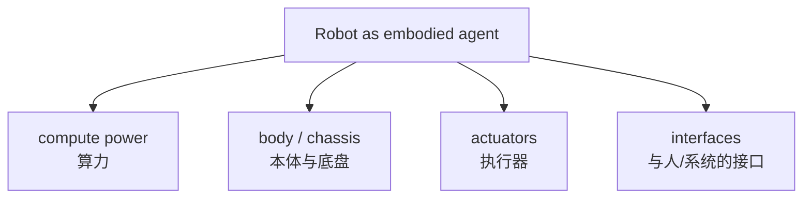

---

## 3. 关键组件:一台机器人由什么拼起来

讲师在这里反复提醒:这门课**不是硬件课**,重点在软件和智能算法。但你必须知道这些部件的存在,否则后面讲"传感器数据"时你不知道数据从哪来。

| 组件 | 具体形态 | 作用 |
|---|---|---|
| **Sensors 传感器** | LiDAR、camera、ultrasonic、IMU | 感知环境与自身状态 |
| **Actuators 执行器** | 伺服电机 (servo)、直线执行器 (linear actuator)、直流电机 (DC motor) | 把决策变成物理动作 |
| **Power 电源** | 电池 | 供能;移动机器人无法一直插电,续航是核心设计约束 |
| **Control unit 控制单元** | 嵌入式计算机 / GPU / FPGA | 运行算法与控制逻辑 |
| **System software 系统软件** | **ROS (Robot Operating System)** + 各类算法模块 | 协调整个系统;讲师指出绝大多数机器人系统都跑在 ROS 上 |

传感器这一块讲师给了更细的分类,值得单独记住——因为它天然分成"看外面"和"看自己"两类:

**感知环境的传感器:**

- **LiDAR** — 全称 **Li**ght **D**etection **A**nd **R**anging,基于激光的测距传感器,用来测量到物体的距离。
- **Camera(摄像头)** — 最常用的视觉传感器,但**原始图像本身没有意义**,必须配一套算法去分析:车道线在哪?前方是什么?有没有偏离车道?
- **Ultrasonic(超声波传感器)** — 主要用于**近距离**测量,典型用途是近距离防撞检测。

**感知自身的传感器:**

- **IMU (Inertial Measurement Unit,惯性测量单元)** — 包含陀螺仪等,测量机器人**自身**的状态(姿态、角速度、加速度)。

> 📎 **拓展(超出 slides)** — 为什么要同时用 LiDAR、radar 和 camera?讲师在讲自动驾驶时点破了原因:**它们在不同天气条件下表现不同**。LiDAR 基于光,雨雾中衰减严重;radar 基于无线电波,穿透性好、还能直接测速度;camera 分辨率最高、语义信息最丰富,但受光照影响大。用多种原理不同的传感器互补,叫做**传感器融合 (sensor fusion)**,是安全关键系统的标准做法。

### 最重要的一句话:整合 > 单模块

slides 在这一页给的 key idea 是:

> **A robot works only when physical, computational, and control components are integrated.**

讲师把这句话展开成了一个非常有价值的洞察,请务必理解:**单个模块的性能并不代表整个系统的性能。**

他举的例子是视觉:你会发现很多机器人里用的视觉算法**相当简单**,一点都不"先进"。为什么不用最强的深度网络?因为它们**计算极其高效**——功耗低、算力需求小。单独拿出来测,它们的可靠性不如 SOTA 模型;但**当它们和系统的其他部分整合在一起时,整体表现得非常好**,足以完成任务。

这就是**系统级视角 (system-level perspective)**:机器人是一个整合系统,不是一堆模块的堆叠。评价一个设计,要看整体能不能完成任务,而不是看某个模块的 benchmark 分数。这个观点会贯穿整门课。

---

## 4. 内部状态与世界模型:机器人存了什么

现在机器人有了传感器,但**原始传感数据无法直接支撑决策**。你不能拿一帧 raw 图像直接得出"我该左转"。中间必须有一层**内部表示 (internal representation)**。

> **Key idea:** A robot cannot decide only from raw input; it needs an internal representation.

这层表示分两半,对应"我"和"世界":

### 内部状态 (Internal state) —— 关于自己

**内部状态汇总了做决策所需要的、关于机器人自身的信息。** slides 列出的典型内容:

- **Mode(模式)** — 当前处在什么工作模式:待机、运行、充电?
- **Pose estimate(位姿估计)** — 我在哪、朝向哪?(pose 这个词是 Part IV 的主角)
- **Battery level(电量)** — 还能撑多久?
- **Task progress(任务进度)** — 指派的任务完成了多少?
- **Warnings(告警)** — 有没有故障?

讲师补充:自身的朝向 (orientation) 和姿态通常由 **IMU / 陀螺仪**测得。

> **🔑 课堂测验** — 下列哪一项最适合存放在机器人的**内部状态**里?
>
> **答案是自身相关的量:** 速度 (speed)、模式 (mode)、电量 (battery level)、位姿估计 (pose estimate)、任务进度 (task progress)。注意**「环境里有什么障碍物」不属于内部状态**——那属于世界模型。这道题的考点就是把这两者分清楚。

### 世界模型 (World model) —— 关于环境

**世界模型是机器人对环境中相关事实的内部表示。** 关键在于 slides 那句被低估的话:

> **A model can be incomplete and still useful.**
> 模型可以不完整,但依然有用。

世界模型不必是一张完美的三维重建。它**可以很简单**:已知区域 (known zones)、物体状态 (object status)、约束 (constraints)——这就够了。

讲师用自动驾驶把两个尺度讲得很清楚:

- **全局世界模型**:GPS 定位 + 地图。有了地图,车就能规划从 A 到 B 的路线。这是"大范围、静态、事先给定"的知识。
- **局部世界模型**:视觉感知前方。车头前面是什么?要不要刹车?能不能加速?这是"小范围、动态、实时获取"的知识。

**两个尺度都需要,缺一不可**——只有地图的车不会躲行人,只有视觉的车不知道该往哪开。这个"全局 + 局部"的二分,马上就会在 Part II 变成**混合式架构**的两层。

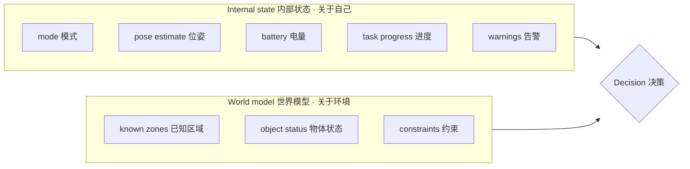

---

## 5. 安全与监督:让机器人能被真正用起来

这一节看起来像"软话题",但讲师给了一个非常硬的理由说明它为什么重要,值得抄下来。

**规则一:安全约束可以覆盖任务目标 (safety constraints can override normal task goals)。** 机器人正在执行任务时,如果出现不安全的情况,必须**放弃任务、执行紧急动作**。任务永远不能凌驾于安全之上。这条规则会在 Part II 里变成架构上的"紧急层能覆盖一切",在 Part III 里变成 BT 里那个优先级最高的 Fallback 分支。

**规则二:监督可以是远程的、本地的,或偶发的 (remote, local, or occasional)。** 不是所有机器人都需要有人一直盯着。扫地机器人的"监督"可能就是:人可以随时把它按停、送回充电桩、或者改变它的清扫规则。

**规则三:故障检测保护的是人、机器人和环境三者。** 顺序值得注意——人在最前面。

**规则四:安全行为不只是"停"。** slides 列了四种:**停止 (stopping)、减速 (slowing)、让行 (yielding)、请求帮助 (requesting help)**。一台好的自主机器人知道什么时候该说"我搞不定了,来个人"。

讲师给的那条产业理由是这一节的灵魂:**机器人能不能被行业采用,很大程度上取决于这一块**。如果没有可靠的故障检测和安全机制,再聪明的机器人也进不了医院、工厂和家庭。安全不是给智能打的补丁,而是能否落地的前提。

> **Key idea:** A useful autonomous robot must also be a **safe** autonomous robot.

---

# Part II · 控制架构:机器人的大脑怎么组织

## 6. 什么是控制架构

到这里我们知道了机器人有哪些零件。但零件不会自己协作。谁来决定"视觉模块的输出交给谁"、"规划模块和避障模块吵起来了听谁的"?这就是**控制架构 (control architecture)** 要回答的问题。

先给定义:

> **Key idea:** A control architecture is the robot's **decision-making organisation**.
> 控制架构就是机器人的决策组织方式。

具体地说,一个控制架构规定了四件事:

1. **信息如何从状态流向动作** (how information flows from state to action);
2. **哪些模块可以做决策、哪些模块可以覆盖 (override) 其他模块**;
3. 在**速度、鲁棒性、可解释性、目标导向性**之间如何取舍;
4. 它是一个**设计模式 (design pattern),不是某个具体算法**。

第 4 点讲师特意强调了两遍,因为这是最容易搞错的地方:**架构不是算法**。就像软件工程里的 MVC 不是一段代码一样,"分层式架构"也不是一个函数。它是一种组织方式,同一种架构可以用完全不同的算法去填充。

用讲师的送物机器人例子把这个抽象落地:现在中国的酒店、餐厅,乃至越来越多的医院都在用**配送机器人 (delivery robot)**,在走廊里把东西从一处送到另一处。它需要:**感知**走廊和人 → 知道要送到哪个房间 → **规划**该往左还是往右 → **驱动**轮子行动。

而**不同的架构会用完全不同的方式来串起这三步**,各有各的优劣。这就是接下来三节要讲的内容。

### 必须记住的五个术语

这五个词会贯穿整个 Part II 和 Part III,slides 专门给了一整页:

| 术语 | 定义 |
|---|---|
| **Robotic primitive(机器人原语)** | 机器人控制中的基本功能步骤:**Sense、Plan、Act** 三者之一 |
| **World model(世界模型)** | 关于环境与机器人本身的相关事实的内部表示 |
| **Behaviour(行为)** | 一个**可复用的"传感器→动作"模块**,例如 avoid obstacle(避障)、follow wall(沿墙走) |
| **Deliberative control(审慎式控制)** | 基于**显式推理、规划和预测**的控制 |
| **Reactive control(反应式控制)** | 把**当前感知直接映射到动作**、不做全局规划的控制 |

讲师对 **behaviour** 给了很好的直觉:所谓行为,就是"你感知到某件事,你就做某件事"。比如避障——机器人感知到前方有东西,**立刻**转向,**不去做规划**,因为等你规划完已经撞上了。或者沿墙——看到一堵墙,就沿着它走。

而 slides 给的那个"每次遇到新架构都该问的问题",是理解一切架构的钥匙:

> **Where is the intelligence located: in a central planner, in behaviours, or across layers?**
> 智能到底住在哪里:中央规划器里?各个行为里?还是分散在各层之间?

讲师补充说,机器人是一个整合系统,**智能通常是分布式的**——一部分在规划器里、一部分在行为里、一部分在控制层里。**不同的架构,本质区别就是把智能分配到了不同的地方。** 带着这个问题往下读。

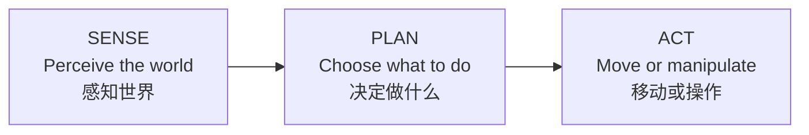

---

## 7. 分层式(审慎式)范式:Sense → Plan → Act

### 直觉

第一种架构是最"自然"的一种,因为它就是人的思维方式的字面翻译。讲师说:大多数时候人就是这样——你看看周围(哪怕你没意识到自己在看),你开始盘算下一步做什么,然后你行动。

它叫**分层范式 (hierarchical paradigm)**,也叫**审慎式架构 (deliberative architecture)**,核心流程是 **Sense → Plan → Act**。

### 形式化

它的信息流是一条严格的流水线:

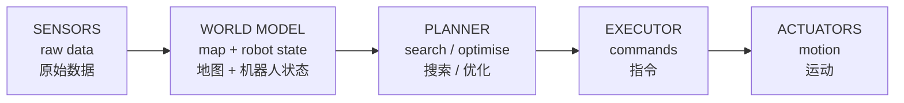

传感器给出原始数据 → 系统据此**建立世界模型**(地图 + 自身状态)→ **规划器**在这个模型上搜索出一个计划 → **执行器**把计划翻译成指令 → 驱动执行器产生运动。要移动,就驱动轮子;要抓取,就驱动手臂。

**它的核心假设有个名字,是考点:**

> **Closed-world assumption(封闭世界假设)** — 世界模型里包含了规划所需要的全部事实。

这个假设是整个架构成立的前提,也是它一切毛病的根源。

### 优点、缺点与适用场景

| Strengths 优点 | Limitations 局限 | Typical use 典型场景 |
|---|---|---|
| 易于理解与**调试** | 规划**可能很慢** | 地图和目标都已知的**结构化环境** |
| 支持**长期目标** | 世界模型可能**过期 (stale)** | |
| 能**优化**路径或计划 | 对突发事件**响应差** | |

讲师把这几条讲得更透:

- **易于调试**是真实的工程优势——因为有显式的世界模型,一旦出问题,你可以去检查模型对不对、规划合不合理,问题定位很清楚。
- **规划慢**导致的后果是**机器人反应迟钝**。规划要花时间,而这段时间里世界还在变。
- **世界模型难建**,尤其是**完整的**世界模型极难构建。这直接动摇了 closed-world assumption。

### 什么是「结构化环境」?

这是讲师在课堂上现场追问学生的一个概念,值得记住,因为它决定了这套架构能不能用。

**结构化环境 (structured environment)** 指的是布局相对固定、可以事先注入先验知识 (prior knowledge) 的环境。讲师的问答:

- **家(卧室、客厅)是结构化环境吗?** 是。所以扫地机器人第一次运行时会到处走一圈,**自己建好地图**,之后就能按图规划。
- **医院是结构化环境吗?** 是,而且通常可以**事先注入先验知识**——走廊、房间、手术室的布局是已知的。

**结论:分层式架构在结构化环境里非常好用。** 反过来,在开放、动态、不可预测的环境里,它会很吃力。

---

## 8. 反应式范式:Sense → Act

### 动机

分层式的问题是慢。但有些情况**根本没有时间规划**——前方 30 厘米突然出现一个障碍物,你规划完就撞上了。这就催生了第二种架构。

**反应式范式 (reactive paradigm)** 干脆把 Plan 整个砍掉:**Sense → Act**。感知到什么,直接发出动作指令。

### 它长什么样

它的实现方式是**一组规则**,讲师称之为**行为规则 (behaviour rules)**:"如果感知到这个,我就做这个;如果感知到那个,我就做那个。" slides 给的四个经典行为:

| Behaviour 行为 | 规则 |
|---|---|
| **Avoid obstacle 避障** | `if object close → turn away`(物体太近 → 转向躲开) |
| **Follow wall 沿墙** | `keep side distance constant`(保持侧向距离恒定) |
| **Emergency stop 紧急停止** | `if collision risk high → stop`(碰撞风险高 → 停) |
| **Wander 漫游** | `choose random safe motion`(随机选一个安全的运动) |


> **🔑 例(讲师的 e-puck 例子)** — 教学用的 e-puck 机器人身上一圈装了 6 到 8 个超声波传感器,覆盖 8 个方向。控制逻辑非常朴素:如果**东北方向**的读数变得很近,就说明那个方向有障碍物,于是**立刻转向**。整个过程没有地图、没有规划、没有推理——只有"读数 → 转向"这一步。
>
> 另一个例子是紧急情况:感知到**电量过低**,立刻触发动作——回充电桩,或者发出告警。同样是纯粹的"感知 → 动作"。

### 核心思想:智能是涌现出来的

> **Key idea:** intelligence can **emerge** from many simple, local behaviours running continuously.
> 智能可以从许多简单的、局部的、持续运行的行为中**涌现**出来。

这是一个哲学上很不一样的立场。分层式认为智能在中央规划器里;反应式认为**没有中央大脑**,智能是一堆傻规则同时运行的**副产品**。回到第 6 节那个问题——"智能住在哪里?"——反应式的答案是:**住在各个 behaviour 里**。

### 代价

slides 给出的权衡非常公道:**反应式架构在动态环境中通常很鲁棒,但它可能找不到全局最优解。**

讲师说得更直白:**反应式很难做规划**。它只知道眼前,不知道远方。让一个纯反应式机器人从 A 走到 B,它可能在墙角来回打转,因为它压根没有"目标在哪"这个概念。

---

## 9. 行为式控制与包容架构 (Subsumption)

### 问题

反应式架构有一堆行为同时在跑,那么问题来了:**如果"避障"说要左转,"沿墙"说要右转,听谁的?**

答案是给行为**排优先级**,并把它们组织成**层 (layers)**。这就是**行为式控制 (behaviour-based control)**,其最著名的形式叫 **subsumption architecture(包容架构)**。

### 结构

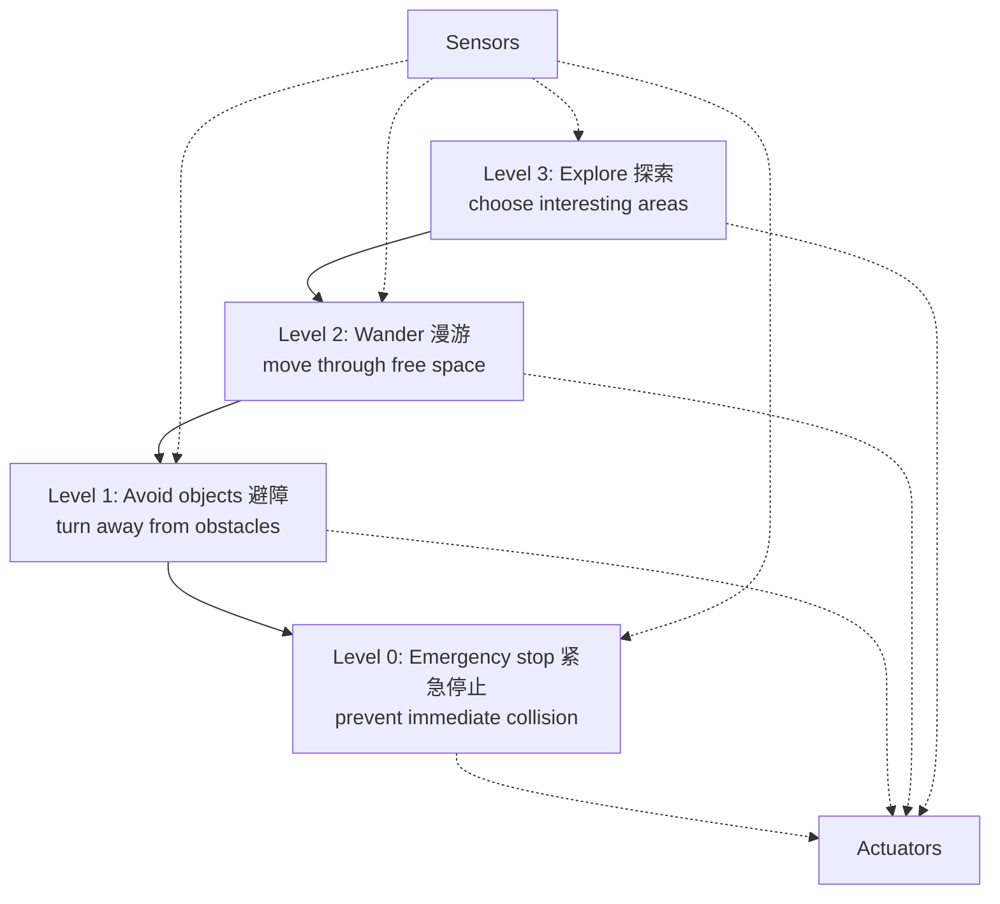

从底向上依次是:**Level 0 紧急停止 → Level 1 避障 → Level 2 漫游 → Level 3 探索**。越靠下越基础、越关乎生存;越靠上越"高级"、越关乎目标。

slides 给的规则是:**Higher layers can override lower layers**(高层可以覆盖低层)。

**设计原则 (design principle):** build from simple reliable behaviours, then add more capable behaviours on top——**先搭好简单可靠的行为,再在上面叠加更强的行为**。这是一种自底向上的工程哲学:底层必须先被做到万无一失。

> 📎 **拓展(超出 slides)** — 讲师在讲这一页时补了一个重要的实践注解:虽然规则上高层可以覆盖低层,但**你并不希望紧急层(Level 0)被覆盖掉**。真实系统里,安全相关的最底层往往被设计成**不可被抑制**的——这与第 5 节"安全约束可以覆盖任务目标"是同一条原则的两种表述。考试时按 slides 答"高层可覆盖低层",但理解上要知道紧急层是特例。
>
> 另外,"subsumption" 这个词在经典文献(Brooks, 1986)中的原意是:高层行为**包容/接管**低层行为的输出通路,而不是简单地"优先级更高"。它的历史意义在于:它证明了不需要世界模型也能做出有用的机器人,直接挑战了当时占统治地位的审慎式范式。

### 它仍然解决不了的问题

行为式控制本质上是**反应式的扩展**——它给反应式加了组织结构,但没有给它加"规划"。所以它继承了反应式的根本短板:**除非有非常明确的目标信息,否则很难做长程规划。**

于是就有了第三种,也是今天最常用的一种。

---

## 10. 混合式架构:先规划,再感知-行动

### 动机

现在把前两种架构的账算清楚:

- 分层式:**能规划长远,但反应太慢**;
- 反应式:**反应极快,但看不见远方**。

而真实的机器人**两样都需要**:自动驾驶车既要知道怎么从悉尼开到卧龙岗(长程规划),又要在有人突然横穿时**在毫秒内刹车**(短程反应)。

**答案自然是把两者叠起来**,这就是**混合式(审慎/反应)架构 (hybrid deliberative/reactive architecture)**——讲师明确指出,这是当今机器人系统和自主系统**最常用**的架构。

### 三层结构

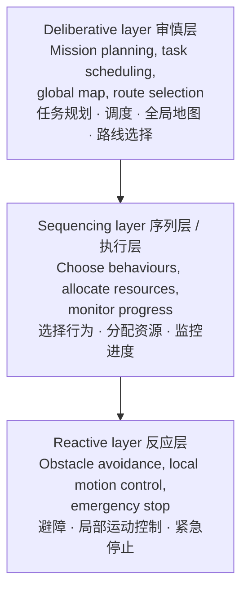

记住 slides 给的这个口诀,它精准概括了混合式与分层式的区别:

> **Hybrid control is often described as: PLAN, then SENSE–ACT.**
> 混合式 = **先规划,然后感知-行动**。

对比一下:分层式是 **Sense → Plan → Act**(每次行动前都要重新感知、重新规划);混合式是**先规划出一个大计划,然后在执行这个计划的过程中,用快速的 sense-act 循环去应对细节**。规划不再挡在每一步动作的前面,这就是它快的原因。

> **🔑 例(讲师的自动驾驶走查)** — 你要从这里开到某个目的地:
>
> 1. **审慎层**:用 GPS 和地图**规划一条路线**。这一步慢没关系,开车前算好就行。
> 2. **序列层**:沿途根据感知**选择行为**——前方车道通畅,那就加速;前面有慢车,那就变道。这是"局部规划"。
> 3. **反应层**:如果**另一辆车突然贴近**,直接触发反应层——**绕过规划部分,立即执行动作**(刹车/避让)。
>
> 三层各管一个时间尺度,这就是它同时具备远见和反射的原因。

---

## 11. 移动机器人的通用控制框架

把上面所有东西串成一张完整的图,就是 slides 给的这个通用控制框架。这张图非常重要——**它其实是本课程后续所有周次的地图**:每一周会讲的算法,都住在这张图的某个方框里。

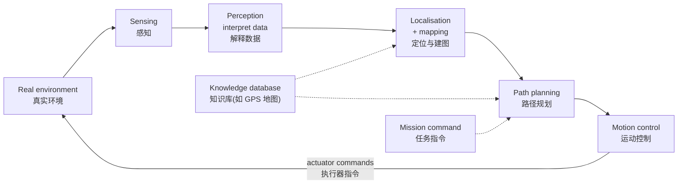

读法是这样的:**真实环境**被**传感**采集 → **感知**模块把原始数据解释成有意义的信息 → **定位与建图**确定"我在哪、地图长什么样" → **路径规划**决定"该怎么走" → **运动控制**把路径变成具体的执行器指令 → 指令改变真实环境,循环重新开始。

旁边还有两条输入:**知识库 (knowledge database)**(比如 GPS 地图,属于事先给定的先验知识)和**任务指令 (mission command)**(人给的目标)。

讲师特别指出规划有**两个层次**:**全局规划 (global planning)**(像自动驾驶决定走哪条路)和**局部规划 (local planning)**(高度依赖实时传感数据——前方有什么、要不要变道)。这正好对应混合式架构的审慎层和序列层。

slides 最后那句话点明了这张图的地位:

> **This schema can be implemented inside hierarchical, reactive or hybrid architectures.**
> 这个框架可以在分层式、反应式或混合式架构中的任何一种里实现。

也就是说,**这不是第四种架构**,而是一张"功能地图"。架构决定的是这些框之间**谁能覆盖谁、以什么频率跑**。

---

## 12. 运动控制:反馈与前馈

流水线的最后一站是**运动控制 (motion control)**——把"走 2 米"这样的指令变成电机的实际转动。这里有一个看似简单实则关键的问题,讲师用一句话点破:

> 你发出"前进 2 米"的指令,**你怎么知道它真的走了 2 米?**

答案分两条路:

### 反馈控制 (Feedback control)

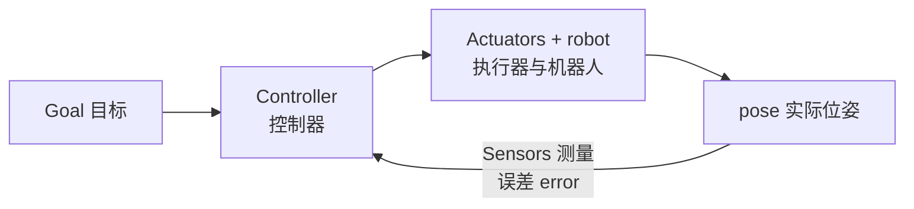

**传感器测量实际发生了什么,用误差 (error) 去修正指令。**

> **🔑 例(讲师的例子)** — 你命令机器人前进 2 米。但地面打滑 (slip),指令执行完它**实际只走了 1.5 米**。传感器测到这个差距,系统就再发一条指令去**补上误差**。这就是反馈。

### 前馈控制 (Feedforward control)


**指令完全由机器人的模型计算出来,不需要测量修正。** 讲师说的"纯粹地往前走、发指令、然后停下,不获取反馈"就是这个意思。

### 实践中的答案:两者都要

> **In practice, robust robots often combine both: feedforward for prediction + feedback for correction.**
> 稳健的机器人通常两者结合:**用前馈做预测,用反馈做修正**。

| | Feedback 反馈 | Feedforward 前馈 |
|---|---|---|
| 指令来源 | 目标 + **测得的误差** | 目标 + **机器人模型** |
| 需要传感器吗 | **需要** | 不需要 |
| 优点 | 能纠正未建模的扰动(打滑、外力) | 快、无延迟、不受传感噪声影响 |
| 缺点 | 有延迟;依赖传感质量 | 模型不准就一直错,且**永远不知道自己错了** |

---

## 13. 怎么选架构 + 控制层的时间分解

### 选择表(高频考点)

| Architecture 架构 | Main idea 核心思想 | Best when 最适合 | Main risk 主要风险 |
|---|---|---|---|
| **Hierarchical (deliberative)** 分层式/审慎式 | Sense → Plan → Act | 目标已知、地图结构化 | 重规划慢;世界模型过期 (stale) |
| **Reactive** 反应式 | Sense → Act behaviours | 动态世界中需要快速响应 | 无全局最优性、无推理能力 |
| **Hybrid** 混合式 | Plan + real-time behaviours | **大多数实用的自主系统** | 层间协调复杂 |

讲师的口头总结可以直接当答题模板:

- **分层式**在**目标、地图、模型都可靠**时有用。比如酒店/餐厅配送机器人:从前台送到走廊尽头的某个房间,地图非常明确,连电梯的位置都是已知的。
- **反应式**在**感知到情况后需要立即动作**时有用。
- **混合式最常用**,因为真实机器人**既需要长程规划,又需要由反应式控制实现的短程安全保障**。

### 时间分解:不同的层跑在不同的频率上

这是一个极容易被忽略但非常能体现"系统思维"的知识点。**控制架构由多个模块组成,而这些模块以完全不同的频率运行。**

为什么?因为**动作产生影响的时间尺度不同**。轮速需要每秒修正上百次,而路线规划算一次能管很久。

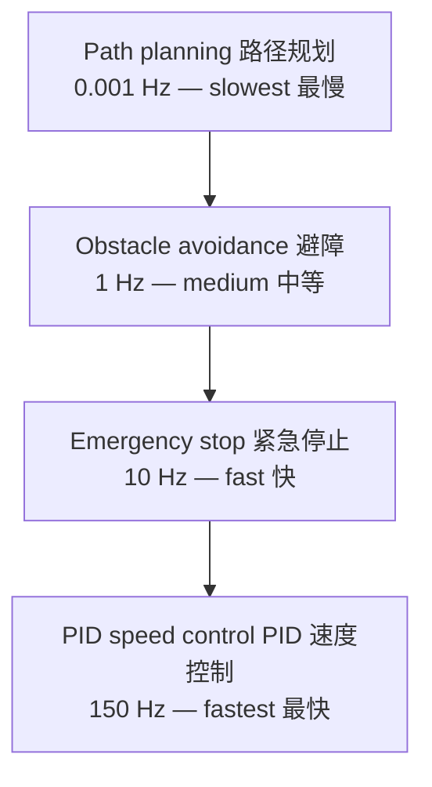

| 控制层 | 频率 | 含义 |
|---|---|---|
| **PID speed control** | **150 Hz** | 每秒 150 次。**PID = Proportional–Integral–Derivative(比例-积分-微分)**,是精确控制轮子转速的经典控制算法 |
| **Emergency stop** | **10 Hz** | 每秒 10 次 |
| **Obstacle avoidance** | **1 Hz** | 每秒 1 次;讲师说实际频率取决于机器人速度 |
| **Path planning** | **0.001 Hz** | 最慢;因为机器人到达目标点本身就需要时间 |

**规律:越底层越快,越高层越慢。** 低层控制最快,路径规划最慢。

> **🔑 课堂练习(把功能匹配到控制层)** — 三个层:**A. Deliberative 审慎层 / B. Sequencing(executive)序列层 / C. Reactive(functional)反应层**
>
> | 功能 | 层 | 理由 |
> |---|---|---|
> | 1. Emergency stop 紧急停止 | **C 反应层** | 感知到危险必须立刻动作,不能等规划 |
> | 2. Global route selection 全局路线选择 | **A 审慎层** | 这是典型的长程规划 |
> | 3. Wheel spin PID control 轮速 PID 控制 | **C 反应层** | 要以 150 Hz 快速响应,属于功能/反应层 |
> | 4. Task progress monitoring 任务进度监控 | **B 序列层** | 任务已经规划好了,这里只是检查"离目标还有多远",既不是规划也不是紧急反应 |
>
> 第 4 题是最容易错的:讲师引导学生排除了"不安全/紧急"这个选项后指出,**任务进度监控 = 检查已规划任务的执行进展 = 序列层的职责**。

---

## 14. 三个真实案例

slides 给出的总纲很值得记:**所有自主机器人共享同一套基础结构,但它们的具体组件和架构是高度定制的——由运行环境和安全要求决定。** 下面三个案例正是同一套原理在三种环境约束下长出的三种形态。

### 14.1 自动驾驶汽车 (Self-Driving Cars)

**环境特征:高速、非结构化、高风险。** 因此它需要**最复杂的感知系统和安全关键 (safety-critical) 架构**。

**关键组件:**

- **传感器**:长距 **LiDAR**(360°)、高分辨率**摄像头**、**radar**(应对天气与测速)、**GNSS/GPS**(全球定位)。
- **处理器**:高性能 AI 计算机(如 **NVIDIA DRIVE**),每秒可执行万亿次运算,以实时运行神经网络。讲师补充:主要依赖 **GPU**,有些算法也会集成到 **FPGA** 上——FPGA 几乎相当于硬件级实现,速度更快。

**控制架构:典型的 Hierarchical Hybrid(分层混合式)。** 三层各司其职:

- **Global Planner(全局规划器)**:规划 A 点到 B 点的路线(用 GPS + 地图)。
- **Local Planner(局部规划器)**:管理变道和即时的交通机动(用传感器与定位数据)。
- **Emergency Layer(紧急层)**:一个**专用的、硬编码的安全层**,可以**覆盖所有其他指令**执行紧急制动。

注意这里第 5 节那条"安全可覆盖任务"的原则,是怎么变成一个具体的架构层的。

### 14.2 仓储 AMR (Warehouse Autonomous Mobile Robots)

**环境特征:动态、半结构化的室内环境**,必须在人和叉车之间穿行。

**关键组件:**

- **传感器**:**地面高度的 2D/3D LiDAR**,用于障碍检测和 **SLAM (Simultaneous Localization and Mapping,同步定位与建图)**;**二维码扫描器**或视觉传感器用于**精确对接 (precision docking)**。
- **执行器**:**高扭矩差速驱动轮 (high-torque differential drive wheels)**,以便在狭窄通道里灵活转向。

**控制架构:Hybrid Reactive-Deliberative(混合反应-审慎式)。**

- **Fleet Manager(车队管理器)**:一台**中央服务器**,负责给多台机器人分配任务、防止它们互相堵车。
- **Onboard Reactive Layer(车载反应层)**:当托盘或人挡住去路时,机器人能**动态重新规划路线**——这正是它与老式 **AGV** 的关键区别:**AGV 遇阻只会停下**。

> **🔑 例(讲师的 Amazon 仓库走查)** — 顾客买了一本书。系统输入"要哪本书" → 机器人查映射数据库,知道这本书在哪个货架上(**这就是它的世界模型**)→ 机器人**规划**一条从当前位置到那个货架的路线(**审慎层**)→ 在移动过程中,用**反应式**行为避开沿途的障碍物和工人(**反应层**)。
>
> **课堂题:仓储机器人既要走全局高效的路线,又要实时避开工人和叉车,该用哪种设计?** 答案:**混合式架构**。全局高效路线 = 审慎/全局规划部分;避开工人和叉车 = 反应部分。
>
> slides 里那段分拣机器人的视频给了一组数字:这些机器人**每小时可处理 18,000 个包裹**,把分拣的人力成本降低了约 **70%**。

### 14.3 医疗机器人 (Medical Robots)

医疗机器人分成两类,**架构完全不同**:

**(1) 物流机器人(医院 AMR)** — 架构和仓储机器人相似,但额外强调:

- **消毒 (sanitization)**;
- **社会化导航 (social navigation)**——等电梯、在"安静区域 (quiet zones)"减速。这是一个很有意思的概念:机器人不仅要避免碰撞,还要符合**社会规范**。

**(2) 手术机器人 (Surgical Robots)** — 完全是另一个物种:

- **关键组件**:**高精度微执行器 (high-precision micro-actuators)** 实现"稳定手"控制;**立体 3D 摄像头 (stereoscopic 3D cameras)** 提供深度感知。讲师强调:手术要求位置**极其精确**,而且需要把**触觉传感**传回医生手中,因为医生可能在远程操作。
- **控制架构:Shared Autonomy(共享自主)**。这是一种此前没出现过的架构:**人类外科医生提供高层意图**,而机器人的控制架构负责:
  - **Motion scaling(动作缩放)**——把医生手部的大幅度动作映射成微小的切口动作;
  - **Tremor filtration(震颤过滤)**——滤掉人手的生理性抖动。

> **🔑 真实案例(slides 引用的 7NEWS 报道)** — 悉尼首次在手术室中使用 **Da Vinci 5** 系统进行远程手术。它的突破在于**外科医生远程操作时仍能保持触觉**:机器人感知缝线的张力或心弦的阻力,并把这种感觉传回医生的指尖。美国两年的数据显示,该系统使手术室效率提高约 **11%**,组织创伤减少约 **40%**。对澳大利亚这样地广人稀的国家,它的意义是**距离不再决定医疗水平**。

### 14.4 三者对比(考试常见的对比表)

| Feature 特征 | Self-Driving Car 自动驾驶 | Warehouse AMR 仓储机器人 | Medical (Surgical) 手术机器人 |
|---|---|---|---|
| **Primary Goal 主要目标** | 乘客安全 / 速度 | 吞吐量 / 效率 | 精度 / 无菌 |
| **Main Sensor 主要传感器** | 长距 LiDAR / Radar | 短距 LiDAR / SLAM | 3D 视觉 / 力传感器 |
| **Architecture 架构** | **Tiered Hierarchical Hybrid** 分层混合式 | **Fleet-Integrated** 车队集成式 | **Master-Slave / Shared** 主从式 / 共享自主 |
| **Human Interaction 人机交互** | 高速、不可预测 | 协作式、近距离 | **直接物理接触** |

讲师的总结点破了这张表的逻辑:**这三类机器人的架构差异,根源在于人机交互的方式不同**——自动驾驶要应对不可预测的人,仓储要与人协作,手术则是人**直接参与控制回路**,所以才需要共享自主。

---

# Part III · 任务执行:从蓝图到引擎(FSM 与 BT)

## 15. 为什么还需要"执行引擎"

Part II 讲完了架构。但假设现在你是开发者,老板说"用混合式架构做一个送咖啡机器人"——**你打开 IDE,第一行代码写什么?**

这就是 Part III 要解决的问题。讲师给了一个极其精准的比喻:

> **控制架构是机器人心智的"哲学蓝图",而 FSM 和 BT 是用来实现这些蓝图的实际软件引擎。**
> Control architectures are the philosophical blueprints of a robot's mind, while FSMs and BTs are the practical software engines used to implement those blueprints.

**架构 ≠ 实现。** 同一个混合式架构,你可以用 FSM 实现,也可以用 BT 实现。这两者是**实现策略 (implementation strategy)**,不是架构本身。这个区分是本 Part 的第一个考点。

任务执行需要同时应付两件相互拉扯的事:

- **决策 (Decision Making)**:解释传感器数据,选择正确的动作;
- **动态环境 (Dynamic Environments)**:障碍物、低电量、任务失败**时时刻刻**在发生。

目标是:**一个既能处理顺序执行、又保持高度反应性的控制结构**。"顺序执行"和"高反应性"本身就是一对矛盾——先做 A 再做 B 是顺序的,但如果做 B 的中途电量告急,你必须立刻中断。这个矛盾如何解决,正是 FSM 和 BT 的分水岭。

两种核心实现范式:

- **有限状态机 (Finite State Machines, FSMs)** — **状态驱动 (state-driven)** 的控制;
- **行为树 (Behaviour Trees, BTs)** — **任务驱动 (task-driven)** 的控制。

---

## 16. 有限状态机 (FSM):用"状态"来驱动执行

### 定义与机制

**FSM 是一种计算的数学模型,由有限个称为「状态 (States)」的条件构成。**

它的两个核心机制:

1. **Active State(活动状态)**:机器人在任意时刻**只处于一个状态**。这一点非常关键——不能同时既在"清扫"又在"充电"。
2. **Transitions(转移)**:根据输入触发的、从一个状态切换到另一个状态的规则。例如 `Battery < 20% → GoToCharge`。

### 例子:扫地机器人

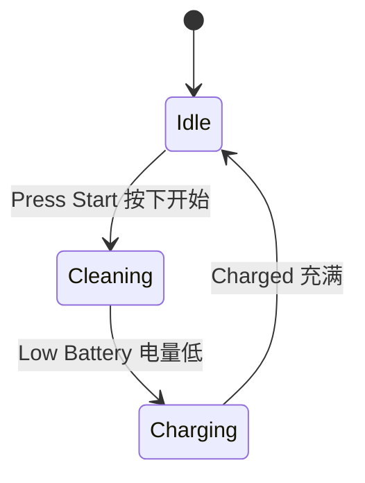

讲师的走查:清扫机器人一开始**待在那里不动,处于 Idle(待机)状态**。按下开始键 → **转移**到 **Cleaning(清扫)** 状态,开始清扫。在清扫状态下,如果**感知到电量低** → 必须**改变状态**,转移到 **Charging(充电)**,回到充电桩。

这就是 FSM 的全部:**处于某个状态 → 条件满足 → 转移到另一个状态 → 如此往复。**

FSM 的优点是显而易见的:**简单、极易实现**。讲师说,早期的机器人执行简单任务时用的就是它;而且**今天大量的家电**——一个只有"关闭 / 制热 / 制冷"三种模式的小家电——用一颗微控制器实现一个 FSM 就够了。

### 致命弱点:状态爆炸

FSM 的问题在任务变复杂时集中爆发。slides 给了三条,一条比一条严重:

**(1) 执行流程刚性且紧耦合 (rigid and tightly coupled)。** **每一个状态都必须显式地指出下一个状态是谁。** 状态之间的连线是写死在代码里的。

**(2) 核心弱点:状态爆炸 (State Explosion)。** 随着任务增长,**转移箭头的数量呈指数级增长**。

想想为什么:如果你有 $n$ 个状态,而它们之间原则上都可能互相转移,你最多要处理 $n(n-1)$ 条转移。加第 11 个状态时,你不是加 1 条线,而是可能要加 20 条线,并且要回去修改已有的 10 个状态。代码迅速变成讲师说的那种**"意大利面条 (spaghetti) 代码"**。

**(3) 缺乏可复用性 (Lack of Reusability)。** 你**无法**简单地把一个 "Grasp(抓取)" 状态复制到新的机器人项目里,因为**它的转移逻辑被硬编码绑定在它周围的那些特定状态上**。这个 Grasp 状态"知道"失败了要去哪、成功了要去哪——而那些目的地在新项目里根本不存在。

讲师还补了一条根本性的局限:**FSM 是绑定在特定任务、特定环境上的**。环境变了、任务变了,**你就得重写状态机**。它不灵活。


---

## 17. 行为树 (BT):用"任务"来驱动执行

### 来历与定义

BT 的出身很有意思:它**起源于电子游戏 AI**(用来写 NPC 的行为逻辑),后来被迁移到现代机器人框架中,比如 **ROS 2 的 Nav2** 导航栈。今天它是**工业界的事实标准**。

**定义:BT 是一棵有向根树 (directed root tree),它以「层次化」而非「顺序化」的方式组织任务执行。**

请把这句话咀嚼一下:FSM 的组织方式是**平面的、顺序的**(状态 A 连到状态 B);BT 的组织方式是**层次的**(任务由子任务组成,子任务又由子子任务组成)。这个结构上的差别,正是它解决状态爆炸的根本原因——**你可以把一整棵子树当作一个模块,整个拿走用在别处。**

### 心跳:Tick

**BT 的核心心跳叫做「Tick」。** 一个信号以设定的频率(例如 20 Hz)从**根节点 (Root)** 发出,沿着树**向下传播**。

> **🔑 类比(讲师给的)** — 这就像 CPU 的时钟。在计算机组成原理里,CPU 的运算由时钟驱动,每个时钟周期完成一个操作(有些操作,比如把数据从 CPU 搬到内存,可能需要 3 到 5 个周期)。BT 的 tick 是一样的道理:**每一次 tick,整棵树被从根重新评估一遍**,机器人被驱动着做一次判断。

**这个"每次都从根重新评估"的机制,就是 BT 高反应性的来源。** 记住它,第 17.4 节的走查全靠它。

### 三种返回状态

**每个节点被 tick 到时,立即返回三种状态之一:**

| 状态 | 含义 |
|---|---|
| **SUCCESS** | 任务成功完成 |
| **FAILURE** | 任务失败 |
| **RUNNING** | 任务正在处理中,还需要更多时间 |

**RUNNING 是 BT 相对 FSM 的一个关键创新。** 它让树能够表达"这件事还没做完,但我没失败"——一个持续多次 tick 的长动作(比如导航到厨房)可以在每次 tick 时返回 RUNNING,同时**树的其余部分仍在被重新检查**。

### 17.1 节点解剖

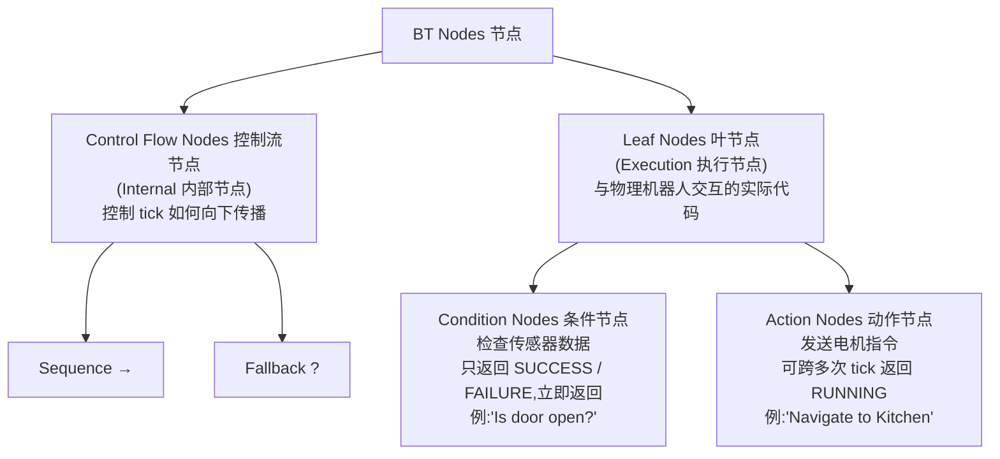

要点:

- **Control Flow Nodes(控制流节点,内部节点)**:控制 tick 如何向下传播到子节点。它们**不直接操作硬件**,只负责"调度"。
- **Leaf Nodes(叶节点,执行节点)**:真正与物理机器人交互的代码,分两种:
  - **Condition Nodes(条件节点)**:检查传感器数据,**只返回 SUCCESS 或 FAILURE,且立即返回**(不会 RUNNING)。例:"门开着吗?"
  - **Action Nodes(动作节点)**:发送电机指令,**可以跨多次 tick 返回 RUNNING**。例:"导航到厨房"。

### 17.2 两个主要控制节点

这是 BT 里最需要背熟的部分,考试必考。

**1. Sequence Node(序列节点,符号 →)**

- **逻辑**:**从左到右**依次执行子节点。
- **规则**:**任一子节点失败,立即失败;只有全部子节点成功,才成功。**
- **用途**:刚性的多步工作流。例:`Find Tool → Pick Tool → Deliver Tool`(找到工具 → 拿起工具 → 送达工具)。

把它理解成**逻辑与 (AND)**:全部都要成。

**2. Fallback / Selector Node(回退节点 / 选择节点,符号 ?)**

- **逻辑**:同样**从左到右**执行子节点。
- **规则**:若某个子节点**成功或正在运行 (RUNNING)**,则回退节点成功或保持 RUNNING;**只有当前一个子节点返回 FAILURE 时,才回退到下一个子节点**。
- **用途**:**容错与应急预案**。例:`Grasp Object` 失败 → **Fallback to** → `Ask Human for Help`(抓取物体失败 → 回退到 → 向人求助)。

把它理解成**逻辑或 (OR)**:有一个成就行。

| | Sequence (→) | Fallback / Selector (?) |
|---|---|---|
| 类比 | **AND** | **OR** |
| 一个子节点 SUCCESS | 继续下一个 | **整体 SUCCESS**,停止 |
| 一个子节点 FAILURE | **整体 FAILURE**,停止 | 继续尝试下一个 |
| 全部子节点执行完 | 全成功 → SUCCESS | 全失败 → FAILURE |
| 典型用途 | 多步流程 | 容错、备选方案 |

> 📎 **拓展(超出 slides)** — 讲师在课堂上还提到了另外两类控制节点,slides 上没有,但它们在真实的 BT 框架里非常常用:
>
> - **Parallel Node(并行节点)** — 让多个子任务**并行**运行,而不是从左到右串行。
> - **Decorator Node(装饰节点)** — **只能有一个子节点**,作用是**修改这个子节点的行为**。两个典型例子:**超时装饰器**(如果子节点 10 分钟内没完成,就强制返回 FAILURE)和**取反装饰器 (inverter)**(把子节点返回的 SUCCESS 变成 FAILURE,反之亦然)。

### 17.3 一棵完整的树长什么样

讲师完整走查了一个操作臂的例子:**抓取方形木钉 (pick square peg)**。

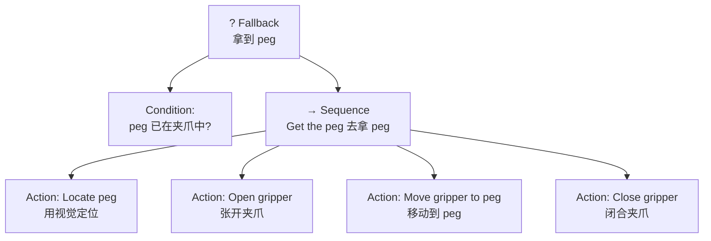

**读法:** 顶层是一个 **Fallback(选择)** 节点,目标是"手上有 peg"。它先检查最左边的条件——**peg 是不是已经在夹爪里了?** 如果是,说明早就拿到了,直接返回 SUCCESS,**整个分支结束,不用再做任何事**。如果不是(返回 FAILURE),Fallback 才回退到第二个子节点:一个 **Sequence**,里面是"拿到 peg"所需的完整步骤——定位、张开夹爪、移动到位、闭合夹爪。**这四步必须全部成功**,才算拿到了 peg;任何一步失败,整个 Sequence 失败,也就意味着这次没拿到。

这个结构展示了 BT 的典型习惯用法:**用 Fallback 把"已经达成了吗?"放在最左边,把"怎么去达成"放在右边。** 这样树天然就具备了幂等性——已经完成的事不会被重做。

### 17.4 走查一:送包裹(电量突降)

现在用 tick 机制走一遍,体会 BT 的**反应性**从何而来。

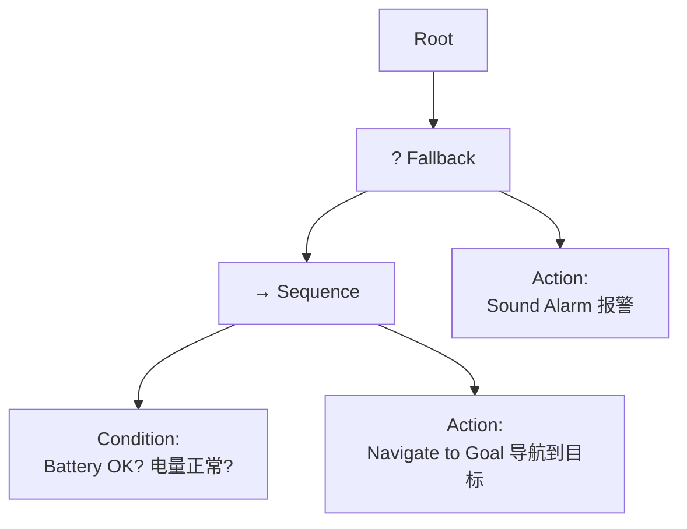

| 步骤 | 发生了什么 |
|---|---|
| **Tick 1** | Root 发 tick 给 Fallback → Fallback tick 它的第一个子节点 Sequence |
| **电量检查** | Sequence tick `Battery OK?`,返回 **SUCCESS** |
| **移动** | Sequence tick `Navigate to Goal`,机器人开始移动,返回 **RUNNING** |
| **Tick 100(动态变化)** | 电量**突然**跌破安全余量 |
| **反应性** | 下一次 tick 时,`Battery OK?` 返回 **FAILURE** |
| **恢复** | Sequence 节点**立即失败**。Fallback 节点接手,tick `Sound Alarm`,安全地停止作业 |

**请注意这里发生的事有多重要:** 机器人正在执行 `Navigate to Goal`(它是 RUNNING 状态),但**因为每次 tick 都从根重新评估整棵树**,`Battery OK?` 这个条件被**反复检查**。一旦它变成 FAILURE,正在运行的导航动作**被自动中断**,控制权立刻转到报警分支。

**你不需要为"导航中途电量不足"写任何一条特殊的转移规则。** 这就是 BT 相对 FSM 最大的胜利——在 FSM 里,你必须从 `Navigating` 状态显式画一条箭头到 `Alarm` 状态,而且还要为**每一个**可能被电量打断的状态都画一条。

### 17.5 走查二:繁忙办公室里送咖啡(行人挡路)

同样的结构,换一个触发条件:

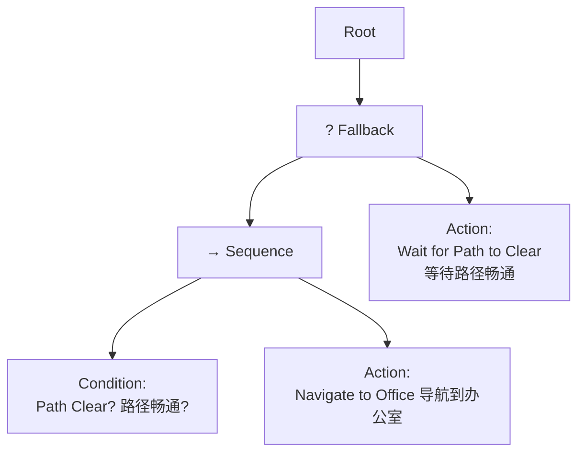

| 步骤 | 发生了什么 |
|---|---|
| **Tick 1** | Root → Fallback → tick Sequence |
| **路径检查** | `Path Clear?` 未检测到障碍,返回 **SUCCESS** |
| **移动** | `Navigate to Office` 开始行驶,返回 **RUNNING** |
| **Tick 80(动态变化)** | 一个人**突然**横穿走廊,挡住机器人 |
| **反应性** | 下一次 tick 时,LiDAR 检测到障碍物,`Path Clear?` 返回 **FAILURE** |
| **恢复** | Sequence 立即失败 → Fallback tick `Wait for Path to Clear`,机器人安全停下,直到走廊恢复畅通 |

**对比这两个走查,你会发现它们的结构完全一样,只是条件和恢复动作不同。** 这正是 BT 可复用性的体现:`? (Fallback) [ → (Sequence) [守卫条件, 主任务], 恢复动作 ]` 是一个可以套用在无数场景上的模式。

> 讲师的说明:本课程**不会深入到 BT 的具体实现**(实验课主要用状态机),这部分是为后面讲感知、规划、交互打的背景知识。但概念和走查是要考的。

---

## 18. FSM vs BT:直接对比

这张表是 Part III 的核心考点,请逐行理解而不是死背。

| Feature 特征 | Finite State Machines (FSM) | Behaviour Trees (BT) |
|---|---|---|
| **Core Element 核心元素** | **States(状态)** — 机器人当前**正在做**什么 | **Tasks(任务)** — 机器人**想要达成**什么 |
| **Modularity 模块化** | **低**。与硬编码的转移路径高度耦合 | **高**。子树是独立的、完全可复用的 |
| **Scalability 可扩展性** | **差**。复杂任务产生混乱、无法维护的"意大利面条"代码 | **优秀**。新任务可以干净地嵌套到任何位置 |
| **Data Sharing 数据共享** | 共享全局变量或自定义状态参数 | **集中式 Blackboard(黑板)架构**(键值存储) |

第一行是理解其余三行的钥匙:**FSM 关心"我现在处于什么状态",BT 关心"我要完成什么任务"。** 状态是关于**当下**的,所以状态之间必须显式连线;任务是关于**目标**的,所以任务可以嵌套、可以整块搬走。

**Blackboard(黑板)** 这个术语要记住:BT 里各节点之间不通过全局变量通信,而是通过一个**集中的键值存储**读写共享数据(比如"目标位置""当前抓着的物体")。这让子树保持独立——它只需要知道从黑板上读哪个 key,不需要知道是谁写进去的。

### 但 FSM 并没有出局

讲师明确地纠正了"BT 全面优于 FSM"这个印象:**FSM 的核心优势是简单、极易实现**,而 BT 需要更多的设计工作。所以现实的答案不是二选一:

> **The Reality: FSMs and BTs don't have to compete; they can complement each other.**

**混合用法(这是工业界的常见做法):**

- **High-Level FSM Control(高层用 FSM)**:管理整个机器人系统的**宏观模式 (macro-level modes)**——
  `State: Operational Mode`(运行模式)vs `State: Emergency Stop Mode`(紧急停止模式)vs `State: Manual Override`(手动接管模式)。
  **模式数量少而固定,FSM 在这里最合适。**
- **Low-Level BT Control(低层用 BT)**:在这些宏观状态**内部**执行有针对性的复杂任务——
  例如"处于运行模式时,执行**物体分拣行为树**"。

> **Result:** 结构层面的**绝对稳定性**,加上执行层面的**流畅反应性**。

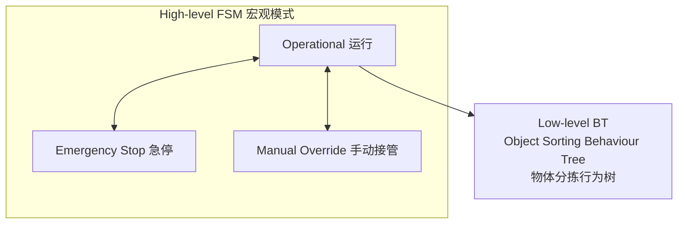

> **🔑 课堂练习(为每种情况选择 FSM 还是 BT)**
>
> | 场景 | 选择 | 理由 |
> |---|---|---|
> | 1. 在"运行 / 急停 / 手动接管"三种模式间切换 | **FSM** | 只有 3 个状态,数量少而固定,FSM 最简单直接 |
> | 2. 执行"找到物体 → 拿起物体 → 送达物体" | **BT** | 多步任务流程,正是 Sequence 节点的用武之地 |
> | 3. 一个只有"关闭 / 制热 / 制冷"三种模式的小家电 | **FSM** | 讲师原话:一颗微控制器实现一个 FSM 就够了 |
> | 4. 协调一个复杂的移动机器人任务,并带有**可复用的恢复行为** | **BT** | "可复用"是关键词——只有 BT 的子树能被整块复用 |

---

## 19. FSM / BT 与三种架构的关系

现在把 Part II 的三种架构和 Part III 的两种引擎交叉起来。这几页 slides 讲师在课上说"要跳过",但它们**把整个 Week 2 的前三部分缝合成了一体**,值得认真读一遍。

### 19.1 与审慎式 (Deliberative) 架构

审慎式架构依赖**自顶向下的重度规划**:感知世界 → 构建详细的内部地图 → 规划一长串动作 → 执行。

- **与 FSM 的关系:FSM 在这里很吃力。** 因为审慎式计划假定世界是可预测的,用 FSM 实现就需要一条**刚性的状态链**。一旦发生意外,**FSM 要么崩溃,要么需要复杂的"重规划"转移**。
- **与 BT 的关系:BT 是出色的计划执行器 (plan executors)。** 审慎式规划器可以**动态生成一棵行为树**并交给机器人运行。如果某个叶节点失败,**树的结构本身就知道该如何回退或触发重规划**。

### 19.2 与反应式 (Reactive) 架构

反应式架构抛弃复杂规划和内部世界模型,在紧密的 Sense-Act 循环上运行,靠一组简单、相互竞争的行为工作。

- **与 FSM 的关系:经典 FSM 在结构上对纯反应式控制过于刚性。** 但有个例外很重要:**Subsumption Architecture(包容架构)使用的是由许多微小的、相互连接的状态机组成的网络**,高优先级层可以根据即时的传感器输入**抑制或覆盖 (suppress or override)** 低优先级状态。
- **与 BT 的关系:BT 与反应式架构完美契合。** 原因就是第 17 节那个 tick 机制——**因为行为树以高频率从根节点开始完整地重新求值,它的表现就像一个反应式系统**。如果传感器突然检测到障碍物,**下一个 tick 就会立即把控制路由到避障行为,绕过正在运行的任务**。

这一条把 17.4 和 17.5 那两个走查的意义提升了一个层次:**BT 的 tick 机制天然带来了反应性**,你不需要额外做什么。

### 19.3 与混合式 (Hybrid) 架构

由于纯规划太慢、纯反应太短视,现代机器人大量依赖混合式架构。

- **与 FSM 的关系**:混合式系统**经常用 FSM 在宏观模式间切换**(例如从审慎式的"建图模式"切到反应式的"紧急停止模式")。这正是第 18 节那个"高层 FSM + 低层 BT"方案的理论依据。
- **与 BT 的关系:BT 是混合式控制的现代工业标准。** 在**同一棵**行为树里,你可以干净地把**审慎式节点**(如 `Compute A* Global Path`,计算 A\* 全局路径)和**反应式节点**(如 `Is Obstacle Blocking Path?`)**并排嵌套**。它原生地弥合了高层逻辑与低层反射之间的鸿沟。

### 19.4 三层架构 (Three-Tier Architecture) 与「执行层之战」

讲师专门强调了这一页:**分层架构,如今常称为三层架构 (three-tier architecture),是当今大多数自主机器人使用的软件组织方式。** FSM 和 BT 通常住在这个栈的**不同层**里。

```mermaid
flowchart TD
  DL["Deliberative Layer 审慎层<br/>规划、定位与建图<br/>产出抽象目标"]
  EL["Executive Layer 执行层<br/>把抽象目标翻译成电机指令<br/>⚔️ FSM vs BT 的主战场"]
  FL["Functional / Reactive Layer 功能层 / 反应层<br/>感知 → 立即动作"]
  DL --> EL --> FL
```

**执行层 (Executive Layer) 是两者关系的顶点。** 这一层接收来自审慎层的抽象目标,并把它们翻译成给功能层的电机指令。

- **FSM 作为执行层**:历史上,**FSM 统治了这一层**。机器人保持在 "Navigate" 状态,直到某个传感器事件把它推到 "Pick Object" 状态。但**随着机器人能力增长,这一层遭遇了"状态爆炸"**,代码变得无法维护。
- **BT 作为执行层**:在现代框架里(如 **ROS 2 Nav2**),**BT 已在很大程度上取代了 FSM**。BT 充当中央协调器,干净地路由数据、管理动作失败、tick 各种反应式检查、并平滑地调用低层控制器,**而不产生意大利面条代码**。

讲师的总结:**FSM 和 BT 是不同架构的实现策略**——底层是功能/反应层(感知即动作),顶层做规划与定位建图,而**中间的执行层如今大多用 BT 实现**。

---

# Part IV · 运动、稳定性与运动学表示

> **本部分学习目标(slides 明确列出)** — 学完本部分,你应该能把物理运动与数学模型连接起来:
> - 定义 locomotion、pose、stability 和 degree of freedom;
> - 区分**机械自由度**、**笛卡尔自由度**、**关节空间 (joint space)** 与**任务空间 (task space)**;
> - 使用**坐标系 (frames)**、**旋转矩阵**和**齐次变换**来表示位置与姿态;
> - 解释**正运动学**、**逆运动学**,以及为什么 IK 很难。
>
> **核心思想:** a robot motion problem becomes a **mapping between coordinate frames**.
> 机器人的运动问题,归根结底是**坐标系之间的映射问题**。

前三个 Part 讲的是"机器人怎么决定做什么"。Part IV 换一个问题:**当机器人决定"往前走 2 米"时,我们到底在说什么?** "往前"是相对谁?"2 米"在哪个坐标系里量?机器人的手臂摆成某个姿势,末端的夹爪究竟在空间中的哪个点?

这就是本部分要建立的语言。讲师给了一个提醒:**这里的 frame 不是视频的"帧",而是坐标系。**

---

## 20. Locomotion 与 Manipulation:一对对偶问题

我们在第 2 节已经见过 mobile robot 和 manipulator 两种具身形态。现在给它们的**动作**正式命名:

| | **Locomotion 移动** | **Manipulation 操作** |
|---|---|---|
| 谁在动 | **机器人移动自己** | **机器人移动物体** |
| 交互对象 | **地面 / 水 / 空气**是反作用介质 | **物体**是交互目标 |
| 形式 | rolling(滚)、walking(走)、swimming(游)、flying(飞)、climbing(爬) | arms(臂)、grippers(夹爪)、hands(手)、tools(工具) |

**它们是一对对偶问题 (dual problems):都是用电机改变相对运动。** slides 把这个共同点提炼成一条链:

> **same principle: actuator → force/torque → motion**
> 控制变量 → 物理运动。

对**移动机器人**来说,**locomotion 是本质能力**——机器人必须能移动自己。

### 运动形式与能量权衡

自然界给了我们一整套运动方案:钻 (boring)、滑 (sliding,像蛇)、跑、走、跳。讲师点出了工程上真正的约束:

> **不同的移动方式消耗的能量差别巨大。而移动机器人靠电池供电,能耗是极其关键的设计因素。**

slides 用 **Todd (1985)** 那张"功耗 vs 速度"的经典图表达了同一件事,并给出三条结论:

- **Rolling(滚动)**:在**平整/工程化的地面**上**效率高**,这是工程环境中最常见的方案;
- **Walking/running(行走/奔跑)**:**更复杂,但在崎岖地面上更好**;
- **Swimming/flying(游泳/飞行)**:**流体/空气动力学效应变得重要**。

> **Mechanism choice is a design trade-off: efficiency, terrain, complexity, speed and controllability.**
> 机构选择是一个设计权衡:效率、地形、复杂度、速度、可控性。

讲师把权衡的维度说得很具体:

- **地形 (terrain)**:平地板?粗糙地面?水下?
- **复杂度 (complexity)**;
- **速度**:你想让机器人多快?
- **可控性**:你需要多大的控制精度?
- 而**贯穿一切的是电池**——"机器人靠电池能跑多久"是一个核心设计指标。

现实印证:医院、餐厅、酒店的配送机器人**绝大多数是轮式**,因为地面平整、滚动效率最高。腿式机器人目前研究最多的是**四足(狗形)**;**人形(双足)仍然不常见**,尽管研究很多——原因下一节的稳定性会告诉你。

---

## 21. Kinematics 与 Dynamics:两种描述运动的层次

在深入之前必须先分清两个最容易混淆的词。

| **Kinematics 运动学** | **Dynamics 动力学** |
|---|---|
| position 位置 | acceleration 加速度 |
| orientation 姿态 | jerk 加加速度 |
| velocity / speed 速度 | forces and torques 力与力矩 |
| geometry of joints and links 关节与连杆的几何 | mass and inertia 质量与惯量 |

一句话概括:**运动学描述运动的几何 (geometry of motion);动力学则加入了力和加速度。**

讲师的补充说明很有用:**运动学只谈位置、姿态和速度**;对操作臂来说,就是**关节和连杆的几何关系**——手臂由多个连杆 (links) 组成,连杆之间由**关节 (joints)** 连接,关节之间有夹角。而**动力学**则涉及**加速度**(位置的二阶导数、速度的一阶导数),并且开始考虑**力、质量和惯量**。

slides 给了一条重要的实践指导:

> **For slow mobile robots and many arm-planning problems, kinematics is often the first model.**
> 对于慢速移动机器人和许多手臂规划问题,运动学往往是首选的模型。

换句话说:如果机器人动得不快,惯性效应可以忽略,那么**只用运动学就够了**。这就是为什么本课程 Part IV 全篇都在讲运动学而几乎不碰动力学。

---

## 22. 静态稳定与动态稳定

机器人必须能在工作环境中**保持稳定**——不能翻倒。slides 给出的判据是:

> **Stability depends on the centre of mass relative to ground-contact support.**
> 稳定性取决于**质心相对于地面接触支撑的位置**。

### 两种稳定性

| | **Static stability 静态稳定** | **Dynamic stability 动态稳定** |
|---|---|---|
| 定义 | **即使没有驱动,机器人也不会倒** | **机器人必须运动或主动控制自己才不会倒** |
| 能耗 | 静止时不耗能 | **持续消耗能量** |
| 例子 | 带支撑轮的轮式机器人、四足静止站立 | 倒立摆机器人 (inverted pendulum)、双足行走 |

讲师的直觉解释:**静态稳定就是"它就那么待着,不会倒"。动态稳定意味着机器人必须一直动、一直主动控制自己,才能避免摔倒——这是要消耗能量的。**

> **🔑 例(倒立摆)** — 控制领域最经典的例子。一根杆子竖着立在小车上,**如果小车不动,杆子必然倒下**;要让它不倒,**小车必须一直移动**来补偿。这就是纯粹的动态稳定。

slides 的总结很有工程味道:**快速、敏捷的机器人常常利用动态稳定;而安全的机器人应当有能力回到静态稳定状态。** 也就是说,一台好机器人在需要敏捷时可以"动态"起来,但出问题时要能"稳稳地停住"。

### 判据:支撑多边形 (Support polygon)

那么怎么**判断**一台机器人是不是静态稳定?

> **Support polygon(支撑多边形)**:**质心的投影必须落在接触多边形之内**,才能保证静态稳定。

具体做法:

1. 找出机器人与地面的所有**接触点**(比如四条腿的四个足端);
2. 这些接触点在地面上围成一个**多边形**;
3. 把机器人的**质心 (centre of mass) 垂直投影到地面**;
4. **投影点落在多边形内 → 静态稳定;落在多边形外 → 不稳定,会倒。**

```mermaid
flowchart LR
  CM["Centre of mass 质心"] -->|"垂直投影<br/>vertical projection"| PR["投影点"]
  PR --> Q{"落在支撑多边形内?"}
  Q -->|Yes| ST["✅ Statically stable<br/>静态稳定"]
  Q -->|No| US["❌ Unstable → 需要主动运动<br/>(dynamic stability)"]
```

**这就解释了为什么双足机器人这么难。** 讲师的对比很清楚:**四足机器人容易保持稳定**(四个接触点围成一个大多边形);但**两足就很棘手**——两只脚只能围出一个很窄的区域,质心投影必须始终落在这条窄带内。**人类能做到这一点**(我们无意识地一直在微调),**但对双足机器人来说极其难控制**。这正是第 20 节那个现象的答案:为什么人形机器人研究了这么多年仍不常见。

> **🔑 课堂测验** — 一台四足机器人静止站立时,如果它质心的垂直投影**移到了四足围成的多边形之外**,它还稳定吗?要防止摔倒必须发生什么?
>
> **答案:不稳定,会倒——即使它有四条腿。** 要防止摔倒,机器人**必须运动**:要么持续移动,要么**调整腿的位置**,使得四足围成的新多边形重新**包住**质心的投影。这道题的考点是:**腿多不等于稳定,决定性因素永远是质心投影与支撑多边形的关系。**

---

## 23. 自由度 (Degree of Freedom):运动的"预算"

slides 给 DoF 的定位很精妙——**the mobility budget(机动性预算)**。

> **DoF counts independent directions of motion or actuation.**
> 自由度计量的是**独立**的运动方向或驱动方向的数量。

关键词是**独立 (independent)**。两个不独立的运动只算一个自由度。

### 两种自由度(必考的区分)

| | **Mechanical DoF 机械自由度** | **Cartesian DoF 笛卡尔自由度** |
|---|---|---|
| 数什么 | **独立的关节或执行器变量** | **任务空间中独立的平移和旋转** |
| 属于 | **机构本身**(joint space) | **任务需求**(task space) |
| 例子 | 一条 5 关节手臂 = **5 个机械 DoF** | 平面任务可能只需 **3 个**;3D 空间中最多 **6 个** |

**slides 的核心例句:** 一条 5 关节手臂有 5 个机械自由度;而任务在平面上可能只需要 3 个笛卡尔自由度,在 3D 中则需要 6 个。

> **DoF in joint space and task space are related but not identical.**
> 关节空间与任务空间中的自由度**相关但不相同**。

### 为什么 3D 空间最多 6 个笛卡尔自由度?

用飞机来理解——slides 用的正是这张图。一架飞机在三维空间中:

- 可以沿 **X、Y、Z** 三个方向**平移**(上下、前后、左右)→ **3 个平移自由度**;
- 可以绕这三个轴**旋转** → **3 个旋转自由度**,分别叫 **roll(滚转)、pitch(俯仰)、yaw(偏航)**。

**3 + 3 = 6。** 这就是刚体在三维空间中的完整自由度,后面第 24 节会看到它有个正式名字叫 **SE(3)**。

```mermaid
graph LR
  subgraph TR ["Translation 平移 · 3 个"]
    X["along X"]
    Y["along Y"]
    Z["along Z"]
  end
  subgraph RT ["Rotation 旋转 · 3 个"]
    RO["Roll 绕 X"]
    PI["Pitch 绕 Y"]
    YA["Yaw 绕 Z"]
  end
  TR --> SE["6 Cartesian DoF<br/>= SE(3)"]
  RT --> SE
```

**并且:可用的自由度取决于机构以及它与环境的约束 (constraints with the environment)。** 讲师举例:如果我只在一个平面上移动,那我在笛卡尔空间就**没有** 6 个自由度——因为某些方向根本走不了。**约束会吃掉自由度。**

> **🔑 课堂测验** — 一条机械臂有 **5 个独立关节**。任务要求它的**末端执行器 (end-effector,即"手")只需到达一个特定位置 $(x, y, z)$,姿态不受约束**。请问:(a) 有多少个**机械**自由度?(b) 任务指定了多少个**笛卡尔**自由度?
>
> **答案:(a) 5 个机械自由度**(5 个关节)。**(b) 3 个笛卡尔自由度**(只需要 $x, y, z$ 三个平移;因为姿态不受约束,那 3 个旋转自由度不算)。
>
> 这道题的价值在于:它证明**机械 DoF 和笛卡尔 DoF 是两个独立的计数**。这里机械 DoF(5)> 任务所需 DoF(3),多出来的自由度叫**冗余 (redundancy)**——它让机器人有多种关节配置都能到达同一点,这在避障时非常有用,但也让逆运动学有了多解(见第 30 节)。

### 轮子的自由度

slides 专门给了一页"不同类型轮子的自由度",因为**轮式机器人是当今最常见的形态**。这里的 DoF 指的是**独立的自由度**,而不同轮型提供的自由度差别很大——这直接决定了机器人能不能横向移动,下一节会展开。

---

## 24. 位置、姿态与位姿 (Position, Orientation, Pose)

现在我们有了"能怎么动"的语言,还差"现在在哪"的语言。

### 三个词的关系

- **Position(位置)**:物体**在哪里**。3D 中记作 $p = (x, y, z)^T$。
- **Orientation(姿态/朝向)**:物体**如何旋转**。3D 中可以用 **roll, pitch, yaw** 表示,也可以用**旋转矩阵 $R$** 或**四元数 $q$**。
- **Pose(位姿)= (position, orientation)**。

> **Pose combines where the object is and how it is rotated.**
> **位姿 = 位置 + 姿态**,合起来才完整地描述一个刚体在空间中的状态。

讲师的说明:**pose 天然地指机器人的位置加上机器人的朝向**——"朝向"简单说就是机器人**面朝哪个方向**。

**3D 空间中完整的位姿有个正式名字:**

> **SE(3): 3 translations + 3 rotations** — 3 个平移 + 3 个旋转,共 6 个量。

### 平面上的特例:只需要三个数

对地面移动机器人,情况大大简化。讲师解释:如果机器人**始终在一个平面上**,你只需要:

- **$x, y$** — 在平面上的位置;
- **$\theta$** — 朝向角(heading),也就是"朝东、朝北还是朝西"。

$$\text{Planar pose:}\quad r = (x, y, \theta)^T$$

**平面位姿只有 3 个量。** 这是整个后续课程里最常用的表示——本课的定位、建图、路径规划,基本都在这个 $(x, y, \theta)$ 空间里进行。

> **注意:** 朝向的具体含义**取决于坐标系的选择**。说"朝北"之前必须先定义哪边是北。这就引出了下一节。

### 轮式约束:为什么位姿的三个分量不能随意改变

有了 $(x, y, \theta)$ 这个表示,第 2 节那个"差速机器人不能侧移"的直觉就可以精确表达了:

> **On a plane, pose needs $x$, $y$ and heading $\theta$; wheels constrain how those can change.**
> 在平面上,位姿需要 $x, y, \theta$;而**轮子约束了这些量能够如何变化**。

slides 给出的三条:

- **标准轮 (standard wheels) 向前滚动,并抵抗侧向运动。** 这是所有约束的物理根源——轮子横着推是推不动的。
- **Caster(万向轮)、Swedish(麦克纳姆轮)、spherical wheels(球轮)提供额外的机动性。**
- **对于类车 (car-like) 或差速驱动 (differential-drive) 机器人,并非所有瞬时侧向运动都是可能的。**

**这就是"非完整约束 (nonholonomic constraint)"的直观含义**:机器人最终**可以**到达它旁边 1 米的位置(倒车入库就是这么做的),但它**不能瞬时地朝那个方向移动**。位姿空间是 3 维的,但瞬时可控的方向只有 2 个(前进速度 + 转向角速度)。

```mermaid
graph TD
  W["Wheel type 轮型"] --> SW["Standard wheel 标准轮<br/>只能前后滚,抵抗侧移<br/>→ 施加约束"]
  W --> CW["Caster 万向轮"]
  W --> SWD["Swedish / Mecanum 麦克纳姆轮"]
  W --> SPH["Spherical 球轮"]
  CW --> M["提供额外机动性<br/>可实现全向运动"]
  SWD --> M
  SPH --> M
```

---

## 25. 坐标系与右手法则

到目前为止我们一直在偷偷假设"有一个坐标系"。现在把它讲清楚。

> **A coordinate system defines axes and positive rotations.**
> 坐标系定义了**轴的方向**和**正向旋转的方向**。

slides 的三条要点:

1. **轴的方向是约定 (convention),但必须一致地使用。** 这句话的分量很重——没有哪个方向"天生"是 X 轴,但一旦选定,全系统必须统一。
2. **右手法则 (Right-hand rule)**:手指沿正向旋转方向弯曲,拇指指向正向的轴。讲师的描述:从 X 转向 Y,拇指指向的就是 Z 方向。
3. **对地面机器人,通常只建模 $x, y$ 和绕 $z$ 的 yaw。** 这正好对应上一节的 $(x, y, \theta)^T$。

### 两个实操细节(Webots 相关,作业会用到)

> 📎 **拓展(超出 slides,但直接影响作业)** — 讲师用了相当长的篇幅讲 Webots 的坐标系,因为**作业就是 Webots 教程 1、2、3**,踩坑概率很高:
>
> **(1) 角度用弧度,不用度数。** 在 Webots 或大多数机器人仿真软件中指定旋转角时,**用的是弧度 (radians) 而不是度 (degrees)**:180° = $\pi$,90° = $\pi/2$,60° = $\pi/3$。
>
> **(2) Webots 在 R2022a 改过坐标系约定,老教程会坑你。**
>
> | 版本 | 约定 | 含义 |
> |---|---|---|
> | **R2022a 之前** | **NUE** | North–Up–East,即 $X$=North, $Y$=Up, $Z$=East |
> | **R2022a 及之后** | **ENU** | East–North–Up,即 $X$=East, $Y$=North, $Z$=Up |
>
> 讲师警告:如果你拿一个 2022 年之前定义的场景文件,在**我们课上用的 R2025a** 里打开,**会出问题**。
>
> **怎么查一个场景用的是哪套约定?** 在场景文件里找 **`WorldInfo`** 节点,它有一个字段标明所用的坐标系约定。
>
> **(3) 颜色即坐标轴。** 在 Webots 里点击一个物体时,它会用 **RGB 颜色**显示坐标系:**R→X, G→Y, B→Z**。这是通用约定,记住能省很多调试时间。

---

## 26. 参考系 (Frames of Reference)

现在到了 Part IV 真正的核心。

> **A frame is a coordinate system attached to something physical or conceptual.**
> **参考系 (frame) 就是附着在某个物理或概念实体上的坐标系。**

为什么需要多个坐标系?slides 的理由是:**局部坐标系能简化复杂机器人**。一台机器人身上同时存在:**world(世界)、base(基座)、joint(关节)、end-effector(末端执行器)、sensor(传感器)** 等多个坐标系。

**最关键的一句话是这个:**

> **A point can have different coordinates in different frames.**
> **同一个点,在不同坐标系里有不同的坐标。**

讲师反复强调这一点:同一个物理点,**换一个坐标系,描述它的数字就变了**。所以

> **Transformations convert coordinates between frames.**
> **变换 (transformation) 负责在坐标系之间换算坐标。**

### 记号约定(必须掌握,否则后面全是天书)

$$^{A}p \quad\text{表示:点 } p \text{ 在坐标系 } \{A\} \text{ 中的表达}$$

左上标表示"**在哪个坐标系里看**"。

### 典型场景

讲师给的场景是理解这一切的锚点:

- 场景里通常有**一个世界坐标系 (world frame)**,用来定义整个环境。在 Webots 里,你定义场景时就是在选一个世界坐标系,并在其中定义环境和机器人的位置。
- 同时,每个物体、每台机器人还有自己的**局部坐标系 (local frame)**。**机器人的局部坐标系原点始终跟着机器人走**——机器人到哪,它的原点就到哪。

```mermaid
graph TD
  WF["{World} 世界坐标系<br/>定义整个环境"] --> BF["{Base} 机器人基座坐标系<br/>跟着机器人移动"]
  BF --> JF["{Joint} 关节坐标系"]
  JF --> EF["{End-effector} 末端执行器坐标系"]
  BF --> SF["{Sensor} 传感器坐标系"]
```

**这条链条就是后面所有变换要打通的路径。** 一个传感器报告"障碍物在我正前方 1 米处"——这是在 `{Sensor}` 里说的话。要让规划器用上它,必须把它一路变换到 `{World}`。

讲师给了这门课最实用的一条忠告:

> **当你说"机器人的位置""物体的位置"时,你必须搞清楚自己在说哪个坐标系。做运算时,所有量必须在同一个坐标系里;如果不在,就必须先做变换。**

---

## 27. 位置向量与基向量

在推导旋转矩阵之前,先把"坐标"这件事本身讲透。

> **Coordinates are coefficients on a frame's unit axes.**
> **坐标就是在该坐标系单位轴上的系数。**

写成公式:

$$^{A}p = (p_x, p_y, p_z)^T$$

这个列向量的含义是:

$$^{A}p = p_x (1,0,0)^T + p_y (0,1,0)^T + p_z (0,0,1)^T$$

也就是说,$p_x, p_y, p_z$ 分别是这个点**沿着 $\{A\}$ 的三个单位轴走了多远**。讲师的解释:$p_x$ 就是沿 X 方向的那段距离,$p_y$ 就是沿 Y 方向的那段距离。所谓"坐标",不过是**在一组基向量上的展开系数**。

上标 $T$ 表示**转置 (transpose)**——把行向量转成列向量,这是机器人学的书写习惯。

> **Interpretation:** the same physical point is described by **different numbers** when the frame changes.
> 同一个物理点,坐标系一变,描述它的数字就变了。

### 投影:两个坐标系怎么建立联系

slides 给了一个关键的几何事实,它是旋转矩阵的全部基础:

把 $\{B\}$ 的单位向量 $\hat{X}_B$ **投影**到张成坐标系 $\{A\}$ 的那些单位向量上。由于**所有向量都是单位向量**,点积就直接等于夹角的余弦:

$$A \cdot B = \|A\|\|B\|\cos\alpha = \cos\alpha$$

**这就是关键机制:** 因为单位向量的模是 1,点积**退化成了纯粹的方向信息**。两个坐标系之间的相对朝向,可以完全由"一个系的轴投影到另一个系的轴上"这些余弦值刻画。

---

## 28. 旋转矩阵:把姿态写成"被投影的轴"

现在可以给出旋转矩阵的定义了。

> **A rotation matrix stores the axes of one frame expressed in another.**
> **旋转矩阵存储的是:一个坐标系的各个轴,在另一个坐标系中的表达。**

$$^{A}_{B}R = \begin{bmatrix} ^{A}\hat{X}_B & ^{A}\hat{Y}_B & ^{A}\hat{Z}_B \end{bmatrix}$$

读作:"$\{B\}$ 相对于 $\{A\}$ 的旋转矩阵"。

**三条必须记住的性质:**

1. **每一列都是坐标系 $\{B\}$ 的一个单位轴,用坐标系 $\{A\}$ 描述。** 第一列是 $\{B\}$ 的 X 轴在 $\{A\}$ 里长什么样,以此类推。
2. **各列都是相互正交的单位向量,所以 $R$ 是正交归一的 (orthonormal)。** 这不是巧合——坐标系的三个轴本来就互相垂直且长度为 1。
3. **求逆非常容易:**
   $$R^{-1} = R^T$$

第 3 条是一个巨大的实用优势。一般矩阵求逆是昂贵且数值不稳定的运算;而旋转矩阵**只需要转置**——把行列互换就行,零计算成本、零数值误差。

讲师的直觉版解释:**旋转矩阵回答的是"我该把 $\{A\}$ 转多少才能变成 $\{B\}$"**,而这个"转多少"由 $\hat{X}_B, \hat{Y}_B, \hat{Z}_B$ 三个轴相对于 $\{A\}$ 的朝向完全决定——把它们各自投影到 $\{A\}$ 的轴上,归一化后并排放好,就得到了旋转矩阵。

---

## 29. 坐标变换:旋转 + 平移

### 29.1 变换一个点

两个坐标系之间的关系其实只有两件事,讲师说得很清楚:

1. **它们的原点相距多远** → 这是**平移 (translation)**;
2. **它们的朝向差多少** → 这是**旋转 (rotation)**。

于是,要把点 $Q$ 从坐标系 $\{B\}$ 表达到坐标系 $\{A\}$,只需**先旋转,再平移**:

$$^{A}Q = {^{A}_{B}R} \; {^{B}Q} + {^{A}P}$$

逐项解释(**这是"读得出来的公式"的示范**):

| 符号 | 含义 |
|---|---|
| $^{B}Q$ | 点 $Q$ 在**局部坐标系 $\{B\}$** 中的坐标 |
| $^{A}_{B}R$ | $\{B\}$ **相对于** $\{A\}$ 的**姿态**(旋转矩阵) |
| $^{A}P$ | $\{B\}$ 的**原点**在坐标系 $\{A\}$ 中的**位置**(平移向量) |
| $^{A}Q$ | 点 $Q$ 在坐标系 $\{A\}$ 中的坐标 |

**用大白话读一遍:** 要知道这个点在 A 系里在哪,先把它按两系的朝向差**转过去**($R \cdot {^{B}Q}$),再加上 B 系原点在 A 系里的**位置偏移**($^{A}P$)。

### 29.2 齐次变换矩阵:把两步合成一步

上面的式子完全正确,但它是**"矩阵乘法 + 向量加法"两种运算的混合**。数学上不优雅,工程上也不方便——尤其是当你要串联很多个坐标系时,加法和乘法交替出现会很难处理。

**解决办法叫齐次表示 (homogeneous representation):在坐标后面补一个 1。**

$$\begin{bmatrix} ^{A}Q \\ 1 \end{bmatrix} = \begin{bmatrix} ^{A}_{B}R & ^{A}P \\ 0\ 0\ 0 & 1 \end{bmatrix} \begin{bmatrix} ^{B}Q \\ 1 \end{bmatrix} = {^{A}_{B}T} \begin{bmatrix} ^{B}Q \\ 1 \end{bmatrix}$$

这个 $4 \times 4$ 矩阵 $^{A}_{B}T$ 就是**齐次变换矩阵 (homogeneous transformation matrix)**。它**把旋转和平移合并进了一次矩阵运算**。

**为什么补的那个 1 能起作用?** slides 说得很准确:**最下面那一行让仿射平移与矩阵乘法兼容。** 展开看第四行:$0 \cdot Q_x + 0 \cdot Q_y + 0 \cdot Q_z + 1 \cdot 1 = 1$,保持了齐次坐标的形式;而前三行里,$^{A}P$ 乘上那个补充的 1,就变成了直接相加。**平移被"伪装"成了乘法。**

**它的三个价值:**

- **对坐标系链非常有用**(见下一小节);
- **同一形式可以表示** 机器人基座→连杆、连杆→连杆、传感器→末端执行器 **等各种变换**;
- 讲师补充的工程理由:**矩阵运算的实现效率极高**。这一点和机器学习是相通的——"把算法变成矩阵运算,比写循环快得多",张量运算的思路正是如此。

> **Rule of thumb: transforms are the grammar of robot geometry.**
> 变换是机器人几何的**语法**。

### 29.3 求逆与串联

**求逆(反过来变换):**

$$T^{-1} = \begin{bmatrix} R^T & -R^T p \\ 0\ 0\ 0 & 1 \end{bmatrix}$$

**逆变换把坐标从父坐标系映射回子坐标系。** 注意它复用了第 28 节的 $R^{-1} = R^T$,所以这个逆也是廉价的。

**串联(连续变换多步):**

$$^{A}p = {^{A}_{B}T} \; {^{B}_{C}T} \; {^{C}p} = {^{A}_{C}T} \; {^{C}p}$$

讲师说:**你不只能做一步,你可以做多步**——给定一个点在 $\{C\}$ 中的坐标,先变换到 $\{B\}$,再变换到 $\{A\}$。

**两条实用提示:**

- **Concatenation order matters(串联顺序很重要)。** 矩阵乘法不满足交换律,顺序写错结果完全不同。
- **前后下标能"相消"是检查的好办法。** 看 $^{A}_{B}T \cdot {^{B}_{C}T}$:相邻的 $B$ 一上一下抵消,剩下 $^{A}_{C}T$。**如果相邻的标号对不上,说明你写错了。** 这是考试和写代码时最好用的自检技巧。

```mermaid
flowchart LR
  C["{C}<br/>sensor 传感器"] -->|"ᴮ_C T"| B["{B}<br/>robot base 机器人基座"]
  B -->|"ᴬ_B T"| A["{A}<br/>world 世界"]
  C -.->|"ᴬ_C T = ᴬ_B T · ᴮ_C T"| A
```

> **🔑 例(讲师的课堂题)** — 一个传感器报告:在**距离 $x, y$ 处有一个障碍物**。但这个读数是在**传感器自己的坐标系**里给出的("在我的 X 方向 1 米远处有障碍")。
>
> 要让路径规划器用上这个信息,你必须把它变换到世界坐标系:
>
> $$^{World}p_{obstacle} = {^{World}_{Base}T} \cdot {^{Base}_{Sensor}T} \cdot {^{Sensor}p_{obstacle}}$$
>
> 其中 $^{Base}_{Sensor}T$ 由传感器**装在机器人身上的位置和朝向**决定(固定不变),$^{World}_{Base}T$ 由机器人**当前的位姿**决定(每时每刻在变)。
>
> **这就是为什么第 26 节那条忠告如此重要:所有运算必须在同一个坐标系里进行,否则就必须先做变换。** 传感器标定 (calibration) 这个工程难题,本质上就是准确测出 $^{Base}_{Sensor}T$。

---

## 30. 姿态的其他表示方式

旋转矩阵不是表示姿态的唯一方式。slides 给了三种,**各有权衡**:

| | **Rotation matrix 旋转矩阵** | **Euler / fixed angles 欧拉角/固定角** | **Quaternion 四元数** |
|---|---|---|---|
| 参数个数 | **9 个值,6 个约束** | **3 个值** | **4 个值,1 个单位约束** |
| 特点 | **鲁棒且直观** | 最紧凑,但**可能有奇异性 (singularities)** | **紧凑,且避免万向节死锁 (gimbal lock)** |

**理解这张表的逻辑:** 三维旋转本质上只有 **3 个自由度**(见第 23 节)。

- **旋转矩阵用 9 个数**去表示 3 个自由度,所以必然有 **6 个约束**(三列各为单位向量 = 3 个约束,三列两两正交 = 3 个约束)。**冗余但直观、运算方便**。
- **欧拉角用 3 个数**,数量上刚好,**最紧凑**。代价是会出现**奇异性**——在某些姿态下,两个旋转轴重合,导致丢失一个自由度,这就是著名的 **gimbal lock(万向节死锁)**。
- **四元数用 4 个数**加一个单位长度约束,**是紧凑性与无奇异性之间的最佳折中**,所以是现代机器人和图形学的默认选择。

**四元数的形式:**

$$q = a + bi + cj + dk, \qquad q^* = a - bi - cj - dk$$

($q^*$ 是它的共轭。)

**由旋转轴 $k$ 和旋转角 $\theta$ 构造单位四元数:**

$$q = [\cos(\theta/2),\; k_x \sin(\theta/2),\; k_y \sin(\theta/2),\; k_z \sin(\theta/2)]$$

这个式子说的是:**任何一个三维旋转都可以描述成"绕某个轴 $k$ 转过角度 $\theta$"**(这叫**轴角表示**),而四元数就是这个描述的一种紧凑编码。注意里面是 $\theta/2$ 而不是 $\theta$——这是四元数的特征。

---

## 31. 运动学:那个核心的映射

现在所有零件齐了,可以给出 Part IV 的最终答案——**运动学到底在做什么**。

> **Kinematics connects robot control variables to physical pose.**
> 运动学把**机器人的控制变量**与**物理位姿**连接起来。

两个空间:

| **Configuration / joint space 关节空间(构型空间)** | **Task / Cartesian space 任务空间(笛卡尔空间)** |
|---|---|
| $q = (q_1, \ldots, q_n)^T$ | $r = (x, y, \theta)^T$ 或 $(x, y, z, roll, pitch, yaw)^T$ |
| **你能直接控制的量**(各关节角度 / 轮子转速) | **你真正关心的量**(末端执行器/机器人在空间中的位姿) |

两者由一个映射连接:

$$r = f(q)$$

```mermaid
flowchart LR
  Q["Joint space 关节空间<br/>q = (q₁, …, qₙ)ᵀ<br/>你能控制的"] -->|"Forward kinematics<br/>正运动学 r = f(q)"| R["Task space 任务空间<br/>r = (x, y, θ)ᵀ<br/>你想要的"]
  R -->|"Inverse kinematics<br/>逆运动学 q = f⁻¹(r)"| Q
```

### 三种运动学

| 名称 | 做什么 | 公式 |
|---|---|---|
| **Forward kinematics 正运动学** | **由关节构型算出位姿** | $r = f(q)$ |
| **Inverse kinematics 逆运动学** | **由期望位姿算出关节构型** | $q = f^{-1}(r)$ |
| **Differential kinematics 微分运动学** | **把关节速度与笛卡尔速度关联起来** | (雅可比矩阵) |

### 为什么逆运动学更难?

这是 slides 学习目标里明确点名要能解释的("**why IK can be hard**"),所以是考点。原因有三层:

**(1) 正运动学总是有唯一解,逆运动学不一定。** 给定所有关节角,末端在哪里是**确定**的——沿着连杆链一路乘齐次变换矩阵就得到了答案(这正是第 29.3 节的串联)。反过来,给定一个目标位置,**可能有多组关节角都能到达**——想想你的手肘:手掌放在同一个位置,肘部可以高一点也可以低一点。这叫**多解 (multiple solutions)**,在第 23 节那个"冗余"的例子里尤其明显。

**(2) 可能无解。** 目标点在工作空间 (workspace) 之外,手臂再怎么摆也够不着。

**(3) 数学形式上,$f$ 通常是关于关节角的非线性(三角函数)方程组,解析求逆往往困难甚至不可能**,必须用数值迭代法。

而正运动学只是"**把一串变换矩阵乘起来**",永远直接、永远唯一。**这就是不对称性的来源。**

讲师指出:**正运动学和逆运动学在操作臂(机械臂)的场景里尤其重要**——因为你想要的是"把夹爪放到那个位置",而你能控制的只有各个关节的电机。

---

## 32. Part IV 收束:一句话与四个问题

slides 的 take-home summary 把 Part IV 全部压缩成五条:

- **Locomotion 移动机器人自己;manipulation 移动物体;两者都依赖驱动与接触。**
- **Pose = position + orientation;frames 定义了位姿和点如何被表示。**
- **旋转矩阵和齐次变换是坐标变换的核心数学。**
- **正运动学把关节空间映射到任务空间;逆运动学求解更难的反向问题。**
- **稳定性、自由度和约束共同决定了什么运动是可行的。**

而 slides 给的这个提问模板,值得贴在书桌上——**每次遇到机器人运动问题,都问这四个问题:**

> ### "What frame, what DoF, what constraints, and what mapping?"
> **在哪个坐标系?有几个自由度?有什么约束?用什么映射?**

这四个问题恰好对应第 26 节(frame)、第 23 节(DoF)、第 24 节(constraints)和第 31 节(mapping)。如果一道题你不知道从哪下手,按这个顺序问一遍,通常就找到入口了。

---

# 本章小结 (Key takeaways)

**Part I — 系统层**

1. **自主 (autonomy) 的核心是"选择动作"的能力**,并且它不是一个模块,而是 **sense state → select action → execute → evaluate** 这个持续运转的闭环;自主永远是**被任务、情境和安全包络所限定**的,Tesla 远程接管的高频率就是证据。
2. **机器人是具身智能体 (embodied agent)**,与软件 agent 的根本区别在于它有物理身体——因此动作有物理后果、可能不可逆,而且**身体形状直接决定了哪些动作在物理上不可能**(差速机器人无法侧移)。
3. **机器人必须同时维护"关于自己"的内部状态**(mode、pose、battery、task progress、warnings)**和"关于环境"的世界模型**(zones、object status、constraints);世界模型**可以不完整但依然有用**,而且通常分全局(地图/GPS)与局部(实时感知)两个尺度。
4. **系统级性能不等于模块级性能**——机器人里常用简单、计算高效但单独看不够可靠的算法,因为整合后的系统表现才是唯一标准;而**安全机制不是智能的补丁,而是机器人能否被行业采用的前提**。

**Part II — 控制架构**

5. **控制架构是机器人的决策组织方式,是设计模式而非算法**,它规定了信息如何从状态流向动作、哪个模块可以覆盖哪个模块;判断任何架构的钥匙是问:**"智能住在哪里——中央规划器、各个行为,还是分散在各层?"**
6. **三大架构各有其位**:**分层式 (Sense→Plan→Act)** 依赖 closed-world assumption,在**结构化环境**中长于长程规划但反应慢、模型易过期;**反应式 (Sense→Act)** 让智能从简单局部行为中涌现,反应极快但无全局最优;**混合式 (PLAN, then SENSE–ACT)** 用审慎/序列/反应三层同时获得远见与反射,是**当今最实用的选择**。
7. **控制层按时间尺度分解**:PID 速度控制 ~150 Hz、紧急停止 ~10 Hz、避障 ~1 Hz、路径规划 ~0.001 Hz——**越底层越快,越高层越慢**;运动控制则由**反馈(测量误差再修正)**与**前馈(靠模型预测)**结合而成。
8. **三个真实案例的架构差异,根源在人机交互方式的不同**:自动驾驶用分层混合式(全局规划器 + 局部规划器 + 可覆盖一切的紧急层),仓储 AMR 用车队集成的混合反应-审慎式(Fleet Manager + 车载反应层,这是它区别于遇阻即停的老式 AGV 的关键),手术机器人则用 **shared autonomy**(人给高层意图,机器负责 motion scaling 与 tremor filtration)。

**Part III — 任务执行**

9. **架构是哲学蓝图,FSM 和 BT 是实现蓝图的软件引擎**——同一个架构可以用任一种引擎实现,这两个层次不能混为一谈。
10. **FSM 由"状态"驱动,任意时刻只处于一个状态,靠显式转移切换**;它简单易实现(至今仍统治简单家电和宏观模式管理),但因为转移被硬编码,任务一复杂就遭遇**状态爆炸**、代码不可维护、状态无法复用。
11. **BT 由"任务"驱动,以层次化而非顺序化的方式组织执行**;它的核心是 **tick**——信号以固定频率从根节点重新遍历整棵树,每个节点立即返回 **SUCCESS / FAILURE / RUNNING**。**正是"每次从根重新求值"这一点带来了天然的反应性**:正在 RUNNING 的导航动作会因为守卫条件突然 FAILURE 而被自动中断,无需为此写任何特殊规则。
12. **Sequence (→) 是 AND(全部成功才成功,一个失败即失败),Fallback/Selector (?) 是 OR(一个成功即成功,失败才尝试下一个)**;二者搭配出的 `?[ →[守卫条件, 主任务], 恢复动作 ]` 是可复用在无数场景上的标准模式。
13. **BT 在模块化、可扩展性、数据共享(Blackboard)上全面优于 FSM,但 FSM 胜在简单**;工业界的答案是**结合**——**高层用 FSM 管少量宏观模式(运行/急停/手动接管),低层用 BT 执行复杂任务**。在现代三层架构中,**BT 已在执行层 (Executive Layer) 大幅取代 FSM**(如 ROS 2 Nav2)。

**Part IV — 运动与运动学**

14. **Locomotion(移动自己)与 manipulation(移动物体)是一对对偶问题**,共享同一条链:actuator → force/torque → motion;运动机构的选择是**效率、地形、复杂度、速度、可控性**之间的权衡,而**电池续航是贯穿一切的硬约束**。
15. **Kinematics 只谈位置、姿态、速度和几何;dynamics 才引入力、力矩、质量与惯量**——对慢速移动机器人和许多手臂规划问题,**运动学往往就是首选模型**。
16. **静态稳定意味着不驱动也不会倒,动态稳定意味着必须持续运动才不倒**;判据是**质心的垂直投影是否落在接触点围成的支撑多边形内**。这直接解释了为什么四足容易而**双足极难**——这正是人形机器人至今不常见的原因。
17. **机械自由度数的是独立的关节/执行器,笛卡尔自由度数的是任务空间中独立的平移与旋转**(3D 中最多 6 个 = SE(3));二者相关但不相同,一条 5 关节手臂完成一个只要求位置的任务,就是 5 机械 DoF 对 3 笛卡尔 DoF。
18. **Pose = position + orientation**;3D 位姿是 SE(3) 的 6 个量,而**平面移动机器人只需要 $r = (x, y, \theta)^T$ 三个量**——但**标准轮抵抗侧移**,使得类车和差速驱动机器人**并非所有瞬时侧向运动都可能**。
19. **同一个点在不同坐标系里有不同的坐标**,所以做任何运算前必须确认所有量在**同一个坐标系**里,否则先做变换。**旋转矩阵的每一列是一个坐标系的单位轴在另一个坐标系中的表达**,它正交归一因而 $R^{-1} = R^T$;**齐次变换矩阵 $4\times4$ 把旋转和平移合并成一次矩阵乘法**,可以串联(注意顺序,用相邻下标相消来自检)也可以求逆。
20. **正运动学 $r = f(q)$ 就是把一串变换矩阵乘起来,永远唯一且直接;逆运动学 $q = f^{-1}(r)$ 则可能多解、可能无解、且通常是非线性方程组,所以困难得多。** 遇到任何机器人运动问题,先问那四个问题:**"What frame, what DoF, what constraints, and what mapping?"**

---

# 阅读与作业 (Suggested Readings and Homework)

**Readings**

- *Introduction to Autonomous Robotics* / Nikolaus Correll, University of Colorado at Boulder, v3, February 2026, ISBN-13: 9780692700877 (Open Education) — **Chapters 2, 3.1, 3.2, and 11**

**Homework**

- **Webots Online Tutorials 1, 2 & 3**
  (做之前请回看第 25 节的 📎 拓展:**角度用弧度**;**R2022a 起坐标系约定改为 ENU**,老场景文件用的是 NUE,可在 `WorldInfo` 节点中确认;点击物体时 **RGB 三色分别对应 XYZ 三轴**。)

