# CSCI944 Week 3 · 传感器 (Sensors)

> **学习目标 (Learning objectives)** — 读完本章你应该能够:
>
> - 用一套标准词汇——**range / dynamic range / resolution / accuracy / precision / bandwidth**——去评价和比较任意一个传感器,并说清 accuracy、precision、resolution 三者为什么互不等价;
> - 用两个正交的分类法给任何传感器归位:**本体感受 (proprioceptive) vs 外部感受 (exteroceptive)**、**主动 (active) vs 被动 (passive)**;
> - 解释**编码器 (encoder)** 如何测关节位置与速度,区分增量式与绝对式,说明正交编码 (quadrature) 如何给出方向,并解释为什么轮式里程计 (odometry) 一定会漂移;
> - 说明**加速度计 (accelerometer)** 与**陀螺仪 (gyroscope)** 各自测什么、各自在什么地方失效,以及为什么必须组合成 **IMU**;
> - 区分**力/力矩传感器 (F/T sensor)**、**触觉 (touch)** 与**压力 (pressure)** 传感,并解释各自适合什么任务;
> - 说出六大类测距原理(反射强度、三角测量、相位差、脉冲飞行时间、超声、雷达/UWB)的物理机制、公式与典型失效模式,并针对给定任务选出合适的组合;
> - 解释深度相机的三条技术路线(结构光、双目立体、ToF 相机)分别怎么产生深度图,以及各自在什么场景崩掉;
> - 说明 GPS 为什么需要 4 颗卫星,以及室内如何用 marker / beacon 替代卫星;
> - 分析可见光相机与红外相机(NIR / SWIR / 热成像)的信号来源差异,并据此判断任务该选哪个波段;
> - 区分**系统误差 (systematic error)** 与**随机误差 (random error)**,并说明冗余、传感器多样性、容错估计三种应对手段的层次关系。

---

上周我们在讲台上停在一个问题上:**一个超声传感器报告"前方 1 米有障碍物",机器人能不能直接把这句话当成"机器人前方 1 米有障碍物"?**

答案是不能,而且这个"不能"正是本周的起点。讲师当时给出的理由是:机器人上的**每一个部件都有自己的坐标系 (frame)**——传感器有,轮子有,机械臂的每一节有,甚至你在 Webots 里搭场景时放的桌子、板子也各有各的。传感器报出来的任何一个数,都是**相对于它自己那个坐标系**说的,不是相对于机器人本体,更不是相对于世界。要用它避障,你必须先把这个测量从**传感器坐标系变换到机器人坐标系**——用上周学的 3×3 旋转矩阵,或者包含平移的 4×4 齐次变换矩阵。

> 📎 **拓展(超出 slides)** — 讲师顺带提了两个上周没细讲的名词,考试不会考推导但你该认识:**欧拉角 (Euler angles)** 用 roll / pitch / yaw 三个角分别表示绕 X / Y / Z 轴的旋转,直观但在某些姿态下会退化;**四元数 (quaternion)** 用四个数(单位长度)表示旋转,专门用来绕开欧拉角的退化问题。本课绝大多数时候仍然用旋转矩阵。同样地,**正运动学 (forward kinematics)** 由关节角算末端位置,**逆运动学 (inverse kinematics)** 由目标位置反解关节角——后者通常**有多个解**,本课不深入,想学的人要去工程学院的 manipulator 课。

于是本周的主线问题就浮出来了:**机器人到底能"感觉"到什么?这些感觉从哪里来、有多可信、会在什么时候骗你?**

注意本章的性格:它**不教任何一款具体型号的传感器**,而是教**分类、原理和失效模式**。讲师明确说了这一点——"我们不讲某个具体传感器,我们讲类别"。这是有道理的:具体型号三年就换一代,但"反射强度测距对材料敏感"这条物理规律不会变。你要带走的是一张**心智地图 (mind map)**:遇到一个陌生传感器,你能立刻问出"它测的是自己还是外界?它主动发能量吗?它的量程、带宽、精度各是多少?它在什么条件下会给我错的数?"

本章按"测什么"分成六大块,层层往外推:

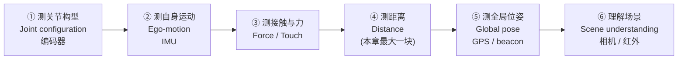

从 ① 到 ⑥,机器人的"注意力"是从**身体内部**一路向外扩张到**整个世界**的:先知道自己的关节在哪,再知道自己在怎么动,再知道自己碰到了什么,再知道周围有什么、多远,再知道自己在世界的哪个位置,最后才是理解看到的到底**是什么东西**。

---

# Part 0 · 先摆正位置:感知在机器人系统里的角色

## 1. 感知是 see–think–act 的第一环

上周我们用 **see–think–act** 这个循环描述了机器人的工作方式。本周讲的所有东西,都塞在第一个词 **see** 里面。

把移动机器人的完整控制框图摊开,你会看到感知不是孤立的一个盒子,而是一条**从物理世界到决策的信息流水线**:

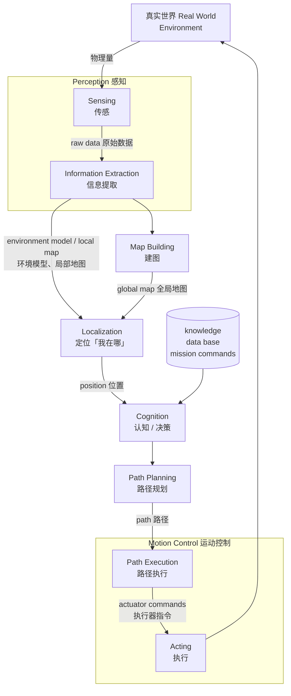

请留意这张图里的一个细节:从 **Sensing** 出来的东西叫 **raw data(原始数据)**,它必须先经过 **Information Extraction** 才变成能用的 **environment model(环境模型)**。也就是说,**传感器给你的从来不是知识,只是数字**。把数字变成"前面 1.2 米处有一堵墙"这件事,是感知算法干的活,而算法能干得多好,取决于你有多懂手里这些数字的脾气。这就是为什么本章要花这么大篇幅讲"每种传感器会怎么出错"——**不懂失效模式,你写的感知算法就是在沙子上盖楼。**

## 2. 为什么感知反而是最难的部分

讲师在正式开讲前先引了 Steven Pinker 的一句话(*The Language Instinct*, 1994):

> "In AI, the easy problems are hard, and the hard problems are easy."
> (在人工智能里,难问题是容易的,容易问题才是难的。)

配的两张图对比得很刺眼:**打败国际象棋世界冠军 = EASY;造一台有点"常识 (common sense)"的机器 = very HARD。**

这在直觉上是反的——下棋明明看起来更"聪明"。讲师把这个问题抛给了课堂,有同学答到了点子上:**因为棋有规则 (rules)。**

讲师顺着这个答案往下推了一层,给出了本课的标准答案:

- **国际象棋近乎是确定性的 (deterministic)。** 棋盘状态完全可见,规则完全已知,每一步的后果完全可预测。如果不考虑计算和存储的限制,理论上你可以把所有可能的局面塞进计算机然后穷举。所以下棋的困难**只是算力和内存的困难**,不是本质的困难——而算力是会随时间变便宜的。
- **常识面对的是不确定性 (uncertainty)。** 而且是**双重**的不确定:一重来自**环境本身**(世界会变、会有你没见过的东西、光线会变、人会乱跑),另一重来自**你的测量**——这一重才是本章的主角。

讲师把第二重讲得很直白:

> "Sensors will never give you the truth. Very often they just give you a result with a certain level of uncertainty or noise."
> (传感器永远不会给你真值。它给你的通常只是一个带着某种程度不确定性或噪声的结果。)

**这句话是整章的地基。** 后面每一节讲某个传感器"能测什么"的时候,都会紧跟着讲它"会怎么错"。请不要把后半部分当成可跳过的附注——在真实机器人上,后半部分才是决定项目成败的东西。这也解释了为什么后面几周的定位 (localization)、规划 (planning) 都必须建立在概率框架上:**因为输入本身就是概率性的。**

---

# Part I · 传感器词汇表:评价一个传感器的六把尺子

在给传感器分类之前,先得有一套能**描述**传感器的语言。这套词汇不只是为了考试——它是你跟做机器人的人对话的通用货币,也是你看 datasheet(规格书)时唯一能依靠的东西。讲师说得很明确:定义这些术语,"so that basically you can talk to people who are working in the robotic area"。

六个词,分成三组来记最省力:**能测多大范围**(range、dynamic range)、**能分多细**(resolution)、**测得准不准**(accuracy、precision)、外加一个**能测多快**(bandwidth)。

## 3. Range 与 Dynamic Range:能测多大范围

**量程 (range)** 指的是传感器按规格能测量的**最小到最大输入值之间的区间**。

这个概念简单到几乎不需要解释,但讲师给的两个例子很好地划出了它的边界。第一个是车速表:一台普通家用车的速度传感器可能覆盖 0 到 140–160 km/h,跑车可能到 260 km/h——**超出这个区间,传感器不是测不准,而是根本没有定义**。第二个是温度传感器:规格书上写 −30 °C 到 50 °C,那么把它扔进烤箱,你得到的读数没有任何意义。

第一个实践含义就在这里:**选传感器的第一步是确认量程覆盖任务**。一个 0.8–4 m 的深度相机装在需要看 20 米外的户外车上,再贵也是错的。

**动态范围 (dynamic range)** 是一个更微妙、也更容易在考试里被混淆的概念。它指的是传感器**能有意义地区分的最大输入信号与最小输入信号之比**——注意是**比值**,不是差值。用讲师的话说:"how large is the span from the weakest to the strongest detectable signal"(从最弱到最强可探测信号的跨度有多大)。

因为是比值,而且这个比值往往大到离谱(几千倍、几百万倍),工程上习惯取对数,用**分贝 (dB)** 表示:

$$\text{DR}_{\text{dB}} = 20\log_{10}\frac{V_{\max}}{V_{\min}} \quad\Big(\;=10\log_{10}\big(\tfrac{V_{\max}}{V_{\min}}\big)^{2}\;\Big)$$

> 📎 **拓展(超出 slides)** — 讲师在课上顺手推了这个 dB 公式(还问了句"有人知道分贝公式吗?"),slides 上没有。两种写法完全等价:对**幅度类**量(电压、声压)用 $20\log_{10}$,对**功率类**量用 $10\log_{10}$,因为功率正比于幅度的平方。考试大概率不会让你算 dB,但你要能读懂 datasheet 上写的 "70 dB dynamic range" 是什么意思——70 dB 约等于 $10^{3.5}\approx 3200$ 倍。

真正让这个概念活起来的是讲师给的图像传感器例子,值得完整记住,因为它解释了一个你天天在用的功能:

> **🔑 例(讲师课上补充)—— 为什么手机要有 HDR 模式**
>
> 自然场景在阳光下的**亮度动态范围可以达到 160–170 dB**:同一个画面里,直射阳光下的白墙和树荫深处的暗部,亮度可以差几百万倍。而一个普通图像传感器的动态范围只有 **70–80 dB**。
>
> 数字对不上,后果就是你每天都在见的那件事:**要么天空一片死白(过曝 saturated),要么阴影一团死黑**——传感器的"窗口"塞不下场景的跨度,只能牺牲一头。
>
> 解决办法就是 **HDR (High Dynamic Range) 成像**:用不同曝光拍多张(短曝光保住高光、长曝光救出暗部),再合成一张覆盖更宽亮度范围的图。所以 HDR 不是"让照片更好看的滤镜",它是**用算法去补传感器动态范围的不足**。

一般规律:**量程越大,动态范围通常也越高**,但两者不是一回事——量程说的是"从哪到哪",动态范围说的是"最强和最弱差多少倍、还能不能分得开"。

## 4. Resolution:能分多细

**分辨率 (resolution)** 是**能让传感器输出产生可分辨变化的、被测量的最小改变量**。

讲师用尺子作比:一把刻度到毫米的尺子,分辨率就是 1 mm。比 1 mm 更细的差别,你只能靠猜。温度传感器同理——能显示到小数点后一位,分辨率就是 0.1 °C;能显示两位,就是 0.01 °C。

这里必须立刻钉死一个高频考点,slides 上专门用一行字强调过:

> **Resolution is not the same as accuracy or precision.**
> **分辨率 ≠ 准确度,也 ≠ 精密度。**

为什么?因为分辨率只描述**输出的刻度有多细**,完全不保证这个刻度**对不对**、也不保证**重复测会不会落在同一格**。一个能显示到 0.001 °C 的温度计,如果它系统性地偏高 5 °C,那它的分辨率高得漂亮,准确度一塌糊涂。**数字位数是最容易伪装成质量的东西**——datasheet 上一个很长的小数,常常什么也没承诺。

这也是 S49 那句话的意思:"The same numerical resolution can hide very different accuracy and precision in real environments."(同样的数值分辨率,在真实环境里可能藏着截然不同的准确度和精密度。)

## 5. Accuracy 与 Precision:两种完全不同的"准"

这一对是本章——也可能是整门课——最经典的考点。中文都翻译成"准",但它们说的是两件毫不相干的事。

- **准确度 (accuracy)**:测量值**系统性地**接近真值 (true value / ground truth) 的程度。回答的是"**我偏了没有?**"
- **精密度 (precision)**:**可重复性 (repeatability)**——同一个被测对象反复测多次,结果彼此之间有多集中(方差有多低)。回答的是"**我稳不稳?**"

讲师特意强调了一句容易被忽略的话:传感器**永远不会**对同一个对象给出完全相同的读数。同样的参考物、同一台传感器,不同时刻测出来的值就是会不一样。精密度衡量的就是这种"抖动"有多小。

slides 上那张四靶图是标准记忆锚点,四种组合都要能认:

| 情形 | 准确度 Accuracy | 精密度 Precision | 打靶表现 | 直觉解读 |
|---|---|---|---|---|
| 1 | 低 | 低 | 弹着点又散又偏离靶心 | 传感器又飘又偏,基本不能用 |
| 2 | 低 | **高** | 弹着点很集中,但整团偏离靶心 | **稳定地错**——但这种错**可以标定掉** |
| 3 | **高** | 低 | 弹着点围着靶心,但散得很开 | 平均是对的,单次不可信——**可以靠多次平均/滤波救** |
| 4 | **高** | **高** | 又集中又在靶心 | 理想传感器(通常也最贵) |

第 2 行和第 3 行是理解这张表的关键,因为它们对应**两种完全不同的补救手段**:

- **高精密、低准确(第 2 行)**:误差是**系统性**的、可预测的,所以**标定 (calibration)** 就能修好——你只要测出它偏了多少,减掉即可。这就是 §26 要讲的**系统误差**。
- **低精密、高准确(第 3 行)**:误差是**随机**的,没有固定的偏移可减,但因为它围着真值散布,**多测几次取平均、或者做时间滤波**就能把它压下去。这就是**随机误差**。

**记住这个映射关系,你就同时掌握了 §26 的误差分类和 §27 的应对策略**——这几节其实在讲同一件事的两面。

## 6. Bandwidth:能测多快

**带宽 (bandwidth)** 是传感器能够**充分响应**的输入频率范围。用讲师的大白话说:"how quickly you can sample the input signal"(你能多快地采到输入信号)。

为什么会有这个限制?因为任何物理传感器都有惯性、有阻尼、有电路的响应时间。当输入信号变化得越来越快,传感器的输出幅度就会跟不上,开始**衰减 (decay)**。工程上的惯例是取**衰减 3 dB 的那个频率点**作为带宽的边界:

> 📎 **拓展(超出 slides)** — "−3 dB 点"就是输出功率降到一半、幅度降到约 0.707 倍的频率。讲师课上提到了这个定义。为什么偏偏是 3 dB?因为 $10\log_{10}(1/2)\approx-3.01$,即功率减半——这是信号处理领域约定俗成的"开始明显失真"的门槛。

带宽是很多灾难的根源。一个 10 Hz 的超声传感器装在一台跑 2 m/s 的机器人上,两次读数之间机器人已经走了 20 cm——**在这 20 cm 里它是瞎的**。所以:

> **🔑 课堂测验(讲师课上做的)** — 当我们要测量一个**快速变化的信号**时,哪个传感器特性最重要?
>
> **答案:带宽 (bandwidth)。** 量程决定测量的上下界,分辨率决定刻度粗细,准确度决定偏不偏——只有带宽决定**跟不跟得上变化**。快变信号 → 带宽。这个对应关系要形成条件反射。

## 7. 词汇表的总结论:一个传感器不够

slides 在这一页的最后落了一句话,它其实是整章反复出现的主旋律:

> **Key lesson: robust robotic sensing usually requires combining sensors with different operating principles.**
> **稳健的机器人感知,通常需要组合使用基于不同工作原理的传感器。**

为什么这句话现在就要出现?因为你刚学的六个指标已经暴露了根本矛盾:**它们互相冲突**。想要量程大,通常牺牲分辨率;想要带宽高,通常牺牲精度;想要又准又快又便宜——不存在。既然单个传感器一定在某个维度上妥协,那么可靠性就只能从**组合**里来。请把这句话记到本章结束,§27 会告诉你组合的正确姿势(以及为什么不是简单平均)。

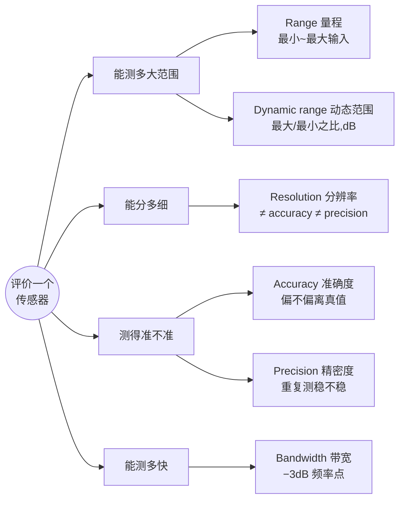

## 8. 第一个分类法:本体感受 vs 外部感受

有了描述语言,现在给传感器分类。第一个分类法问的是:**这个传感器在看谁?**

| | **本体感受 Proprioception** | **外部感受 Exteroception** |
|---|---|---|
| **看什么** | 机器人**自己的内部状态** | 机器人**身体之外的一切** |
| **典型测量** | 关节角度与速度、内部力矩与力 | 物体、障碍物、表面、人 |
| **给出什么** | 自身构型与运动 | 世界状态 **+ 不确定性** |
| **主要用途** | **控制**与**自我监测** | **导航**与**操作** |
| **典型器件** | 编码器、加速度计、陀螺仪 | 相机、激光雷达、超声、GPS |

"Proprioception"这个词来自人体:闭上眼睛,你依然知道自己的手抬到了什么高度——这就是本体感觉。机器人的编码器和 IMU 干的是同一件事。

注意上表右下角那个不起眼的 "+ 不确定性"。这不是随手加的:**外部感受本质上比本体感受更不确定**。关节编码器测的是一个机械结构内部的量,环境影响有限;而相机测的是外面的世界,光线、材质、天气、遮挡全都会插一脚。这个差异会一路影响到后面的定位与建图算法设计。

讲师用了一个人人都能验证的例子来检验理解:

> **🔑 例(讲师课堂互动)—— 你手机里有哪些传感器?**
>
> 同学答:陀螺仪 (gyroscope)、加速度计 (accelerometer)、相机 (camera)。
>
> 那么哪些是本体感受、哪些是外部感受?
>
> - **陀螺仪、加速度计 → 本体感受**:它们测的是**手机自己**在怎么转、怎么加速,跟外面有什么东西完全无关。
> - **相机 → 外部感受**:它拍的是**外面的世界**。
>
> 这个判断法则很好用:**问"如果把这个设备关在一个全黑的箱子里,它还能给出有意义的读数吗?"** 能 → 本体感受;不能 → 外部感受。

再来一道讲师课上出的原题:

> **🔑 课堂测验** — 下面哪一项主要是**本体感受 (proprioceptive)** 的测量?
> (A) 到墙的距离  (B) **车轮转动 (wheel rotation)**  (C) 行人的位置  (D) GPS 位置
>
> **答案:B。** 车轮转了多少圈,是机器人**自己身体**的构型变化,不需要知道外面有什么。A 测的是外部几何,C 测的是外部物体,D 是外部基础设施(卫星)给的世界坐标——全是外部感受。

## 9. 第二个分类法:主动 vs 被动

第二个分类法问的是一个完全不同的问题:**这个传感器往外发能量吗?**

| | **主动传感器 Active** | **被动传感器 Passive** |
|---|---|---|
| **机制** | **发射**能量:光、无线电或声波,然后测量环境如何反应 | 只测量**环境中已经存在**的能量 |
| **例子** | 超声、激光雷达 (lidar)、雷达、红外测距、结构光深度相机 | 加速度计、指南针 (compass)、普通相机 |
| **备注** | **绝大多数测距传感器都是主动的** | 有时会配一个主动元件来改善信噪比(如主动双目) |

为什么大部分测距传感器必须是主动的?因为**距离信息不会自己送上门**。要知道一个物体多远,你得知道"信号跑一个来回花了多久"或者"反射回来的角度是多少"——这就要求你**先发出一个你完全知道其发出时刻、频率、图案的信号**。被动地看,你只能看到环境反射的自然光,里面并不直接编码距离。

讲师举了两个被动传感器的例子来说明"利用已有能量"是什么意思:**指南针**利用的是**地球磁场**的排布,它什么都不发,只是感受地球本来就有的场;**普通相机**利用的是太阳或灯具已经打在物体上、再反射进镜头的光。

这个分类法直接决定了两类实践后果,后面会反复用到:

1. **主动传感器会互相干扰 (crosstalk / interference)。** 两台超声机器人靠近时,A 发出的声波可能被 B 收到并当成自己的回波;两台结构光深度相机对着同一面墙,投影的图案会叠加成一团乱码。
2. **主动传感器要跟自然界的"背景噪声"竞争。** 最典型的就是**阳光里含有大量红外**,这就是为什么结构光深度相机(如 Kinect)在户外基本不能用——这一点在 §19 和 §23 会详细展开。

## 10. 一台移动机器人身上都装了些什么

在深入每一类之前,先看一眼一台典型的自主车/移动机器人的传感器配置。这张"全家福"值得记住,因为它就是后面每一节的目录:

| 传感器 | 类别 | 主要用途 |
|---|---|---|
| **触觉传感器 / 保险杠 (tactile sensor / bumper)** | 外部,被动 | 检测**物理接触**;安全开关 (security switch) |
| **GPS** | 外部,被动接收 | **全局定位**与导航 |
| **惯性测量单元 (IMU)** | 本体 | 机器人的**朝向与加速度** |
| **轮式编码器 (wheel encoders)** | 本体 | **局部运动估计**(里程计 odometry) |
| **激光扫描仪 (laser scanners)** | 外部,主动 | 避障、运动估计、场景解释(道路检测、行人) |
| **相机 (standard / omnidirectional camera)** | 外部,被动 | **纹理信息**、运动估计、场景解释 |

讲师在这里点了一句非常重要的话,它解释了为什么这张表这么长:

> "Sometimes for the same purpose, because the system has an error and is not reliable, we use multiple principles, and then we fuse them together to achieve reliable measurements."
> (有时候为了**同一个目的**,因为单个系统有误差、不可靠,我们会用**多个不同原理**的传感器,再把它们融合起来,以获得可靠的测量。)

注意"for the same purpose"——这不是说每个传感器各管一摊,而是说**好几个传感器在测同一件事**。IMU、轮式编码器、激光雷达都能给出"机器人在怎么动"的线索,它们的存在是冗余的,而这种冗余正是可靠性的来源。这就是 §27 **传感器融合 (sensor fusion)** 的动机,也是本章反复出现的那句 "combining sensors with different operating principles"。

---
# Part II · 测关节构型:编码器 (Encoders)

## 11. 什么算"关节"

第一类传感器回答的问题是:**我的身体现在摆成什么姿势?**

最直观的"关节"当然是机械臂上的转动关节。但讲师提醒了一个容易被忽略的扩展:**轮子和车体之间的连接也是一个关节 (joint)**。轮子相对车体绕轴转动——这在机构学上跟机械臂的转动关节没有本质区别。所以"关节构型传感"这一类,同时覆盖了**机械臂的关节角**和**移动机器人的车轮转动**,而后者正是里程计的来源。

这一类几乎清一色是**本体感受**传感器,而扛大梁的是**编码器 (encoder)**。

## 12. 编码器测什么、怎么测

**编码器 (encoder)** 是把**物理转动转换成离散计数或绝对码**的器件。它的基本能力有三项:

1. **测关节位置** (角度);
2. **测关节速度**(位置对时间求差分);
3. **配合弹簧还能间接测力**——这一点先记住,§17 讲串联弹性驱动器时会用到。

工作原理上,编码器依靠的是**随电机一起旋转的光学或磁性图案 (optical or magnetic patterns)**。想象电机轴上装了一个圆盘,盘上刻着黑白相间的条纹(光学式)或南北交替的磁极(磁性式);圆盘转动时,固定在旁边的探测器就会看到一串明暗(或磁极)交替的信号。**数这串信号的跳变次数,就知道转了多少。**

关键洞察在这里:编码器**把连续的物理转动变成了离散的数字事件**。这既是它便宜可靠的原因(数数是数字电路最擅长的事),也是它精度上限的来源(圆盘上刻了多少条纹,就决定了你的角度分辨率)。

slides 特意提到编码器"used differently in mobile robots and manipulators"(在移动机器人和机械臂上用法不同)——这正是下一节的主题。

## 13. 增量式 vs 绝对式:两种表示角位置的方式

| | **增量式 / 相对式 Incremental** | **绝对式 Absolute** |
|---|---|---|
| **测什么** | 数**跳变次数**:相对上一次读数转了多少 | 每个扇区有**唯一编码**,直接读出当前绝对角度 |
| **开机时** | **不知道自己在哪**,需要回零 (reference) 或从起点开始积分 | **一上电就知道**当前角度 |
| **典型场合** | **移动机器人**(车轮) | **机器人机械臂 (manipulator)** |
| **编码方式** | 条纹计数 | **格雷码 (Gray code)**——相邻扇区**只变 1 个 bit** |

讲师用了一个很自然的方式来解释为什么两者的应用场合不同,值得完整跟一遍:

> **🔑 例(讲师课堂提问)—— 轮式机器人该用哪种编码器?**
>
> 讲师问:如果我用轮子来移动机器人,通常该用增量式还是绝对式?
>
> **答案:增量式。** 理由在于**"绝对"这个概念对轮子没有意义**。绝对式编码器的输出是"当前处在 0–360° 中的哪个角度"——它有一个固定的量程。但轮子是要**一直转下去**的:机器人往前开 10 米,轮子可能转了 30 圈,你要的不是"现在停在第几度",而是**累计转了多少**。
>
> 所以做法是:持续采样增量信号,把每一小段位移**累加 (accumulate)** 起来,得到走过的总距离——这就是**里程计 (odometry)**。
>
> 反过来,**机械臂的关节天然是有限量程的**:肘关节只能在某个角度区间里摆,而且**开机瞬间你就必须知道手臂现在摆在哪**,否则第一个动作就可能撞到自己。这时绝对式编码器一上电就报出绝对角度,正是刚需。

**为什么绝对式要用格雷码?** slides 只写了"Gray code changes one bit at a time",没解释为什么,这里补上:

> 📎 **拓展(超出 slides)** — 假设用普通二进制给扇区编号,从 3 (`011`) 跨到 4 (`100`) 时,**三个 bit 要同时翻转**。但物理上三个探测器不可能在同一纳秒完成翻转,于是在过渡的瞬间你可能读到 `111`(=7)或 `000`(=0)——**一个离真值十万八千里的假读数**。格雷码把编号排列成"相邻码字只差 1 个 bit"的顺序(如 `000, 001, 011, 010, 110, ...`),于是过渡时最多只有一位在变,读到的要么是转换前的值、要么是转换后的值,**永远不会跳到一个完全无关的角度上**。这是一个典型的"用编码设计消灭一整类硬件错误"的例子。

## 14. 正交编码器:两路信号如何给出方向

单个光学探测器有一个致命缺陷:**它能数出转了多少,但不知道往哪转**。黑白黑白的跳变,正转和反转看起来一模一样。

**正交编码器 (quadrature encoder)** 用一个极简的办法解决了这个问题:**放两个探测器 A 和 B,让它们在空间上错开四分之一个周期(即 90° 相位差,"quadrature"就是这么来的)。**

于是两路方波之间就有了**先后关系**:

- 若 **A 领先 B** → 顺时针 (clockwise);
- 若 **B 领先 A** → 逆时针 (counter-clockwise)。

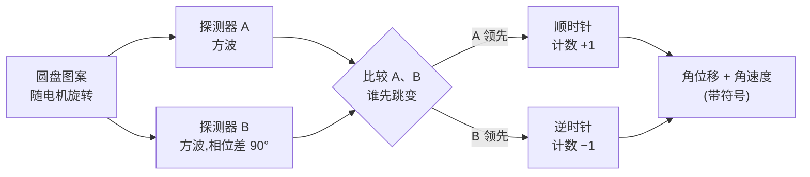

数跳变次数给出**角位移**,跳变的快慢给出**角速度**,A/B 的相位关系给出**方向**——三样东西,两个廉价探测器搞定。slides 给了它应有的地位:

> **Quadrature is the most common encoder principle in robotics.**
> **正交编码是机器人领域最常用的编码器原理。**

讲师顺带把这件事跟你的作业连上了:在 **Webots** 里给电机设定速度时,**正值表示前进、负值表示后退**——这个符号,现实中就是靠 A/B 两路的相位关系得来的。

## 15. 编码器的根本局限:轮子转了 ≠ 机器人到了

这一节是本 Part 的重点,也是最容易在考试里被追问的地方。

slides 的标题一句话就点破了:**Wheel motion is not the same as global motion(轮子的运动不等于全局的运动)。**

编码器测的是**轮子或关节自己转了多少**,而且这个测量是**在它自己的坐标系里**说的。它**不测**机器人在世界里的绝对位姿。从"轮子转了 N 圈"推到"机器人现在在 (x, y, θ)",中间隔着一大堆假设——而每一条假设在现实里都会被打破:

**问题一:非完整约束 (non-holonomic constraints)。**

slides 说:对于非完整机器人,**回到相同的编码器读数,并不意味着回到了出发点**。

这句话初读很绕,讲师的展开值得完整跟一遍。**非完整机器人 (non-holonomic robot)** 指的是**运动受到约束**的机器人:它最终能到达空间中的任意位置,但**不能沿任意方向直接移动过去**。

> **🔑 例(讲师课堂展开)—— 汽车是非完整的吗?**
>
> 讲师问:汽车算不算非完整机器人?
>
> **算。** 想想侧方停车:你的车就停在目标车位旁边,横向只差一米。但你**不能**让车直接向左平移一米——车轮的机构不允许。你必须**前进、打方向、后退、回方向**,来回挪好几次才能进去。
>
> 换句话说:**你能到达那个位置,但你到不了"直接过去"这条路径。** 你的运动方向在任意瞬间都被约束在"车头指向"附近。
>
> 讲师补了一句:"**most of the time robots are non-holonomic robots**"——因为大多数机构(轮子、腿、履带)天然带约束。全向轮 (omnidirectional wheel) 机器人是少数的例外。
>
> **这跟编码器有什么关系?** 因为运动受约束,轮子转过的量和机器人在世界里的位移之间**不是一一对应的**。同样"左轮转 10 圈、右轮转 10 圈",机器人可能停在完全不同的地方——取决于它是从哪个朝向开始转的、中间怎么转弯的。**编码器读数不能唯一决定位姿。**

**问题二:物理世界不理想 → 里程计漂移 (odometry drift)。**

slides 列了三个物理原因:

- **轮子打滑 (wheel slip)**:轮子空转了,但机器人没动(或反过来,机器人被推动了但轮子没转)。编码器记录了这段"位移",实际上并没发生。
- **回程间隙 (backlash)**:齿轮传动中的机械空隙,换向时会有一小段"空走"。
- **地面变化 (surface changes)**:从瓷砖开到地毯,有效轮径和摩擦都变了。

讲师用一个思想实验把后果讲透了:

> "In the ideal case, I read a number of turns of the robot's wheels, and if the reading gets back to the original value, I'm supposing the robot returns back to the original position... But eventually this is not the case, because of the drift and the slip on the floor."
>
> (理想情况下,如果编码器读数转了一圈又回到原值,我就该认为机器人回到了原点。但实际上不是这样,因为地面上有漂移和打滑。)

**而且这些误差是累积的。** 因为里程计是把每一小段位移**加起来**的,任何一次微小的打滑都会永久地进入总和,并且再也不会被自动纠正。走得越久,位姿估计离真值越远——**这是一个没有下界的、单调恶化的过程**。

**所以正确的用法是:**

| 该用编码器干什么 | 不该指望编码器干什么 |
|---|---|
| 局部速度估计 | 全局定位 |
| 短时间尺度的里程推算 | 长时间无校正的位姿跟踪 |
| 作为融合系统的一路输入 | 作为唯一的位置来源 |

slides 给的结论是:**"Fuse with IMU, vision, lidar or global pose sensors for robust localisation."**(与 IMU、视觉、激光雷达或全局位姿传感器融合,才能得到稳健的定位。)

这句话已经预告了本课后面几周的核心内容——**SLAM(同步定位与建图)存在的理由,就是里程计一定会漂移。** 如果编码器足够可靠,机器人学会简单得多。

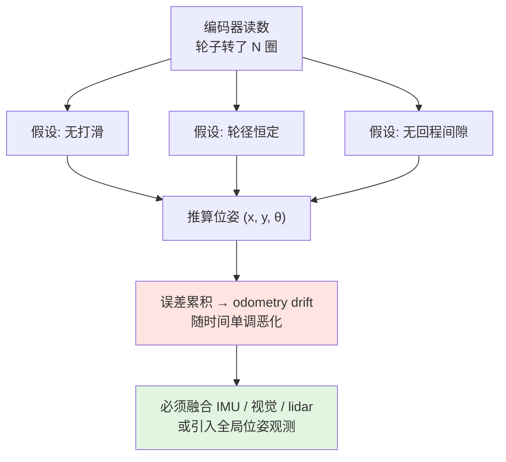

---

# Part III · 测自身运动:加速度计、陀螺仪与 IMU

## 16. 为什么关节构型不够

编码器告诉了你"我的关节摆成什么样",但 slides 的标题一针见血地指出了它缺什么:

> **Joint configuration alone cannot tell whether the robot is accelerating or falling.**
> **单靠关节构型,你无法知道机器人是在加速,还是在倒下。**

想象一台双足机器人:所有关节角都读得清清楚楚,但整个机器人正在向前栽倒——**关节角完全正常,而机器人已经完了**。因为关节角描述的是**身体各部分之间**的相对关系,不描述**整个身体相对于世界**在怎么运动。

这就引出了 **ego-motion(自我运动)** 传感。讲师解释了这个前缀:"ego" 就是"自己"的意思,像 **ego camera**(第一人称相机)一样——**测的是机器人自身的运动**。

**谁最需要它?** slides 的答案是**动态稳定 (dynamically stable) 的机器人**。回忆上周的区分:**静态稳定**的机器人不动也能站住(如六足、四轮车);**动态稳定**的机器人**必须持续运动才能保持平衡**(如双足行走的人形机器人、四旋翼、走在崎岖地面上的移动机器人)。对后者来说,"我现在的加速度和角速度是多少"是**每毫秒都要回答的生死问题**,慢一点就摔了。所以 slides 说 "Dynamically stable robots need **fast** sensing of motion"——注意那个 fast,这就是 §6 的**带宽**在起作用。

**要测三样东西:**

- **平移加速度 (translational acceleration)** — 我在往哪个方向加速?
- **旋转速度 (rotational speed)** — 我在绕哪个轴转、转多快?
- **融合后的姿态估计 (orientation estimates after fusion)** — 我现在朝向哪里?(注意 "after fusion":姿态**不是直接测出来的**,是算出来的。)

**共同的物理基础是惯性 (inertia):质量抵抗运动状态的改变。** 这一条把接下来两种传感器串在了一起——它们都是在测"某个小质量块因为不愿意改变运动状态而产生的效应"。

## 17. 加速度计:把加速度变成位移

**加速度计 (accelerometer)** 的直觉模型是**一个挂在阻尼弹簧上的质量块 (mass on a damped spring)**。

推导链条只有两步,而且两步你都已经学过:

1. **胡克定律 (Hooke's law)**:弹簧的力正比于形变,$F = kx$。
2. **牛顿第二定律**:$F = ma$。

联立两式:

$$ma = kx \quad\Longrightarrow\quad a = \frac{k}{m}\,x$$

**位移 $x$ 直接给出加速度 $a$。** 整个器件的精妙之处在于:加速度是个看不见摸不着的量,而位移是可以用电学手段直接读出来的。

现实中的器件是 **MEMS (Micro-Electro-Mechanical Systems,微机电系统)** 加速度计:把上面那个弹簧-质量结构用**微机械梁 (micro-mechanical beams)** 做到硅片上,再用**电容感应 (capacitive sensing)** 读出位移——梁一动,极板间距变了,电容就变了。这就是为什么你手机里那颗加速度计只有几毫米、成本几块钱。

典型器件**测最多 3 个轴的平移加速度**(X、Y、Z)。

**它擅长什么:利用重力当参考。**

这是加速度计最重要、也最反直觉的用法。地球提供了一个**恒定的加速度矢量**(重力,竖直向下,约 9.81 m/s²)。静止的加速度计始终能感受到这个矢量;而**这个矢量在传感器自身坐标系里的方向,就告诉了你传感器相对于竖直方向倾斜了多少**。

于是:**roll(绕 X 轴)和 pitch(绕 Y 轴)可以直接从重力方向估计出来。**

讲师把这里的几何讲得很清楚,而且点出了一个关键的不对称:

> Z 轴通常就是**竖直方向、与重力对齐**的那个轴。以重力为参考,**绕 X 和 Y 轴的旋转很容易测**——因为一旦绕它们转动,重力矢量在传感器坐标系里的投影就变了。**但绕 Z 轴的旋转(yaw)测不了**——因为绕竖直轴转动时,重力矢量在传感器坐标系里**纹丝不动**。
>
> **这就是为什么 IMU 里必须有磁力计。** 记住这个逻辑链:重力 → 给 roll/pitch 提供参考 → 但对 yaw 无能为力 → 需要另找一个水平方向的参考 → 地磁场。

**它不擅长什么:算位置。**

从加速度到位置,要**积分两次**:$a \to v \to p$。理论上没问题,实践上是灾难。

> 📎 **拓展(超出 slides)** — 为什么二次积分这么致命?假设加速度计有一个恒定的微小偏置 $\epsilon$(哪怕只有 0.01 m/s²)。积一次,速度里多出 $\epsilon t$——**随时间线性增长**;再积一次,位置里多出 $\tfrac{1}{2}\epsilon t^2$——**随时间平方增长**。0.01 m/s² 的偏置,60 秒后就是 18 米的位置误差。而且这还只是**偏置**;**随机噪声**经过两次积分同样会被急剧放大。

slides 的结论毫不含糊:

> **Standalone accelerometer-based position is infeasible in practice.**
> **仅靠加速度计做位置估计,在实践中是不可行的。**
> **Use accelerometers as part of an IMU, not as a standalone global positioning sensor.**

| 加速度计的强项 | 加速度计的弱项 |
|---|---|
| 重力提供恒定参考矢量 | 求绝对位置需要**二次积分** |
| 由此可实用地估计 **roll / pitch** | 二次积分让噪声**急剧累积** |
| MEMS 器件**快速、廉价、普及** | **单独用来定位不可行** |
| | **测不了 yaw**(重力对绕 Z 轴旋转不敏感) |

## 18. 陀螺仪:测转动

加速度计管平移,**陀螺仪 (gyroscope)** 管转动——slides 的原话是"Gyroscopes complement accelerometers: rotation + translation"(陀螺仪与加速度计互补:转动 + 平移)。

**经典陀螺仪**是一个高速旋转的圆盘,靠**角动量 (angular momentum)** 保持自己的指向不变:你转动外面的框架,里面的盘依然指着原来的方向,读出框架和盘之间的角度就知道你转了多少。这是航海和早期航空用的东西,又大又重又贵。

**速率陀螺 (rate gyro)** 是机器人里真正用的东西,它测的**不是角度,而是角速度 (rotational / angular velocity)**。三轴速率陀螺给出 **roll、pitch、yaw 三个方向的角速率**。

**现代 MEMS 陀螺仪**用的是**振动质量块 + 科里奥利力 (Coriolis force)**:让一个微小质量块在硅片上高频振动,当器件整体发生旋转时,科里奥利效应会让这个质量块的振动方向产生一个垂直方向的偏移,偏移量正比于角速度。同样地,用电容感应把这个偏移读出来。

> 📎 **拓展(超出 slides)** — 科里奥利力是在旋转参考系里观察运动物体时出现的惯性力。地球自转让台风在北半球逆时针旋转,是同一个效应。MEMS 陀螺就是把这个宏观现象做进了几平方毫米的硅片。

**核心问题:陀螺仪测的是角速度,你要的是角度。**

要从角速度得到姿态,必须**对时间积分**:

$$\theta(t) = \theta_0 + \int_0^t \omega(\tau)\,d\tau$$

而这就带来了和加速度计同源的病:

> **Bias and noise integrate into drift.**
> **偏置和噪声会被积分成漂移。**

即使只积一次(比加速度计的两次好一些),后果依然严重:一个恒定的偏置 $\epsilon$ 经过积分,会让姿态角以 $\epsilon t$ 的速度**线性地、永久地偏离**。放一台机器人原地不动十分钟,它的陀螺仪算出来的朝向可能已经转了好几度——**而它自己完全不知道**。

**唯一的出路是找外部参考来"锚定"**,slides 直接给出了配方:

- **roll / pitch 的锚 → 加速度计**(用重力);
- **yaw 的锚 → 磁力计 (magnetometer)**(用地磁场);
- 结论:**Sensor fusion is essential.**(传感器融合是必需的。)

请注意这里出现了一个漂亮的互补结构,值得单独记住:

| | 加速度计 | 陀螺仪 |
|---|---|---|
| **短时间内** | **差**(振动、线加速度都会污染重力读数) | **好**(积分误差还没长大,响应快) |
| **长时间内** | **好**(重力不会漂,平均下来始终指向下) | **差**(漂移单调累积) |

**两者的误差特性在时间尺度上正好相反**——一个短期准、长期漂,一个短期抖、长期稳。这就是为什么把它们放在一起能得到比任何一个都好的结果,也是所有姿态估计算法(互补滤波、卡尔曼滤波)的立足点。**这个"互补失效模式"的思想,就是 §7 那句 "combining sensors with different operating principles" 的第一个具体实例。**

## 19. IMU:把三种惯性传感器合成一个

**惯性测量单元 (IMU, Inertial Measurement Unit)** 就是把上面几样东西封装到一起:

| 组件 | 测什么 | 提供什么 |
|---|---|---|
| **加速度计 Accelerometer** | 平移加速度 | 借重力得到 **roll / pitch** |
| **陀螺仪 Gyroscope** | 角速度 | **短期姿态**(快速、平滑) |
| **磁力计 Magnetometer** | 地磁场方向 | **绝对航向线索**,即 **yaw 参考** |

slides 的总结句要能背下来:

> **Together they provide information about motion in all six degrees of freedom and support attitude and heading reference systems (AHRS).**
> **三者合起来提供六个自由度上的运动信息,并支撑姿态与航向参考系统 (AHRS)。**

**为什么是六个自由度?** 回忆上周:3D 空间中一个刚体有 6 个笛卡尔自由度——3 个平移 (x, y, z) + 3 个旋转 (roll, pitch, yaw)。加速度计覆盖 3 个平移方向的加速度,陀螺仪覆盖 3 个旋转方向的角速度,合起来正好把 6 个自由度上的**运动**都测到了。(注意:测到的是运动的**导数**——加速度和角速度——不是位置和角度本身,这个区别正是漂移问题的根源。)

**AHRS (Attitude and Heading Reference System,姿态与航向参考系统)** 是 IMU 之上的一层:它跑融合算法,把三路原始数据变成一个持续更新的、可用的姿态估计(roll、pitch、yaw)。你在 Webots 里用到的 IMU 节点,输出的就是这一层的结果。

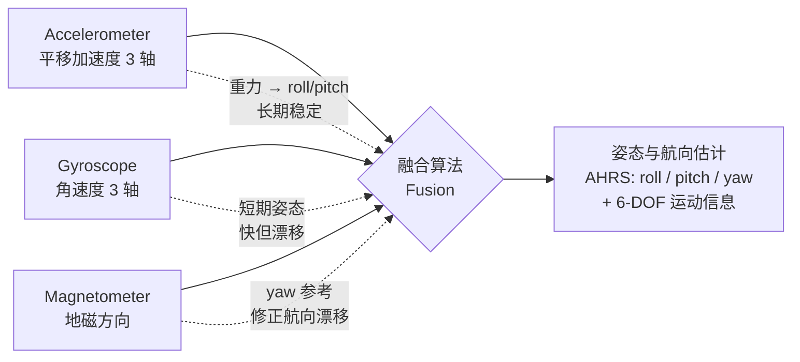

讲师补充了两个实践细节:

1. **Webots 里可以仿真 IMU**,而且大多数机器人平台都装了它——这是你作业里会直接碰到的。
2. **现在很多深度相机 (RGB-D camera) 内部就集成了 IMU**——不只是加速度计和陀螺仪,连磁力计也一起放进去了。这不是巧合:视觉里程计在快速运动时会糊,IMU 在快速运动时反而最准,两者又是一对互补失效模式。

**一句话收束这一 Part:** 编码器告诉你身体摆成什么样,IMU 告诉你身体在怎么动——**但两者都只在很短的时间尺度上可信,因为它们都靠积分,而积分会漂移。** 要让机器人长期知道自己在哪,必须引入**外部感受**的观测。这就是从 Part IV 开始,我们把目光转向外部世界的原因。

---
# Part IV · 测力与触觉:机器人怎么"摸"到世界

## 20. 为什么要测力

前两 Part 的传感器都在测**运动学**的量:角度、速度、加速度。但机器人一旦真的**碰到**东西,位置控制就不够了。

slides 用四个场景说明了力感知的必要性,它们指向同一个道理——**有些任务的成功判据不是"到没到位",而是"用了多大力"**:

- **轻轻拿起易碎物体 (gently picking fragile objects)**。你让机械臂抓一个玻璃杯:如果只做位置控制,手指闭合到指定位置——杯子碎了,或者根本没夹住。**正确的目标不是位置,是力。** 讲师专门举了这个例子,说抓玻璃杯"has to be very touchy in terms of the force"。
- **保持恒定的力 (maintaining a desired force)**:打磨 (sanding)、抛光 (polishing)、装配 (assembling)。这些工艺的质量直接由接触力决定,而工件表面永远不是理想平面——只有闭力环才能贴着实际表面走。
- **与人安全接触 (safe touch-based interactions with humans)**。协作机器人 (cobot) 能跟人共处一室的前提,就是它能感知接触力并及时停下。
- **检测碰撞与意外接触 (detecting collisions and unexpected contacts)**。

slides 给了一句很好的总结:

> **Force sensing connects manipulation to control: it closes the loop around physical interaction.**
> **力感知把操作与控制连起来:它围绕物理交互闭合了控制环。**

注意"闭环"这个词——它把本章接回了上周的 see–think–act。**没有力感知,机器人对世界的接触就是开环的**:它按计划伸出去,至于碰到什么、碰得多重,一无所知。

## 21. 两种间接测力的方法

在买昂贵的专用力传感器之前,有两条便宜的路可以走。它们都是**间接**的——不直接测力,而是测一个跟力有关的量再反推。

**方法一:弹簧位移 → 串联弹性驱动器 (Series Elastic Actuator, SEA)**

配方是:**电机 + 编码器 + 弹簧 = SEA**。

把一个已知刚度的弹簧串在电机和负载之间,然后用编码器(§12 里那个"配合弹簧还能测力"的伏笔在这里兑现)测量弹簧被压缩或拉伸了多少。由胡克定律:

$$F = kx$$

其中 $k$ 是弹簧刚度(已知,出厂标定),$x$ 是测得的位移。**测位移 → 得到力。**

讲师用了一个身体力行的比喻:你拉一根弹簧,拉得越长,手上感觉到的力越大——你的手其实就是在用位移读力。

**方法二:电机电流 (motor current)**

电机的**电流消耗反映关节出力 (joint effort)**。物理上,直流电机的输出力矩近似正比于电枢电流。所以:如果你知道机器人当前的位姿和动力学模型,就能算出"没有外力时,维持这个姿态该消耗多少电流";**实测电流偏离这个预期值,就提示存在外力**。

这个方法的优点是**零额外硬件成本**——电流本来就要测(用于电机控制)。缺点 slides 直说了:**"Useful but model-dependent"(有用,但依赖模型)**。你的动力学模型有多准、摩擦建模有多好,直接决定了这个方法有多可信。而摩擦恰恰是机器人里最难建模的东西之一。

| | **弹簧位移 (SEA)** | **电机电流** |
|---|---|---|
| **原理** | $F = kx$,测弹簧形变 | 电流 ∝ 力矩,与无载模型比对 |
| **额外硬件** | 需要弹簧 + 编码器 | **无** |
| **优点** | 直接、可靠;弹簧还提供机械柔顺性(本身就更安全) | 免费 |
| **缺点** | 弹簧降低了刚度和带宽 | **强依赖动力学与摩擦模型** |

## 22. 力/力矩传感器:测量 6D 力旋量

需要严肃的力测量时,就要用商用的**力/力矩传感器 (F/T sensor, Force/Torque sensor)**。

它测的是一个 **6D 力旋量 (6D wrench)**:

$$\text{wrench} = \underbrace{(F_x, F_y, F_z)}_{\text{3D 力 force}} \;+\; \underbrace{(\tau_x, \tau_y, \tau_z)}_{\text{3D 力矩 torque}}$$

**为什么需要 6 个分量?** 讲师解释得很清楚:光知道"有一个力"是不够的。你需要知道这个力**沿 X、Y、Z 三个方向各有多大**(3 个平移分量),还需要知道它**绕 X、Y、Z 三个轴各产生多大的扭转**(3 个旋转分量)。想想拧螺丝:你既在往下压(力),又在旋转(力矩)——只测其中一个,你对这个动作一无所知。

**怎么实现的?** 绝大多数 F/T 传感器用的是**应变片 (strain gauge)**。典型结构是:**一个内毂 (inner hub) 通过若干金属杆悬挂在外环 (outer ring) 里**。当外力施加时,这些金属杆发生微小形变;贴在杆上的应变片随之被拉伸或压缩,**其电阻随之改变**。用多个方向布置的应变片同时测量,再解一个线性方程组,就能把 6 个力/力矩分量分别恢复出来。

**装在哪?** slides 说:通常装在**机械臂与末端执行器之间**(即"腕部"),或者集成在关节里。装在腕部的好处是它能测到手上受到的**全部**外力,不受手臂自身重量和惯性的干扰(经过重力补偿后)。

## 23. F/T 传感器的五条局限

这一页 slides 用六个格子列了 F/T 传感器的代价,每一条都要能说出所以然:

| 局限 | slides 原文 | 为什么 |
|---|---|---|
| **成本 Cost** | precision manufacturing | 应变片布置和标定要求极高的制造精度 |
| **尺寸 Size** | often wrist-sized | 内毂-外环结构做不小,大约一个手腕那么大 |
| **信号质量 Signal quality** | low signal-to-noise ratio | 应变片的电阻变化极其微小,**信噪比低**,极易受温度和电磁干扰 |
| **响应速度 Responsiveness** | limited bandwidth | 机械结构有惯性和阻尼,**带宽有限**(§6 的概念在这里发挥作用) |
| **空间稀疏性 Spatial sparsity** | single contact measurement | **这是最致命的一条**:它只给出**一个**合力,不告诉你力作用在哪里、有几个接触点 |

**最后一条值得展开。** 一个装在腕部的 F/T 传感器测的是"手整体受到的合力与合力矩"。如果你的手同时在三个地方碰到东西,它只会报告这三个力的**矢量和**——你无法区分"用手掌轻轻托着"和"用一根手指狠狠戳着"。而对于抓取和精细操作,**接触点在哪里**恰恰是最关键的信息。

slides 因此写道:**"This motivates dense pressure and tactile sensing on robot surfaces."**(这促使人们在机器人表面做密集的压力与触觉感知。)——这正是下一节的动机。

讲师在这里插入了本章最令人印象深刻的一段,值得完整保留:

> **🔑 例(讲师课上补充)—— 人手上有多少个触觉感受单元?**
>
> 讲师问全班:我们**一只手**上大约有多少个感知元件?
>
> 答案:**大约 17,000 个**触觉感受单元。
>
> 对比一下:一个腕部 F/T 传感器给你 **1 个**接触测量点。即使是先进的触觉阵列,也只能做到**每平方厘米数十个**。
>
> 讲师说:"**Up to now, there's no machine that has a hand with that many sensing elements.**"(到今天为止,还没有任何机器的手拥有那么多感知元件。)他把这称为**人形机器人最大的挑战之一**,并提到最近腾讯发布的按摩机器人视频——做医疗按摩这类任务,手上必须有极密集的感知元件才行。
>
> 他还加了一句感慨:"Your hand is very important, don't take that for granted."(你的手非常重要,别把它当理所当然。)
>
> **这个数字的意义**:它量化了机器人触觉与人类触觉之间的**数量级鸿沟**——不是 2 倍、10 倍,而是三个数量级。这解释了为什么灵巧操作 (dexterous manipulation) 至今仍是未解决的问题。

## 24. 触觉 vs 压力:二值与分级

现在从"腕部一个点"走向"体表一大片"。

- **触觉传感器 (touch sensor)**:**二值 (binary)** 的接触/碰撞检测——碰到了,还是没碰到。就这样。
- **压力传感器 (pressure sensor)**:**分级 (graded)** 的局部压力测量——碰到了,而且**有多重**。

物理上,**压力正比于施加在感知表面上的法向力 (normal force)**——注意是**法向 (normal)**,即垂直于表面的那个分量。切向的摩擦力,普通压力传感器测不到。

讲师的例子把"分级"讲活了:养老院的**电容压力垫**铺在床上,一个人躺上去和坐上去,压力读数是不同的;体重不同的人,读数也不同。**如果只是二值触觉传感器,你只知道"床上有东西",区分不了这些情况。**

> **🔑 课堂测验(讲师课上做的)** — 触觉传感器和压力传感器的**主要区别**是什么?
>
> **答案:触觉传感器是二值的(碰到/没碰到);压力传感器给出分级的局部压力测量。** 讲师原话:"there's a grading there, it's not binary."

**跟 F/T 传感器比,它们各自的位置在哪?** slides 给了一句精准的定位:

> Compared with F/T sensors: **less dimensional information, but more local and dense.**
> 与力/力矩传感器相比:**维度信息更少,但更局部、更密集。**

这正是那道课堂测验的考点:

> **🔑 课堂测验(讲师课上做的)** — 与腕部力/力矩传感器相比,**密集触觉阵列 (dense tactile array)** 主要提供什么?
> (A) 完整的 6D 力旋量  (B) **更局部的空间接触信息**  (C) 绝对全局位置  (D) 角速度
>
> **答案:B。** 逐项排除:6D 力旋量是 **F/T 传感器**的强项(3 个力 + 3 个力矩),不是触觉阵列的;触觉阵列显然不给全局位置(那是 GPS 的活);角速度是陀螺仪的活。触觉阵列的独特价值就是**"哪里被碰到了、每个点被碰得多重"**——即空间分布信息。
>
> **一句话记忆:F/T = 一个点,六个数;触觉阵列 = 很多点,每点一个数。**

## 25. 电容式压力感知与超越压力的触觉

**电容式压力传感 (capacitive pressure sensing)** 是最常用的原理之一,而且它的机制简单到一句话就能说完:

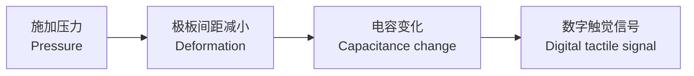

结构是**两块导电极板中间夹一层绝缘材料**,构成一个类电容器件。受压时**极板间距减小**,电容值随之改变,用电子电路一读就知道压了多重。

> 📎 **拓展(超出 slides)** — 平行板电容 $C = \varepsilon A / d$,其中 $d$ 是极板间距。压力使 $d$ 减小,$C$ 就增大——而且是**非线性**地增大($C \propto 1/d$)。这解释了为什么电容式压力传感器需要标定曲线,而不是简单的线性映射。

slides 点明这跟**电容式触摸屏**是同一类思想。讲师则给了一个落地的应用:**养老院的电容感应床垫 (capacitive bed mat)**——能感知老人是躺下了还是坐起来了,而且这种垫子**相对其他接触式方案更容易做密集**。

**触觉不止是压力。** 这是本节最有意思的一段。人的触觉能感知的东西远超"压了多重":

> 讲师说:"如果你把手放在一个表面上滑过,你能感到它是光滑还是粗糙,能感到纹理 (texture)。我摸自己的毛衣,能感到它有纹理。"

**机器人怎么做到?** slides 和讲师给的答案很巧妙:**靠振动 (vibration)**。

人类触觉包含**高频振动线索 (high-frequency vibration cues)** 来感知纹理——手指划过粗糙表面时会产生特定频率的微振动。机器人可以把**加速度计或麦克风集成到柔性换能器 (soft transducer) 里**:传感器划过表面时,表面的微观起伏引起振动,**不同的表面产生不同的振动频谱 (spectral vibration patterns)**,而这个频谱可以拿去做**表面分类**。

于是**人工皮肤 (artificial skin)** 就可以是一个多模态的东西:压力 + 纹理 + **温度** + **光** + 甚至**内嵌相机**。slides 给出的密度指标是:**密集触觉阵列可以达到每平方厘米数十个传感元件,成本低、响应快。**

不过讲师加了一句现实的提醒:**"not every robot has every type of sensor. It depends on the utility of your robot"**(不是每个机器人都装所有类型的传感器,取决于你的机器人要干什么)——一台在仓库里搬箱子的 AMR 不需要人工皮肤,一台做康复护理的机器人则可能非要不可。

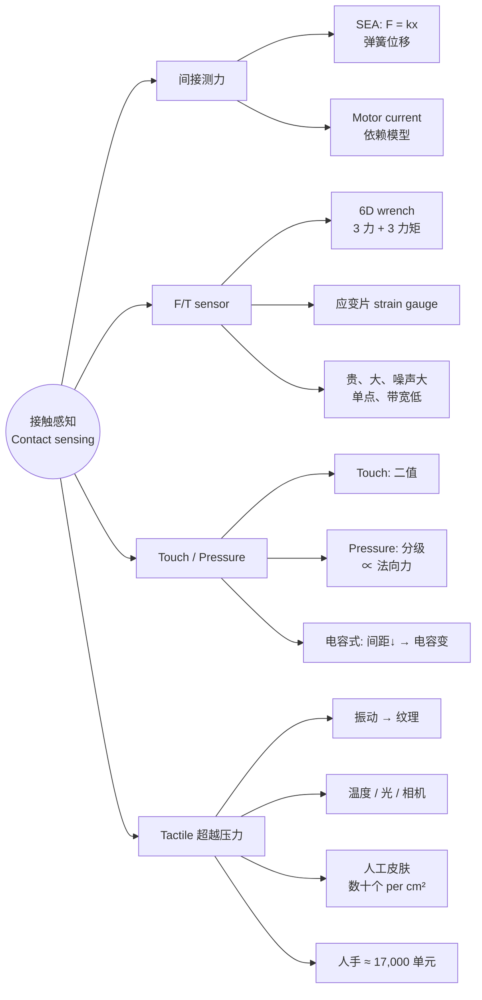

---
# Part V · 测距离:本章最大的一块

讲师在这一 Part 开头就打了预防针:

> "This is probably the most complicated area in terms of sensors for robotics."
> (就机器人传感器而言,这大概是最复杂的一块。)

复杂在哪?**因为"测距离"根本不是一种传感器,而是一整个家族的物理原理。** slides 说得很直白:

> **Key idea: distance sensing is not one sensor type; it is a family of physical principles.**

所以本 Part 的学习策略应该是:**先把"输出形态"和"物理原理"两张分类表刻进脑子,再逐个理解每种原理的公式与失效模式。** 考试考的往往不是"lidar 是什么",而是"lidar 在玻璃墙前会怎样,你该加什么传感器"——那需要你真的懂原理。

## 26. 距离传感的四种输出形态

同样是"测距离",不同传感器吐出来的数据结构差别巨大。这四种形态要能立刻分辨:

| 输出形态 | 是什么 | 典型器件 |
|---|---|---|
| **Single range 单点距离** | 一个 1D 距离数 | 红外测距模块、单个超声探头 |
| **Range scan 距离扫描** | 一个 **2D 极坐标图**(一圈角度,每个角度一个距离) | 2D 激光雷达 |
| **Depth image 深度图** | **逐像素**的距离,像一张图 | RGB-D 相机、ToF 相机 |
| **Point cloud 点云** | **3D 几何**:一堆带 (x, y, z) 坐标的点 | 3D 激光雷达 |

讲师给了一个很实用的工程画面来说明单点测距怎么用:

> 单点测距一次只测一个点。但你可以**在机器人上装 8 个,分别朝向东、南、西、北和四个斜对角**——这样就能在 8 个方向上防撞了。**用数量弥补维度**,是低成本机器人的常规操作。

深度图的价值也值得单独说一句:讲师强调,**深度图通常与 RGB 图像逐像素对齐**。也就是说每个像素同时拥有 RGB 三个颜色值**和**一个深度值——这就是所谓的 **RGB-D**。这种对齐带来的能力是巨大的:你用视觉算法在彩色图上框出一个杯子,立刻就能从对应的深度像素读出它离你多远。**语义 + 几何,一步到位。**

**下面这条铁律,讲师在本 Part 里重复了至少三遍,是最高频的考点:**

> **所有传感器读数都是相对于传感器自己的坐标系 (sensor frame) 说的,不是相对于机器人,更不是相对于世界。**
>
> 即使是点云,每个点的 3D 坐标也是在传感器坐标系里的。要用它,**必须先做坐标变换**——回到本章开头那个"1 米外的障碍物"问题。

slides 也把这句话写进了要点里:"The measurement is relative to the sensor frame; robot pose is still needed to place it in the world."

**最后,选测距传感器时要在这些维度上做权衡**(注意这些词你在 Part I 都学过了):**range(量程)、accuracy(准确度)、precision(精密度)、bandwidth(带宽)、field of view(视场)、cost(成本)。**

## 27. 六大测距原理总览

这张表是本 Part 的骨架,建议直接背下来。每一行的三列——**怎么推出距离、强在哪、弱在哪**——都是考点。

| 原理 | 如何推断距离 | 典型强项 | 典型弱项 |
|---|---|---|---|
| **反射强度 Reflection / intensity** | 回波**强度** | 极便宜;短距离 | **强烈依赖材料** |
| **三角测量 Triangulation** | 回波**角度 / 几何** | 短距离精度好 | **盲区**;对标定敏感 |
| **相位差 Phase shift** | **相位**之差 | 精确;扫描快 | **相位模糊**;多径 |
| **脉冲飞行时间 Pulsed ToF** | **传播时间** | 直接测距;可扩展 | 需精密计时;受环境光影响 |
| **超声 Ultrasound** | 声波传播时间 | 能在锥形波束内发现小物体 | **带宽低**;软表面失效 |
| **雷达 / UWB Radar / UWB** | 无线电 ToF 或 **FMCW** | **抗天气**;长距离 | 角分辨率低;多径 |

讲师提示了一个把这六种原理串起来的物理视角,非常值得记住:

> **无论是光、超声还是雷达,它们本质上都是"波"。** 光和无线电是**电磁波**,只是波长/频率不同(所以红外、可见光、雷达其实是同一条频谱上的不同段);超声是**机械波(声波)**。习惯上,**声波用频率描述,光用波长描述**,但这只是表述习惯,物理上可以互相换算($c = \lambda f$)。

理解了这一点,你就明白为什么这六种原理的公式长得那么像——它们都在测同一件事:**一个波跑了一个来回,从中提取距离。** 差别只在于"用波的哪个属性来读时间":强度、角度、相位,还是直接计时。

slides 在这一页的底部给了本章第二次出现的核心结论:

> **Robust systems usually combine sensors with different failure modes rather than seeking one perfect sensor.**
> **稳健的系统通常组合具有不同失效模式的传感器,而不是去寻找一个完美的传感器。**

注意措辞的升级:第一次(§7)说的是 "different operating principles"(不同工作原理),这次说的是 **"different failure modes"(不同失效模式)**。后者才是真正的目的——**用不同原理只是手段,目的是让它们不要同时坏掉**。

## 28. 反射强度测距:最便宜的那条路

**原理:近的物体通常反射回更强的信号。**

结构极简:一个**发射器 (emitter)** 打出信号,一个**接收器 (receiver)** 收回波,然后**用回波强度反推距离**。

常用**红外 (infrared)** 而不是可见光,slides 的措辞很谨慎:红外能**减少但不能消除**颜色依赖性。

**这是本章最"脏"的一种测距原理,而且脏得很有教育意义。** 它的问题在于:**回波强度受太多东西影响,距离只是其中之一。**

- **表面反射率 (surface reflectance) 和颜色 (colour)**:讲师给了具体例子——**深色/红色材料对红外的反射远弱于其他材料**。反射弱了,你的算法会以为"很远",甚至根本收不到信号。同样距离的白纸和黑布,读数可能差好几倍。
- **入射角 (angle of incidence)**:斜着照上去,大部分能量朝别的方向反射走了。
- **环境红外 (ambient infrared)**:阳光里含有大量红外,直接给你的接收器灌噪声。
- **饱和 (saturation) 与标定漂移**。

而且**输出还是非线性的**:slides 特别指出,**近处可能饱和(强度爆表,再近也分不出),远处则塌进噪声里**。所以这类传感器的可用区间往往很窄。

**那为什么还用它?** 因为它**真的很便宜**。讲师说:"still can be very, very cheap"。对于一台只需要"别撞墙"的教学机器人或扫地机器人,它足够了。**知道它有多脏,然后只在它够用的地方用它——这就是工程判断。**

## 29. 光学三角测量:用几何代替强度

三角测量的动机很清楚:**回波强度太不可靠了,能不能改用一个更稳定的量?**

答案是**角度**。**光学三角测量 (optical triangulation)** 的做法是:

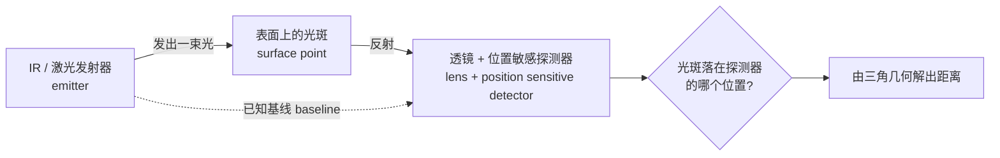

发射器和探测器之间隔着一段**已知的基线 (baseline)**。物体越近,反射光斑落在探测器上的位置就越偏——**光斑位置(或等价的回波角度)与距离之间存在确定的几何关系**。测出位置,查几何,得距离。

**关键的改进在于:它不看信号有多强,只看信号落在哪里。** 强度会随材料和角度剧烈变化,但**光斑的位置不会**。这就把 §28 里最大的病治好了一半。

**强项**:短距离精度好、电路简单、输出快。典型应用是紧凑型短距红外测距模块和工业激光位移传感器。

**弱项**(注意这一条是三角测量特有的,考试很爱考):

- **有限的最小距离与盲区 (finite minimum distance, blind/dead zones)**。为什么?因为当物体**太近**时,反射光的角度会大到**根本落不到探测器上**。基线越长,精度越好,但盲区也越大——**这是一个内在的权衡**。
- **视场窄 (narrow field of view)**。
- **误差源**:失准 (misalignment)、镜头污染 (lens contamination)、**镜面反射 (specular reflection)**、**黑色或透明表面**、标定误差。

注意"黑色和透明表面"这个组合会在本章反复出现——它是**所有光学测距**的共同软肋,我们在 §36 会把它系统化。

## 30. 相位差测距:用波的相位读时间

前两种方法都在"空间域"做文章(强度、角度)。相位差法转向了"时间域",但用了一个聪明的迂回。

**问题**:光速太快了。要用直接计时测 1 米,你得分辨约 6.7 纳秒——很贵。

**相位差 (phase shift) 法的思路**:不直接计时,而是**给发射的光做强度调制 (intensity-modulated)**,让它的亮度按某个频率 $f_m$ 正弦变化。光跑一个来回回来后,这个调制波的**相位会滞后一个 $\Delta\varphi$**。**测相位比测纳秒容易得多**,而相位差就编码了飞行时间。

$$d = \frac{c \cdot \Delta\varphi}{4\pi f_m}$$

**读懂这个公式**(这一步很重要,公式不能只是抄):

- $c$:波速(光速);
- $\Delta\varphi$:测得的相位差,单位是弧度;
- $f_m$:**调制频率**(不是光本身的频率!是亮度起伏的频率);
- 分母里的 $4\pi$ 而不是 $2\pi$,是因为光跑的是**来回两趟**——往返路程是 $2d$,所以要再除以 2。

用一句话读出来就是:**"相位差占整个调制周期的比例,乘以调制波长,再除以二,就是距离。"**

**核心权衡(slides 明确写出的考点)**:

> **A longer modulation wavelength gives longer unambiguous range but lower distance sensitivity.**
> **调制波长越长,无模糊量程越长,但距离灵敏度越低。**

为什么?因为相位只能在 $0$ 到 $2\pi$ 之间取值。一旦物体远到让相位差超过 $2\pi$,**相位就"绕回来"了**——你测到 $0.1\pi$,分不清它是 $0.1\pi$ 还是 $2.1\pi$ 还是 $4.1\pi$。这就是**相位缠绕 (phase wrapping)**,对应的最大可测距离叫**无模糊量程 (unambiguous range)**。

- 调制波长长 → 无模糊量程大 → 但同样的相位测量误差对应更大的距离误差(灵敏度低);
- 调制波长短 → 灵敏度高、精度好 → 但很近就绕回来了。

**鱼与熊掌**。实际的 ToF 相机常用多个调制频率来同时兼顾两者。

**主要误差**:相位缠绕、**多径反射 (multipath)**、低反射率、**混合像素 (mixed pixels)**、调制频率标定。

**用在哪**:很多**扫描式激光雷达**和**早期 ToF 相机**都用这个原理。

## 31. 脉冲飞行时间:最直接的那种

**脉冲飞行时间 (Pulsed Time-of-Flight, ToF)** 是概念上最简单的测距方式:**发一个脉冲,数它多久回来,除以二。**

$$d = \frac{c \cdot \Delta t}{2}$$

除以 2 是因为信号跑了**往返**。

流程:发射器发出一个**短光脉冲或编码信号** → 接收器**估计回波到达的时刻** → 算时间差 → 得距离。

**技术难点全在计时上。** slides 给了具体数字:

> **For light, centimetre accuracy requires sub-nanosecond timing.**
> **对光而言,厘米级精度需要亚纳秒级的计时。**

> 📎 **拓展(超出 slides)** — 算一下就知道有多难:光速约 $3\times10^8$ m/s,1 纳秒里光跑 30 cm(往返算 15 cm)。要做到 1 cm 的距离精度,你的计时误差必须小于约 67 皮秒。这就是为什么高性能激光雷达比超声传感器贵几百倍——**你买的不是激光,是那颗计时芯片**。
>
> 工程上的替代方案是 slides 提到的**间接快门/门控技术 (indirect shutter/gating techniques)**:不直接测时间,而是在两个不同的时间窗内分别积分接收到的光子数,用两者的比值反推到达时刻。这是消费级 ToF 相机的常用做法。

**误差源**(其中两个是 ToF 特有的,值得记):

- **计时抖动 (timing jitter)**、**环境光**、**回波光子太少**、**饱和**、**多径**;
- **飞点 (flying pixels)**:发生在**深度边缘**。当一个像素的视场同时覆盖了前景物体和背景时,它收到的回波是两者的混合,算出来的深度落在两者中间——空间中于是出现一堆**根本不存在的、悬浮在物体边缘的点**。这在点云里非常显眼。
- **深度相机中的卷帘快门效应 (rolling-shutter effects)**。

## 32. 激光扫描仪与激光雷达:把一个点扫成一片

单点 ToF 只给你一个数。**激光扫描仪 (laser range scanner) / 激光雷达 (lidar)** 的思想是:**把这个快速的单点测量在空间中扫过去,拼成扫描线或点云。**

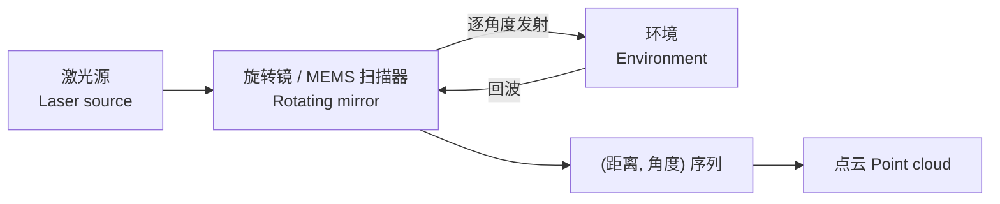

讲师解释了为什么要用**旋转镜 (rotating mirror)**:因为你**不可能装很多个激光发射器**——太贵。所以只用一个发射器,靠一面转动的镜子把激光**引导到不同方向**,一条线一条线地扫。

**2D 激光雷达**:只扫一个平面,给出一条扫描线。常用于**室内移动机器人和建图**。
**3D 激光雷达**:多光束、旋转式或固态扫描,给出完整点云。常用于**自动驾驶汽车**。

输出通常是**一组 (距离, 角度) 对**,可以直接转换成点云。

**强项**:角度覆盖广、几何精确、**SLAM 生态成熟**(讲师强调"a lot of SLAM is based on the laser")。

**局限与误差**(这一串要背):**玻璃、黑色表面、雨/雾/尘、多径、阳光干扰、扫描过程中的运动畸变 (motion distortion)**。

> 📎 **拓展(超出 slides)** — "扫描过程中的运动畸变"是个容易被忽略的坑:一次 360° 扫描需要几十毫秒,如果机器人在这期间移动了,那么这一"帧"扫描里的不同角度实际上是**从不同位置**测出来的。把它们当成同一时刻的数据来用,墙就会被扭曲。高速平台上必须用 IMU 或里程计做**去畸变 (deskewing)**。

**扫描匹配 (scan matching) 与 3D 建图**:slides 单独给了一页。思想是:在时刻 $t_1$ 采一帧扫描,在时刻 $t_2$ 采另一帧,**把两帧对齐 (match) 起来**——对齐所需的那个变换,既告诉了你机器人这段时间移动了多少(**定位**),又让你能把两帧拼成一张更大的图(**建图**)。这就是 **SLAM(同步定位与建图)** 的核心机制,后面几周会详细展开。

> **🔑 例(讲师课上补充)—— 悉尼歌剧院的激光扫描**
>
> 讲师提到,澳大利亚政府曾花费约**一百万澳元**请公司用激光扫描**悉尼歌剧院**,从而得到一个详细的 3D 模型。
>
> 这个例子说明了 lidar 的另一半价值:它不只是机器人的"眼睛",也是**高精度三维测量工具**。一次扫描一条线,多次扫描合并 (merge),就能建出建筑级别的 3D 模型。

## 33. 深度相机:三条通往深度图的路

到目前为止我们得到的都是"点"或"线"。**深度相机 (depth camera)** 的目标不同:**一次给出一整张深度图**——每个像素都有一个距离值。

slides 给出了三条技术路线,它们的物理原理完全不同,失效模式也完全不同。**这张对比表是高频考点:**

| | **结构光 Structured light** | **双目立体 Stereo vision** | **ToF 相机 ToF camera** |
|---|---|---|---|
| **怎么做** | **投射已知图案**,看图案怎么变形 | **匹配左右两张图**,算视差 | **逐像素**测飞行时间/相位 |
| **公式 / 机制** | 图案形变 → 深度 | $Z = \dfrac{fB}{\text{disparity}}$ | $d = c\Delta t/2$ 或相位法 |
| **主动/被动** | **主动**(投红外图案) | **被动**(可加主动纹理) | **主动** |
| **强项** | 室内近距离效果好 | 无需发射能量;成熟 | 紧凑、密集;适合操作与人体感知 |
| **弱项** | **强阳光下失效**;反射/透明表面失效 | **需要纹理**;遮挡、重复纹理、无纹理表面出错 | **多径、混合像素、运动模糊** |

### 33.1 结构光与 Kinect

**结构光 (structured light)** 是三角测量思想的二维推广。做法:用红外投影仪往场景上**投射一个已知的图案**(通常是网格或伪随机散斑点阵),然后用一台**红外相机**拍下这个图案。

关键洞察是:**如果场景是一个平面且距离固定,拍到的图案就应该和投射出去的一模一样。** 但真实物体表面**不是平的**——每个点离相机的距离都不同,于是图案在拍到的图像里会**发生形变 (deformation)**。**形变的量,几何上直接对应该处表面的深度。**

讲师原话:"based on the change of the pattern from the expected one, we can calculate the distance."

> **🔑 例(讲师课上详述)—— Kinect:让 3D 感知变便宜的那个转折点**
>
> **Kinect** 是微软为 Xbox 游戏机推出的体感相机(讲师推算发布于 **2010–2011** 年),它是一台**改良的结构光 3D 扫描仪**。
>
> **结构**:一个**红外图案投影仪** + 一台**红外相机**(用来拍投影图案、算深度) + 一台**RGB 相机**(用来拍彩色图),而且**深度图与 RGB 图是对齐的**。于是每个像素同时有 RGB 值和深度值——这就是 **RGB-D**。
>
> **参数**(讲师给的具体数字,很有参考价值):
> - 早期版本深度分辨率约 **320×240**,后来提升到 VGA / SVGA;
> - 价格约 **200 澳元零售**,批发更便宜;
> - **Kinect v2** 的有效工作距离约 **0.8 m 到 3–4 m**(早期版本约 1.5–4 m);
> - 在约 **2 米**处,测量精度约 **1–5 毫米**。
>
> **最重要的一条**:讲师强调,**误差随距离增加不是线性增长,而是显著的、指数式的增长**。也就是说这类相机在近处非常准,一旦超出设计距离就迅速崩掉。**超出量程之外,它不是"稍微不准",而是完全不能用。**
>
> **为什么这台游戏外设在机器人学史上重要?** 因为在它之前,能给出稠密深度图的设备是实验室级别的昂贵仪器;Kinect 把价格砍到了两百澳元,直接引爆了整个 RGB-D SLAM 和 3D 感知的研究浪潮。

**结构光的致命弱点**:讲师反复强调——**它在户外基本不能用**。因为**阳光里含有大量红外**,会把投影出去的红外图案完全淹没。这是 §9 里"主动传感器要跟自然背景竞争"那条原则最典型的体现。户外要测距,你就得用功率更高的 ToF 或激光雷达,**而那要贵得多**。

### 33.2 双目立体视觉

**双目立体视觉 (stereo vision)** 模仿人的两只眼睛:左右各一台普通相机,**不发射任何能量**(所以是**被动**的)。

原理是三角测量:空间中同一个物理点,会**投影到左右两张图像的不同位置上**。这个位置差就叫**视差 (disparity)**。物体越近,视差越大。深度由下式给出:

$$Z = \frac{f \cdot B}{\text{disparity}}$$

其中 $f$ 是焦距,$B$ 是**基线 (baseline)**(两台相机光心的间距),disparity 是视差(以像素计)。

**读懂它**:深度与视差成**反比**。这意味着**近处深度分辨率高,远处急剧下降**——当物体足够远,视差接近 0,分母的一点点误差就会让 $Z$ 爆炸。**这是所有被动立体系统的固有性质,也是讲师说"stereo works reasonably well for near objects but not for faraway objects"的数学原因。**

**核心难点:对应问题 (correspondence problem)。** slides 用一整页强调了这一点:

> "Computer vision is very complex. **Correspondence problem** makes stereo vision more difficult."

问题是:要算视差,你必须先知道**左图的这个像素,对应右图的哪个像素**——而这远不是显然的。于是:

- **无纹理表面**(一面白墙)→ 每个像素长得都一样,**根本无法匹配**;
- **重复纹理**(瓷砖、栅栏)→ 匹配到错误的周期上;
- **遮挡 (occlusion)** → 左图看得到的点,右图根本看不到。

**解法是"主动双目 (active stereo)"**:既然被动立体缺纹理,那就**投射一个红外纹理图案上去**,人为地给白墙"画上花纹",再做立体匹配。这是结构光与立体视觉的杂交,也是现代消费级深度相机的主流做法。

> **🔑 例(讲师课上补充)—— Intel RealSense**
>
> 讲师介绍了他们**实验室实际在用**的器件:
> - **RealSense D415 / D435**——主动双目深度相机,非常小巧,"most of our robots started using this one"。RealSense 原本是 Intel 的产品线,现已分拆成独立公司。
> - **RealSense L515**——**激光雷达相机**,直径约 **6 厘米**,极其紧凑。讲师说 **lidar 方案的精度总体优于立体方案,但成本更高**;这款产品**已经停产**,他推测原因就是**成本**——"just like a car, like a mobile phone, each component has to cost as little as possible"。
>
> 这个小故事有它的现实意义:**在机器人产业里,技术上更优的方案经常输给成本**。你做系统设计时,"哪个更准"往往不是决定性问题。

### 33.3 ToF 相机

第三条路是把 §30/§31 的时间/相位测距做成**逐像素**的:传感器阵列上**每个像素独立估计自己的距离**。

**强项**:紧凑、稠密,适合**操作 (manipulation) 与人体感知**。
**弱项**:**多径 (multipath)**——光在房间角落里多次反射后才回来,让角落显得比实际更远;**混合像素 (mixed pixels)**;**运动模糊**。

**三条路线的共同结论**(slides 的原话):

> **Strength: dense geometry. Limitation: depth image quality depends heavily on scene texture, material, illumination and calibration.**
> **强项:稠密的几何信息。局限:深度图质量严重依赖场景纹理、材料、光照与标定。**

## 34. 超声测距:慢,但因此简单

超声走的是和 lidar 完全相同的 ToF 原理,却因为一个物理事实而变成了一种性格截然不同的传感器:**声音很慢。**

**空气中声速约 344 m/s**——比光慢了约一百万倍。后果是:

**好消息:计时变得极其容易。** 测 1 米距离,往返时间约 5.8 毫秒——用最普通的单片机就能测准。所以**超声传感器可以做到极其便宜**。

**坏消息:带宽极低。** 每测一次都得等回波跑完全程。要测 5 米外的物体,一次测量就要 30 毫秒;还得留出余量避免上一次的回波干扰下一次。所以 slides 的标题写着:**"Sound is slow, so time-of-flight is easy, but bandwidth decreases with range."**(声音慢,所以飞行时间好测,但带宽随量程下降。)——**注意这句话把 §6 的带宽概念和量程直接挂上了钩:量程和带宽在超声这里是直接冲突的。**

**波束形状是另一个决定性特征:超声发出的是一个锥形波束 (cone),不是一条细线。**

这是一把双刃剑,slides 和讲师都强调了两面:

- **好的一面**:锥形波束能**发现细小的障碍物**,而不需要一条细激光正好打中它。一根细柱子,激光可能从旁边扫过去了,超声的锥面却能覆盖到。
- **坏的一面**:**你不知道回波来自锥内的哪个方向**。传感器报"1.2 米有东西",但那个东西可能在正前方,也可能在锥的边缘 30° 外。这叫**锥形模糊 (wide cone ambiguity)**。讲师补了一句实用的经验:**锥的中心区域精度和可靠性最高,越靠近边缘越差。**

**其他局限**(slides 单独用一整页列出):

- **不具方向性 (not directive)**——就是上面的开角问题;
- **软表面吸收大部分声能**(布料、泡沫、窗帘)——回波太弱,**物体"消失"**;
- **表面远离垂直方向 → 镜面反射 (specular reflection)**。这个尤其阴险:声波像打在镜子上一样**整个反射到别的方向去了**,传感器什么也收不到,于是报告"前方无障碍"——**而实际上前面有一堵斜墙**;
- **更新频率低**(声速所限);
- **温度依赖**(声速随温度变化)、**传感器之间的串扰 (crosstalk)**。

**典型应用**:**倒车雷达/泊车辅助**、简单避障。有效距离从**厘米到数米**。讲师说得直接:"most robotics like the ultrasound because it's so cheap"。

## 35. 雷达与 UWB:用无线电

最后一种原理换了波段:**用无线电波而不是光或声音。**

**测距机制**有三种:飞行时间、相位,或**调频连续波 (FMCW, Frequency-Modulated Continuous Wave)**——发射一个频率随时间线性变化的"啁啾 (chirp)"信号,回波与当前发射信号的**频率差**正比于距离。

**额外的能力:测速。** 由于**多普勒频移 (Doppler shift)**,雷达不仅能测距离,还能直接测出目标的**相对速度**——这是光学传感器做不到的(lidar 要测速必须比较两帧)。这就是为什么汽车的自适应巡航用雷达。

**UWB (Ultra-Wide Band,超宽带)**:用极短的无线电脉冲估计距离,**常用于室内定位**。这个会在 §37 的室内定位里再出现。

**核心优势:抗恶劣环境。** slides 说:"Radio sensing is **less affected by fog, dust and lighting** than optical sensing."(无线电感知比光学感知更少受雾、尘和光照影响。)这是雷达存在的根本理由——**当所有光学传感器都瞎了的时候,雷达还在工作。**

**局限**:

- **角分辨率低于 lidar**——雷达能告诉你"前方 40 米有个东西在以 20 km/h 接近",但对它的形状轮廓的刻画远不如 lidar 精细;
- **金属结构周围的多径**;
- **鬼影目标 (ghost targets)**、目标反射率变化。

**这就凑齐了自动驾驶的经典三件套**,而且现在你能说清为什么是这三样:

| | 提供什么 | 什么时候瞎 |
|---|---|---|
| **相机** | 语义(这是行人/红灯/车道线) | 黑夜、逆光、雨雾 |
| **激光雷达** | 精确几何 | 雨雾尘、玻璃、黑色车漆 |
| **雷达** | 距离 **+ 速度**,全天候 | 角分辨率粗,金属多径 |

**三者的失效条件几乎不重叠**——这正是 §27 那句 "different failure modes" 的完整体现。
## 36. 测距误差的六大机制:一张总表

前面每一节都在结尾列误差,现在把它们收拢成一个**可迁移的框架**。slides 用了六个格子——**这六个格子是回答"这个传感器在什么情况下会骗我"这类考题的标准答题模板**。

| 类别 | 具体表现 | 为什么 |
|---|---|---|
| **材料 Material** | **黑色、光亮、透明、吸收性或柔软**的表面会返回**微弱或误导性**的信号 | 反射率决定了有多少能量回得来 |
| **几何 Geometry** | **斜入射 (oblique incidence)**、边缘、**混合像素**——一束光同时打到多个深度 | 回波方向和回波构成由几何决定 |
| **环境 Environment** | 环境光、阳光、**雨、雾、尘**、声学噪声、电磁干扰 | 外界能量与你的信号竞争 |
| **计时 Timing** | 带宽限制、**扫描运动畸变**、同步误差、信号延迟 | 测量不是瞬时的 |
| **标定 Calibration** | 内参/外参**漂移**、温度与机械失准 | 几何关系会随时间变化 |
| **模糊 Ambiguity** | **相位缠绕**、**多径**、串扰、**一束/一锥内有多个物体** | 一个读数对应多种可能世界 |

**"材料"那一格是所有光学测距的共同软肋**,值得把这几种表面拆开看:

- **黑色表面**:吸收绝大部分入射光 → 回波太弱 → 报"很远"或无读数;
- **光亮/镜面表面**:**镜面反射**把光整个弹到别处 → 传感器什么也收不到,或者收到的是**镜子里那个虚像的距离**;
- **透明表面(玻璃)**:讲师专门讲了这个——**激光会穿透玻璃**,于是你测到的是玻璃后面那个东西的距离,**玻璃本身在你的地图上不存在**。对于一个正在朝落地窗开过去的机器人,这是个灾难性的失败;
- **柔软/吸收性表面**:对超声尤其致命(吸声)。

slides 在这一页的结论呼应了 §4 的分辨率讨论:

> **The same numerical resolution can hide very different accuracy and precision in real environments.**
> **同样的数值分辨率,在真实环境中可能掩盖着截然不同的准确度与精密度。**

换句话说:**datasheet 上的分辨率是在实验室的理想靶面上测的;你的机器人跑的是真实世界。**

## 37. 怎么选一个测距传感器

有了原理和失效模式,选型就成了一件可以讲道理的事。slides 给了一张任务导向的表:

| 任务 | 候选传感器 | 理由 |
|---|---|---|
| **低成本避障** | 红外反射 或 **超声** | 便宜、简单,短距离够用 |
| **室内建图 / 导航** | **2D lidar + 轮式里程计 + IMU** | 几何可靠,**SLAM 流水线成熟** |
| **近距离操作 (manipulation)** | 深度相机 + 短距三角测量 | 稠密局部几何;**需要手眼标定** |
| **户外车辆** | **3D lidar + 雷达 + 相机** | 可见性、量程与速度线索**互补** |
| **室内全局定位** | **UWB/信标 + lidar/视觉** | 信标抑制漂移,局部传感器处理障碍 |

slides 的结论句:

> **Good sensor design is usually multi-sensor design: complementary strengths reduce failure cases.**

讲师在课上把这张表变成了两道测验题,它们的解题思路比答案本身更值得学:

> **🔑 课堂测验 1** — 对**室内建图与导航**,下面哪个组合最合适?
> (A) GPS  (B) **2D lidar + 轮式里程计 + IMU**  (C) 仅触觉传感器  (D) 仅磁力计
>
> **答案:B。** 讲师的推理值得复述,因为它是一个**通用的排除法**:
>
> 导航需要两件事——**知道环境**(外部感受)**和知道自己**(本体感受),缺一不可。
> - **GPS**:室内**根本收不到信号**,直接出局;
> - **仅触觉/保险杠**:只有撞上了才知道,**对导航毫无帮助**;
> - **仅磁力计**:只测自己的朝向,**完全不感知环境**;
> - **B**:**2D lidar 感知环境**,**轮式里程计测走了多远**,**IMU 测自身姿态**——本体 + 外部齐备。
>
> **答题模板:先问"这个组合里有没有外部感受?有没有本体感受?"** 两者缺一,就不是导航方案。

> **🔑 课堂测验 2** — 你要做一台**低成本室内机器人**,只需要避开近处障碍。你**最初**会选 3D lidar 还是超声/红外?
>
> **答案:超声。** 讲师的话:"lidar is more expensive. You **can** use lidar to serve the purpose, but it does **not** serve the low-cost purpose."
>
> **这道题的考点是"需求匹配",不是"哪个更强"。** 3D lidar 当然能避障——但它是用一万块钱的方案解决一百块钱的问题。**在工程里,过度设计和设计不足同样是错误。**

## 38. 从原始测距到稳健感知

最后一步:传感器给了你一堆数,离"可用的感知"还差四道工序。slides 给了这条流水线:

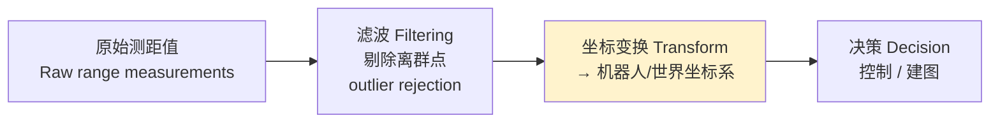

四条要点,每一条都在回答"为什么不能直接用原始数据":

1. **用标定 (calibration) 把测量从传感器坐标系变换到机器人坐标系。** 这就是本章开头那个问题的正式答案,也是讲师全程重复最多的一句话。
2. **用时间滤波 (temporal filtering) 抑制噪声、拒绝不可能的跳变。** 如果上一帧墙在 2.0 米,这一帧突然报 0.3 米,再下一帧又回到 1.98 米——那个 0.3 几乎肯定是**离群点 (outlier)**,不是墙突然扑过来了。
3. **与编码器、IMU、视觉或全局位姿传感器融合,以抑制漂移与模糊。**
4. **显式建模不确定性:不要把每个距离点都当成同样可靠。** 这一条最重要,也最常被初学者违反。一个正对着传感器的白墙上的点,和一个来自锥形波束边缘、打在黑色布料上的点,**在你的算法里不该有同等的话语权**。

slides 的收尾句是本 Part 最该带走的一句话:

> **Take-home: distance sensors are powerful but incomplete; reliability comes from understanding their failure modes.**
> **要点:测距传感器很强大,但不完整;可靠性来自于理解它们的失效模式。**

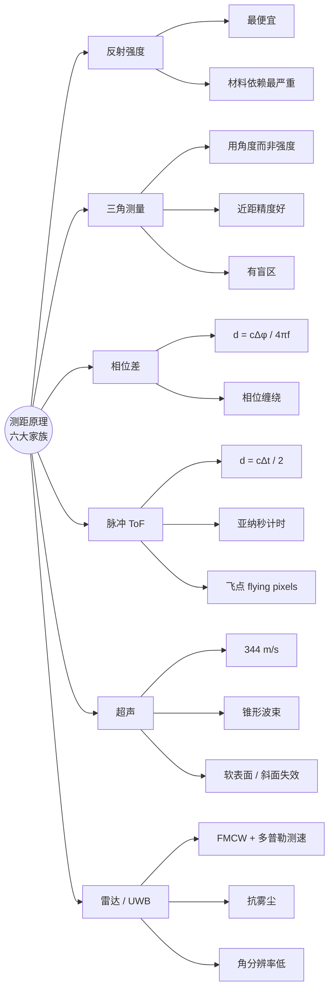

---

# Part VI · 测全局位姿:我在世界的哪里

到目前为止,所有传感器给出的都是**相对**信息:关节转了多少、我加速了多少、前面 2 米有东西。把这些累加起来能推算位置,但我们已经知道——**积分必漂移**。

要打断这个漂移,你需要一个**外部的、绝对的参考**:一个不依赖于你走过多少路的、直接告诉你"你在世界坐标系的哪个点上"的观测。这就是**全局位姿感知 (global pose sensing)**。

## 39. GPS:室外的全局定位

**GPS** 的机制并不复杂,但那个"为什么是 4 颗卫星"的问题几乎每年都会考。

**基本流程**:

1. 每颗卫星**广播自己的位置和发射时刻**;
2. 接收机根据**信号传播时间**估计到该卫星的距离;
3. 有了到若干个已知点的距离,就能解出自己的位置。

**为什么需要 4 颗?** slides 说得很清楚:

> **Four satellites are needed because position and receiver clock offset are unknown.**
> **需要四颗卫星,是因为位置和接收机钟差都是未知的。**

展开来讲:未知数有 **4 个**——位置的 $x, y, z$ **加上接收机的时钟偏差 $t$**。

**为什么时钟偏差是未知数?** 因为距离是靠时间算的($d = c \cdot \Delta t$),而要算出 $\Delta t$,你的钟必须和卫星的钟严格同步。卫星上装的是原子钟,你手机里那个几毛钱的石英晶振可差远了——**哪怕只差 1 微秒,就是 300 米的距离误差**。所以聪明的做法不是去校准你的钟,而是**把钟差当成第 4 个未知数一起解出来**。

4 个未知数 → 需要 4 个方程 → **需要 4 颗卫星**。

**实践特性**:

- **首次定位 (initial fix) 可能要几分钟**;之后每秒可以更新多次。讲师印证了这一点:把车开到户外,GPS 要"花一点时间"才能开始工作。
- **精度不够**。slides 的措辞很直接:"For many robotics tasks, GPS alone is not precise or accurate enough; fuse it with IMU, wheel odometry, lidar or vision."(对许多机器人任务而言,单靠 GPS 精度和准确度都不够;要与 IMU、轮式里程计、lidar 或视觉融合。)民用 GPS 的典型误差在**数米**量级——对于一辆需要保持在车道内(宽 3.5 米)的车,这远远不够。

**什么时候彻底失效**:讲师点了两个场景——

- **室内**:收不到卫星信号;
- **城市峡谷 (urban canyon)**:高楼林立的市中心,信号被建筑遮挡或经**多径**反射后到达,位置会突然跳几十米。

> 📎 **拓展(超出 slides)** — 讲师提到 **GPS 只是众多全球导航卫星系统之一**:美国的 **GPS**、欧洲的 **Galileo**、俄罗斯的 **GLONASS**、中国的**北斗 (BeiDou)**、日本的 **QZSS**、印度的 **NavIC**。它们的统称是 **GNSS (Global Navigation Satellite System)**。现代接收机通常同时接收多个系统的信号——**可见卫星越多,解算越稳**,尤其是在城市峡谷里。

## 40. 室内怎么办:用信标和标记替代卫星

室内没有卫星,但**"到若干个已知点的距离/角度"这个思想仍然成立**——只要你**自己造一批"卫星"**。slides 给出了三条路线:

| | **被动标记 Passive markers** | **主动信标 Active beacons** | **局部感知 Local sensing** |
|---|---|---|---|
| **是什么** | **AprilTag** / 条形码 / 反光标 | **UWB** / 超声 / 无线电 | lidar / 视觉 / IMU |
| **怎么工作** | 相机检测标记,由**已知的标记几何**解算位姿 | 发射器位置已知,机器人估计到各**锚点 (anchor)** 的距离 | 在标记/信标被遮挡时**填补空缺** |
| **优点** | **成本低** | UWB 支持基于无线电的相对定位,**室内常用** | 同时**抑制漂移**并检测障碍 |
| **缺点** | 需要**视线 (line of sight)** 和受控的布置 | 需要预先安装并标定锚点位置 | 本身仍是相对测量 |

讲师用一个具体场景把它讲活了:

> **🔑 例(讲师课上补充)—— 医院/酒店服务机器人怎么定位**
>
> 这类环境有一个重要性质:**建筑是固定的**。所以你可以在环境里**预先埋设参考**:
>
> **方案 A——贴标记。** 在墙上、天花板上贴 **AprilTag** 或条形码(磁性的、视觉的都行)。机器人的相机一看到某个标记,**立刻就知道自己在哪**——因为每个标记的 ID 对应一个已知的世界坐标,而标记在图像中的形变还能反解出相机相对它的位姿。
>
> **方案 B——装信标。** 在建筑里固定安装 **UWB 或超声发射器**,**这些发射器的位置是已知的**。机器人接收信号,估计到各个发射器的距离,三边定位。
>
> 讲师特别强调了一个容易搞反的细节:**发射器固定在建筑上,而不是装在机器人上**——"otherwise the emitter will be moving along with the robot"。这正是 GPS 的架构:**卫星(锚点)在已知位置,接收机在你身上。** 如果反过来把发射器装在机器人上,你就没有固定参考了。

**最终结论**(slides 原文):

> **Practical indoor localization often combines global references with local distance sensing and ego-motion estimation.**
> **实用的室内定位通常把全局参考、局部测距和自我运动估计结合起来。**

请注意这句话把本章前五个 Part **全部串起来了**:

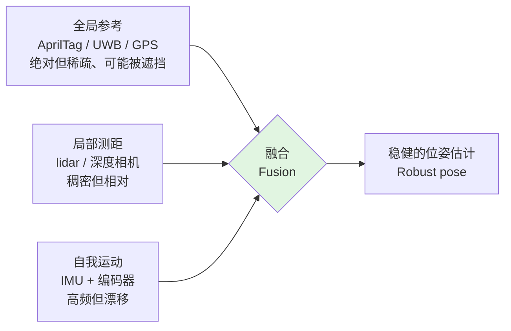

三者的时间特性正好互补:**IMU/编码器给你高频但会漂的短期信息,lidar 给你中等频率的局部几何,全局参考偶尔出现但能一次性把漂移清零。** 这个三层结构就是现代机器人定位系统的标准骨架,后面几周讲 SLAM 时会一直用到。

**如果室内既没有标记也没有信标怎么办?** 讲师给了答案:那就**用 lidar 做局部感知,把问题变成一个定位与建图 (localization and mapping) 问题**——即 SLAM。这是最通用但也最难的路线,因为你要**在没有任何外部参考的情况下,同时搞清楚"地图长什么样"和"我在地图的哪里"**。

---
# Part VII · 理解场景:图像传感器

## 41. 为什么距离不够

到这里,机器人已经知道自己的关节在哪、在怎么动、碰到了什么、周围几何长什么样、自己在世界的哪个位置。听起来很完整了。但讲师用一个场景指出了缺口:

> "如果你给出指令——**'去拿一个杯子,送到 103 房间'**——机器人做不到。因为它只有距离。"

**距离告诉你"那里有个东西",不告诉你"那是什么东西"。** 点云里有一团形状,但它是杯子、还是花瓶、还是别人的水壶?哪个是 103 房间的门?自然语言指令里的每一个名词,都要求机器人具备**语义 (semantics)** 能力。

> "You need to understand things before the robot can receive the instruction in natural language."

这就是最后一类传感器的任务:**场景理解 (scene understanding)**。而承担这个任务的,绝大多数时候是**相机**。

## 42. 可见光相机:一条从光子到数字的流水线

**可见光相机 (visible-light camera)** 是**被动 (passive)** 图像传感器:它测量的是场景反射的、人眼可见波段的光。

**可见光的波段是 400–700 nm**(讲师给的数字)——这是本 Part 后面区分红外的基准,请记住。

成像链路是这样的:

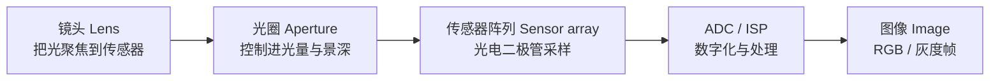

讲师把镜头和光圈类比成人眼:**光圈 (aperture) 就像瞳孔,控制有多少光进来**。

**一个必须理解的机制:曝光 (exposure)。** slides 说:相机在一段**曝光时间**内**积分入射的光子**,所以**运动和光照会直接影响测量**。

这句话的分量在于:**相机的读数不是"某一瞬间的场景",而是"一段时间内场景的积分"。** 于是——曝光期间物体动了,就**运动模糊 (motion blur)**;曝光期间光变了,整帧的亮度就变了。**相机测的从来不是"物体是什么颜色",而是"在这段时间里有多少光子打进来"。**

**机器人用可见光图像干什么**:物体检测、跟踪、**视觉伺服 (visual servoing)**、SLAM、检测 (inspection)、人机交互。

**重要设置**(这些是你调相机时真正要动的旋钮):曝光时间、增益 (gain)、白平衡 (white balance)、对焦、帧率、分辨率、**快门类型 (shutter type)**。

**这一页的结论句极其重要**,它是理解相机全部优缺点的钥匙:

> **Main weakness: appearance is highly informative but not physically invariant.**
> **主要弱点:外观信息量极大,但不具备物理不变性。**

翻译成人话:**同一个场景,几何一点没变,光一变,图像就完全不同了。** slides 的原话是 "The same scene can look very different under changing lighting even if geometry is unchanged."。**lidar 测的距离是物理量(几何不变它就不变),相机测的外观不是。** 这一条会解释后面所有的相机局限。

## 43. CMOS 与 CCD,以及快门类型

**成像原理**:每个像素都有一个**光敏元件 (photodiode)**,把光子转换成电荷,再由电路累积和读出。

**两种技术路线**:

| | **CCD** | **CMOS** |
|---|---|---|
| **特点** | 均匀性极好、**噪声低**、色彩还原好 | 读出电路**集成在芯片上** |
| **代价** | 需要专门的读出电路;**功耗高** | 早期噪声较高 |
| **现状** | 已基本退出 | **主流**——低功耗、快、便宜 |

讲师补了这条技术路线更替的来龙去脉:**CCD 先进入市场**,噪声低、色彩保真度好,**但功耗太大**——对靠电池工作的机器人是硬伤。**CMOS 功耗低得多,电池能用更久**;它早期的缺点是噪声高,但随技术进步已大幅改善。所以今天**从专业相机到手机到笔记本摄像头,几乎全是 CMOS**。

**快门类型是机器人视觉里被低估的一个参数**,slides 专门强调:

- **卷帘快门 (rolling shutter)**:**逐行**读出。后果是**图像不同行对应不同时刻**——快速运动会让直线**弯曲**,或者让位姿估计失真。
- **全局快门 (global shutter)**:**所有像素同时曝光**。对机器人运动场景更好,但**成本更高或灵敏度更低**。

slides 给了一句直接可用的判断标准:

> **For mobile robots, shutter type and exposure time can matter as much as resolution.**
> **对移动机器人而言,快门类型和曝光时间的重要性可能不亚于分辨率。**

这句话值得抄在选型笔记本上:**新手看分辨率,老手看快门。** 一台 2 MP 全局快门相机在移动平台上做视觉 SLAM,通常远胜一台 12 MP 卷帘快门相机。

**噪声源**(知道有哪些即可):散粒噪声 (shot noise)、读出噪声 (read noise)、暗电流 (dark current)、固定图案噪声 (fixed-pattern noise)、量化噪声。

## 44. 拜耳滤波与去马赛克:你的彩色图是算出来的

这是一个大多数人从没想过、但一旦知道就再也忘不掉的事实:

> **大多数可见光相机并不在每个像素上直接测量完整的 RGB。**

**为什么?** 因为一个光电二极管只能数光子的**数量**,不能分辨光子的**颜色**。要得到 RGB 三个值,理论上你需要三个传感器(分别加红、绿、蓝滤镜)加分光棱镜——**成本会显著上升**(讲师明确指出了这一点)。

**实际的做法:彩色滤波阵列 (Color Filter Array, CFA),即拜耳阵列 (Bayer filter)。**

在传感器**每个像素上方贴一片单色滤光片**,让这个像素只接收红、绿或蓝**其中一种**光。排布成这样的图案:

```
G B G B G B
G R G R G R
G B G B G B
G R G R G R
```

于是每个像素只测到 RGB 中的**一个**分量,**另外两个分量是缺失的**。

**去马赛克 (demosaicing)** 就是把缺失的两个分量**用周边像素插值算出来**。讲师说得很清楚:"the other two missing values we **calculate**, digitally calculate based on the surrounding values."

> 📎 **拓展(超出 slides)** — 讲师提到 CFA 这个发明来自 **Kodak(柯达)**,由 Bryce Bayer 提出,所以叫拜耳阵列。注意图案里**绿色像素的数量是红蓝的两倍**——因为人眼对绿光最敏感,把绿色采样得更密,感知上的画质更好。

**这件事的后果,对机器人视觉很重要:**

1. **你拿到的彩色图,有三分之二的数据是插值猜出来的。** 讲师直言:"this calculation will introduce error and reduce the quality"——它的画质**不如**真正的三传感器相机。
2. **典型误差**:**色彩混叠 (color aliasing)**、**伪纹理 (false texture)**、饱和、白平衡差、相机与光源之间的光谱失配。"伪纹理"尤其危险——**插值算法可能在细密条纹处凭空造出并不存在的花纹**,而你的视觉算法会认真地去分析它。
3. **对学习系统的警告**(slides 特别提出):**颜色统计可能变成数据集捷径 (dataset shortcuts)**。如果训练集里所有的"危险区域"恰好都在暖色灯光下拍的,模型可能学会的是"偏黄=危险"而不是真正的语义。**所以机器人视觉模型必须在光照变化下测试。**
4. **一条非常实用的建议**:**做几何任务时,灰度图或 raw 图可能比处理过的 RGB 帧更稳定。** 因为白平衡、色彩校正这些 ISP 处理会**改变像素值**,而几何算法(特征匹配、光流)需要的是稳定的亮度,不是好看的颜色。

slides 的总结:

> **Color is useful but fragile: it helps semantic recognition, yet changes with light source and camera pipeline.**
> **颜色有用但脆弱:它有助于语义识别,却会随光源和相机处理流程而改变。**

## 45. 相机几何与标定:让像素变成三维射线

如果要用相机做**测量**(而不只是识别),就绕不开**标定 (calibration)**。原因很根本:

> **Scene interpretation requires mapping pixels to rays in 3D.**
> **场景解释要求把像素映射为 3D 空间中的射线。**

一个像素坐标 $(u, v)$ 本身只是"图像上的第几行第几列",它跟真实世界的厘米没有任何直接关系。**建立这个关系的参数,就是标定要求的东西。**

**四个概念:**

| 概念 | 是什么 | 包含什么 |
|---|---|---|
| **内参 Intrinsics** | 相机**自身**的成像参数 | **焦距 (focal length)**、**主点 (principal point)**、**畸变 (distortion)** |
| **外参 Extrinsics** | 相机**相对于机器人**(或机械臂、lidar、IMU)的位姿 | 旋转 + 平移(又见坐标变换!) |
| **投影 Projection** | 3D 点 → 图像像素 的映射 | 由内参决定 |
| **不确定性 Uncertainty** | 像素噪声 → 位姿/距离的不确定性 | 误差如何传播 |

讲师解释了**主点 (principal point)** 为什么是个独立参数,这个细节很多人忽略:**镜头的光学中心不一定精确对准传感器的几何中心**。如果装配有偏差,那么"图像的正中心那个像素"**并不对应镜头的光轴**。所以你必须标定出光轴究竟落在哪个像素上。

**为什么标定这么要命?** slides 说:

> **Errors in calibration shift every downstream estimate: object pose, visual odometry and hand-eye alignment.**
> **标定误差会让每一个下游估计都发生偏移:物体位姿、视觉里程计、手眼对齐。**

标定是**流水线最上游**的东西。上游偏 1%,下游所有环节都跟着偏——而且下游算法**无法察觉**这个偏差,它们会自信地输出错误答案。

**几条实践警告:**

- **广角镜头视场大,但畸变严重**——鱼眼镜头拍出来的直线是弯的,不校正就没法用来做几何。
- **自动对焦、变焦、振动和温度都会改变实际的内参。** 也就是说,**标定不是一劳永逸的**:你在实验室标好的相机,跑一天户外后可能已经变了。
- **标定应在机器人的实际工作范围内验证,而不只是在实验室的棋盘格上。** 在 50 cm 处标定得完美的相机,在 5 m 处可能误差很大。

slides 给了一句该背下来的话:

> **Rule of thumb: poor calibration turns good image data into unreliable robot action.**
> **经验法则:糟糕的标定会把好的图像数据变成不可靠的机器人动作。**

## 46. 可见光相机的强项

理解了机制,现在可以公允地评价它。slides 列了四条:

| 强项 | 含义 |
|---|---|
| **稠密语义 Dense semantics** | 物体、人、标志、车道线、工具——**一张图里信息量极大** |
| **低成本 Low cost** | 小、轻、功耗低 |
| **高分辨率 High resolution** | 精细的纹理和边缘 |
| **被动感知 Passive sensing** | **不发射信号,不会互相干扰** |

讲师补充了具体数字:相机**极其便宜且到处都是**,分辨率可以做到 10、50、100 甚至 200 百万像素;而且因为是被动的,**不需要主动发光,直接利用环境光**——多台机器人在同一空间里用相机,**不会像超声或结构光那样互相干扰**。

其他能力:通过**光流 (optical flow)** 和**视觉里程计 (visual odometry)** 估计运动;大规模数据集与深度学习让可见光图像成为**语义感知的主导模态**;硬件可以从微型嵌入式相机一路缩放到高分辨率工业检测相机。

但 slides 立刻加了一条限定,这是本章一贯的态度:

> **Strength does not imply reliability: most advantages assume sufficient illumination and a reasonably cooperative scene.**
> **强大不等于可靠:上述优势大多假定了充足的照明和一个还算配合的场景。**

## 47. 可见光相机的局限:外观会变,几何却没变

这一页 slides 的标题就是关键句:

> **Appearance changes can break perception without any change in scene geometry.**
> **场景几何完全没变,外观的变化就足以让感知崩溃。**

六类失效,配上讲师给的具体解释:

| 类别 | 具体表现 | 讲师的说明 |
|---|---|---|
| **照明 Illumination** | 阴影、频闪、逆光、夜间 | **相机需要最低照度才能工作**。天黑后大多数相机会**自动切换到黑白(灰度)**,因为光不够支撑彩色成像;再暗就完全不能用了 |
| **曝光 Exposure** | 欠曝/过曝、饱和 | 走到强光下**过曝**,画面一片死白,**所有细节都没了** |
| **运动 Motion** | 模糊、卷帘快门、振动 | 自动驾驶车跑 60–100 km/h,**相机必须有很高的帧率**,否则每帧都是糊的 |
| **材料 Material** | 镜面、透明或**无纹理**表面 | 无纹理表面对双目立体是致命的(§33.2) |
| **光学 Optics** | 失焦、镜头脏污、眩光、畸变 | |
| **天气 Weather** | 雨、雾、尘、**水滴** | 讲师说下雨天镜头上的水痕会在图像上留下明显的竖条纹,**严重干扰理解** |

**典型缓解手段**(slides 给的清单):自动曝光控制、**HDR 成像**(还记得 §3 吗)、**全局快门**、图像稳定、清洁、标定、**主动照明**、时间滤波、**传感器融合**。

结论句:

> **Do not treat a high-resolution image as a high-confidence measurement.**
> **不要把高分辨率图像当成高置信度的测量。**

这句话和 §4 那句"分辨率 ≠ 准确度"是同一条原则在图像上的化身。

> **🔑 例(讲师课上补充)—— Tesla 的纯视觉路线**
>
> 讲师提到一个真实的产业分歧:**Tesla(马斯克)坚持一切基于相机**,而**其他自动驾驶厂商则组合使用超声、激光雷达、雷达和相机**。
>
> 学完本章,你应该能自己评估这个争论的两端:
> - **支持纯视觉的理由**:相机便宜、被动、语义能力无可替代,而且人类就是只靠两只眼睛开车的;
> - **反对的理由**:§47 这张表里的每一行都是相机的失效模式,而**雷达/lidar 在这些情况下恰好不失效**——这正是 §27 "different failure modes" 的论证。
>
> 这是一道很好的开放题:**如果你的所有传感器都是同一种物理原理,它们会同时瞎。**

## 48. 红外图像传感器:三个完全不同的波段

既然可见光有这么多问题,一个自然的想法是:**换个波段看看。**

但 slides 立刻给出了一个必须先澄清的要点:

> **Infrared is not one modality; different wavelength bands have different physics and hardware.**
> **红外不是一种模态;不同波段有不同的物理机制和硬件。**

三个波段,三种完全不同的东西:

| 波段 | 典型机器人用途 | **测的是什么** | 常见问题 |
|---|---|---|---|
| **近红外 NIR (Near-IR)** | 主动照明、跟踪、**深度相机** | **反射的红外光** | **阳光干扰** |
| **短波红外 SWIR** | 检测、材料分析、穿透雾霾 | 反射/发射的红外 | **成本更高** |
| **中/长波红外 LWIR(热成像)** | **人、动物、热源、夜视** | **发射的热辐射** | **发射率与热对比度** |

**这张表最关键的一列是中间那列**,slides 用一句话把它钉死了:

> **Important distinction: active IR measures reflected illumination; thermal IR measures emitted radiation.**
> **重要区分:主动红外测量的是"反射的照明";热红外测量的是"发射的辐射"。**

**这是本节最高频的考点。** 两者虽然都叫"红外",但一个是**你打光、看反射**(和普通相机一样,只是换了个人眼看不见的波段),另一个是**物体自己在发光**(不需要任何外部光源)。

讲师给的波长界线:**可见光 400–700 nm,近红外是超过 700 nm 的部分**——人眼看不到,但硅传感器能感受到。这就是为什么**普通的 CMOS 传感器稍加改造就能做 NIR 相机**,而热成像需要完全不同的传感器材料。

**NIR 的行为**:slides 说 "NIR often behaves like **monochrome vision with invisible active lighting**"(近红外的行为常常就像"带着不可见主动照明的单色视觉")。这是一个很准确的描述——你得到的是一张灰度图,只不过打光的灯是别人看不见的。

**热成像的代价**:分辨率通常**远低于**可见光相机。

## 49. 主动红外成像:自己带光源

**主动红外 (active infrared)** 的核心价值,slides 的标题一句话说完:

> **IR illumination can make appearance more controllable than visible ambient light.**
> **红外照明能让外观比可见环境光更可控。**

回忆 §42 那个"外观不具物理不变性"的问题——环境光是你控制不了的。**那就自己带光源**:

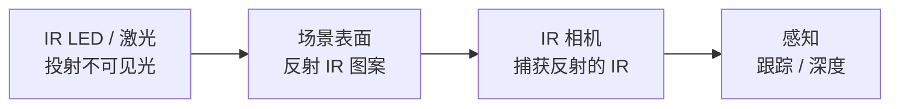

**用在哪**:深度相机、眼动/手部跟踪、**基准标记 (fiducial markers)**、夜间作业、受控的工业感知。

**两种具体形态**(都在 §33 见过了,这里是从"波段"角度重看):

- **结构光**:投射已知图案,由图案形变算深度;
- **主动双目 (active stereo)**:**添加红外纹理**,让立体匹配能在无纹理表面上工作。

**强项**:照明一致、**黑暗中可用**、**人眼不可见**(不会打扰人)、适合近距离感知。

**局限**(核心矛盾一句话):

> **Active IR is powerful indoors; outdoors it competes with the sun.**
> **主动红外在室内很强大;到了户外,它要跟太阳竞争。**

具体三条:**阳光含有强红外**;**多个投影器会互相干扰**;**光亮/黑色/透明表面依然困难**。另外 slides 提醒:**功率较高的红外激光要考虑安全与人眼暴露限值**——因为人看不见它,眨眼反射保护不了你。

讲师给了一个你天天见到但可能没意识到的例子:**监控摄像头镜头周围那一圈小灯珠,就是主动红外 LED**——夜里它们会点亮,给场景提供人眼看不见的照明,从而让相机在黑暗中依然拍到清晰画面。

## 50. 热成像:看见热量

**热红外相机 (thermal camera)** 成像的是**物体自身发射的辐射**,和温度相关。

链路:

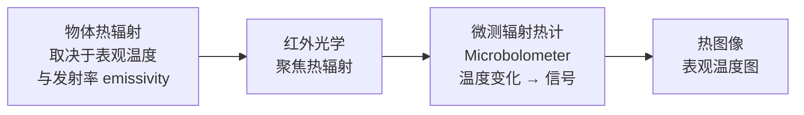

核心器件是**微测辐射热计 (microbolometer)**:一个吸收红外辐射后自身温度会升高的微结构,通过测量它的电阻变化得到辐射强度。

**能干什么**:**不需要任何可见光**——因为场景自己在发光。检测人、动物、发热的机器、**热泄漏**、火,以及**夜间导航和搜救**。当颜色和纹理不可靠时,热成像是可见光相机的补充。

**必须理解的两个陷阱:**

**陷阱一:热强度 ≠ 真实温度。** slides 说得很严谨:除非正确处理了**发射率 (emissivity)**、反射和大气影响,否则热图像的读数并不是真实温度。

> 📎 **拓展(超出 slides)** — **发射率**是材料辐射热量的效率(0 到 1)。人的皮肤发射率约 0.98(接近理想黑体),抛光金属可能只有 0.05。这意味着:**一块 80 °C 的抛光铝板,在热像仪里可能看起来比一个 35 °C 的人还"冷"**——因为它几乎不辐射,只是把周围环境的辐射反射过来。

**陷阱二:低波红外下的材料行为反直觉。** slides 举了两个:

- **玻璃在长波红外下通常是不透明的**——你**没法透过窗户做热成像**,热像仪看到的是玻璃自己的温度;
- **光亮的金属会反射来自别处的热辐射**——你可能在不锈钢台面上看到一个"热人影",那只是反射。

**其他限制**:分辨率和帧率通常低于可见光相机;**标定和漂移**是需要认真对待的问题。

slides 的结论句极其精炼:

> **Thermal cameras sense heat contrast, not semantic objects directly.**
> **热像仪感知的是热对比度,而不是直接感知语义物体。**

> **🔑 例(讲师课上补充)—— 热像仪的成本演变**
>
> 讲师说:**热像仪过去需要制冷系统 (cooling system),因而极其昂贵**。现在已经有**不需要专用制冷的传感器**,可以做得非常紧凑。他的实验室里就装了一台很小的热像仪:**只要有人出现,因为身体有热量,就能拍到照片**——一个不依赖照明的人员检测方案。
>
> 但他也提醒:**这类红外传感器的分辨率通常低于常规 RGB 相机。**

## 51. 红外的强项、局限,以及与可见光的对照

**红外的强项**(slides 四格):

| 强项 | 说明 |
|---|---|
| **黑暗 Darkness** | NIR 配主动照明,或热成像**完全不依赖光照** |
| **人/动物检测** | **热对比**支撑安全与搜救 |
| **受控照明** | 主动 IR **减少了对房间照明的依赖** |
| **材料线索** | 某些波段能揭示缺陷或含水量 |

其他要点:适合**夜间、仓库、人员周围、光照多变**的机器人;**热对比通常比可见光颜色更稳定**(因为人体温度不随灯光变化);主动 NIR 能在近距离提供**可重复的特征**;**IR/可见光融合提升稳健性,因为二者失效模式不同**(又一次!)。

**红外的局限**(六格):**发射率**、**反射**(热的物体会出现在光亮表面上)、**玻璃/水**(许多材料阻挡或吸收 IR)、**低分辨率**、**阳光/干扰**(主动 NIR 系统会被压制)、**标定漂移**(温度、非均匀性、光学)。

**缓解手段**:传感器预热 (warm-up)、**非均匀性校正 (non-uniformity correction)**、考虑发射率的解读、受控照明、滤波,以及**与可见光/深度/IMU 融合**。

slides 给的最后一句:

> **Thermal and NIR images are measurements of radiance, not direct maps of temperature or depth.**
> **热成像与近红外图像测量的是辐射亮度,而不是温度图或深度图本身。**

**三种图像传感器的正面对照表——这是本 Part 最可能出现在考卷上的一张表:**

| 判据 | **可见光相机** | **主动 IR / NIR 相机** | **热红外相机** |
|---|---|---|---|
| **主要信号** | 反射的**可见光** | 反射的**投射红外** | **发射的热辐射** |
| **最擅长** | **语义、颜色、纹理、标志** | 近距跟踪、深度、**黑暗室内场景** | **人/动物、热、夜间作业** |
| **主要弱点** | 光照、模糊、眩光、天气 | **阳光**、互相干扰、反光/黑色表面 | **发射率**、反射、**低分辨率** |
| **典型融合搭档** | IMU、lidar、深度相机 | 可见光相机、深度、IMU | 可见光相机、雷达/lidar |

结论:

> **No spectrum is universally best. Robust robotic perception uses complementary spectra and explicit uncertainty.**
> **没有哪个波段是普遍最优的。稳健的机器人感知使用互补的波段,并显式建模不确定性。**

## 52. 从图像到场景理解

有了图像,怎么变成机器人能用的东西?slides 给了这条流水线:


**产物的例子**:用于导航的**语义地图**、用于操作的**抓取位姿 (grasp pose)**、用于交互的**人物轨迹**、用于检测的**缺陷图**。

**两条重要的原则:**

1. **图像测量只有在"配准到机器人坐标系"并"与时间、运动、几何结合"之后才有用。** 又一次是坐标变换——本章讲了五遍的那件事。
2. **失效处理是感知的一部分 (Failure handling is part of perception)。** slides 的表述很具体:**检测到低置信度时,要么请求另一个视角,要么回退到另一个传感器。** 这跟"尽量把算法做准"是完全不同的思路——**好的感知系统不是不会错,而是知道自己什么时候可能错了。**

slides 的收尾:

> **Scene understanding is an inference problem built on imperfect sensor measurements.**
> **场景理解是一个建立在不完美传感器测量之上的推断问题。**

讲师补了一个工程现实,和课程后面的内容有关:

> **传统计算机视觉算法 vs 深度学习模型,取决于板载算力。** 如果机器人上有 **GPU 级别的计算资源**,就可以用深度学习模型,**可靠性远高于传统方法**;如果只有低算力的 CPU,你就**只能依赖传统的计算机视觉算法**。
>
> 这是嵌入式机器人里一个真实的约束:**算法选择往往由你能带多少算力(以及多少电池)决定,而不是由哪个算法在论文里更准决定。**

## 53. 图像传感器与其他传感器的融合

slides 用一句话点出了融合的目标:

> **Scene understanding becomes robust when appearance, geometry and motion agree.**
> **当外观、几何与运动三者相互一致时,场景理解才变得稳健。**

四路信息各司其职:

| 来源 | 贡献 |
|---|---|
| **可见光 Visible** | **语义与纹理** |
| **红外 / 热成像** | **夜间与热线索** |
| **深度 / lidar** | **度量几何 (metric geometry)** |
| **IMU / 编码器** | **自我运动与时序** |
| → | **一致的场景状态(世界模型)** |

**四条要点,每一条都有实践价值:**

1. **时间融合 (temporal fusion)** 抑制噪声,并帮助**区分"物体在动"和"相机在动"**——这两件事在单帧图像里是无法区分的。
2. **几何融合 (geometric fusion)**:把图像上的检测结果**投影到深度、lidar 或地图上**,从而得到**度量位置**。这就是 "在图像里框出一个人" + "从深度图读出他的距离" = "他在世界坐标的哪个点"。讲师说 **RGB + depth 是当今最流行的融合方式**。
3. **跨波段融合 (cross-spectrum fusion)** 在某一路失效时救场:黑暗中用热像仪补可见光,低对比度物体上用可见光补热像仪。
4. **不要盲目平均传感器 (Do not blindly average sensors)。** 这一条最重要:**要建模"在当前条件下,哪个传感器是可靠的"**。雨天里相机和 lidar 的权重不该跟晴天一样。

**还有两个工程前提**,slides 单独列出:**融合需要时间同步 (time synchronisation) 和外参标定 (extrinsic calibration)**。没有这两样,融合只会把误差放大——**你把 t 时刻的图像和 t+50 ms 的 lidar 点云叠在一起,得到的是一个扭曲的世界。**

最后一条:**机器人系统应当把置信度暴露给规划与控制 (expose confidence to planning and control)**。感知模块不应该只说"前面有个人",而应该说"前面有个人,置信度 0.6"——因为规划器对这两种情况的应对方式应该完全不同。

> **Reliable perception is multi-sensor, calibrated, time-aligned and uncertainty-aware.**
> **可靠的感知是多传感器的、经过标定的、时间对齐的,并且有不确定性意识的。**

## 54. 按任务选图像传感器

slides 的最后一张选型表,注意它的标题就是方法论:**"Start from the task and failure environment, not the camera specification sheet."**(从任务和失效环境出发,而不是从相机规格表出发。)

| 任务 / 环境 | 好的候选 | 理由 |
|---|---|---|
| **室内操作 Indoor manipulation** | **RGB-D** + 近距可见光相机 | **语义 + 局部几何** |
| **夜间巡逻 Night patrol** | 可见光 + **热成像** + 主动 IR | **不依赖照明**的检测 |
| **人机交互 Human interaction** | RGB + 深度/热成像安全线索 | 身份、手势与**接近度** |
| **工业检测 Industrial inspection** | 可见光、**NIR/SWIR** 或热成像 | 针对特定材料的缺陷;照明可控 |
| **户外导航 Outdoor navigation** | 可见光 + lidar/雷达(+ 必要时热成像) | 外观、几何与**抗天气性** |

**还要评估的其他维度**(选型 checklist):视场 (FOV)、快门类型、帧率、动态范围、镜头防护、带宽、**计算负载**、标定可及性。

讲师看着这张表点出了一个模式:**可见光相机几乎出现在每一行里**(RGB-D 里的 RGB 也是可见光)。这说明了相机在机器人感知中的中心地位——**它不只是用来"理解东西是什么",配上第二个相机(立体)或红外图案投影器,它还能直接变成一个 3D 测距设备。** 一个传感器,两种角色。

---
# Part VIII · 传感器性能与容错:回到真实世界

本章从词汇表出发,绕了一大圈六类传感器,现在回到起点——但这次要问一个更狠的问题:**在真实环境里,这些指标还成立吗?**

## 55. 真实环境里额外重要的三个特性

slides 的标题限定得很小心:**"Characteristics that are especially relevant for real world environments."**(在真实世界环境中尤为相关的特性。)言下之意:实验室里可以忽略的东西,到了现场会变成主要矛盾。

**① 灵敏度 (Sensitivity)**

定义:**输出变化与输入变化之比**。灵敏度高,意味着被测量稍微一变,输出就有明显的响应。

**但 slides 立刻给出了转折**,这是本节最精彩的一句:

> "However, in real world environment, the sensor very often has **high sensitivity to other environmental changes**, e.g. illumination."
> (然而在真实环境中,传感器往往对**其他环境变化**也有很高的灵敏度,比如光照。)

高灵敏度**不加限定就不是优点**——一个对目标量灵敏的传感器,常常对干扰量同样灵敏。

**② 交叉灵敏度 / 串扰 (Cross-sensitivity / cross-talk)**

定义:**对其他环境信号的灵敏度**,以及**来自其他主动传感器的影响**。

这个概念把本章前面的一堆现象统一起来了,你现在应该能一眼认出它们全是交叉灵敏度:

- 红外测距对**颜色和材料**敏感(§28);
- 结构光相机被**阳光**压制(§33.1);
- 多个超声传感器**互相串扰**(§34);
- 热像仪读数被**发射率和反射**污染(§50);
- 相机的读数随**光照**剧变(§47)。

**这些不是各自独立的缺陷,而是同一个病的不同表现:传感器测到的量里,混进了它不该测的东西。**

**③ 误差 / 准确度 (Error / Accuracy)**

定义还是老的:传感器输出与真值之差。但 slides 在这里补了一句极其重要、也极容易被忽略的话:

> **Problem: the robot does not normally know the true value and hence cannot determine the accuracy of a measurement.**
> **问题在于:机器人通常并不知道真值,因此无法判断某次测量的准确度。**

**停下来想想这句话的分量。** 准确度这个概念,在教科书里是用真值定义的;但**在运行中的机器人身上,真值是永远不可得的**——如果它知道真值,它就不需要传感器了。

于是准确度从一个"可测量的属性"变成了一个"只能间接推断的信念"。机器人怎么办?它只能:

- 靠**出厂标定**(在实验室里,有真值的条件下测出来的);
- 靠**多个传感器互相印证**(如果三个不同原理的传感器都说 2.0 米,那大概率是 2.0 米);
- 靠**概率模型**明确地表达"我认为它是 2.0 米,标准差 0.1 米"。

**这句话是 §57 传感器融合、以及后面整个概率机器人学的根本动机。**

slides 还补了两条现实:

- **误差大小依赖其他因素**:温度变化、空气湿度、**传感器老化**、制造差异;
- **传感器可能在任意时刻以任意方式失效 (Sensors can fail arbitrarily and at arbitrary times)**——不只是"读数不准",而是**彻底坏掉**。这就是 §57 第三层容错机制存在的理由。

## 56. 系统误差 vs 随机误差

这是本章最后一个核心区分,也是把误差**转化为可操作策略**的关键。还记得 §5 那张四靶图吗?现在我们给它配上处理方法。

| | **系统误差 Systematic error** | **随机误差 Random error** |
|---|---|---|
| **性质** | **确定性 (deterministic)** | **非确定性 (non-deterministic)** |
| **能否预测** | **能**——由(理论上)可建模的因素造成 | **不能** |
| **怎么处理** | **标定 (calibration) 修正** | **用概率描述**,再滤波/融合 |
| **例子** | 激光传感器的标定误差;**相机光学畸变** | **相机色调不稳定**;相机黑电平噪声 |
| **对应四靶图** | 高精密、**低准确**(稳定地偏) | **低精密**、高准确(围着真值散) |

**为什么这个区分如此重要?** 因为它决定了你该花力气做什么:

- 面对**系统误差**,再多测几次**毫无帮助**——你会一致地得到同样偏掉的答案。**唯一的解法是建模并减去它**(标定)。
- 面对**随机误差**,标定**毫无帮助**——它没有固定的偏移可减。**解法是多次测量取平均、或用滤波器**(卡尔曼滤波等)。

**用错工具是新手最常见的失败模式。**

**Precision(精密度)在这里的角色**:slides 把它定义为**传感器结果的可重复性 (reproducibility)**,并举例"传感器的分辨率"。精密度低,通常就是随机误差大的表现。

讲师在这里给出了整章最有历史纵深的一段,值得完整保留:

> **🔑 讲师课上补充 —— 概率机器人学为什么改变了一切**
>
> **在现实中,大多数传感器的误差是非确定性的、概率性的**,而不是可以简单标定掉的。
>
> 讲师说:**这正是 1980 年代之前机器人学"非常不成熟 (very immature)"的原因**——那时候人们用机器人只能做**非常受限的任务**(结构化的工厂环境、预编程的轨迹)。因为一旦进入真实环境,传感器的不确定性就让确定性的方法全面崩溃。
>
> 转折点是人们开始发展**概率机器人学 (probabilistic robotics)**:**不再假装传感器给的是真值,而是显式地引入概率来处理不确定性。** 从那以后,机器人才真正走出了受控环境,能够在**各种各样的环境**中工作。
>
> **这段话解释了本课接下来几周的全部内容。** 你会学到的定位、SLAM、规划算法之所以长成那个样子——为什么处处是概率分布、贝叶斯更新、置信度——根源就在本章这句话:**传感器永远不会给你真值。**

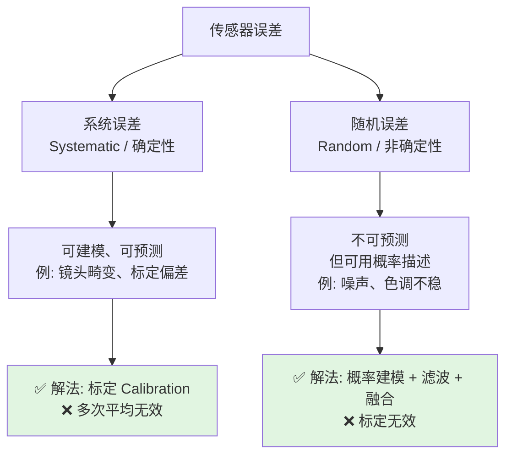

## 57. 应对传感器误差的三个层次

最后一页 slides 给出了应对策略,而且它们是有**层次**的——成本和保障强度递增。

**层次 1:冗余 (Redundancy)**

**用多个传感器观测同一个量。** 具体做法:

- 把传感器**布置在不同位置**;
- **优先选择不同厂商、不同使用年限**的硬件(这一点很妙——同一批次的传感器可能有**相同的制造缺陷**,一起坏);
- **比较各路读数,检测离群值或失效的传感器**。

讲师给了具体例子:在**任务关键 (mission-critical)** 的机器人上,可以用**3 个同类型传感器 + 多数表决 (majority voting)**。但他立刻加了一句现实提醒:**"this is only in the situation where the mission is very critical. Otherwise you cannot afford it."**(只有在任务极端关键时才这么做,否则你负担不起。)

**层次 2:传感器多样性 + 稳健融合 (Sensor diversity + Robust Fusion)**

**用不同类型的传感器测量同一个实体。** 例子:**编码器 + IMU**,或 **lidar + 相机 + 超声**。

理由——本章第三次、也是最完整的一次表述:

> **Different sensing principles reduce common-mode failure.**
> **不同的感知原理能减少共模失效。**

**共模失效 (common-mode failure)** 是层次 1 的软肋:如果你装了三个同款激光雷达,遇到玻璃墙时**三个会一起失效**——冗余在这里毫无价值。**只有原理不同,失效条件才会不同。**

这引出了讲师课上的最后两道测验,它们是本章的完美收尾:

> **🔑 课堂测验 1** — 为什么组合使用**不同物理工作原理**的传感器是有用的?
> (A) 它保证零误差  (B) **不同传感器有不同的失效模式**  (C) 它免除了标定  (D) 它减少了测量次数
>
> **答案:B。** 逐个排除:
> - **(A) 保证零误差?** 不可能——本章从 §2 开始就在说传感器永远不给真值,组合再多也不会变成真值。
> - **(C) 免除标定?** 恰恰相反——**融合需要更多标定**(§53 明确要求外参标定和时间同步)。
> - **(D) 减少测量次数?** 明显更多,不是更少。
> - **(B)** 才是正解。讲师的原话:在某种情况下这个传感器误差小、另一个误差大;换个情况反过来。**关键不是让每个传感器更好,而是让它们不要在同一时刻一起坏。**

> **🔑 课堂测验 2(本章最好的一道题)** — 假设你的 **lidar 在一面玻璃墙上失效**了。加上什么感知原理,能让机器人不至于漏掉这个障碍物?
>
> **答案:超声、接触式(保险杠/触觉)传感器,或者雷达。**
>
> **推理过程才是重点。** 先问:**lidar 为什么在玻璃上失效?** 因为激光**穿透了玻璃**(§36 的材料一格)——它测到的是玻璃后面的东西,玻璃在地图上根本不存在。
>
> 那么解法就必须是**一个与玻璃的相互作用方式不同的原理**:
> - **超声**:声波**不穿透玻璃**,会正常反射回来 → 能测到墙;
> - **接触/保险杠**:物理接触,跟光学性质完全无关 → 一定能发现(虽然是撞上以后);
> - **雷达**:取决于波长,某些频段能被玻璃反射。
>
> 课上还有同学答了"红外",讲师的评价是 **"probably a bit hard"**——因为红外仍然是光,面对玻璃会遇到和激光相似的透射问题。**这个细节很值得记:换传感器不等于换原理,红外和激光同属光学,失效模式高度重合。**
>
> 讲师的总结:"**ultrasound, tactile, and radar sensors work on glass. They interact with the glass in different ways.**"
>
> **答题模板:先说清原传感器为什么失效(物理机制),再选一个在该机制上不失效的原理。**

**层次 3:容错估计 (Fault-tolerant estimation)——仅用于安全关键子系统**

当失效的后果是人身伤害时,前两层还不够,要上专门的容错机制:

- **多数表决 / 三模冗余 (Majority voting / Triple Modular Redundancy, TMR)**:三个独立单元同时计算,取多数结果。任何**一个**单元失效都不影响输出。
- **拜占庭容错方法 (Byzantine-resilient methods)**:应对**故障或不一致的节点**。

> 📎 **拓展(超出 slides)** — "拜占庭故障"指的是一个节点不是干脆地宕机,而是**给出错误甚至自相矛盾的信息**(可能对不同的询问者给出不同答案)。这比彻底失效更难对付——因为一个"看起来还在工作但在撒谎"的传感器,会污染整个融合结果。这就是为什么 §57 层次 1 强调要**主动比较各路读数、检测离群者**,而不是被动地等某一路彻底没信号。

- **滤波、传感器融合和离群点剔除 (outlier rejection)** 提升整体稳健性。

**slides 的最终结论,也是整章的最终结论:**

> **Key idea: robust robots do not rely on a single noisy sensor; they combine redundant, diverse and/or fault-tolerant sensing.**
> **核心思想:稳健的机器人不依赖单个含噪的传感器;它们组合使用冗余的、多样的和/或容错的感知。**

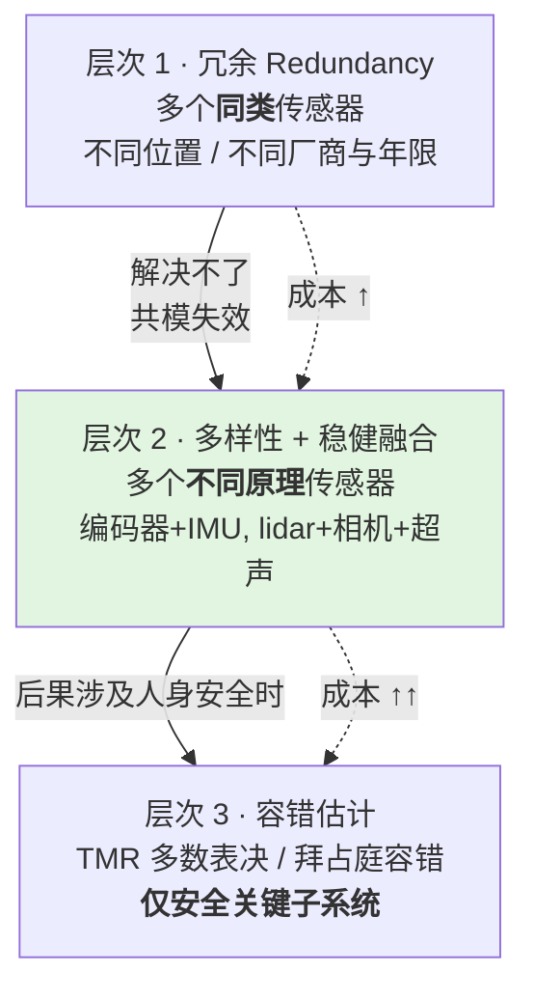

**注意这三层的关系不是"越高越好",而是"按需要选择"**:层次 1 便宜但挡不住共模失效;层次 2 是绝大多数机器人的正确答案;层次 3 昂贵,只用在失效会致命的地方。讲师那句 "otherwise you cannot afford it" 就是这个意思。

---

# 本章小结 (Key takeaways)

1. **传感器永远不会给你真值,只会给你一个带噪声、带不确定性的结果。** 这是整章——乃至整门课后续所有概率方法——的地基。机器人**通常不知道真值,因此无法自行判断某次测量的准确度**。

2. **评价任何传感器,用六把尺子:range(量程)、dynamic range(动态范围,dB)、resolution(分辨率)、accuracy(准确度)、precision(精密度)、bandwidth(带宽)。** 其中 **resolution ≠ accuracy ≠ precision**:分辨率只说刻度多细,准确度说偏不偏,精密度说稳不稳。**快变信号看带宽。**

3. **两个正交的分类法给所有传感器定位:proprioceptive(测自己)vs exteroceptive(测外界);active(发能量)vs passive(不发)。** 绝大多数测距传感器是主动的,因此会**互相干扰**并**与阳光竞争**。

4. **编码器测关节位置与速度;移动机器人用增量式(要累加),机械臂用绝对式(用格雷码);正交编码用 A/B 两路 90° 相位差给出方向。** 但**轮子转了不等于机器人到了**:非完整约束、打滑、回程间隙和地面变化让**里程计必然漂移**,所以它只能用于局部估计,必须与其他传感器融合。

5. **加速度计用重力当参考,能给出 roll/pitch,但绝对位置需要二次积分因而不可行;陀螺仪测角速度,积分得姿态但会漂移;磁力计提供 yaw 参考。三者合成 IMU,覆盖 6 个自由度并支撑 AHRS。** 加速度计与陀螺仪的失效模式在时间尺度上**正好互补**(一个长期稳、一个短期准),这是所有姿态融合算法的立足点。

6. **力感知把操作接入控制闭环。** F/T 传感器用应变片测量 **6D 力旋量(3 力 + 3 力矩)**,但**贵、大、信噪比低、带宽有限,而且只给一个接触点**;触觉/压力传感器维度更少(触觉是**二值**、压力是**分级**)但**更局部更密集**。人手约有 **17,000 个**感受单元,而机器人触觉阵列只能做到每 cm² 数十个——这是灵巧操作至今未解的原因之一。

7. **测距不是一种传感器,而是一个原理家族:反射强度、三角测量、相位差($d=c\Delta\varphi/4\pi f_m$)、脉冲飞行时间($d=c\Delta t/2$)、超声(344 m/s,锥形波束)、雷达/UWB(FMCW + 多普勒可测速)。** 输出形态有四种:单点距离、2D 扫描、深度图、点云。

8. **深度相机有三条路线:结构光(投图案看形变,户外被阳光打败)、双目立体($Z=fB/\text{disparity}$,受制于对应问题和无纹理表面)、ToF 相机(逐像素测时间,受多径与混合像素影响)。** Kinect 用两百澳元把稠密深度感知变成了商品,但**误差随距离呈非线性急剧增长**。

9. **测距误差有六大机制:材料、几何、环境、计时、标定、模糊。** 黑色/光亮/透明/柔软表面是光学与声学测距的共同软肋——**激光会穿透玻璃,这就是玻璃墙那道经典题的答案**。

10. **绝对参考是打断漂移的唯一办法。** GPS 需要 **4 颗**卫星,因为未知数是 $x, y, z$ **加接收机钟差**;它在室内和城市峡谷失效,精度也不足以单独使用。室内用 **AprilTag 等被动标记**或 **UWB/超声主动信标**替代卫星——**信标固定在建筑上,机器人携带接收机**。实用系统总是"全局参考 + 局部测距 + 自我运动"三者结合。

11. **相机提供距离传感器给不了的东西:语义。** 但它的根本弱点是**外观不具物理不变性**——几何没变,光一变图就全变了。彩色图有三分之二是**去马赛克插值算出来的**;**快门类型和曝光时间对移动机器人的重要性不亚于分辨率**;**糟糕的标定会把好的图像数据变成不可靠的机器人动作**。

12. **红外不是一种模态而是三个波段,关键区分是:主动 IR 测的是"反射的照明",热红外测的是"发射的辐射"。** 热像仪能在全黑中工作,但读数受**发射率**污染、**玻璃在长波红外下不透明**、分辨率偏低。**没有哪个波段普遍最优。**

13. **误差分两类,对应两种完全不同的解法:系统误差(确定性,如镜头畸变)靠标定修正,多次平均无效;随机误差(非确定性,如噪声)靠概率建模与滤波,标定无效。** 用错工具是最常见的失败模式。1980 年代之后**概率机器人学**的兴起,正是因为承认了大多数误差属于后者。

14. **应对传感器误差有三个层次:冗余(同类多个)、传感器多样性 + 稳健融合(不同原理)、容错估计(TMR/拜占庭,仅安全关键)。** 层次 1 挡不住**共模失效**,所以层次 2 才是主力。**组合不同原理的意义不在于消除误差,而在于让它们不要同时失效。**

15. **贯穿全章、被讲师重复最多的一条铁律:所有传感器读数都在传感器自己的坐标系里。** 用它做任何事之前,先做**坐标变换**;而变换所需的外参,来自标定。从测距到稳健感知的完整流水线是:**原始测量 → 滤波去离群 → 变换到机器人/世界坐标系 → 决策**。

---

# 作业与阅读 (Homework and readings)

**阅读 (Readings)**

- *Introduction to Autonomous Robotics* / Nikolaus Correll, University of Colorado at Boulder, v3, February 2026, ISBN 13: 9780692700877 (Open Education) — **第 5 章**
- *Robotics, Vision and Control — Fundamental Algorithms in Python* / Peter Corke, 3rd Edition 2023, Springer, ISBN 978-3-031-06468-5 — **第 2、3 章**

**作业 (Homework)**

- **Webots 在线教程 4、5、6**

讲师提示:本周是第一次 lab,重点是把 Webots 跑起来;教程 4–6 会用到本章讲的传感器(包括可以在 Webots 里仿真的 **IMU** 和轮式编码器的**正负速度方向**约定)。装不上的话去 lab 找 tutor,或者发邮件给讲师。
