# CSCI944 Week 4 · 视觉感知与特征提取 (Perception with Vision & Feature Extraction)

> **学习目标 (Learning objectives)** — 读完本章你应该能够:
>
> - 说明为什么视觉在机器人感知里地位特殊——它同时提供**语义信息 (semantic information,"这是什么")** 和**度量信息 (metric information,"在哪、多远")**,而测距类传感器只给后者;
> - 把一幅图像当作**二维信号 (2D signal)** 来分析,用**低频 / 高频 / 带通 (low- / high-frequency, band-pass)** 的语言解释每一种滤波器到底做了什么;
> - 说清"视觉为什么难":同一条 **edge** 可以由材质边界、深度不连续、镜面高光、光照变化、表面朝向变化五种完全不同的物理原因产生,因此**感知本质上是推断 (perception is inference)**;
> - 熟练使用低层图像操作的三大家族——**阈值化 (thresholding)**、**卷积 (convolution)**、**形态学 (morphology)**——并针对给定机器人任务组装出合理的预处理流水线,包括说明为什么颜色分割要用 **HSV** 而不是 RGB;
> - 手算一次 3×3 卷积,写出 **Sobel** 核并由此求梯度幅值与方向,解释 **DoG (Difference of Gaussians)** 在什么参数比下变成边缘检测器、在什么比下逼近 **LoG**;
> - 写出相机的**投影模型 (projection model)**,区分**内参 (intrinsic)** 与**外参 (extrinsic)**,并解释为什么单张图像无法恢复三维、需要**三角测量 (triangulation)**;
> - 定义**对极平面 (epipolar plane)** 与**对极线 (epipolar line)**,说明它如何把二维搜索降为一维搜索,并解释**视差 (disparity)** 与深度的反比关系及其带来的量程上限;
> - 解释**特征 (feature)** 是什么、好特征的四条标准(repeatable / robust / invariant / discriminative),并说明特征提取本质上是一次**信息压缩**;
> - 用极坐标表示直线,并对同一组点云分别应用**最小二乘 (least squares)**、**split-and-merge**、**RANSAC** 三种拟合策略,说清各自的强项、弱项与典型组合方式;
> - 解释 **Hough transform** 的投票原理,写出其参数空间与算法流程,并把它推广到圆和多边形;
> - 完整复述 **SIFT** 的四步流水线(尺度空间 → DoG 极值与筛除 → 主方向 → 128 维描述子),并说明每一步分别买到了哪一种不变性;
> - 说明经典视觉方法在深度学习时代为什么仍然必须学。

---

上周我们把机器人身上能装的传感器过了一遍,最后停在一个未完成的判断上:**测距传感器很准,但它们不理解世界。**

一个超声传感器告诉你"前方 1.2 米有东西";一台激光雷达告诉你"以我为中心的这一圈,每 0.25° 有一个距离读数"。这些数字精确、可靠、便宜。但它们回答不了机器人真正想问的那个问题——**那个东西是什么?** 是一堵墙,还是一个正要横穿马路的行人?是一把可以推开的椅子,还是一台不能碰的仪器?讲师这周开场就把这一点摆在最前面:

> 超声、LiDAR、radar、UWB 这些传感器"大多数时候测的是距离。它们不告诉你场景里有什么,不告诉你那是不是一个人、是不是一把椅子……它们可能检测到障碍物、可能避免碰撞,但它们不知道自己将要撞上的是什么东西。**本质上那是测量,不是理解 (measurement rather than understanding)。**"

视觉是唯一一类既能测量、又能理解的传感器。它给你**语义 (semantics)**:这是门、这是人、这是我上周来过的那个角落。它同时也能给你**度量 (metric)**:那扇门离我 2.3 米。代价是——把像素变成这两样东西,需要的处理量远远超过读一个超声回波。这就是为什么整个课程要为视觉单独留一周,也是为什么这一周的内容密度明显高于上一周。

讲师还给了一个非常直观的动机:**人类大约 80% 的信息来自视觉**,远超听觉、触觉、嗅觉、味觉的总和。如果我们希望机器人在人类设计的环境里工作——人类的门、人类的标识、人类的走廊——那么复制人类最依赖的那条感知通道,几乎是必然的选择。

但这里有一个残酷的落差,它构成了本章真正的主线:

> "对计算机来说,你的算法看到的**只是一个数字数组 (array of numbers)**。它们不像人那样看。人类视觉有非凡的能力,我们的大脑能处理这些像素刺激,能把它们组合起来,认出'这是一个人、这是一台笔记本'。但对计算机来说,同样的任务极其困难,因为**你的程序看到的,就只是一个数字数组**。"

整章要做的事情,就是一步一步地填平这个落差:从数字数组出发,经过滤波、几何、特征,最终走到"这是什么、在哪里"。

本章的路线图正是这条路径:

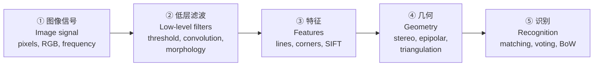

注意这五个阶段和上周那张 **see–think–act** 大图的关系:整章仍然全部发生在 **see** 里面,但我们第一次深入到了 **Information Extraction(信息提取)** 这个盒子的内部——上周我们只说了"原始数据必须经过信息提取才能变成环境模型",这周我们要看这个提取具体是怎么做的。

最后提醒一句本章的定位。讲师明确说了:这一周和 *Computer Vision* 那门课**有意重叠但刻意浅**——这里只讲"和机器人感知直接相关、在机器人里最常用"的那部分,不做完整的计算机视觉课程,也**完全不涉及深度学习模型**(理由见 §42)。所以你在本章看到的每一个算法,都应该问一句:**机器人为什么需要它?**

---

# Part 0 · 从像素到决策:先看清整条流水线

## 1. 一个视觉机器人从开机到决策,数据经历了什么

在钻进任何一个算法之前,先建立整条流水线的心智地图。讲师在开场就把它完整地口述了一遍,顺序如下:

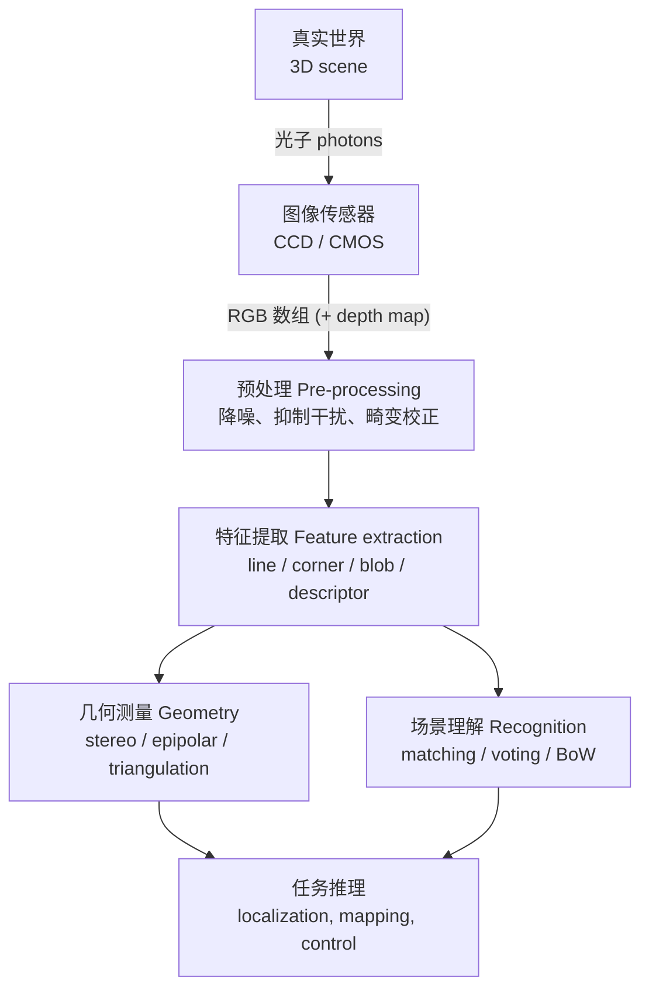

逐段解释这条链上每一步在干什么,以及**为什么必须有它**:

**① 成像。** 现在的机器人几乎全用数字图像传感器(**CMOS** 为主,少数用 **CCD**)。传感器输出的东西非常朴素:一个像素数组。彩色相机每个像素给三个通道(**RGB**),灰度相机每个像素给一个强度值。如果是 RGB-D 相机,你还会额外得到一张**深度图 (depth map)**。请把这句话刻进脑子——**传感器给你的不是图片,是数组**。

**② 预处理。** 为什么不能直接拿原始图像去做任务?两个原因,讲师都提到了。第一是**质量**:如果传感器档次不高,图里会有噪声和各种失真,你得先压掉。第二是**测量**:机器人经常要用视觉做**几何测量**,而镜头**畸变 (distortion)** 会严重污染测量结果,所以预处理里必须包含**畸变校正**。这一步用的正是本章 Part III 的三大家族。

**③ 特征提取。** 把海量像素压成少量"对任务有用的结构"。机器人里最常用的两类:**直线 (line)** 和**兴趣点 (interest point / keypoint)**。直线的用途讲师举得很具体——自动驾驶的**车道线 (lane marking)** 检测,车要保持在车道内;室内机器人则用走廊墙面、门框的直线。兴趣点(以及它的进阶版 **SIFT**)则用来判断"这个地方我以前来过没有",这对**定位与建图 (localization and mapping)** 至关重要。

**④ 几何测量。** 如果任务需要距离,就走**立体视觉 (stereo vision)** 这条支路,其中的关键概念是**对极线 (epipolar line)**——它把"在另一张图里找对应像素"这个二维搜索问题压成一维搜索,并且让匹配好的像素对可以直接换算成距离。

**⑤ 场景理解。** 如果任务需要语义,就走特征**匹配 (matching)**、**投票 (voting)**、场景分类这条支路,经典代表是 **BoW (Bag of Words,词袋模型)**。

值得注意的是 ④ 和 ⑤ 是**并列的两条出口**,共享同一批特征。这解释了为什么"特征"这个概念在本章中间的位置如此关键:它是几何和语义的公共货币。

## 2. 为什么还要学"过时"的经典算法

现在的机器人如果算力够,这五步很多可以被一个深度模型端到端吃掉。那为什么这门课还要花一周讲卷积核、Hough 投票、SIFT?讲师给了三条理由,值得原样记住,因为这类"为什么"经常出现在概念题里:

1. **算力和功耗约束是真实存在的。** 讲师原话:"有些平台你没有足够的计算处理能力,尤其是当你电池供应有限的时候——你**负担不起 GPU 这一类计算资源**。基于 CPU 的方案,现在仍然是有效的。" 移动机器人是靠电池活着的,这一条比在服务器上做视觉的人想象得重要得多。

2. **经典方法解释了深度模型在做什么。** "这些基础知识让你能够解释,为什么深度学习模型比经典模型表现更好、或者深度学习模型是怎么工作的。" 这不是空话:CNN 前几层学出来的卷积核,和你在 §14–§16 手写的高斯核、Sobel 核、DoG 核**惊人地相似**。你先手写过一遍,才看得懂网络自己学到了什么。

3. **可解释、可调试、不吃数据。** 一条阈值加一次形态学开运算,你能画出中间结果、能指着某一帧说"就是这里错了"。端到端模型给你一个错误答案时,你连从哪问起都不知道。

> 📎 **拓展(超出 slides)** — 这三条理由合起来是机器人视觉领域一个长期的现实:**工业界的机器人视觉系统极少是纯端到端的。** 讲师在 slide 48 用了 "practical reality" 这个说法——真实系统通常是"学到的感知 + 几何 + 标定 + 经典前后处理"的混合体。深度模型负责"这是什么",几何负责"在哪里、多远",而经典滤波负责把两者之间的数据清干净。

---

# Part I · 图像是二维信号

## 3. 你拿到的到底是什么:从光子到数组

先把术语钉死。**图像传感器 (image sensor)**——**CCD** 或 **CMOS** 阵列——的物理工作是把**光子转换成电信号,再转换成数字像素值 (photons → electrical signals → digital pixel values)**。它是一个采样器:把连续的光场,在空间上切成网格,在强度上量化成整数。

于是你得到的东西可以精确地描述为:

$$\text{image} = f[x, y]$$

一个把**离散坐标** $(x, y)$ 映射到**像素值**的函数。注意方括号——这是离散信号的记法,提醒你 $x, y$ 只能取整数。规则简单到近乎无聊,但一定要记牢方向:

- **亮的像素 → 大的值 (bright pixel → large value)**
- **暗的像素 → 小的值 (dark pixel → small value)**

一幅 640×480 的 RGB 图像,每个像素有**三个值**(red / green / blue),所以整幅图是 $640 \times 480 \times 3$ 个数。灰度相机(讲师说的"black and white sensor")每个像素只有**一个**强度值。

这里有一条对机器人特别重要、但在摄影语境下反直觉的经验,讲师专门强调了:

> "很多情况下,机器人用的视觉传感器**分辨率并不高**,因为我们常常没有能力处理大量像素;而且事实上很多情况下**我们并不需要那么高的分辨率**去理解场景。这和用于可视化、用于视觉呈现的图像很不一样——那种场合分辨率越高越好。**对于处理和理解,通常我们不需要高分辨率图像。**"

换句话说:**分辨率是给人眼看的指标,不是给算法看的指标。** 一台 4K 相机接在一块跑不动它的嵌入式板子上,对机器人是负担而不是优势。这条经验会在 §14 高斯平滑那里再次出现——降采样之前必须先低通滤波。

## 4. 把图像当成信号来读

现在做本章第一个关键的思维切换。既然图像就是一个二维数组,那么:

**每一行是一个一维信号。每一列也是一个一维信号。**

沿着某一行从左往右走,像素值高高低低地变化,这条曲线和你在信号处理里画的时间序列没有本质区别——只不过横轴不是时间,而是空间位置。讲师甚至提到,有些算法干脆把整幅图**从上到下、从左到右扫描成一个长序列**,当成一段"类似时间序列的数据"来处理。

这个切换之所以值钱,是因为它一下子把整套信号处理的工具搬了过来:**梯度 (gradients)**、**频率 (frequencies)**、**滤波器 (filters)** 全都可以直接用。本章后面几乎每一个低层操作,追根溯源都是"把某个一维信号处理的想法搬到二维"。

用一个具体的小数组感受一下"像素值就是信号":

| | col 0 | col 1 | col 2 | col 3 | col 4 | col 5 |
|---|---|---|---|---|---|---|
| **row 0** | 30 | 34 | 38 | **170** | 176 | 180 |
| **row 1** | 29 | 33 | 41 | **168** | 173 | 181 |
| **row 2** | 31 | 36 | 42 | **171** | 177 | 185 |
| **row 3** | 32 | 38 | 45 | **175** | 182 | 190 |

读一下 row 0:30 → 34 → 38,变化很慢;然后 38 → 170,**一步跳了 132**;之后 170 → 176 → 180,又变慢了。这个"跳"就是一条**竖直的边 (vertical edge)**,它正好落在 col 2 和 col 3 之间。整幅图的左半是一片暗区域,右半是一片亮区域。

请注意你刚才做的事情:你**没有"看"这张图**,你只是读了几个数,就推断出了"这里有一条竖边"。这正是所有边缘检测算法在做的事。而"变化慢 / 变化快"的这个区别,就是下一节的频率。

## 5. 频率语言:低频、高频与带通

**图像里的"频率 (frequency)"指的是像素值变化的快慢**——不是时间上的快慢,是**空间上**的快慢。讲师的定义原话:"图像里,频率指的是像素值的变化。像素值在水平方向、垂直方向、或同时在两个方向上**变化得有多快**。变化得越快,它含有的频率成分就越高。"

三种成分,以及它们各自对应图像里的什么东西:

| 成分 | 定义 | 图像里对应什么 | 对机器人意味着 |
|---|---|---|---|
| **低频 (low-frequency)** | 相邻像素之间变化**慢** | 平滑表面、渐变光照、模糊区域 | 大尺度结构、整体明暗;通常是"背景" |
| **高频 (high-frequency)** | 相邻像素之间变化**快** | 边缘 (edges)、纹理 (texture)、锐利细节、**噪声 (noise)** | 既是你要的边,**也是你不要的噪声** |
| **带通 (band-pass)** | 只保留某一段频率 | 特定尺度的边缘状结构 | 检测边缘而**不过度放大噪声** |

第三行是整章反复出现的一个工程动机,值得单独说清。这里有一个恼人的事实:

> **边缘和噪声都是高频的。**

所以你无法用"删掉高频"这一招同时得到"干净"和"锐利"——删高频会同时删掉噪声**和**边缘,这就是 §14 高斯平滑的核心权衡。**带通**是对这个两难的回应:与其粗暴地砍掉一整段高频,不如**只保留一个中间频段**——足够高,还留得住边缘;足够低,已经甩掉了大部分逐像素的随机噪声。§16 的 **DoG** 就是这个想法的具体实现。

一个统一的图景,讲师用了一个漂亮的类比:

> "任何信号都是不同频率成分的混合。就像光一样——我们有不同波长的混合。图像也是同一回事:它是不同频率成分的混合,**其中有些成分和噪声有关,有些成分和边缘有关**。"

所以"滤波"这件事的本质就一句话:**你在决定保留哪些频率成分、丢掉哪些。** 后面每见到一个滤波器,都可以问它一句"你是低通、高通,还是带通?"

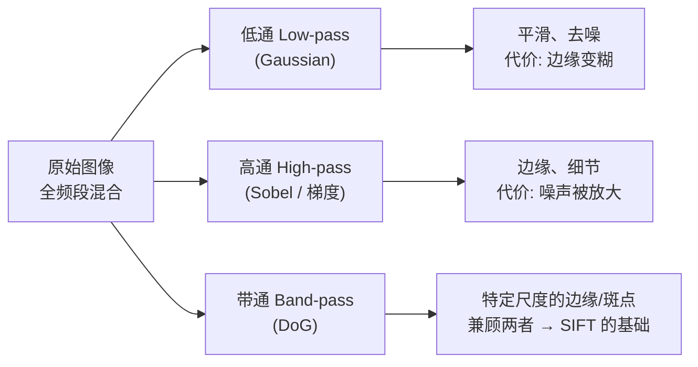

---

# Part II · 为什么视觉是难的:感知即推断

上一节我们把图像变成了信号,好像一切都可以用滤波器解决了。这一部分要泼一盆冷水,而且这盆冷水是本章最重要的**概念性**内容——期末的概念题极大概率考这里(讲师课上问的两道随堂题都出自这一部分,见 §44)。

## 6. 同一条 edge,五种物理成因

先把 **edge(边缘)** 定义清楚。讲师给的定义很朴素但很准:

> "**Edge 意味着不连续,或者像素值的变化**——不管是强度值还是颜色值。"

也就是说,edge 是一个**图像空间**里的现象:某处像素值突然跳变。检测它很容易(§15 的 Sobel 就够了)。**难的是解释它。**

问题的根源在于投影。讲师说得很直接:

> "图像是二维的,是一个投影(3D world projecting to the 2D)。所以能产生所谓 edge 的原因有很多……如果你想反推回去,弄清楚这条边的成因是深度不连续、还是物体边界,有时候是很难的。因为这**通常是一个病态问题 (ill-posed problem)**——**你没法从二维图像恢复三维信息。**"

Slides 上把这五种成因编了号(对应 slide 7 那张国际空间站内部的图),你应该能背下来:

| # | 成因 | 英文 | 具体例子 |
|---|---|---|---|
| 1 | **表面属性变化** | change in surface properties | 一面墙上贴了不同颜色的漆;讲师的例子:**红上衣配黑裤子,两者之间有一条清晰的边,但那不是物体边界** |
| 2 | **深度不连续** | depth discontinuities | 前景物体的轮廓压在远处背景上 |
| 3 | **镜面高光** | specular highlights | 光滑金属或玻璃上的反光斑,边界很锐但物理上什么都没有 |
| 4 | **光照条件变化** | changing lighting conditions, 尤其是阴影 | 阴影的边界,它随太阳移动,物体本身没动 |
| 5 | **表面朝向变化** | surface orientation changes | 一个方盒子的棱:同一块材料、同一个物体,只是转了个面,亮度就变了 |

请特别注意 1 和 5:**它们发生在同一个物体上**。也就是说,一个物体内部完全可以充满强边缘,而物体的真实轮廓反而可能因为和背景颜色接近而**几乎没有边缘**。这正是"从边缘直接得到物体"这条朴素思路失败的原因。

由此得到本章最重要的一条判断,也是 slide 7 的 Key idea:

> **感知即推断 (perception is inference)。机器人必须用光照模型、几何模型和物体模型来"解释"图像证据。**

以及一条你必须能脱口而出的推论:

> **低层信号处理是必要的,但不充分 (necessary but not sufficient)。**

讲师随堂就考了这一点:"机器人在图像里检测到一条强边缘,能不能得出结论说这是物体边界?"——**不能**,因为 edge 有多种成因。

那怎么办?答案是**上下文 (context)**:

> "但我们怎么克服这个问题?我们用**上下文信息**来帮我们弄清成因。比如说,哪里是物体边界、哪里是因为深度不连续——我们需要一定的上下文信息来解决这些问题。"

Slide 7 把机器人需要的东西列全了:**上下文 (context)、空间关系 (spatial relationships)、任务知识 (task knowledge)**。

## 7. 陨石坑还是山丘:先验知识如何改写像素

要理解"上下文"到底有多强,slide 8 给了一个漂亮到有点吓人的例子:**Apollo 15 着陆点的两张照片。**

同一片月球地貌,在一天中的不同时刻拍摄。左边那张,你清清楚楚看到一片**陨石坑 (craters)**;右边那张,你同样清清楚楚看到一片**山丘 (hills)**。地形完全没有改变,改变的只有**太阳照射的方向**——一张从左边照,一张从右边照。

发生了什么?你的视觉系统默认了一个先验:**光从上方来**(这在地球上待了几百万年是个极好的假设)。在这个假设下,"上亮下暗"必须解释成凸起,"上暗下亮"必须解释成凹陷。当实际光照方向违反这个假设时,你的大脑不会怀疑先验,它会**改写你看到的形状**。

这个例子把本章的核心命题推到了极致:

> **同一份数据,在不同假设下会得到不同的解释 (The same data can be interpreted differently under different assumptions)。**

Slide 8 把它翻译成两条工程结论,考试友好,建议直接记:

- **Robot implication(对机器人的含义)**:视觉算法**不应该只依赖局部像素对比度 (should not rely on local pixel contrast alone)**。
- **Design implication(对设计的含义)**:必须把低层线索与**几何 (geometry)**、**时间一致性 (temporal consistency)**、**语义 (semantics)** 结合起来。

第二条里的"时间一致性"值得多说一句:机器人相对于静止场景是**运动**的。同一个物体在连续多帧里应该保持形状与位置的连续变化,而一道阴影的边界会随着机器人移动表现出**和真实几何不同的运动规律**。所以"多看几帧"本身就是一种消歧手段——这一点和 §21 的 structure from motion 是同一个物理事实的两种用法。

## 8. 人类视觉的"作弊":Gestalt 分组与那只斑点狗

Slide 9 是视觉课的经典图:一张由黑白斑块构成的照片,大多数人第一眼就能看出**一只斑点狗 (Dalmatian)** 在地上嗅东西。

关键在于:**这张图里几乎没有完整的边缘。** Slide 的说明写得很明白——低层线索"只在耳朵、下巴和部分腿部存在"。狗的轮廓在像素层面**大部分是不存在的**,是你的视觉系统凭空补出来的。

讲师课上现场做了这个演示,并且提出了一个很尖锐的追问:

> "你能不能画出狗的腿?如果我说'画出狗的腿',大概是可以的,你差不多能画出来。但如果你要求一个视觉算法去画出狗的腿、去勾出狗的轮廓——那会**极其困难**。"

人做到这件事靠的是**格式塔分组 (Gestalt grouping)**:

> "人有一种额外的能力,我们的视觉系统叫做 Gestalt grouping。人能**自动把相关的信息分组到一起,形成物体**。"

讲师还提到了另一个同类现象:**随机点立体图 (random-dot stereogram)**——就是那种曾经出过很多书的"盯着一堆随机点看一会儿,就会浮出一个三维物体"的图。对人来说这是自然发生的;对算法来说,输入就是一堆随机点,没有任何可依附的边缘。

从这两个例子里要提炼的,不是"人很厉害",而是一条工程结论:

> **识别依赖物体先验 (object priors)——预期的形状、姿态和纹理。**

也就是说,人之所以能补出不存在的轮廓,是因为**已经知道狗长什么样**。算法要做同样的事,就必须以某种方式**注入先验信息**。讲师的说法是:"对于缺失的部分,我们需要**注入一些先验信息 (inject some prior information)** 才能做到。"这正是后来 CNN 从数据里"学先验"这条路线的动机所在。

## 9. 局部 vs 全局:经典算法的视野天花板

Slide 9 的最后一点还引出了一个和后文关系很深的区分,讲师展开讲了:

> "你需要在不同层级、不同尺度上做整体性的观察——**多尺度特征 (multiscale features)**。经典算法**往往只在局部看**。在局部周围看,你看不到其他部分。……但卷积神经网络有能力考虑很远的信息。你可以这样设计**感受野 (receptive field)**——当我们分析这个像素时,我们同时也考虑很远处的信息。"

把这个区分记牢,它解释了本章后半段所有算法的性格:

| | 经典方法 | CNN |
|---|---|---|
| **看多大范围** | 一个固定的小邻域(3×3、5×5、16×16) | 逐层堆叠,**感受野 (receptive field)** 不断扩大,深层能看到全图 |
| **多尺度怎么处理** | **人工构造**尺度空间(SIFT 的 octaves,§38) | 网络在不同深度**自动**得到不同尺度的表征 |
| **先验从哪来** | 研究者手工设计("handcrafted") | 从数据里学 |
| **代价** | 便宜、可解释、不吃数据 | 需要 GPU、需要大量标注数据 |

这张表也顺便解答了一个常见困惑:**SIFT 为什么要费那么大劲搞尺度空间?** 因为经典方法没有"深层网络自动获得大感受野"这个便利,想要多尺度就只能**自己一层一层造出来**。§38 你会看到这个过程有多手工。

> **🔑 小结这一部分** — 视觉难在哪里,一句话:**图像是三维世界的二维投影,投影丢掉的信息无法凭一张图恢复,所以任何从像素到含义的推断都是欠定的,必须靠先验、上下文、几何或多视角来补。** 本章剩下的内容,可以全部理解为"补信息"的不同办法:Part III 靠滤波抑制干扰,Part IV 靠**第二个视角**补几何,Part V–VIII 靠**特征**提供可跨视角比对的稳定锚点。

---

# Part III · 低层图像操作的三大家族

现在开始动手。Slide 10 把机器人里最常用的低层操作分成三个家族,这个分类法很值得记,因为**它们的"邻域规则"完全不同**:

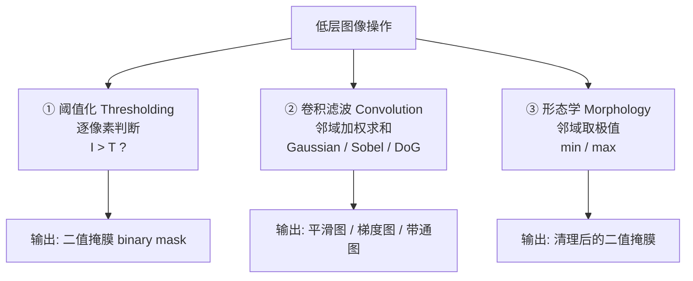

三者的区别用一句话就能钉死:

- **阈值化**看的是**单个像素自己**的值;
- **卷积**看邻域,做的是**加权求和 (weighted sum)**——线性操作;
- **形态学**也看邻域,但做的是**取最小 / 取最大 (minimum or maximum)**——非线性操作。

讲师特别提醒,这三者在机器人里的地位并不因为深度学习而下降。Slide 10 的落脚句值得记:

> **这些方法即使在使用基于学习的视觉时依然重要,因为它们解释了 CNN 早期层通常会自动学到什么。**

## 10. 阈值化 Thresholding

### 10.1 规则本身

最简单的操作:**把灰度图或彩色图变成一张二值掩膜 (binary mask)。**

$$M[x,y] = \begin{cases} 1 & \text{if } I[x,y] > T \\ 0 & \text{otherwise} \end{cases}$$

读作:像素值超过阈值 $T$ 的位置标 1,其余标 0。还有一种更常用的**区间形式 (range mask)**:

$$M[x,y] = 1 \quad \text{if } T_{\text{low}} \le I[x,y] \le T_{\text{high}}$$

区间形式在颜色分割里几乎是默认选择——你要找的往往不是"比某值亮",而是"落在某个颜色区间内"。

> **🔑 例 (Worked example)** — 取 slide 11 那一行像素:`40 75 110 145 180 215 250`,阈值 $T = 120$。
>
> 逐个比较:40 ≤ 120 → 0;75 ≤ 120 → 0;110 ≤ 120 → 0;145 > 120 → 1;180 > 120 → 1;215 > 120 → 1;250 > 120 → 1。
>
> 得到掩膜 `0 0 0 1 1 1 1`。注意:**边界正好落在 110 和 145 之间**。如果场景整体变暗 30 个灰度级(比如云飘过来了),这一行变成 `10 45 80 115 150 185 220`,同一个 $T=120$ 给出的掩膜是 `0 0 0 0 1 1 1`——**边界移动了一个像素**。这就是下面要说的最大弱点。

### 10.2 优点与致命弱点

**优点:简单、快。** Slide 11 直接点明用途:"useful in real-time robot controllers"。一个机器人控制回路可能要求 30 Hz 以上,而阈值化是逐像素的一次比较,快到可以忽略不计。讲师举的场景是**产线上的机械臂**:在受控光照下,台面上的产品可以用一次简单阈值就切出来。

**弱点:阈值在光照变化下极难稳健。** 这是它的阿喀琉斯之踵。上面那个例子已经演示了:光一变,同一个 $T$ 就错了。而机器人恰恰是**在移动的**——它会从窗边走到走廊深处,会被自己的影子盖住目标。

两个应对手段:

**(a) 自适应阈值 (adaptive thresholding)。** 让 $T$ **随位置局部变化**,以补偿阴影和光照梯度。直觉很简单:与其问"这个像素比 120 亮吗",不如问"这个像素比**它周围一小片区域的平均**亮吗"。这样即使整幅图左边亮右边暗,判断依然成立。

**(b) 自动选阈值。** 讲师提到了这条路,但明确说不展开:

> "有一些算法可以帮我们设计阈值。你去看图像的**直方图 (histogram)**,就能设计出阈值。我们不打算深入这类算法的细节,但要记住**存在这样的算法可以自动选取阈值**。"

> 📎 **拓展(超出 slides)** — 讲师说的这类方法里最经典的是 **Otsu's method(大津法)**:它把直方图看成两个分布(前景和背景),遍历所有可能的 $T$,选出让两类**类间方差最大**(等价于类内方差最小)的那个。你在 OpenCV 里写 `cv2.threshold(img, 0, 255, cv2.THRESH_BINARY + cv2.THRESH_OTSU)` 用的就是它。考试不会考推导,但知道名字有好处。

### 10.3 关键:颜色分割要用 HSV,不是 RGB

这一小节请重点看——它是讲师讲得最细、并且**直接关系到 lab 和 assignment** 的一点,slide 11 上只有一行字("For color segmentation, thresholds are often applied in HSV rather than raw RGB"),但课上展开了很多。

问题:你要在场景里找一个**红球**。最朴素的做法是直接在 RGB 上设三个区间:R 高、G 低、B 低。讲师说,这样做"可能相当困难 (quite challenging)"。为什么?

因为 **RGB 的三个通道每一个都同时混合了颜色信息和亮度信息**。讲师原话:

> "RGB 里同时包含了**色度 (chrominance,颜色信息)** 和**强度 (intensity)** 信息。如果你感兴趣的物体是**纯粹由颜色定义**的,那么单靠 hue 会比用 RGB 可靠得多。"

具体想一下就明白:一个红球,被阳光直射的那一面 RGB 可能是 (250, 60, 55),阴影里那一面可能是 (90, 20, 18)。**它们是同一个红色**,但三个通道的数值全都差了两三倍。你设的任何 RGB 区间要么框不住阴影面,要么宽到把别的东西也框进来。

**HSV** 把这两种信息**分开**了:

| 通道 | 全称 | 含义 | 讲师的说法 |
|---|---|---|---|
| **H** | **Hue(色相)** | 颜色本身,对应**主波长 (dominant wavelength)** | "hue 和色度成分特别相关……hue 关系到我们看到的颜色的主波长" |
| **S** | **Saturation(饱和度)** | 颜色的纯度 | "颜色被光冲淡了多少 (how much the color has been dyed by the lights)" |
| **V** | **Value(明度)** | 亮度 | 也写作 **B (Brightness, HSB)** 或 **L (Luminance, HSL)**——讲师说这些"是同一件事,只是用了不同的术语" |

关键在于:**红球被照亮或落在阴影里,变的主要是 V,而 H 基本不变。** 所以只要在 **H 通道**上设一个区间,一次阈值就能同时框住亮面和暗面。

> **🔑 讲师给的实操建议(直接对应 lab)** — "在 lab exercise 里,我们用 **RGB 阈值**来定义那个红球。但如果你**转成 hue、在 hue 上做阈值,会比用 RGB 可靠得多**。这是你可以在 lab exercise 里试一试的地方。"
>
> 也就是说:lab 给的骨架代码用的是 RGB,但讲师明确暗示你**把它改成 HSV 会更好**。做 assignment 时值得动手试一次并对比效果。

## 11. 卷积 Convolution:整章的核心操作

### 11.1 为什么需要它

阈值化只看单个像素,所以它对噪声毫无抵抗力——一个被噪声打歪的像素,就会在掩膜上留下一个错误的点。要抗噪,你必须**利用邻域**:一个像素的"真实"值,应该和它的邻居们有关系。

**卷积 (convolution)** 就是把这个想法形式化:**用一个小窗口(叫做核)在图像上滑动,每到一个位置,把窗口下的像素和核的权重相乘再相加。**

### 11.2 形式定义

连续形式(slide 12 给的,作为一般表示):

$$(f \star g)(x) = \int_{-\infty}^{\infty} f(\tau)\, g(x - \tau)\, d\tau$$

离散二维形式(这才是图像实际用的,因为**像素是离散的**):

$$(f \star g)[x, y] = \sum_i \sum_j f[x - i,\, y - j]\; g[i, j]$$

其中 $f$ 是图像,$g$ 是**核 (kernel)**。

翻译成人话——slide 12 的 "Computational view":

> **对每一个输出像素,取一个邻域,乘以核的权重,然后求和。**

讲师描述得更具操作性:

> "对每一个像素做卷积。不管你要处理哪个像素,你**把核的中心对齐到那个像素**,然后做**逐元素相乘 (element-wise multiplication)**,再把它们**加起来**。……然后你对图像里的每一个像素都应用这个操作。"

于是整套滤波理论浓缩成一句话,slide 12 的落脚句:

> **大多数图像滤波器都可以描述为"选一个有用的核" (Most image filters can be described as choosing a useful kernel)。**

这句话是接下来 §12–§16 的组织原则:高斯核、Sobel 核、DoG 核——**操作永远是同一个卷积,变的只有核里的那几个数**。

> 📎 **拓展(超出 slides)** — 严格来说,上面那个带负号的定义是**卷积 (convolution)**;如果不翻转、直接写成 $\sum_i\sum_j f[x+i, y+j]\,g[i,j]$,那叫**相关 (correlation)**。深度学习里说的"卷积层"其实做的是相关。对**对称核**(高斯核就是对称的)两者结果完全一样,所以在本课范围内可以不区分。讲师说的"这里的卷积和卷积神经网络里的卷积是一回事",指的正是这个层面上的等同。

### 11.3 手算一次 3×3 卷积

Slide 13 给了一个必须会手算的例子(这类题很适合出成计算题,虽然讲师说 quiz 偏概念)。

**核**(一个类高斯的平滑核,注意前面的归一化系数 $1/10$):

$$g = \frac{1}{10}\begin{bmatrix} 1 & 1 & 1 \\ 1 & 2 & 1 \\ 1 & 1 & 1 \end{bmatrix}$$

**图像块**(要处理的是**中心那个像素 80**):

$$f = \begin{bmatrix} 10 & 10 & 20 \\ 10 & \mathbf{80} & 20 \\ 10 & 20 & 20 \end{bmatrix}$$

**计算**:把核心对齐到 80,逐元素相乘再求和:

$$\begin{aligned}
\text{output} &= \frac{1}{10}\big(1{\cdot}10 + 1{\cdot}10 + 1{\cdot}20 + 1{\cdot}10 + \mathbf{2{\cdot}80} + 1{\cdot}20 + 1{\cdot}10 + 1{\cdot}20 + 1{\cdot}20\big) \\
&= \frac{10+10+20+10+160+20+10+20+20}{10} \\
&= \frac{280}{10} = \mathbf{28}
\end{aligned}$$

**读懂这个结果**,slide 13 列了三条,每条都重要:

1. **那个噪声中心像素 80 被拉向了它的邻居们** —— 从 80 变成 28。周围一圈都是 10–20,80 明显是个**被噪声污染的孤立点**;卷积把它压回了合理范围。讲师原话:"很明显你能看出这个 80 像素是被噪声破坏的。卷积之后变成 28,**它抑制了这个噪声**。"

2. **边缘也被软化了**,因为两侧的邻居被一起平均了。这是代价,不是 bug。

3. **更大的核平滑得更强,但可能抹掉有用的细节。**

注意核里那个 **2**:中心权重比周围大。这不是随意的——**中心像素本来就该最有发言权**。权重从中心向外递减的形状,正是下一节的高斯。讲师现场就是这么描述的:"中间是大的峰值,然后逐渐向外衰减……这就是一个 Gaussian。"

### 11.4 核的大小

核不限于 3×3,可以是 5×5、7×7 或更大。规律很简单,但请把两个方向都记住:

> **核越大 → 平滑越强 → 去掉越多高频成分 → 同时也去掉越多细节。**

讲师给了一个判断标准:"在某些情况下,你只对**较大尺度的物体**感兴趣,而不是细节和纹理,那么你就可以用大一点的高斯核。"也就是说,**核的大小应该匹配你关心的物体尺度**——找一个直径 100 像素的球,用 7×7 核平滑掉纹理是好事;找一条 3 像素宽的细线,7×7 核会直接把它抹掉。

## 12. 高斯平滑 Gaussian smoothing

上一节那个带中心权重 2 的核,已经是高斯的雏形。现在把它正式化。

**高斯滤波器是一个低通滤波器 (low-pass filter)**:它压制噪声和细小细节。核的权重服从二维高斯分布,由一个参数控制——**标准差 $\sigma$ (standard deviation)**:

$$G_\sigma(x, y) = \frac{1}{2\pi\sigma^2}\, e^{-\frac{x^2 + y^2}{2\sigma^2}}$$

不用背这个公式,但要能读懂它说了什么:**权重随着离中心的距离呈指数衰减,衰减的快慢由 $\sigma$ 决定。** $\sigma$ 小 → 权重迅速掉到零 → 有效核小 → 平滑弱;$\sigma$ 大 → 权重铺得远 → 有效核大 → 平滑强。所以 **$\sigma$ 和核大小是同一件事的两种说法**。

**效果 (Effect)**:每个像素变成它自己和邻居的**加权平均 (weighted average)**,高频噪声被削弱。

**权衡 (Trade-off)**——这是必须记住的一句:

> **噪声减少了,但锐利的边界变模糊了,边缘的定位精度也变差了 (Noise decreases, but sharp boundaries become blurred and localization of edges becomes less precise)。**

讲师随堂考的第三题就是这个:"如果把高斯平滑核**加大**(从 3×3 到 5×5 到 7×7),最可能的效果是什么?" 答案是 **"more smoothing, but poorer edge localization"**——平滑更强,但边缘定位变差。注意这道题的四个选项里有一个陷阱选项"less smoothing",要看清方向。

**在机器人里的用途 (Robot use)**,slide 14 列了:边缘检测、直线检测、特征匹配、颜色分割**之前**的预处理。这个"之前"很关键——讲师的说法是:

> "通常我们这样做:如果你的机器人上装的是一台**低质量的相机**,我们就先做一次平滑,**然后再做边缘检测**。"

道理在 §5 已经埋好了:边缘和噪声都是高频的。如果你不先压噪声就去求梯度,噪声点会产生**巨大的假梯度**,边缘图上会布满假边。先高斯、再 Sobel,是几乎所有边缘检测器(包括 Canny)的标准开头。

> **🔑 第二个用途:降采样之前必须先低通** — 讲师专门提了这个,很实用:
>
> "高斯平滑还有一个用处:当相机分辨率很高、你想**缩小传给视觉算法的图像尺寸**时,你也需要**先用一个低通滤波器(比如高斯低通)去掉细节,然后再缩小尺寸。否则你会引入伪影 (artifacts)。**"
>
> 为什么?因为降采样就是**隔行隔列丢像素**。如果图里还有比新采样间隔更细的高频结构,这些结构会被错误地"折叠"成低频的假纹路。这个现象叫 **aliasing(混叠)**,视觉上表现为莫尔条纹、锯齿。**先模糊、再缩小**——这是所有图像金字塔的标准做法,也正是 §38 SIFT 构造 octave 时会用到的。

## 13. 用 Sobel 核做边缘检测

### 13.1 边缘 = 梯度

高斯是低通,现在换个方向:我们**想要**高频,因为边缘就在那里。

数学上,"像素值变化快"这件事的度量就是**梯度 (gradient)**,也就是**一阶导数 (first-order derivative)**。讲师说得很直白:"边缘基本上可以用梯度或一阶导数来量化。"

图像是二维的,所以梯度有两个分量:沿 $x$ 方向的 $G_x$ 和沿 $y$ 方向的 $G_y$。而计算它们的方式——不出意外——又是**卷积**。

### 13.2 两个 Sobel 核

$$S_x = \begin{bmatrix} -1 & 0 & 1 \\ -2 & 0 & 2 \\ -1 & 0 & 1 \end{bmatrix} \qquad S_y = \begin{bmatrix} 1 & 2 & 1 \\ 0 & 0 & 0 \\ -1 & -2 & -1 \end{bmatrix}$$

用 $S_x$ 卷积图像,得到的每个像素值就是该处的 $G_x$;用 $S_y$ 卷积,得到 $G_y$。

**为什么这两个核长这样?** 值得花一分钟看懂,因为看懂了就不用背。看 $S_x$:左列全负、右列全正、中列为零。它在做的事情本质上是**"右边的像素之和减去左边的像素之和"**——这正是"沿 $x$ 方向的变化量"的离散近似。如果左右两边一样亮,结果是 0(没有竖直边);如果右边明显更亮,结果是一个大正数(有一条竖直边)。中间那行的权重是 2 而不是 1,是因为**离中心更近的行更可信**——这里又藏了一次高斯式的加权。

同理 $S_y$ 是"上面减下面",检测**水平边**。

注意 slide 15 的措辞很容易读反:**$S_x$ 标的是 "Vertical-edge response"**——它响应的是**竖直的边**,因为竖直边意味着**水平方向上**有跳变。做题时按"$S_x$ 检测竖边"来记。

### 13.3 从两个分量到边缘强度和方向

有了 $G_x, G_y$,就能算两个非常有用的量:

**梯度幅值 (gradient magnitude)** —— 边缘的**强度**:

$$G = \sqrt{G_x^2 + G_y^2}$$

**梯度方向 (gradient orientation)** —— 边缘的**方向**:

$$\varphi = \operatorname{atan2}(G_y, G_x)$$

怎么用?讲师说:

> "梯度的强度可以表示某个像素在边缘上的可能性有多大。**$G$ 值越大,那个像素越可能在边缘上。**……如果这个像素在边缘上,梯度的这个朝向也指示了边缘的朝向。"

请把这条记牢,因为它是 Part VI 和 Part VII 的**入口条件**:后面所有的直线拟合(最小二乘、split-and-merge、RANSAC、Hough)都不是作用在原图上的,而是作用在**"梯度超过某阈值的那些候选边缘像素"**上。讲师在讲 RANSAC 时反复强调:"记住,直线上的都是边缘像素,你是从**边缘像素**里去找直线的。"

$\varphi$ 的用处则更精细:一条直线上的所有边缘像素,梯度方向应该**大致一致**(都垂直于这条线)。这既可以用来过滤假边,也可以用来给 Hough 投票加速。

### 13.4 Canny:把这个想法做完整

Slide 15 的落脚句:

> **Canny 边缘检测在此基础上扩展,加入了平滑 (smoothing)、梯度估计 (gradient estimation)、非极大值抑制 (non-maximum suppression) 和滞后阈值 (hysteresis thresholding)。**

四步各自解决什么,简单理解一下(讲师说不深入,但这四个词要认识):

1. **平滑** —— 就是 §12,先压噪声,免得噪声制造假边。
2. **梯度估计** —— 就是 §13.2 的 Sobel。
3. **非极大值抑制 (NMS)** —— 解决"边太粗"的问题。直接对梯度幅值做阈值,一条边会变成好几个像素宽的带子。NMS 的做法是:沿着梯度方向看,只**保留局部最大的那个像素**,把它两侧的压成 0。这样得到**单像素宽的边**。讲师提到了这个目标:"检测出**一个像素宽**的边缘。"
4. **滞后阈值 (hysteresis)** —— 解决"单一阈值两头不讨好"的问题。用**两个**阈值:超过高阈值的一定是边(**强边**);低于低阈值的一定不是;介于两者之间的,**只有当它连接到某条强边时**才算边。这样既不会因为阈值定高而把一条边打断成虚线,也不会因为阈值定低而满图假边。

讲师说 Canny **已经在主流视觉库里实现好了**:"在 OpenCV 这类主要视觉包里都已经实现了,你可以直接调用,我们把它叫做 Canny edge detector。" 所以工程上你不会自己写,但你要知道它内部是这四步。

## 14. 高斯差分 DoG (Difference of Gaussians)

### 14.1 想法

§5 说过带通滤波的动机:既不想要平坦区域的低频,也不想要逐像素的噪声,只想要**中间那一段**——边缘和斑点所在的尺度。

DoG 用一个极其省事的办法实现了带通:**把同一幅图用两个不同 $\sigma$ 的高斯核分别模糊,然后相减。**

$$\text{DoG} = G_{\sigma_1}(I) - G_{\sigma_2}(I), \qquad \sigma_1 < \sigma_2$$

**为什么相减就能得到带通?** 想一想两次模糊各保留了什么:

- $G_{\sigma_1}(I)$($\sigma$ 小)——去掉了最细的噪声,**保留了中等细节**;
- $G_{\sigma_2}(I)$($\sigma$ 大)——去掉了更多细节,**只剩下粗大的结构**。

相减之后,两者**共有的**粗大结构(低频)被抵消掉了,而 $\sigma_1$ 保留、$\sigma_2$ 丢弃的那一段——**恰好是介于两个尺度之间的中频结构**——被留了下来。至于比 $\sigma_1$ 还细的噪声,两张图里都已经没有了,自然也不会出现在差里。

Slide 16 用一行标出了这个效果链:

> **suppresses noise → removes smooth background → highlights edges/blobs → supports SIFT keypoints**

### 14.2 两个必须记住的比例

Slide 16 给了两个具体的 $\sigma_2/\sigma_1$ 比值,**这是很典型的考点**:

| $\sigma_2 : \sigma_1$ | 行为 | 用途 |
|---|---|---|
| **约 4–5 : 1** | DoG 表现为一个**边缘检测器 (edge detector)** | 突出边缘 |
| **约 1.6 : 1** | DoG **逼近 LoG (Laplacian-of-Gaussian)** | 用于**尺度空间特征检测**,即 SIFT |

第二行是 SIFT 的技术基础,§38 会用到。这里先解释一下 **LoG** 是什么,以及为什么要拿 DoG 去逼近它。

### 14.3 LoG 与二阶导数零交叉

讲师提到了边缘检测的**另一条路线**:

> "另一种检测边缘的方法叫做**二阶导数的零交叉 (second-order derivative zero crossing)**,它基于 **Laplacian of Gaussian**。而 Difference of Gaussians 可以**近似**这个 Laplacian,也就是图像的二阶导数。"

直觉是这样的:在一条边上,**一阶导数(梯度)有一个峰值**;那么**二阶导数**在同一位置会**穿过零点**——从正变负或从负变正。所以"找边"这件事可以换个说法:**找二阶导数的零交叉点。**

**Laplacian(拉普拉斯算子)** $\nabla^2 = \partial^2/\partial x^2 + \partial^2/\partial y^2$ 就是二维的二阶导数。但二阶导数对噪声极其敏感(求一次导放大一次噪声,求两次放大两次),所以实际用的是**先高斯平滑、再求拉普拉斯**,合起来叫 **LoG**。

而 LoG 的计算比较贵。**DoG 是它的一个廉价近似**——两次高斯模糊加一次减法,就得到了几乎一样的结果。这就是为什么 SIFT 用 DoG 而不用 LoG:**在需要构造一整个尺度金字塔、反复计算的场合,省下来的计算量非常可观。**

讲师明确说这块不展开("we won't go to detail"),slide 上也标注这只是"一些术语的列举"。所以你需要掌握的是:**DoG 是什么、怎么算、两个比例分别对应什么、以及它是 SIFT 的基石**;LoG 和零交叉知道名字和直觉即可。

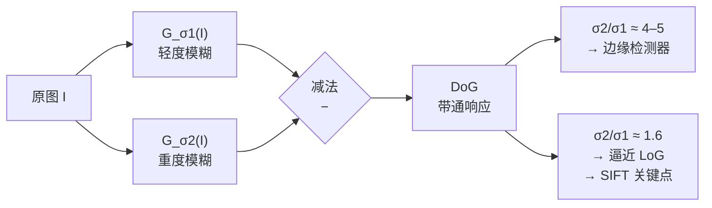

## 15. 形态学操作 Morphological operations

### 15.1 为什么需要它

阈值化(§10)给了你一张二值掩膜,但那张掩膜**几乎从来不干净**。讲师描述得很具体:

> "特别是当你把图像阈值化成黑白之后,你会看到**很多噪声**。有些被误检了——本该属于物体的没检出来,于是物体里出现了一个洞;或者有一堆不属于物体的噪声点。**你需要清理这些点。**"

两种典型脏东西:

- **物体里面有洞** —— 球体表面某个像素被噪声打成了背景;
- **物体外面有孤立噪点** —— 背景里有几个像素被误判成了前景;或者两个本该分开的物体,**被一串噪声像素连在了一起**。

形态学操作就是用来修这两类问题的。它和卷积一样在邻域上工作,但规则不是加权求和,而是**取极值**。邻域的形状由一个**结构元 (structuring element)** 定义——讲师说:"邻域由你定义的核决定,你可以定义 3×3、5×5 或 7×7 的邻域作为邻居,这取决于你。"

### 15.2 两个基本操作

| 操作 | 规则 | 效果 |
|---|---|---|
| **腐蚀 Erosion** | 赋予邻域内的**最小值 (minimum)** | **收缩亮区域 (shrinks bright regions)** |
| **膨胀 Dilation** | 赋予邻域内的**最大值 (maximum)** | **扩张亮区域 (expands bright regions)** |

在二值图上想一下就很清楚:**腐蚀**——只要邻域里有一个 0,中心就变成 0,所以前景往内缩,孤立的小白点会被**整个抹掉**。**膨胀**——只要邻域里有一个 1,中心就变成 1,所以前景往外长,小黑洞会被**填上**。

### 15.3 两个组合操作:开与闭

单独用腐蚀或膨胀有个明显副作用:**物体的尺寸变了**。腐蚀掉噪点的同时,你的球也缩小了一圈。解决办法是**把两者按不同顺序组合**,让尺寸变回来:

| 组合 | 顺序 | 效果 | 什么时候用 |
|---|---|---|---|
| **开运算 Opening** | **先腐蚀,后膨胀** (Erosion then dilation) | **去掉小的亮噪声**,同时基本保持物体原尺寸 | 掩膜外面有孤立噪点;两个物体被噪声连在一起要**断开** |
| **闭运算 Closing** | **先膨胀,后腐蚀** (Dilation then erosion) | **填小洞、补断口** (fills small holes and gaps) | 物体内部有洞;一条线**断成了几段**要接上 |

记忆窍门:**"开"是把东西打开、分离**(去掉多余的连接和噪点);**"闭"是把东西闭合**(填上洞和缺口)。顺序也好记——**要去掉东西就先腐蚀,要补上东西就先膨胀**,第二步都是把尺寸还原。

还有第三个组合,slide 17 提到:

- **形态学梯度 (Morphological gradient)** = **膨胀 − 腐蚀**,结果是**突出物体边界**。直觉:膨胀后的图比腐蚀后的图正好"胖"出一圈,那一圈就是边界。

### 15.4 讲师的三个具体场景

这三个例子直接对应 slide 18 的任务表,也直接对应 lab,建议连答案一起记:

> **🔑 例 1:球里有个洞** — "假设你做了阈值化,检出了球的区域,但突然因为噪声,球内部某个像素被破坏了,出现了一个洞——它看起来不像一个实心的盘,里面有几个像素掉到了背景去了。你需要**填上这些像素,用 closing**。"
>
> **🔑 例 2:两个球被噪声连起来了** — "如果两个球碰巧被噪声像素连在了一起,那你必须切断这个连接,这时用 **opening**。"
>
> **🔑 例 3:跟随一条线,线断了** — "如果我们做**循线 (follow a line)**,阈值化之后你可能发现**线是断的**。所以你要做 **closing**,让它变成一条连续的线。"

讲师随堂考的第四题正是例 1:"一个分割出来的物体内部有一个小洞,你会先试哪个操作?"选项有 opening / closing / Sobel / erosion,答案是 **closing**。讲师还顺带解释了机制:"closing 基本上是你先做 dilation 把洞填上,然后 erosion——因为按照定义,dilation 会**放大**物体尺寸,所以你要用后面这一步**把它缩回去**。"

## 16. 为机器人任务组装流水线

现在把三大家族拼起来。Slide 18 给了一张任务 → 流水线的对照表,**这张表是本 Part 的总结,极其适合作为考点**:

| 任务 (Task) | 典型流水线 (Typical pipeline) |
|---|---|
| **找一个红球** (Find a red ball) | **HSV 区间阈值 → 形态学 → 求斑点中心** (HSV range threshold → morphology → blob centre) |
| **循线** (Follow a line) | **对暗/亮像素阈值 → 闭运算 → 求轮廓中心** (Threshold dark/bright pixels → closing → contour centre) |
| **检测障碍物** (Detect obstacles) | **立体/深度预处理 → 边缘/平面/角点特征** (Stereo/depth preprocessing → edge/plane/corner features) |
| **识别物体** (Recognize objects) | **关键点或学习得到的 CNN 特征 → 匹配/分类器** (Keypoints or learned CNN features → matching/classifier) |

对着这张表把前面的内容串一遍:第一行用到了 §10.3 的 HSV(不是 RGB!)和 §15 的形态学;第二行的 closing 正是讲师的例 3;第三行指向 Part IV 的几何;第四行指向 Part V–VIII 的特征。**整个 Part III 到 Part VIII 的结构,就藏在这张表里。**

Slide 18 最上面还有一句必须内化的话:

> **不存在放之四海而皆准的最佳预处理流水线 (There is no universal best pre-processing pipeline)。**

以及四条工程习惯,写得很实在:

1. **从简单滤波器开始** (start with simple filters);
2. **可视化中间输出** (visualize intermediate outputs)——不要写一个黑盒然后猜哪一步错了,把每一步的图都存下来看;
3. **在不同光照和视角下测试** (test under different lighting and viewpoints)——呼应 §10.2 阈值的脆弱性;
4. **测量失败案例** (measure failure cases)——这和上周"理解失效模式"是同一条方法论。

---

# Part IV · 从图像恢复几何:视觉如何变成尺子

到这里,我们能把图像洗干净、能标出边缘和感兴趣的区域。但所有这些都还停留在**图像坐标**里——"红球在图像的第 320 行第 210 列"。机器人真正需要的是**"红球在我前方 1.4 米、左偏 12°"**。这一部分讲的就是这个转换,以及它为什么需要**两个视角**。

## 17. 相机投影模型:世界坐标如何变成像素坐标

> 📎 **说明** — 这一节的内容在 slides 上只以图片形式出现(slide 21、22 是纯图无文字),但讲师在课上**完整口述了整个模型**。下面是根据讲堂讲解整理的,它是理解 §18–§20 的必要前提。

设想空间中有一个点,它在世界坐标系里的坐标是 $(X, Y, Z)$。相机拍下这一幕,这个点落在图像的某个像素上,像素坐标记作 $(u, v)$。**投影模型**就是描述 $(X,Y,Z) \to (u,v)$ 这个映射的东西。

讲师说,这个映射由**两组参数**决定,分两步走:

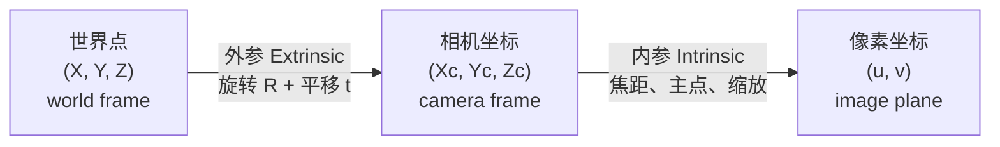

### 17.1 外参 Extrinsic parameters

**外参描述的是"相机站在世界的哪里、朝向哪边"。**

讲师直接把它接回了上周的内容:

> "真实世界坐标和你相机上那个坐标系(叫做 **camera frame**)之间存在一个关系。记得我们用过 frame——有 **world frame**,有 **camera frame**。你的 world frame 和 camera frame 之间的关系,用**旋转矩阵和平移矩阵**来表示。记住这叫做 **extrinsic transformation(外参变换)**。"

所以外参就是上周学的那个**齐次变换**,没有任何新东西:

$$\begin{bmatrix} X_c \\ Y_c \\ Z_c \end{bmatrix} = \mathbf{R} \begin{bmatrix} X \\ Y \\ Z \end{bmatrix} + \mathbf{t}$$

其中 $\mathbf{R}$ 是 3×3 旋转矩阵,$\mathbf{t}$ 是 3×1 平移向量。这一步**把世界坐标转成相机坐标**。

注意外参**不是相机的属性**——同一台相机装在机器人身上,机器人一动,外参就变了。外参描述的是**相机与世界的相对位姿**。

### 17.2 内参 Intrinsic parameters

**内参描述的是"这台相机内部长什么样"**,它由硬件决定,机器人怎么动都不变。讲师列出的三样:

1. **焦距 (focal length)** —— "你镜头的焦距,因为相机通常有一个光学镜头"。焦距决定了视场角和放大率:焦距长 → 视野窄、物体在图上大。
2. **主点 (principal point)** —— 讲师的说法是"镜头的中心是否 100% 和传感器对齐"。理想情况下光轴正好穿过传感器的正中心,实际装配总有偏差,所以要用两个参数 $(c_x, c_y)$ 记录光轴实际落在哪个像素上。
3. **缩放 / 放大率 (scale, magnification)** —— 把物理尺寸(毫米)换算成像素数的比例。

这三样打包成一个 3×3 的**内参矩阵 (intrinsic matrix)**:

$$\mathbf{K} = \begin{bmatrix} f_x & 0 & c_x \\ 0 & f_y & c_y \\ 0 & 0 & 1 \end{bmatrix}$$

配上投影本身(除以深度 $Z_c$,这就是"近大远小"):

$$u = f_x \frac{X_c}{Z_c} + c_x, \qquad v = f_y \frac{Y_c}{Z_c} + c_y$$

**读一下这两个式子在说什么**:一个点在图像上偏离中心多少,等于它在相机坐标系里的横向偏移**除以它的深度**,再乘一个焦距。除以 $Z_c$ 是整件事的关键——**同一个物体,离得越远($Z_c$ 越大),在图上就越小**。

> 📎 **拓展(超出 slides)** — 上周讲相机标定时提过的**镜头畸变 (lens distortion)** 是内参的一部分(通常写成额外的畸变系数 $k_1, k_2, p_1, p_2, \dots$)。讲师在本周开头讲预处理时也点了这一笔:"特别是在机器人里,我们还用视觉做**几何测量**,这种情况下**畸变会严重影响测量**,所以预处理也包括这些校正。" 换句话说:§11–§16 那些滤波是为了"看清楚",而畸变校正是为了"量得准"——两个不同的目的,都归在预处理里。

## 18. 为什么一张图不够:投影不可逆

现在到了这一部分的转折点。讲师说得非常清楚:

> "基本上,在相机投影几何模型里,当你拍一张照片时,**你只有 $u$ 和 $v$。你没有 $X, Y, Z$**,你不知道是哪个真实世界坐标映射到了图像里这个 $(u,v)$ 位置。所以如果我们想做测量、想测出 $X, Y, Z$,你就得反过来做——**逆映射 (inverse mapping)**。但是,**三维映射到二维之后,你没法做逆运算。**"

为什么不能?看 §17.2 那两个式子就明白了:$u$ 只告诉你比值 $X_c/Z_c$,不告诉你 $X_c$ 和 $Z_c$ 各自是多少。

**一个像素对应的不是空间中的一个点,而是一整条射线。** 沿着这条射线,近处的小物体和远处的大物体会投影到**完全相同的像素**上。这就是电影里"手托太阳"那类照片能成立的原因,也是 §6 说的"病态问题"在几何上的确切形式。

于是结论:

> **要恢复 $X, Y, Z$,你需要两台相机。** 讲师原话:"通常,如果你想测 $X, Y$ 坐标,你需要两台相机,两台相机一起。**这就是三角测量 (triangulation) 的由来。**"

## 19. 三角测量、立体视觉与运动恢复结构

### 19.1 三角测量的原理

假设空间中有一个真实点 $P$。它在**左相机**的图像上落在 $P_L$,在**右相机**的图像上落在 $P_R$。

现在:$P_L$ 定义了一条从左相机中心出发的射线,$P_R$ 定义了一条从右相机中心出发的射线。这两条射线**在空间中相交,交点就是 $P$**。只要你知道两台相机的相对位姿(它们之间的旋转和平移),这个交点就可以解出来。

这就是**三角测量 (triangulation)**——slide 19 的定义:

> **三维点由它在两幅图像中对应的二维投影估计得到 (A 3D point is estimated from corresponding 2D projections in the two images)。**

### 19.2 三种拿到"两个视角"的方式

Slide 19 和讲师一共给了三种,区别只在于"两个视角之间的变换是怎么来的":

| 方式 | 英文 | 两视角之间的变换是什么 | 特点 |
|---|---|---|---|
| **立体视觉** | **Stereo vision** | 两台相机**刚性固连**,变换**固定且经过标定** (fixed and calibrated) | 变换已知且恒定,最可靠;需要两台相机 |
| **运动恢复结构** | **Structure from motion (SfM)** | **一台**相机在时间上移动,变换就是**相机的运动** | 只需一台相机;但变换本身需要估计,且场景必须静止 |
| **(讲师补充)物体运动** | — | 相机不动,**点在动** | 也能恢复三维 |

讲师对 SfM 的描述很直观:

> "这两幅图像也可以来自**单台相机从一个位置移动到另一个位置**。你可以在这里拍一张,在另一个时刻拍另一张,然后**把这两张图当作它们是被一台立体相机拍下的**——你依然能恢复出这个位置,这种情况叫做 structure from motion,因为你的相机从一个位置移到了另一个位置。"

请注意**立体视觉和 SfM 在数学上是同一件事**,差别只在于:立体相机的基线是出厂标定好的常数,而 SfM 的基线是运动带来的、需要从图像本身估计出来的未知量。这也是为什么 SfM 更难。

### 19.3 核心难点:对应问题

无论走哪条路,slide 19 的落脚句都是同一个要求:

> **核心要求:在两幅图像中识别出同一个物理点 (Core requirement: identify the same physical point in both images)。**

讲师叫它 **matching(匹配)**:

> "关键想法是:**你要在两幅图像里找到对应的点**,你必须找到两幅图像里对应于三维世界中**同一个物理点**的像素。这个寻找的过程叫做 matching。匹配之后,基于几何关系,我们就能做三角测量。"

这个"对应问题 (correspondence problem)"是立体视觉的全部难度所在。想想它有多难:右图有 640×480 ≈ 30 万个像素,对左图的**每一个**像素,你都要在这 30 万个里找出正确的那一个。而且很多像素长得一模一样——**一面白墙上的所有像素彼此无法区分**。

这就引出了下一节:一个把搜索量砍掉几个数量级的几何约束。

## 20. 对极几何:把二维搜索压成一维

### 20.1 对极平面的定义

**这是 slide 20 唯一的内容,而且讲师随堂考了它,几乎必考,请逐字记住。**

> **对极平面 (epipolar plane)** 是一个平面,它包含以下三样东西:
>
> 1. **被观察的三维点** (the 3D point being observed);
> 2. **第一台相机的光心** (the optical center / camera center of the first camera);
> 3. **第二台相机的光心** (the optical center of the second camera)。

三个点确定一个平面——这就是全部。讲师课上被问到时的回答同样干脆:"**两个相机中心加上空间中的那个三维点。**"

### 20.2 对极线,以及它为什么有用

现在把这个平面和两个成像平面相交。**平面与平面相交得到一条直线**——这条交线就是**对极线 (epipolar line)**。

讲师的描述:

> "左相机的中心、右相机的中心,加上三维空间中的那个点,构成一个平面。这个平面叫做 **epipolar plane**,而这个 epipolar plane 和**成像平面 (image plane)** 的交线,就构成了 **epipolar line**。"

**它的价值在于一条约束**:

> "所以 epipolar 约束了到哪里去找那个与 $P_L$ 对应的 $P_R$。这**简化了我们的算法,只需沿着这条线搜索**。"

把这件事的收益量化一下,你就明白为什么它是立体视觉的基石:

| | 没有对极约束 | 有对极约束 |
|---|---|---|
| 搜索空间 | 整幅右图,约 $640 \times 480 = 307{,}200$ 个像素 | 一条对极线,约 $640$ 个像素 |
| 复杂度 | $O(N^2)$ 二维搜索 | $O(N)$ 一维搜索 |
| 附带好处 | — | 不在线上的候选**直接排除**,大幅减少误匹配 |

**从二维搜索降为一维搜索**——这就是对极几何买到的东西。

> 📎 **拓展(超出 slides)** — 实际的立体相机系统会先做一步**校正 (rectification)**:把两幅图像做一次变换,让所有对极线都变成**水平的、且行号相同**。这样"沿对极线搜索"就退化成"在同一行里从左往右扫",可以做得极快,也是硬件立体相机(比如课上那位同学公司做的产品)能实时输出深度图的原因。

### 20.3 用什么判断两个像素匹配

对极线告诉你**在哪里找**,但没告诉你**怎么判断找到了**。讲师给的答案很朴素:

> "我们用什么标准来做匹配?我们用**局部的强度或颜色 (local intensity or colour)**,我们跑匹配算法。"

也就是:取 $P_L$ 周围的一小块像素,沿着右图的对极线滑动,找和它**最像**的那一块。这里"最像"通常用像素差的平方和(SSD)或归一化互相关(NCC)来衡量。

这个朴素方案的失效场景也就一目了然了——**无纹理表面**。一面白墙上,对极线上每一块看起来都一样,匹配算法无从选择。这正是下一节结构光要解决的问题。

## 21. 视差 Disparity:从匹配到距离

匹配成功后,你得到了一对像素坐标 $(u_L, v_L)$ 和 $(u_R, v_R)$。现在算距离。

**视差 (disparity)** 定义为同一个点在左右图像中的**水平位置之差**:

$$d = u_L - u_R$$

讲师的说法:"$u_R$ 和 $u_L$ 沿对极线的差,我们叫做 **disparity**。"

深度与视差的关系是:

$$Z = \frac{f \cdot B}{d}$$

其中 $f$ 是焦距,$B$ 是两台相机之间的**基线 (baseline)** 距离。

**这个式子最重要的性质是反比**。讲师反复强调了它:

> "你可以看到 $d$ ——**视差越小,$Z$ 值越大**。换句话说,当那个点很远的时候,视差会小于 1 个像素,那就**很难测量**了。"

用一个直观的自测:伸出手指放在鼻子前,左右眼交替眨——手指跳得很厉害(视差大)。把手伸直再试——跳得少了。看远处的山?**完全不跳**(视差为零)。你的眼睛就是一套基线约 6.5 cm 的立体视觉系统,而山超出了它的量程。

由此得到立体视觉的两条根本限制,**这是考点**:

| 结论 | 原因 |
|---|---|
| **立体相机有一个最大可测距离** | 太远 → 视差 < 1 像素 → 无法分辨 |
| **近处物体测得比远处准** | 近 → $d$ 大 → 同样的 1 像素匹配误差,换算成深度误差就小 |

讲师原话:"通常对于立体相机,**离相机近的物体,你能更好地测出它们的距离**,因为这种情况下 $d$ 变大了,精度会提高。如果 $d$ 非常非常小,小到不足 1 个像素,你就没法测量了,因为它们几乎落在同一个像素位置上。"

> ⚠️ **一个容易忽略但会考的细节** — 讲师提醒:"这个 $X, Y, Z$ 值是**相对于相机坐标系 (camera frame)** 的,**不是**真实世界坐标系。要把它变成世界坐标系里的值,你必须建立 camera frame 和 world frame 之间的变换。"
>
> 这正是上周那条铁律的又一次现身:**任何传感器读数都在传感器自己的坐标系里**。立体视觉给你的是相机坐标系下的三维点,要用它导航,还得乘上外参。

如果想提高量程,从 $Z = fB/d$ 就能读出办法:**加大基线 $B$** 或**加大焦距 $f$**。代价分别是——基线大了,两台相机的**共同视野变小**,近处的东西反而看不到;焦距长了,**视场角变窄**。这是一个没有免费午餐的权衡。

## 22. 结构光:用主动照明制造纹理

§20.3 留下的问题是:**无纹理表面无法匹配**。一面白墙、一只手的皮肤——对极线上处处相同,匹配算法彻底失效。

**结构光 (structured light)** 的解法非常聪明:**既然场景没有纹理,那我们就自己投一个上去。**

Slide 23 的定义:

> **结构光把一个已知的图案投射到表面上 (Structured light projects a known pattern onto surfaces)。观察到的图案形变揭示了三维形状 (The observed deformation of the pattern reveals 3D shape)。**

讲师用了一只手做例子:

> "我们把一组竖直的线投射到场景上……比如说这里有一只手,你把竖直的线投上去。因为这些位置**相对于相机处于不同的深度**,当我们拍照时,它们**以不同的方式发生形变**——不再是竖直的直线了,因为表面不是平面。而**形变的程度就指示了表面的深度值**。"

关键在于:投射的图案是**已知的**。你知道原本投出去的是一条笔直的竖线,所以图像里那条线弯了多少,就直接编码了表面起伏了多少。

**几种图案**,讲师和 slide 各提了一部分:

- **竖直线条或彩色条纹** —— slide 23 的图(Zhang et al. 2002)用的就是彩色直线;
- **网格 (grid)**;
- **散斑图案 (speckle patterns)** —— slide 23 特别提到:"红外深度相机使用**散斑图案**:许多小点,每个点都有**独特的局部排布 (distinctive local layouts)**。"

第三种最值得琢磨。为什么要用**随机散斑**而不是规则网格?slide 给了答案:

> **匹配变得更容易,因为每个点都有了局部图案上下文 (Matching becomes easier because points have local pattern context)。**

规则网格有一个致命问题——**所有格点长得一样**,你还是分不清左图的第 5 条线对应右图的第 5 条还是第 6 条(这叫**周期性歧义**)。而随机散斑里,每一小片区域的点分布都是**独一无二**的,相当于给场景贴上了一层"指纹",匹配立刻变得可靠。

**红外的用途**——讲师提到一个实用细节:

> "很多时候,这些线是**红外的 (infrared)**,人眼看不见。所以当你在测距离时,你看不到这些图案。"

这解释了为什么 Kinect 这类设备工作时你看不到任何投影——它投的是近红外散斑,只有它自己的红外相机看得见。这对人机共处的机器人很重要:你不会希望机器人在房间里投一片刺眼的光栅。

**最后一句要记住的定性判断**,slide 23 的落脚句:

> **结构光是一种主动视觉 (active vision) 方法:它改变场景照明来简化感知。**

回忆上周的**主动 (active) vs 被动 (passive)** 分类法——结构光深度相机是**主动**传感器,因此继承了主动传感器的所有通病:**耗电**、**会和其他同类设备互相干扰**、**在强阳光下失效**(投出去的图案被日光淹没)。

## 23. Part IV 小结:视觉如何变成尺子

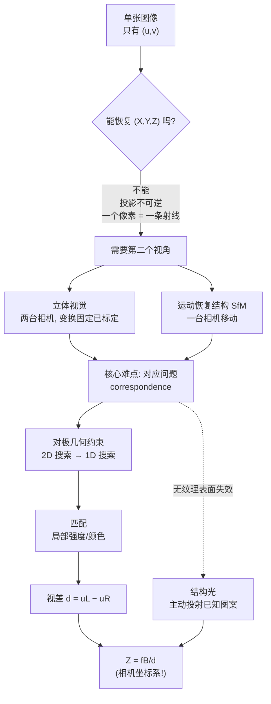

最后,讲师提到现代方法把这些阶段**合并**了:

> "如今,我们用机器学习——特别是神经网络——把所有这些阶段结合在一起。你给我一张图像,我可以直接估计每个像素的深度。不是绝对深度,而是**尺度不变版本的深度 (scale-invariant depth)** 或者**相对深度 (relative depth)**……已经有模型,给定一张图像,模型就给你每个像素的深度估计。"

注意讲师加的那个限定词非常重要:**单目深度估计给出的通常是相对深度,不是绝对深度**。原因正是 §18 说的——**单张图像在数学上就无法确定绝对尺度**。神经网络学到的是"根据先验,这个场景大概长这样",它猜出了形状,但猜不出真实尺寸。一台相机拍一个玩具房间和一个真房间,图像可以完全一样。这也再次印证了 §7 的主题:**没有先验,视觉是欠定的;有先验,你得到的是先验允许的答案。**

---

# Part V · 特征提取:把数据压成决策

## 24. 为什么必须做特征提取:27.6 MB/s 的问题

Part IV 解决了几何,但还有一个更基础的资源问题没解决。Slide 26 用一个数字把它砸出来:

> 一路 **640×480×3 字节 × 30 fps ≈ 27.6 MB/s**,而且这是**压缩之前**的数据量。

讲师现场也算了这笔账,并给出了机器人的真实处境:

> "每秒钟都是大量的数据。所以大多数时候,**我们并不需要每一个像素**。我们需要一些特征。"

对比一下三种数据形态的信息量,这是 slide 26 的核心对照:

| | 原始相机流 | 原始激光扫描 | **任务真正需要的答案** |
|---|---|---|---|
| 内容 | 640×480×3 × 30 fps ≈ **27.6 MB/s** | 每帧数百个距离测量,常以点云形式 | "**这是一扇门**"、"**墙在 1.2 m 处**"、"**marker ID 17**"、"**检测到一个角**" |
| 量级 | 兆字节每秒 | 千字节每帧 | **几个字节** |

看最右边那一列——机器人做决策真正需要的信息,可能只有**几个字节**。中间隔着七八个数量级。**特征提取就是跨越这个鸿沟的操作。**

Slide 26 给出了它的定义,措辞很精确,值得记:

> **特征提取的目标是:保留对决策有用的信息,同时丢弃无关的细节、噪声和冗余 (preserve information useful for decision-making while discarding irrelevant detail, noise and redundancy)。**

注意这句话里的紧张关系:**丢掉东西是目的,不是副作用。** 但丢错了就完了。所以下一节要问:什么样的东西可以丢,什么样的必须留?

## 25. 什么是特征,以及好特征的四条标准

Slide 27 的定义:

> **特征 (feature) 是从传感器数据中提取出来的、稳定的、有信息量的模式 (a stable, informative pattern extracted from sensor data)。**

**四种常见特征类型**:

| 类型 | 英文 | 定义 | 机器人里的例子 |
|---|---|---|---|
| **直线** | **Line** | — | 墙的边界、地面标线、货架边缘、车道线 |
| **角点** | **Corner** | **两条边的交点** | 用于定位和匹配 |
| **斑点** | **Blob** | 具有独特局部强度结构的区域或关键点 | 讲师的说法:"一组像素,代表了机器人感兴趣的东西,比如**彩色球**——只包含那个颜色的一组像素" |
| **描述子** | **Descriptor** | 表示**局部外观**的**数值向量 (numerical vector)** | SIFT 的 128 维向量 |

**注意最后一行和前三行性质不同**:前三个回答"**在哪里**",描述子回答"**长什么样**"。这个区分在 §37 讲 SIFT 时会变成一条明确的设计原则。

**好特征的四条标准 (Desirable feature properties)** —— slide 27 列了四条,请连同"为什么"一起理解,因为讲师的随堂题就考这个:

| 标准 | 英文 | 含义 | 为什么机器人需要它 |
|---|---|---|---|
| **可重复** | **Repeatable** | **从不同视角都能检测到** | 机器人第二次经过同一个地方时,视角必然不同。检测不到 = 认不出这地方 |
| **稳健** | **Robust** | 在噪声和小幅光照变化下稳定 | 早上和傍晚经过同一条走廊,光完全不同 |
| **不变或容忍** | **Invariant or tolerant** | 对**旋转和尺度**不变 | 机器人可能从 2 m 外看,也可能从 5 m 外看;可能正着看,也可能歪着头看 |
| **可区分** | **Discriminative** | 能把一个地方/物体和另一个区分开 | 如果所有的墙角看起来都一样,特征就没用了 |

讲师把前三条概括成一个更简洁的版本,并强调了"低维"这个额外要求:

> "我们希望选出的特征必须是**低维的 (low dimension)**,意思是用尽可能少的数字来表示;特征要能被**重复检测**——所以如果机器人再次来到同一个地方,看着同一面墙,它能提取出相同的、相似的特征,这样你就能用它做定位;还要足够**稳健**。这就是三条标准。"

> **🔑 讲师的随堂题(直接考这个)** — "对机器人定位来说,下面哪一个是**最不可取**的视觉特征属性?" 选项:可重复性 / 对噪声稳健 / **对小视角变化敏感** / 可区分性。
>
> 答案是**对小视角变化敏感 (sensitivity to small viewpoint change)**。讲师的解释:"定位需要什么?如果机器人来到一个它以前访问过的地方,它要能认出这个地方。……如果这个特征**对小视角非常敏感**,那它就是最不可取的——因为机器人每次看那个地方,角度都会略有不同,位置或朝向可能都不一样。所以我希望特征对视角变化足够稳健,这叫做**视角不变性 (view invariance)**。"
>
> 这道题的陷阱在于问的是"**least desirable**",四个选项里三个是好性质,一个是坏性质。读题要小心。

## 26. 直线为什么在移动机器人里如此重要

四种特征里,本课重点讲两个:**直线**(Part VI–VII)和**兴趣点/SIFT**(Part VIII)。先说直线。

讲师给的理由很直接:

> "直线对场景、对机器人导航是非常重要的特征。对自动驾驶车辆来说是**车道线检测**;对室内机器人来说,是**墙角、墙的边缘、走廊的墙**。"

Slide 28 把用途列全了:

1. **墙在二维激光扫描中形成直线模式** —— 注意这一条:**直线特征不只用于图像,也用于激光点云**。事实上 §28–§32 讲的所有拟合算法,slides 上举的例子几乎全是激光扫描的点云。这是本章一个容易被忽略的点:**特征提取是一套跨传感器的方法论**。
2. **地面标线和门框在图像中形成直线**;
3. **直线的朝向有助于在机器人转弯时修正里程计误差 (odometry errors)** —— 这条很妙:走廊的墙提供了一个**绝对的方向参考**。上周说过里程计的朝向会漂移,而"我看到的这面墙应该是和上一帧同一面墙"就构成了一个纠正约束。
4. **直线的距离和角度可以成为定位与建图的路标 (landmarks)**。

一句话总结 slide 28 的标题:**直线把原始测量连接到几何结构 (Lines connect raw measurements to geometric structure)。** 一堆离散的距离点是没有结构的;一旦拟合成"距我 1.2 m、法向 37° 的一面墙",它就变成了可以放进地图、可以参与定位计算的东西。

---

# Part VI · 直线拟合的三种策略

## 27. 直线的极坐标表示

在拟合之前,先解决一个表示问题。

最熟悉的直线方程是 $y = mx + c$。它有一个致命缺陷:**竖直的线斜率是无穷大**。而机器人面前的墙,完全可能正好是竖直的——一个在物理上毫无特殊之处的方向,在数学表示上却会让程序崩掉。这种表示是不能用的。

**解决办法:用极坐标 (polar form) 表示直线。** Slide 29 的标题就是:"距离 $r$ 和角度 $\alpha$ 避免了无穷斜率问题"。

**两个参数**:

| 参数 | 含义 |
|---|---|
| $r$ | 从机器人/原点到这条直线的**垂直距离** (perpendicular distance) |
| $\alpha$ | 这条直线的**法向朝向** (line normal orientation) |

讲师的描述:"$\rho$ 是这条线离图像空间原点的**最短距离**,$\alpha$ 是那个角度。"

**这个表示对任何方向的直线都成立**,包括竖直和水平——slide 29 明确写了 "This form works for vertical and horizontal lines"。而且这两个参数**天然就是机器人想要的东西**:"墙离我多远"($r$)和"墙朝哪个方向"($\alpha$),直接可以拿去做定位。

**点到直线的距离公式**(这是后面三种算法共同的基础):

对于极坐标下的第 $i$ 个点 $(\rho_i, \theta_i)$,它到候选直线 $(r, \alpha)$ 的**有符号距离 (signed distance)** 是:

$$d_i = \rho_i \cos(\theta_i - \alpha) - r$$

**读懂这个式子。** $\rho_i \cos(\theta_i - \alpha)$ 是把点的位置向量**投影到直线的法方向上**——也就是"这个点沿着法向走了多远"。而 $r$ 是直线本身沿法向的位置。两者相减,就是这个点偏离直线多远。

所以:

> **$d_i$ 越小,这个点越可能在这条线上;$d_i$ 越大,越不可能。**

讲师说得很朴素:"你可以看到,$d_i$ 越小,这个像素越可能在这条线附近。如果 $d_i$ 变大了,这个边缘像素就越不可能属于这条线。"

**注意"有符号"**:线一侧的点 $d_i > 0$,另一侧 $d_i < 0$。这个符号在下一节会立刻造成麻烦。

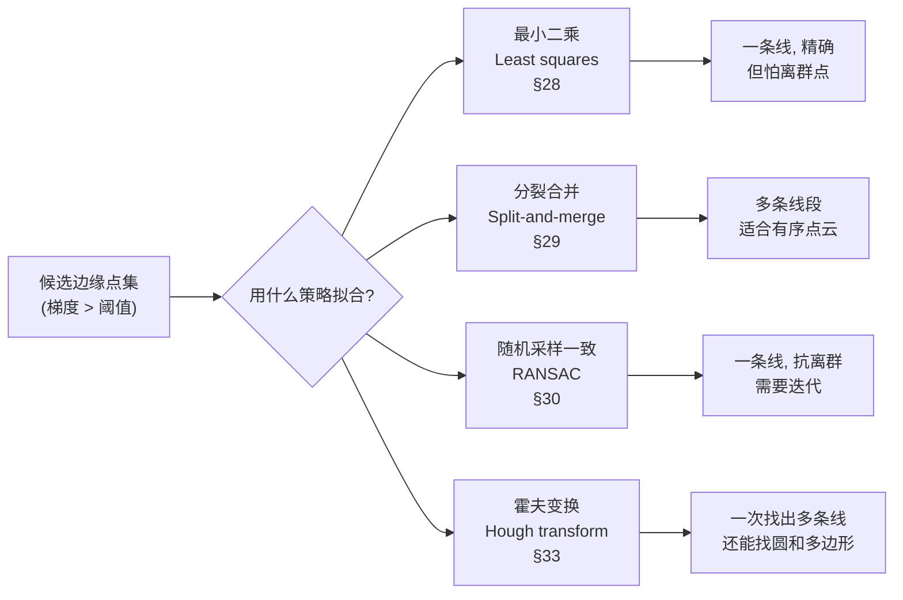

## 28. 最小二乘拟合 Least-squares line fitting

### 28.1 目标函数

有了 $d_i$,拟合的目标就自然了:**找一组 $(r, \alpha)$,让所有点到这条线的距离总体上最小。**

Slide 30 的目标函数:

$$S(r, \alpha) = \sum_i \big(\rho_i \cos(\theta_i - \alpha) - r\big)^2$$

也就是**所有 $d_i$ 的平方和**。

**为什么要平方?** Slide 30 给了两条理由,都要记:

1. **正负误差不应该互相抵消** (Positive and negative errors should not cancel)。还记得 $d_i$ 是**有符号**的吗?如果直接把 $d_i$ 相加,一个 $+5$ 和一个 $-5$ 会加成 0,给出"完美拟合"的假象——而实际上这两个点离线都很远。平方让所有误差都变成正的。
2. **偏差大的点被重罚** (larger deviations are penalized strongly)。平方是超线性的:误差从 1 变成 10,惩罚从 1 变成 100。这**看起来**是个优点(逼着算法照顾偏得远的点),但 §28.3 会看到它其实是最小二乘最大的软肋。

### 28.2 怎么解

Slide 30 的 "Optimality condition":

> **令 $\partial S / \partial r = 0$ 且 $\partial S / \partial \alpha = 0$,然后解出最优参数。**

这是标准的多元函数求极值:在最小值处,函数对每个参数的偏导都为零。$S$ 对 $(r, \alpha)$ 是两个未知数、两个方程,可以解出闭式解。本课不要求推导过程,但要能说出这个思路。

Slide 30 还给了一个更一般的观察,值得记住,因为它超出直线:

> **General idea:最小二乘可以通过最小化残差平方和 (a sum of squared residuals) 来拟合任何参数化模型。**

也就是说,直线只是一个例子。同样的框架可以拟合圆、平面、多项式——只要你能写出"点到模型的距离"。

### 28.3 致命弱点:离群点

Slide 30 的落脚句,加粗记住:

> **弱点:最小二乘对离群点 (outliers) 极其敏感,因为离群点会贡献非常大的平方误差。**

这正是 §28.1 那第二条"优点"的反面。假设 20 个点整齐地落在一面墙上,第 21 个点是一个从玻璃门透射造成的错误测量,离墙 3 米远。最小二乘看到这个点贡献了 $3^2 = 9$ 的误差,会**把整条线朝它拽过去**,以求减少这个巨大的项——结果是:为了迁就一个错误的点,**牺牲了 20 个正确的点**。

这是一个必须理解的直觉:**最小二乘假设所有数据点都是"基本正确、只是带点高斯噪声"的。** 一旦有点是"根本错误"的,这个假设崩塌,结果可以任意糟糕。

而机器人的传感器数据**充满**了这种根本错误的点:激光穿透玻璃、超声的多次反射、图像里被阴影骗出来的假边缘。所以纯最小二乘几乎从不单独使用。§30 的 RANSAC 就是为此而生的。

### 28.4 直觉版的三步

Slide 31 把这个过程画成了三步,作为无公式版的理解:

> **Step 1** —— 假设一条由 $r$ 和 $\alpha$ 定义的候选直线。
> **Step 2** —— 测量所有点到这条线的垂直误差 $d_i$。
> **Step 3** —— 选出 $\sum d_i^2$ 最小的那条线。

讲师的描述和这个一致:"我们做第一步,假设一条由 $r$ 和 $\alpha$ 定义的候选线,测量所有像素的误差 $d_i$,然后挑出 $\sum d_i^2$ 最小的那条线。"他还补充了两种等价的看法——一种是"枚举候选线、选误差最小的"(概念上),另一种是"直接求导数为零解出来"(实际上)。**两种说法描述的是同一件事。**

## 29. Split-and-merge:当直线不止一条

### 29.1 问题

最小二乘有一个隐含前提:**你已经知道这些点属于同一条直线**。但机器人拿到一帧激光扫描时,并不知道面前是一面墙、还是一个墙角(两面墙)、还是一条走廊(两面平行的墙)。

讲师提出这个问题:"通常不止一条线。我们不知道这些像素构成的是一条线,还是可能是多条线。"

Slide 32 的标题正是:**当直线数量未知时,检测多条线段。**

### 29.2 四个步骤

| 步骤 | 英文 | 做什么 |
|---|---|---|
| **1 · 拟合** | **Fit** | 用最小二乘对当前点集拟合**一条**直线 |
| **2 · 分裂** | **Split** | 找到**离这条拟合线最远**的那个点 |
| **3 · 递归** | **Recurse** | 如果那个距离**超过阈值**,就在该点处把点集**切成两半**,对每一半重复整个过程 |
| **4 · 合并** | **Merge** | (可选)如果相邻的两段能被一条线很好地解释,就把它们**合并**回去 |

**为什么在"最远的那个点"处分裂?** 因为那个点是"一条线解释不了这些数据"的最强证据,它最可能就是**转折点**——也就是两条线的交界。Slide 33 把这个洞察写成了一句很漂亮的话:

> **一个角点可以表示为两条线段。Split-and-merge 通过"先用一条线解释全部点而失败"来发现这个角点。**

也就是说:**失败本身携带了信息。** 拟合失败得最厉害的地方,恰恰就是结构发生变化的地方。

讲师的描述完全一致:"如果我们拟合一条线,因为误差太大,现在我们必须把它分成两条,在**误差最大的那个点**处分裂……然后得到两组像素,每一组各自再拟合一条线。如果两条线的误差还是很大,我们可以继续分裂。"

### 29.3 伪代码

Slide 33 给的实现:

```python
function splitMerge(points, threshold):
    line = leastSquaresFit(points)
    p_max, d_max = largestError(points, line)
    if d_max <= threshold:
        return [line]
    left, right = splitAt(points, p_max)
    return splitMerge(left, threshold) + splitMerge(right, threshold)
```

这是一个标准的**递归 (recursion)**:终止条件是"最大误差已经在阈值以内"(说明一条线够用了),否则一分为二、各自递归。

### 29.4 三条性质

Slide 33 列了三条,每一条都对应一个实践中的坑:

1. **适用于有序点云 (ordered point clouds),比如激光扫描序列。**

   这一条很关键,也是它和 RANSAC 最大的区别。"有序"是什么意思?激光扫描仪是**按角度依次**输出测量的,所以点自然按顺序排成一串。`splitAt(points, p_max)` 这个操作**只有在点有顺序时才有意义**——你才知道哪些点在分裂点"左边"、哪些在"右边"。如果给它一堆无序的图像边缘像素,这一步就无从下手。

2. **需要一个距离阈值:太小会得到太多线,太大会漏掉结构。**

   这是所有阈值型算法的通病。阈值太小 → 一面稍微有点起伏的墙被切成十几段;太大 → 一个真实的墙角被当成噪声,两面墙被硬拟合成一条。

3. **对离群点敏感,因为每一个离群点都可能强制一次分裂。**

   这一条继承自最小二乘。想想看:一个离群点的 $d_{max}$ 必然很大,超过阈值 → 触发分裂 → 在它那里把一段好好的墙切成两半。**离群点不仅污染拟合,还污染分段。**

Slide 33 最后补了一句实践建议:"通常后面跟着合并或模型验证 (Usually followed by merging or model validation)。"这就是名字里 "merge" 的来源——讲师说:"当然,分裂之后你可能有 5 段或 10 段小线段,那些靠得近的线段,你仍然可以把它们合并成一条线。"

## 30. RANSAC:随机采样一致

### 30.1 想法

前两节都栽在同一个地方:**离群点**。RANSAC 的思路是一次彻底的转向。

最小二乘的逻辑是:"我要找一条线,让**所有点**的误差最小。"这个逻辑的问题在于——**它必须迁就每一个点**,包括错的。

RANSAC 的逻辑是:"我要找一条线,让**尽可能多的点认同它**。至于那些不认同的点,**我根本不管它们**。"

这个转变是关键的:从"最小化总误差"变成"**最大化支持者数量**"。离群点不再能拖动模型——它们只是不投票而已。

**RANSAC** 全称 **RANdom SAmple And Consensus(随机采样与一致性)**,slide 34 的副标题是:"当存在很多离群点时的稳健模型拟合"。

### 30.2 四个步骤

| 步骤 | 英文 | 做什么 |
|---|---|---|
| **1 · 随机采样** | **Random sample** | 选出**构建模型所需的最少点数**;对于二维直线,就是**选 2 个点** |
| **2 · 一致集** | **Consensus set** | 数一数有多少个数据点落在候选模型的距离 $\varepsilon$ 之内 |
| **3 · 保留最优** | **Keep best model** | 重复很多次,保留**内点 (inlier) 数量最多**的那个模型 |
| **4 · 精修** | **Refine** | 对最终的内点集**跑一次最小二乘**,改进参数估计 |

**第 1 步的"最少点数"值得说一句。** 为什么是 2 个而不是 10 个?因为**采样点越多,采到离群点的概率越高**。两点确定一条直线,这是构建模型的最低要求;如果每次采 10 个点,只要其中一个是离群点,这次采样就废了。**最小采样是 RANSAC 稳健性的一半来源。**

**第 4 步很容易被忽略但很重要。** RANSAC 本身只用 2 个点定线,这条线的精度受限于那 2 个点的噪声。但一旦确定了内点集合,就可以对**所有内点**做最小二乘——此时离群点已经被排除,最小二乘的假设终于成立了。所以:

> **RANSAC 负责"找出谁是内点",最小二乘负责"用内点算出精确参数"。两者是互补的,不是竞争的。**

### 30.3 伪代码与三个参数

Slide 35 的实现:

```python
best = None
for k in 1..N_iterations:
    p1, p2 = randomTwoPoints(points)
    model = lineThrough(p1, p2)
    inliers = {p : distance(p, model) < ε}
    if count(inliers) > best.count:
        best = model, inliers
return leastSquaresFit(best.inliers)
```

注意最后一行——**返回的是对内点做最小二乘的结果**,不是随机选的那两个点定的线。这就是第 4 步。

**三个必须调的参数**,slide 35 单独列出:

| 参数 | 含义 | 调错了会怎样 |
|---|---|---|
| **$\varepsilon$** | 一个点被算作内点的**最大距离** | 太小 → 真正的内点被排除,支持数不足;太大 → 离群点也被算成内点,失去稳健性 |
| **最小内点数** | 接受一条线所需的**最少支持** | 太低 → 噪声里的巧合被当成线;太高 → 真实但较短的线段被漏掉 |
| **迭代次数 $N$** | 重复多少轮 | **更多迭代提高成功概率,但代价是更多时间** |

### 30.4 找多条线

RANSAC 一轮只找一条线。讲师说明了怎么找多条:

> "内点数量最多的那条线会被保留下来,然后你找到了一条线,**剩下的像素再走同样的流程**,你就找到了第二条线。"

这个模式叫做**顺序 RANSAC (sequential RANSAC)**:找一条 → 移除它的内点 → 在剩下的点里再找一条 → 重复。

### 30.5 讲师的实践建议

关于"最小二乘还是 RANSAC",讲师给了一个明确的答案:

> "用哪个,最小二乘还是 RANSAC?**大多数时候我们用 RANSAC,因为它更稳健。**最小二乘对离群点或噪声非常敏感,而 RANSAC 稳健得多。"

以及完整的机器人场景描述,这段话把 Part III 和 Part VI 串了起来:

> "在典型的机器人场景里:你要找一条线,**给定一组候选像素——那些通过边缘检测、梯度值超过某个阈值的像素**——从这些候选像素出发,用 RANSAC 算法找出直线。"

**请把这条流水线记牢**:原图 → 高斯平滑 → Sobel 求梯度 → 阈值得到候选边缘点 → RANSAC 找直线 → 最小二乘精修。这是本章前六个 Part 的完整闭环。

## 31. 三种方法对比

Slide 36 给了一张对比表,**这是 Part VI 最适合做考点的一张表**:

| 方法 | 强项 (Strength) | 弱项 (Weakness) | 典型用途 (Typical use) |
|---|---|---|---|
| **最小二乘 Least squares** | 在**类高斯噪声**下很精确 | **对离群点极其敏感** | **选出内点之后的精修** |
| **分裂合并 Split-and-merge** | 把**有序扫描**分成多条线段 | 对**阈值和离群点**敏感 | **激光扫描的直线分割** |
| **RANSAC** | **对大量离群点稳健** | **随机的,可能需要很多次迭代** | **初始的稳健模型估计** |

Slide 36 下方那句**常用实践流水线**,建议直接背下来:

> **RANSAC 找出内点 → 最小二乘精修参数 → 时间滤波器跨帧跟踪特征**
> (RANSAC identifies inliers → least squares refines parameters → temporal filter tracks features over time)

第三步"时间滤波"是前面没细讲的一环,但逻辑很清楚:机器人是连续观测的,同一面墙会在几十帧里反复出现。与其每帧独立拟合,不如用一个滤波器(比如卡尔曼滤波)把跨帧的估计融合起来——这既能压噪声,又能在某一帧检测失败时保持连续。这正好呼应了 §7 说的**时间一致性 (temporal consistency)**。

---

# Part VII · Hough 变换:让每个点去投票

## 32. 换一个思路:从"拟合"到"投票"

前面三种方法有一个共同的形状:**先猜一个模型,再检验有多少点支持它。** 无论是枚举候选线、递归分裂,还是随机采样,本质上都是在**模型空间里搜索**。

Hough 变换把这件事**彻底反过来**:

> **不再是"每条候选线去找支持它的点",而是"每个点去投票支持所有可能经过它的线"。**

Slide 37 的四条要点:

1. **每一个图像空间中的点,为所有可能经过它的直线投票** (Each image-space point votes for all lines that could pass through it);
2. **一条真实存在的直线,会在某一个参数位置收到大量选票** (A true line receives many votes at one parameter location);
3. **Hough 空间中的亮峰对应检测到的直线参数** (Bright peaks in Hough space correspond to detected line parameters);
4. **同样的想法可以检测圆和其他参数化形状**。

**为什么这个反转有用?** 因为它一次性解决了 split-and-merge 和 RANSAC 都需要额外处理的问题:**图里有几条线?** 拟合类方法必须一条一条来(顺序 RANSAC、递归分裂),而 Hough **一次投票就能同时暴露出所有的线**——每条线在参数空间里是一个独立的峰。讲师强调了这一点:"我们想在所有候选边缘像素里找出直线,**一次找出有多少条线**。"

## 33. 参数空间与算法

### 33.1 参数空间是什么

沿用 §27 的极坐标表示,一条直线由 $(\rho, \theta)$ 唯一确定。所以:

> **参数空间 (parameter space) 里的每一个点 $(\rho, \theta)$,对应图像空间里的一条完整的直线。**

讲师说:"每一个特定的 $\rho$ 和 $\theta$ 的取值,对应图像里的一条线。"

这是一个需要停下来消化的对偶关系:

| 图像空间 (image space) | 参数空间 / Hough 空间 |
|---|---|
| 一个**点** $(x, y)$ | 一条**曲线**(所有经过该点的线的参数) |
| 一条**直线** | 一个**点** $(\rho, \theta)$ |
| 多个点**共线** | 它们的曲线**交于同一点** → 该点票数高 |

最后一行就是整个算法的原理:**共线的点,在参数空间里的曲线会交于一处。**

### 33.2 参数范围与离散化

这里有一个实现细节,讲师讲得比 slides 详细,值得记:

**$\theta$ 的范围。** 直觉上角度应该是 $0$ 到 $360°$,但实际用的是 **$0$ 到 $180°$**(即 $0$ 到 $\pi$)。讲师解释了原因:

> "$\theta$ 本来可以从 0 到 $2\pi$,也就是 360 度,但因为每个 $\rho$ 都必须是正值……我们**引入负值 (minus value)** 来配合,这样我们就能把 $\theta$ 的范围限制在 0 到 180 度。"

也就是说:**允许 $\rho$ 取负值,$\theta$ 的范围就可以砍掉一半。** 这直接把累加器的大小减半。讲师说这个推导"在计算机视觉那门课里会讲",本课**知道结论即可**。

**$\rho$ 的范围。** 由图像尺寸决定——对一幅 $640 \times 480$ 的图,$\rho$ 的最大值就是对角线长度 $\sqrt{640^2 + 480^2} = 800$ 像素。

**离散化。** 参数空间是连续的,但计算机需要离散的格子。讲师:"我们把 $\rho$ 和 $\theta$ 空间**离散化 (discretize)** 到某个分辨率,$\theta$ 可能每 1 度一格,$\rho$ 每一个单位一格。于是我们有一个矩阵,是 $\rho$ 和 $\theta$ 的离散化版本。"

这个矩阵叫做**累加器 (accumulator)** $A[\rho, \theta]$,**它的每一个格子代表一条候选直线**。

### 33.3 算法

Slide 39 的伪代码:

```python
Input: binary edge image E
Create accumulator A[ρ, θ] = 0

for each edge pixel (x, y) in E:
    for each θ in allowed angles:
        ρ = x·cos θ + y·sin θ
        A[ρ, θ] += 1

Find peaks in A
Return line parameters (ρ, θ)
```

**逐行读懂:**

- 外层循环遍历**每一个边缘像素**——注意输入是**二值边缘图**,不是原图(下面 §33.5 会强调这一点);
- 内层循环遍历**所有允许的角度**——对每个 $\theta$,用 $\rho = x\cos\theta + y\sin\theta$ 算出"经过这个点、法向为 $\theta$ 的那条线的 $\rho$ 是多少";
- `A[ρ, θ] += 1` 就是**投票**;
- 全部投完后,**找峰值**——票数高的格子就是检测到的直线。

讲师的描述完全对应:

> "对图像里的每一个像素,你开始投票——判断那个像素是否落在这条线上。如果落在这条线上,你就投票,把这个格子的票数加一。而**每一个像素可以落在多条线上**,所以它可能投给参数空间里的多个格子。……但最终,如果确实存在一条直线,你会发现**某一个特定的格子被非常多的像素投过票**。最高票就给出了直线的指示。"

### 33.4 三个"matters"

Slide 39 右侧列了三条实现要点:

| 要点 | 内容 |
|---|---|
| **分辨率很重要** (Resolution matters) | 累加器格子**越细,参数检测越精确,但计算量越大**。格子太粗 → 相近的两条线被并成一个峰;太细 → 同一条线的票分散到相邻几个格子,峰不明显 |
| **阈值很重要** (Threshold matters) | 峰值阈值控制**误检 (false positives) 和漏检 (missed detections)** 的平衡 |
| **预处理很重要** (Preprocessing matters) | **好的边缘图和去噪能提高投票的可靠性** |

### 33.5 必须先做边缘检测

Slide 37 的落脚句,单独强调:

> **在边缘检测或阈值化之后使用 Hough:只有可能属于直线的像素才应该投票 (only likely line pixels should vote)。**

为什么?两个原因。**计算量**:一幅 640×480 的图有 30 万个像素,如果每个都投 180 票,就是 5500 万次累加,每帧。而边缘检测后可能只剩几千个像素。**准确性**:平坦区域的像素不属于任何边,让它们投票只会给累加器铺一层均匀的噪声底,淹没真正的峰。

讲师也是这么说的:"记住,直线上的都是边缘像素,你要**从边缘像素里**去找直线……那些像素通常是梯度超过某个阈值的。"

### 33.6 计算代价

讲师给了一个平衡的评价:

> "用 Hough 变换**计算量稍微有点大**……但它**非常灵活而且好用**,而且如今大多数微处理器都能应付这种计算需求。"

这和 RANSAC 形成了有意思的对比:RANSAC 的代价是**随机的**(可能很快找到,也可能很多次迭代都没找到);Hough 的代价是**确定的**(边缘像素数 × 角度数,不多不少)。对需要保证实时性的机器人控制回路,**可预测的代价有时比平均更快的代价更有价值**。

## 34. 推广:圆、多边形与角度关系

### 34.1 检测圆

Hough 的投票思想不限于直线。讲师:

> "Hough 变换的想法可以扩展,不只是直线,**也可以用同样的方式检测圆**。"

圆由**三个**参数确定:圆心 $(a, b)$ 和半径 $r$。所以参数空间从二维变成**三维** $A[a, b, r]$,投票规则也相应改变——每个边缘像素为所有"可能经过它的圆"投票。找到的峰值 $(a, b, r)$ 就是"图像里存在一个以 $(a,b)$ 为心、$r$ 为半径的圆"。

代价是明显的:参数空间从二维涨到三维,内存和计算量都大幅上升。这是 Hough 推广到复杂形状时的普遍代价——**参数越多,累加器维度越高,越吃不消**。这也解释了为什么 Hough 在实践中主要用于直线和圆,而不用于任意形状。

### 34.2 多边形与角度关系

讲师提到一个很实用的技巧:

> "有意思的是参数空间。当你有多条这样的线,比如一个三角形、一个矩形……因为三角形里一条线和另一条线之间,它们的角度总是有固定的差。你会发现这两条线的 $\theta$ 相差 90 度,那意味着这两条线是**互相垂直的**。所以 Hough 的直线表示和投票方案**可以一次性检测出多条直线**。"

也就是说:**参数空间里峰与峰之间的关系,本身就携带结构信息。**

- 两个峰的 $\theta$ 相差 **90°** → 两条线**垂直** → 可能是一个矩形的两条边,或一个墙角;
- 两个峰的 $\theta$ **相同**但 $\rho$ 不同 → 两条线**平行** → 可能是走廊的两面墙,或车道的两条线。

对机器人来说这非常有用:检测到"两条相互垂直的长直线"基本就等于检测到了一个**墙角**,而墙角是极好的定位路标。

Slide 37 说的"同样的想法可以检测圆和其他参数化形状",落到实处就是这一节。

### 34.3 现成实现

讲师提醒:"对大多数视觉软件包来说,Hough 变换都已经实现好了,你直接调用就行。" OpenCV 里对应的是 `cv2.HoughLines` / `cv2.HoughLinesP`(直线)和 `cv2.HoughCircles`(圆)。

---

# Part VIII · SIFT:尺度不变特征变换

## 35. 动机:几何形状之外的世界

Part VI 和 VII 处理的都是**几何形状**——直线、圆、多边形。但机器人要认的东西大多不是几何形状。讲师提出了这个转折:

> "如果是**非几何形状的物体**,我们怎么办?……这些东西不一定是几何形状,但可以用某种类型的**图像特征**来描述。"

答案就是 **SIFT (Scale-Invariant Feature Transform,尺度不变特征变换)**。讲师说它是"视觉领域的一个重大里程碑之一"。

### 35.1 要解决的问题

Slide 41 的副标题给出了目标:

> **在尺度、旋转和中等程度的光照变化下,检测到同一个局部图案。**

为什么机器人特别需要这个?slide 41 的第一条说得很清楚:

> **机器人从不同的距离和朝向看同一个物体。**

想象机器人在走廊里巡逻。它上周在 2 米外、正对着看过某扇门;这周它从 5 米外、侧着 30° 经过。**图像层面这两次看到的东西完全不同**——门在图上的大小差了 2.5 倍,形状因为透视而扭曲,光照也变了。但机器人必须判断"这是同一扇门",否则定位和建图就无从谈起。

所以 slide 41 的第二条:

> **一个好的关键点,即使图像被缩放或旋转,也应该能被再次找到。**

### 35.2 基本策略

Slide 41 第三条和落脚句给出了 SIFT 的两句话概括:

> **SIFT 这类方法在尺度空间 (scale space) 中寻找有辨识度的局部极值 (distinctive local extrema)。**
>
> **SIFT 先检测出大量候选点,然后拒绝掉不稳定的那些 (SIFT first detects many candidates, then rejects unstable ones)。**

第二句是一条重要的方法论:**先宽后严**。与其试图一步到位地找到"完美的点",不如先找一大堆候选,再用几个筛子把不可靠的滤掉。§39 会看到这个筛选有多狠。

讲师给了一个非常有力的数字来说明:

> "对这幅图像,如果我没记错,大概是 **30,000 个点**。这张图被减到 **2,000 多个**,然后再减到 **1,000 多一点**。所以这么大一幅图像,**你只用 1,000 个点就代表了整幅图像。**"

从 30,000 到 1,000——**筛掉了 97%**。而剩下的 1,000 个点足以代表整幅图像。这就是 §24 说的"信息压缩"在 SIFT 里的具体样子。

### 35.3 替代方案

Slide 41 提到:

> **替代方案包括 SURF 和 ORB,它们在常见的计算机视觉工具箱里都有。**

讲师补充了背景,这个故事值得知道:

> "**SIFT 其实是有专利的。** 只要你把 SIFT 用于商业用途,就必须向发明人支付版税。后来出现了很多 SIFT 的变体,它们没有专利,你可以用。但**通常最好的性能仍然是 SIFT 拿到的**,而不是那些变体。"

> 📎 **拓展(超出 slides)** — SIFT 由 David Lowe 于 1999 年提出,专利于 **2020 年 3 月到期**,现在可以自由使用了(OpenCV 4.4 之后 `cv2.SIFT_create()` 已经回到主模块)。**SURF** (Speeded-Up Robust Features) 用积分图加速,快但仍有专利;**ORB** (Oriented FAST and Rotated BRIEF) 完全免专利、极快、描述子是二进制的(用汉明距离比较),是资源受限的机器人平台上最常见的选择。讲师说的"仍在 contrib 模块里"对应的正是专利期内的历史状态——课程资源里那份 "OpenCV-Contrib-Python 4.13 with Webots" 教程名字里的 contrib 就是这个来源。

## 36. 流水线总览

Slide 42 把 SIFT 分成六个阶段:

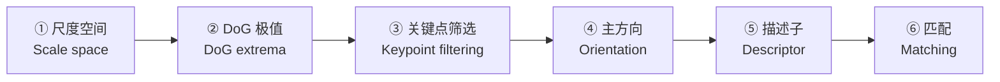

Slide 42 的落脚句点出了 SIFT 最核心的设计思想,**这句话请重点记**:

> **SIFT 把"特征在哪里?"和"局部外观长什么样?"分开处理。最终的描述子是一个由局部梯度直方图构建的 128 维向量。**
> (SIFT separates "where is the feature?" from "what does the local appearance look like?")

**这个分离是 SIFT 优雅的根源。** 阶段 ①②③ 只回答"哪里"——输出一批 $(x, y, \text{scale})$;阶段 ④⑤ 只回答"长什么样"——输出每个位置的 128 维向量。两个问题用完全不同的机制解决,互不干扰。这也呼应了 §25 里"角点/斑点回答在哪里,描述子回答长什么样"的区分。

下面按讲师和 slides 的组织,分成四步详讲(阶段 ②③ 合并为一步)。

## 37. Step 1:构建尺度空间

### 37.1 为什么需要尺度空间

"尺度不变"是 SIFT 名字里的第一个词,它的实现方式非常直白:**既然不知道物体会以多大的尺寸出现,那就在所有尺寸上都找一遍。**

讲师的解释:

> "首先我们必须构建**尺度空间 (scale space)**。我们必须在**不同尺度**上检测关键点。所谓尺度,简单地说就是不同的分辨率。……小尺度上你有更多细节,大尺度上细节更少。或者说,当远处的物体和近处的物体在同一尺度上时,它在图像里会变成更小的物体。"

回忆 §9 的那张表——CNN 靠网络深度自动获得多尺度表征,而**经典方法必须手工把尺度金字塔造出来**。这一节就是那个"手工造"的过程。

### 37.2 三个操作

Slide 43 把构建过程分成三步:

| 操作 | 英文 | 做什么 |
|---|---|---|
| **重采样** | **Resample** | 通过每隔 2 个、4 个……像素取样,创建图像**八度 (octaves)** |
| **模糊** | **Blur** | 在每个八度**内部**,用**不同方差**的高斯滤波器 |
| **相减** | **Subtract** | 计算相邻模糊层之间的**高斯差分 (DoG)** |

**"八度 (octave)" 是什么?** 借用音乐术语——升高一个八度频率翻倍。在图像里,**一个 octave 就是图像尺寸减半一次**。原图是 octave 1,缩小到一半是 octave 2,再一半是 octave 3……

讲师描述了完整的结构:

> "我们拿到原图,应用低通滤波去掉一些细节,这是第一个尺度。这叫做第一个 octave。在每个尺度上,你有一个略微不同的平滑版本——换句话说,**高斯滤波的标准差 $\sigma$ 略有不同**。……当我们移到更高的 octave 时,更多细节被去掉,所以**图像不需要保持原始分辨率了,你可以把分辨率降到一半、四分之一**。"

所以尺度空间是一个**二维的**结构:

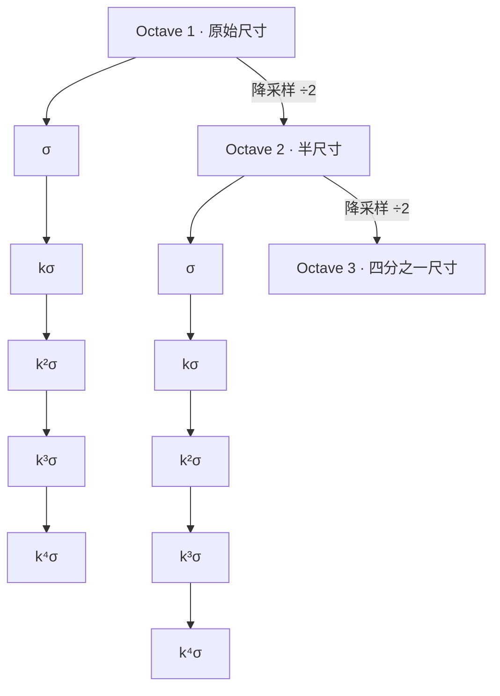

- **横向**(同一 octave 内):$\sigma$ 逐级增大,细节逐级减少。讲师说每个 octave 里"有 5 张略有不同的高斯滤波图像"。
- **纵向**(跨 octave):图像尺寸减半。

**为什么要降采样而不是一直用大 $\sigma$?** 因为效率。一张已经被模糊得很厉害的图,高频信息本来就没了,**保留全分辨率是纯粹的浪费**。降采样一半,像素数降到四分之一,后续所有计算都便宜四倍。而且请回忆 §12 的那个提醒——**降采样之前必须先低通滤波**,而这里恰好已经模糊过了,天然满足条件。这不是巧合,是设计。

### 37.3 从模糊到 DoG

有了每个 octave 里那几张不同 $\sigma$ 的模糊图,**相邻两张相减**就得到 DoG:

$$D(x, y, \sigma) = G_{k\sigma}(I) - G_{\sigma}(I)$$

这正是 §14 的内容,而且用的是那里说的 **$k \approx 1.6$** 的比例——这个比例下 DoG **逼近 LoG**,是尺度空间特征检测的标准配置。

Slide 43 的落脚句:

> **关键点的尺度选在它最有辨识度的地方 (A keypoint scale is selected where it is most distinctive)。**

也就是说,SIFT 不仅告诉你关键点**在哪**,还告诉你它**在哪个尺度上最突出**。这个尺度信息后面有大用——§39 会用它决定描述子窗口的大小,§40 也需要它。

## 38. Step 2:检测极值并剔除不稳定关键点

Slide 44 的标题一针见血:**不是每个局部极大值都有用。**

### 38.1 找极值

**规则**:把每个候选点与它在 **$x$、$y$ 和尺度**三个维度上的邻居比较。

请注意"**和尺度**"这三个字——这是 SIFT 与普通角点检测器的根本区别。一个点必须**不仅在本层图像里是局部极值,而且比上一层和下一层对应位置的值都更极端**,才算数。这就是"尺度空间极值"的确切含义,也是尺度不变性的来源:**一个真正的斑点结构,只会在与它自身大小匹配的那个尺度上给出最强响应。**

具体地,每个候选点要和 26 个邻居比较:本层的 8 个 + 上层的 9 个 + 下层的 9 个。极大或极小都算。

讲师的描述:"在不同的 DoG 层里检测**极值 (extrema)**,考虑相邻的像素值。如果它是极值——不管是最小值还是最大值——你就把那个点当作**兴趣点 (interest point) 的候选**。"

### 38.2 两道筛子

极值检出来是一大堆(讲师说的 30,000 个),接下来要狠狠地筛。

**筛子一:拒绝低对比度 (Reject low contrast)**

Slide 44:**弱响应在噪声和光照变化下不可靠。**

一个 DoG 响应很微弱的点,可能只是噪声制造的偶然极值。下一帧噪声一变,它就消失了——**违反了"可重复"这条标准**。讲师:"如果是低对比度,我们把它去掉,因为那是**误检 (false detection)**。"

30,000 → 2,000 就是这一刀砍掉的。

**筛子二:拒绝边缘响应 (Reject edge responses)**

Slide 44:**沿着边缘的点在某一个方向上定位很差。**

这一条更微妙,但很重要。想象一个点落在一条长长的直边上。沿着**垂直于边**的方向,它的位置很明确(一动就不在边上了);但沿着**平行于边**的方向,它可以滑动很远而 DoG 响应几乎不变。

**结果是:你下次再检测,这个点可能出现在边上的任何位置。** 它的位置是不可重复的——同样违反"可重复"标准。

这就是为什么**角点比边缘点更适合做特征**:角点在**两个**方向上都被约束住了,位置唯一确定。这也是为什么 §25 把 corner 列为一种特征而没有列 edge。

2,000 → 1,000 就是这一刀。

Slide 44 的落脚句:

> **稳定的关键点是可重复的、且定位良好的 (Stable keypoints are repeatable and well-localized)。**

这两个词正好对应两道筛子:低对比度筛子保证**可重复**,边缘筛子保证**定位良好**。

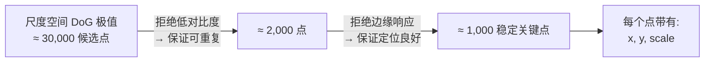

## 39. Step 3:主方向赋值

### 39.1 目的

到这里,每个关键点有了 $(x, y, \text{scale})$。但还缺**旋转不变性**——如果机器人歪着头看,同一个图案的所有梯度方向都会整体旋转,描述子就对不上了。

SIFT 的解法很巧妙,slide 45 的标题就是答案:

> **旋转不变性通过把描述子对齐到一个主方向来实现。**

思路是:**既然图案会旋转,那就先找出它"自己的"方向,然后一切都相对于这个方向来测量。** 这样图案怎么转,描述子都不变——因为参照系跟着一起转了。

### 39.2 三个步骤

Slide 45 对每个保留下来的关键点:

1. **在一个邻域内计算局部梯度幅值和方向** (Compute local gradient magnitudes and orientations in a neighbourhood);
2. **构建方向直方图,例如 36 个 bin,每个覆盖 10 度** (Build an orientation histogram, e.g. 36 bins covering 10 degrees each);
3. **用最强的那个峰作为该关键点的方向** (Use the strongest peak as the keypoint orientation);
4. **相对于这个方向而不是图像坐标轴来测量描述子** (Measure the descriptor relative to this orientation, not the image axes)。

第 4 条是整件事的关键——前三步只是为了得到那个方向,**真正买到不变性的是第 4 条**。

讲师的描述,包括一个重要的补充:

> "对每个兴趣点,我们取一个邻域,计算局部梯度的幅值……每个像素我们都有一个方向。然后我们统计每个方向,简单地说,**每 10 度一档,所以有 36 档**。每个方向值会被量化到 36 档中的一档。然后画出直方图……**哪一档占主导,我们就把它称为这个兴趣点的方向**。"

### 39.3 邻域大小由尺度决定

讲师补充了一个很重要、slide 上没有明说的点:

> "这也取决于这个邻域的大小,而**邻域的大小取决于尺度**。记得前面我们有不同的尺度——这个点是从某个尺度上检测出来的。那个尺度给了我们 $\sigma$,$\sigma$ 给了我们尺度。所以**这块区域的大小取决于尺度**。"

**这一点必须理解,否则尺度不变性就是假的。** 如果所有关键点都用固定的 16×16 邻域,那么当物体变大 2 倍时,同一个关键点周围的 16×16 覆盖的**物理区域**就只有原来的一半——描述的东西完全不同了。只有让邻域大小**随着关键点的尺度等比缩放**,才能保证"描述的始终是物体上同一块地方"。

所以 §37 那个"关键点的尺度"输出,在这里第一次派上用场。

于是每个关键点现在携带**四个量**:

$$(x,\; y,\; \text{scale } \sigma,\; \text{orientation } \varphi)$$

讲师原话:"对每个兴趣点,我们有 $x, y$ 坐标,我们有尺度,……然后我们有方向。"

## 40. Step 4:构建 128 维描述子

### 40.1 结构

Slide 46 给出了描述子的构造,这是 SIFT 里最需要记牢的一组数字:

| 层级 | 内容 |
|---|---|
| **邻域 (Neighbourhood)** | 关键点周围的 **16×16 像素**区域 |
| **子区域 (Subregions)** | 划分成 **4×4 个 cell**(每个 cell 是 4×4 像素) |
| **直方图 (Histogram)** | 每个 cell 有 **8 个方向 bin** |

$$4 \times 4 \times 8 = \mathbf{128} \text{ 个描述子数值}$$

**这个 128 一定要能自己推出来**,而不是死记。

注意方向 bin 的数量变了:§39 主方向用的是 **36 个 bin**(每 10°),这里描述子用的是 **8 个 bin**(每 45°)。讲师专门点了这个区别:"我这里只用 **8 个方向**,不是 36 个方向。"

**为什么不同?** 因为两者的目的不同。主方向需要**精确**——它是整个描述子的参照系,差一点后面全歪,所以用细粒度的 36 档。描述子则需要**容忍**——如果分得太细,视角稍微一变梯度方向就跳到隔壁 bin 去了,匹配就失败;粗一点(8 档)反而更稳。**这是"精确"和"稳健"的一次刻意权衡。**

### 40.2 关键:在旋转后的坐标系里采样

讲师详细讲了一个 slide 上没写清楚的实现细节,而它正是旋转不变性真正落地的地方:

> "现在我要一个对方向不变的特征向量。我找到了这个方向……**现在我要取另一个 patch,但这个 patch 是绕着这个旋转方向取的**。……这 16×16 的像素是**沿着这个方向对齐的**,而不是沿着 $x, y$ 对齐的。……你可能没有现成的像素值,我怎么得到?**通过插值 (interpolation)**,从原图恢复出来。"

用图说明这件事:

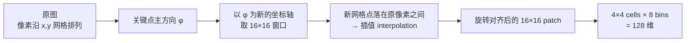

**为什么需要插值?** 因为旋转后的采样网格不再和原图的像素网格对齐——你要的位置落在四个真实像素中间。插值就是从周围的真实像素算出那个位置"应该"是多少。

这一步是旋转不变性的**真正**实现:不是事后把描述子转一转,而是**从一开始就在旋转后的坐标系里采样**。

### 40.3 梯度加权与归一化

讲师提到了两个细节:

**加权。** "我取梯度方向,**用它的梯度值加权**。" 也就是说,直方图不是简单地数"有几个像素属于这个方向",而是**按梯度幅值累加**——梯度强的像素说话更有分量。这很合理:一个几乎没有梯度的像素,它的"方向"基本是噪声决定的,不该和一个强边缘上的像素等量齐观。

**归一化 → 光照不变性。** 这一步很重要,讲师专门强调:

> "事实上,得到这些值之后,我们还会**归一化这个向量 (normalize this vector)**,把它归一化以**去除光照的影响**。……经过进一步归一化之后,这个向量就是**光照不变 (illumination invariant)** 的。不管是室内还是室外,**只要是同一个物体,这组值就是一样的**,所以它成为了稳健的信息。"

理解一下机制:如果整个场景的亮度乘以某个系数(比如太阳被云挡住了,一切都暗了 30%),**所有梯度也会等比例地乘以同一个系数**。把 128 维向量归一化成单位长度,这个公共系数就被除掉了。所以**线性的光照变化被完全消除**。

> 📎 **拓展(超出 slides)** — Lowe 的原始论文里归一化其实做了两次:先归一化到单位长度,然后**把所有大于 0.2 的分量截断 (clamp)**,再归一化一次。为什么?因为**非线性**的光照变化(比如镜面高光)会让个别方向的梯度异常巨大,而截断限制了任何单个分量的支配力。考试不会考这个细节,但它说明了一件事:SIFT 的每一个设计决定,背后都对应着一种具体的失效模式。

### 40.4 三种不变性的来源

这是理解 SIFT 的关键总结表,**强烈建议记住**:

| 不变性 | 由哪一步买到 | 机制 |
|---|---|---|
| **尺度不变 (scale invariance)** | **Step 1 尺度空间 + Step 2 跨尺度极值** | 在所有尺度上找一遍,只保留在自身尺度上最突出的点;描述子窗口随尺度缩放 |
| **旋转不变 (rotation invariance)** | **Step 3 主方向 + Step 4 旋转采样** | 建立随图案一起转动的局部参照系 |
| **光照不变 (illumination invariance)** | **Step 4 梯度 + 归一化** | 用梯度(对加性变化不敏感)+ 归一化(消除乘性变化) |

请注意最后一行里"梯度"这三个字本身也在做工作:描述子基于**梯度**而不是原始像素值,所以给整幅图**加**一个常数(相机曝光偏置)完全不影响它;再加上归一化,**乘**一个常数也不影响。加性和乘性都被处理掉了。

## 41. 用 SIFT 做物体识别与定位

### 41.1 五步流水线

Slide 47 给出识别流程:

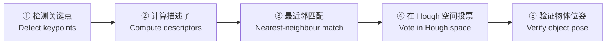

Slide 47 的四条要点:

1. **描述子用欧氏距离 (Euclidean distance) 比较,常用 k-d 树 (k-d tree) 加速。**

   两个 128 维向量之间的欧氏距离越小,越可能是同一个点。但如果数据库里有几万个描述子,逐个比较太慢——**k-d 树**是一种空间划分数据结构,能把最近邻搜索从 $O(N)$ 降到大约 $O(\log N)$。

2. **通常至少需要 3 个独立特征才能稳健地识别一个物体。**

   讲师也说了:"如果最少的话,你需要 **3 个**兴趣点来代表这个物体,才能做物体检测。" 为什么是 3?因为单个匹配很容易是巧合(128 维空间里两个不相关的点碰巧接近),而 3 个匹配同时在几何上一致的概率就低得多。

3. **每一个匹配上的特征都可以为物体的位置、尺度和朝向投票。**

   **注意这里 Hough 变换又出现了**,但用法不同了——§32 里投票的参数是直线的 $(\rho, \theta)$,这里投票的参数是**物体的位姿**。这是同一个思想的复用:**让证据投票,看哪个假设得票最多。**

   而且这一次投票的信息更丰富:每个 SIFT 关键点自带尺度和方向,所以**单个匹配就能预测出整个物体的位置、大小和朝向**。如果 10 个匹配都指向同一个位姿,那这个位姿几乎可以确定。

4. **词袋模型 (Bag-of-Words, BoW) 把局部描述子聚合成"视觉单词 (visual words)",用于识别和检索。**

> 📎 **拓展(超出 slides)** — BoW 的想法借自文本检索。文本里,一篇文档可以用"每个词出现了几次"来表示(丢掉词序)。视觉里同理:先把大量 SIFT 描述子聚类(比如 k-means)成若干个"视觉单词",然后一幅图像就可以表示成"每个视觉单词出现了几次"的**直方图**。两幅图像相似 = 它们的直方图相似。这样比较两幅图从"比较几千个 128 维向量"变成了"比较两个直方图",快了几个数量级,是大规模场景识别和**回环检测 (loop closure)** 的经典做法。讲师在开场提到 BoW 时说的"用这些特征做匹配、投票和场景分类"就是指这一类方法。

### 41.2 机器人里的两大用途

讲师反复强调 SIFT 在机器人里最重要的两个用途:

**用途一:物体识别。** "用 SIFT 做物体检测……识别场景中出现的这个物体实例。"

**用途二:定位与建图 (SLAM)。** 这是讲师说得更多的:

> "你也可以用这些关键点来匹配,判断**机器人以前有没有见过这个特定的地方**,用于定位和建图。……很多时候 SLAM 就是基于这些点去匹配两幅图像。"

以及在总结时:

> "SIFT 是机器人视觉里最广泛使用的特征之一,**特别是用在 SLAM,也就是定位与建图上**。"

把这条线索接回 §26:直线特征给出几何路标("墙在 1.2 m,法向 37°"),SIFT 特征给出**外观路标**("我在这里见过这 1,000 个点的这种排布")。两者在 SLAM 里是互补的。

> **🔑 讲师的随堂题** — "一个机器人第一次从 **2 米**外观察某个路标,后来从 **5 米**外观察同一个路标。SIFT 的哪个特性在这里特别重要?"
>
> 答案:**尺度不变性 (scale invariance)**。讲师的解释:"因为当你从不同距离看同一个东西时,**同一个物体在图像里会以不同的大小出现**,这和尺度有关。"

---

# Part IX · 经典方法与深度学习

## 42. 手工特征与学习特征

Slide 48 的标题:**在深度学习时代,经典视觉在概念上依然重要。**

### 42.1 三栏对照

| | **经典流水线 (Classical pipeline)** | **神经网络流水线 (Neural pipeline)** | **实践现实 (Practical reality)** |
|---|---|---|---|
| 做法 | 滤波 → 阈值化 → 特征提取 → 几何推理 → 识别 | **CNN 层从数据中自动学习滤波器和特征** | **机器人常常把学到的感知与几何、标定、经典前后处理结合起来** |

讲师把 SIFT 归类得很清楚:

> "SIFT 是一种**手工特征 (handcrafted feature)**,就是说它是**人定义的**——研究者基于对尺度空间的研究定义出来的。……如今越来越流行的是基于机器学习的方法。"

**"handcrafted" 这个词值得体会。** SIFT 的每一个数字——16×16、4×4、8 个 bin、36 个 bin、$k=1.6$、0.2 的截断阈值——都是 David Lowe 通过分析和实验**手工确定**的。CNN 则是把这些全部交给数据去定。

### 42.2 为什么学生仍然要学经典方法

Slide 48 的落脚句,四条理由:

> **它们是可解释的 (interpretable),在数据有限时也能工作 (work with limited data),对调试有用 (useful for debugging),并且揭示了学习网络内部往往会重现的那些操作 (reveal the operations that learned networks often reproduce internally)。**

最后一条最有意思,值得展开:**训练好的 CNN,第一层卷积核看起来和高斯核、Sobel 核、DoG 核非常像。** 网络并不是发明了什么新东西——它在数据的驱动下,**独立地重新发现了**几十年前研究者手工设计出来的那些算子。

这是一个很有说服力的验证:**这些算子之所以被手工设计出来,是因为它们确实是从图像中提取信息的正确方式。** 你在 §12–§16 手写的每一个核,都是网络后来自己学到的东西。

讲师给出的额外理由已经在 §2 讲过——**算力和功耗约束**、**解释深度模型**。加上 slide 的这四条,一共六条理由。

### 42.3 本课的边界

讲师明确划了范围,你应该知道考试考什么、不考什么:

> "我们**不会在这门课里讲任何基于学习的特征**。……我们不涉及任何深度学习模型,因为我们只有**一周**的时间来讲视觉感知。对那些想了解更多视觉算法感知细节的人,你需要去选**计算机视觉**那门课。"

所以:**深度学习在本章只作为"对照物"和"未来方向"出现,不是考点。** 但"为什么还要学经典方法"这个问题**是**考点,因为它是 slide 48 的主体内容。

### 42.4 工具:OpenCV

讲师在结尾推荐了工具,和 homework 直接相关:

> "**OpenCV** 是一个……库,它有大约 **2500 个算法**,视觉算法,都在 OpenCV 这一个包里。……对于任何视觉任务,特别是传统的、经典的计算机视觉算法,**OpenCV 是最好用的库**。如果你想用深度学习模型,那就是 **OpenCV 加上 PyTorch**。而且 OpenCV 在**商业产品**里也用得很多,不只是用于研究开发。"

本章讲的几乎每一个算法在 OpenCV 里都有现成实现:

| 本章内容 | OpenCV 函数 |
|---|---|
| 阈值化 / 自适应阈值 (§10) | `cv2.threshold`, `cv2.adaptiveThreshold` |
| RGB → HSV (§10.3) | `cv2.cvtColor(img, cv2.COLOR_BGR2HSV)`, `cv2.inRange` |
| 高斯平滑 (§12) | `cv2.GaussianBlur` |
| Sobel / Canny (§13) | `cv2.Sobel`, `cv2.Canny` |
| 形态学 (§15) | `cv2.erode`, `cv2.dilate`, `cv2.morphologyEx` |
| Hough 直线 / 圆 (§32–34) | `cv2.HoughLines`, `cv2.HoughLinesP`, `cv2.HoughCircles` |
| SIFT (§35–41) | `cv2.SIFT_create()` |
| 立体匹配 (§21) | `cv2.StereoBM_create`, `cv2.StereoSGBM_create` |

---

# Part X · 全景回顾与随堂题

## 43. 从像素到机器人决策:完整流水线

Slide 50 用一张图把整章串了起来:

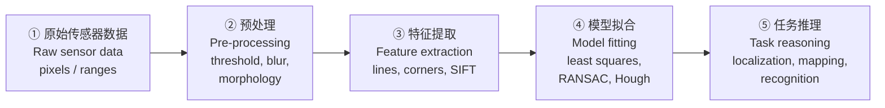

请注意 ① 那里写的是 "pixels / **ranges**"——**这条流水线同时适用于相机和激光雷达**。这是本章一个容易忽略的统一性:§27–§31 的直线拟合方法,slides 上的例子几乎全是激光扫描点云;而 §32 的 Hough 用的是图像边缘。**方法论是共享的,输入是什么传感器并不重要。**

Slide 50 的落脚句,是整章的价值声明:

> **经典计算机视觉不仅仅是"老技术";它为现代自主机器人感知提供了可解释的构件 (interpretable building blocks)。**

### 43.1 第一部分的五条 take-home(slide 24)

| # | 要点 | 内容 |
|---|---|---|
| 1 | **图像是信号** (Images are signals) | 像素构成二维信号。**梯度、频率和卷积**是分析图像的有用方式 |
| 2 | **解释需要上下文** (Interpretation requires context) | **相似的低层模式可能由不同的物理现象引起** |
| 3 | **滤波器降低复杂度** (Filters reduce complexity) | **阈值化、卷积和形态学**暴露有用结构、抑制噪声 |
| 4 | **几何给出度量信息** (Geometry gives metric information) | **立体视觉和对极几何**可以恢复距离和三维结构 |
| 5 | **机器学习可以合并各个阶段** (ML can combine stages) | 现代 CNN **联合地**学习滤波、特征提取和识别 |

Slide 24 的副标题也要记:**低层视觉让信息变得可处理,但会丢失信息 (Low-level vision makes information tractable but can lose information)。** 这个"但"是关键——每一次滤波、每一次阈值都是不可逆的信息丢弃。

### 43.2 第二部分的五条 take-home(slide 49)

| # | 要点 | 内容 |
|---|---|---|
| 1 | **特征降低信息量** (Features reduce information) | 把高维传感器数据转成**紧凑的、任务相关的量** |
| 2 | **好特征是稳健的** (Good features are robust) | 在**旋转、尺度、噪声和中等视角变化**下可重复 |
| 3 | **直线是核心** (Lines are central) | 直线特征支撑**定位、建图和几何推理** |
| 4 | **稳健拟合很重要** (Robust fitting matters) | **RANSAC 和 Hough 投票**能应对噪声和离群点 |
| 5 | **SIFT 是一个原型** (SIFT is a prototype) | 尺度空间关键点和梯度描述子展示了**局部不变性可以被工程化设计出来** |

第 5 条的措辞很值得品:**"invariance can be engineered"**——不变性不是天上掉下来的,是**一步一步设计出来的**。§40.4 那张表(每种不变性由哪一步买到)就是这句话的具体展开。

## 44. 讲师课堂随堂题汇总

讲师课上现场提了 8 道题。**这些题的风格和难度,极可能就是 quiz 的风格和难度**(讲师说 quiz 是 20 道 MCQ、45 分钟、开卷、**偏概念不考计算**),所以建议把它们当作最高优先级的复习材料。先自己答一遍再看答案。

| # | 问题 | 答案 | 考的是 |
|---|---|---|---|
| **1** | 哪种图像结构最与**高空间频率**相关?(平滑的光照变化 / 均匀的墙面 / **锐利的边缘** / 缓慢变化的明暗) | **锐利的边缘 (sharp edge)** | §5 —— 频率 = 像素值变化的快慢 |
| **2** | 机器人在图像中检测到一条强边缘,能否断定这是**物体边界**? | **不能。** edge 可以由深度不连续、颜色突变、阴影、镜面高光、表面朝向变化等多种原因产生 | §6 —— 五种成因;perception is inference |
| **3** | 如果**加大**高斯平滑核(3×3 → 5×5 → 7×7),最可能的效果是?(更多噪声和锐利边缘 / 平滑变弱 / **平滑更强但边缘定位变差** / 没变化) | **平滑更强,但边缘定位变差 (more smoothing, but poorer edge localization)** | §12 —— 高斯平滑的核心权衡 |
| **4** | 一个分割出来的物体内部有一个**小洞**,你会先试哪个操作?(opening / **closing** / Sobel / erosion) | **闭运算 (closing)** —— 先膨胀填洞,再腐蚀恢复尺寸 | §15.3 —— 开 vs 闭 |
| **5** | 对机器人**定位**来说,哪一个是**最不可取**的视觉特征属性?(可重复性 / 对噪声稳健 / **对小视角变化敏感** / 可区分性) | **对小视角变化敏感** —— 机器人每次经过角度都不同,需要**视角不变性 (view invariance)** | §25 —— 好特征的四条标准 |
| **6** | 哪些元素定义了**对极平面 (epipolar plane)**? | **两个相机的光心 + 被观察的那个三维点** | §20.1 —— 必考定义 |
| **7** | 在 Hough 变换里,参数空间中的一个**强峰**代表什么? | 代表一条**很可能存在的直线**,其参数 $(\rho, \theta)$ 收到了大量选票 | §33 —— 投票与参数空间 |
| **8** | 机器人先从 **2 米**外、后从 **5 米**外观察同一个路标。SIFT 的哪个特性在这里特别重要? | **尺度不变性 (scale invariance)** | §41.2 / §40.4 |

**从这 8 道题能读出的出题规律**,值得注意:

- **6 道是"概念判断"**,只有 0 道涉及计算——和讲师说的"mainly related to the concept, not calculation, not mathematical formulation"完全一致;
- **有陷阱选项**:第 3 题有 "less smoothing"(方向反了),第 5 题问的是 "least desirable"(三个好选项+一个坏选项)。**读题时先确认问的是正面还是反面**;
- **定义题占比高**:第 6 题就是纯定义。所以 slides 上那些黑体的定义句子(对极平面、特征、DoG 的两个比例、开/闭的顺序)必须精确掌握。

---

# 本章小结 (Key takeaways)

1. **视觉在机器人感知里之所以特殊,是因为它同时给出语义和度量。** 超声、LiDAR、radar 这些测距传感器"是测量而不是理解"——它们能告诉你 1.2 米外有东西,但不知道那是人还是椅子。**相机是唯一既能回答"这是什么"又能回答"在哪里、多远"的传感器**,代价是处理量高得多。人类约 80% 的信息来自视觉,而机器人工作在人类设计的环境里。

2. **图像是二维信号,而"频率"指的是像素值在空间上变化的快慢。** 低频 = 平滑表面和渐变光照;高频 = **边缘、纹理和噪声**;带通 = 只保留中间一段。**边缘和噪声都是高频的**,这就是所有滤波取舍的根源:删高频既去噪也糊边。

3. **视觉之所以难,是因为图像是三维世界的二维投影,而投影丢掉的信息无法从单张图恢复(病态问题)。** 同一条 edge 有五种成因:**表面属性变化、深度不连续、镜面高光、光照/阴影变化、表面朝向变化**。所以**低层信号处理必要但不充分,感知本质上是推断**,必须靠上下文、几何、时间一致性和语义来消歧。Apollo 15 的"陨石坑还是山丘"和斑点狗图,分别演示了先验假设改写解释、以及人类靠 Gestalt 分组补全缺失边缘。

4. **低层操作分三个家族,区别在于邻域规则:阈值化看单个像素、卷积做加权求和(线性)、形态学取极值(非线性)。** "大多数图像滤波器都可以描述为选一个有用的核"——高斯核(低通,去噪但糊边)、Sobel 核(梯度,$G=\sqrt{G_x^2+G_y^2}$、$\varphi=\operatorname{atan2}(G_y,G_x)$)、DoG(带通)用的是同一个卷积操作,只是核里的数不同。

5. **DoG 的两个比例是考点:$\sigma_2/\sigma_1 \approx 4\text{–}5$ 时是边缘检测器,$\approx 1.6$ 时逼近 LoG,用于尺度空间特征检测(即 SIFT)。** DoG 之所以被用在 SIFT 里,是因为它是 LoG 的**廉价近似**——两次模糊加一次减法。

6. **形态学的顺序必须记准:开 = 先腐蚀后膨胀,去掉小噪点、断开粘连;闭 = 先膨胀后腐蚀,填小洞、接断口。** 三个典型场景:球里有洞 → **closing**;两个球被噪声连起来 → **opening**;循线时线断了 → **closing**。

7. **颜色分割要用 HSV 而不是 RGB,因为 RGB 的每个通道都同时混合了色度和亮度。** 同一个红球在阳光和阴影下 RGB 值差好几倍,但 **hue(对应主波长)基本不变**。讲师明确建议把 lab 里的 RGB 阈值改成 hue 阈值试试,"会可靠得多"。

8. **单张图像无法恢复三维,因为投影不可逆——一个像素对应的是一整条射线,不是一个点。** 投影模型由**内参**(焦距、主点、缩放;相机自身属性)和**外参**(旋转 + 平移;相机相对世界的位姿)两组参数决定。要测距就必须有**两个视角**:**立体视觉**(两台相机固连,变换已标定)、**运动恢复结构 SfM**(一台相机移动)。两者数学上相同,难点都是**对应问题**。

9. **对极平面 = 三维点 + 第一台相机光心 + 第二台相机光心;它与成像平面的交线是对极线。** 它的价值是把**二维搜索压成一维搜索**(30 万像素 → 640 像素)。匹配后得到**视差 $d = u_L - u_R$**,深度 $Z = fB/d$——**反比关系**,所以**远处视差不足 1 像素就测不了**(量程上限),**近处测得更准**。得到的 $XYZ$ 在**相机坐标系**里,要用还得乘外参。

10. **结构光是主动视觉:场景没有纹理就自己投一个上去。** 已知图案的**形变程度编码了深度**。红外**散斑图案**比规则网格好,因为每个点都有**独特的局部排布**,消除了周期性歧义;红外让图案对人不可见。作为主动传感器,它耗电、会互相干扰、在强阳光下失效。

11. **特征提取是一次信息压缩:从 27.6 MB/s 的原始视频流,压到"这是一扇门"这样几个字节的答案。** 好特征的四条标准:**repeatable(不同视角都能检测到)、robust(抗噪声和光照)、invariant/tolerant(对旋转和尺度)、discriminative(能区分)**。**对小视角变化敏感**是定位场景下最不可取的属性。

12. **直线是移动机器人最重要的几何特征**,因为墙在激光扫描里形成直线、门框和车道线在图像里形成直线、**直线朝向能纠正转弯时的里程计漂移**、直线的 $(r, \alpha)$ 可以直接当作定位路标。直线用**极坐标 $(r, \alpha)$** 表示以避免竖直线的无穷斜率;点到线的有符号距离是 $d_i = \rho_i\cos(\theta_i - \alpha) - r$。

13. **三种拟合策略各有分工:最小二乘在高斯噪声下精确但对离群点极其敏感;split-and-merge 能把有序扫描切成多段(靠"一条线解释失败"来发现角点)但对阈值和离群点敏感;RANSAC 靠"最大化支持者数量"而非"最小化总误差",对大量离群点稳健但是随机的。** 讲师说**大多数时候用 RANSAC**。标准流水线是:**RANSAC 找内点 → 最小二乘精修 → 时间滤波跨帧跟踪**。

14. **Hough 变换把拟合反转成投票:每个边缘点为所有可能经过它的直线投票,真实的直线在参数空间里收到大量选票形成峰。** 图像空间的一个点 ↔ 参数空间的一条曲线;图像空间的一条线 ↔ 参数空间的一个点。**必须先做边缘检测再投票**(只让可能的线上像素投票)。它能**一次找出多条线**,峰之间的 $\theta$ 差还能揭示垂直/平行关系;推广到圆就是三维参数空间 $(a, b, r)$。

15. **SIFT 把"特征在哪里"和"局部外观长什么样"分开处理,最终给出 128 维描述子($4\times4$ cells $\times$ 8 bins)。** 四步:**① 尺度空间**(octave 降采样 + 不同 $\sigma$ 高斯 + DoG)→ **② 跨 x/y/尺度找极值,并拒绝低对比度(保证可重复)和边缘响应(保证定位良好)** → **③ 主方向**(36 bin 直方图取最强峰,邻域大小随尺度缩放)→ **④ 在旋转对齐的 16×16 patch 上(需插值)建梯度直方图并归一化**。讲师给的数字:**30,000 候选 → 2,000 → 1,000**。

16. **SIFT 的三种不变性各自由不同步骤买到:尺度不变来自尺度空间与跨尺度极值;旋转不变来自主方向与旋转采样;光照不变来自"用梯度"加"向量归一化"。** 用它做识别时,描述子按**欧氏距离**匹配(k-d 树加速),**至少需要 3 个特征**,每个匹配为物体的位置/尺度/朝向**投票**(Hough 思想的复用),BoW 把描述子聚成视觉单词用于检索。机器人里两大用途:**物体识别**与 **SLAM / 地点重识别**。

17. **经典视觉在深度学习时代仍然必须学,理由有六条:算力和电池受限的平台负担不起 GPU;经典方法可解释、可调试;不需要大量数据;它们解释了深度模型为什么有效;训练好的 CNN 第一层学到的核和高斯/Sobel/DoG 惊人地像;真实机器人系统几乎总是"学到的感知 + 几何 + 标定 + 经典前后处理"的混合体。** 本课不考任何深度学习模型。

18. **贯穿全章的主线:每一步都是在"补信息"。** 投影丢掉了一维,于是 Part IV 用**第二个视角**补几何;像素本身没有意义,于是 Part III 用**滤波**压掉干扰、Part V–VIII 用**特征**提供可跨视角比对的稳定锚点;而当低层线索根本不够时(斑点狗、陨石坑),就只能靠**先验和上下文**补。**理解了"缺什么、补什么",本章所有算法的动机就都通了。**

---

# 作业与阅读 (Homework and readings)

**阅读 (Readings)**

- *Introduction to Autonomous Robotics* / Nikolaus Correll, University of Colorado at Boulder, v3, February 2026, ISBN 13: 9780692700877 (Open Education) — **第 8、9 章**
- *Robotics, Vision and Control — Fundamental Algorithms in Python* / Peter Corke, 3rd Edition 2023, Springer, ISBN 978-3-031-06468-5 — **第 10–14 章**

**作业 (Homework)**

- **Webots 在线教程 7 和 8** —— 讲师说明:教程 7 讲的是 **PROTO**("一种可复用的场景元素,你可以在 Webots 里定义 proto"),教程 8 是 **supervisor**(监督者)版本。
- **《A short Tutorial on Built-in Object Recognition in Webots R2025a》**(在 Resources 下)—— Webots 的相机自带**基于颜色的简单物体识别**,讲师说"这就是做实验的方式"。
- **《A Short Tutorial on OpenCV-Contrib-Python 4.13 with Webots 2025a》**(在 Resources 下)—— 如果你想要更 elegant 的识别方式(讲师明确点名 **SIFT** 或其他前面讲过的方法),就得用 **OpenCV**。

**讲师给的实操路线**:先用 Webots 内置的颜色识别把流程跑通,再换成 OpenCV 做真正的特征识别。**本章 §10.3 的 HSV 建议和 §42.4 的 OpenCV 函数表可以直接用在 assignment 上。**

**关于随堂测验 (quiz)** —— 讲师在课上宣布的安排:

- **20 道 MCQ,45 分钟**;
- **主要考概念,不考计算、不考数学推导**;
- **开卷**,但讲师提醒:"时间上你可能来不及为每道题去查参考资料,所以你**还是得做一点准备**。"
- 第一次 assignment 已发布,提供了 controller 的骨架代码(**不要修改给的 world 文件**,在 controller 骨架上做)。

> **复习建议** — 按性价比排序:**① §44 的 8 道随堂题**(最接近考试风格)→ **② 本章小结的 18 条**(覆盖全部考点)→ **③ slides 上加粗的定义**(对极平面、DoG 两个比例、开/闭顺序、四条特征标准、三种拟合方法对比表)→ **④ §43 的两组 take-home messages**(slide 24 和 49,这是讲师自己划的重点)。
