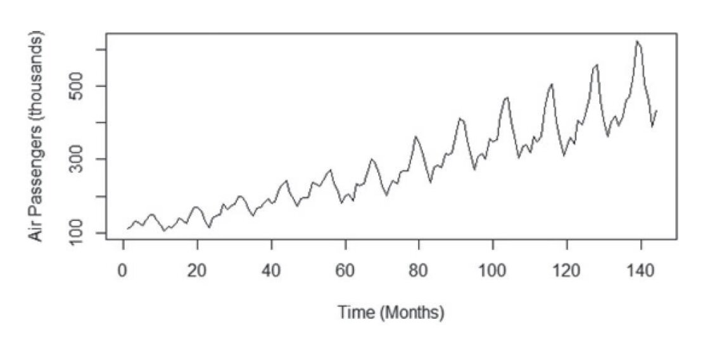
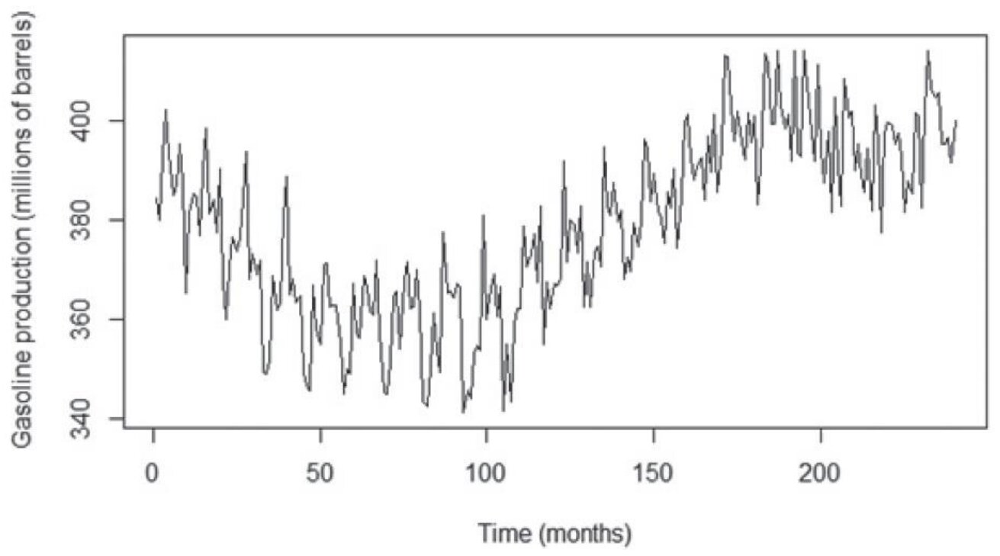
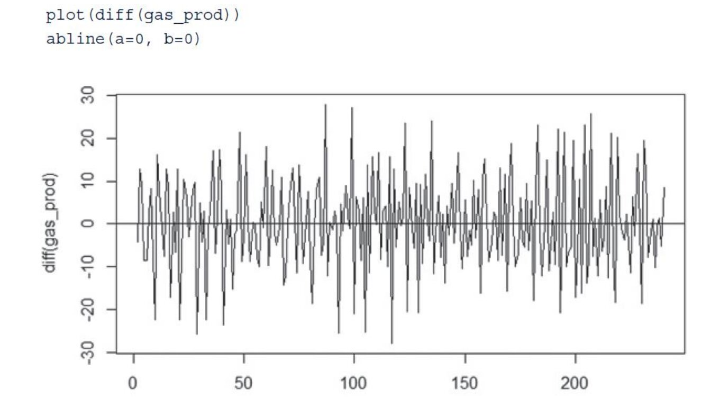
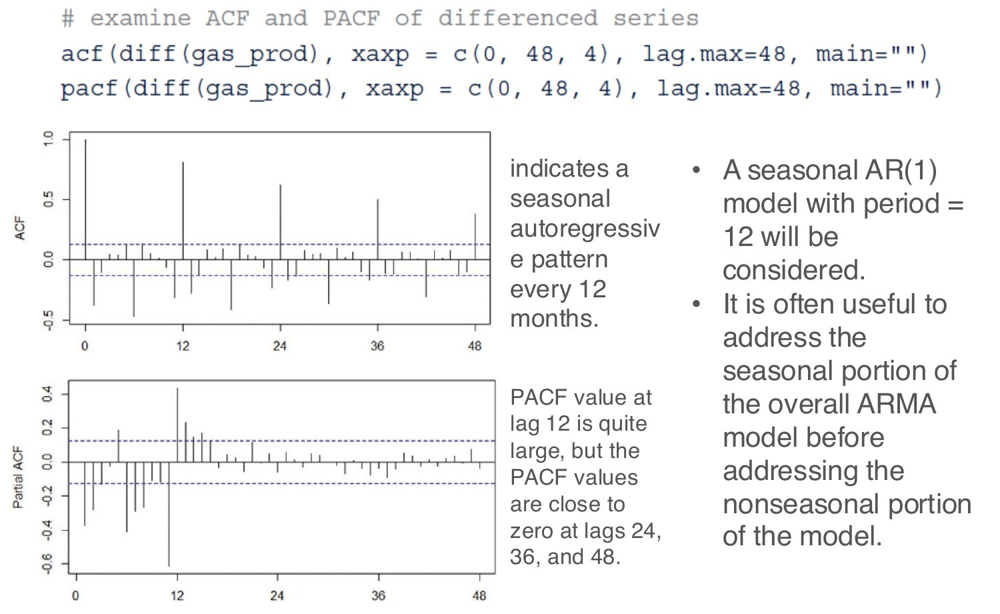
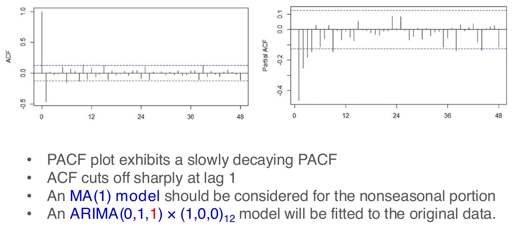
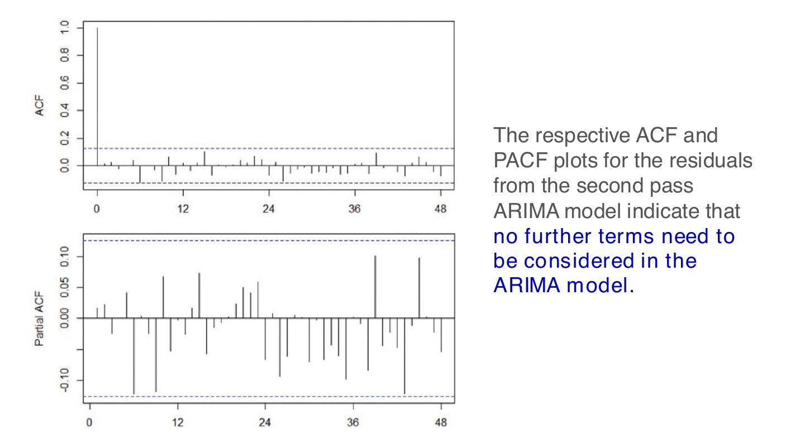
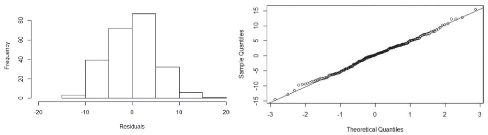
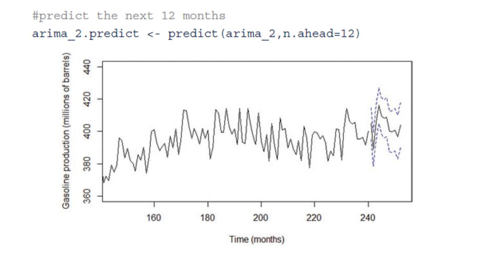

# Week 11 · Time Series Analysis（时间序列分析）

> **CSCI446/946 Big Data Analytics** — University of Wollongong, Spring 2026
> 本讲义融合 `Week11_Lecture_Time_Series_Analysis_2026.pdf`（53 页 slides）与 Week 11 课堂录音转录，并参考了 Week 12 录音开头对本周内容的回顾。Slides 上的真实数据图（航空客流、汽油产量案例的 R 输出）直接从 slides 裁下（文件在 `figs/w11-sNN.jpg`，NN 是 slide 页码）；其余示意图是为讲解重新画的，数据都是模拟的。
>
> **关于 Week 10**：Week 10 因为公众假期停课，没有 slides，也没有录音。讲师在 Week 11 开场就说明了这一点，所以 Week 9 之后的下一讲就是这一讲。本周的 lab（`labs/Lab9`，lab 讲义标题写的是 Week 11）用 Python 做时间序列分析，§22 有一张 R 与 Python 的对照表。
>
> **标记说明**：🔑 = 例题 / 手算；🎙️ = 讲师课上讲了、slides 上没有的内容（按考试范围对待）；📎 = 超出 slides 和课堂的拓展，为补足理解而加；⚠️ = 易错点，或 slides / 录音里的笔误。录音转写里有不少误识别（比如把 ARIMA 转成了 "A Riemann model"，把 PACF 转成了 "PSCF"），对照表放在讲义末尾。

---

> **学习目标 (Learning objectives)** — 读完本章你应该能够：
>
> - **说清什么是 time series**，以及 time series forecasting 和前几周 classification / regression 里的"预测"有什么不同；
> - **识别一条时间序列的四个组成部分**：trend、seasonality、cyclic、random，尤其能分清 seasonality 和 cyclic；
> - **复述 Box-Jenkins methodology 的三步**（condition data and select a model → estimate the model parameters → assess the model），解释它为什么要反复迭代；
> - **说出 stationary（平稳）时间序列的三个条件**，解释 AR、MA、ARMA 为什么只能用在平稳序列上；
> - **写出并解读 AR(p)、MA(q)、ARMA(p,q) 的公式**，说出 AR 和 MA 刻画的是两种不同的时间依赖；
> - **用 ACF 和 PACF 定阶**：AR(p) 看 PACF 在哪里截断，MA(q) 看 ACF 在哪里截断，并能解释原因；记住讲师总结的"四种情形"；
> - **用 differencing 去掉趋势**，解释 ARIMA(p,d,q) 里 "I"（integrated）的含义和"不要过度差分"的原因；读懂 seasonal ARIMA 的记号 ARIMA(p,d,q)×(P,D,Q)ₛ；
> - **走通汽油产量的完整案例**：差分 → 读 ACF/PACF → 拟合 → 检查残差 → 用 AIC / AICc / BIC 比较 → 检查正态性与等方差 → 预测，并读懂每一步的 R 输出；
> - **说出 ARIMA 的优点、局限和使用注意**（只适合短期预测，怕严重冲击），以及 ARMAX、GARCH、Kalman filtering、VARIMA 等方法各自补上了什么。

---

## 开篇：又是预测，但这次没有特征

讲师开场先交代了课程走到了哪里：前半学期依次讲了 clustering、classification、regression、association rules，接着进入"应用周"，讲了文本分析和图像分析；这一周回到分析方法本身，讲 **time series（时间序列）**，重点是 **forecasting（预测）**。

预测并不新鲜，Week 5 的分类和 Week 6 的回归都在做预测。讲师特意点出了区别：

> 🎙️ "*在 classification 或 regression 里，我们有一些输入变量，叫 features、attributes 或 predictors，还有一个要预测的目标。今天你会看到，time series 里的 forecasting 是用这条序列过去的值，去预测它短期内未来的值。我们不用任何特定的 features 或 attributes，只用过去的值预测未来的值。*"

把两者并排放，差别一目了然：

| | Regression（Week 6） | Time series forecasting（本周） |
|---|---|---|
| 输入 | 解释变量 $x_1,\dots,x_p$（features / predictors） | 序列自己过去的值 $y_{t-1},y_{t-2},\dots$，以及过去的随机冲击 |
| 输出 | 目标变量 $y$ | 未来的值 $y_{t+1},y_{t+2},\dots$（短期） |
| 数据的顺序 | 📎 行与行通常当作相互独立，打乱顺序不影响结果 | 相邻的观测值彼此依赖，**顺序本身就是信息** |
| 能回答的问题 | 哪些因素在影响 $y$、影响多大 | $y$ 接下来会怎样走 |

本周的主角是一套 1970 年代由 Box 和 Jenkins 提出的经典方法，叫 **Box-Jenkins methodology**，它的核心模型是 **ARIMA**。讲师坦言这不是唯一的方法：统计学习和机器学习发展到今天，已经有了基于 machine learning、deep learning 的新方法；但 Box-Jenkins 仍然是经典，"*在学术研究里被广泛用作 baseline，而且很好解释*"。这一讲是时间序列分析的入门，所以只讲它。Slide 2 注明，本讲的图、表和代码都来自 *Data Science and Big Data Analytics: Discovering, Analyzing, Visualizing and Presenting Data*（EMC Education Services），也就是本课程推荐的教材。

全章按 Box-Jenkins 的顺序展开：

1. **Part I** 说清什么是时间序列、为什么要分析它，以及一条时间序列由哪四部分组成；
2. **Part II** 介绍 Box-Jenkins 的三个步骤，以及贯穿全章的前提：**stationary（平稳）**，再引入描述时间依赖的第一个工具 ACF；
3. **Part III** 讲两类基本模型 AR 和 MA，以及怎样用 ACF、PACF 确定它们的阶数；
4. **Part IV** 讲怎样处理 trend 和 seasonality：differencing、ARIMA、seasonal ARIMA；
5. **Part V** 用汽油产量的例子，把整套方法在 R 里完整走一遍；
6. **Part VI** 讨论这套方法的优点、局限，以及更多的方法。

---

# Part I · 时间序列与它的组成

## §1 什么是时间序列

Slide 3 给出了定义：

> **Time series** — An ordered sequence of equally spaced values over time.

一条时间序列是**按时间排好顺序、间隔相等**的一串数值。Slide 上 *ordered* 和 *time* 两个词被标成了蓝色，定义里的每个词都有分量：

- **ordered（有序）**：值按时间先后排列，顺序不能打乱。今天的气温排在昨天后面，这个先后关系正是我们要分析的对象。
- **equally spaced（等间隔）**：相邻两个值之间的时间间隔固定，每月一个、每天一个或每小时一个。
- **over time（随时间）**：横轴是时间。

图 1 是 slide 3 的例子：12 年间每月的国际航空旅客人数。每年 12 个月，一共 $12\times12=144$ 个值，纵轴单位是千人。



讲师说，时间序列每天都在我们身边："*只要你能把信息按时间排成一个等间隔的序列，就得到了一条时间序列。*" 每天测一次的气温、每天的股价、每天的油价，都是时间序列。我们想做的，是根据已经记录下来的值，预测明天、后天、下周的值。

本章的记号：一条长度为 $n$ 的序列写作 $y_1,y_2,\dots,y_n$，$y_t$ 是第 $t$ 个时间点上的值，$y_{t-1}$ 是它前一期的值，$y_{t+h}$ 是 $h$ 期之后的值。

> 📎 **为什么要求等间隔（超出 slides）** — 后面的模型都在说"前一期的值"$y_{t-1}$ 怎样影响 $y_t$。如果间隔忽长忽短，"前一期"有时指一天前、有时指一周前，模型里的系数就失去了固定的含义。时间戳不规则的原始数据（比如一笔笔交易记录）要先**汇总**成等间隔的序列，比如每天的总销售额，才能用本章的方法。

<details>
<summary>自测：下面哪些可以直接当作时间序列来分析？(a) 每天中午记录的气温；(b) 一家超市每一笔交易的金额和发生时刻；(c) 2025 年全国 100 个城市各自的人口；(d) 一个网站每小时的访问量。</summary>

(a) 和 (d) 可以：按时间排序，间隔固定（每天、每小时）。(b) 不能直接用：交易的发生时刻不等间隔，要先汇总成每小时或每天的销售额。(c) 不是时间序列：100 个城市是同一时刻的 100 个观测（横截面数据），没有时间先后。

</details>

## §2 为什么要分析时间序列

Slide 4 列出了应用领域：finance、economics、biology、engineering、retail、manufacturing 等等。分析时间序列有两个目的：

> - **Understand the underlying process that generates the observed data**
> - **Forecast and monitor the future data**

第一个目的是**理解**。讲师解释，我们想知道这条序列背后是什么样的模型：AR 模型还是 MA 模型？阶数是多少？要多复杂的模型才能刻画数值之间的时间依赖？有了一个数学模型，就知道这些数据大致是怎样产生的，进而更好地理解背后的物理、化学、经济或生物过程。第二个目的是**预测和监控**：预测能让我们提前为未来做准备，这和分类、回归里做预测的动机是一致的。Slide 11 用两句话把目标说得更直接：*identify and model the structure of time series*，以及 *forecast future values in the time series*。

Slides 5–7 给了三个例子，每个例子都对应后面的一个要点。

**例一：零售销量（slide 5）。** 一家服装零售商要为各条产品线预测未来的**月**销量，而且预测必须考虑顾客购买决策的季节性：在北半球，毛衣在秋季卖得最火，泳衣在晚春到初夏卖得最多。所以合适的时间序列模型必须能刻画一年之中起伏的需求。讲师提醒，这个例子的关键词是 *forecast* 和 *monthly*，"*你会在这一讲里多次看到 seasonal 这个词*"，因为季节效应（每周、每月、每年固定重复的模式）是时间序列里必须建模的重要因素。

> 📎 在澳大利亚（南半球），季节正好反过来：毛衣在 5–8 月好卖，泳衣在 11 月到次年 2 月好卖。正因为这种模式由日历决定、年年重复，它才能被建模和预测。

**例二：备件计划（slide 6）。** 一家公司的售后服务部门要预测未来对备件的需求，保证有足够的零件修理客户的产品，而备件库存往往有**成千上万个**不同的零件编号。有两条路可走：

- **为每个零件编号建一个复杂的模型**，输入变量包括预期故障率、服务诊断的有效性、预计的新产品出货量、预计的以旧换新和报废量。讲师说："*这其实就是我们讲 regression 时见过的东西。*" 收集这些输入变量的历史数据和对应的需求，训练一个回归模型，以后输入新的变量值就能得到需求预测。
- **用时间序列分析**，只根据这个零件过去的需求记录，就能给出准确的**短期**预测。

讲师比较了两条路：零件有几千种，用回归就要为每一种分别收集数据、选择模型、训练和测试；用时间序列只需要每个零件的历史需求，"*简单得多*"。他举的场景是汽车行业，那里每天都要面对这个问题。时间序列分析相对回归的劣势，留到 §23 再讲。

**例三：股票交易（slide 7）。** 一些高频交易者使用一种叫 **pairs trading（配对交易）** 的技术：找到两只价格高度正相关、总是一起涨跌的股票 A 和 B，然后把**两者的价差**当作一条时间序列来分析。价差比预期大得多（statistically larger than expected）时，就是交易的时机：买入一只、卖出另一只。

背后的道理是：如果 A、B 的价格总是一起变动，价差就会围着一个稳定的水平来回波动；一旦偏离得太远，大概率还会回来。所以价差异常大时，卖出价格相对偏高的 A、买入价格相对偏低的 B；价差异常小时反过来操作。图 2 用模拟数据画出了这个过程。

```plot 图 2 · Pairs trading：两只股票一起涨跌（上），它们的价差围着均值波动（下），偏离超过 2σ 时就是交易信号
rng = np.random.default_rng(5)
n = 250
common = 50 + np.cumsum(rng.normal(0.05, 0.8, n))
s = np.zeros(n)
for t in range(1, n):
    s[t] = 0.9 * s[t - 1] + rng.normal(0, 0.5)
a = common + 2 + s / 2
b = common - s / 2
spread = a - b
mu, sd = spread.mean(), spread.std()
fig, (ax1, ax2) = plt.subplots(2, 1, figsize=(6.4, 4.8), sharex=True,
                               gridspec_kw={"height_ratios": [1.1, 1]})
ax1.plot(a, color="C1", lw=1.3, label="公司 A")
ax1.plot(b, color="C3", lw=1.3, label="公司 B")
ax1.set_ylabel("股价 price")
ax1.legend(loc="upper left", ncol=2)
ax1.set_title("两只股票总是一起涨跌", fontsize=10.5, loc="left")
ax2.plot(spread, color="C0", lw=1.2)
ax2.axhline(mu, color="C3", lw=1)
for k in (-2, 2):
    ax2.axhline(mu + k * sd, color="C2", ls="--", lw=1)
out = np.abs(spread - mu) > 2 * sd
ax2.scatter(np.where(out)[0], spread[out], color="C2", s=22, zorder=3)
ax2.set_xlim(-4, n + 1)
ax2.text(n + 5, mu + 2 * sd, "均值 + 2σ", va="center", fontsize=9, color="C2")
ax2.text(n + 5, mu, "均值", va="center", fontsize=9, color="C3")
ax2.text(n + 5, mu - 2 * sd, "均值 − 2σ", va="center", fontsize=9, color="C2")
ax2.annotate("价差异常大：卖 A、买 B", xy=(195, spread[195]), xytext=(150, 5.6), fontsize=9, color="C2",
             arrowprops=dict(arrowstyle="->", color="C2"))
ax2.annotate("价差异常小：买 A、卖 B", xy=(120, spread[120]), xytext=(135, -1.3), fontsize=9, color="C2",
             arrowprops=dict(arrowstyle="->", color="C2"))
ax2.set_ylim(-2.0, 6.6)
ax2.set_ylabel("价差 A − B")
ax2.set_xlabel("时间 t（交易日）")
ax2.set_title("价差围着均值来回波动；偏离超过 2σ（橙点）就是交易信号", fontsize=10.5, loc="left")
```

图 2 上半部分的两条股价都在大幅漂移，单看任何一条都很难预测；下半部分的价差却老老实实地围着均值打转。讲师的说法是，找到配对关系之后，观察一只股票的价格，就对另一只有了预测能力。

> 📎 **伏笔（超出 slides）** — 价差"围着一个固定水平波动、偏离了还会回来"，正是 §5 要讲的 **stationary（平稳）** 序列的样子；单只股价那种一路漂移的序列则不平稳。Pairs trading 之所以分析价差而不是股价，就是因为价差平稳，可以建模。

<details>
<summary>自测：备件的例子里，为什么时间序列比回归更合适？什么情况下反过来，应该用回归？</summary>

零件有几千种，用回归要为每一种收集故障率、出货量等输入变量，再分别选模型、训练、测试，工作量巨大；时间序列只需要每个零件自己的历史需求，就能给出短期预测。如果要做**长期**预测，或者想知道需求**为什么**变化（比如一款新产品上市会让某个零件的需求增加多少），就应该用带解释变量的回归：时间序列模型里没有这些变量（见 §23）。

</details>

## §3 四个组成部分：trend、seasonality、cyclic、random

要分析一条时间序列，第一步是会"读"它。讲师说，要成为有经验的分析师，拿到一条序列先要能解释它，而解释可以从四个角度入手。Slides 8–10：

> A time series can consist of **Trend, Seasonality, Cyclic, and Random**.
> - **Trend** — The long-term movement in a time series; the values increase or decrease over time.
> - **Seasonality** — The fixed, periodic fluctuation over time; often related to the calendar.
> - **Cyclic** — Periodic, but not fixed fluctuation over time; say, the boom-bust cycles of the economy.
> - **Random** (after accounting for the above three) — What remains after the above three components; noise + underlying structure to be modelled.

逐个看：

- **Trend（趋势）** 是长期的走向：整体在上升或下降。讲师补充，趋势也可能整体先升后降，有起有伏，关键在"长期"二字。
- **Seasonality（季节性）** 是**固定周期**的波动，通常和日历有关：每周、每月、每年重复一次。讲师说它"*很容易识别*"。
- **Cyclic（循环）** 也是有起有伏的周期性波动，但**周期不固定**。讲师的例子是经济的繁荣–萧条周期："*这一轮可能持续 2 年，下一轮可能持续 7 年。*" 正因为周期不固定，它更难处理，所以 slides 里没有专门讲怎样处理 cyclic，重点放在 trend 和 seasonality 上。
- **Random（随机）** 是把前三项都考虑掉之后剩下的部分。Slide 说它包含两样东西：**noise（噪声）** 和 **underlying structure to be modelled（有待建模的内在结构）**。

最后一条是全章的伏笔。讲师解释，时间序列模型（AR、MA）要做的，正是刻画 random 部分里的**时间依赖**。把内在结构都建模之后，剩下的应该只是 **white noise（白噪声）**；如果建模之后剩下的东西还不是白噪声，说明还有结构没被模型抓住，模型需要调整。"*所以你从这里就能明白，为什么建模之后要检查残差。*" 这条思路会在 §4、§18、§20 反复出现。

图 3 用一条模拟的月度序列，把四个部分拆开来看。

```plot 图 3 · 一条（模拟的）月度序列拆成四个部分：季节性每 12 个月重复一次，循环的长度却各不相同
rng = np.random.default_rng(8)
t = np.arange(144)
trend = 100 + 1.6 * t
season = 25 * np.sin(2 * np.pi * (t - 3) / 12)
lengths = [30, 52, 38, 24]
cyc = np.concatenate([18 * np.sin(np.linspace(0, 2 * np.pi, L, endpoint=False)) for L in lengths])
noise = np.zeros(144)
for i in range(1, 144):
    noise[i] = 0.4 * noise[i - 1] + rng.normal(0, 7)
y = trend + season + cyc + noise
fig, axes = plt.subplots(5, 1, figsize=(6.4, 6.6), sharex=True,
                         gridspec_kw={"height_ratios": [1.5, 1, 1, 1, 1]})
parts = [(y, "观测值 = 下面四项相加", "C0"), (trend, "Trend 趋势：长期上升", "C1"),
         (season, "Seasonality 季节性：周期固定", "C1"), (cyc, "Cyclic 循环：有起伏，周期不固定", "C2"),
         (noise, "Random 随机：剩下的部分", "C3")]
for ax, (v, name, c) in zip(axes, parts):
    ax.plot(t, v, color=c, lw=1.4)
    ax.text(0.01, 0.97, name, transform=ax.transAxes, va="top", fontsize=10, color=c)
    ax.set_yticks([])
    ax.spines["left"].set_visible(False)
ax = axes[2]
ax.set_ylim(-34, 56)
ax.annotate("", xy=(114, 31), xytext=(102, 31), arrowprops=dict(arrowstyle="<->", color="C1", lw=1))
ax.text(108, 35, "12 个月", ha="center", va="bottom", fontsize=9, color="C1")
ax = axes[3]
ax.set_ylim(-40, 34)
edges = np.cumsum([0] + lengths)
for lo, hi in zip(edges[:-1], edges[1:]):
    ax.annotate("", xy=(hi, -30), xytext=(lo, -30), arrowprops=dict(arrowstyle="<->", color="C2", lw=1))
    ax.text((lo + hi) / 2, -27, f"{hi - lo} 个月", ha="center", va="bottom", fontsize=9, color="C2")
axes[0].set_ylim(y.min() - 10, y.max() + 60)
axes[-1].set_xlabel("月份 t")
```

图 3 里，季节性那一行的波峰之间永远相隔 12 个月；循环那一行的四段起伏分别持续 30、52、38、24 个月，长短不一。这就是 seasonality 和 cyclic 的根本区别：

| | Seasonality（季节性） | Cyclic（循环） |
|---|---|---|
| 周期 | **固定**：7 天、12 个月、52 周 | **不固定**：可能 2 年，也可能 7 年 |
| 来源 | 日历：季节、节假日、周末 | 经济的繁荣与萧条等较长的波动 |
| 难度 | 容易识别，容易建模 | 难，本课不展开 |

> ⚠️ **别被名字误导** — cyclic 带个 "cycle"，却不是"每隔固定时间重复"的意思；每 12 个月准时重复一次的模式是 **seasonality**。考试问"周期固定、和日历有关"的是哪一种，答 seasonality。

讲师带大家回到图 1 的航空客流：**trend** 很明显，12 年里旅客人数稳步上升；**seasonality** 也很明显，每年夏天人数上升、之后回落，年年如此；至于 **cyclic**，"*我在这里没有看到明显的循环模式*"。他的要求是：拿到一条时间序列，至少要能说出有没有趋势、趋势是什么样的，有没有季节性或循环模式。

> 📎 **再看一眼图 1（超出 slides）** — 航空客流的季节性波动幅度随着人数增加而**越来越大**：头几年每年的起伏只有几十，最后几年有一两百。这种"水平越高、波动越大"的模式在 §20 会再出现，那里讲怎样用 log 变换处理它。

<details>
<summary>自测：下面各是哪个组成部分？(a) 冰淇淋销量每年夏天达到高峰；(b) 一座城市的人口 30 年来稳步增长；(c) 房价大约每 7–10 年经历一次繁荣与回落，每次长短不一；(d) 某天发生重大交通事故，当天医院急诊人数激增。</summary>

(a) seasonality：周期固定（一年），和日历有关。(b) trend：长期的上升。(c) cyclic：有起有伏，但周期不固定。(d) random：偶然的冲击，不属于前三种有规律的成分。

</details>

---

# Part II · Box-Jenkins 方法与平稳性

## §4 Box-Jenkins methodology：三步，可以反复

会读一条序列之后，下一个问题是怎样系统地分析它。Slide 12：

> **Box-Jenkins methodology**
> 1. **Condition data and select a model**
>    - Identify and account for any trends or seasonality in the time series
>    - Examine the remaining time series and determine a suitable model
> 2. **Estimate the model parameters**
> 3. **Assess the model and return to Step 1, if needed**

讲师逐步解释了这三步。

**第 1 步有两个子步骤，顺序不能颠倒：先 condition data，再 select a model。** "Condition data"的意思是先**识别**序列里的 trend 和 seasonality（就是 §3 读图做的事），再 **account for** 它们，也就是用某种方法把它们去掉，让序列变成 **stationary（平稳）** 的。为什么非要这样做？讲师点明了其中的逻辑：

> 🎙️ "*因为我们要用的 AR 模型、MA 模型，只能用在平稳的时间序列上。输入的序列不一定平稳，所以我们必须先处理掉趋势和季节性，让它变平稳，然后才能套用模型。这个过程就叫 condition data。*"

"Select a model"要做两个决定：用 AR 模型、MA 模型，还是两者的组合 ARMA；以及模型的**阶数（order）**。

**第 2 步：估计参数。** 选定模型、有了数据，剩下的就是估计一组系数，"*看起来和回归模型里的系数很像*"。讲师说不需要自己从头编程、自己求解优化问题：调用 R 或 Python 的函数，它直接给出参数估计。

**第 3 步：评估模型。** 评估的对象是 **residuals（残差）**：拿模型的拟合值和实际数据比，剩下的差值是什么样的？是不是只剩白噪声？如果不是，就回到第 1 步重新考虑：也许趋势没有完全去掉，也许季节性没处理好，也许要换一个模型或换一个阶数。

> 🎙️ "*这不是一次就完的过程，而是一个迭代的过程。你可能要把 1、2、3 步走两遍，甚至三遍，直到评估的结果令人满意，才停下来。*"

图 4 把这个循环画了出来。

```d2 图 4 · Box-Jenkins methodology：残差不是白噪声，就回到第 1 步
grid-rows: 2
grid-columns: 2
grid-gap: 70
c: "① Condition data：去趋势、去季节性 → 平稳\n① Select a model：AR / MA / ARMA，定阶数"
e: "② Estimate parameters\n软件估计系数"
f: "用模型预测" {class: good}
a: "③ Assess the model\n残差是白噪声吗？" {class: key}
c -> e
e -> a
a -> f: 是
a -> c: 否：回到第 1 步
```

讲师说，接下来的内容会严格按照这个方法论展开。这张表是本章的地图，读到后面迷路时可以回来看：

| Box-Jenkins 的步骤 | 要用的工具 | 本章位置 |
|---|---|---|
| ① condition data | 平稳性的判断；differencing；seasonal differencing | §5、§13、§15 |
| ① select a model | ACF、PACF；AR、MA、ARMA 的识别规则 | §6–§12 |
| ② estimate | maximum likelihood estimation（软件完成） | §19 |
| ③ assess | 残差的 ACF/PACF；AIC、AICc、BIC；正态性与等方差 | §18–§20 |

<details>
<summary>自测：一位同学拟合完模型，发现残差的 ACF 在 lag 12 有一根很高的柱子（数据是月度的）。按 Box-Jenkins 方法，他下一步该做什么？</summary>

残差还不是白噪声：lag 12 的相关说明还有以年为周期的季节结构没被模型抓住。应该回到第 1 步，处理季节性（比如加一个季节差分，或者加 seasonal AR / MA 项，见 §15），然后重新估计参数，再评估一次残差。

</details>

## §5 ARIMA 的前提：平稳的时间序列

Box-Jenkins 用的模型叫 ARIMA。Slide 13：

> **ARIMA** — AutoRegressive Integrated Moving Average. Shall be applied to **stationary** time series.
> A stationary time series' statistical properties such as mean, variance, autocorrelation, etc. are all constant over time.

名字里的三个部分会在后面逐一讲到：**AR**（autoregressive，§7）、**I**（integrated，对应一种叫 differencing 的技术，用来去掉趋势，§13–§14）、**MA**（moving average，§10）。讲师先把 AR 和 MA 放在前面讲，而它们都要求序列是 **stationary（平稳）** 的。

平稳的意思是：序列的统计性质，包括均值、方差、自相关，都**不随时间改变**。Slide 13 把它写成三个条件：

> - The mean of $y_t$ is a constant over time
> - The variance of $y_t$ is constant over time (i.e., $\text{cov}(y_t,y_t)$)
> - The covariance of $y_t$ and $y_{t+h}$ (i.e., $\text{cov}(y_t,y_{t+h})$) depends only on $h$

用式子写就是：

$$
\mathbb{E}[y_t]=\mu,\qquad \text{Var}(y_t)=\sigma^2,\qquad \text{cov}(y_t,y_{t+h})=\gamma(h)
$$

三个等式对所有 $t$ 都成立。方差就是一个变量和它自己的协方差，所以 slide 在括号里写的是 $\text{cov}(y_t,y_t)$。前两个条件说，不管在哪个时间点，$y_t$ 的平均水平和波动幅度都一样。第三个条件最抽象：$y_t$ 和 $h$ 期之后的 $y_{t+h}$ 之间的协方差，只取决于两者相隔多远（**lag** $h$），和从哪个时间点开始数无关。$\gamma(h)$ 读作"lag $h$ 处的 **autocovariance（自协方差）**"，$\gamma(0)$ 就是方差。

讲师给了两个直观的检验办法。

**看均值和方差：滑动窗口。** Slide 13 的旁注说：*If the series is stationary, then no matter which time window you choose, the average of values within this window should stay roughly the same.* 讲师的做法是开一个滑动窗口，在这里算一个均值，挪到那里再算一个，比较这些均值：如果都差不多，方差也差不多，序列就是平稳的。图 5 用三条模拟序列演示了这个检验。

```plot 图 5 · 用滑动窗口检验平稳性：① 平稳；② 均值随时间上升；③ 均值不变但方差越来越大
rng = np.random.default_rng(3)
n = 200
e = np.zeros(n)
for i in range(1, n):
    e[i] = 0.5 * e[i - 1] + rng.normal(0, 1)
t = np.arange(n)
w = np.random.default_rng(278).normal(size=n)
cases = [(e, "① 平稳：每个窗口的均值和波动幅度都差不多", "C1"),
         (e + 0.04 * t, "② 不平稳：均值随时间上升（有 trend）", "C2"),
         (w * (0.3 + 0.015 * t), "③ 不平稳：均值不变，波动越来越大（方差变了）", "C2")]
fig, axes = plt.subplots(3, 1, figsize=(6.4, 5.4), sharex=True)
for ax, (y, title, c) in zip(axes, cases):
    ax.plot(t, y, color="C3", lw=0.9)
    for k in range(5):
        lo, hi = 40 * k, 40 * (k + 1)
        seg = y[lo:hi]
        m, s = seg.mean(), seg.std()
        ax.fill_between([lo + 2, hi - 2], m - s, m + s, color=c, alpha=0.15, lw=0)
        ax.hlines(m, lo + 2, hi - 2, color="C0", lw=3)
        if k:
            ax.axvline(lo, color="C3", lw=0.6, ls=":")
    ax.set_title(title, fontsize=10.5, loc="left")
    ax.set_ylabel("yₜ")
axes[-1].set_xlabel("时间 t（每 40 期一个窗口；绿线 = 窗口均值，色带 = 均值 ± 1 个标准差）")
```

图 5 的第 ② 条违反了第一个条件（窗口均值逐段升高），第 ③ 条违反了第二个条件（均值一直在 0 附近，色带却越来越宽）。只有第 ① 条三个条件都满足。

**看依赖关系：两个错开的副本。** 讲师这样解释第三个条件：从原序列的第 1 个时刻开始取一段，再从第 3 个时刻开始取一段，就得到两条相隔 2 期的序列；算它们的协方差或相关系数。对平稳序列来说，这个值"*不取决于你具体从哪个时刻开始，只取决于两者之间的 lag*"。§6 的 ACF 就建立在这个性质上。

Slide 14 展示了一条平稳序列的样子：

> Flat looking (No trend); Constant variance (Similar scattering).

讲师指着图说：看不到明显的趋势，均值一直在 0 附近；围绕中心的波动幅度大致保持不变。Slide 14 最后抛出一个问题：*How each point is dependent on the past points?* 每个点和过去的点有什么关系？这个问题由下一节的 ACF 回答。

> 📎 **White noise（白噪声）**（超出 slides）— 讲师反复提到白噪声，slides 却没给定义。白噪声是最简单的平稳序列：每个 $\varepsilon_t$ 均值为 0、方差都是 $\sigma^2$，而且彼此**独立**（本课还假设它服从正态分布 $N(0,\sigma^2)$）。知道过去所有的值，对预测下一个值毫无帮助。所以它是建模的终点：模型把能抓的结构都抓住之后，残差就应该是白噪声。

> ⚠️ **平稳不等于"不动"** — 平稳序列照样上下波动（图 5 的第 ① 条）；不变的是它的**统计性质**：均值、方差、自协方差。也别把"有起伏"误认为不平稳：判断标准是起伏的规律会不会随时间变化。

<details>
<summary>自测：下面哪些序列是平稳的？(a) 白噪声；(b) 图 1 的航空客流；(c) 卧龙岗（Wollongong）十年来每月的平均气温；(d) 图 2 下半部分的价差。</summary>

(a) 平稳：均值 0、方差恒定、不同时刻互不相关。(b) 不平稳：有上升趋势（均值在变），季节波动幅度还越来越大（方差在变）。(c) 不平稳：有季节性，夏季月份的均值和冬季月份不同，均值随所处的月份而变。(d) 平稳：价差围着固定的均值波动，偏离之后会回来。

</details>

## §6 Autocorrelation function（ACF）：每个点和过去的点有多相关

平稳序列满足第三个条件，$y_t$ 和 $y_{t+h}$ 的依赖程度只取决于 lag $h$。于是可以把这种依赖写成 $h$ 的一个函数，这就是 **autocorrelation function（ACF，自相关函数）**。Slide 15：

$$
\text{ACF}(h)=\frac{\text{cov}(y_t,y_{t+h})}{\sqrt{\text{cov}(y_t,y_t)\,\text{cov}(y_{t+h},y_{t+h})}}=\frac{\text{cov}(h)}{\text{cov}(0)}
$$

> ACF ∈ [−1, +1]; **ACF(0) = 1 always**.

这个式子就是普通的**相关系数（correlation coefficient）**：协方差除以两边标准差的乘积，只不过两边是同一条序列和它**错开 $h$ 期的副本**，所以叫"自"相关。序列平稳时，$\text{cov}(y_t,y_t)$ 和 $\text{cov}(y_{t+h},y_{t+h})$ 都等于方差 $\text{cov}(0)$，分母化简成 $\text{cov}(0)$，就得到等号右边的形式。既然是相关系数，取值就在 $-1$ 到 $+1$ 之间；$h=0$ 时是序列和它自己的相关，永远等于 1。

实际数据只有一条有限长的序列，用 slide 15 下方的**样本**公式估计。给定在时刻 $X_1,\dots,X_N$ 测得的 $Y_1,\dots,Y_N$，lag $k$ 的自相关是：

$$
r_k=\frac{\sum_{i=1}^{N-k}(Y_i-\bar Y)(Y_{i+k}-\bar Y)}{\sum_{i=1}^{N}(Y_i-\bar Y)^2}
$$

分子把每个值和它 $k$ 期之后的值配成一对，一共 $N-k$ 对，把两者偏离均值的量相乘再加起来：两者同时高于（或同时低于）均值，乘积为正；一高一低，乘积为负。分母是整条序列的总波动，用来把结果缩放到 $[-1,1]$。

讲师这样读 slide 15 的 ACF 图：lag 0 是序列和自己的相关，所以最高，等于 1.0，即 100%；从 $Y_1$ 开始取一段、从 $Y_2$ 开始再取一段，lag 是 1，相关下降了；从 $Y_3$ 开始，lag 是 2，相关更低……lag 越大，相关越小。他还说："*课后你可能需要花点时间，好好理解这张图。*" 图 6 把"错开的副本"和"ACF 图上的柱子"对应起来，帮你理解。

```plot 图 6 · 左：把序列和它错开 1 期、10 期的副本配对画散点；右：ACF 图上的每根柱子，就是一种错开方式下的相关系数
rng = np.random.default_rng(108)
n, burn = 300, 200
e = rng.normal(size=n + burn)
y = np.zeros(n + burn)
for i in range(1, n + burn):
    y[i] = 0.8 * y[i - 1] + e[i]
y = y[burn:]
def acf(x, m):
    x = np.asarray(x) - np.mean(x)
    d = (x * x).sum()
    return np.array([1.0] + [(x[:-k] * x[k:]).sum() / d for k in range(1, m + 1)])
r = acf(y, 20)
fig, (a, b) = plt.subplots(1, 2, figsize=(8, 3.5), gridspec_kw={"width_ratios": [1, 1.3]})
a.scatter(y[:-10], y[10:], s=10, color="C2", alpha=0.55, label=f"(yₜ, yₜ₊₁₀)   r₁₀ = {r[10]:.2f}")
a.scatter(y[:-1], y[1:], s=10, color="C0", alpha=0.65, label=f"(yₜ, yₜ₊₁)   r₁ = {r[1]:.2f}")
a.set_xlabel("yₜ")
a.set_ylabel("h 期之后的值 yₜ₊ₕ")
a.legend(loc="upper left", fontsize=8.5, handletextpad=0.2)
lim = np.abs(y).max() * 1.15
a.set_xlim(-lim, lim)
a.set_ylim(-lim, lim * 1.35)
lags = np.arange(21)
cols = ["C0" if l == 1 else "C2" if l == 10 else "C3" for l in lags]
b.vlines(lags, 0, r, colors=cols, lw=2.5)
b.axhline(0, color="#5b636b", lw=0.8)
band = 1.96 / np.sqrt(n)
b.axhline(band, color="C1", ls="--", lw=1)
b.axhline(-band, color="C1", ls="--", lw=1)
b.annotate("ACF(0) = 1", xy=(0, 1), xytext=(2.5, 0.95), fontsize=9, arrowprops=dict(arrowstyle="->"))
b.annotate("lag 1：左图绿点", xy=(1, r[1]), xytext=(4.5, 0.78), fontsize=9, color="C0", arrowprops=dict(arrowstyle="->", color="C0"))
b.annotate("lag 10：左图橙点", xy=(10, r[10]), xytext=(11.5, 0.42), fontsize=9, color="C2", arrowprops=dict(arrowstyle="->", color="C2"))
b.text(20.4, -band - 0.03, "虚线 ±1.96/√n", fontsize=9, color="C1", ha="right", va="top")
b.set_xlabel("lag h")
b.set_ylabel("ACF(h)")
b.set_ylim(-0.25, 1.08)
```

图 6 左边，绿点是"今天和明天"配成的对，紧贴着一条斜线，说明相邻两天高度相关（$r_1=0.82$）；橙点是"今天和 10 天后"配成的对，散成一团，几乎看不出关系（$r_{10}=0.08$）。右边的 ACF 图把每一种错开方式下的相关系数画成一根竖线：绿色那根就是左图的绿点，橙色那根就是左图的橙点。

> **🔑 例 — 手算一条短序列的 ACF**
>
> 序列 $Y=(1,3,5,3,1,3,5,3)$，$N=8$，每 4 期重复一次。
>
> 1. 均值 $\bar Y=24/8=3$，偏差 $Y_i-\bar Y=(-2,0,2,0,-2,0,2,0)$；分母 $\sum(Y_i-\bar Y)^2=4+0+4+0+4+0+4+0=16$。
> 2. $r_1$：7 对相邻偏差的乘积 $(-2)(0),(0)(2),(2)(0),\dots$ 全是 0，所以 $r_1=0$。
> 3. $r_2$：6 对乘积为 $(-2)(2),(0)(0),(2)(-2),(0)(0),(-2)(2),(0)(0)$，和是 $-12$，$r_2=-12/16=-0.75$。
> 4. $r_4$：4 对乘积为 $(-2)(-2),(0)(0),(2)(2),(0)(0)$，和是 $8$，$r_4=8/16=0.5$。
>
> 三点值得注意：lag 等于周期（4）时出现**正**的峰，lag 等于半个周期（2）时是**负**的谷，所以季节性会在 ACF 上留下周期性的尖峰（§17 的汽油数据在 lag 12、24、36 处的尖峰就是这样来的）。另外，序列每 4 期严格重复，$r_4$ 却只有 0.5：分子只有 $N-k=4$ 对，分母却加了全部 8 项，lag 越大，样本 ACF 被压得越低。

> 📎 **ACF 图上的虚线是什么（超出 slides）** — R 和 Python 画 ACF / PACF 时，都会在 $\pm1.96/\sqrt{N}$ 处画两条虚线（Python 画成灰色的带）。如果序列是白噪声，样本自相关大约有 95% 的机会落在这两条线之间。所以**落在虚线内的柱子可以当作 0**，越过虚线的才算"显著"。后面读 slides 39、42、44 的图时，"close to zero"指的就是落在虚线之内。汽油案例差分后有 $N=239$ 个值，虚线在 $\pm1.96/\sqrt{239}\approx\pm0.127$。本周 lab 的代码注释也说：*Values falling inside this region are considered statistically insignificant (i.e., likely to be zero).*

<details>
<summary>自测：把一条时间序列的顺序随机打乱，它的 ACF 会变成什么样？为什么？</summary>

除了 ACF(0)=1，其余各个 lag 的值都会落在虚线之内，接近 0。打乱顺序后，"相邻"的两个值原本相隔多远已经完全随机，时间依赖被破坏了，打乱后的序列就像白噪声。这也说明了开篇那句话：时间序列里，**顺序本身就是信息**。

</details>

---

# Part III · 两类基本模型：AR 与 MA

## §7 Autoregressive（AR）模型：用过去的值预测现在

有了 ACF，我们知道了每个点和过去的点有多相关。接下来要用一个模型把这种依赖写出来。第一个模型是 **autoregressive model（AR，自回归模型）**。Slide 16：

> **Autoregressive (AR) Models** — For a **stationary** time series, AR($p$) is expressed as
>
> $$y_t=\delta+\phi_1y_{t-1}+\phi_2y_{t-2}+\cdots+\phi_py_{t-p}+\varepsilon_t$$
>
> where $\delta$ is a constant for a nonzero-centered time series; $\phi_j$ is a constant for $j=1,2,\dots,p$; $y_{t-j}$ is the value of the time series at time $t-j$; $\phi_p\neq0$; $\varepsilon_t\sim N(0,\sigma_\varepsilon^2)$ for all $t$.
>
> **A point $y_t$ is a linear combination of the prior $p$ values.**

讲师特意强调了 slide 上两处蓝字：一是 **stationary**，AR 模型只能用在平稳序列上；二是 **$p$**，它是 AR 模型的**阶数（order）**，表示用过去多少期的值。

逐项读这个式子：

- $y_t$ 是要解释（预测）的当前值，$y_{t-1},\dots,y_{t-p}$ 是它过去 $p$ 期的值。
- $\phi_1,\dots,\phi_p$ 是待估计的系数，每个过去值各有一个。
- $\delta$ 是常数项。讲师解释：如果平稳序列的均值不是 0（比如在 1 或 1.5 附近波动），就靠 $\delta$ 来体现这个水平。
- $\phi_p\neq0$：既然说阶数是 $p$，最远的那一项 $y_{t-p}$ 的系数就不能是 0，否则模型其实是更低的阶数。
- $\varepsilon_t$ 是白噪声，均值为 0 的正态分布，代表这一期新出现、无法从过去预测的部分。

讲完公式，讲师问大家："*这种模型我们以前见过吗？*" 见过，就是 Week 6 的 **linear regression**。线性回归里，目标值等于截距加上各个输入特征乘以系数，再加噪声；AR 模型长得一模一样，区别只在于**没有外部的输入特征**，而是拿序列**自己过去的值** $y_{t-1}$、$y_{t-2}$ 当作输入，用一个类似线性回归的模型来预测 $y_t$。"自回归"（auto-regressive）这个名字就是这么来的：自己对自己做回归。

| Linear regression（Week 6） | AR($p$) |
|---|---|
| 目标 $y$ | 当前值 $y_t$ |
| 输入特征 $x_1,\dots,x_p$ | 自己过去的值 $y_{t-1},\dots,y_{t-p}$ |
| 截距 $\beta_0$ | 常数 $\delta$ |
| 系数 $\beta_1,\dots,\beta_p$ | 系数 $\phi_1,\dots,\phi_p$ |
| 误差 $\varepsilon$ | 白噪声 $\varepsilon_t$ |

讲师后来讲 MA 模型时，把 AR 刻画的依赖概括为**记忆**（memory）或**惯性**（momentum）：过去的值会延续到现在，过去能帮我们预测未来。

> **🔑 例 — 用 AR(1) 做预测**
>
> 设模型是 $y_t=2+0.6\,y_{t-1}+\varepsilon_t$，最后一个观测值 $y_n=10$。未来的 $\varepsilon$ 不可预测，取它的均值 0：
>
> - $\hat y_{n+1}=2+0.6\times10=8$
> - $\hat y_{n+2}=2+0.6\times8=6.8$
> - $\hat y_{n+3}=2+0.6\times6.8=6.08$
>
> 预测值一步步往 5 靠拢。📎 5 正是这个序列的均值：平稳时 $\mu=\delta+\phi_1\mu$，解得 $\mu=\delta/(1-\phi_1)=2/0.4=5$。注意 $\delta$ 本身（2）**不是**均值。预测得越远，最近观测值的影响就越弱，预测最终退回到均值，这也是 §23 说 ARIMA 只适合**短期**预测的原因之一。

> 📎 **AR(1) 什么时候平稳（超出 slides）** — AR(1) 要平稳，需要 $\lvert\phi_1\rvert<1$。如果 $\phi_1=1$，模型变成 $y_t=y_{t-1}+\varepsilon_t$，叫 **random walk（随机游走）**：每一期在上一期的基础上随机走一步，方差越积越大，序列四处漂移，看起来像有"趋势"。股价就很像随机游走。它的一阶差分 $y_t-y_{t-1}=\varepsilon_t$ 恰好是白噪声，这是 §13 用差分去趋势的伏笔。

写出模型之后，剩下的问题是怎样得到 $\delta,\phi_1,\dots,\phi_p$。估计系数交给软件（第 2 步）；在那之前，必须先决定 $p$。讲师打了个比方：有些算法（K-means、kNN）要先定 $K$，多层感知机要先定网络有几层，这些都是 **hyperparameter（超参数）**；AR 模型的阶数 $p$ 也一样，要在估计参数之前先定下来。

## §8 为什么不能直接看 ACF 定 AR 的阶数

怎样确定 $p$？一个很自然的想法是看 ACF。讲师把这个想法讲得很有说服力：既然 $y_t$ 由 $y_{t-1},\dots,y_{t-p}$ 决定，那就算一算 $y_t$ 和各个过去值的相关，看看到哪一期就没有关系了。如果 $y_t$ 和 $y_{t-4}$ 完全不相关，何必把 $y_{t-4}$ 放进模型？比如 ACF 到 lag 27 只剩 0.1 了，就在 27 停下，阶数取 27。

> 🎙️ "*听起来很合理，但很遗憾，答案是不行。这是今天这一讲的第一个要点。*"

Slide 17：

> **How to identify the order $p$ in AR($p$)? Can we follow the autocorrelation graph?**
> — No. Even the simple AR(1) model leads to considerable autocorrelation.

原因可以从 AR(1) 推出来。AR(1) 的模型对每个时刻都成立：

$$
y_t=\phi_1y_{t-1}+\varepsilon_t,\qquad y_{t-1}=\phi_1y_{t-2}+\varepsilon_{t-1}
$$

把第二个式子代进第一个：

$$
y_t=\phi_1(\phi_1y_{t-2}+\varepsilon_{t-1})+\varepsilon_t=\phi_1^2\,y_{t-2}+\phi_1\varepsilon_{t-1}+\varepsilon_t
$$

模型里明明只有 $y_{t-1}$，$y_t$ 却也可以写成 $y_{t-2}$ 的函数，只是系数从 $\phi_1$ 变成了 $\phi_1^2$。照这样继续代下去，$y_t$ 还和 $y_{t-3}$、$y_{t-4}$……都有关系。所以哪怕是最简单的 AR(1)，它的 ACF 也会拖出一条长长的尾巴。如果按 ACF 定阶，就会选出一个不必要的高阶模型，而真正的阶数是 1。

> 📎 **AR(1) 的 ACF 是 $\phi_1^h$（超出 slides）** — 把上面的代入重复 $h$ 次，得到 $y_t=\phi_1^h\,y_{t-h}+(\varepsilon_t,\dots,\varepsilon_{t-h+1}\text{ 的线性组合})$。后面那些冲击发生在 $t-h$ 之后，和 $y_{t-h}$ 无关，所以 $\text{cov}(y_t,y_{t-h})=\phi_1^h\,\text{Var}(y)$，即 $\text{ACF}(h)=\phi_1^h$。取 $\phi_1=0.8$：lag 1 到 lag 5 依次是 0.8、0.64、0.51、0.41、0.33，到 lag 10 还有 0.11。图 6 右边那条慢慢下降的 ACF，就是一条 $\phi_1=0.8$ 的 AR(1) 序列算出来的。

讲师用一个传话游戏解释这件事。让学生 A、B、C、D、E 排成一列，老师悄悄告诉 A 一个词，比如 "airplane"；A 只告诉 B，B 只告诉 C，依此类推，每个人只和下一个人说话。最后 E 说出来的词，也许不完全是 "airplane"，可能变成了 "some plane"，但和 A 听到的仍然高度相关。

> 🎙️ "*所以即使是 AR(1)，相关性也会存活很久。这种情况下，我们不能简单地用第一个学生和后面学生之间的相关来判断，否则会不必要地选出一个很高的阶数。*"

E 和 A 相关，并不是因为 A 直接对 E 说了什么，而是信息经过 B、C、D 一路传了过来。ACF 衡量的是这种"包括了中间传递"的总相关，而定阶需要的是"A 有没有**直接**影响 E"。

## §9 Partial autocorrelation function（PACF）：把中间的人关进房间

要判断 A 有没有直接影响 E，就不能让中间的人传话。讲师的办法很形象：把站在中间的学生"*锁进一个房间*"，只让 A 和 E 站在那里，再看他们之间的相关。图 7 把这两种相关画在一起。

```svg 图 7 · 传话游戏：ACF 让中间的人照常传话；PACF 把中间的人“关进房间”，只看 A 对 E 的直接影响
<svg viewBox="0 0 640 330">
  <defs>
    <marker id="arrow" viewBox="0 0 10 10" refX="9" refY="5" markerWidth="7" markerHeight="7" orient="auto">
      <path d="M0,0 L10,5 L0,10 z" class="solid-muted"/>
    </marker>
  </defs>
  <text x="20" y="96" class="warn">ACF</text>
  <text x="20" y="118" class="muted">中间的人照常传话</text>
  <path d="M200,76 C280,26 520,26 600,76" fill="none" class="warn dashed" stroke-width="2"/>
  <text x="400" y="30" text-anchor="middle" class="warn">ACF(4)：A 和 E 仍然高度相关</text>
  <line x1="224" y1="100" x2="276" y2="100" class="muted" stroke-width="1.5" marker-end="url(#arrow)"/>
  <line x1="324" y1="100" x2="376" y2="100" class="muted" stroke-width="1.5" marker-end="url(#arrow)"/>
  <line x1="424" y1="100" x2="476" y2="100" class="muted" stroke-width="1.5" marker-end="url(#arrow)"/>
  <line x1="524" y1="100" x2="576" y2="100" class="muted" stroke-width="1.5" marker-end="url(#arrow)"/>
  <circle cx="200" cy="100" r="22" class="ink fill-soft" stroke-width="2"/>
  <circle cx="300" cy="100" r="22" class="ink fill-soft" stroke-width="2"/>
  <circle cx="400" cy="100" r="22" class="ink fill-soft" stroke-width="2"/>
  <circle cx="500" cy="100" r="22" class="ink fill-soft" stroke-width="2"/>
  <circle cx="600" cy="100" r="22" class="ink fill-soft" stroke-width="2"/>
  <text x="200" y="105" text-anchor="middle">A</text>
  <text x="300" y="105" text-anchor="middle">B</text>
  <text x="400" y="105" text-anchor="middle">C</text>
  <text x="500" y="105" text-anchor="middle">D</text>
  <text x="600" y="105" text-anchor="middle">E</text>
  <text x="200" y="146" text-anchor="middle" class="muted">yₜ</text>
  <text x="300" y="146" text-anchor="middle" class="muted">yₜ₊₁</text>
  <text x="400" y="146" text-anchor="middle" class="muted">yₜ₊₂</text>
  <text x="500" y="146" text-anchor="middle" class="muted">yₜ₊₃</text>
  <text x="600" y="146" text-anchor="middle" class="muted">yₜ₊₄</text>
  <text x="20" y="246" class="accent">PACF</text>
  <text x="20" y="268" class="muted">中间的人关进房间</text>
  <rect x="262" y="214" width="276" height="64" rx="12" class="muted fill-muted dashed" stroke-width="1.5"/>
  <path d="M200,226 C280,176 520,176 600,226" fill="none" class="accent" stroke-width="2.5"/>
  <text x="400" y="180" text-anchor="middle" class="accent">PACF(4)：只剩 A 对 E 的直接影响</text>
  <circle cx="200" cy="250" r="22" class="accent fill-soft" stroke-width="2"/>
  <circle cx="300" cy="250" r="22" class="muted fill-muted" stroke-width="1.5"/>
  <circle cx="400" cy="250" r="22" class="muted fill-muted" stroke-width="1.5"/>
  <circle cx="500" cy="250" r="22" class="muted fill-muted" stroke-width="1.5"/>
  <circle cx="600" cy="250" r="22" class="accent fill-soft" stroke-width="2"/>
  <text x="200" y="255" text-anchor="middle">A</text>
  <text x="300" y="255" text-anchor="middle" class="muted">B</text>
  <text x="400" y="255" text-anchor="middle" class="muted">C</text>
  <text x="500" y="255" text-anchor="middle" class="muted">D</text>
  <text x="600" y="255" text-anchor="middle">E</text>
  <text x="400" y="306" text-anchor="middle" class="muted">房间：B、C、D 能传递的信息已经扣除</text>
</svg>
```

回到时间序列，"关进房间"就是 slide 18 说的：

> **Why can't simply use autocorrelation?** — Even AR(1) model leads to considerable autocorrelation. We need a measure of the autocorrelation between $y_t$ and $y_{t+h}$ for $h=1,2,3\dots$ **with the effect of the $y_{t+1}$ to $y_{t+h-1}$ values excluded from the measure**.
>
> **Partial autocorrelation function (PACF)** — PACF of an AR($p$) process is zero at lag ($p+1$) and greater. Check the PACF of your data and find the lag after which the PACF becomes zero.

**Partial autocorrelation function**（PACF，偏自相关函数）里的 "partial"，讲师说，就是"*把中间那些学生的影响排除掉*"。Slide 19 给出了它的定义：

$$
\text{PACF}(h)=
\begin{cases}
\text{corr}(y_t,\;y_{t+1}), & h=1\\[4pt]
\text{corr}\big(y_t-y_t^{*},\;y_{t+h}-y_{t+h}^{*}\big), & h\ge2
\end{cases}
$$

$$
\begin{aligned}
y_t^{*}&=\beta_1y_{t+1}+\beta_2y_{t+2}+\cdots+\beta_{h-1}y_{t+h-1}\\
y_{t+h}^{*}&=\beta_1y_{t+h-1}+\beta_2y_{t+h-2}+\cdots+\beta_{h-1}y_{t+1}
\end{aligned}
$$

where the $h-1$ values of the $\beta$s are based on linear regression.

这个定义分四步读：

1. **用中间的值预测 $y_t$。** 用线性回归，拿夹在中间的 $y_{t+1},\dots,y_{t+h-1}$（slide 上标成蓝色的那几个，即"中间的学生"）去预测 $y_t$，得到 $y_t^{*}$。它代表"中间的人知道的、关于 $y_t$ 的信息"。
2. **同样地预测 $y_{t+h}$**，得到 $y_{t+h}^{*}$。
3. **扣掉中间能解释的部分。** $y_t-y_t^{*}$ 和 $y_{t+h}-y_{t+h}^{*}$ 是两个残差，即中间的值解释不了的部分。
4. **算两个残差的相关。** 讲师说："*残差被用来计算相关，这才真正相当于把中间的学生都锁进了房间，再看剩下的信息，你就能知道这一头到底能不能影响那一头。*"

$h=1$ 时中间没有人，PACF(1) 就等于 ACF(1)。

> 📎 **两个 $y^{*}$ 为什么共用一组 $\beta$（超出 slides）** — 注意 $y_{t+h}^{*}$ 里系数的顺序是倒过来的：离 $y_{t+h}$ 最近的 $y_{t+h-1}$ 配 $\beta_1$。平稳序列的相关只取决于 lag，从前往后看和从后往前看是一样的，所以"用后面的值预测 $y_t$"和"用前面的值预测 $y_{t+h}$"可以用同一组系数。

为什么 AR($p$) 的 PACF 在 $p$ 之后就是 0？看 AR($p$) 的式子：$y_t$ 只直接依赖 $y_{t-1},\dots,y_{t-p}$，再加一个和过去完全无关的新冲击 $\varepsilon_t$。一旦这 $p$ 个值都"关进房间"、影响被扣除，$y_t$ 剩下的只有 $\varepsilon_t$，而 $\varepsilon_t$ 和更早的 $y_{t-p-1}$ 毫无关系。所以 lag $p+1$ 以及更远的偏自相关都是 0。

> 📎 **另一种算法（超出 slides）** — PACF($h$) 也等于"拟合一个 AR($h$) 模型时，最后一个系数 $\phi_{hh}$ 的估计值"。对 AR($p$) 数据拟合 AR($p+1$)，多出来的那个系数应该是 0，这和上面的结论一致。软件就是用这种思路高效地算出 PACF 的。

Slide 20 用一个 AR(2) 模型演示了整件事：

$$
y_t=0.6\,y_{t-1}+0.35\,y_{t-2}+\varepsilon_t,\qquad \varepsilon_t\sim N(0,4)
$$

图 8 按同一个模型模拟了 500 个点，画出它的 ACF 和 PACF，和 slide 20 的图是同一个样子。

```plot 图 8 · Slide 20 的 AR(2) 模型（模拟 500 个点）：ACF 慢慢下降，PACF 在 lag 2 之后截断
rng = np.random.default_rng(4)
n, burn = 500, 300
e = rng.normal(0, 2, n + burn)
y = np.zeros(n + burn)
for t in range(2, n + burn):
    y[t] = 0.6 * y[t - 1] + 0.35 * y[t - 2] + e[t]
y = y[burn:]
def acf(x, m):
    x = np.asarray(x) - np.mean(x)
    d = (x * x).sum()
    return np.array([1.0] + [(x[:-k] * x[k:]).sum() / d for k in range(1, m + 1)])
def pacf(x, m):
    r = acf(x, m)
    out, prev = [r[1]], np.array([r[1]])
    for k in range(2, m + 1):
        a = (r[k] - prev @ r[1:k][::-1]) / (1 - prev @ r[1:k])
        prev = np.append(prev - a * prev[::-1], a)
        out.append(a)
    return np.array(out)
m = 25
r, p = acf(y, m), pacf(y, m)
band = 1.96 / np.sqrt(n)
fig, (a, b) = plt.subplots(1, 2, figsize=(8, 3.2), sharey=True)
a.vlines(np.arange(m + 1), 0, r, colors="C3", lw=2.2)
b.vlines(np.arange(1, m + 1), 0, p, colors=["C0" if k <= 2 else "C3" for k in range(1, m + 1)], lw=2.2)
for ax in (a, b):
    ax.axhline(0, color="#5b636b", lw=0.8)
    ax.axhline(band, color="C1", ls="--", lw=1)
    ax.axhline(-band, color="C1", ls="--", lw=1)
    ax.set_xlabel("lag h")
a.set_title("ACF：一路慢慢下降（拖尾）", fontsize=10.5)
b.set_title("PACF：lag 2 之后掉进虚线内（截尾）", fontsize=10.5)
a.set_ylabel("相关系数")
b.annotate("lag 1、2 显著\n→ p = 2", xy=(2, p[1]), xytext=(6, 0.6), fontsize=9.5, color="C0",
           arrowprops=dict(arrowstyle="->", color="C0"))
```

讲师读图：ACF 逐渐下降，到很大的 lag 还没消失；PACF 却很清楚，lag 1 和 lag 2 之后只剩很小的噪声。"*从这张图你就能清楚地看出该用 2，这就是我们得到 AR(2) 的方式。*" Slide 20 的结论是 **AR(2) model will suffice!**

讲师把这个识别规则总结成一句话，后面会反复用到：

> 🎙️ "*拿到一条时间序列，你总要把 ACF 和 PACF 这一对图放在一起画。如果 PACF 有清晰的截断（clear cut-off），而 ACF 逐渐下降，这就清楚地表明是 AR 模型，阶数就是 PACF 变成 0 之前的那个最大的 lag。*"

本讲义用两个词描述这两种形态：柱子在某个 lag 之后突然全部掉进虚线以内，叫 **截尾（cut off）**；柱子一点点变小、拖了很长才消失，叫 **拖尾（tail off）**。讲师的说法分别是 *clear cut* 和 *gradually decrease / slowly decay*。

> **🔑 例 — 读 PACF 定阶**
>
> 一条 $N=400$ 的平稳序列，PACF 前几个值为：lag 1：0.85，lag 2：0.40，lag 3：$-0.05$，lag 4：0.03，lag 5：$-0.06$……ACF 则一路缓慢下降。
>
> 1. 虚线在 $\pm1.96/\sqrt{400}=\pm0.098$。
> 2. lag 1、2 的 PACF 越过虚线，从 lag 3 开始都在虚线以内：PACF 在 lag 2 之后截尾。
> 3. ACF 拖尾、PACF 截尾，选 AR 模型，阶数 $p=2$。

<details>
<summary>自测：AR(1) 模型 yₜ = 0.5 yₜ₋₁ + εₜ。它的 ACF 前 4 个 lag 是多少？PACF 呢？</summary>

ACF$(h)=0.5^h$：0.5、0.25、0.125、0.0625，拖尾。PACF：lag 1 是 0.5（等于 ACF(1)），lag 2 及以后都是 0，在 lag 1 之后截尾。

</details>

## §10 Moving average（MA）模型：用过去的冲击解释现在

AR 模型用过去的**值**预测现在。讲师说，还有另一种时间依赖，AR 刻画不了，要用 **moving average model（MA，移动平均模型）**。Slide 21：

> **Moving Average (MA) models** — For a time series, $y_t$, centred at zero, a MA($q$) is expressed as
>
> $$y_t=\varepsilon_t+\theta_1\varepsilon_{t-1}+\cdots+\theta_q\varepsilon_{t-q}$$
>
> where $\theta_k$ is a constant for $k=1,2,\dots,q$; $\theta_q\neq0$; $\varepsilon_t\sim N(0,\sigma_\varepsilon^2)$ for all $t$.

MA 模型里**没有**过去的 $y$。$y_t$ 是当前和过去 $q$ 期的**随机冲击**（random shocks）的线性组合，每个冲击 $\varepsilon_{t-k}$ 配一个系数 $\theta_k$；$\theta_q\neq0$ 表示最高阶是 $q$；序列以 0 为中心，所以没有常数项。

讲师用一个咖啡馆的故事说明这种依赖。你在郊区开了一家咖啡馆，过去几个月每天来多少客人，你心里有数。某一天，一辆平常从堪培拉直达悉尼、从不在你这里停的旅游大巴，偏偏在你店门口抛锚了，一车游客涌进来买咖啡和茶。这就是一次随机冲击：

> 🎙️ "*这种随机冲击和 AR 模型里看到的不一样。AR 模型刻画的那种影响可以长期维持，是有规律、可预测的。这一次不是：第二天你不会指望大巴再抛锚一次。所以这是另一种我们想要建模的时间依赖。*"

抛锚当天销量大涨，也许第二天还有几个游客回头再来，然后影响就彻底消失了。MA 模型描述的就是这种"冲击来了、持续几期、然后消失"的依赖。

Slide 22 把 MA 和 AR 的区别说得更正式：

> **Moving Average (MA) models** — A linear regression of $y_t$ against current and previous (observed) white noise error terms or random shocks.
>
> **Two differences of MA($q$) from AR($p$) models**
> - $\varepsilon_{t-1},\dots,\varepsilon_{t-q}$ are propagated to $y_t$ **directly**
> - $\varepsilon_t$ affects the current and future $q$ values

> ⚠️ **Slide 22 的笔误** — 原文第二条写的是 "future **p** values"，讲师也照着念了。对 MA($q$) 来说应该是 **$q$**：$\varepsilon_t$ 只出现在 $y_t,y_{t+1},\dots,y_{t+q}$ 这 $q+1$ 个式子里。

两条区别分别是：

1. **冲击直接传到 $y_t$。** MA 模型里，过去的冲击 $\varepsilon_{t-1},\dots,\varepsilon_{t-q}$ 直接出现在 $y_t$ 的式子里。AR 模型里没有这些项，过去的冲击只能**间接**地影响现在：$\varepsilon_{t-1}$ 先进入 $y_{t-1}$，再通过 $\phi_1y_{t-1}$ 传给 $y_t$。
2. **冲击的影响有期限。** MA($q$) 里，一个冲击 $\varepsilon_t$ 只影响当期和之后 $q$ 期，然后就消失了。AR 模型里，冲击进入 $y_t$ 之后会通过"记忆"一期期传下去，虽然越来越弱，却永远不会完全消失。

图 9 把一次冲击（大巴抛锚，$\varepsilon_t=1$）在两种模型里的影响画了出来。

```plot 图 9 · 同样一次冲击：MA(2) 里只影响 3 期就完全消失；AR(1) 里一直传下去，按 0.8ᵏ 衰减
k = np.arange(0, 13)
ma = np.array([1, 0.6, 0.3] + [0] * 10)
ar = 0.8 ** k
fig, (a, b) = plt.subplots(1, 2, figsize=(8, 3.1), sharey=True)
for ax, v, c, title in [(a, ma, "C1", "MA(2)：yₜ = εₜ + 0.6εₜ₋₁ + 0.3εₜ₋₂"),
                        (b, ar, "C2", "AR(1)：yₜ = 0.8yₜ₋₁ + εₜ")]:
    ax.vlines(k, 0, v, color=c, lw=2.5)
    ax.plot(k, v, "o", color=c, ms=5)
    ax.axhline(0, color="#5b636b", lw=0.8)
    ax.set_title(title, fontsize=10)
    ax.set_xlabel("冲击发生后的第 k 期")
    ax.set_ylim(-0.05, 1.25)
a.set_ylabel("这次冲击对 yₜ₊ₖ 的影响")
a.annotate("大巴抛锚那天\nεₜ = 1", xy=(0, 1), xytext=(2.2, 1.0), fontsize=9.5, arrowprops=dict(arrowstyle="->"))
a.annotate("q = 2 期之后\n影响完全消失", xy=(3, 0.02), xytext=(5.5, 0.45), fontsize=9.5, color="C1",
           arrowprops=dict(arrowstyle="->", color="C1"))
b.annotate("一直传下去，\n每期乘 0.8", xy=(6, 0.8 ** 6), xytext=(7.2, 0.62), fontsize=9.5, color="C2",
           arrowprops=dict(arrowstyle="->", color="C2"))
```

图 9 左边，冲击当期的影响是 1，下一期是 $\theta_1=0.6$，再下一期是 $\theta_2=0.3$，从第 3 期起变成 0。右边的 AR(1) 里，冲击的影响每期乘以 0.8：0.8、0.64、0.51……12 期之后还剩 0.07。

> 📎 **"moving average"这个名字（超出 slides）** — $y_t$ 是最近 $q+1$ 个冲击的加权和（"average"），这个窗口随 $t$ 一起往前"移动"，所以叫 moving average。⚠️ 它和画趋势线时常用的"移动平均"（比如把最近 12 个月的 $y$ 取平均，画一条平滑的线）**不是一回事**：那里平均的是观测值 $y$，这里组合的是看不见的冲击 $\varepsilon$。

> 📎 **冲击是看不见的（超出 slides）** — Slide 22 把 *observed* 放在了括号里。实际上 $\varepsilon_t$ 无法直接观测，只能在拟合时当作残差估计出来，而残差又取决于 $\theta$ 的取值。所以 MA 模型不能像线性回归那样直接用最小二乘求解，要用 §19 的 maximum likelihood estimation 迭代求解。好在这些都由软件完成。

## §11 MA 的两个性质：总是平稳，用 ACF 定阶

Slide 23 给出了 MA 的第一个性质：

> **Finite MA models are always stationary.**

Slide 用的例子是一个 MA(3)：

$$
y_t=\varepsilon_t-0.4\,\varepsilon_{t-1}+1.1\,\varepsilon_{t-2}-2.5\,\varepsilon_{t-3},\qquad \varepsilon_t\sim N(0,1)
$$

它画出来的样子和 §5 平稳序列的特征一致：围着 0 上下波动，散布的幅度前后差不多。讲师说，这是因为"*你可以根据模型直接算出它的方差*"。

> 📎 **为什么有限阶 MA 一定平稳（超出 slides）** — 逐条检查 §5 的三个条件：均值是若干个零均值冲击之和，等于 0；方差是 $\sigma^2(1+\theta_1^2+\cdots+\theta_q^2)$，和 $t$ 无关；$y_t$ 和 $y_{t+h}$ 的协方差只取决于两者共享了哪些冲击，也就是只取决于 $h$（下面马上会算）。不管 $\theta$ 取什么值，三条都满足。上面的例子方差是 $1+0.16+1.21+6.25=8.62$，标准差约 2.9，所以 slide 23 的图大多落在 $\pm6$ 之内。对比之下，AR(1) 在 $\lvert\phi_1\rvert\ge1$ 时就不平稳。

第二个性质关于定阶。Slide 24 画出了这个 MA(3) 的 ACF：lag 1、2、3 有明显的柱子，lag 3 之后都接近 0。

> **ACF can help to identify $q$ in MA($q$).**

讲师把两类模型的定阶工具并排放在一起：

> 🎙️ "*现在我可以这么说：AR 模型用 PACF 定阶，MA 模型用 ACF 定阶。这是两者的区别。*"

图 10 按 slide 23 的模型模拟了 600 个点，画出它的 ACF 和 PACF。Slide 24 只画了 ACF，这里把 PACF 也画上，和图 8 的 AR(2) 正好相反。

```plot 图 10 · Slide 23 的 MA(3) 模型（模拟 600 个点）：ACF 在 lag 3 之后截断，PACF 拖尾，和图 8 正好相反
rng = np.random.default_rng(63)
n = 600
e = rng.normal(0, 1, n + 3)
y = e[3:] - 0.4 * e[2:-1] + 1.1 * e[1:-2] - 2.5 * e[:-3]
def acf(x, m):
    x = np.asarray(x) - np.mean(x)
    d = (x * x).sum()
    return np.array([1.0] + [(x[:-k] * x[k:]).sum() / d for k in range(1, m + 1)])
def pacf(x, m):
    r = acf(x, m)
    out, prev = [r[1]], np.array([r[1]])
    for k in range(2, m + 1):
        a = (r[k] - prev @ r[1:k][::-1]) / (1 - prev @ r[1:k])
        prev = np.append(prev - a * prev[::-1], a)
        out.append(a)
    return np.array(out)
m = 25
r, p = acf(y, m), pacf(y, m)
band = 1.96 / np.sqrt(n)
fig, (a, b) = plt.subplots(1, 2, figsize=(8, 3.2), sharey=True)
a.vlines(np.arange(m + 1), 0, r, colors=["C0" if 1 <= k <= 3 else "C3" for k in range(m + 1)], lw=2.2)
b.vlines(np.arange(1, m + 1), 0, p, colors="C3", lw=2.2)
for ax in (a, b):
    ax.axhline(0, color="#5b636b", lw=0.8)
    ax.axhline(band, color="C1", ls="--", lw=1)
    ax.axhline(-band, color="C1", ls="--", lw=1)
    ax.set_xlabel("lag h")
a.set_title("ACF：lag 3 之后截尾 → q = 3", fontsize=10.5)
b.set_title("PACF：lag 3 之后还有显著的柱子（拖尾）", fontsize=10.5)
a.set_ylabel("相关系数")
```

为什么 MA 模型可以用 ACF 定阶？Slide 25 给出了答案：把 $y_t$ 和它前面几期的式子上下对齐写出来，看它们**共享**了哪些冲击。

$$
\begin{aligned}
y_t&=\varepsilon_t+\theta_1\varepsilon_{t-1}+\theta_2\varepsilon_{t-2}+\theta_3\varepsilon_{t-3}\\
y_{t-1}&=\varepsilon_{t-1}+\theta_1\varepsilon_{t-2}+\theta_2\varepsilon_{t-3}+\theta_3\varepsilon_{t-4}\\
y_{t-2}&=\varepsilon_{t-2}+\theta_1\varepsilon_{t-3}+\theta_2\varepsilon_{t-4}+\theta_3\varepsilon_{t-5}\\
y_{t-3}&=\varepsilon_{t-3}+\theta_1\varepsilon_{t-4}+\theta_2\varepsilon_{t-5}+\theta_3\varepsilon_{t-6}\\
y_{t-4}&=\varepsilon_{t-4}+\theta_1\varepsilon_{t-5}+\theta_2\varepsilon_{t-6}+\theta_3\varepsilon_{t-7}
\end{aligned}
$$

> **Because $y_t$ and $y_{t-4}$ have no overlapping at all.**

> ⚠️ **Slide 25 的笔误** — slide 上 $y_{t-2}$ 那一行的最后一项写成了 $\theta_3\varepsilon_t$，应为 $\theta_3\varepsilon_{t-5}$；$y_{t-3}$、$y_{t-4}$ 两行的下标也不完整。上面是改正后的写法。

讲师数了一下重叠的冲击：$y_t$ 和 $y_{t-1}$ 有 3 个共同的冲击，和 $y_{t-2}$ 有 2 个，和 $y_{t-3}$ 只有 1 个（$\varepsilon_{t-3}$），和 $y_{t-4}$ 一个也没有。两个值共享冲击，才会相关；一个都不共享，就完全无关。"*这一点会反映在自相关上。*" 图 11 把这件事画成了格子。

```plot 图 11 · MA(3) 里每个 y 由 4 个相邻的冲击组成（每行的色块）：错开得越远，和 yₜ 共享的冲击越少，错开 4 期就一个都不剩
fig, ax = plt.subplots(figsize=(6.4, 3.1))
rows, cols = 5, 8
names = ["yₜ", "yₜ₋₁", "yₜ₋₂", "yₜ₋₃", "yₜ₋₄"]
shocks = ["εₜ", "εₜ₋₁", "εₜ₋₂", "εₜ₋₃", "εₜ₋₄", "εₜ₋₅", "εₜ₋₆", "εₜ₋₇"]
notes = ["yₜ 自己的 4 个冲击", "共享 3 个 → ACF(1) ≠ 0", "共享 2 个 → ACF(2) ≠ 0", "共享 1 个 → ACF(3) ≠ 0",
         "共享 0 个 → ACF(4) = 0"]
for i in range(rows):
    yy = rows - 1 - i
    for j in range(cols):
        inc = i <= j <= i + 3
        if inc:
            shared = j <= 3 and i > 0
            fc = "C0" if shared else ("C1" if i == 0 else "C3")
            al = 0.75 if shared or i == 0 else 0.35
        else:
            fc, al = "white", 1
        ax.add_patch(plt.Rectangle((j + 0.04, yy + 0.1), 0.92, 0.8, facecolor=fc, alpha=al,
                                   edgecolor="#c8ccd0", lw=0.8))
    ax.text(-0.15, yy + 0.5, names[i], ha="right", va="center", fontsize=11)
    ax.text(cols + 0.15, yy + 0.5, notes[i], ha="left", va="center", fontsize=9.5,
            color="C2" if i == 4 else ("C0" if i else "C1"))
for j in range(cols):
    ax.text(j + 0.5, rows + 0.12, shocks[j], ha="center", va="bottom", fontsize=10)
ax.axvspan(0, 4, ymin=0, ymax=1, color="C1", alpha=0.05)
ax.set_xlim(-1.1, cols + 3.6)
ax.set_ylim(-0.1, rows + 0.7)
ax.axis("off")
```

> **🔑 例 — 算出 slide 23 那个 MA(3) 的 ACF**
>
> 记 $\theta_0=1$，$(\theta_0,\theta_1,\theta_2,\theta_3)=(1,-0.4,1.1,-2.5)$，$\sigma^2=1$。lag $h$ 的自协方差是共享冲击的系数两两相乘再相加：$\gamma(h)=\sum_{j}\theta_j\theta_{j+h}$。
>
> - $\gamma(0)=1+0.16+1.21+6.25=8.62$（方差）
> - $\gamma(1)=\theta_0\theta_1+\theta_1\theta_2+\theta_2\theta_3=-0.4-0.44-2.75=-3.59$，$\text{ACF}(1)=-3.59/8.62=-0.42$
> - $\gamma(2)=\theta_0\theta_2+\theta_1\theta_3=1.1+1.0=2.1$，$\text{ACF}(2)=0.24$
> - $\gamma(3)=\theta_0\theta_3=-2.5$，$\text{ACF}(3)=-0.29$
> - $\gamma(4)=0$：没有共享的冲击，$\text{ACF}(4)=0$，之后也都是 0
>
> 负、正、负三根柱子，然后截断，和 slide 24、图 10 的 ACF 一致。

> 📎 **为什么 MA 的 PACF 拖尾（超出 slides）** — 这和 AR 正好对称。MA 模型（满足一定条件时）可以改写成一个"无穷阶"的 AR 模型：$y_t$ 依赖于它过去**所有**的值，权重越来越小。既然直接依赖一直延伸下去，偏自相关也就一点点衰减，而不会在某处截断。AR 和 MA 互为镜像：AR 的 PACF 截尾、ACF 拖尾；MA 的 ACF 截尾、PACF 拖尾。

<details>
<summary>自测：MA(1) 模型 yₜ = εₜ + 0.5 εₜ₋₁。算出它的 ACF(1) 和 ACF(2)。</summary>

$\gamma(0)=1+0.5^2=1.25$，$\gamma(1)=\theta_0\theta_1=0.5$，所以 ACF(1)$=0.5/1.25=0.4$。$y_t$ 和 $y_{t-2}$ 没有共享的冲击，ACF(2)$=0$。ACF 在 lag 1 之后截尾，正是 MA(1) 的特征。

</details>

## §12 ARMA(p, q)，以及识别模型的"四种情形"

AR 刻画"记忆"，MA 刻画"冲击"。讲师说，这两种时间依赖通常**同时存在**于一条序列里，所以要把两个模型合起来。Slide 26：

> **AR($p$) and MA($q$) are often combined into one model for time series, resulting in ARMA($p,q$).**
>
> $$\begin{aligned}y_t=\delta&+\phi_1y_{t-1}+\phi_2y_{t-2}+\cdots+\phi_py_{t-p}\\&+\varepsilon_t+\theta_1\varepsilon_{t-1}+\cdots+\theta_q\varepsilon_{t-q}\end{aligned}$$
>
> where $\delta$ is a constant for a nonzero-centered time series; $\phi_j$ is a constant for $j=1,\dots,p$; $\phi_p\neq0$; $\theta_k$ is a constant for $k=1,\dots,q$; $\theta_q\neq0$; $\varepsilon_t\sim N(0,\sigma_\varepsilon^2)$ for all $t$.

讲师说这个模型"*很直接*"：第一行是 AR 部分，第二行是 MA 部分，简单地合在一起，没有别的变化。ARMA($p$, 0) 就是 AR($p$)，ARMA(0, $q$) 就是 MA($q$)。

到这里，识别模型的工具都齐了。讲师在课程最后、Week 12 开头又回顾了一遍，把规则总结成"四种情形"：每张图只有截尾和拖尾两种可能，ACF 和 PACF 两张图组合起来，2 × 2 一共四种。

| ACF | PACF | 结论 |
|---|---|---|
| 拖尾（慢慢衰减） | 在 lag $p$ 之后截尾 | **AR($p$)** |
| 在 lag $q$ 之后截尾 | 拖尾 | **MA($q$)** |
| 拖尾 | 拖尾 | **ARMA($p,q$)**：AR 和 MA 都有 |
| 截尾：lag ≥ 1 全在虚线内 | 截尾：lag ≥ 1 全在虚线内 | **白噪声**：没有可建模的结构，不用再做什么 |

> 🎙️ "*你把这四种情形列出来，工作就容易了，只需要对照检查。分析 ACF 和 PACF 图时，先找有没有清晰的截断，因为截断通常给你最重要的信息。*"

图 12 把四种情形各模拟了一条序列，排在一起。绿色的柱子越过了虚线（显著），灰色的在虚线之内（可以当作 0）。

```plot 图 12 · 四种情形（各模拟 500 个点）：先找截断。AR 的截断在 PACF 上，MA 的截断在 ACF 上；ARMA 两边都拖尾；白噪声两边都是 0
def sim(phi, theta, n, seed):
    rng = np.random.default_rng(seed)
    e = rng.normal(size=n + 300)
    y = np.zeros(n + 300)
    for t in range(1, n + 300):
        y[t] = phi * y[t - 1] + e[t] + theta * e[t - 1]
    return y[300:]
def acf(x, m):
    x = np.asarray(x) - np.mean(x)
    d = (x * x).sum()
    return np.array([1.0] + [(x[:-k] * x[k:]).sum() / d for k in range(1, m + 1)])
def pacf(x, m):
    r = acf(x, m)
    out, prev = [r[1]], np.array([r[1]])
    for k in range(2, m + 1):
        a = (r[k] - prev @ r[1:k][::-1]) / (1 - prev @ r[1:k])
        prev = np.append(prev - a * prev[::-1], a)
        out.append(a)
    return np.array(out)
n, m = 500, 12
band = 1.96 / np.sqrt(n)
models = [("AR(1)", 0.7, 0.0, "ACF 拖尾 · PACF 截尾"), ("MA(1)", 0.0, 0.8, "ACF 截尾 · PACF 拖尾"),
          ("ARMA(1,1)", 0.7, 0.5, "两个都拖尾"), ("白噪声", 0.0, 0.0, "两个都 ≈ 0")]
fig, axes = plt.subplots(2, 4, figsize=(8, 3.9), sharex=True, sharey=True)
lags = np.arange(1, m + 1)
for j, (name, ph, th, verdict) in enumerate(models):
    y = sim(ph, th, n, seed=j + 21)
    for i, v in enumerate([acf(y, m)[1:], pacf(y, m)]):
        ax = axes[i, j]
        ax.vlines(lags, 0, v, colors=["C0" if abs(x) > band else "C3" for x in v], lw=2.2)
        ax.axhline(0, color="#5b636b", lw=0.8)
        ax.axhline(band, color="C1", ls="--", lw=0.9)
        ax.axhline(-band, color="C1", ls="--", lw=0.9)
        ax.tick_params(labelsize=9)
    axes[0, j].set_title(f"{name}\n{verdict}", fontsize=9.5)
    axes[1, j].set_xlabel("lag", fontsize=9)
axes[0, 0].set_ylabel("ACF")
axes[1, 0].set_ylabel("PACF")
axes[0, 0].set_ylim(-0.55, 0.95)
```

图 12 第一列是 AR(1)：ACF 一根根变短，PACF 只有 lag 1 一根。第二列是 MA(1)：ACF 只有 lag 1 一根，PACF 正负交替地慢慢变小。第三列的 ARMA(1,1) 两边都拖尾，看不出明确的截断位置。第四列的白噪声两边都是灰色。

> 📎 **ARMA 的阶数怎么定（超出 slides）** — 两张图都拖尾时，它们不会直接告诉你 $p$ 和 $q$ 各是多少。实际做法是试几个小的组合，比如 (1,1)、(2,1)、(1,2)，分别拟合，再用 §19 的 AIC / BIC 挑最好的那个。本周 lab 用的 `pmdarima.auto_arima` 就是把这个搜索过程自动化了。

> ⚠️ **"两个都截尾"指的是什么** — 讲师说"*如果两个都是清晰的截断，就是白噪声*"，这里的截断指 **lag ≥ 1 的柱子全都在虚线内**。别和 AR、MA 的情形混淆：MA(1) 的 ACF 也"截尾"，但它在 lag 1 有一根显著的柱子。

<details>
<summary>自测：根据描述判断模型。(a) ACF 在 lag 1、2 显著，之后都在虚线内；PACF 正负交替、慢慢变小。(b) ACF 缓慢下降；PACF 只有 lag 1 显著。(c) 一个模型的残差，ACF 和 PACF 在 lag ≥ 1 处全在虚线内。(d) ACF 和 PACF 都慢慢衰减。</summary>

(a) MA(2)：ACF 在 lag 2 之后截尾，PACF 拖尾。(b) AR(1)：PACF 在 lag 1 之后截尾，ACF 拖尾。(c) 白噪声：残差里已经没有结构，模型可以停在这里。(d) ARMA：两个都拖尾，试几个小的 $(p,q)$ 组合，用 AIC / BIC 比较。

</details>

---

# Part IV · 处理趋势和季节性：从 ARMA 到 SARIMA

AR、MA、ARMA 都要求序列平稳，可现实中的序列大多带着 trend 和 seasonality，比如图 1 的航空客流。这一部分回到 Box-Jenkins 第 1 步的前半句 *condition data*：怎样把不平稳的序列变平稳。

## §13 去掉趋势：regression 还是 differencing

Slide 27 画了一条明显带趋势的序列：50 个点，数值一路线性上升。讲师说，它显然不平稳：在不同的时间窗口算均值，均值会变。要套用 AR、MA 或 ARMA，先得把它转换成平稳序列。Slide 28 给出了两种办法：

> **Transformations to stationary time series**
> - Train a linear or higher-order **regression** model to remove trends
> - Or compute the difference between successive $y$-values, which is known as **differencing**
>
> $$d_t=y_t-y_{t-1}\qquad\text{for } t=2,3,\dots,n$$
>
> - If still not stationary, apply differencing more times
>
> $$d_t-d_{t-1}=(y_t-y_{t-1})-(y_{t-1}-y_{t-2})=y_t-2y_{t-1}+y_{t-2}$$

> ⚠️ **Slide 28 的笔误** — slide 上二阶差分的左边写成了 $d_{t-1}-d_{t-2}$，下标错了一位。按 $d_t=y_t-y_{t-1}$ 的定义，右边 $(y_t-y_{t-1})-(y_{t-1}-y_{t-2})$ 应该等于 $d_t-d_{t-1}$。

**办法一：用回归拟合趋势，再减掉。** 讲师说，看到一条直线上升的序列，你会想到这很简单：用 Week 6 学过的回归，以时间 $t$ 为输入、$y$ 为输出，拟合一条直线，再从序列里减掉它，趋势就去掉了。趋势如果是弯的，就用多项式回归，输入 $t$、$t^2$、$t^3$，拟合一条曲线。这完全可行，但讲师指出了它的不足：模型一旦训练好，趋势的形状就固定了；每次都要重新训练，还要先决定多项式的阶数。

**办法二：differencing（差分）。** 更简单的办法是算相邻两个值的差 $d_t=y_t-y_{t-1}$。讲师用微积分做类比：

> 🎙️ "*如果你熟悉微积分，这正是我们算一阶导数的方式。算出差分之后，你会发现趋势基本上被去掉了。对更复杂的趋势，如果还不平稳，可以再差分一次：对差分后的序列再做差分，相当于求二阶导数。*"

> **🔑 例 — 差分怎样去掉趋势**
>
> - 线性趋势 $y=(3,5,7,9,11)$：一阶差分 $d=(2,2,2,2)$，是一个常数，趋势没了。
> - 二次趋势 $y=(1,4,9,16,25)$：一阶差分 $d=(3,5,7,9)$，还在上升；再差分一次得 $(2,2,2)$，才变成常数。
>
> 所以线性趋势差分 1 次就够，二次（弯曲）的趋势要差分 2 次。另外，每差分一次，序列就少一个值：$n$ 个值差分后剩 $n-1$ 个。

> 📎 **用式子看（超出 slides）** — 若 $y_t=a+bt+e_t$（线性趋势加平稳的波动 $e_t$），则 $d_t=y_t-y_{t-1}=b+(e_t-e_{t-1})$：斜率 $b$ 变成了一个常数均值，趋势消失，剩下的部分是平稳的。差分还能处理回归处理不好的情况：§7 提到的随机游走 $y_t=y_{t-1}+\varepsilon_t$ 四处漂移，没有一条固定的趋势线可以拟合，差分一次却直接得到白噪声 $\varepsilon_t$。

Slide 29 展示了差分的效果：原序列的趋势不是一条直线，而是先升后降、弯弯曲曲；讲师说，要用多项式回归的话得用 2 阶、3 阶甚至 4 阶，而差分一次，序列就大致平稳了，均值接近 0，前后的散布幅度也差不多。

Slide 30 紧接着给出一条警告：

> **Do not do differencing more than necessary.**

讲师比较了差分一次和差分两次：差分一次后，波动大致在 $-10$ 到 $10$ 之间；再差分一次，波动反而变大了。

> 🎙️ "*这和一阶导数、二阶导数的道理一致：导数的阶数越高，对噪声越敏感，会不必要地引入噪声。所以可以做差分，但不要不必要地做好几次。*"

图 13 用一条模拟序列重现了 slides 29–30 的过程。

```plot 图 13 · 差分去趋势（模拟数据）：一阶差分已经平稳；再差分一次，标准差从 2.8 涨到 3.8
rng = np.random.default_rng(12)
n = 150
y = 50 + np.cumsum(rng.normal(0, 3, n))
d1, d2 = np.diff(y), np.diff(y, 2)
t = np.arange(n)
fig, axes = plt.subplots(3, 1, figsize=(6.4, 5.4), sharex=True)
axes[0].plot(t, y, color="C3", lw=0.8)
axes[0].plot(t, y, "o", color="C3", ms=2.5)
axes[0].set_title("原序列：有起伏的趋势，不平稳", fontsize=10.5, loc="left")
for ax, d, start, c, label in [(axes[1], d1, 1, "C1", "一阶差分 dₜ = yₜ − yₜ₋₁：平稳了"),
                               (axes[2], d2, 2, "C2", "二阶差分：仍然平稳，但波动变大了")]:
    ax.plot(t[start:], d, color=c, lw=0.8)
    ax.plot(t[start:], d, "o", color=c, ms=2.5)
    ax.axhline(0, color="#5b636b", lw=0.8)
    ax.set_ylim(-17, 17)
    ax.set_title(label, fontsize=10.5, loc="left")
    ax.text(n + 2, 12, f"标准差\n{d.std():.1f}", fontsize=9.5, color=c, va="top")
axes[-1].set_xlabel("时间 t")
```

图 13 的原序列在 45 到 78 之间起伏，趋势没有固定的形状；一阶差分之后，点围着 0 均匀散开，已经平稳；二阶差分仍然平稳，但点散得更开。

> 📎 **过度差分的代价，算一算（超出 slides）** — 假设一阶差分后已经是白噪声 $d_t=\varepsilon_t$（方差 $\sigma^2$）。再差分一次得 $\varepsilon_t-\varepsilon_{t-1}$，方差是 $\sigma^2+\sigma^2=2\sigma^2$，翻了一倍，标准差变成原来的 $\sqrt2\approx1.41$ 倍（图 13 里 $3.8/2.8\approx1.36$）。更糟的是它凭空造出了一种依赖：相邻两项共享 $\varepsilon_{t-1}$，lag 1 的自相关变成 $-0.5$。所以如果差分之后 ACF 在 lag 1 出现一根接近 $-0.5$ 的负柱子，要警惕是不是差分过头了。

## §14 ARIMA(p, d, q)：I 就是 differencing

差分讲完，ARIMA 名字里的最后一个字母也就清楚了。Slide 31：

> **ARIMA model** — Autoregressive Integrated Moving Average. Differencing is included in ARIMA model as "**I**".
>
> **ARIMA($p,d,q$)** — ARMA($p,q$) model is applied after applying differencing $d$ times to the time series data.

ARIMA($p,d,q$) 有三个参数：

- $p$：AR 部分的阶数（§7–§9，看 PACF）；
- $d$：差分的次数（§13），讲师说通常是 0、1 或 2，"*不要不必要地多做*"；
- $q$：MA 部分的阶数（§10–§11，看 ACF）。

它的意思是：先把原序列差分 $d$ 次，得到一条平稳序列，再对这条序列拟合 ARMA($p,q$)。

为什么叫 "integrated"（积分）？讲师解释：我们对数据做了差分，相当于对原数据求了一阶导数，AR 和 MA 模型都建在**差分后的数据**上，模型预测出来的也是**差分值**，不是原始数据。要得到原始数据的预测，就得把差分"积"回去，"*就像知道了导数，要通过积分才能得到原函数一样*"。

> **🔑 例 — 把差分的预测"积分"回原序列**
>
> 原序列最后两个值是 $y_{n-1}=100$、$y_n=104$。对差分序列拟合的 ARMA 模型预测出接下来两期的差分为 $\hat d_{n+1}=3$、$\hat d_{n+2}=2$。
>
> - $\hat y_{n+1}=y_n+\hat d_{n+1}=104+3=107$
> - $\hat y_{n+2}=\hat y_{n+1}+\hat d_{n+2}=107+2=109$
>
> 这里的"积分"就是**逐项累加**，离散版本的积分。软件会自动做这一步：在 R 里拟合 `order=c(p,1,q)` 的模型，预测出来的就是原序列尺度上的值。

几个特殊的组合值得记住，它们说明 ARIMA 把前面所有模型都包含在内：

| 写法 | 等价于 |
|---|---|
| ARIMA($p$,0,0) | AR($p$) |
| ARIMA(0,0,$q$) | MA($q$) |
| ARIMA($p$,0,$q$) | ARMA($p,q$) |
| ARIMA(0,0,0) | 白噪声 |
| 📎 ARIMA(0,1,0) | 随机游走 $y_t=y_{t-1}+\varepsilon_t$：差分一次就是白噪声 |

<details>
<summary>自测：把 ARIMA(1,1,0) 写成方程。如果模型是 ARIMA(0,2,1)，它对原序列做了什么？</summary>

ARIMA(1,1,0)：记 $d_t=y_t-y_{t-1}$，模型是 $d_t=\delta+\phi_1d_{t-1}+\varepsilon_t$，即差分后的序列服从 AR(1)。ARIMA(0,2,1)：先把原序列差分两次（适合弯曲的趋势），再对得到的序列拟合 MA(1)，没有 AR 项。

</details>

## §15 Seasonal ARIMA：ARIMA(p,d,q)×(P,D,Q)ₛ

§3 说过，trend 和 seasonality 是要处理的两大成分。差分解决了 trend，讲师接着讲 seasonality。Slide 32：

> **Seasonal ARIMA model** — ARIMA($p,d,q$) × ($P,D,Q$)$_s$
> - It is used to account for **seasonal** patterns
> - An alternative to above **regression** analysis

记号分两部分：前面的小写 $(p,d,q)$ 就是普通的 ARIMA，处理非季节的部分；后面的大写 $(P,D,Q)_s$ 专门处理季节的部分。讲师补充，季节性也可以用回归处理，比如以时间（月份）为输入，估计每个月的平均水平再减掉，这也可以；这里介绍的是不用回归的办法。Slide 33 解释了每个记号：

> - $p$, $d$, and $q$ are the same as defined previously.
> - $s$ denotes the seasonal period.
> - $P$ is the number of terms in the AR model across the $s$ periods.
> - $D$ is the number of differences applied across the $s$ periods.
> - $Q$ is the number of terms in the MA model across the $s$ periods.
>
> For a time series with a seasonal pattern, following are typical values of $s$: **52 for weekly data; 12 for monthly data; 7 for daily data**.

> 🎙️ "*理解 seasonal ARIMA 的关键在于 $s$。$s$ 对应着季节性：每周一个数据的，$s$ 可以是 52；月度数据对应 12；每日数据是 7。*"

$s$ 是季节的周期，用"一个周期包含多少个数据点"来表示：月度数据一年 12 个点，$s=12$；周度数据一年 52 个点，$s=52$；日度数据要刻画"一周七天"的模式（比如周末客流更多），$s=7$。

"Across the $s$ periods" 是理解大写字母的钥匙：季节部分不看相邻的两期，而是**隔 $s$ 期**看。

- **季节 AR 项（$P$）**：让 $y_t$ 依赖 $y_{t-s}$、$y_{t-2s}$……比如今年 7 月的值依赖去年 7 月的值。
- **季节差分（$D$）**：做 $y_t-y_{t-s}$，即今年 7 月减去年 7 月（同比变化），用来去掉年复一年重复的模式。
- **季节 MA 项（$Q$）**：让 $y_t$ 依赖 $s$ 期之前的冲击 $\varepsilon_{t-s}$，比如去年 7 月的意外。

图 14 把"隔 1 期"和"隔 $s$ 期"画在了一起。

```plot 图 14 · 非季节部分 (p,d,q) 看相邻的两个月；季节部分 (P,D,Q)ₛ 隔 s = 12 期看：每年 7 月（绿点）和前一年的 7 月相连
rng = np.random.default_rng(2)
t = np.arange(48)
y = 100 + 0.4 * t + 15 * np.sin(2 * np.pi * (t - 3) / 12) + rng.normal(0, 2.0, 48)
fig, ax = plt.subplots(figsize=(6.4, 3.5))
ax.plot(t, y, color="C3", lw=1.1, marker="o", ms=3)
jul = np.arange(6, 48, 12)
ax.plot(jul, y[jul], "o", color="C0", ms=8, zorder=3)
for a_, b_ in zip(jul[:-1], jul[1:]):
    ax.annotate("", xy=(b_, y[b_] + 2.5), xytext=(a_, y[a_] + 2.5),
                arrowprops=dict(arrowstyle="->", color="C0", connectionstyle="arc3,rad=-0.35"))
    ax.text((a_ + b_) / 2, max(y[a_], y[b_]) + 9.5, "隔 s = 12 期", ha="center", color="C0", fontsize=9)
for k in (12, 24, 36):
    ax.axvline(k - 0.5, color="C3", lw=0.6, ls=":")
ax.annotate("", xy=(40, y[40]), xytext=(39, y[39]), arrowprops=dict(arrowstyle="->", color="C1", lw=1.5))
ax.annotate("隔 1 期：非季节部分", xy=(39.5, (y[39] + y[40]) / 2), xytext=(25.5, 88), fontsize=9, color="C1",
            arrowprops=dict(arrowstyle="->", color="C1", lw=0.8))
ax.set_xticks([0, 12, 24, 36], ["第 1 年 1 月", "第 2 年 1 月", "第 3 年 1 月", "第 4 年 1 月"])
ax.set_ylabel("月销量")
ax.set_ylim(78, 150)
ax.text(6, y[6] - 9, "7 月", ha="center", color="C0", fontsize=9)
```

把七个记号放在一张表里：

| 记号 | 含义 | 作用在哪些 lag | 怎么定 |
|---|---|---|---|
| $p$ | 非季节 AR 项的个数 | 1, …, $p$ | PACF 在前几个 lag 截尾 |
| $d$ | 非季节差分的次数 | 相邻两期：$y_t-y_{t-1}$ | 有趋势就差分，通常 0–2 |
| $q$ | 非季节 MA 项的个数 | 1, …, $q$ | ACF 在前几个 lag 截尾 |
| $P$ | 季节 AR 项的个数 | $s,2s,\dots,Ps$ | PACF 在 lag $s,2s,\dots$ 处截尾 |
| $D$ | 季节差分的次数 | 隔 $s$ 期：$y_t-y_{t-s}$ | 季节模式强而稳定时用，通常 0 或 1 |
| $Q$ | 季节 MA 项的个数 | $s,2s,\dots,Qs$ | ACF 在 lag $s,2s,\dots$ 处截尾 |
| $s$ | 季节周期 | — | 月度 12、周度 52、日度 7 |

"怎么定"一列是 §12 四种情形的推广：非季节部分看 lag 1、2、3……，季节部分只看 lag $s$、$2s$、$3s$……（📎 这一列的具体做法超出 slides，§17 的案例会用到）。

Slide 34 举了一个完整的例子：

> If you have monthly sales data that peaks every 12 months, a SARIMA(1,1,1)(1,1,1)$_{12}$ model might be used. This model would include:
> - One non-seasonal AR(1) term,
> - One non-seasonal difference,
> - One non-seasonal MA(1) term,
> - One seasonal AR(1) term (with a 12-month lag),
> - One seasonal difference (to remove yearly patterns),
> - One seasonal MA(1) term (with a 12-month lag).

讲师说，数据每 12 个月回到同一个水平，有固定周期的模式，就可以用这样一个 **SARIMA**（seasonal ARIMA）模型。读这个记号时，前三个 1 依次对应非季节的 AR、差分、MA，后三个 1 依次对应季节的 AR、差分、MA，下标 12 表示季节项都隔 12 个月起作用。

> **🔑 例 — 季节差分**
>
> 某店第 1 年和第 2 年的月销量（单位：千元）：
>
> | | 1 月 | 4 月 | 7 月 | 10 月 |
> |---|---|---|---|---|
> | 第 1 年 | 80 | 95 | 120 | 100 |
> | 第 2 年 | 84 | 100 | 130 | 103 |
>
> 季节差分 $y_t-y_{t-12}$：1 月 $84-80=4$，4 月 $100-95=5$，7 月 $130-120=10$，10 月 $103-100=3$。原序列里"7 月最高、1 月最低"的季节模式被减掉了，剩下的是每个月的同比增长，各个月份之间不再有固定的高低之分。

<details>
<summary>自测：一家咖啡店有过去两年每天的销量，周末明显比工作日高，整体还在缓慢上升。为它写一个 SARIMA 记号的骨架（AR、MA 的阶数可以先留空），并说明每个位置为什么这样填。</summary>

ARIMA($p$,1,$q$)×($P$,$D$,$Q$)$_7$。$d=1$：一阶差分去掉缓慢上升的趋势。$s=7$：日度数据，模式按"一周七天"重复。周末效应稳定时可以取 $D=1$，做 $y_t-y_{t-7}$（这周六减上周六）。$p$、$q$、$P$、$Q$ 要等差分之后看 ACF、PACF 再定：非季节部分看 lag 1、2、3……，季节部分看 lag 7、14、21……

</details>

---

# Part V · 案例：预测汽油产量

工具都齐了，slides 35–49 用一个例子把 Box-Jenkins 方法完整走了一遍。这一部分跟着这个例子，逐步读懂每一张图、每一段 R 输出。

## §16 问题、数据与第一步观察

Slide 35 交代了问题：

> For a large country, the monthly gasoline production measured in millions of barrels has been obtained for the past **240 months (20 years)**. A market research firm requires some **short-term** gasoline production forecasts to assess the petroleum industry's ability to deliver future gasoline supplies and the effect on gasoline prices.

一个大国过去 20 年每月的汽油产量（单位：百万桶），一共 240 个值。一家市场研究公司需要**短期**预测，用来评估石油行业未来的供给能力，以及对汽油价格的影响。讲师说，这是一个很常见的时间序列分析问题。

Slide 36 是读数据、画图的 R 代码：

```r
library(forecast)

# read in gasoline production time series
# monthly gas production expressed in millions of barrels
gas_prod_input <- as.data.frame( read.csv("c:/data/gas_prod.csv") )

# create a time series object
gas_prod <- ts(gas_prod_input[,2])

#examine the time series
plot(gas_prod, xlab = "Time (months)",
     ylab = "Gasoline production (millions of barrels)")
```

讲师逐行解释：先加载 `forecast` 包，它提供时间序列分析的工具；数据文件只有两列，第一列是时间，第二列是汽油产量；`ts()` 把第二列转换成 R 的时间序列对象；最后用 `plot()` 画出来。他说会把 CSV 文件传到 Moodle 上，Week 12 开场确认已经上传，大家可以用 R 或 Python 自己验证一遍。

Slide 37 就是画出来的图（图 15），标题是一个问题：*What is your observation on this time series?*



讲师的观察：

- **有 trend**：先逐渐下降，然后上升，最后又有些回落。
- **有 seasonality**：每 12 个值（12 个月）产量就有规律地起伏一次。
- 所以它**不平稳**："*在不同的时间窗口算均值，会得到不同的值。*"

📎 注意这里的趋势不是一条直线，而是先降后升，用一条回归直线去拟合并不合适，差分却可以直接处理（§13 的优势）。于是第一步，先做一阶差分。Slide 38（图 16）：



> **The differenced time series has a constant mean near zero with a fairly constant variance over time. Thus, a stationary time series has been obtained.**

`diff(gas_prod)` 算出相邻两个月的差；`abline(a=0, b=0)` 画一条截距为 0、斜率为 0 的直线，也就是 $y=0$ 的参考线。差分后的序列均值在 0 附近、方差前后大致相同，已经平稳，于是 $d=1$。

## §17 读 ACF 和 PACF：先处理季节部分

序列平稳了，可以选模型。讲师说："*和往常一样，要画 ACF 和 PACF，看哪张图上有清晰的截断，或者能看出清晰的模式。*" Slide 39：



R 代码是：

```r
# examine ACF and PACF of differenced series
acf(diff(gas_prod), xaxp = c(0, 48, 4), lag.max=48, main="")
pacf(diff(gas_prod), xaxp = c(0, 48, 4), lag.max=48, main="")
```

`lag.max=48` 表示画到 lag 48（4 年），`xaxp = c(0, 48, 4)` 让横轴从 0 到 48、等分成 4 段，刻度正好落在 0、12、24、36、48 上，方便看季节性。

图 17 的读法，slide 上已经写在右侧：

- **ACF** 在 lag 12、24、36、48 有很高的柱子，而且一根比一根略低：*indicates a seasonal autoregressive pattern every 12 months*，每 12 个月有一个季节性的自回归模式。
- **PACF** 在 lag 12 很大，但在 lag 24、36、48 都接近 0：*PACF value at lag 12 is quite large, but the PACF values are close to zero at lags 24, 36, and 48.*

把 §12 的四种情形用到季节的 lag 上（只看 12、24、36、48）：ACF 在这些 lag 上拖尾，PACF 在第一个季节 lag（12）之后截尾，所以季节部分是一个 **AR(1)**，周期 12。讲师说："*把这两张图结合起来，可以试一个 seasonal AR(1) 模型。*"

> - **A seasonal AR(1) model with period = 12 will be considered.**
> - **It is often useful to address the seasonal portion of the overall ARMA model before addressing the nonseasonal portion of the model.**

第二句是一条实用的经验：**先处理季节部分，再处理非季节部分**。

讲师还提醒大家注意 PACF 在 lag 11 处的一根大柱子：

> 🎙️ "*这一根是数学上的伪影（mathematical artifact）。通常在 lag 12（对应一年）看到很大的值时，也会在 lag 11 附近看到一个大的值，它们往往一起出现。我不讲它为什么会出现，但你要关注的是对应 12 个月的 lag 12。*"

> 📎 **为什么先处理季节部分、为什么 lag 11 会"陪着"lag 12（超出 slides）** — 季节结构的柱子又高又显眼，还会在附近的 lag 上留下"回声"：季节模型和非季节模型是**相乘**组合的（这类模型叫 multiplicative seasonal model），两部分相互作用，会在 lag $s-1$、$s+1$ 处产生陪伴的尖峰。先把季节结构建模，残差图上的干扰就少了，非季节部分那点较弱的模式才看得清楚。§18 的残差图正是如此。

Slide 40 拟合了第一个模型：差分 + seasonal AR(1)，即 **ARIMA(0,1,0)×(1,0,0)₁₂**。

```r
arima_1 <- arima (gas_prod,
                  order=c(0,1,0),
                  seasonal = list(order=c(1,0,0),period=12))
arima_1
```

```text
Series: gas_prod
ARIMA(0,1,0)(1,0,0)[12]

Coefficients:
        sar1
      0.8335
s.e.  0.0324

sigma^2 estimated as 37.29:  log likelihood=-778.69
AIC=1561.38   AICc=1561.43   BIC=1568.33
```

先看调用：`order=c(0,1,0)` 是非季节部分的 $(p,d,q)$：差分一次，暂时不加 AR 和 MA 项。`seasonal = list(order=c(1,0,0), period=12)` 是季节部分的 $(P,D,Q)$ 和 $s$：一个季节 AR 项，不做季节差分，周期 12。注意 `arima()` 的输入是**原序列** `gas_prod`，差分由 $d=1$ 在模型内部完成。

再逐行读输出：

| 输出 | 含义 |
|---|---|
| `sar1 0.8335` | 季节 AR(1) 项的系数（seasonal AR 的第 1 项） |
| `s.e. 0.0324` | 这个系数估计值的 standard error（标准误），衡量估计的不确定性 |
| `sigma^2 estimated as 37.29` | 白噪声 $\varepsilon_t$ 方差的估计，即残差的方差 |
| `log likelihood=-778.69` | 模型的对数似然，§19 用 |
| `AIC`、`AICc`、`BIC` | 比较模型用的三个准则，越小越好，§19 详讲 |

讲师特别讲了系数和标准误的关系：

> 🎙️ "*通常，如果系数相对标准误足够大，比如 2 倍甚至更多，就说明这个系数确实不为 0。我们在回归里估计系数时讨论过这个问题：系数在统计上是否显著不为 0。*"

这就是 Week 6 §6 的 t value：$0.8335/0.0324\approx25.7$，远大于 2，季节 AR 项显著。讲师接着指出 $\sigma^2$ 仍然相当大，并请大家留意 AIC、AICc、BIC 这几个数，后面比较模型要用。

> 📎 **把模型 1 写成方程（超出 slides）** — 记 $d_t=y_t-y_{t-1}$（本月产量相对上月的变化），模型 1 是 $d_t=0.8335\,d_{t-12}+\varepsilon_t$：本月的变化量，大约是去年同月变化量的 0.83 倍，再加一个随机冲击。

## §18 检查残差：再加一个 MA(1)

第一个模型拟合好了，按 Box-Jenkins 第 3 步，要检查残差。Slide 41 的代码：

```r
# examine ACF and PACF of the (0,1,0)x(1,0,0)12 residuals
acf(arima_1$residuals, xaxp = c(0, 48, 4), lag.max=48, main="")
pacf(arima_1$residuals, xaxp = c(0, 48, 4), lag.max=48, main="")
```



> - PACF plot exhibits a slowly decaying PACF
> - ACF cuts off sharply at lag 1
> - An **MA(1)** model should be considered for the nonseasonal portion
> - An **ARIMA(0,1,1) × (1,0,0)₁₂** model will be fitted to the original data.

图 18 和图 17 一比，lag 12、24、36 的季节尖峰都不见了。讲师说，这说明季节部分的结构已经被 seasonal AR 项很好地抓住了。剩下的模式在前几个 lag：ACF 在 lag 1 有一根明显的负柱子，之后突然截断；PACF 在前几个 lag 都是负的，一点点变小。按四种情形，**ACF 截尾、PACF 拖尾，是 MA**，截断在 lag 1，所以给非季节部分加一个 MA(1)。

> 🎙️ "*残差里还有信息，还有内在的结构，说明模型还不够好。所以要加一个 MA 模型。*"

> 📎 **对一下数（超出 slides）** — 残差 ACF 在 lag 1 大约是 $-0.45$。MA(1) 的 ACF(1) 是 $\theta_1/(1+\theta_1^2)$；下面模型 2 估计出 $\theta_1=-0.7065$，代进去得 $-0.7065/(1+0.499)\approx-0.47$，和图上的柱子吻合。

于是回到第 1 步，把 `order` 里的 $q$ 从 0 改成 1（slide 43 上标成红色的那个 1），拟合模型 2：

```r
arima_2 <- arima (gas_prod,
                  order=c(0,1,1),
                  seasonal = list(order=c(1,0,0),period=12))
arima_2
```

```text
Series: gas_prod
ARIMA(0,1,1)(1,0,0)[12]

Coefficients:
          ma1    sar1
      -0.7065  0.8566
s.e.   0.0526  0.0298

sigma^2 estimated as 25.24:  log likelihood=-733.22
AIC=1472.43   AICc=1472.53   BIC=1482.86
```

`ma1` 是新加的非季节 MA(1) 系数，`sar1` 仍然是季节 AR(1) 系数。两个系数的 t 值分别约为 $0.7065/0.0526\approx13.4$ 和 $0.8566/0.0298\approx28.7$，都非常显著。讲师比较了前后两个模型：$\sigma^2$ 从 37 降到 25，BIC 从 1568 降到 1482，"*说明加了这一项之后，模型有了进步*"。

> 📎 **把模型 2 写成方程（超出 slides）** — $d_t=0.8566\,d_{t-12}+\varepsilon_t-0.7065\,\varepsilon_{t-1}$。读出来是：本月产量的变化 ≈ 去年同月变化的 0.86 倍 + 本月的冲击 − 上月冲击的 0.71 倍。$\theta_1$ 为负，意思是上个月的意外有七成会在这个月被"抵消"回来：某个月产量意外冲高，下个月往往有所回落。（R 的 `arima()` 中 MA 项前面是加号，和 slide 21 的写法一致，所以 $\theta_1=-0.7065$ 就写成"$-0.7065\,\varepsilon_{t-1}$"。）

又一次检查残差。Slide 44（图 19）：



> **The respective ACF and PACF plots for the residuals from the second pass ARIMA model indicate that no further terms need to be considered in the ARIMA model.**

讲师读图：ACF 只有 lag 0 那一根（永远是 1），其余都很小；PACF 的值也很小，都在 $\pm0.10$ 左右以内（注意这张 PACF 图的纵轴范围很窄，柱子看着高，其实都没越过虚线）。两张图上既没有截断，也没有缓慢衰减的模式，残差已经接近白噪声，不用再加项。

## §19 比较模型：MLE、AIC、AICc、BIC

到目前为止，系数都是软件给的。Slide 45 交代了它们是怎样估计的，以及怎样比较不同的模型：

> **Comparing fitted time series models**
> - Model coefficients are estimated via **Maximum Likelihood Estimation (MLE)**
> - Several measures based on MLE value can be used: **AIC** (Akaike Information Criterion), **AICc** (AIC corrected), **BIC** (Bayesian Information Criterion)
> - The preferred model shall have the **smallest** AIC, AICc, or BIC value
>
> Because these criteria impose a penalty based on the number of parameters included in the models, the preferred model is the fitted model with the smallest AIC, AICc, or BIC value.

**Maximum likelihood estimation（MLE，最大似然估计）** 讲师在 Week 6 讲 logistic regression 时提过（见 Week 6 §14），是统计分析里的典型方法。它的思路是：在所有可能的参数取值里，挑出能让**观测到的这条序列出现的概率最大**的那一组。R 输出里的 `log likelihood` 就是这个最大概率取对数后的值，越大（越接近 0），说明模型和数据越吻合。

光看拟合好坏还不够：参数越多，模型越灵活，似然总会更高，可多出来的参数可能只是在拟合噪声。讲师把这一点和前几周的 overfitting 联系起来：

> 🎙️ "*AIC、BIC 这些准则也考虑了参数的个数。能达到差不多的效果时，它们不偏爱过于复杂的模型，而偏爱用更简单的模型达到合理的效果。这和我们以前讲的一致：我们总是倾向于用简单的模型得到合理的效果，而不是追求一个过于复杂的模型去换一点点更好的表现，因为那可能导致 overfitting。*"

> 📎 **三个准则的公式（超出 slides）** — 记 $\ln L$ 为对数似然，$k$ 为估计的参数个数（**包括** $\sigma^2$），$n$ 为参与拟合的观测数：
>
> $$\begin{aligned}\text{AIC}&=-2\ln L+2k\\ \text{AICc}&=\text{AIC}+\frac{2k(k+1)}{n-k-1}\\ \text{BIC}&=-2\ln L+k\ln n\end{aligned}$$
>
> 第一项衡量拟合得多差（似然越大，这一项越小），第二项是对参数个数的惩罚。BIC 的惩罚 $k\ln n$ 在 $n\ge8$ 时就比 AIC 的 $2k$ 重，所以 BIC 更偏爱简单的模型；AICc 是 AIC 在小样本下的修正，$n$ 很大时和 AIC 几乎一样。

> **🔑 例 — 用公式验算 slide 上的数**
>
> 差分之后参与拟合的观测有 $n=240-1=239$ 个，$\ln239\approx5.476$。
>
> **模型 1**：$\ln L=-778.69$，参数是 `sar1` 和 $\sigma^2$，$k=2$。
> - $-2\ln L=1557.38$
> - AIC $=1557.38+2\times2=1561.38$ ✓
> - AICc $=1561.38+\dfrac{2\times2\times3}{239-3}=1561.38+0.05=1561.43$ ✓
> - BIC $=1557.38+2\times5.476=1568.33$ ✓
>
> **模型 2**：$\ln L=-733.22$，参数是 `ma1`、`sar1` 和 $\sigma^2$，$k=3$。
> - $-2\ln L=1466.44$
> - AIC $=1466.44+6=1472.44$（slide 上 1472.43，差别来自四舍五入）✓
> - BIC $=1466.44+3\times5.476=1482.87$（slide 上 1482.86）✓
>
> 模型 2 多了 1 个参数，惩罚只多了 2（AIC）或 5.5（BIC），$-2\ln L$ 却下降了 91，所以三个准则都明显变小。

Slide 46 比较了 5 个模型，季节部分都是 $(1,0,0)_{12}$，非季节部分不同：

| ARIMA model $(p,d,q)\times(P,D,Q)_s$ | AIC | AICc | BIC |
|---|---|---|---|
| $(0,1,0)\times(1,0,0)_{12}$ | 1561.38 | 1561.43 | 1568.33 |
| $(0,1,1)\times(1,0,0)_{12}$ | **1472.43** | **1472.53** | **1482.86** |
| $(0,1,2)\times(1,0,0)_{12}$ | 1474.25 | 1474.42 | 1488.16 |
| $(1,1,0)\times(1,0,0)_{12}$ | 1504.29 | 1504.39 | 1514.72 |
| $(1,1,1)\times(1,0,0)_{12}$ | 1474.22 | 1474.39 | 1488.12 |

讲师说，前两个模型课上已经讲过，后三个大家拿到 CSV 文件后可以用 R 代码自己试；比较 BIC，选第二个，因为它的 BIC 最低。实际上三个准则都选第二个。

> 📎 **为什么更复杂的模型反而输了（超出 slides）** — 用 $-2\ln L=\text{AIC}-2k$ 把表里的拟合部分还原出来：
>
> | 模型 | $k$ | $-2\ln L$（越小越好） | 和 (0,1,1) 比 |
> |---|---|---|---|
> | (0,1,1) | 3 | 1466.43 | — |
> | (0,1,2) | 4 | 1466.25 | 拟合只好了 0.18，惩罚多了 2（AIC）/ 5.5（BIC） |
> | (1,1,1) | 4 | 1466.22 | 拟合只好了 0.21，同样得不偿失 |
> | (1,1,0) | 3 | 1498.29 | 参数一样多，拟合却差了 32 |
>
> 多加一个 MA 项或 AR 项，拟合几乎没有改善，惩罚却实实在在，所以更简单的 (0,1,1) 胜出，这就是"惩罚参数个数"在防止 overfitting。(1,1,0) 输得最多：残差的特征是 ACF 在 lag 1 截尾，这是 MA(1) 的形态，用 AR(1) 去模仿效果很差，四种情形的判断在这里得到了印证。

> ⚠️ **AIC / BIC 只能横向比较** — 它们的绝对大小没有意义，1472 本身说明不了什么，只有同一份数据上不同模型之间的**差**才有意义。📎 差分次数 $d$ 不同的模型，拟合的其实是不同的序列，AIC 不能直接比较；slide 46 的 5 个模型都是 $d=1$，可以放在一起比。

<details>
<summary>自测：在同一份数据（n = 100）上，模型 A 的对数似然是 −500，有 3 个参数；模型 B 的对数似然是 −498，有 5 个参数。分别算出 AIC 和 BIC，各自偏向哪个模型？</summary>

A：AIC $=1000+6=1006$，BIC $=1000+3\ln100=1000+13.82=1013.82$。B：AIC $=996+10=1006$，BIC $=996+5\times4.605=1019.03$。AIC 打平；BIC 选 A，因为 B 多用了 2 个参数，拟合只好了一点，BIC 的惩罚更重。

</details>

## §20 最后检查：正态性与等方差

选出模型 2 之后，还有最后一道检查。讲师说，我们假设噪声 $\varepsilon_t$ 服从均值为 0 的正态分布，所以要验证残差是不是真的如此：均值是否在 0 附近、方差是否恒定、分布是否正态。Week 12 开头回顾时，他又强调了一遍："*因为这是我们的假设。如果残差不满足，就要回头检查模型。*" Slide 47 的代码：

```r
plot(arima_2$residuals, ylab = "Residuals")
abline(a=0, b=0)

hist(arima_2$residuals, xlab="Residuals", xlim=c(-20,20))

qqnorm(arima_2$residuals, main="")
qqline(arima_2$residuals)
```

三张图各查一件事：

- **残差随时间的图**（slide 47）：查均值和方差。图上的残差围着 0 上下波动，散布的幅度前后差不多，满足"均值为 0、方差恒定"。
- **直方图**（slide 48 左）：查分布的形状。讲师说它呈"钟形"（bell shape），对应正态分布。
- **Q-Q plot**（slide 48 右）：更严格地查正态性。`qqnorm()` 画点，`qqline()` 画参考直线。



Week 6 §9 已经用过 Q-Q plot。📎 它的横轴是标准正态分布的分位数，纵轴是把残差从小到大排好后的样本分位数；残差如果服从正态分布，点就排成一条直线。讲师说："*如果点和 Q-Q plot 里的直线贴得很好，就说明数据确实服从正态分布。*" 图 20 的点几乎都在直线上，只有两端略有偏离，可以接受。

> **If not satisfied, need to transform the time series before ARIMA model fitting — say, apply a logarithm function.**

如果点明显偏离直线，就要在拟合 ARIMA 之前**先变换原序列**，比如取对数，然后重新走一遍 Box-Jenkins。

> 📎 **为什么取 log 有用（超出 slides）** — 常见的一种违反是"水平越高、波动越大"，比如 §3 提到的航空客流：季节波动的幅度和序列的水平成比例（multiplicative）。取对数之后，乘法关系变成加法：$\log(\text{水平}\times\text{季节因子})=\log\text{水平}+\log\text{季节因子}$，波动的幅度就不再随水平变化，方差恒定了。图 21 用一条模拟序列演示了这个效果。

```plot 图 21 · log 变换（模拟数据）：原序列的季节波动随水平一起变大（左）；取 log 之后，每年的波动幅度基本一样（右）
rng = np.random.default_rng(9)
t = np.arange(144)
logy = 4.8 + 0.011 * t + 0.16 * np.sin(2 * np.pi * (t - 3) / 12) + rng.normal(0, 0.025, 144)
y = np.exp(logy)
fig, (a, b) = plt.subplots(1, 2, figsize=(8, 3.1))
a.plot(t, y, color="C2", lw=1.2)
b.plot(t, logy, color="C1", lw=1.2)
a.set_title("原序列：水平越高，季节波动越大", fontsize=10)
b.set_title("取 log 之后：每年的波动差不多大", fontsize=10)
for ax, v, c in [(a, y, "C2"), (b, logy, "C1")]:
    for lo in (0, 132):
        seg = v[lo:lo + 12]
        x0 = lo + 13 if lo == 0 else lo - 2
        ax.annotate("", xy=(x0, seg.max()), xytext=(x0, seg.min()),
                    arrowprops=dict(arrowstyle="<->", color="C0", lw=1.3))
    ax.set_xlabel("月份 t")
a.set_ylabel("yₜ")
b.set_ylabel("log yₜ")
```

图 21 左边，第 1 年的季节波动（左下角的双箭头）只有几十，第 12 年（右上角）有一百多；右边取 log 之后，两个双箭头差不多长。

## §21 预测未来 12 个月

模型通过了所有检查，终于可以用来预测。讲师说："*如果你对分析结果满意，建模和训练的部分就完成了，接下来就可以用模型做预测。*" Slide 49：

```r
#predict the next 12 months
arima_2.predict <- predict(arima_2,n.ahead=12)
```

`n.ahead=12` 表示往后预测 12 期（12 个月）。讲师说，`predict()` 会给出预测值和它的标准误（standard error），把实际值、预测值，以及"预测值加减标准误"画在一起，就得到预测的上界和下界。



图 22 最右边那一小段是预测：实线是预测值，延续了季节性的起伏；两条蓝色虚线是上下界，越往后张得越开。

> 📎 **区间为什么越来越宽（超出 slides）** — 预测下个月时，只有下个月的冲击是未知的；预测 12 个月之后，中间 12 个月的冲击都未知，不确定性一期期累积。所以预测得越远越不可靠，这是 §23 强调"只用于短期预测"的又一个原因。如果要 95% 的预测区间，一般取"预测值 ± 1.96 × 标准误"。

回顾整个案例，Box-Jenkins 的三步一共走了两轮，如图 23 所示。

```d2 图 23 · 汽油产量案例：Box-Jenkins 走了两轮（上排第一轮，下排第二轮，从右往左读）
grid-rows: 2
grid-columns: 3
grid-gap: 50
d1: "① 一阶差分 → 平稳\nACF/PACF → seasonal AR(1)"
m1: "② ARIMA(0,1,0)×(1,0,0)₁₂"
a1: "③ 残差：ACF 在 lag 1 截尾\n→ 还缺一个 MA(1)" {class: warn}
a2: "③ 残差 ≈ 白噪声，AIC/BIC 最小\n正态、等方差 → 预测 12 个月" {class: good}
m2: "② ARIMA(0,1,1)×(1,0,0)₁₂" {class: key}
d2: "① 回到第 1 步\n非季节部分加 MA(1)"
d1 -> m1 -> a1
a1 -> d2: 第二轮
d2 -> m2 -> a2
```

## §22 📎 在 Python 里做同样的事：对照本周 lab

讲师说，slides 用 R 演示，本周的 lab 则用 Python 做时间序列分析。Lab 讲义（`labs/Lab9/Lab9.pdf`）用的是 shampoo sales 数据集：3 年的月度洗发水销量，一共 36 个观测值。下表把 slides 的 R 代码和 lab 的 Python 代码对应起来（这一节整体超出 slides）：

| 步骤 | Slides 的 R | Lab 的 Python |
|---|---|---|
| 读数据、建时间序列 | `read.csv()`、`ts()` | `pandas.read_csv(..., parse_dates=[0], index_col=0)` |
| 差分 | `diff(gas_prod)` | `np.diff(series, n=1)` |
| 画 ACF / PACF | `acf()`、`pacf()` | `plot_acf()`、`plot_pacf()`（`statsmodels.graphics.tsaplots`） |
| 拟合 | `arima(x, order=c(0,1,1), seasonal=list(order=c(1,0,0), period=12))` | `ARIMA(x, order=(0,1,1), seasonal_order=(1,0,0,12)).fit()`（`statsmodels.tsa.arima.model`） |
| 看结果 | 打印 `arima_2` | `model_fit.summary()` |
| 残差 | `arima_2$residuals` | `model_fit.resid` |
| 预测 | `predict(arima_2, n.ahead=12)` | `model_fit.forecast(12)` |
| 自动选阶 | `forecast::auto.arima()` | `pm.auto_arima(...)`（pmdarima，默认按 AIC 选） |

Lab 里有几个 slides 没讲、但值得注意的地方：

- **Python 的 ACF 图用灰色的带表示置信区间**，含义和 R 的虚线一样：落在带里的值可以当作 0（§6）。
- **残差的均值**：lab 让你用 `residuals.describe()` 看残差的均值是不是接近 0。均值明显不为 0，说明预测有系统性的偏差（bias），这正是 §20"均值为 0"那一条检查。
- **Walk-forward validation**：lab 把前 66% 的数据当训练集、后 34% 当测试集，然后每预测一步，就把这一期的真实值加进历史数据、重新拟合，再预测下一步，最后算 RMSE $=\sqrt{\text{mean}\big((y-\hat y)^2\big)}$。⚠️ 时间序列**不能**像 Week 5 §4 那样随机划分训练集和测试集：随机划分会让模型"看到未来"，训练集必须在时间上早于测试集。
- **Lab 的思考题**问 $p=5,d=1,q=0$ 的设置是否合理。提示：只有 36 个观测值，5 个 AR 项很多；可以先看差分后序列的 PACF 在哪里截尾，再决定 $p$。

---

# Part VI · 优点、局限与更多方法

## §23 什么时候用 ARIMA，要注意什么

学会了怎样用，还要知道什么时候用、用的时候要小心什么。Slide 50：

> **Reasons to Choose and Cautions**
> - Time series analysis is based on historical data for the variable of interest
> - Forecasting process is simplified with ARIMA — Note that regression analysis requires input explanatory variables
> - **Disadvantage** — Not know underlying variables affect the outcome
> - **Cautions** — Impact of severe shocks to the system; Shall only be used for short-term forecast

讲师把这几条和回归放在一起讲，呼应了开篇那张对比表。时间序列分析**只**依靠目标变量自己的历史数据；线性回归则有输入变量，通过回归能理解哪些输入变量在影响目标、影响多大。ARIMA 没有任何解释变量，这件事有两面：

- **优点**：不需要收集那些输入变量，预测过程大大简化。§2 的备件例子就是这样：几千种零件，只要有各自的历史需求，就能做短期预测。
- **缺点**：不知道是哪些潜在的因素在影响结果。讲师说："*我们只是基于过去的记忆和随机冲击，也就是 AR 模型和 MA 模型，做短期的预测。*"

两条使用上的提醒：

1. **严重冲击（severe shocks）会影响模型的准确性。** 讲师举的例子是地震、战争。这类事件会改变产生数据的过程本身，模型从过去学到的规律就不再适用。📎 比如 2020 年疫情期间的航空客流，用之前的数据训练的模型完全预测不到那次断崖式下跌。
2. **只能用于短期预测**，不能推广到长期预测。

> 📎 **为什么只适合短期（超出 slides）** — 前面已经遇到两个原因：一是预测越远，最近观测值的影响越弱，预测值逐渐退回到均值或固定的季节模式（§7 的 AR(1) 例子）；二是未知的冲击一期期累积，预测区间越来越宽（§21 的图 22）。

讲师也说明了这一讲的范围：Box-Jenkins 是 1970 年代提出的经典方法，这一讲没有介绍基于 machine learning 或 deep learning 的方法，比如基于 Transformer 或 LSTM 的模型，"*它们可能更强大，能更好地处理更大规模的问题*"。

## §24 更多方法

Slide 51 列出了 ARIMA 之外的六类方法：

> **Additional Methods**
> - Autoregressive Moving Average with Exogenous inputs (**ARMAX**)
> - **Spectral analysis**
> - Generalised Autoregressive Conditionally Heteroscedastic (**GARCH**)
> - **Kalman filtering**
> - Multivariate time series analysis (**VARIMA**)
> - **Neural networks and deep learning methods**

讲师对每一种都给了一句话的说明。理解它们的最好办法，是看每一种补上了 ARIMA 的哪个缺口：

- **ARMAX**：讲师说，它可以把外部因素考虑进来。这里的"外部"指**时间序列本身以外**的变量（exogenous inputs），本讲的模型都没有考虑这类变量。📎 比如预测汽油产量时，把油价或节假日作为额外的输入；它把 ARMA 和回归式的输入结合起来，部分弥补了 §23 说的"不知道是什么因素在影响结果"。
- **Spectral analysis（频谱分析）**：讲师只提到可以对时间序列做频谱分析。📎 它在**频率**的角度看序列：把序列分解成不同频率的正弦波的叠加，频谱上的峰揭示序列里有哪些周期，包括 cyclic 这种周期不固定、肉眼难以看清的成分。
- **GARCH**：讲师说，这类方法专门分析时间序列的**方差**，叫 ARCH 或 generalized ARCH。📎 *Heteroscedastic* 的意思是"方差会变"。ARIMA 假设方差恒定，而金融数据常常是"大波动后面跟着大波动、平静期连着平静期"（volatility clustering）；GARCH 让方差本身也随过去的情况变化，常用来刻画股价的波动率。
- **Kalman filtering（卡尔曼滤波）**：讲师说，这是做滤波、最优估计或跟踪的典型方法。📎 它假设有一个看不见的状态在随时间演变，我们只能得到带噪声的观测；每来一个新观测，它就把"根据上一步的预测"和"新的观测"按各自的不确定性加权合并，更新对状态的估计。ARIMA 模型也可以写成这种状态空间的形式，R 的 `arima()` 正是用 Kalman filter 来计算似然的。
- **VARIMA**：讲师指出，本讲只考虑**一个**变量（每月的销量、温度、价格或产量），叫 univariate（单变量）时间序列；VARIMA 可以同时考虑多个变量，一起预测它们。📎 比如汽油产量、油价、需求三者互相影响，每个变量都依赖于所有变量的过去。
- **Neural networks and deep learning**：讲师说，借助深度学习这类更先进的 AI 模型，可以做出更有效、更准确的时间序列分析。📎 LSTM 是一种带"记忆单元"的循环神经网络，专为序列数据设计；Week 8、Week 9 见过的 Transformer 也被用在时间序列上。它们能刻画非线性的关系，但需要更多数据，也更难解释，所以 ARIMA 仍然常被用作 baseline。

| 方法 | 补上了 ARIMA 的哪个缺口 |
|---|---|
| ARMAX | 不能利用序列以外的解释变量 |
| Spectral analysis | 在时间域里不容易看清有哪些周期 |
| GARCH | 假设方差恒定；金融数据的波动会聚集 |
| Kalman filtering | 观测有噪声、真实状态看不见，需要逐步更新估计 |
| VARIMA | 只能处理一个变量（univariate） |
| Neural networks / deep learning | 只能刻画线性关系，难以处理大规模的复杂问题 |

## §25 回顾

讲师说，时间序列分析本身是一个很大的领域，这一讲只用了一周，是一个入门。Slide 52 的总结：

> **Summary**
> - **Box-Jenkins methodology** — Condition, identify, model; Stationary time series, ACF, PACF plot
> - **ARIMA model** — AR, MA, Differencing; ARIMA($p,d,q$) x ($P,D,Q$)$_s$
> - Build ARIMA model in R
> - Assess and refine the model
>
> **Reference books** — 1. *Data Science and Big Data Analytics: Discovering, Analyzing, Visualizing and Presenting Data*；2. *The Analysis of Time Series: An Introduction*, Sixth Edition, Chris Chatfield；3. *Time Series Analysis and Its Applications With R Examples*, Shumway, Robert H., Stoffer, David S.

讲师在最后几分钟划了重点：

> 🎙️ "*我想强调一个重要的概念：stationary。你必须知道平稳的时间序列是什么意思。还有 ACF 是什么、PACF 是什么，它们分别是什么意思，怎样用它们估计 AR 和 MA 模型……对你建的任何模型，都必须评估残差，必须画 ACF 和 PACF，确保你已经把所有内在结构都建模了，剩下的残差应该是白噪声的形式。这时你才能说可以停了；否则就要回头检查、调整模型。*"

他还提到，如果时间序列和你的研究项目或职业规划有关，可以去读上面三本参考书。

回头看这一章，所有内容都在回答同一个问题：怎样把一条序列里**能预测的结构**和**不能预测的噪声**分开。Trend 和 seasonality 是最明显的结构，用差分（$d$、$D$）去掉；剩下的平稳部分里，"记忆"用 AR 刻画，"冲击"用 MA 刻画，ACF 和 PACF 告诉我们各要几阶；建完模型，残差就是剩下的噪声，它是不是白噪声，决定了这一轮是否可以结束。预测，就是把已经抓住的结构往前延伸几步。

---

# 本章小结 (Key takeaways)

- **Time series** 是按时间排好顺序、间隔相等的一串数值。时间序列分析有两个目的：理解产生数据的过程（选什么模型、几阶），以及预测和监控未来。和回归不同，forecasting 只用序列自己过去的值预测短期的未来，不用任何外部特征。
- 一条时间序列由四部分组成：**trend**（长期走向）、**seasonality**（周期**固定**、和日历有关的波动）、**cyclic**（周期**不固定**的起伏，如经济周期）、**random**（剩下的部分 = 噪声 + 有待建模的结构）。建模的目标是让残差只剩**白噪声**。
- **Box-Jenkins methodology** 三步：① condition data（识别并去掉 trend、seasonality，得到平稳序列）and select a model（AR / MA / ARMA 及阶数）；② estimate the model parameters（软件用 MLE 完成）；③ assess the model（残差是不是白噪声），不满意就回到 ①。这是一个迭代的过程。
- **Stationary（平稳）**：均值恒定，方差恒定，$\text{cov}(y_t,y_{t+h})$ 只取决于 lag $h$。AR、MA、ARMA 只能用在平稳序列上。**ACF** $=\text{cov}(h)/\text{cov}(0)$，取值在 $[-1,1]$，ACF(0)=1；落在 $\pm1.96/\sqrt N$ 虚线内的值可以当作 0。
- **AR($p$)**：$y_t=\delta+\phi_1y_{t-1}+\cdots+\phi_py_{t-p}+\varepsilon_t$，用过去 $p$ 期的值做线性回归，刻画"记忆"。不能用 ACF 定阶：哪怕 AR(1) 的 ACF 也拖得很长（$\phi_1^h$）。要用 **PACF**（排除了中间各期影响的相关），AR($p$) 的 PACF 在 lag $p$ 之后为 0。
- **MA($q$)**：$y_t=\varepsilon_t+\theta_1\varepsilon_{t-1}+\cdots+\theta_q\varepsilon_{t-q}$，用当前和过去 $q$ 期的随机冲击刻画"冲击"，冲击直接传到 $y_t$，只影响 $q$ 期。有限阶 MA 总是平稳的；**ACF** 在 lag $q$ 之后为 0，因为相隔超过 $q$ 期的两个值没有共享的冲击。
- **四种情形**：ACF 拖尾 + PACF 截尾 → AR；ACF 截尾 + PACF 拖尾 → MA；两个都拖尾 → ARMA；lag ≥ 1 处两个都没有显著的柱子 → 白噪声。先找截断。
- **Differencing** $d_t=y_t-y_{t-1}$ 去掉趋势，相当于求导；不要过度差分（每多差分一次，噪声被放大）。**ARIMA($p,d,q$)** = 差分 $d$ 次后拟合 ARMA($p,q$)，"I"（integrated）指预测完差分后要累加回原序列。**SARIMA** ARIMA($p,d,q$)×($P,D,Q$)$_s$ 用大写参数隔 $s$ 期处理季节性，$s$ 取 12（月度）、52（周度）、7（日度）。
- **汽油案例**：240 个月 → 一阶差分得到平稳序列 → ACF 在 12、24、36、48 拖尾、PACF 只有 lag 12 → seasonal AR(1) → ARIMA(0,1,0)×(1,0,0)₁₂（sar1 = 0.8335，σ² = 37.29，BIC = 1568.33）→ 残差 ACF 在 lag 1 截尾、PACF 拖尾 → 加 MA(1) → **ARIMA(0,1,1)×(1,0,0)₁₂**（ma1 = −0.7065，sar1 = 0.8566，σ² = 25.24，AIC = 1472.43，BIC = 1482.86）→ 残差是白噪声，AIC / AICc / BIC 最小，残差正态、等方差 → 预测未来 12 个月。
- 比较模型用 **AIC、AICc、BIC**，越小越好，它们惩罚参数个数，防止 overfitting。ARIMA 的优点是只需要历史数据；缺点是不知道背后的影响因素；怕严重冲击；**只适合短期预测**。扩展方法：ARMAX（外部输入）、spectral analysis、GARCH（变化的方差）、Kalman filtering、VARIMA（多变量）、neural networks / deep learning。

# 公式与数字速查

| 量 | 公式 / 数字 | 说明 |
|---|---|---|
| 平稳的三个条件 | $\mathbb{E}[y_t]=\mu$；$\text{Var}(y_t)=\sigma^2$；$\text{cov}(y_t,y_{t+h})=\gamma(h)$ | slide 13 |
| ACF | $\text{ACF}(h)=\dfrac{\text{cov}(y_t,y_{t+h})}{\sqrt{\text{cov}(y_t,y_t)\,\text{cov}(y_{t+h},y_{t+h})}}=\dfrac{\text{cov}(h)}{\text{cov}(0)}$ | slide 15；$[-1,1]$，ACF(0)=1 |
| 样本 ACF | $r_k=\dfrac{\sum_{i=1}^{N-k}(Y_i-\bar Y)(Y_{i+k}-\bar Y)}{\sum_{i=1}^{N}(Y_i-\bar Y)^2}$ | slide 15 |
| 📎 显著性虚线 | $\pm1.96/\sqrt N$ | $N=239$ 时约 $\pm0.127$ |
| AR($p$) | $y_t=\delta+\phi_1y_{t-1}+\cdots+\phi_py_{t-p}+\varepsilon_t$，$\phi_p\neq0$ | slide 16 |
| AR(1) 展开 | $y_t=\phi_1^2y_{t-2}+\phi_1\varepsilon_{t-1}+\varepsilon_t$ | slide 17；📎 ACF$(h)=\phi_1^h$ |
| 📎 AR(1) 的均值 | $\mu=\delta/(1-\phi_1)$ | $\delta$ 不是均值 |
| PACF | $h=1$：$\text{corr}(y_t,y_{t+1})$；$h\ge2$：$\text{corr}(y_t-y_t^{*},\,y_{t+h}-y_{t+h}^{*})$ | slide 19；$y^{*}$ 由中间各期线性回归得到 |
| Slide 20 的 AR(2) | $y_t=0.6y_{t-1}+0.35y_{t-2}+\varepsilon_t$，$\varepsilon_t\sim N(0,4)$ | PACF 在 lag 2 后截尾 |
| MA($q$) | $y_t=\varepsilon_t+\theta_1\varepsilon_{t-1}+\cdots+\theta_q\varepsilon_{t-q}$，$\theta_q\neq0$ | slide 21；以 0 为中心 |
| 📎 MA 的方差 / 自协方差 | $\gamma(0)=\sigma^2\sum_j\theta_j^2$；$\gamma(h)=\sigma^2\sum_j\theta_j\theta_{j+h}$（$\theta_0=1$） | $h>q$ 时为 0 |
| Slide 23 的 MA(3) | $y_t=\varepsilon_t-0.4\varepsilon_{t-1}+1.1\varepsilon_{t-2}-2.5\varepsilon_{t-3}$ | 📎 ACF：$-0.42$、$0.24$、$-0.29$，之后为 0 |
| ARMA($p,q$) | $y_t=\delta+\sum_{j=1}^p\phi_jy_{t-j}+\varepsilon_t+\sum_{k=1}^q\theta_k\varepsilon_{t-k}$ | slide 26 |
| 一阶差分 | $d_t=y_t-y_{t-1}$，$t=2,\dots,n$ | slide 28 |
| 二阶差分 | $d_t-d_{t-1}=y_t-2y_{t-1}+y_{t-2}$ | slide 28（⚠️ slide 左边下标写错） |
| 📎 季节差分 | $y_t-y_{t-s}$ | 同比变化 |
| ARIMA / SARIMA | ARIMA($p,d,q$)；ARIMA($p,d,q$)×($P,D,Q$)$_s$ | $s$：52 周度、12 月度、7 日度 |
| 📎 AIC / AICc / BIC | $-2\ln L+2k$；$\text{AIC}+\frac{2k(k+1)}{n-k-1}$；$-2\ln L+k\ln n$ | $k$ 含 $\sigma^2$；越小越好 |
| 汽油数据 | 240 个月（20 年），差分后 239 个 | slide 35 |
| 模型 1 | ARIMA(0,1,0)×(1,0,0)₁₂：sar1 = 0.8335（s.e. 0.0324），σ² = 37.29，log L = −778.69，AIC 1561.38，AICc 1561.43，BIC 1568.33 | slide 40 |
| 模型 2（最终） | ARIMA(0,1,1)×(1,0,0)₁₂：ma1 = −0.7065（0.0526），sar1 = 0.8566（0.0298），σ² = 25.24，log L = −733.22，AIC 1472.43，AICc 1472.53，BIC 1482.86 | slide 43 |
| 📎 系数显著 | Estimate / s.e. 大于约 2 | 讲师："2 倍或更多" |

# 全章概念地图

图 24 把全章的概念串成一个循环：差分让序列平稳；序列平稳了，ACF、PACF 才读得出意义，由它们定出 AR、MA 的阶数；AR 和 MA 组合成 ARMA，再加上差分和季节部分，就是 SARIMA；拟合之后检查残差，不是白噪声就回到起点。绿色是两个核心概念，蓝色是建模的终点。

```d2 图 24 · 全章概念地图（上排从左往右，下排从右往左）
grid-rows: 2
grid-columns: 3
grid-gap: 60
diff: "Differencing（d、D）\n去趋势、去季节性"
st: "Stationary 平稳\n均值、方差、自协方差不变" {class: key}
id: "ACF 截尾 → MA(q)：冲击\nPACF 截尾 → AR(p)：记忆"
wn: "残差是 white noise 吗？\n是 → 预测；否 → 回到差分" {class: good}
sarima: "ARIMA(p,d,q)×(P,D,Q)ₛ\nARMA + 差分 + 季节部分" {class: key}
arma: "两者都拖尾\n→ ARMA(p, q)"
diff -> st: 得到
st -> id: 才能读
id -> arma
arma -> sarima
sarima -> wn
wn -> diff: 否
```

# 考点提示与易错点

1. **定义要背准**：time series 是 *an ordered sequence of equally spaced values over time*。分析的两个目的：*understand the underlying process that generates the observed data*；*forecast and monitor the future data*。
2. **三个例子各说明什么**：retail sales（预测必须考虑**季节性**：秋季毛衣、晚春初夏泳衣）；spare parts planning（几千种零件，时间序列只靠历史需求就能做**短期**预测，比为每个零件建回归简单）；stock trading（**pairs trading**：分析两只高度正相关股票的**价差**，价差比预期大得多时买一只、卖一只）。
3. **四个组成部分**：trend（long-term movement）、seasonality（**fixed** periodic fluctuation，related to the calendar）、cyclic（periodic but **not fixed**，boom-bust cycles）、random（what remains = noise + underlying structure to be modelled）。⚠️ 周期固定的是 seasonality，不是 cyclic。
4. **Box-Jenkins 三步**按原文背：① condition data and select a model（identify and account for trends or seasonality；examine the remaining series and determine a suitable model）；② estimate the model parameters；③ assess the model and return to step 1 if needed。先 condition 后 select；可能要走两三轮。
5. **ARIMA 全称** AutoRegressive Integrated Moving Average，**shall be applied to stationary time series**。平稳的三个条件：均值恒定、方差恒定、$\text{cov}(y_t,y_{t+h})$ 只取决于 $h$。讲师说"*你必须知道平稳是什么意思*"。
6. **ACF**：公式、取值 $[-1,+1]$、**ACF(0) = 1 always**；能读懂 ACF 图和虚线。
7. **AR($p$)**：公式和每个符号的含义（$\delta$ 用于均值不为 0 的序列，$\phi_p\neq0$，$\varepsilon_t\sim N(0,\sigma^2)$）；*a point $y_t$ is a linear combination of the prior $p$ values*；和线性回归的对应关系。
8. **为什么不能用 ACF 给 AR 定阶**（讲师："*今天的第一个要点*"）：*even the simple AR(1) model leads to considerable autocorrelation*，能写出 $y_t=\phi_1^2y_{t-2}+\phi_1\varepsilon_{t-1}+\varepsilon_t$ 的推导。
9. **PACF**：*the autocorrelation between $y_t$ and $y_{t+h}$ with the effect of the $y_{t+1}$ to $y_{t+h-1}$ values excluded*；**PACF of an AR($p$) process is zero at lag $p+1$ and greater**；$y^{*}$ 由线性回归得到。
10. **MA($q$)**：公式（以 0 为中心，$\theta_q\neq0$）；*a linear regression of $y_t$ against current and previous white noise error terms or random shocks*；和 AR 的两点区别：冲击**直接**传到 $y_t$；$\varepsilon_t$ 只影响当期和之后 **$q$** 期（⚠️ slide 22 写成了 $p$）。
11. **Finite MA models are always stationary**；**ACF can help to identify $q$ in MA($q$)**，原因是 $y_t$ 和 $y_{t-q-1}$ 没有共享的冲击（slide 25：*no overlapping at all*）。
12. **一句口诀**：AR 用 PACF 定阶，MA 用 ACF 定阶。**四种情形**：ACF 拖尾 + PACF 截尾 → AR；ACF 截尾 + PACF 拖尾 → MA；都拖尾 → ARMA；都截尾（lag ≥ 1 全在虚线内）→ 白噪声。
13. **去趋势的两种办法**：回归（线性或高阶，缺点是形状固定、要定阶数）和 **differencing**；二阶差分 $=y_t-2y_{t-1}+y_{t-2}$。**Do not do differencing more than necessary**：二阶差分后方差变大。
14. **ARIMA($p,d,q$)**：*ARMA($p,q$) is applied after applying differencing $d$ times*；"I" = differencing，预测的是差分，要累加（积分）回原序列。$d$ 通常是 0、1、2。
15. **SARIMA** 的每个记号：$P$、$D$、$Q$ 是 *across the $s$ periods* 的 AR 项数、差分次数、MA 项数；$s$ = 52（weekly）、12（monthly）、7（daily）。能逐项读出 SARIMA(1,1,1)(1,1,1)₁₂ 的六个部分。季节模型是**回归之外**的另一种处理季节性的办法。
16. **汽油案例的顺序和数字**：差分一次 → ACF 在 12、24、36、48 有尖峰（seasonal AR pattern），PACF 只在 12 大 → seasonal AR(1)，period 12；**先处理季节部分**。模型 1 残差：ACF 在 lag 1 截尾、PACF 慢慢衰减 → MA(1)。最终模型 ARIMA(0,1,1)×(1,0,0)₁₂。
17. **读 R 输出**：`sar1`、`ma1` 是系数，`s.e.` 是标准误（系数 / s.e. 大于约 2 → 显著）；`sigma^2` 是残差方差；AIC、AICc、BIC 越小越好。会读 `order=c(p,d,q)` 和 `seasonal=list(order=c(P,D,Q), period=s)`。
18. **MLE 与三个准则**：系数用 MLE 估计；AIC、AICc、BIC 基于 MLE，**对参数个数施加惩罚**，最小的最好。Slide 46 的五个模型里 (0,1,1)×(1,0,0)₁₂ 三项最小。
19. **最后的检查**：残差的**正态性**（直方图呈钟形、Q-Q plot 上的点在直线上）和**等方差**（残差图散布幅度不变）；不满足就**在拟合前变换原序列**，比如取 log。预测用 `predict(arima_2, n.ahead=12)`。
20. **Reasons to choose and cautions**（slide 50）：只基于目标变量的历史数据；预测过程简化（回归需要输入解释变量）；缺点是不知道潜在变量怎样影响结果；小心严重冲击；**只用于短期预测**。
21. **Additional methods** 六个名字和各自用途：ARMAX（exogenous inputs）、spectral analysis、GARCH（方差）、Kalman filtering（滤波、跟踪）、VARIMA（multivariate）、neural networks and deep learning。
22. **常见混淆**：平稳 ≠ 一动不动；cyclic ≠ seasonality；MA 模型 ≠ 画趋势用的移动平均线；$\delta$ ≠ 均值；ACF 截尾 ≠ PACF 截尾（前者 MA、后者 AR）；AIC 只能在同一份数据（同样的 $d$）上比较。

# 自测题

1. 用自己的话说明 time series forecasting 和 Week 6 的 regression 有什么不同。为什么说时间序列里"顺序本身就是信息"？
2. 下面各属于哪个组成部分：(a) 某电商每年 11 月的销量高峰；(b) 一个国家的 GDP 大约每 5–10 年经历一次扩张与衰退；(c) 智能手机用户数十年来持续增长；(d) 某天服务器故障导致访问量骤降。
3. 写出 Box-Jenkins 的三个步骤。为什么说它是迭代的？什么情况下要回到第一步？
4. 写出平稳时间序列的三个条件。判断并说明理由：(a) 白噪声；(b) 随机游走 $y_t=y_{t-1}+\varepsilon_t$；(c) 带固定季节性的月度销量；(d) 随机游走的一阶差分。
5. 计算题。序列 $Y=(2,4,6,4,2,4,6,4)$。求 $r_1$、$r_2$、$r_4$，并解释 $r_4$ 为什么是正的、$r_2$ 为什么是负的。
6. 写出 AR($p$) 的公式，说明每个符号的含义。它和线性回归有什么相同、有什么不同？
7. 模型 $y_t=3+0.5\,y_{t-1}+\varepsilon_t$，最后一个观测值 $y_n=12$。求 $\hat y_{n+1}$、$\hat y_{n+2}$、$\hat y_{n+3}$，以及这个序列的均值。预测值有什么趋势？
8. 为什么不能用 ACF 确定 AR 模型的阶数？用 AR(1) 推导说明，并用"传话游戏"解释 PACF 是怎样解决这个问题的。
9. 写出 MA($q$) 的公式。按 slide 22，MA 和 AR 有哪两点区别？用"咖啡馆和抛锚的大巴"说明 MA 刻画的是哪一种依赖。
10. 计算题。MA(2) 模型 $y_t=\varepsilon_t+0.5\,\varepsilon_{t-1}-0.4\,\varepsilon_{t-2}$，$\sigma^2=1$。求它的方差和 ACF(1)、ACF(2)、ACF(3)。它的 ACF 在哪里截尾？
11. 根据下面的 ACF / PACF 描述选模型并给出阶数：(a) ACF 缓慢衰减，PACF 在 lag 1、2、3 显著，之后都在虚线内；(b) ACF 只有 lag 1 显著，PACF 正负交替地衰减；(c) 两张图在 lag ≥ 1 处都没有显著的柱子；(d) 两张图都慢慢衰减。
12. 一条序列 $y=(10,13,17,22,28)$。做一阶差分和二阶差分。这条序列应该取 $d=1$ 还是 $d=2$？为什么不应该随便多差分几次？
13. 用 ARIMA(0,1,1) 模型对一条序列做预测，原序列最后一个值 $y_n=50$，模型预测下两期的差分是 $\hat d_{n+1}=1.5$、$\hat d_{n+2}=0.8$。求 $\hat y_{n+1}$、$\hat y_{n+2}$。这一步为什么叫 "integrated"？
14. 逐项解释 SARIMA(2,1,0)(0,1,1)₁₂ 的每个数字。如果数据是每天的、有"一周七天"的模式，$s$ 应该取多少？
15. 汽油案例：(a) 为什么第一个模型是 ARIMA(0,1,0)×(1,0,0)₁₂？(b) 看了它的残差之后，为什么改成 ARIMA(0,1,1)×(1,0,0)₁₂？(c) 怎样判断第二个模型已经够了？
16. 读 slide 43 的输出：`ma1 = -0.7065 (s.e. 0.0526)`、`sar1 = 0.8566 (s.e. 0.0298)`、`sigma^2 = 25.24`、`log likelihood = -733.22`。两个系数显著吗？$\sigma^2$ 是什么？用 $n=239$ 验算 AIC 和 BIC。
17. Slide 46 里 (1,1,1)×(1,0,0)₁₂ 的 AIC 是 1474.22，比 (0,1,1)×(1,0,0)₁₂ 的 1472.43 大，可它的参数更多、拟合不会更差。这说明了什么？
18. 残差的 Q-Q plot 上，点在两端明显偏离直线，而且残差图显示越往后波动越大。应该怎么办？
19. 列出 ARIMA 的一个优点、一个缺点和两条使用注意。为什么它只适合短期预测？
20. 下面各场景应该考虑 slide 51 的哪种方法：(a) 预测电力需求时想把气温作为输入；(b) 股票收益率的波动时大时小、成群出现；(c) 同时预测一个地区的失业率、通胀率和利率；(d) 雷达对飞机位置的观测带有噪声，要实时估计它的真实位置。

<details>
<summary><b>参考答案（先自己做完再展开）</b></summary>

1. 回归用外部的解释变量（features）预测目标，样本之间通常当作相互独立；time series forecasting 只用序列自己过去的值（和过去的冲击）预测它短期的未来，没有外部特征。时间序列的相邻值互相依赖，模型刻画的正是"前一期怎样影响后一期"；把顺序打乱，这种依赖就被破坏了，ACF 会全部变成接近 0（§6 自测）。

2. (a) seasonality：每年固定在 11 月出现，周期固定、和日历有关。(b) cyclic：有起有伏，但周期长短不一。(c) trend：长期的上升。(d) random：偶然的冲击。

3. ① condition data and select a model：识别并去掉 trend 和 seasonality，让序列平稳，再选 AR / MA / ARMA 及阶数；② estimate the model parameters；③ assess the model，检查残差。如果残差不是白噪声（ACF / PACF 还有显著的柱子，或不满足正态、等方差），说明还有结构没被抓住，或者模型、阶数不对，就回到第一步重新处理，所以可能要走两三轮。

4. 均值恒定；方差恒定；$\text{cov}(y_t,y_{t+h})$ 只取决于 $h$。(a) 平稳。(b) 不平稳：$\text{Var}(y_t)=t\sigma^2$（从 $y_0=0$ 开始）随时间变大，序列四处漂移。(c) 不平稳：均值随月份变化。(d) 平稳：随机游走的一阶差分是白噪声 $\varepsilon_t$。

5. $\bar Y=4$，偏差 $(-2,0,2,0,-2,0,2,0)$，分母 16。$r_1=0$（相邻偏差的乘积全为 0）；$r_2=\big[(-2)(2)+0+(2)(-2)+0+(-2)(2)+0\big]/16=-12/16=-0.75$；$r_4=\big[(-2)(-2)+0+(2)(2)+0\big]/16=8/16=0.5$。序列每 4 期重复，相隔 4 期的两个值总在同一相位（同高或同低），所以 $r_4$ 为正；相隔 2 期正好一个在峰、一个在谷，所以 $r_2$ 为负。（和 §6 的例子只差一个常数，ACF 不受整体平移的影响。）

6. $y_t=\delta+\phi_1y_{t-1}+\cdots+\phi_py_{t-p}+\varepsilon_t$：$y_t$ 是当前值，$y_{t-j}$ 是 $j$ 期前的值，$\phi_j$ 是系数且 $\phi_p\neq0$，$\delta$ 是常数（序列均值不为 0 时需要），$\varepsilon_t\sim N(0,\sigma^2)$ 是白噪声。相同：都是"系数乘输入再相加，加一个噪声"的线性模型。不同：AR 的"输入"是序列自己过去的值，没有外部特征。

7. $\hat y_{n+1}=3+0.5\times12=9$；$\hat y_{n+2}=3+0.5\times9=7.5$；$\hat y_{n+3}=3+0.5\times7.5=6.75$。均值 $\mu=3/(1-0.5)=6$。预测值逐步靠近均值 6：预测得越远，最近观测值的影响越弱，所以 ARIMA 适合短期预测。

8. AR(1) 里 $y_t=\phi_1y_{t-1}+\varepsilon_t$，代入 $y_{t-1}=\phi_1y_{t-2}+\varepsilon_{t-1}$ 得 $y_t=\phi_1^2y_{t-2}+\phi_1\varepsilon_{t-1}+\varepsilon_t$，继续代下去，$y_t$ 和更早的值都相关（ACF$=\phi_1^h$），ACF 拖得很长，按它定阶会选出不必要的高阶。传话游戏里，E 和 A 相关是因为中间的人一路传话；PACF 把中间的人"关进房间"：先用中间各期的值通过线性回归分别预测两端，扣掉能解释的部分，再算两个残差的相关，只剩下 A 对 E 的直接影响。AR($p$) 的 PACF 在 lag $p$ 之后为 0。

9. $y_t=\varepsilon_t+\theta_1\varepsilon_{t-1}+\cdots+\theta_q\varepsilon_{t-q}$，$\theta_q\neq0$，序列以 0 为中心。区别：① 过去的冲击 $\varepsilon_{t-1},\dots,\varepsilon_{t-q}$ 直接传到 $y_t$（AR 里只能通过过去的 $y$ 间接传递）；② 冲击 $\varepsilon_t$ 只影响当期和之后 $q$ 期（AR 里会一直传下去）。大巴抛锚是一次偶然的冲击：当天销量大涨，也许影响一两天，然后彻底消失，不会像 AR 的"记忆"那样长期延续。

10. $\theta_0=1,\theta_1=0.5,\theta_2=-0.4$。方差 $\gamma(0)=1+0.25+0.16=1.41$。$\gamma(1)=\theta_0\theta_1+\theta_1\theta_2=0.5-0.2=0.3$，ACF(1)$=0.3/1.41\approx0.21$；$\gamma(2)=\theta_0\theta_2=-0.4$，ACF(2)$\approx-0.28$；$\gamma(3)=0$，ACF(3)$=0$。ACF 在 lag 2 之后截尾，对应 $q=2$。

11. (a) AR(3)：ACF 拖尾，PACF 在 lag 3 之后截尾。(b) MA(1)：ACF 在 lag 1 之后截尾，PACF 拖尾。(c) 白噪声：没有可建模的结构；如果这是某个模型的残差，说明模型已经够了。(d) ARMA：试几个小的 $(p,q)$ 组合，用 AIC / BIC 挑。

12. 一阶差分 $(3,4,5,6)$，还在上升；二阶差分 $(1,1,1)$，是常数。这是一条二次（弯曲）的趋势，取 $d=2$。不要随便多差分：每多差分一次，噪声被放大（白噪声再差分一次，方差翻倍），还会造出 lag 1 自相关为 $-0.5$ 的假依赖。

13. $\hat y_{n+1}=50+1.5=51.5$，$\hat y_{n+2}=51.5+0.8=52.3$。模型建在差分后的数据上，预测的是差分值；把差分逐项累加回去才得到原序列的预测，累加是离散版本的积分，所以叫 integrated（"I"）。

14. 非季节部分：$p=2$，两个 AR 项（$y_{t-1}$、$y_{t-2}$）；$d=1$，一阶差分；$q=0$，没有非季节 MA 项。季节部分（下标 12：月度数据，周期 12 个月）：$P=0$，没有季节 AR 项；$D=1$，一次季节差分 $y_t-y_{t-12}$；$Q=1$，一个季节 MA 项（12 个月前的冲击 $\varepsilon_{t-12}$）。日度数据、按周重复，$s=7$。

15. (a) 原序列有趋势和季节性，一阶差分后平稳（$d=1$）；差分序列的 ACF 在 lag 12、24、36、48 有逐渐变低的尖峰，PACF 只在 lag 12 显著、在 24、36、48 接近 0，季节部分符合 AR(1) 的特征（周期 12），而且应先处理季节部分，所以是 (0,1,0)×(1,0,0)₁₂。(b) 模型 1 的残差里季节尖峰消失了，但 ACF 在 lag 1 有一根显著的柱子后截断，PACF 慢慢衰减，符合 MA(1)，所以给非季节部分加一个 MA(1)。(c) 模型 2 残差的 ACF、PACF 都没有显著的柱子（白噪声）；它的 AIC、AICc、BIC 在 5 个候选里最小；残差直方图呈钟形，Q-Q plot 上的点在直线上，方差稳定。

16. t 值：$0.7065/0.0526\approx13.4$，$0.8566/0.0298\approx28.7$，都远大于 2，都显著。$\sigma^2=25.24$ 是白噪声 $\varepsilon_t$ 方差的估计（残差方差），比模型 1 的 37.29 小。$k=3$（ma1、sar1、$\sigma^2$），$-2\ln L=1466.44$：AIC $=1466.44+6=1472.44$；BIC $=1466.44+3\ln239=1466.44+16.43=1482.87$，和 slide 上的 1472.43、1482.86 一致（差别来自四舍五入）。

17. (1,1,1) 的 $-2\ln L=1474.22-8=1466.22$，只比 (0,1,1) 的 1466.43 好 0.21；多一个参数，AIC 的惩罚多 2，BIC 多 5.5，得不偿失。说明加的那个 AR 项几乎没有带来新信息，只是在拟合噪声；AIC / BIC 惩罚参数个数，偏爱用更简单的模型达到差不多的效果，防止 overfitting。

18. 残差不满足正态和等方差，说明模型的假设被违反了。应该在拟合 ARIMA 之前先变换原序列，比如取 log（波动随水平变大时尤其有效），然后重新走一遍 Box-Jenkins：差分、看 ACF/PACF、拟合、检查残差。

19. 优点：只需要目标变量的历史数据，不用收集解释变量，预测过程简单。缺点：不知道是什么因素在影响结果。注意：严重冲击（地震、战争）会让模型失效；只能用于短期预测。原因：预测越远，最近数据的影响越弱，预测退回到均值或固定模式；未知的冲击一期期累积，预测区间越来越宽。

20. (a) ARMAX：把气温作为外部输入。(b) GARCH：刻画随时间变化、会聚集的方差（波动率）。(c) VARIMA：多个变量互相影响，一起预测。(d) Kalman filtering：从带噪声的观测中逐步估计看不见的真实状态。

</details>

---

# 与前后各周的连接

图 25 画出了本周和其他各周的联系，下面逐条说明。

```d2 图 25 · Week 11 和其他各周的关系
direction: right
W3: "Week 3 · 统计基础\n相关 · 假设检验"
W5: "Week 5 · Classification\ntrain/test · overfitting"
W6: "Week 6 · Regression\n线性回归 · MLE · 残差诊断"
W89: "Week 8–9 · Text / Image\nTransformer"
W11: "Week 11\nTime Series" {class: key}
W12: "Week 12\nGraph Neural Networks"
W3 -> W11
W5 -> W11
W6 -> W11
W89 -> W11
W11 -> W12
```

- **承接 Week 3**：ACF 就是序列和它错开 $h$ 期的副本之间的相关系数（§6）；ACF / PACF 图上的虚线、系数的"显著"，背后都是假设检验的思路：落在虚线内，就不能拒绝"这个值等于 0"。
- **承接 Week 5**：AIC / BIC 惩罚参数个数，防止的正是 Week 5 §24 的 **overfitting**（§19）；评估预测模型时同样要分训练集和测试集，但时间序列必须**按时间先后**划分，不能像 Week 5 §4 那样随机划分（§22）。
- **承接 Week 6**：这是联系最紧的一周。AR 模型就是"拿自己过去的值当输入"的线性回归（§7）；用回归拟合趋势是去趋势的一种办法（§13）；系数除以标准误判断显著性就是 Week 6 §6 的 t value（§17）；系数用 Week 6 §14 的 **MLE** 估计（§19）；用直方图和 Q-Q plot 检查残差的正态性，和 Week 6 §9 的模型诊断一脉相承（§20）。ARIMA 和回归的分工也很清楚：回归要解释变量，能回答"为什么"；ARIMA 只要历史数据，只回答"接下来怎样"（§23）。
- **承接 Week 8–9**：📎 讲师提到基于 Transformer 的方法同样可以用在时间序列上（§24）。文本是词的序列，时间序列是数值的序列，处理"序列"的工具可以互相借用。
- **本周 lab**：用 Python（statsmodels、pmdarima）在 shampoo sales 数据上练习差分、ACF/PACF、ARIMA 拟合、walk-forward validation 和 auto_arima，对照表见 §22。
- **指向 Week 12**：讲师在 Week 12 开头说，时间序列可以看作一种**退化的图（degenerated graph）**：每个时间点是一个节点，只有相邻的时间点之间有边。分类和回归里用的独立同分布（i.i.d.）数据则是另一种退化：节点之间没有任何边。Week 12 处理节点之间有任意连接的数据。

# 附：录音转写的误识别对照

录音转写里有不少技术词被识别错了，读录音稿时可以对照这张表：

| 转写里的写法 | 实际是 |
|---|---|
| A Riemann model、Arrima、arrayma、Arrieman、ARA、Arima、rima 010 | ARIMA、ARIMA(0,1,0) |
| Arima max | ARIMAX（slides 上是 ARMAX） |
| ALMA model、Amamo、AMA model | ARMA model |
| AMO、mammal、MMO、MMMO、MAA model、MM model | AR model / MA model（依上下文） |
| PSCF、PSF、PSCF plot、PCF PSA | PACF |
| SCF、SAF、SF | ACF |
| box checkings、Box Jenkins | Box-Jenkins |
| Trapped seasonality、Chand、change（"account for change and seasonality"） | trend、seasonality |
| random patches | random patterns |
| 5 1、52、5P；51 square | $\phi_1$、$\phi_2$、$\phi_p$；$\phi_1^2$ |
| KCT、CCT minus 3 | $\varepsilon_t$、$\varepsilon_{t-3}$ |
| the edge（"the edge is a lag"） | $h$（lag） |
| the police know that the 5% | please note that $\phi_p$（$\neq0$） |
| positive value（"we use a positive value, past Y value"） | past value |
| station time series、Stationary time zones | stationary time series |
| students in Beijing | students in between |
| a mirror of the correlation、mirrored in millions of barrels | a measure of the correlation、measured in millions of barrels |
| excessing | assessing |
| different thing、different different time series | differencing、differenced time series |
| Ker's label（"decide the key value first"） | 要先定 K 值的算法（K-means / kNN） |
| multilayer perception | multilayer perceptron |
| peer peers trading、path trading | pairs trading |
| sweet sales | sweater sales |
| survey diagnostic effectiveness | service diagnostic effectiveness |
| in solids | in thousands |
| caffeine tea | coffee、tea |
| Sarima、seasonalarma | SARIMA |
| 74, for daily data | 7 for daily data |
| GLA patterns | yearly patterns |
| SAR1 | `sar1` |
| ARC ARCC, BRC；ARC BRC | AIC、AICc、BIC |
| QQ norm | `qqnorm`（Q-Q plot） |
| arch method or generalized arch method | ARCH / GARCH |
| common filtering、Carman filtering | Kalman filtering |
| varima、uni variable | VARIMA、univariate |
| Exogeneous | exogenous |
| MOD、the model（"download the data… in the model"） | Moodle |
