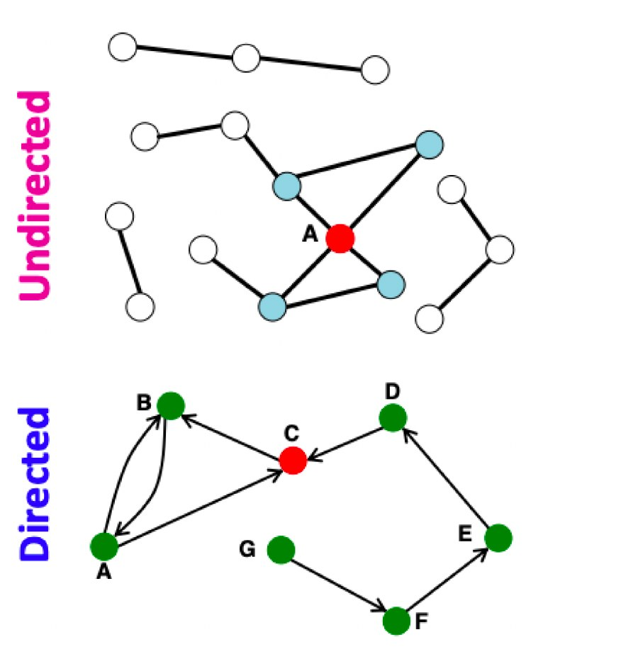
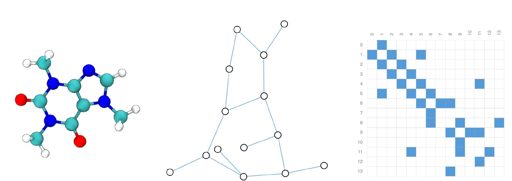
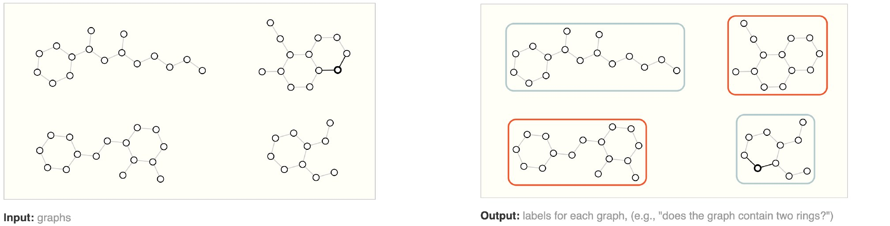
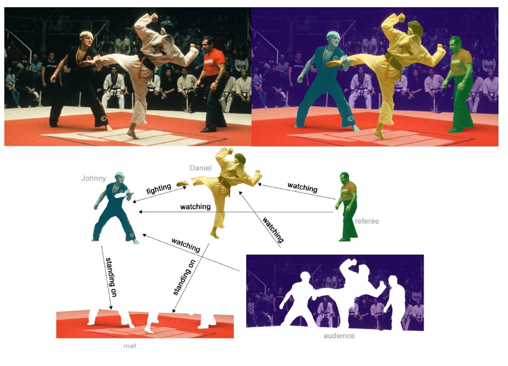
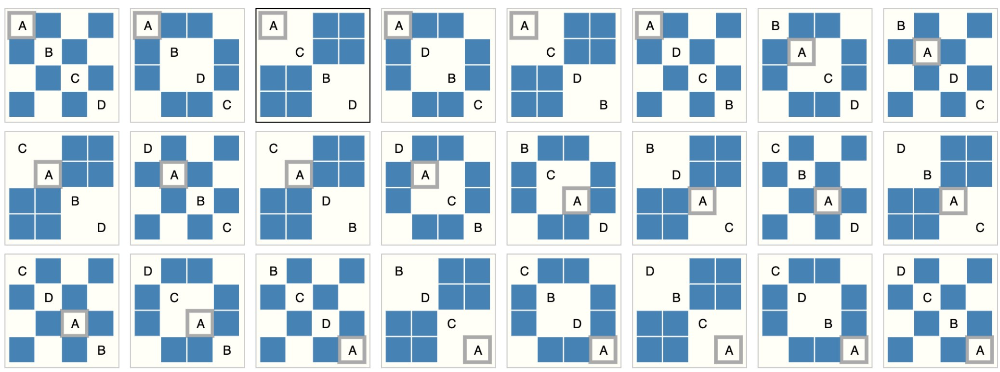
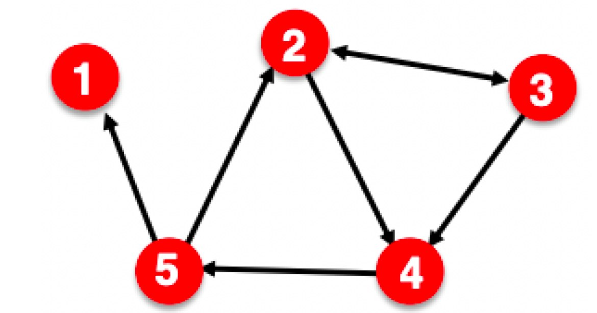
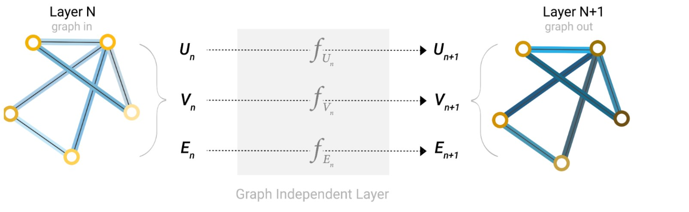
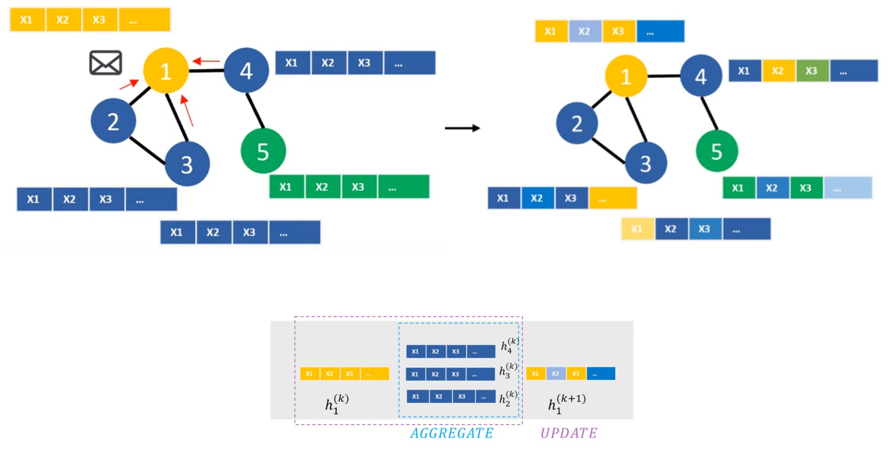

# Week 12 · Graph Neural Networks（图神经网络）

> **CSCI446/946 Big Data Analytics** — University of Wollongong, Spring 2026
> 本讲义融合 `Week12_Graph Neural Networks_SP_2026.pdf`（34 页 slides，封面标题是 *Graph Modelling*）与 Week 12 课堂录音转录。录音开头几分钟，讲师回顾了 Week 11 的时间序列分析，那部分内容见 `week11-time-series-analysis-study-guide.md`，这里不再重复。Slides 上的照片和真实网络图（节点度的例子、分子、场景图、24 种邻接矩阵、message passing 示意图等）直接从 slides 裁下，文件在 `figs/w12-sNN.jpg`，NN 是 slide 页码；其余示意图是为讲解重新画的，例题里的数字是本讲义编的。
>
> **关于 slides 上的红字**：讲师在课上说，他在 slides 上补充了邻接矩阵的定义，更新版已经上传。Slides 上其他几处红字（场景图、GNN 的定义、simple GNN 会退化成 MLP 等）看起来也是这样补充的。复习时把红字当作重点。
>
> **标记说明**：🔑 = 例题 / 手算；🎙️ = 讲师课上讲了、slides 上没有的内容（按考试范围对待）；📎 = 超出 slides 和课堂的拓展，为补足理解而加；⚠️ = 易错点，或 slides / 录音里的笔误。录音转写里有不少误识别（比如把 GNN 转成了 "gene"，把 adjacency matrix 转成了 "adjacent symmetrics"），对照表放在讲义末尾。

---

> **学习目标 (Learning objectives)** — 读完本章你应该能够：
>
> - **说清什么是 graph**：node、edge、global 三个元素，directed 与 undirected 的区别；解释讲师为什么说 i.i.d. 数据和时间序列都是"退化的图"；
> - **计算 node degree**（无向图的 $k_i$、有向图的 in-degree 和 out-degree、平均度 $2E/V$），**写出并读懂 adjacency matrix**，从它的行和、列和读出度和边数 $L$；
> - **举例说明图结构数据**：图像（规则的网格）、文本（有向链）、分子、社交网络、scene graph，说出每种数据里节点和边各是什么；
> - **区分图上的三类机器学习任务**：graph-level、node-level、edge-level，各举一个例子；
> - **说出邻接矩阵的两个缺点**（稀疏导致低效；不满足 permutation invariance），解释 adjacency list 和 edge list 解决了哪一个、没解决哪一个，以及 sum、mean、max 为什么能保证 permutation invariance；
> - **复述 GNN 的定义**，解释 simple GNN 为什么会退化成 MLP；**说出 message passing 的三步**（gather、aggregate、update），能在一张小图上手算一轮，并说明多层 message passing 怎样让信息多跳传播；
> - **在 GCN、GAT 等四个模型的公式里指出** aggregate 和 update 各是哪一部分；
> - **走通三个应用**：假账号识别（节点级）、电影推荐（边级）、分子毒性预测（图级），说清每一步用到了什么。

---

## 开篇：样本之间的关系也是信息

回想 Week 4 的 clustering、Week 5 的 classification、Week 6 的 regression。我们拿到的数据都能排成一张表：一行一个样本（一个学生、一个客户、一封邮件），一列一个特征。讲师在 Week 12 开场指出，这些方法背后有一个默认的假设：样本是 **i.i.d.** 的。

> 📎 **i.i.d.（超出 slides）** — independent and identically distributed，独立同分布：每个样本都从同一个分布中抽出，样本之间互不影响。Week 3 讲假设检验时，它是前提条件之一。在这个假设下，知道一个客户买了什么，对判断另一个客户没有任何帮助。

讲师说，从图的角度看，i.i.d. 数据其实是**图的退化情形（degenerate case）**：每个样本是一个节点，节点之间一条边也没有。上周的时间序列也可以看作一种退化的图：📎 每个时间点是一个节点，相邻的时间点之间有一条边，连成一条链（图 1 中间）。

```plot 图 1 · 讲师的开场：i.i.d. 数据是没有边的图，时间序列是一条链，本周处理任意连接的图
def draw(ax, pos, edges, color, directed=False):
    for i, j in edges:
        (x1, y1), (x2, y2) = pos[i], pos[j]
        if directed:
            ax.annotate("", xy=(x2, y2), xytext=(x1, y1),
                        arrowprops=dict(arrowstyle="-|>", color="C3", lw=1.3, shrinkA=8, shrinkB=8))
        else:
            ax.plot([x1, x2], [y1, y2], color="C3", lw=1.3, zorder=1)
    xs, ys = zip(*pos)
    ax.scatter(xs, ys, s=150, facecolor="white", edgecolor=color, linewidth=2, zorder=2)
    ax.set_xlim(-0.08, 1.08)
    ax.set_ylim(-0.25, 1.05)
    ax.axis("off")
fig, axes = plt.subplots(1, 3, figsize=(8, 2.9))
iid = [(0.1, 0.8), (0.45, 0.9), (0.85, 0.75), (0.25, 0.45), (0.65, 0.5), (0.1, 0.1), (0.8, 0.15)]
chain = [(0.04 + 0.153 * i, 0.5 + 0.28 * np.sin(1.2 * i)) for i in range(7)]
general = [(0.1, 0.75), (0.4, 0.92), (0.78, 0.85), (0.25, 0.38), (0.6, 0.5), (0.95, 0.42), (0.45, 0.04)]
g_edges = [(0, 1), (0, 3), (1, 2), (1, 4), (3, 4), (4, 5), (2, 5), (3, 6), (4, 6)]
draw(axes[0], iid, [], "C3")
draw(axes[1], chain, [(i, i + 1) for i in range(6)], "C1", directed=True)
draw(axes[2], general, g_edges, "C0")
titles = ["(a) i.i.d. 数据：一条边也没有", "(b) 时间序列：一条有向链", "(c) 一般的图：任意连接"]
notes = ["邻接矩阵全是 0", "只有相邻时间点之间有边", "谁和谁相连由数据决定"]
for ax, t, n in zip(axes, titles, notes):
    ax.set_title(t, fontsize=10.5)
    ax.text(0.5, -0.2, n, ha="center", fontsize=9.5, color="C3")
```

现实中很多数据不满足 i.i.d. 的假设。讲师的说法是："*现实世界里有很多数据必须用图来表示，因为它们内部有连接。*" 社交网络里，一个人的朋友是谁，和这个人本身是什么样的人密切相关；分子里，哪个原子连着哪个原子，决定了它有没有毒。忽略这些关系，有些问题根本解决不了。这一周要回答的，就是怎样分析这种数据，讲师说这是本讲的动机。

Slide 2 列出了本讲的五个问题，它们也是本讲义的骨架：

1. What is a graph?（Part I）
2. Where are the graph-structured data around us?（Part II）
3. What types of machine learning tasks are there?（Part III）
4. How to represent graphs?（Part IV）
5. How to build and utilize Graph Neural Networks?（Part V、Part VI）

讲师提前划了重点。最后一部分介绍的 **graph neural network（GNN，图神经网络）** 是又一种神经网络：我们在 Week 5、Week 6 见过 multilayer perceptron，在 Week 9 见过处理图像的 CNN，GNN 则专门处理图结构的数据。它的核心技术叫 **message passing（消息传递）**，"*这是今天要讨论的关键点*"。

---

# Part I · 图是什么

## §1 图的三个基本元素：node、edge、global

Slide 3 给出了定义：

> **A graph represents the relations (edges) between a collection of entities (nodes).**

讲师让大家注意两个关键词：**relation（关系）** 和 **entity（实体）**。一张图由三部分组成：

- **Vertex（或 node，节点）**，记作 $V$。节点就是实体。讲师说，回想 clustering 和 classification 里的数据，一个学生、一个苹果、一辆自行车都是一个节点，"*它只是一个我们可以为它定义特征的实体*"。过去 11 周处理的每个样本都是节点，我们对它已经很熟悉了。
- **Edge（或 link，边）**，记作 $E$。一条边连接两个节点，表示它们之间有关系。**并不是每两个节点之间都有边**：图 1 右边的图里，很多对节点之间就没有边。
- **Global（或 graph，全局）**，整张图记作 $G(V,E)$，意思是"由节点集合 $V$ 和边集合 $E$ 组成的图"。

新东西是边。讲师回忆 Week 4："*我把一些数据放在那里，说我们可以把它们聚类、分组。你会注意到它们之间没有任何连线。*" 那时我们假设数据相互独立，不讨论数据之间的关系。今天要讨论的正是这些关系，因为在很多应用里，关系天然存在而且很重要，"*忽略关系的信息，我们就解决不了这个问题*"。

特征也不再只属于节点。过去我们为图像、文本、学生、文章定义特征，它们都是节点的特征。今天会看到，**边**可以有特征，**整张图**也可以有特征。以社交网络为例（📎 表里的特征是本讲义举的例子）：

| 元素 | 是什么 | 可能的特征 |
|---|---|---|
| node | 一个用户 | 年龄、注册时长、发帖频率 |
| edge | 两个用户之间的好友关系 | 认识了多久、每周聊几次 |
| global | 整个社交网络 | 用户总数、主要在讨论什么话题 |

> ⚠️ **"图"的几个意思** — 本章的"图"是 graph：由点和边组成的结构。它不是 Week 3 用来可视化数据的统计图表（chart / plot），也不是 Week 9 的图像（image）。考试里出现 graph，指的是前者。

<details>
<summary>自测：一个论文引用网络里，node、edge、global 分别可能是什么？各举一个可能的特征。</summary>

node 是一篇论文，特征可以是摘要的 TF-IDF 向量或 embedding、发表年份。edge 是引用关系（论文 A 引用了论文 B），特征可以是引用发生的年份。global 是整个引用网络，特征可以是论文总数、所属的学科领域。

</details>

## §2 边的方向：directed 与 undirected

Slide 4 把边进一步分成两种：

> We can additionally specialize graphs by associating directionality to edges (**directed, undirected**).

- **Undirected edge（无向边）**：平等地连接两个节点，两端没有区别。讲师的例子：我们在社交网络上互为好友，"*你是我的朋友，我也是你的朋友*"，这种关系是相互的。
- **Directed edge（有向边）**：从一个**源节点** $v_{src}$（source）指向一个**目标节点** $v_{dst}$（destination），画成箭头。讲师的例子：你是社交网络上有影响力的用户，我喜欢读你的文章，于是关注了你，你却没有关注我。这是一个单向的关系，不是相互的关系，所以用有向边，箭头从我指向你。

全部由无向边组成的图叫 **undirected graph（无向图）**，由有向边组成的叫 **directed graph（有向图）**。

> 📎 **更多例子（超出 slides）** — 有向：网页之间的超链接、论文引用、邮件从发件人到收件人、句子里一个词到下一个词（§7）。无向：微信好友、两个人合写过论文、分子里两个原子之间的化学键（§8）。

> ⚠️ **相互关注 ≠ 一条无向边** — 在有向图里，A 关注 B、B 也关注 A，是**两条**有向边（A→B 和 B→A），不是一条无向边。图 2 下半部分的 A、B 之间，以及 §15 里 slide 19 的节点 2、3 之间，就是这种情况。数边、算度的时候，两条要分开算。

<details>
<summary>自测：下面的关系应该用有向边还是无向边？(a) 两个人是 LinkedIn 好友；(b) 在 X（Twitter）上关注一个账号；(c) A 给 B 发了一封邮件；(d) 两座城市之间有一条双向高速公路；(e) 网页 A 上有一个指向网页 B 的链接。</summary>

(a) 无向：好友关系是相互的。(b) 有向：关注是单向的，从关注者指向被关注者。(c) 有向：从发件人指向收件人。(d) 无向（也可以看作两条方向相反的有向边）。(e) 有向：从 A 指向 B，B 不一定链接回 A。

</details>

## §3 Node degree：一个节点连着几条边

有了一张图，最先想知道的是有多少个节点、多少条边，数一数就行。讲师说，接下来值得关心的是每个节点的**度**。Slide 5 把它称为一个重要的统计量：

> **Node degree, $k_i$**: the number of edges adjacent to node $i$.

**Node degree（节点度）** $k_i$ 就是和节点 $i$ 相连的边的条数。图 2 上半部分是 slide 5 的无向图：红色的节点 A 连着 4 个蓝色的节点，所以 $k_a=4$。



度有直观的含义。讲师还是用社交网络举例：假设 A 是一个有影响力的用户，他会和很多很多用户相连，"*本质上它是一个 hub（枢纽）*"，度很高。反过来，一个度只有 1 的节点相对孤立。只看度，就能大致看出哪些节点是枢纽，哪些在边缘。

**Average degree（平均度）** 是所有节点的度的平均值：

$$\bar k=\langle k\rangle=\frac{1}{V}\sum_{i=1}^{V}k_i=\frac{2E}{V}$$

这里 $V$ 是节点个数，$E$ 是边的条数。讲师说，算平均度不需要逐个数每个节点的度，"*数学上可以证明，无向图的平均度就是 2 乘以边数、再除以节点数*"。

> 📎 **为什么是 2E（超出 slides）** — 每条无向边有两个端点，它在两个端点的度里各算一次。把所有节点的度加起来，每条边恰好被数了两次：$\sum_ik_i=2E$。两边同除以 $V$，就得到 $\bar k=2E/V$。这个结论在图论里叫 handshake lemma（握手引理）：一屋子人互相握手，每个人握手次数的总和，等于握手总次数的两倍。

> ⚠️ **记号** — 这个公式里的 $V$、$E$ 指**个数**（节点数、边数），slide 3 的 $V$、$E$ 却指节点和边的**集合**。Slide 7 又换了一套记号：用 $N$ 表示节点数，用 $L$（links）表示边数。

有向图要分得更细（slide 5）：

> In directed networks we define an **in-degree** and **out-degree**. The (total) degree of a node is the sum of in- and out-degrees.

- **In-degree（入度）** $k_i^{in}$：指向节点 $i$ 的边的条数。
- **Out-degree（出度）** $k_i^{out}$：从节点 $i$ 出发、指向别的节点的边的条数。
- **Total degree（总度）** $k_i=k_i^{in}+k_i^{out}$。

图 2 下半部分的节点 C：A→C、D→C 两条边指向它，C→B 一条边从它出发，所以 $k_c^{in}=2$，$k_c^{out}=1$，$k_c=3$。

> 📎 在社交网络里，入度就是粉丝数，出度就是关注数。一个明星账号的入度可能上千万，出度只有几十。只看总度，会把这两种完全不同的角色混在一起，所以有向图要区分入度和出度。

> **🔑 例** — 一个无向图有 4 个节点、4 条边：1–2、1–4、2–4、3–4（§4 还会用到它）。
> - 节点 1 连着 2、4：$k_1=2$；节点 2 连着 1、4：$k_2=2$；节点 3 只连着 4：$k_3=1$；节点 4 连着 1、2、3：$k_4=3$。
> - 度之和 $2+2+1+3=8=2\times4$，验证了 $\sum_ik_i=2E$。
> - 平均度 $\bar k=2E/V=2\times4/4=2$。节点 4 是这张小图的枢纽，节点 3 最靠边缘。

<details>
<summary>自测：(1) 一个无向图有 10 个节点、15 条边，平均度是多少？(2) 数出图 2 下半部分有向图里每个节点的入度和出度，验证"入度之和 = 出度之和 = 边数"。</summary>

(1) $\bar k=2\times15/10=3$。

(2) 图里的 8 条边是：A→B、B→A、A→C、C→B、D→C、E→D、F→E、G→F。

| 节点 | A | B | C | D | E | F | G | 合计 |
|---|---|---|---|---|---|---|---|---|
| 入度 | 1 | 2 | 2 | 1 | 1 | 1 | 0 | 8 |
| 出度 | 2 | 1 | 1 | 1 | 1 | 1 | 1 | 8 |

每条有向边恰好给一个节点贡献 1 个出度、给另一个节点贡献 1 个入度，所以两行的和都等于边数 8。G 的入度为 0：没有边指向它。

</details>

## §4 Adjacency matrix：把图写成一个矩阵

讲师说，对一张图来说，最重要的是**关系**，也就是边，或者说 **connectivity（连通性）**：图是怎样连起来的。图的结构，有时也叫 **topology（拓扑）**，完全由连通性决定。要让计算机处理图，先要把连通性写成计算机能存、能算的形式。最直接的形式是一个矩阵。Slide 6 的定义（讲师说这是他新加到 slides 上的）：

> An **adjacency matrix** is a square, binary matrix used to represent which vertices (nodes) in a graph are connected by an edge. For a graph with $V$ vertices, the adjacency matrix $A$ is a $V$ by $V$ matrix where the rows and columns represent the vertices.
>
> $A_{ij}=1$ if there is a link from node $i$ to node $j$; $A_{ij}=0$ otherwise.

逐词看：

- **square（方阵）**：行数等于列数，都等于节点数 $V$。第 $i$ 行、第 $i$ 列都代表节点 $i$。
- **binary（二值）**：讲师解释，矩阵的每个元素只能是 0 或 1。
- $A_{ij}=1$ 表示**有一条从节点 $i$ 到节点 $j$ 的边**：行是起点，列是终点。

讲师强调，邻接矩阵和图是等价的："*给了邻接矩阵，你就能画出这张图；给了一张图，你就能写出它的邻接矩阵。*"

图 3 是 slide 6 左边的无向图，也就是 §3 例题里的那张图。读第一行（节点 1）：节点 1 到节点 1 没有边，讲师说"*这 4 个节点都没有指向自己的边*"，所以对角线上全是 0；节点 1 和节点 2 之间有边，第 1 行第 2 列是 1；节点 1 和节点 4 之间也有边，第 1 行第 4 列是 1。再看第 4 行：节点 4 有三条边，分别连到节点 1、2、3，所以这一行有三个 1。

```plot 图 3 · 无向图和它的邻接矩阵：矩阵对称，每一行的和（= 每一列的和）就是节点的度
A = np.array([[0, 1, 0, 1], [1, 0, 0, 1], [0, 0, 0, 1], [1, 1, 1, 0]])
pos = {0: (0.6, 0.9), 1: (2.0, 1.35), 2: (3.0, 1.9), 3: (0.9, 2.35)}
fig, (g, m) = plt.subplots(1, 2, figsize=(8, 3.3), gridspec_kw={"width_ratios": [1, 1.1]})
pairs = [(i, j) for i in range(4) for j in range(i + 1, 4) if A[i, j]]
for i, j in pairs:
    g.plot([pos[i][0], pos[j][0]], [pos[i][1], pos[j][1]], color="C3", lw=1.8, zorder=1)
for i, (x, y) in pos.items():
    g.scatter([x], [y], s=420, color="C3", zorder=2)
    g.text(x, y, str(i + 1), ha="center", va="center", color="white", fontsize=11, fontweight="bold", zorder=3)
g.set_xlim(0.2, 3.4)
g.set_ylim(0.5, 2.7)
g.set_aspect("equal")
g.axis("off")
g.set_title("无向图 undirected：4 个节点、4 条边", fontsize=10.5)
for r in range(4):
    for c in range(4):
        m.add_patch(plt.Rectangle((c - 0.5, r - 0.5), 1, 1, facecolor="C1" if A[r, c] else "white",
                                  alpha=0.35 if A[r, c] else 1, edgecolor="C3", lw=0.6))
        m.text(c, r, str(A[r, c]), ha="center", va="center", fontsize=11)
    m.text(-0.95, r, f"节点 {r + 1}", ha="right", va="center", fontsize=9.5)
    m.text(4.1, r, str(A[r].sum()), ha="center", va="center", fontsize=11, color="C0", fontweight="bold")
for c in range(4):
    m.text(c, -0.85, str(c + 1), ha="center", va="center", fontsize=9.5)
    m.text(c, 4.1, str(A[:, c].sum()), ha="center", va="center", fontsize=11, color="C0", fontweight="bold")
m.text(4.1, -0.85, r"行和 $k_i$", ha="center", va="center", fontsize=9.5, color="C0")
m.text(-0.95, 4.1, "列和", ha="right", va="center", fontsize=9.5, color="C0")
m.text(4.1, 4.1, f"Σ={A.sum()}", ha="center", va="center", fontsize=9.5)
m.set_xlim(-2.2, 4.7)
m.set_ylim(4.6, -1.3)
m.set_aspect("equal")
m.axis("off")
m.set_title(r"对称：$A_{ij}=A_{ji}$；对角线全 0", fontsize=10.5)
```

图 4 是 slide 6 右边的有向图，四条边是 1→4、2→1、4→2、4→3。讲师专门讲了第 1 行：这一行**只有一个 1**，在第 4 列。节点 1 和节点 2 之间虽然有边，方向却是从 2 到 1，按定义它属于"从节点 2 出发"的第 2 行（$A_{21}=1$），不在第 1 行。同样，第 4 行有两个 1（$A_{42}$、$A_{43}$），对应从节点 4 出发、指向节点 2 和节点 3 的两条边。

```plot 图 4 · 有向图的邻接矩阵不对称：行和是出度，列和是入度，所有元素之和就是边数
A = np.array([[0, 0, 0, 1], [1, 0, 0, 0], [0, 0, 0, 0], [0, 1, 1, 0]])
pos = {0: (0.6, 0.9), 1: (2.0, 1.35), 2: (3.0, 1.9), 3: (0.9, 2.35)}
fig, (g, m) = plt.subplots(1, 2, figsize=(8, 3.3), gridspec_kw={"width_ratios": [1, 1.1]})
arcs = [(i, j) for i in range(4) for j in range(4) if A[i, j]]
for i, j in arcs:
    g.annotate("", xy=pos[j], xytext=pos[i],
               arrowprops=dict(arrowstyle="-|>", color="C3", lw=1.8, shrinkA=13, shrinkB=13, mutation_scale=16))
for i, (x, y) in pos.items():
    g.scatter([x], [y], s=420, color="C3", zorder=2)
    g.text(x, y, str(i + 1), ha="center", va="center", color="white", fontsize=11, fontweight="bold", zorder=3)
g.set_xlim(0.2, 3.4)
g.set_ylim(0.5, 2.7)
g.set_aspect("equal")
g.axis("off")
g.set_title("有向图 directed：1→4、2→1、4→2、4→3", fontsize=10.5)
for r in range(4):
    for c in range(4):
        m.add_patch(plt.Rectangle((c - 0.5, r - 0.5), 1, 1, facecolor="C1" if A[r, c] else "white",
                                  alpha=0.35 if A[r, c] else 1, edgecolor="C3", lw=0.6))
        m.text(c, r, str(A[r, c]), ha="center", va="center", fontsize=11)
    m.text(-0.95, r, f"从 {r + 1} 出发", ha="right", va="center", fontsize=9.5)
    m.text(4.1, r, str(A[r].sum()), ha="center", va="center", fontsize=11, color="C0", fontweight="bold")
for c in range(4):
    m.text(c, -0.85, f"→{c + 1}", ha="center", va="center", fontsize=9.5)
    m.text(c, 4.1, str(A[:, c].sum()), ha="center", va="center", fontsize=11, color="C4", fontweight="bold")
m.text(4.1, -0.85, r"出度 $k^{out}$", ha="center", va="center", fontsize=9.5, color="C0")
m.text(-0.95, 4.1, r"入度 $k^{in}$", ha="right", va="center", fontsize=9.5, color="C4")
m.text(4.1, 4.1, f"Σ={A.sum()}", ha="center", va="center", fontsize=9.5)
m.set_xlim(-2.4, 4.7)
m.set_ylim(4.6, -1.3)
m.set_aspect("equal")
m.axis("off")
m.set_title(r"$A_{ij}=1$ 表示有一条 $i\to j$ 的边；$A_{ij}\neq A_{ji}$", fontsize=10.5)
```

两张图并排看，有一个明显的区别：**无向图的邻接矩阵是对称矩阵**，有向图的一般不是。讲师解释，无向图不考虑方向，1 和 2 之间有边，既可以说"1 到 2"，也可以说"2 到 1"，所以 $(1,2)$ 和 $(2,1)$ 两个位置都是 1；$(1,4)$ 和 $(4,1)$、$(2,4)$ 和 $(4,2)$ 也一样。有向图里 $A_{21}=1$，$A_{12}$ 却是 0。

讲师这样总结邻接矩阵的地位："*邻接矩阵对图数据分析非常重要，因为它表示了图的结构。它告诉你哪个节点和哪个节点相连，这是一张图最本质的信息。*"

> ⚠️ **行是起点，列是终点** — 本课程约定 $A_{ij}=1$ 表示 $i\to j$。📎 有些教材和软件用相反的约定（列是起点），读别的资料时先看清定义。无向图的矩阵对称，不受这个约定影响。

> 📎 **0 和 1 之外（超出 slides）** — 如果边有强弱，可以把 1 换成权重，得到 **weighted adjacency matrix（加权邻接矩阵）**，比如用户给电影打的星级、两座城市之间的距离。§11 的 edge regression 预测的就是这种权重。如果允许节点连向自己（self-loop，自环），对角线上就会出现 1；§21 的 GCN 会故意加上自环。

<details>
<summary>自测：一个有向图有 3 个节点，边是 1→2、2→3、3→1、1→3。写出它的邻接矩阵。它对称吗？</summary>

$$A=\begin{pmatrix}0&1&1\\0&0&1\\1&0&0\end{pmatrix}$$

第 1 行（从节点 1 出发）在第 2、3 列是 1；第 2 行在第 3 列是 1；第 3 行在第 1 列是 1。它不对称：比如 $A_{12}=1$，$A_{21}=0$。注意 1→3 和 3→1 是两条有向边，分别占 $A_{13}$ 和 $A_{31}$ 两个位置。

</details>

## §5 从邻接矩阵读出度和边数

有了邻接矩阵，§3 的统计量都能直接算出来。讲师说："*一旦有了邻接矩阵，节点度就很容易得到，你只要求和。*" Slide 7 把公式列全了：

| | Undirected（无向） | Directed（有向） |
|---|---|---|
| 对称性 | $A_{ij}=A_{ji}$ | $A_{ij}\neq A_{ji}$（一般而言） |
| 对角线 | $A_{ii}=0$ | $A_{ii}=0$ |
| 行和 | $k_i=\sum_{j=1}^{N}A_{ij}$（度） | $k_i^{out}=\sum_{j=1}^{N}A_{ij}$（出度） |
| 列和 | $k_j=\sum_{i=1}^{N}A_{ij}$（度） | $k_j^{in}=\sum_{i=1}^{N}A_{ij}$（入度） |
| 边数 $L$ | $L=\frac12\sum_{i=1}^{N}k_i=\frac12\sum_{ij}A_{ij}$ | $L=\sum_{i=1}^{N}k_i^{in}=\sum_{j=1}^{N}k_j^{out}=\sum_{ij}A_{ij}$ |

$N$ 是节点数，$L$ 是边的总数（total number of edges, links）。

这些公式都能从 $A_{ij}$ 的含义推出来。第 $i$ 行的 1 标出了所有从 $i$ 出发的边，所以行和是出度；第 $j$ 列的 1 标出了所有指向 $j$ 的边，所以列和是入度。无向图没有方向，行和与列和相等，都是度。把矩阵里所有的 1 加起来：有向图里每条边恰好占一个格子，总和就是边数；无向图里每条边占两个格子（$A_{ij}$ 和 $A_{ji}$），总和是边数的两倍，所以要除以 2。这和 §3 的 $\sum_ik_i=2E$ 说的是同一件事。

> **🔑 例（slide 7）** — 回到图 3、图 4。
> - 无向图：行和是 $(2,2,1,3)$，正是 §3 例题算出的四个度。讲师说，要求节点 2 的度，"*把第二行加起来，或者把第二列加起来*"，结果一样：$1+0+0+1=2$。所有元素之和是 8，所以 $L=8/2=4$ 条边。
> - 有向图：行和（出度）是 $(1,1,0,2)$，列和（入度）是 $(1,1,1,1)$，两者的和都是 4。讲师的算法："*把所有元素快速加起来，1、2、3、4，就是 4 条边。*" 节点 3 的出度为 0：没有边从它出发。

讲师提到，在邻接矩阵上做一些简单的计算，还能得到关于图的更多信息，"*但今天没有时间讲*"。

> 📎 **一个例子：$A^2$ 数的是共同邻居（超出 slides）** — 矩阵乘法 $(A^2)_{ij}=\sum_kA_{ik}A_{kj}$ 里，$A_{ik}A_{kj}=1$ 当且仅当 $i$ 连着 $k$、$k$ 又连着 $j$。所以 $(A^2)_{ij}$ 数的是从 $i$ 走两步到 $j$ 的路线条数；在无向图里，就是 $i$ 和 $j$ 的**共同邻居**个数。在图 3 里，节点 1 和节点 3 之间没有边，但 $(A^2)_{13}=A_{14}A_{43}=1$：它们有一个共同的邻居，节点 4。社交网络里，共同好友多、却还不是好友的两个人，正是推荐好友的候选对象（§11 的 link prediction）。

<details>
<summary>自测：一个图的邻接矩阵如下。它是有向图还是无向图？求每个节点的度和边数 L。</summary>

$$A=\begin{pmatrix}0&1&1&0\\1&0&1&1\\1&1&0&0\\0&1&0&0\end{pmatrix}$$

矩阵对称（$A_{12}=A_{21}$、$A_{13}=A_{31}$、$A_{23}=A_{32}$、$A_{24}=A_{42}$），对角线全 0，是无向图。行和就是度：$k_1=2$、$k_2=3$、$k_3=2$、$k_4=1$。所有元素之和是 8，$L=8/2=4$ 条边：1–2、1–3、2–3、2–4。

</details>

---

# Part II · 身边的图结构数据

知道了什么是图，下一个问题是哪些数据可以写成图。Slide 8 的回答：

> **Why use graph** — Graphs are very flexible data structures, and they are all around us.

讲师举了五个例子：图像、文本、分子、社交网络和场景图。前两个结构规则，后三个是"更不规则"（more heterogeneously structured）的数据。

## §6 图像：一张规则的网格图

第一个例子出人意料，讲师说："*图像本身就是一张图，这很有意思。*" 设想一张只有 5 行 5 列的小图，一共 25 个像素。把每个像素当作一个节点；两个像素如果相邻（左右相邻、上下相邻，或者沿对角线相邻），就在它们之间连一条边。这样每个像素最多和周围 8 个像素相连，讲师说这叫 **8-connectedness（8 连通）**：两个像素要么共享一条边界，要么在对角线上共享一个角。

一张图像就这样变成了一张图：节点是像素，节点特征是像素值；边表示两个像素在位置上相邻。按 slide 8 的方式给像素编号（先排第一行的 5 个像素，再排第二行，依此类推），可以写出一个 $25\times25$ 的邻接矩阵（图 5）。

```plot 图 5 · 把 5×5 的图像当作图：每个像素连着 8 个邻居（左）；邻接矩阵 25×25，只有 23% 的格子是 1（右）
N = 5
steps = [(dr, dc) for dr in (-1, 0, 1) for dc in (-1, 0, 1) if (dr, dc) != (0, 0)]
inside = lambda r, c: 0 <= r < N and 0 <= c < N
A = np.array([[int(inside(r2, c2) and (r2 - r, c2 - c) in steps)
               for r2 in range(N) for c2 in range(N)]
              for r in range(N) for c in range(N)])
fig, (g, m) = plt.subplots(1, 2, figsize=(8, 3.9), gridspec_kw={"width_ratios": [1, 1.15]})
half = [(0, 1), (1, 0), (1, 1), (1, -1)]
for r in range(N):
    for c in range(N):
        for dr, dc in half:
            if inside(r + dr, c + dc):
                g.plot([c, c + dc], [r, r + dr], color="C3", lw=0.8, alpha=0.55, zorder=1)
for dr, dc in steps:
    g.plot([2, 2 + dc], [2, 2 + dr], color="C0", lw=2.4, zorder=2)
g.scatter([c for r in range(N) for c in range(N)], [r for r in range(N) for c in range(N)],
          s=110, facecolor="white", edgecolor="C3", linewidth=1.2, zorder=3)
g.scatter([2], [2], s=170, color="C0", zorder=4)
g.text(2, -0.95, "像素 (2, 2) 和它的 8 个邻居", ha="center", fontsize=9.5, color="C0")
g.set_xlim(-0.6, 4.6)
g.set_ylim(4.6, -1.3)
g.set_aspect("equal")
g.axis("off")
g.set_title(f"25 个节点、{A.sum() // 2} 条边", fontsize=10.5)
cmap = matplotlib.colors.ListedColormap(["white", matplotlib.colors.to_rgba("C1", 0.85)])
m.imshow(A, cmap=cmap, vmin=0, vmax=1)
m.set_xticks(np.arange(-0.5, 25, 1), minor=True)
m.set_yticks(np.arange(-0.5, 25, 1), minor=True)
m.grid(which="minor", color="C3", lw=0.25, alpha=0.5)
m.tick_params(which="both", length=0, labelbottom=False, labelleft=False)
m.add_patch(plt.Rectangle((-0.5, 11.5), 25, 1, fill=False, ec="C0", lw=1.8))
m.text(25.2, 12, "← 像素 (2, 2)\n    这一行有 8 个 1", fontsize=9, color="C0", va="center")
m.set_title(f"邻接矩阵：{A.sum()} 个 1 / 625 个格子", fontsize=10.5)
```

图 5 右边的邻接矩阵有两个特点。它是**对称的**：相邻是相互的关系，这是一张无向图。它的大部分元素是 **0**：讲师解释，"*在图像里，一个像素只和相邻的 8 个像素相连*"，所以每一行最多只有 8 个 1。这些 1 都集中在对角线附近的几条斜线上，排成整齐的带状。这就是 slide 8 说的 **graph with regular structure（规则结构的图）**：除了边界上的像素，每个节点的邻居一样多，排列方式也一样（上、下、左、右和四个对角）。

> 📎 **数一数（超出 slides）** — 5×5 的网格里，水平相邻的边有 $5\times4=20$ 条，竖直的也是 20 条，两个方向的对角线各 $4\times4=16$ 条，合计 72 条边，矩阵里有 144 个 1，占 625 个格子的 23%。度也很规则：中间 9 个像素的度是 8，边上（不含角）12 个像素的度是 5，4 个角的度是 3，$9\times8+12\times5+4\times3=144=2\times72$。图像越大，0 的比例越高，§13 会算一张 1000×1000 的图。

## §7 文本：一条有向链

讲师接着联系 Week 8 的文本分析：一个句子也可以表示成图。Slide 9 的句子是 "Graphs are all around us"：每个词是一个节点，每个词指向它后面的那个词，得到一条有向的链 Graphs → are → all → around → us。

这条链的邻接矩阵是 $5\times5$（5 个词），1 都在主对角线右上方紧挨着的那条斜线上（$A_{12}$、$A_{23}$、$A_{34}$、$A_{45}$）。讲师指出，它**不是对称矩阵**，因为这是一张有向图："*如果你改变词的顺序，它就不再是原来那个句子了。*" 边的方向记录的正是词序。

> 📎 **和前几周的联系** — Week 8 的 bag-of-words 把文档变成词频向量，丢掉了词序，相当于把这条链上的边全部删掉，只留下节点。Week 11 的时间序列和这里的句子形状一样，都是一条链（图 1 中间）：值的先后顺序就是边。

## §8 分子、社交网络与 scene graph：不规则的图

Slides 10–11 的数据更不规则（**more heterogeneously structured**）：不同节点的邻居个数可以差别很大，邻居的排列也没有固定的模式。

**分子（molecules as graphs）**。讲师说，图神经网络和图数据分析在化学里有大量应用，可以用来研究分子和蛋白质。把一种化学物质的分子画成图：每个节点是一个**原子（atom）**，每条边是两个原子之间的**化学键（bond）**。键没有方向，这是一张无向图，同样可以写成邻接矩阵（图 6）。讲师说，有了这张图，就能推断分子的各种化学性质：它有没有毒（toxic），能不能溶解（soluble），等等。§24 会完整地做一遍。



拿它和图 5 比一比：图像的邻接矩阵是整齐的带状，分子的邻接矩阵里，1 散落在各处，没有规律；有的原子有 3 个邻居，有的只有 1 个。

**社交网络（social networks as graphs）**。讲师说，无论你用 LinkedIn、Meta 还是 X，你都是其中的一个用户，和很多朋友相连，或者关注了某些人。每个用户是一个节点，好友关系是无向边，关注关系是有向边，同样可以写成邻接矩阵。

> 📎 **Slide 11 的网络（超出 slides）** — Slide 11 中间那张网络是网络科学里最有名的数据集之一：**Zachary's karate club（Zachary 空手道俱乐部）**，记录了一个空手道俱乐部 34 名成员之间的社交关系。邻接矩阵的行标签 "Mr. Hi" 是俱乐部教练的化名。左边的空手道比赛照片只是配图。

**Scene graph（场景图）**。Slide 11 底部的红字给出了定义：

> **Scene graph**: a data structure used to break down an image or 3D space into "connected facts" so that an AI can understand context and meaning rather than just listing isolated objects.

讲师解释，在图像分析里，可以先从一张图中找出很多实体（物体），比如地板、舞台、桌子、人 1、人 2、人 3、裁判、运动员，再描述这些孤立的物体之间的关系，得到的就是场景图。它把一幅画面拆成一组"相互连接的事实"，比如"裁判在看运动员""运动员站在垫子上"。Week 9 的 image recognition 只告诉我们"图里有一个人、一张垫子"，场景图还告诉 AI 这些物体之间是什么关系。§11 会看一个完整的例子。

把这些例子放在一起：

| 数据 | 节点 | 边 | 有向？ | 结构 |
|---|---|---|---|---|
| 图像（slide 8） | 像素 | 相邻（8 连通） | 无向 | 规则的网格 |
| 文本（slide 9） | 词 | 前一个词 → 后一个词 | 有向 | 一条链 |
| 分子（slide 10） | 原子 | 化学键 | 无向 | 不规则 |
| 社交网络（slide 11） | 用户 | 好友 / 关注 | 好友无向，关注有向 | 不规则 |
| 场景图（slides 11、14） | 物体（人、垫子、观众） | 关系（fighting、watching……） | 有向 | 不规则 |
| 📎 时间序列（Week 11） | 时间点 | 前一个时间点 → 后一个 | 有向 | 一条链 |

<details>
<summary>自测：把一个城市的交通网络表示成图。节点、边各是什么？应该用有向图还是无向图？节点和边可以有哪些特征？</summary>

一种做法：节点是路口，边是连接两个路口的路段。有单行道时要用有向图（双向的路段可以看作两条方向相反的有向边）。节点特征可以是路口有没有红绿灯、每小时通过的车辆数；边特征可以是路段长度、车道数、限速、当前的平均车速（这就是带权重的边）。讲师在 §9 提到，可以根据这样的图判断一个交通网络会不会经常堵车。

</details>

---

# Part III · 在图上能做哪些机器学习任务

讲师说，有了图，接着就要问能用它做什么："*我们要做分类、回归还是聚类？都可以，这些就是用机器学习处理图结构数据的方式。*" 一旦把图像、网络或化学物质表示成图，就可以在三个层级上做分析：整张图、单个节点、单条边（图 7）。

```plot 图 7 · 同一张图上的三类任务：预测一个节点、预测一条边、预测整张图
pos = [(0.12, 0.72), (0.42, 0.9), (0.78, 0.8), (0.28, 0.36), (0.6, 0.48), (0.92, 0.36), (0.48, 0.06)]
edges = [(0, 1), (1, 2), (0, 3), (1, 4), (3, 4), (4, 5), (2, 5), (3, 6), (4, 6)]
fig, axes = plt.subplots(1, 3, figsize=(8, 3.0))
for ax in axes:
    for i, j in edges:
        ax.plot([pos[i][0], pos[j][0]], [pos[i][1], pos[j][1]], color="C3", lw=1.2, zorder=1)
    ax.scatter(*zip(*pos), s=150, facecolor="white", edgecolor="C3", linewidth=1.5, zorder=2)
    ax.set_xlim(-0.12, 1.12)
    ax.set_ylim(-0.4, 1.08)
    ax.axis("off")
a, b, c = axes
a.scatter([pos[4][0]], [pos[4][1]], s=260, color="C0", zorder=3)
a.text(pos[4][0], pos[4][1], "?", ha="center", va="center", color="white", fontsize=12, fontweight="bold", zorder=4)
a.set_title("节点级 node-level", fontsize=10.5)
a.text(0.5, -0.3, "这个节点是什么？\n例：真人账号还是 bot", ha="center", fontsize=9.5, color="C0")
b.plot([pos[0][0], pos[2][0]], [pos[0][1], pos[2][1]], color="C2", lw=2.2, ls="--", zorder=1)
b.text(0.64, 0.66, "?", ha="center", fontsize=13, color="C2", fontweight="bold")
b.set_title("边级 edge-level", fontsize=10.5)
b.text(0.5, -0.3, "这两个点之间该不该有边？\n例：推荐好友、推荐电影", ha="center", fontsize=9.5, color="C2")
c.add_patch(matplotlib.patches.FancyBboxPatch((0.0, -0.04), 1.04, 1.04, boxstyle="round,pad=0.03",
                                              fill=False, ec="C1", lw=2))
c.set_title("图级 graph-level", fontsize=10.5)
c.text(0.5, -0.3, "整张图是什么？\n例：这个分子有没有毒", ha="center", fontsize=9.5, color="C1")
```

## §9 Graph-level task：给整张图一个答案

Slide 12：

> **Graph-level task**: Predict a single property for a whole graph (**Graph classification and graph regression**).

图级任务的输入是一张张完整的图，输出是每张图的一个标签或一个数值。Slide 12 的例子（图 8）：给几张图，判断每张图里是不是有两个环（"does the graph contain two rings?"）。输出里红框的两张图各有两个环，灰框的两张只有一个。讲师说，这是最简单的图分类。



Slide 12 列出的应用领域有 Molecular Chemistry、Social Network Analysis、Computer Vision、Material Science 和 Traffic Networks。讲师逐个举了例子：

- **分子化学**：估计一个分子的性质，比如它能不能用作治疗某种疾病的药物、有没有毒、能不能溶解。
- **社交网络**：判断一个社交网络是不是健康，或者它主要在讨论教育话题还是体育话题。
- **计算机视觉**：在 §8 的场景图上，"*仅仅根据物体之间的关系*"，判断这是一间厨房还是一间卧室。
- **交通网络**：判断一个交通网络会经常堵车，还是稳健、高效。
- 如果要预测的是一个**数值**（代表网络的某种特征或质量），就是 **graph regression（图回归）**。

讲师点出了做图级任务的关键：本质上，我们是用一个**特征向量**表示一整张图，然后就可以用以前学过的任何机器学习算法做分类或回归。"*但关键问题是，怎样把一张图变成一个特征向量？*" 有了特征向量，问题就回到了我们熟悉的向量空间里。这个问题的答案就是 Part V 的 GNN。

> 📎 Week 9 的 image classification 也是给"一整个对象"一个标签，那时的难点是怎样把一张图像变成特征向量（BoVW、CNN）。图级任务的难点完全一样，只是对象从图像换成了图。

## §10 Node-level task：给每个节点一个答案

讲师说，图级任务是最高的层级，"*我们还可以进入图的内部，做更细的事*"。Slide 13：

> **Node-level task**: Predict the identity or role of each node within a graph (**Node classification, regression, clustering, and scoring**).

节点级任务对图里的每个节点做预测：分类、回归、聚类或打分。讲师说，这和我们以前做的事情是一致的：对每个数据做分类、回归、聚类，"*一样*"，我们早就熟悉节点级任务了。区别在于，以前不考虑节点之间的关系，或者根本没有关系的信息；在图结构数据上做节点分类时，**必须考虑、也必须利用节点之间的关系**，它会提供更多有用的信息。

讲师的例子：假设你是一个社交平台的安全负责人，平台上新注册了一个账号，你想判断它是真实的用户，还是一个 bot（机器人账号）、一个假账号。"*如果你只看这个账号自己的特征，可能没法有效、准确地识别它。*" 但现在你多了一份信息：和这个账号相连的那些账号。它们提供了更多的上下文，真人账号和 bot 的连接模式可能很不一样。回归、聚类和打分也是这样，不只用节点自己的特征，还用相邻节点的特征增强预测能力。讲师总结："*如果节点之间确实存在关系、确实相连，图分析会给我们更强大的工具。*" §22 会完整地做这个例子。

> 📎 **四种节点级任务各举一例（超出 slides）** — 分类：账号是真人还是 bot，论文属于哪个领域。回归：预测一个用户的年龄或月消费额。聚类：把社交网络分成若干个社区（community detection），对应 Week 4 的 clustering。打分：给每个用户一个影响力分数或风险分数，用来排序。

## §11 Edge-level task：给每条边（或每对节点）一个答案

第三个层级是边。讲师说："*这是我们以前从来没见过的，因为以前从来不讨论关系。*" Slide 14：

> **Edge-level task**: Predict the property of edges a graph — **Link prediction, Edge classification, Edge regression**.

三种任务：

- **Link prediction（链接预测）**：预测两个节点之间会不会有边。讲师的例子：你刚加入一个社交网络，系统会推荐你"*连接 Tom、连接 Johnson、连接 Kate*"。为什么会收到这样的推荐？平台分析了你的资料和已有用户的资料，估计你们之间是否可能存在一条边。
- **Edge classification（边分类）**：给一条已经存在的边分类。讲师说，可以判断一条边是高质量的、真实的关系，还是短期的、试探性的关系；也可以判断边的类型，比如影响是从 A 到 B，还是从 B 到 A。
- **Edge regression（边回归）**：预测边上的一个数值，比如这条边有多强，也就是边的权重（§4 的加权邻接矩阵）。

讲师强调，这里**关系本身成了要估计的变量**。

图 9 是 slide 14 的例子：从一张照片里提取出 5 个实体，分别是 Johnny、Daniel、裁判（referee）、垫子（mat）和观众（audience），再根据图像建立它们之间的关系。这是一张有向图：Johnny 和 Daniel 在对打（fighting，双向箭头），裁判在看（watching）他们两人，观众也在看他们两人，两人都站在（standing on）垫子上。预测"哪两个实体之间有关系"是链接预测，预测"这个关系是 fighting 还是 watching"是边分类。



> 📎 照片是电影《龙威小子》（*The Karate Kid*，1984）结尾的比赛场面，Johnny 和 Daniel 是片中的两个角色。

三类任务对比：

| 层级 | 预测什么 | slides 上的任务名 | 例子 | 和前几周的关系 |
|---|---|---|---|---|
| Graph-level | 整张图的一个标签或数值 | graph classification、graph regression | 分子有没有毒；场景是厨房还是卧室 | 像 Week 9 给整张图像分类，但对象是图 |
| Node-level | 每个节点的标签、数值、类别或分数 | node classification、regression、clustering、scoring | 账号是真人还是 bot | 就是 Week 4–6 做过的事，但要利用邻居 |
| Edge-level | 每条边（或每对节点）的有无、类型、强弱 | link prediction、edge classification、edge regression | 推荐好友；判断关系的类型 | 新的：以前没有"关系"这个预测对象 |

<details>
<summary>自测：下面各属于哪一级任务，具体是哪一种？(a) 预测两种蛋白质会不会相互作用；(b) 预测一种分子在水里的溶解度（一个数值）；(c) 在论文引用网络里预测每篇论文的研究领域；(d) 预测用户会给一部没看过的电影打几星；(e) 把一个社交网络的用户分成若干个兴趣社区。</summary>

(a) 边级，link prediction：蛋白质是节点，相互作用是边。(b) 图级，graph regression：一个分子是一张图，溶解度是一个数值。(c) 节点级，node classification。(d) 边级，edge regression：预测用户和电影之间那条边上的权重（星级）；如果只预测"会不会看"，就是 link prediction。(e) 节点级，node clustering。

</details>

---

# Part IV · 把图交给机器学习：表示的问题

讲师说，谈到机器学习，第一件事总是："*我们有数据吗？有。那数据怎样表示？特征是什么？属性是什么？*" 图的表示"*看起来比以前遇到的情况复杂一些*"。这一部分回答 slide 2 的第四个问题：How to represent graphs?

## §12 四种信息：node、edge、global、connectivity

Slides 15–20 的副标题都是同一句话：

> How to deal with four information: **nodes, edges, global-context, and connectivity**.

用机器学习处理图，要处理四种信息。Slide 15 说，前三种好办：

> For the first three, it is straightforward to use **embedding vectors**.

- **Vertex (or node) embedding**：每个节点一个特征向量。讲师说，如今可以用特征提取器或神经网络的 embedding 层，把每个节点表示成一个特征向量。
- **Edge (or link) attributes and embedding**：每条边根据它的属性，也可以得到一个向量。📎 比如化学键是单键还是双键，场景图里的关系是 fighting 还是 watching，用户给电影打了几星。
- **Global (or master node) embedding**：整张图一个向量。讲师说，可以把所有节点和边的特征汇总成一个特征，比如通过 **global pooling（全局池化）**。

> 📎 **embedding 是什么（回顾）** — embedding 就是一个稠密的实数向量，用来表示一个对象。Week 8 §28 的 word embedding 是最熟悉的例子：每个词一个向量，意思相近的词，向量也相近。Week 9 的 CNN 从图像中学出的特征向量也是 embedding。本章说的节点 embedding、边 embedding，是把同样的东西用在节点和边上。

> 📎 **为什么叫 master node** — 可以想象图里多了一个虚拟的"总节点"，它和所有节点都相连，负责收集全图的信息，它的向量就是全局 embedding。

第四种信息是 **connectivity（连通性）**：谁和谁相连，也就是图的结构。讲师说，它由邻接矩阵表示，"*这又把我们带回了邻接矩阵*"。Slide 15 问：直接用邻接矩阵行不行？接下来两节说明，邻接矩阵有两个缺点。

## §13 邻接矩阵的第一个缺点：太稀疏，浪费空间

Slide 16：

> **Drawbacks of adjacency matrix — sparse**
> - Number of nodes is large (could be millions)
> - Number of edges can be highly variable
>
> **Inefficient!**

讲师解释："*通常连接都是局部的。*" 即使是一张高分辨率的图像，比如 1000 × 1000 个像素，每个像素也只和相邻的 8 个像素相连。节点数很大，边数相对很少，邻接矩阵的绝大部分是 0。"*如果你真的用邻接矩阵把每个 0 和 1 都记下来，会浪费大量内存。*"

> **🔑 例：1000×1000 的图像（数字是本讲义算的）**
> - 节点：$1000\times1000=10^6$ 个像素。邻接矩阵是 $10^6\times10^6$，有 $10^{12}$ 个格子。每个格子哪怕只用 1 个字节，也要大约 1 TB。
> - 边：按 §6 的数法，水平和竖直的边各约 $10^6$ 条，两个方向的对角线合计约 $2\times10^6$ 条，一共约 $4\times10^6$ 条边，矩阵里约有 $8\times10^6$ 个 1。
> - 1 的比例：$8\times10^6/10^{12}=8\times10^{-6}$，也就是 **0.0008%**。其余 99.9992% 的格子都在存 0。
> - 只记下有边的那约 $4\times10^6$ 对节点，每对用两个 4 字节的整数，约 32 MB，大约是 1 TB 的三万分之一。

社交网络更极端：用户数以亿计，每个用户的好友通常却只有几百个。

Slide 16 的第二条"边的数量可能差别很大"，说的是另一面：不同的节点、不同的图，边数可以相差悬殊。有的节点只有一个邻居，有的有上百万个（比如明星账号）。📎 不同的图大小也不同：一个分子有 14 个原子，另一个可能有 50 个，它们的邻接矩阵一个是 $14\times14$，一个是 $50\times50$。想把邻接矩阵直接当作一个固定长度的输入向量交给 MLP，大小就对不上。

## §14 邻接矩阵的第二个缺点：不满足 permutation invariance

第二个缺点更根本。Slide 17：

> **Drawbacks of adjacency matrix — not permutation invariant**
> - Change order of nodes does not matter

讲师解释，节点的编号通常是随意的。拿到一张图，哪个节点叫 1、哪个叫 2、哪个叫 3，"*完全是任意的*"：你可以从这个节点开始编号，也可以从那个节点开始。图本身没有变，变的只是名字。可是邻接矩阵会随着编号变。Slide 17 左边按 A、B、C、D 的顺序写，右边把最后两个节点对调成 A、B、D、C，两个矩阵的样子明显不同，"*让你觉得你在处理一个不同的结构*"。

4 个节点有 $4!=24$ 种编号顺序。Slide 18 把 24 种顺序得到的邻接矩阵都画了出来（图 10），它们描述的全是**同一张图**。



> 📎 **细看图 10（超出 slides）** — 这张图是一个环 A–B–C–D–A。环本身是对称的（转一圈、翻个面还是它自己），所以 24 个矩阵里其实只有 3 种不同的样子。一般的图没有这么多对称性，$n$ 个节点最多能得到 $n!$ 种不同的矩阵：10 个节点就是 $10!=3{,}628{,}800$ 种。如果把邻接矩阵展开成向量交给一个 MLP，它会看到几百万个不同的输入，却要学会对它们给出同一个答案。

我们希望的性质叫 **permutation invariance（置换不变性）**。讲师的说法是：改变节点的顺序，不应该影响图分析的结果，"*因为顺序不是本质的特征*"。谁叫节点 1、谁叫节点 2，不该改变分析的结论。他强调，保证 permutation invariance 是图数据分析里的一个**重要问题**。

怎样做到呢？讲师说，通常靠一种叫 **pooling（池化）** 的技术：把数据合并在一起，只取和（sum）、平均（mean）或最大值（max），这些运算对顺序不敏感。他的比喻："*如果你有 10 个数，只是要求它们的和或平均值，你根本不需要关心哪个是第一个、哪个是第二个；取最大值也一样，不管你怎样排它们的顺序，结果都不会变。*"

> **🔑 例：哪些运算不受顺序影响** — 一个节点有 3 个邻居，它们的特征值是 4、2、6。两个人给邻居编号的顺序不同：
>
> | 运算 | 顺序 (4, 2, 6) | 顺序 (6, 4, 2) | 受顺序影响吗 |
> |---|---|---|---|
> | sum | 12 | 12 | 不受 |
> | mean | 4 | 4 | 不受 |
> | max | 6 | 6 | 不受 |
> | 拼接（concatenation） | [4, 2, 6] | [6, 4, 2] | **受** |
> | 拼接后乘权重 $(1,0,0)$ | 4 | 6 | **受** |
>
> 拼接得到的向量取决于谁排第一。后面接一个线性层，权重 $(1,0,0)$ 只看"第一个邻居"，两种编号就得出不同的结果。sum、mean、max 只看"有哪些值"，不看"谁在前"。它们还有一个好处：不管有 3 个邻居还是 300 个邻居，结果都是一个数（或一个固定长度的向量），这也解决了 §13 说的"边数差别很大"的问题。

> 📎 **invariant 与 equivariant（超出 slides）** — 严格地说，要分两种情况。**图级**的输出（比如分子有没有毒）在节点重新编号后应该**完全不变**，叫 invariant。**节点级**的输出（比如每个账号是不是 bot）在重新编号后应该**跟着节点走**：账号 X 不管叫 3 号还是 7 号，它的预测都一样，只是在输出列表里换了位置，这叫 equivariant（等变）。Slides 统称为 permutation invariance，意思都是"编号不影响分析结果"。

<details>
<summary>自测：一个节点的 4 个邻居的特征值是 3、1、4、1。分别用 sum、mean、max 汇总它们。如果改成"取第一个邻居的值"，会有什么问题？</summary>

sum $=9$，mean $=2.25$，max $=4$，无论邻居按什么顺序排列，这三个值都不变。"取第一个邻居"的结果取决于编号：排第一的是谁完全是随意的，可能是 3，也可能是 1。同一张图会因为编号不同而得出不同的结果，不满足 permutation invariance。

</details>

## §15 Adjacency list 与 edge list：只记有边的地方

两个缺点里，稀疏的问题比较好解决：既然 0 那么多，为什么要把它们都记下来？讲师说，可以把邻接矩阵换成 **adjacency list（邻接表）** 或 **edge list（边表）**，只记录有边的那些节点对，"*没有边就不记*"。Slide 19 的红字：

> An adjacency list associates each individual vertex with a list of its immediate neighbors, for example: A: [B, C];
> An adjacency list (or an edge list) on its own does not solve the permutation-invariance requirement, which is addressed by mathematical operations.

两种格式的区别：

- **Adjacency list（邻接表）**：每个节点后面跟一个列表，列出它的直接邻居。`A: [B, C]` 表示 A 有边连向 B 和 C。
- **Edge list（边表）**：只是一条条地列出哪两个节点之间有边。`(2, 3)` 表示节点 2 和节点 3 之间有一条边（在有向图里是 2→3）。

图 11 是 slide 19 的有向图，slide 右边列出了它的边表：(2,3)、(2,4)、(3,2)、(3,4)、(4,5)、(5,2)、(5,1)，一共 7 条边。2 和 3 之间是双向箭头，所以 (2,3) 和 (3,2) 各算一条。



> **🔑 例：同一张图的三种写法（邻接表和矩阵是本讲义写的）**
>
> | 边表 edge list | 邻接表 adjacency list（列出出边） |
> |---|---|
> | (2,3) (2,4) (3,2) (3,4) (4,5) (5,2) (5,1) | 1: [ ]　2: [3, 4]　3: [2, 4]　4: [5]　5: [2, 1] |
>
> $$A=\begin{pmatrix}0&0&0&0&0\\0&0&1&1&0\\0&1&0&1&0\\0&0&0&0&1\\1&1&0&0&0\end{pmatrix}$$
>
> 邻接矩阵有 25 个格子，只有 7 个是 1。节点 1 的邻接表是空的：它的出度为 0，只有 5→1 一条边指向它。

两种列表哪个好？讲师用一个查询来比较：给定节点 10，想找出所有和它相连的节点。用边表，"*你必须把整个边表从头到尾过一遍*"，找出所有含 10 的节点对。用邻接表，"*找到节点 10，取出它后面的列表就行*"，效率高得多。他的结论是：**edge list 通常用来存储**（不用存整个邻接矩阵，只存 1 所在的位置），**分析时通常用 adjacency list**；相比之下，邻接表在图分析里更常用。

| 表示法 | 📎 占用空间 | 📎 找出节点 $u$ 的邻居 | 讲师说的用途 |
|---|---|---|---|
| Adjacency matrix | $V^2$ 个格子，大部分是 0 | 扫描第 $u$ 行的 $V$ 个格子 | 表示结构、推导统计量（§5） |
| Adjacency list | 约 $V+E$ 项 | 直接取出 $u$ 的列表 | 分析 |
| Edge list | $E$ 对节点 | 扫描全部 $E$ 对 | 存储 |

讲师和 slide 19 的红字都提醒：**邻接表和边表只解决了计算效率的问题，本身并不能满足 permutation invariance**。给节点换个编号，边表里的数字、邻接表里的字母都会跟着变。Permutation invariance 要靠 **mathematical operations（数学运算）** 来保证，比如讲师说的求和、平均池化、最大池化（§14）。Part V 的 message passing 就建立在这些运算上。

<details>
<summary>自测：(1) 把 slide 19 的图当成无向图（忽略方向），节点 2 的邻居有哪些？(2) 有人说"把邻接矩阵换成邻接表，就同时解决了稀疏和 permutation invariance 两个问题"。错在哪里？</summary>

(1) 涉及节点 2 的边有 (2,3)、(2,4)、(3,2)、(5,2)，邻居是 3、4、5（3 出现了两次，但只算一个邻居）。

(2) 邻接表只记有边的地方，解决了稀疏造成的浪费，但它仍然依赖节点编号：换一种编号，列表就变了。Permutation invariance 要靠对邻居做 sum、mean、max 这类与顺序无关的运算来保证。

</details>

## §16 一张图的完整表示

Slide 20 把四种信息放在一起，给出了一张图的完整表示。📎 这个例子和本讲的很多插图一样，出自 Distill 上的一篇 GNN 入门文章 *A Gentle Introduction to Graph Neural Networks*。Slide 上的图没有标节点编号，图 12 按 slide 上的四张表把编号补了上去。

```plot 图 12 · Slide 20 的完整表示：节点值、边值、端点对、全局值四张表（节点和边的编号是本讲义加的，slide 上没标）
pos = {0: (6.23, 1.93), 1: (4.38, 0.52), 2: (2.08, 0.83), 3: (0.67, 2.67),
       4: (0.97, 4.97), 5: (2.82, 6.40), 6: (5.12, 6.08), 7: (6.55, 4.25)}
node_val = [0, 1, 1, 0, 0, 1, 1, 1]
edges = [(1, 0, 2), (2, 0, 1), (4, 3, 1), (6, 2, 1), (7, 3, 2), (7, 4, 1), (7, 5, 1)]
label_at = {3: 0.72}
fig, (g, t) = plt.subplots(1, 2, figsize=(8, 3.9), gridspec_kw={"width_ratios": [1, 1.05]})
for k, (i, j, v) in enumerate(edges):
    (x1, y1), (x2, y2) = pos[i], pos[j]
    g.plot([x1, x2], [y1, y2], color="C1" if v == 2 else "C3", lw=3 if v == 2 else 1.4, zorder=1)
    f = label_at.get(k, 0.5)
    g.text(x1 + f * (x2 - x1), y1 + f * (y2 - y1), f"e{k}", fontsize=9, color="C1" if v == 2 else "C3",
           ha="center", va="center", bbox=dict(boxstyle="round,pad=0.12", fc="white", ec="none"), zorder=2)
for n, (x, y) in pos.items():
    one = node_val[n] == 1
    g.scatter([x], [y], s=330, color="C0" if one else "white", edgecolor="C0", linewidth=2, zorder=3)
    g.text(x, y, str(n), ha="center", va="center", fontsize=10.5, fontweight="bold",
           color="white" if one else "C0", zorder=4)
g.set_xlim(0.2, 7.1)
g.set_ylim(0.0, 6.9)
g.set_aspect("equal")
g.axis("off")
g.set_title("实心 = 节点值 1，空心 = 0；粗蓝边 = 边值 2", fontsize=10)
t.axis("off")
rows = [("Nodes（8 个节点的值）", "[0, 1, 1, 0, 0, 1, 1, 1]", "C0"),
        ("Edges（7 条边 e0 … e6 的值）", "[2, 1, 1, 1, 2, 1, 1]", "C1"),
        ("Adjacency List（e0 … e6 的两个端点）", "[[1,0], [2,0], [4,3], [6,2],\n [7,3], [7,4], [7,5]]", "C3"),
        ("Global（整张图的值）", "0", "C4")]
y = 0.95
for head, body, col in rows:
    t.text(0.02, y, head, fontsize=10, color=col, va="top", transform=t.transAxes)
    t.text(0.06, y - 0.08, body, fontsize=10, family="monospace", va="top", transform=t.transAxes)
    y -= 0.3 if "\n" in body else 0.25
```

四张表分别是：

- **Nodes** `[0, 1, 1, 0, 0, 1, 1, 1]`：8 个节点各有一个值（0 或 1），第 $i$ 个数是节点 $i$ 的值。
- **Edges** `[2, 1, 1, 1, 2, 1, 1]`：7 条边各有一个值（1 或 2），第 $k$ 个数是边 e$k$ 的值。
- **Adjacency List** `[[1,0], [2,0], [4,3], [6,2], [7,3], [7,4], [7,5]]`：第 $k$ 对是边 e$k$ 的两个端点。比如 e0 = [1, 0] 连接节点 1 和节点 0，它的值是 Edges 的第 0 个数 2，所以图 12 里它是一条粗蓝边。
- **Global** `0`：整张图的值。

> ⚠️ **名字和内容不符** — 讲师指出："*这个其实是 edge list，不是 adjacency list。*" 它一对一对地列出边的两端，是 §15 的边表格式。真正的邻接表应该是每个节点一个邻居列表，比如节点 7 那一项是 `7: [3, 4, 5]`。

讲师说，这是一种简化的表示：每个节点、每条边、整张图都只有一个数。实际中，每个节点有一个**特征向量**，每条边也有一个特征向量和它的两个端点，全局特征通常也是一个特征向量，而不是一个数。把它们排成矩阵：节点特征是一个 $V\times d$ 的矩阵（每行一个节点），边特征是一个 $E\times d'$ 的矩阵，连通性用边表记录。

> 📎 **在代码里（超出 slides）** — 常用的 GNN 库 PyTorch Geometric 用的正是这种格式：`x` 是节点特征矩阵，`edge_index` 是边表（一个 $2\times E$ 的整数数组），`edge_attr` 是边特征矩阵。

<details>
<summary>自测：根据 slide 20 的四张表回答：(1) 节点 7 的度是多少？它的值是多少？(2) 哪几条边的值是 2？它们各连接哪两个节点？(3) 8 个节点的度加起来是多少？为什么？</summary>

(1) 节点 7 出现在 [7,3]、[7,4]、[7,5] 三对里，度是 3；Nodes 的第 7 个数（从 0 数起）是 1。

(2) Edges 里第 0 个和第 4 个数是 2，对应 e0 = [1,0] 和 e4 = [7,3]。

(3) 度之和 $=2\times7=14$，因为每条边有两个端点（§3 的握手引理）。逐个数也一样：节点 0 到 7 的度依次是 2、1、2、2、2、1、1、3，和为 14。

</details>

---

# Part V · Graph Neural Networks

## §17 GNN 是什么

Slide 21 先给了两段红字定义：

> A **Graph Neural Network (GNN)** is a class of machine learning models designed to process data structured as graphs, $G=(V,E)$.
> The core objective of a GNN is to learn a function that maps the graph components (nodes, edges, or the entire graph) into low-dimensional vector spaces (**embeddings**) while preserving both the local node features and the global graph topology.

讲师说，读到 "a class of machine learning models"，你会松一口气：我们已经很熟悉机器学习模型了，讲过很多分类模型和回归模型，logistic regression、linear regression、decision tree、naïve Bayes 都学过。GNN 在概念上和它们相似，"*而且更接近 multilayer perceptron*"：都有多层，数据输入后一层一层地处理，最后输出。区别在于 GNN 处理的数据是图：化学物质、社交网络、交通网络，或者表示成图的图像。

第二段说 GNN 的核心目标是**学一个函数**。讲师说这也一样：linear regression 学一个函数，给一个输入，输出一个值；decision tree 本质上也是学一个函数，给一个输入，沿着树走到叶子，输出一个标签。GNN 学的函数把图的组成部分（节点、边或整张图）映射到低维的向量空间，也就是 **embedding**，"*本质上就是特征*"。这个映射要同时保留两样东西：**local node features**（每个节点自己的特征）和 **global graph topology**（整张图的结构）。

这正是 §9 那个关键问题的答案。讲师说，图级任务的难点是怎样把一张图变成一个特征向量；GNN 就是**学出这个转换**的模型。

> 🎙️ **GNN 像 CNN 的前半部分** — 讲师拿 Week 9 的 CNN 作了对比。CNN 是端到端的：输入图像，输出标签。它由两部分组成：前面几层（卷积、池化、卷积、池化……）负责提取特征，最后两三层负责分类。"*CNN 前一部分的那些层，和这里的 GNN 是同一个概念*"：GNN 把一张图变成 embedding，embedding 就是特征。之后会接专门的 classification head（分类头）或 regression head（回归头），"*但那一部分我们不把它看作 GNN 的本质部分*"。也就是说，**GNN 被看作一个 embedding 函数**。讲师说，这是和我们通常的理解相比一个微妙的区别。

Slide 21 的第一条 bullet 换了一个角度描述 GNN：

> A GNN is an **optimisable transformation** on all attributes of the graph (nodes, edges, global-context) that **preserves graph symmetries (permutation invariances)**.

拆开看：

- **optimisable（可优化的）**：讲师说，可优化意味着它像神经网络一样有权重，可以通过训练调整。
- **transformation on all attributes of the graph**：它变换图的所有属性，包括节点特征、边特征和全局特征。
- **preserves graph symmetries (permutation invariances)**：讲师解释，做置换（给节点重新编号）不会影响图的 embedding。这就是 §14 要求的 permutation invariance。

> ⚠️ **GNN 输出的是什么** — 按本课程的说法，GNN 输出的是 embedding（新的节点特征、边特征和全局特征），不是最终的预测。预测由后面接的 head 完成（图 14）。考试问 "What is the core objective of a GNN?"，答 *learn a function that maps the graph components (nodes, edges, or the entire graph) into low-dimensional embeddings while preserving both the local node features and the global graph topology*。

## §18 最简单的 GNN：每个节点各算各的

Slide 21 的第二条 bullet 给出了一个最简单的 GNN：

> A simple GNN — **A shared MLP** for all nodes/edges/global context for their attributes.

讲师说，这其实不是真正的 GNN，"*是一个退化的 GNN，我们实际不用它*"，讲它是为了说明考虑节点之间的连接有多重要。它的做法是：把每个节点单独拿出来，用同一个分类模型或 MLP 处理所有节点，完全不考虑它们之间的关系。边也一样，同一个 MLP 处理所有的边，不从别的节点或边那里收集信息。全局特征也这样单独处理。

图 13 是 slide 21 底部的示意图。左边是第 $N$ 层输入的图，右边是第 $N+1$ 层输出的图。中间三个函数各管一件事：$f_{U_n}$ 把全局特征 $U_n$ 变成 $U_{n+1}$，$f_{V_n}$ 把节点特征 $V_n$ 变成 $V_{n+1}$，$f_{E_n}$ 把边特征 $E_n$ 变成 $E_{n+1}$。灰色方框的名字是 **Graph Independent Layer**：三条线之间没有任何交流。左右两张图的**连接方式完全一样**，变的只是节点和边的颜色，也就是它们的 embedding。



**Shared（共享）** 是说所有节点用**同一个** $f_V$，所有边用同一个 $f_E$。

> 📎 **为什么要共享（超出 slides）** — 共享带来两个好处。第一，它能处理任意大小的图：不管图有 14 个节点还是 1400 万个节点，都用同一个 $f_V$ 逐个处理。第二，它自动满足 §14 的要求：给节点重新编号，每个节点得到的输出不变，只是换了位置。

问题出在 slide 22：

> **No connectivity used?** Each node is processed independently, as is each edge, as well as the global context.
>
> When connectivity information is completely removed or ignored, a GNN degrades into a standard Multi-Layer Perceptron (MLP) that operates on each node independently.

讲师的评价很直接："*你丢掉了很多信息，丢掉了最重要的那一份：节点之间的连接。你根本没有用到它。你还停留在前几周，停留在用 decision tree、linear regression 的年代，把每个节点当作一个独立的数据。这不是我们想要的。*" 连通性完全被忽略时，GNN 就退化成一个逐个处理节点的普通 MLP，和 i.i.d. 的世界（图 1 左）没有区别。

Slide 22 的下半部分画出了 GNN 做端到端预测的完整流程，图 14 把它重画了一遍：输入一张图，经过多个 **GNN blocks**（GNN 层），得到一张**变换后的图**（transformed graph），再接一个分类层，输出预测 $Y$。预测可以是节点级、边级或全局的。Slide 上用红色箭头标出了 **GNN (Embedding Operator)** 的范围：从输入图到变换后的图。讲师说："*GNN 就是从这里到这里，本质上是一个 embedding 层……后面这部分叫 classification head 或 regression head，它们只是普通的分类或回归算法，我们不一定把它们看作 GNN 结构的一部分。*"

```d2 图 14 · GNN 做端到端预测：GNN 本体只负责把图变成 embedding，最后的预测交给按任务选择的 head
direction: down
gnn: "GNN（embedding operator）" {
  direction: right
  in: "输入图\n节点 · 边 · 全局特征"
  L: "GNN blocks\nK 层 message passing" {class: key}
  out: "变换后的图\n新的 embedding"
  in -> L -> out
}
heads: "head（不算 GNN 本体）" {
  n: "节点级\nclassification head"
  e: "边级\nlink scoring"
  g: "图级\nglobal pooling + head"
}
gnn.out -> heads.n
gnn.out -> heads.e
gnn.out -> heads.g
```

图 14 里最关键的是 GNN blocks。在 simple GNN 里，它们是 Graph Independent Layer，节点之间不交流；真正的 GNN 要让信息沿着边流动。下一节讲怎样流动。

<details>
<summary>自测：一个社交网络有 100 万个用户。用 simple GNN（一个共享的 MLP 逐个处理用户特征）识别 bot，和 Week 5 直接用 MLP 给每个用户分类相比，有什么区别？</summary>

几乎没有区别。Simple GNN 不使用连通性，每个用户独立地经过同一个 MLP，这正是 slide 22 说的"退化成一个逐个处理节点的标准 MLP"。好友关系、关注关系里的信息（比如一个账号的邻居大多是 bot）完全没有用上。

</details>

## §19 Message passing：让邻居互相交换信息

讲师用一个课堂上的比喻引出 message passing。假设班上有 10 个学生，期末考试有 10 道题。我把每道题分别只告诉一个学生：告诉你第 1 题，告诉他第 2 题，依此类推。

- 如果不允许你们互相交流，那么无论经过多少层处理，"*你们每个人还是只知道我告诉你的那一道题*"。这就是 simple GNN。
- 如果允许你们交流："*我知道第 1 题，你呢？你知道第 2 题，那把第 2 题告诉我，我把第 1 题告诉你。*" 你的邻座收集到信息之后，可以再传给下一个同学，换来第 3 题，他也可以把第 3 题传给你。这样一轮一轮地进行下去，"*交流的次数足够多、时间足够长，最后每个人都会知道全部 10 道题*"。

这就是 **message passing（消息传递）**：每个节点从邻居那里收集信息，丰富自己的特征。讲师说，graph neural network 的整个机制就是 message passing。Slide 23 的定义：

> **Message passing** — neighbouring nodes or edges exchange information and influence each other's updated embeddings.
> 1. For each node, **gather** all the neighbouring node embeddings
> 2. **Aggregate** all messages via an aggregate function (sum or max)
> 3. All pooled messages are passed through an **update** function

讲师说，边也可以参与 message passing，但可以先只考虑节点：每个节点是一个学生。三步分别是：

1. **Gather（收集）**：对每个节点，收集所有邻居节点的 embedding。"*我有我的特征，我还从相邻的节点那里收集特征。*" 邻居由图的连接决定：只有相连的节点之间才传递消息。
2. **Aggregate（聚合）**：用一个聚合函数把收集来的所有消息合成一个。Slide 写的是 sum 或 max，讲师还提到 mean。这三个函数都与顺序无关（§14），所以聚合这一步保证了 permutation invariance；不管有几个邻居，聚合的结果长度都一样。
3. **Update（更新）**：把聚合后的消息（slide 叫 pooled messages）和节点自己当前的 embedding 一起送进一个更新函数，得到这个节点在下一层的 embedding。讲师描述的一种做法是：把邻居的平均值和自己的特征拼在一起，"*我的向量变长了，一部分是我自己的信息，另一部分是我从邻居那里收集来的*"，然后做一个线性投影，送到下一层。

讲师把三步概括为 **gather、aggregate、update**，并给了一个读论文的建议："*任何 graph neural network 的论文，你都可以盯住这一步，很快就能看懂它们是怎样做 message passing 的。*"

图 15 是 slide 24 的例子。图里有 5 个节点：节点 1 是黄色，节点 2、3、4 是蓝色，节点 5 是绿色。一开始每个节点只有自己的特征向量（X1、X2、X3……），颜色就是它自己的颜色。节点 1 有 3 个邻居（2、3、4），红色箭头表示它从这三个邻居那里收集消息。经过 message passing（右半部分），节点 1 的向量里不再只有黄色，还混进了蓝色；节点 4 和黄色的节点 1、绿色的节点 5 相连，它的向量里也混进了黄色和绿色。



讲师提醒，颜色只是一种概念上的示意，"*不是真正的数学结果*"。它想说明的是：经过 message passing，每个节点既包含自己的信息，也包含邻居的信息。Slide 24 下半部分把节点 1 的这一步单独画了出来，图 16 用同样的记号重画一遍。

```d2 图 16 · 节点 1 的一次更新：收集 3 个邻居的 embedding，聚合成一条消息 m，再和自己的 embedding 一起更新
direction: down
nb: "① gather：邻居 N(1) = {2, 3, 4}" {
  direction: right
  h2: "h₂⁽ᵏ⁾"
  h3: "h₃⁽ᵏ⁾"
  h4: "h₄⁽ᵏ⁾"
}
agg: "② AGGREGATE\nsum / mean / max" {class: key}
self: "h₁⁽ᵏ⁾\n节点 1 自己"
upd: "③ UPDATE\n线性投影 + 激活"
out: "h₁⁽ᵏ⁺¹⁾" {class: good}
nb.h2 -> agg
nb.h3 -> agg
nb.h4 -> agg
agg -> upd: "m"
self -> upd
upd -> out
```

写成公式（📎 这是 slides 24–25 的通用形式，记号沿用 slide 25）：

$$\mathbf m_{\mathcal N(u)}^{(k)}=\text{AGGREGATE}\big(\{\mathbf h_v^{(k)}:v\in\mathcal N(u)\}\big),\qquad \mathbf h_u^{(k+1)}=\text{UPDATE}\big(\mathbf h_u^{(k)},\ \mathbf m_{\mathcal N(u)}^{(k)}\big)$$

- $\mathbf h_u^{(k)}$：节点 $u$ 在第 $k$ 层的 embedding（$h$ 取自 hidden）。第 0 层就是节点的原始特征。
- $\mathcal N(u)$：节点 $u$ 的邻居集合（neighbourhood），由邻接矩阵决定。
- $\mathbf m_{\mathcal N(u)}^{(k)}$：从邻居那里聚合来的消息（message）。
- AGGREGATE 必须与顺序无关（sum、mean、max）。UPDATE 通常是"线性变换 + 非线性激活"，权重通过训练学出来，所有节点**共享**同一套权重。

讲师对 slide 24 的解读和这两个式子完全对应："*这是节点 1 的特征，它有 3 个邻居，节点 4、节点 3、节点 2，你把它们的特征收集起来，然后聚合，比如求平均，再更新，比如做一个线性投影……同一个节点在下一层的表示，被它自己在第 k 层的信息、以及它三个邻居在第 k 层的信息丰富了。*"

> **🔑 例：在 slide 24 的图上手算一层** — 为了能手算，每个节点的特征只取一个数（实际中是向量，每一维做同样的运算）。邻居关系：$\mathcal N(1)=\{2,3,4\}$，$\mathcal N(2)=\{1,3\}$，$\mathcal N(3)=\{1,2\}$，$\mathcal N(4)=\{1,5\}$，$\mathcal N(5)=\{4\}$。第 0 层的特征是 $h^{(0)}=(1,\ 4,\ 2,\ 6,\ 3)$。
>
> 聚合用 mean，更新函数取 $h_u^{(1)}=\text{ReLU}\big(0.5\,h_u^{(0)}+0.5\,m_u\big)$。两个权重 0.5 是为了手算方便随手定的，实际中它们是训练出来的。
>
> | 节点 | 自己的 $h^{(0)}$ | ① gather：邻居的值 | ② aggregate：mean $m$ | ③ update：$0.5h+0.5m$ |
> |---|---|---|---|---|
> | 1 | 1 | 4, 2, 6 | 4 | **2.5** |
> | 2 | 4 | 1, 2 | 1.5 | **2.75** |
> | 3 | 2 | 1, 4 | 2.5 | **2.25** |
> | 4 | 6 | 1, 3 | 2 | **4** |
> | 5 | 3 | 6 | 6 | **4.5** |
>
> 所有值都是正的，ReLU 不改变结果。有三点值得注意：
> - 每个节点用的是**同一个**更新函数（同样的两个 0.5），只是输入的邻居不同。
> - 如果节点 1 用 sum 聚合，$m_1=4+2+6=12$，$h_1^{(1)}=6.5$；用 max，$m_1=6$，$h_1^{(1)}=3.5$。sum 会随邻居个数增长：一个有 1000 个邻居的节点，求和的结果会大得多。所以 mean 很常用，§21 的 GCN 也要做归一化。
> - 第 1 层之后，节点 5 只"听到"了节点 4。节点 1 的信息要再过一层才能到达它（§20）。

<details>
<summary>自测：在上面的例子里改用 sum 聚合（更新函数不变），算出节点 2 和节点 5 第 1 层的值。为什么 aggregate 这一步不能用"把邻居的值按编号顺序拼成一个向量"？</summary>

节点 2：$m=1+2=3$，$h_2^{(1)}=0.5\times4+0.5\times3=3.5$。节点 5：$m=6$，$h_5^{(1)}=0.5\times3+0.5\times6=4.5$（只有一个邻居，sum 和 mean 一样）。

拼接有两个问题。一是结果取决于邻居的编号顺序，不满足 permutation invariance。二是不同节点的邻居个数不同（节点 1 有 3 个，节点 5 有 1 个），拼出来的向量长度不一样，没法共享同一个更新函数。

</details>

## §20 一层走一跳：多层 message passing

一层 message passing 只能让每个节点听到它的**直接邻居**。讲师说，GNN 要堆叠很多层："*通过多层，我们保证每个节点能从它的邻居、甚至邻居的邻居那里得到信息，我们把它叫作 multi-hop（多跳），而不是 single hop（单跳）的信息传递。*" 第 $k$ 层的节点 $u$ 聚合的是邻居在第 $k-1$ 层的 embedding，而邻居在第 $k-1$ 层的 embedding，已经包含了邻居的邻居在更早一层的信息。层层叠加，**$K$ 层 message passing 让每个节点看到 $K$ 跳以内的所有节点**。

图 17 在 slide 24 的图上把讲师的"传题"比喻真的跑了一遍。一开始（第 0 层），5 个学生（节点）各知道一道题，也就是对角线上的格子。每过一层，每个学生把自己和邻居知道的题合在一起（聚合用 max：只要自己或任何一个邻居知道，就算知道）。

```plot 图 17 · 讲师的"传题"比喻：每层 message passing 让信息多走一跳，3 层之后每个节点都知道全部 5 道题（蓝 = 之前就知道，绿 = 这一层新知道的）
A = np.array([[0, 1, 1, 1, 0], [1, 0, 1, 0, 0], [1, 1, 0, 0, 0], [1, 0, 0, 0, 1], [0, 0, 0, 1, 0]])
step = lambda K: np.minimum(1, (A + np.eye(5, dtype=int)) @ K)
Ks = [np.eye(5, dtype=int)]
for _ in range(3):
    Ks = Ks + [step(Ks[-1])]
fig, axes = plt.subplots(1, 4, figsize=(8, 2.75))
for k, (ax, K) in enumerate(zip(axes, Ks)):
    prev = Ks[k - 1] if k else np.zeros_like(K)
    for r in range(5):
        for c in range(5):
            new = K[r, c] and not prev[r, c]
            colr = "C0" if (new and k) else ("C1" if K[r, c] else "white")
            ax.add_patch(plt.Rectangle((c - 0.5, r - 0.5), 1, 1, facecolor=colr,
                                       alpha=0.8 if K[r, c] else 1, edgecolor="C3", lw=0.5))
    ax.set_xlim(-0.5, 4.5)
    ax.set_ylim(4.5, -0.5)
    ax.set_xticks(range(5))
    ax.set_xticklabels([f"{i + 1}" for i in range(5)], fontsize=9)
    ax.set_yticks(range(5))
    ax.set_yticklabels([f"{i + 1}" for i in range(5)] if k == 0 else [], fontsize=9)
    ax.tick_params(length=0)
    ax.set_aspect("equal")
    for s in ax.spines.values():
        s.set_visible(False)
    ax.set_title(f"第 {k} 层后：{K.sum()}/25", fontsize=10)
    ax.set_xlabel("第几道题", fontsize=9)
axes[0].set_ylabel("节点（学生）", fontsize=9)
```

图 17 里，第 1 层后，节点 1 有 3 个邻居，一下子知道了 4 道题；节点 5 只有一个邻居，只多知道了 1 道。第 2 层后，节点 1 和节点 4 已经知道全部 5 道题。节点 2、3 离节点 5 最远（2–1–4–5，要走 3 跳），所以第 3 层之后所有人才都知道全部的题。📎 这张图里任意两点之间最多走 3 跳（这个数叫图的直径，diameter），所以 3 层就够了。

§19 的数字也能说明这一点：

> **🔑 例：节点 1 的信息什么时候到达节点 5** — 把 §19 例题里节点 1 的初始值从 1 改成 9（比如节点 1 是一个可疑的账号），其他不变。
> - 第 1 层：$h_5^{(1)}=0.5\times3+0.5\times h_4^{(0)}=0.5\times3+0.5\times6=4.5$，和原来一样。节点 5 只聚合节点 4 的**第 0 层**值，节点 1 的变化还没传到。
> - 节点 4 的第 1 层值变了：$h_4^{(1)}=0.5\times6+0.5\times\frac{9+3}{2}=6$（原来是 4）。
> - 第 2 层：$h_5^{(2)}=0.5\times4.5+0.5\times6=5.25$（原来是 $0.5\times4.5+0.5\times4=4.25$）。节点 1 的变化经过节点 4，在第 2 层到达节点 5：它们之间隔 2 跳。

讲师说，经过足够多层之后，"*你可以想象所有节点都已经互相交谈过、交换过信息，每个节点的特征都考虑了所有信息，被充分丰富了*"。这时可以做三件事，对应图 14 下方的三个 head：

- 做一次 **global pooling（全局池化）**，把所有节点的向量汇总成一个代表整张图的向量，接一个线性分类器或单层感知机，做**图级分类**；
- 每个节点都有了增强后的特征，可以直接做**节点分类**；
- 甚至可以做**边分类**。

"*所有这些，都是在允许信息沿着边和节点交换之后进行的，这就是图的价值。*" Slide 33 把这一点总结为 message passing *enables hierarchical propagation of information and relational reasoning*：信息一层一层地向外传播，模型借助这些关系推理。

> 📎 **邻接矩阵在哪里（超出 slides）** — 讲师在结尾说，邻居由连通性（邻接矩阵）定义，message passing 又基于邻居，这就是两者的联系。用矩阵写出来更清楚：把所有节点的 embedding 按行排成矩阵 $H$（$V\times d$），那么"每个节点把邻居的向量加起来"一次就能对所有节点算完：
> $$M=AH$$
> 因为 $M$ 的第 $u$ 行等于 $\sum_vA_{uv}\mathbf h_v$，正好是 $u$ 的所有邻居之和；加上自己就是 $(A+I)H$。这里邻接矩阵不是被当作一张"图片"直接输入，而是用来规定**谁和谁交换消息**。给节点重新编号，相当于 $A\to PAP^\top$、$H\to PH$（$P$ 是置换矩阵），结果变成 $PAP^\top PH=P(AH)$：每个节点得到的消息不变，只是跟着节点换了位置。这正是 §14 要的性质。

> 📎 **CNN 是网格图上的特例（超出 slides）** — §6 说图像是一张 8 连通的网格图。Week 9 的 3×3 卷积，可以看作每个像素从它的 8 个邻居和它自己那里收集信息，再加权求和，这就是网格图上的 message passing。网格上每个邻居的位置是固定的（左上、正上、右上……），所以 CNN 能给每个位置一个单独的权重。一般的图没有这个条件：邻居没有天然的顺序，个数也各不相同，只能用 sum、mean、max 这类与顺序无关的聚合，所有邻居共享权重。从这个角度看，GNN 把 CNN"从邻居收集信息"的思路推广到了任意结构的数据。

> 📎 **层数不是越多越好（超出 slides）** — 讲师的比喻里，交流足够多次之后"每个人都知道全部 10 道题"。这既是好事也是坏事：所有节点最后都知道同样的信息，它们的 embedding 就会越来越像，节点之间反而难以区分。这个现象叫 **over-smoothing（过平滑）**。所以实际的 GNN 通常只叠几层，让每个节点看到附近几跳就够了。

<details>
<summary>自测：在一条 6 个节点的链 1–2–3–4–5–6 上做 message passing。(1) 至少要几层，节点 1 才能收到节点 6 的信息？(2) 2 层之后，节点 3 的 embedding 里包含了哪些节点的信息？</summary>

(1) 节点 1 到节点 6 要走 5 跳，至少要 5 层。(2) 2 跳以内的节点：1、2、3、4、5（节点 3 自己，1 跳的 2 和 4，2 跳的 1 和 5）。节点 6 离节点 3 有 3 跳，它的信息还没有到达。

</details>

## §21 四个经典 GNN：它们怎样 aggregate、怎样 update

Slide 25 列出了四个著名的 GNN。讲师说，他只展示每个模型的一个关键公式，"*你可以看到，它们的 message passing 都很相似*"。页面顶部重申了两步：**AGGREGATE（permutation invariant）** 和 **UPDATE**。

**① Graph Convolutional Networks（GCN），Kipf and Welling [2016]**

$$\mathbf h_u^{(k)}=\sigma\Bigg(\mathbf W^{(k)}\sum_{v\in\mathcal N(u)\cup\{u\}}\frac{\mathbf h_v^{(k-1)}}{\sqrt{|\mathcal N(u)|\,|\mathcal N(v)|}}\Bigg)$$

Slide 的注释是 *Sum of normalized neighbor embeddings*（邻居 embedding 归一化后求和），求和范围上标着 *Self-loop*。讲师的解读："*它们把邻居的特征和自己的特征加在一起，做一些缩放、归一化，然后做线性投影，再加一点非线性，比如 ReLU 或 sigmoid，就得到下一层的特征。你清楚地看到，这里是 aggregation，这里是 update。*"

- **Aggregate**：对 $\mathcal N(u)\cup\{u\}$ 求和，也就是邻居**加上自己**（self-loop，自环），每一项除以 $\sqrt{|\mathcal N(u)||\mathcal N(v)|}$。
- **Update**：乘权重矩阵 $\mathbf W^{(k)}$（线性投影），再经过激活函数 $\sigma$。
- $|\mathcal N(u)|$ 是邻居的个数，也就是 §3 的度。

> ⚠️ **slide 上的记号** — Slide 25 把公式左边写成了 $\mathbf h_v^{(k)}$，右边求和里的 $\mathbf h_v$ 也没写层号。按其余三个公式的记号，左边应是 $\mathbf h_u^{(k)}$（被更新的是节点 $u$），右边是上一层的 $\mathbf h_v^{(k-1)}$，上面的公式已经改正。

> 📎 **为什么要除以 $\sqrt{|\mathcal N(u)||\mathcal N(v)|}$（超出 slides）** — §19 例题已经看到，直接求和会让邻居多的节点得到很大的值。除以自己的度，作用接近取平均；再除以邻居的度，邻居越"热门"，它发来的消息权重越小：一个连着所有人的枢纽节点，对某一个具体节点的意义没那么特别。用 slide 24 的图算一下（Kipf 和 Welling 的版本里，度要把自环算进去，5 个节点的度是 4、3、3、3、2）：节点 1 收到四条消息，来自自己的权重是 $1/\sqrt{4\times4}=0.25$，来自节点 2、3、4 的各是 $1/\sqrt{4\times3}\approx0.29$；节点 5 收到两条消息，来自自己的权重是 $1/\sqrt{2\times2}=0.5$，来自节点 4 的是 $1/\sqrt{2\times3}\approx0.41$。邻居少的节点 5，每条消息的权重都更大。

**② Multi-Layer-Perceptron as Aggregator，Zaheer et al. [2017]**

$$\mathbf m_{\mathcal N(u)}=\text{MLP}_\theta\Bigg(\sum_{v\in\mathcal N(u)}\text{MLP}_\phi(\mathbf h_v)\Bigg)$$

Slide 的注释是 *Send states through a MLP*；左边的 $\mathbf m_{\mathcal N(u)}$ 标着 *Aggregated message*，$\text{MLP}_\theta$ 标着 *trainable!*。讲师解释："*它们先把特征投影到另一个空间……然后还是求和，把邻居的特征加起来，再用一个 multilayer perceptron，得到聚合后的消息。它们用了比单纯求和更复杂的方式来得到聚合消息。*" 这个聚合消息之后再和当前节点自己的信息结合，做进一步的更新。

- **Aggregate**：每个邻居先经过 $\text{MLP}_\phi$，再求和，最后经过 $\text{MLP}_\theta$。中间的求和保证与顺序无关；两个 MLP 都可以训练，聚合方式本身也能从数据中学出来。
- **Update**：这个公式只给出了 aggregate，update 另外进行（和自己的 $\mathbf h_u$ 结合）。

> 📎 这个结构来自 Deep Sets 这篇论文。它证明了一个漂亮的结论：在一定条件下，**任何**对集合元素顺序不敏感的函数，都能写成"先逐个变换（$\phi$），再求和，再变换一次（$\rho$）"的形式。所以 MLP 聚合器几乎是最一般的 permutation invariant 聚合方式。

**③ Graph Attention Networks（GAT），Veličković et al. [2017]**

$$\mathbf m_{\mathcal N(u)}=\sum_{v\in\mathcal N(u)}\alpha_{u,v}\mathbf h_v,\qquad \alpha_{u,v}=\frac{\exp\big(\mathbf a^\top[\mathbf W\mathbf h_u\oplus\mathbf W\mathbf h_v]\big)}{\sum_{v'\in\mathcal N(u)}\exp\big(\mathbf a^\top[\mathbf W\mathbf h_u\oplus\mathbf W\mathbf h_{v'}]\big)}$$

Slide 的注释是 *Attention weights*。讲师说："*这是对 $\mathbf h_v$ 的加权求和，权重由 attention 得到。*"

- **Aggregate**：加权求和，邻居 $v$ 的权重是 $\alpha_{u,v}$。
- $\alpha_{u,v}$ 的算法：$\oplus$ 表示把两个向量**拼接**起来。先把 $u$ 和 $v$ 的 embedding 都乘上 $\mathbf W$ 再拼接，用一个可学习的向量 $\mathbf a$ 打一个分，最后用 exp 和分母归一化（📎 这就是 softmax）。所以所有邻居的权重都是正数，加起来等于 1。
- 和 GCN 的区别：GCN 里邻居的权重由度**固定**地决定；GAT 的权重根据 $u$ 和 $v$ 的内容**学出来**，重要的邻居权重大。

> 📎 **和 Week 8、Week 9 的联系** — 这里的 attention 和 Week 8 的 Transformer、Week 9 的 ViT 里的 attention 是同一个思想：计算一个对象的新表示时，看其他对象，并学会给它们分配不同的权重。区别在于 Transformer 让每个 token 看**所有** token，GAT 只看图上的**邻居**。原论文在 exp 里面还有一个 LeakyReLU 激活，slide 省略了。权重按邻居的内容计算，和邻居排在第几无关，所以仍然满足 permutation invariance。

**④ Gated Graph Neural Networks，Li et al. [2015]**

$$\mathbf h_u^{(k)}=\text{GRU}\big(\mathbf h_u^{(k-1)},\ \mathbf m_{\mathcal N(u)}^{(k)}\big)$$

Slide 的注释是 *Recurrent update of the state*。讲师说，这个公式展示的是怎样 **update**："*这是当前节点现在的 embedding，这是从邻居那里收集来的信息，两者作为输入，送进一个叫 GRU（gated recurrent unit）的函数，投影到新的一层。*"

- **Aggregate**：$\mathbf m_{\mathcal N(u)}^{(k)}$ 是聚合好的消息，公式里没有展开。
- **Update**：用 GRU 把旧状态和新消息合成新状态。

> 📎 **GRU 是什么（超出 slides）** — GRU（Cho 等人 2014 年提出）是一种**循环神经网络（recurrent neural network）** 的单元，原本用来处理文本、时间序列这类序列数据。它内部有"门"（gate），由数据决定保留多少旧状态、吸收多少新信息。用在这里，就是让每个节点自己决定这一轮邻居发来的消息要听进去多少。

讲师的总结："*这正是我们说的：收集、聚合、更新，你可以反复看到这三步。*" 他会把这 4 篇论文上传到 Moodle，并建议大家："*你可以把论文交给 AI，问它：我的讲师说这篇论文里应该有 message passing 的部分，能指给我看是哪个公式、哪一部分吗？能给我解释一下吗？*"

| 模型 | Aggregate（与顺序无关） | Update | 一句话 |
|---|---|---|---|
| GCN（Kipf & Welling 2016） | 邻居 + 自己（self-loop），按度归一化后求和 | $\mathbf W$ 线性投影 + 激活 $\sigma$ | 归一化的邻居之和 |
| MLP as Aggregator（Zaheer et al. 2017） | 每个邻居经过 $\text{MLP}_\phi$ → 求和 → $\text{MLP}_\theta$ | 另外和 $\mathbf h_u$ 结合 | 聚合方式本身也能训练 |
| GAT（Veličković et al. 2017） | 用 attention 权重 $\alpha_{u,v}$ 加权求和 | （公式未展开） | 重要的邻居权重大 |
| Gated GNN（Li et al. 2015） | （公式未展开，记作 $\mathbf m_{\mathcal N(u)}$） | GRU（旧状态，新消息） | 循环地更新状态 |

<details>
<summary>自测：(1) GCN 的公式里，哪一部分是 aggregate，哪一部分是 update？(2) 去掉求和范围里的 ∪{u}，会丢掉什么？(3) GCN 和 GAT 给邻居分配权重的方式有什么不同？</summary>

(1) Aggregate 是 $\sum_{v\in\mathcal N(u)\cup\{u\}}\mathbf h_v^{(k-1)}/\sqrt{|\mathcal N(u)||\mathcal N(v)|}$：邻居和自己的 embedding 归一化后求和。Update 是乘上 $\mathbf W^{(k)}$ 再经过 $\sigma$。

(2) 去掉自环，节点的新 embedding 只由邻居决定，节点自己上一层的信息就丢掉了。

(3) GCN 的权重 $1/\sqrt{|\mathcal N(u)||\mathcal N(v)|}$ 只取决于两端的度，是固定的；GAT 的权重 $\alpha_{u,v}$ 由 $u$ 和 $v$ 的 embedding 经过可学习的参数算出来，再用 softmax 归一化，能学会哪个邻居更重要。

</details>

---

# Part VI · 三个应用：节点、边、整张图

讲师用三个例子把 Part III 的三类任务和 Part V 的 GNN 连起来。三个例子用的是同一套流程（图 14）：先用 message passing 得到 embedding，再按任务接不同的 head。

## §22 节点级：识别假账号

Slide 26 的场景：一个社交平台上，用户之间通过**好友**关系或**关注**关系相连。讲师提醒，好友是无向边，关注是有向边（§2）。每个用户是一个节点，带有这些属性：

> - **Profile metadata** (age, activity frequency, interests)
> - **Post features** (text embeddings, sentiment)
> - **Connectivity statistics** (number of mutual friends, etc.)

讲师逐个作了补充。资料信息可以有年龄、性别，甚至来自哪个 IP 地址，以及活跃频率（每周在平台上待多久）和兴趣。用户发的帖子可以用 Week 8 的文本分析做 embedding、做情感分析，提取特征。如果用户有头像，还可以用 Week 9 的图像分析提取特征：有的用户喜欢用山、海作头像，有的喜欢用电影明星或卡通形象，这也反映了用户的特点。连接统计量和节点的度有关（§3）。

任务是**预测一个账号是假的还是真的**：是真人，还是 bot。可用的信息有两类：

> - **Node features** (profile & activity data)
> - **Graph structure** (follower–following relationships)

只用节点特征当然也能分类，但讲师说，图的特征提供了更多信息：从关注和被关注的关系、好友关系里，能更好地估计一个账号是真是假。Slide 27 给出了做法：

> - Each user node exchanges information with its neighbours.
> - The message-passing layers aggregate these signals to build a context for each user.
> - A classification head predicts if the user is fake.

每个用户节点和它的邻居交换信息；message passing 层一层层地聚合这些信号，为每个用户建立一个**上下文**（context），丰富它的特征；最后取出 embedding，接一个分类算法，讲师说这叫 classification head。

为什么 GNN 在这里有帮助？Slide 27：

> **Why GNN helps:**
> - A fake account may look real individually, but its connectivity pattern reveals its nature.
> - GNNs can capture this relational anomaly, outperforming traditional per-node classifiers.

一个假账号单独看，可能很像真的，"*一旦你知道了它的连接情况，就可能暴露出更多信息*"。GNN 能捕捉到这种**关系上的异常**（relational anomaly），所以效果超过只看单个节点的传统分类器。

> 📎 **"关系上的异常"长什么样（超出 slides）** — 批量注册的假账号，资料往往填得很完整，发帖频率也正常，单看每个账号挑不出毛病。可它们的连接模式很特别：一大群同一周注册的新账号互相关注，形成一个很密的小团体，又一起去关注同一批目标账号，和平台上的老用户几乎没有联系。这种模式只在图上才看得见：一个账号的邻居大多是可疑账号，经过 message passing，这个信号就汇入了它自己的 embedding。

## §23 边级：电影推荐

Slide 28 的场景：一个推荐系统维护一张**二部图（bipartite graph）**，图里有两类节点：

> - Users (nodes)
> - Movies (nodes)
>
> Edges represent user–movie interactions such as ratings or watch events.

**Bipartite graph（二部图）** 的节点分成两组（这里是用户和电影），边只连接不同组的节点：用户和电影之间有边，用户和用户之间、电影和电影之间没有边。边表示用户和电影的互动，比如打分或者看过。📎 Slide 28 的示意图里，边上的数字就是用户给电影打的分。

任务是**预测缺失的边**（predict missing edges）：一个用户接下来可能会看哪部新电影。讲师解释，你要估计一个用户和一部电影之间**会不会出现**一条边，也就是用户的兴趣和电影的类型是否吻合。原本没有边的地方，估计那里会不会有一条边，这就是 §11 的 link prediction。

Slide 29 给出了做法：

> - User and movie nodes have embeddings derived from their metadata (e.g., genre preferences, tags, textual descriptions).
> - During message passing, each user node aggregates signals from connected movies (watched history) and from similar users.
> - Edge existence (user ↔ movie) is predicted by combining their embeddings using a **link scoring function** (dot product, MLP, or attention).

1. **初始 embedding**：用户的 embedding 来自用户数据（比如喜欢什么类型的电影），电影的 embedding 来自电影数据（标签、文字简介，可以用 Week 8 的方法变成向量）。
2. **Message passing**：每个用户节点聚合它看过的电影发来的信号，以及相似用户发来的信号。讲师补充，还可以聚合朋友的信号，"*甚至朋友看过的电影*"。电影也一样，可以用"哪些用户看过它"来丰富电影的特征。这样，用户和电影的 embedding 都被丰富了。📎 在纯粹的二部图里，用户和用户之间没有边，"相似用户"要走两跳才能到达：用户 → 两人都看过的电影 → 另一个用户。
3. **Link scoring（链接打分）**：用一个打分函数把用户和电影的 embedding 结合起来，预测它们之间有没有边。讲师说，最简单的办法是算两者的距离，距离很小说明它们很吻合；或者算 cosine similarity（余弦相似度），越大越吻合；也可以用 dot product（点积），或者用更复杂的 MLP 来处理。

> **🔑 例：用点积给三部电影打分（数字是编的）** — 经过 message passing 之后，用户的 embedding 是 $\mathbf z_u=(0.9,\ 0.1,\ 0.4)$。为了好理解，假设三个维度大致对应"动作、爱情、科幻"（📎 真实 embedding 的各维度没有这么清楚的含义）。三部这个用户还没看过的电影：
>
> | 电影 | embedding | 点积 $\mathbf z_u\cdot\mathbf z_m$ | cosine |
> |---|---|---|---|
> | A | (0.8, 0.0, 0.6) | $0.72+0+0.24=0.96$ | 0.97 |
> | B | (0.1, 0.9, 0.0) | $0.09+0.09+0=0.18$ | 0.20 |
> | C | (0.5, 0.2, 0.9) | $0.45+0.02+0.36=0.83$ | 0.80 |
>
> 打分从高到低是 A、C、B，系统先推荐 A。这个用户偏爱动作片，也喜欢科幻，A 正好是一部动作科幻片。点积同时看方向和长度，cosine 只看方向（除以了两个向量的长度），这里两者给出的排序一样。

## §24 图级：预测分子毒性

Slide 30 回到计算化学。分子可以表示成图：

> - Nodes: atoms (C, O, N, etc.)
> - Edges: chemical bonds
>
> Global property — toxicity, solubility, or binding affinity.

节点是原子（碳、氧、氮等），每个原子有自己的特征；边是化学键。要预测的是整个分子的**全局性质**：毒性（toxicity）、溶解度（solubility）或结合亲和力（binding affinity，📎 药物分子和目标蛋白结合得有多牢）。Slide 30 的任务是预测一个分子（整张图）对人体是有毒还是安全。讲师说，这也能用来设计新药："*如果你有很多候选方案，可以用图分析很快地做出预测。*"

Slide 31 的做法：

> - Atom-level features are combined through message passing to form **context-aware atom embeddings**.
> - A **global pooling function** (sum/mean/attention) aggregates atom embeddings into a molecular representation.
> - A **graph-level classification head** predicts toxicity.

1. **Message passing**：每个原子的特征被和它相连的原子丰富，得到"感知上下文"（context-aware）的原子 embedding：一个碳原子的 embedding 不只说"我是碳"，还说"我连着一个氧和两个氢"。
2. **Global pooling**：把所有原子的 embedding 合成一个分子的表示。讲师说，可以用 sum、mean 或 attention，"*你得到每个原子的特征，直接把它们加起来就行，很容易*"。这里的 pooling 和 §14 的道理一样：结果与原子的编号无关。
3. **Graph-level classification head**：在分子的表示上接一个分类器，预测有没有毒。

为什么 GNN 有帮助？Slide 31：

> - Molecular properties depend not just on the atoms present but on how they are connected.
> - GNNs capture both local chemistry (bonds, substructures) and global topology (aromatic rings, branches), enabling highly accurate property prediction.

讲师说："*在化学里，结构决定性质。*" 分子的性质不只取决于有哪些原子，还取决于哪个原子连着哪个原子。GNN 既能捕捉**局部化学**（化学键、子结构），也能捕捉**全局拓扑**（芳香环、支链）。

> **🔑 例：同样的原子，不同的连接（📎 化学例子超出 slides）** — 乙醇（酒精）和二甲醚的分子式都是 C₂H₆O，原子完全一样，性质却大不相同：乙醇在室温下是液体（沸点 78 °C），二甲醚是气体（沸点 −24 °C）。只看三个重原子（省略氢），乙醇是 C–C–O，二甲醚是 C–O–C。
> - 每个原子的特征用 one-hot 表示：碳 $=(1,0)$，氧 $=(0,1)$。
> - **不做 message passing**（simple GNN）直接求和：两个分子都是 $(1,0)+(1,0)+(0,1)=(2,1)$，完全一样，模型分不出它们。
> - **做一层 message passing**（更新规则：自己 + 所有邻居之和）：
>   - 乙醇 C–C–O：端上的 C 得 $(1,0)+(1,0)=(2,0)$；中间的 C 得 $(1,0)+(1,0)+(0,1)=(2,1)$；O 得 $(0,1)+(1,0)=(1,1)$。求和 $=(5,2)$。
>   - 二甲醚 C–O–C：两个 C 各得 $(1,0)+(0,1)=(1,1)$；O 得 $(0,1)+(1,0)+(1,0)=(2,1)$。求和 $=(4,3)$。
> - 一层之后，两个分子的表示就不同了：氧原子的 embedding 记下了"我连着几个碳"。这就是 slide 31 说的"性质取决于原子怎样相连"。

> 📎 **sum、mean 还是 attention（超出 slides）** — sum pooling 会随分子变大而变大，保留了"有多少个原子"的信息；mean pooling 不受大小影响，只反映平均的组成；attention pooling 给每个原子学一个权重，让决定毒性的关键原子（比如某个官能团）占更大的比重。

三个应用放在一起：

| | 节点级：假账号 | 边级：电影推荐 | 图级：分子毒性 |
|---|---|---|---|
| 图 | 用户之间的好友 / 关注网络 | 用户–电影二部图 | 一个分子 |
| 节点特征 | 资料、帖子的 embedding 与情感、头像、连接统计 | 用户偏好；电影的类型、标签、简介 | 原子的类型等 |
| Message passing 做什么 | 为每个用户建立邻居的上下文 | 用户聚合看过的电影和相似用户；电影聚合看过它的用户 | 得到感知上下文的原子 embedding |
| 读出（head） | classification head（每个节点） | link scoring：点积、MLP、attention | global pooling（sum / mean / attention）+ 分类头 |
| 输出 | 每个账号：真 / 假 | 每对用户–电影：会不会看 | 每个分子：有毒 / 安全 |
| 为什么 GNN 有用 | 假账号单看像真的，连接模式暴露了它 | 用户的兴趣藏在他看过的电影和相似用户里 | 性质取决于原子怎样连接 |

<details>
<summary>自测：一家银行想检测洗钱账户，账户之间的转账构成一张图。(1) 节点、边各是什么？有向还是无向？(2) 这是哪一级任务？(3) 为什么 GNN 可能比只看单个账户特征的分类器效果好？</summary>

(1) 节点是账户（特征：开户时长、余额、交易频率等）；边是转账，有向（从付款方指向收款方），边特征可以是金额和时间。(2) 判断每个账户是不是洗钱账户，是节点级的分类；如果要判断每一笔转账是否可疑，就是边分类。(3) 洗钱账户单独看可能很正常，但它们的资金流动有特别的模式：比如资金在一小群新开的账户之间快速转来转去，再汇到同一个账户。这是关系上的异常，只有利用图的结构（message passing 聚合邻居的信息）才能捕捉到，和 §22 假账号的道理一样。

</details>

---

# Part VII · 回顾

## §25 回顾

Slide 32 用一张图总结了三类任务：

> - **Node-level tasks** — Predict a label, type, category, or attribute of a node. *E.g. detect fake accounts in a large social network with millions of users.*
> - **Edge-level tasks** — Given a set of nodes and an incomplete set of edges between these nodes, infer the missing edges. *E.g. predict the probability that a user will be interested in a product.*
> - **Graph-level tasks** — Carry a classification, regression, or clustering task over entire graphs. *E.g. predict molecules' toxicity based on the graph representing the structure of a molecule.*

Slides 32–33 的总结：

> - Graphs encode entities (nodes), relations (edges), and global context.
> - Graph data require models that respect structural connectivity and permutation invariance.
> - Simple GNNs apply independent transformations to nodes and edges.
> - Connectivity-aware GNNs perform message passing — Three key steps: gather, aggregate, and update. Enables hierarchical propagation of information and relational reasoning.
> - GNN applications — Node level, Edge-level, Global-level
> - **Key Takeaways** — GNNs unify graph structure and neural learning. They enable reasoning over relational data.

讲师自己的总结有几句值得记住。图数据需要尊重结构的模型，"*连通性很重要*"：用邻接矩阵、邻接表表示它，用数学运算保证 permutation invariance。我们不要 simple GNN，因为它对节点和边做的是相互独立的变换，"*应该避免*"。

"*图数据分析的关键在于：当你遇到一个应用，发现其中有一些你想考虑、想预测、想利用的关系，你就知道需要考虑图了。*" 关键的方法是 message passing，三步是 gather、aggregate、update，通常一层一层地做，保证信息充分交换。GNN 结合了两样东西：一是传统的神经网络学习，它只基于单个实体（节点或边）；二是图的结构。"*为什么？因为邻居是由连通性定义的，由邻接矩阵定义，而 message passing 基于邻居。这就是邻接矩阵、连通性和 message passing 之间的联系。*" 它们让模型能在关系数据上推理。

回头看这一章，所有内容都在回答同一个问题：怎样让模型利用样本之间的关系。Part I 用节点、边和邻接矩阵描述关系；Part II 说明关系无处不在；Part III 列出能在关系上提的三类问题；Part IV 说明为什么不能把邻接矩阵直接交给模型（稀疏、依赖编号）；Part V 给出答案：沿着边做 message passing，用与顺序无关的聚合，一层层地把邻居的信息汇入每个节点的 embedding；Part VI 用三个应用说明，同一套 embedding 接上不同的 head，就能回答三类问题。

讲师说，这是最后一讲技术内容。Week 13 他会回顾全部 12 讲，介绍期末考试的试卷，并回答问题，"*如果你有问题，请务必来上课，线下或线上都可以*"。他还通知了几件事：group assignment A2 的分数和反馈已经发布在 Moodle 上；Quiz 2 的分数也会上传；assignment 3 还没截止，要和组员一起把它做好。

---

# 本章小结 (Key takeaways)

- **Graph** 表示一组实体（**node**）之间的关系（**edge**），整张图记作 $G(V,E)$；节点、边和整张图（**global**）都可以有特征。边分为 **undirected**（相互的，如好友）和 **directed**（单向的，如关注，从 $v_{src}$ 指向 $v_{dst}$）。i.i.d. 数据是没有边的退化图，时间序列是一条链。
- **Node degree** $k_i$ 是和节点 $i$ 相连的边数；平均度 $\bar k=2E/V$（每条边被两个端点各数一次）。有向图分 **in-degree** 和 **out-degree**，总度是两者之和。
- **Adjacency matrix** 是 $V\times V$ 的二值方阵，$A_{ij}=1$ 表示有一条从 $i$ 到 $j$ 的边。无向图的 $A$ 对称，对角线为 0；行和是度（有向图里是出度），列和是度（有向图里是入度）；边数 $L=\frac12\sum_{ij}A_{ij}$（无向）或 $\sum_{ij}A_{ij}$（有向）。
- 图结构数据无处不在：**图像**是规则的 8 连通网格图，**文本**是有向链，**分子**（原子 + 化学键）、**社交网络**和 **scene graph**（把画面拆成"相互连接的事实"）是不规则的图。
- 三类任务：**graph-level**（给整张图一个标签或数值：graph classification / regression），**node-level**（node classification、regression、clustering、scoring，要利用邻居），**edge-level**（link prediction、edge classification、edge regression）。
- 用机器学习处理图，要处理四种信息：nodes、edges、global-context（都可以用 embedding 向量表示）和 **connectivity**。邻接矩阵有两个缺点：**稀疏**，浪费空间（1000×1000 的图像只有 0.0008% 的格子是 1）；**不满足 permutation invariance**（4 个节点就有 24 种编号）。**Adjacency list / edge list** 只解决了效率问题（邻接表用于分析，边表用于存储）；permutation invariance 要靠 sum、mean、max 这类与顺序无关的运算保证。
- **GNN** 是处理图数据的机器学习模型，核心目标是学一个函数，把节点、边或整张图映射成低维 **embedding**，同时保留节点特征和图的拓扑。它是 *an optimisable transformation that preserves graph symmetries*，相当于 CNN 的特征提取部分，分类 / 回归 head 不算 GNN 本体。**Simple GNN** 用共享的 MLP 独立处理每个节点和边，忽略连通性，退化成普通 MLP。
- **Message passing** 三步：**gather**（收集邻居的 embedding）→ **aggregate**（sum / mean / max，与顺序无关）→ **update**（和自己的 embedding 一起经过更新函数）。$K$ 层让每个节点看到 $K$ 跳以内的信息。GCN（归一化求和 + 自环）、MLP 聚合器、GAT（attention 权重）、Gated GNN（GRU 更新）都是这一框架的具体形式。三个应用：假账号识别（节点级 + classification head）、电影推荐（边级 + link scoring）、分子毒性（图级 + global pooling + head）。

# 公式与数字速查

| 量 | 公式 / 数字 | 说明 |
|---|---|---|
| 图 | $G(V,E)$ | slide 3 |
| 节点度 | $k_i$ = 和节点 $i$ 相连的边数 | slide 5；例：$k_a=4$ |
| 平均度 | $\bar k=\langle k\rangle=\frac1V\sum_{i=1}^Vk_i=\frac{2E}{V}$ | slide 5；📎 因为 $\sum_ik_i=2E$ |
| 有向图的度 | $k_i=k_i^{in}+k_i^{out}$ | slide 5；例：$k_c^{in}=2$，$k_c^{out}=1$，$k_c=3$ |
| 邻接矩阵 | $A_{ij}=1$ 若有 $i\to j$ 的边，否则为 0；$V\times V$ | slide 6 |
| 无向图 | $A_{ij}=A_{ji}$，$A_{ii}=0$；$k_i=\sum_jA_{ij}$（行和 = 列和）；$L=\frac12\sum_ik_i=\frac12\sum_{ij}A_{ij}$ | slide 7 |
| 有向图 | $A_{ij}\neq A_{ji}$，$A_{ii}=0$；$k_i^{out}=\sum_jA_{ij}$，$k_j^{in}=\sum_iA_{ij}$；$L=\sum_ik_i^{in}=\sum_jk_j^{out}=\sum_{ij}A_{ij}$ | slide 7 |
| 📎 共同邻居 | $(A^2)_{ij}=\sum_kA_{ik}A_{kj}$ | 从 $i$ 走两步到 $j$ 的路线条数 |
| 5×5 图像 | 25 个节点，72 条边，144 个 1（23%） | 📎 8 连通 |
| 📎 1000×1000 图像 | $10^6$ 个节点，$10^{12}$ 个格子，约 $4\times10^6$ 条边，1 占 0.0008% | slide 16 的 "Inefficient!" |
| 编号方式 | $n$ 个节点有 $n!$ 种；$4!=24$ | slide 18；📎 $10!=3{,}628{,}800$ |
| Message passing | $\mathbf m_{\mathcal N(u)}^{(k)}=\text{AGG}(\{\mathbf h_v^{(k)}\}_{v\in\mathcal N(u)})$；$\mathbf h_u^{(k+1)}=\text{UPDATE}(\mathbf h_u^{(k)},\mathbf m_{\mathcal N(u)}^{(k)})$ | slides 23–24 |
| 📎 矩阵形式 | 邻居求和 $M=AH$；加上自己 $(A+I)H$ | 重新编号后得到 $P(AH)$ |
| GCN | $\mathbf h_u^{(k)}=\sigma\big(\mathbf W^{(k)}\sum_{v\in\mathcal N(u)\cup\{u\}}\mathbf h_v^{(k-1)}/\sqrt{\lvert\mathcal N(u)\rvert\,\lvert\mathcal N(v)\rvert}\big)$ | slide 25（⚠️ slide 左边写成了 $\mathbf h_v$） |
| MLP 聚合器 | $\mathbf m_{\mathcal N(u)}=\text{MLP}_\theta\big(\sum_{v\in\mathcal N(u)}\text{MLP}_\phi(\mathbf h_v)\big)$ | slide 25 |
| GAT | $\mathbf m_{\mathcal N(u)}=\sum_v\alpha_{u,v}\mathbf h_v$；$\alpha_{u,v}=\dfrac{\exp(\mathbf a^\top[\mathbf W\mathbf h_u\oplus\mathbf W\mathbf h_v])}{\sum_{v'}\exp(\mathbf a^\top[\mathbf W\mathbf h_u\oplus\mathbf W\mathbf h_{v'}])}$ | slide 25；$\oplus$ 是拼接 |
| Gated GNN | $\mathbf h_u^{(k)}=\text{GRU}(\mathbf h_u^{(k-1)},\mathbf m_{\mathcal N(u)}^{(k)})$ | slide 25 |
| Link scoring | dot product、MLP、attention | slide 29 |
| Global pooling | sum、mean、attention | slide 31 |

# 全章概念地图

图 18 把全章串成一张图：从图的定义出发，邻接矩阵一方面给出度和边数，一方面直接使用时暴露出两个缺点；"依赖编号"引出 permutation invariance，它和"邻接矩阵定义邻居"一起，落到 message passing 上；多层 message passing 之后，按任务接上不同的 head。绿色是两个核心概念，橙色是要避开的做法，蓝色是终点。

```d2 图 18 · 全章概念地图
direction: down
G: "Graph G(V, E)\nnode · edge · global"
A: "邻接矩阵 A\n度 · 边数 L"
D: "图结构数据\n图像 · 文本 · 分子 · 社交网络"
T: "三类任务\n图级 · 节点级 · 边级"
P: "邻接矩阵的两个缺点\n稀疏 · 依赖编号" {class: warn}
L: "邻接表 / 边表\n只解决效率"
PI: "permutation invariance\nsum · mean · max" {class: key}
S: "simple GNN\n退化成 MLP" {class: warn}
MP: "message passing\ngather → aggregate → update" {class: key}
H: "embedding + head\n分类 · 链接打分 · 全局池化" {class: good}
G -> A: 写成
G -> D: 无处不在
D -> T: 能问什么
A -> P: 直接用
P -> L: 稀疏
P -> PI: 依赖编号
A -> MP: 定义邻居
PI -> MP: 聚合要满足
S -> MP: 加上连通性
MP -> H: K 层之后
T -> H: 决定接哪种 head
```

# 考点提示与易错点

1. **图的定义按原文记**：*A graph represents the relations (edges) between a collection of entities (nodes)*。三个元素：Vertex（$V$）、Edge（$E$）、Global（$G(V,E)$）。讲师强调的两个关键词是 relation 和 entity。
2. **Directed 与 undirected**：好友是无向边（相互的），关注是有向边（单向的，$v_{src}\to v_{dst}$）。⚠️ 相互关注是两条有向边，不是一条无向边。
3. **Node degree**：*the number of edges adjacent to node $i$*；平均度 $2E/V$，要能解释"2"从哪里来；有向图的入度、出度，总度 = 入度 + 出度；slide 5 的 $k_a=4$、$k_c^{in}=2$、$k_c^{out}=1$、$k_c=3$。⚠️ 是 $2E/V$，不是讲师一时口误说的"2 乘以节点数除以边数"。
4. **邻接矩阵的定义**（slide 6 的红字，讲师新加）：*a square, binary matrix used to represent which vertices in a graph are connected by an edge*，$V\times V$，$A_{ij}=1$ if there is a link from node $i$ to node $j$。会从图写矩阵，也会从矩阵画图。⚠️ 行是起点，列是终点。
5. **从矩阵读统计量**（slide 7）：无向图对称、对角线为 0、行和 = 列和 = 度、$L=\frac12\sum A_{ij}$；有向图行和是出度、列和是入度、$L=\sum A_{ij}$。⚠️ 只有无向图要除以 2。
6. **图结构数据的例子**（slides 8–11）：图像是规则的网格（8-connectedness，邻接矩阵对称、稀疏、带状）；文本是有向链（矩阵不对称，边记录词序）；分子（原子 + 化学键）；社交网络；**scene graph** 的定义（slide 11 的红字：*break down an image or 3D space into "connected facts"*）。
7. **三类任务**（slides 12–14）及其名称：graph-level（graph classification、graph regression）、node-level（node classification、regression、clustering、scoring）、edge-level（link prediction、edge classification、edge regression）。各能举一个例子；记住图级任务的五个应用领域（molecular chemistry、social network analysis、computer vision、material science、traffic networks）。
8. **四种信息**（slide 15）：nodes、edges、global-context、connectivity；前三种用 embedding vectors，第四种是难点。
9. **邻接矩阵的两个缺点**（slides 16–18）：sparse（节点多、边数差别大 → inefficient）；not permutation invariant（节点顺序本不该影响结果，$4!=24$ 种编号得到不同的矩阵）。能解释为什么各是问题。
10. **Adjacency list 与 edge list**（slide 19 的红字）：定义；邻接表适合分析（找邻居快），边表适合存储；⚠️ **两者本身都不能满足 permutation invariance**，要靠 mathematical operations（sum、mean、max pooling）。
11. **完整表示**（slide 20）：Nodes、Edges、Adjacency List、Global 四张表。⚠️ slide 上的 "Adjacency List" 其实是 edge list。
12. **GNN 的定义**（slide 21 的红字）：*a class of machine learning models designed to process data structured as graphs*；core objective：*learn a function that maps the graph components into low-dimensional embeddings while preserving both the local node features and the global graph topology*；以及 *an optimisable transformation on all attributes of the graph that preserves graph symmetries (permutation invariances)*。GNN 是 embedding operator，head 不算本体（slide 22）。
13. **Simple GNN**（slides 21–22 的红字）：a shared MLP；no connectivity used → *degrades into a standard MLP that operates on each node independently*；Graph Independent Layer（$f_U$、$f_V$、$f_E$）。
14. **Message passing**（slide 23，讲师说是"今天的关键点"）：定义和三步 gather、aggregate（sum 或 max，讲师还提到 mean）、update。会在小图上手算一层；能解释为什么聚合函数必须与顺序无关、为什么它能处理邻居个数不同的情况。
15. **多跳**：$K$ 层看 $K$ 跳；"10 个学生 10 道题"的比喻；*hierarchical propagation of information and relational reasoning*。
16. **四个 GNN**（slide 25）：在每个公式里指出 aggregate 和 update；记住名字、作者和年份：GCN（Kipf and Welling 2016，self-loop、归一化求和）、MLP as Aggregator（Zaheer et al. 2017）、GAT（Veličković et al. 2017，attention weights）、Gated GNN（Li et al. 2015，GRU 循环更新）。
17. **三个应用**（slides 26–31）：每个应用的图、节点特征、message passing 的作用、head，以及 slide 上 "Why GNN helps" 的原话。
18. **总结**（slides 32–33）：*GNNs unify graph structure and neural learning; they enable reasoning over relational data.*
19. **常见混淆**：graph ≠ 统计图表；adjacency list ≠ edge list；邻接表不解决 permutation invariance；simple GNN ≠ 做 message passing 的 GNN；GNN 的输出是 embedding，预测由 head 完成；有向图的行和是出度、列和是入度。

# 自测题

1. 讲师说 i.i.d. 数据和时间序列都是"退化的图"。分别解释为什么。本周处理的图和它们有什么不同？
2. 下面的关系用有向边还是无向边？(a) 两个人合写过一篇论文；(b) 论文 A 引用了论文 B；(c) 列车双向运行的两个地铁站；(d) 用户在网上买了一件商品。
3. 一个无向图有 6 个节点，度分别是 3、2、2、1、1、1。它有几条边？平均度是多少？
4. 写出下面有向图的邻接矩阵（节点按 A、B、C、D 排列），求每个节点的入度、出度和边数 $L$：A→B、A→C、B→C、C→A、D→C。
5. 一个无向图的邻接矩阵如下。求每个节点的度和边数；哪个节点是枢纽？用 $A^2$ 找出一对"不相连、但共同邻居最多"的节点。
$$A=\begin{pmatrix}0&1&1&0&0\\1&0&1&1&0\\1&1&0&1&1\\0&1&1&0&0\\0&0&1&0&0\end{pmatrix}$$
6. 一张 100×100 的灰度图像按 8 连通转成图。有多少个节点？邻接矩阵多大？大约有多少条边？1 占多大比例？
7. 按 slide 9 的方式，把句子 "I love graph data" 画成图，写出邻接矩阵。它为什么不对称？
8. 下面各属于哪一级任务、哪一种？(a) 判断一张场景图是厨房还是卧室；(b) 预测社交网络里两个用户的亲密程度（0 到 1 之间的数）；(c) 预测每个用户的年龄；(d) 预测一个分子的结合亲和力（一个数）；(e) 在场景图里判断"人"和"自行车"之间的关系是 riding 还是 standing next to。
9. 邻接矩阵的两个缺点是什么？各用一个例子说明为什么是问题。
10. 一个节点有 5 个邻居，特征值是 (2, 7, 1, 7, 3)。求 sum、mean、max。把邻居重新编号成 (7, 3, 2, 1, 7) 之后呢？这说明了什么？
11. 比较 adjacency list 和 edge list：各适合做什么？讲师为什么说它们"本身不能满足 permutation invariance"？
12. 讲师为什么说 slide 20 的 "Adjacency List" 其实是 edge list？把它改写成真正的邻接表（当作无向图）。
13. 用自己的话说明 GNN 的 core objective。讲师为什么说 GNN 相当于 CNN 的前半部分？
14. 什么是 simple GNN？为什么说它会"退化成 MLP"？它缺了什么？
15. 写出 message passing 的三步。在 slide 24 的图上（$\mathcal N(1)=\{2,3,4\}$、$\mathcal N(2)=\{1,3\}$、$\mathcal N(3)=\{1,2\}$、$\mathcal N(4)=\{1,5\}$、$\mathcal N(5)=\{4\}$），特征 $h=(2,\ 0,\ 4,\ 1,\ 3)$，聚合用 sum，更新 $h'=\text{ReLU}(h+m-5)$，求一层后每个节点的值。
16. 在 slide 24 的图上，节点 3 至少要经过几层 message passing 才能收到节点 5 的信息？为什么层数也不能太多？
17. GAT 的公式里，$\alpha_{u,v}$ 是什么？一个节点所有邻居的 $\alpha$ 加起来等于多少？它和 GCN 的归一化系数有什么区别？
18. 用一句话分别说出 slide 25 四个模型的 aggregate 和 update。
19. 电影推荐：用户 $\mathbf z=(0.2,\ 0.8,\ 0.5)$，电影 P $=(0.1,\ 0.9,\ 0.2)$，电影 Q $=(0.9,\ 0.1,\ 0.3)$。用点积打分，应该推荐哪部？在纯粹的二部图里，"相似用户"怎样影响一个用户的 embedding？
20. 用乙醇和二甲醚说明 slide 31 的 *molecular properties depend not just on the atoms present but on how they are connected*。如果做完一层 message passing 之后，global pooling 用的是 max 而不是 sum，还能区分这两个分子吗？

<details>
<summary><b>参考答案（先自己做完再展开）</b></summary>

1. i.i.d. 数据：每个样本是一个节点，样本之间相互独立，节点之间没有任何边，邻接矩阵全是 0。时间序列：每个时间点是一个节点，只有相邻的时间点之间有边，连成一条链（📎 讲义的解读）。本周的图里，节点之间可以有任意的连接，谁和谁相连由数据决定（社交网络、分子），而且这些连接本身就是信息。

2. (a) 无向：合作是相互的。(b) 有向：从引用者指向被引用者。(c) 无向（或两条方向相反的有向边）。(d) 用户和商品之间的边，可以看作有向（用户 → 商品）；在用户–商品二部图里，通常当作无向的互动边。

3. 度之和 $=10=2E$，所以 $E=5$ 条边；平均度 $\bar k=2E/V=10/6\approx1.67$。

4. $$A=\begin{pmatrix}0&1&1&0\\0&0&1&0\\1&0&0&0\\0&0&1&0\end{pmatrix}$$ 出度（行和）：A 2、B 1、C 1、D 1；入度（列和）：A 1、B 1、C 3、D 0。$L=5$，等于所有元素之和。

5. 矩阵对称，是无向图。度（行和）：$k_1=2$、$k_2=3$、$k_3=4$、$k_4=2$、$k_5=1$，和为 12，$L=6$。节点 3 的度最高，是枢纽。不相连的节点对里：$(A^2)_{14}=A_{12}A_{24}+A_{13}A_{34}=1+1=2$，节点 1 和 4 有两个共同邻居（2 和 3），最值得推荐连边；$(A^2)_{15}$、$(A^2)_{25}$、$(A^2)_{45}$ 都是 1（共同邻居都是 3）。

6. $10^4$ 个节点；邻接矩阵 $10^4\times10^4=10^8$ 个格子。边：水平 $100\times99=9900$，竖直 9900，对角线 $2\times99\times99=19602$，合计 39402 条，约 $3.9\times10^4$；1 有 78804 个，比例约 $7.9\times10^{-4}$，即 0.079%。

7. 4 个节点 I → love → graph → data；邻接矩阵 $4\times4$，只有 $A_{12}=A_{23}=A_{34}=1$。有向边记录了词序（从前一个词指向后一个词），$A_{12}=1$ 而 $A_{21}=0$，所以不对称；打乱词序，句子的意思就变了。

8. (a) 图级，graph classification。(b) 边级，edge regression。(c) 节点级，node regression。(d) 图级，graph regression。(e) 边级，edge classification。

9. ① 稀疏：节点很多时矩阵大得惊人，绝大多数格子是 0。例：1000×1000 的图像有 $10^{12}$ 个格子，1 只占 0.0008%，存下来约 1 TB，大部分空间在存 0。② 不满足 permutation invariance：节点编号是随意的，换一种编号，矩阵的样子就变了。例：4 个节点有 24 种编号；把矩阵直接交给 MLP，同一张图会变成很多个不同的输入，模型可能给出不同的结果。

10. sum $=20$，mean $=4$，max $=7$；重新编号后完全一样。这说明 sum、mean、max 与顺序无关，用它们汇总邻居，结果不受节点编号影响，满足 permutation invariance。

11. 邻接表：每个节点一个邻居列表，找一个节点的邻居很快，适合分析。边表：逐条列出边的两个端点，找邻居要扫描整个表，适合存储（只存有边的位置）。两者都依赖节点编号：换一种编号，表里的数字就变了，它们只解决了稀疏造成的效率问题。Permutation invariance 要靠对邻居做 sum、mean、max 这类数学运算来保证。

12. 它一对一对地列出每条边的两个端点，这是边表的格式；邻接表应该是每个节点后面跟一个邻居列表。改写（当作无向图）：0: [1, 2]；1: [0]；2: [0, 6]；3: [4, 7]；4: [3, 7]；5: [7]；6: [2]；7: [3, 4, 5]。

13. GNN 要学一个函数，把节点、边或整张图映射成低维的 embedding（特征向量），同时保留节点自己的特征和整张图的结构。CNN 的前面几层（卷积、池化）负责提取特征，最后几层负责分类；GNN 对应前面的特征提取部分，它的输出是 embedding，之后接的 classification head 或 regression head 不算 GNN 本体。

14. Simple GNN 用一个共享的 MLP 分别处理每个节点（同样地处理每条边、全局特征），节点之间不交换信息，也就是 slide 21 的 Graph Independent Layer。它完全没有用到连通性，每个节点被当作独立的数据，和直接对每个样本用 MLP 没有区别，所以说它退化成了 MLP。它缺的是最重要的信息：节点之间的连接。

15. 三步：gather（收集邻居的 embedding）、aggregate（用 sum / mean / max 聚合成一条消息）、update（和自己的 embedding 一起经过更新函数）。计算：节点 1：$m=0+4+1=5$，$h'=\text{ReLU}(2+5-5)=2$；节点 2：$m=2+4=6$，$h'=\text{ReLU}(0+6-5)=1$；节点 3：$m=2+0=2$，$h'=\text{ReLU}(4+2-5)=1$；节点 4：$m=2+3=5$，$h'=\text{ReLU}(1+5-5)=1$；节点 5：$m=1$，$h'=\text{ReLU}(3+1-5)=\text{ReLU}(-1)=0$。结果是 $(2,1,1,1,0)$。

16. 节点 3 到节点 5 的最短路径是 3–1–4–5，要走 3 跳，所以至少 3 层。层数太多会 over-smoothing：所有节点最后都汇集了几乎同样的信息，embedding 越来越像，节点之间难以区分。

17. $\alpha_{u,v}$ 是节点 $u$ 给邻居 $v$ 的 attention 权重：把 $\mathbf W\mathbf h_u$ 和 $\mathbf W\mathbf h_v$ 拼接，用可学习的向量 $\mathbf a$ 打分，再用 softmax 归一化。一个节点所有邻居的 $\alpha$ 加起来等于 1。GCN 的系数 $1/\sqrt{|\mathcal N(u)||\mathcal N(v)|}$ 只由度决定，是固定的；GAT 的权重由节点的内容学出来，能区分重要和不重要的邻居。

18. GCN：aggregate 是邻居加自己、按度归一化后求和，update 是 $\mathbf W$ 投影加激活。MLP 聚合器：aggregate 是每个邻居先过 $\text{MLP}_\phi$、求和、再过 $\text{MLP}_\theta$，update 另外和自己的状态结合。GAT：aggregate 是用 attention 权重加权求和。Gated GNN：update 是用 GRU 把旧状态和新消息合成新状态。

19. P：$0.02+0.72+0.10=0.84$；Q：$0.18+0.08+0.15=0.41$，推荐 P。纯粹的二部图里，用户和用户之间没有边，相似用户的信息要走两跳传过来：第一层，电影聚合了看过它的所有用户；第二层，用户再聚合他看过的电影，其中就带着和他看过同样电影的那些用户的信息。

20. 两个分子都由 2 个碳、1 个氧组成，不做 message passing 直接求和，都是 $(2,1)$，分不出来；做一层 message passing 再求和，乙醇是 $(5,2)$，二甲醚是 $(4,3)$，区分开了，因为氧原子的 embedding 记下了它连着几个碳。改用 max pooling：乙醇三个原子的 embedding 是 $(2,0)$、$(2,1)$、$(1,1)$，逐维取最大得 $(2,1)$；二甲醚是 $(1,1)$、$(2,1)$、$(1,1)$，也是 $(2,1)$，又分不出来了。max 只看"最大的那个"，丢掉了"有几个"的信息。📎 一些研究（比如 GIN 这篇论文）正因为这一点主张用 sum 聚合，它的区分能力比 mean 和 max 强。

</details>

---

# 与前后各周的连接

图 19 画出了本周和其他各周的联系，下面逐条说明。

```d2 图 19 · Week 12 和其他各周的关系
direction: right
W3: "Week 3\ni.i.d. 假设"
W46: "Week 4–6\n聚类 · 分类 · 回归 · MLP"
W8: "Week 8\n文本 · embedding · attention"
W9: "Week 9\n图像 · CNN · 场景"
W11: "Week 11\n时间序列：一条链"
W12: "Week 12\nGraph Neural Networks" {class: key}
W13: "Week 13\n总复习 · 考试说明"
W3 -> W12
W46 -> W12
W8 -> W12
W9 -> W12
W11 -> W12
W12 -> W13
```

- **承接 Week 3**：假设检验要求数据 i.i.d.；本周开场就指出，i.i.d. 数据是没有边的退化图，图模型放松的正是这个假设。
- **承接 Week 4–6**：节点级任务就是 Week 4 的 clustering、Week 5 的 classification、Week 6 的 regression，只是要利用邻居（§10）。GNN 的结构和 MLP 一样一层层处理数据（§17）；Week 6 说过，线性激活的单层 MLP 就是线性回归，message passing 里的 update 正是"线性投影 + 激活"（§19）。
- **承接 Week 8**：句子可以写成一条有向链（§7）；节点、边的 embedding 和 word embedding 是同一个概念（§12）；假账号例子里帖子的特征来自文本 embedding 和情感分析（§22）；GAT 的 attention 和 Transformer 的 attention 思路相同（§21）。
- **承接 Week 9**：图像是一张 8 连通的网格图（§6）；GNN 相当于 CNN 的特征提取部分，head 另接（§17）；📎 卷积可以看作网格图上的 message passing（§20）；场景图把图像分析从"认出物体"推进到"理解关系"（§8、§11）。
- **承接 Week 11**：时间序列是一条链（图 1）；讲师在 Week 12 开头还回顾了 Week 11 的要点。📎 Gated GNN 用的 GRU 原本是处理序列数据的循环神经网络单元（§21）。
- **指向 Week 13**：这是最后一讲技术内容。Week 13 回顾全部 12 讲、介绍期末试卷并答疑。

# 附：录音转写的误识别对照

录音转写里有不少技术词被识别错了，读录音稿时可以对照这张表：

| 转写里的写法 | 实际是 |
|---|---|
| gene、GN、GM、GA、the GMO | GNN、GNN model |
| simple gene、simple chain、simple GM | simple GNN |
| indirect edge、indirected | undirected edge、undirected |
| adjacency symmetrics、adjacent symmetrics、adjacency metrics、adjacency matrics、Adjacent symmetry | adjacency matrix |
| urgency matrix、urgency list、assumption list | adjacency matrix、adjacency list |
| vortex | vertex |
| H A（"if you have H A"）、A has H B | node A；A has an edge to B |
| Switching network | social network |
| half node | hub node |
| KA is for | $k_a=4$ |
| KCE is 2 | $k_c^{in}=2$ |
| 2 times the number of nodes divided by the number of edges | 讲师口误，随即改成 2 times the number of edges divided by the number of nodes（$2E/V$） |
| node degree 4 for the node 2 | 讲师口误：节点 2 的度是 2 |
| syn graph、connected effects | scene graph、connected facts |
| Kia is an example | here is an example |
| Whether it's slow | whether it's soluble |
| fixed account、Abort | fake account、a bot |
| Permutation environment | permutation invariant |
| sampling（"average pooling, sampling, or max pooling"） | 可能是 sum pooling |
| multilayer perceptual、multilayer perception | multilayer perceptron |
| conclusion, pooling | convolution, pooling |
| regretting hat、classification hat | regression head、classification head |
| message pathing、message parsing | message passing |
| ported messages | pooled messages |
| Dating are the Famous | these are the famous (GNNs) |
| red or sigmoid | ReLU or sigmoid |
| they steal some | they still sum |
| Age classification、Age level | edge classification、edge level |
| user-mo interaction | user–movie interaction |
| top product、Do product | dot product |
| constant similarity | cosine similarity |
| rela relational anomaly、pronode classifier | relational anomaly、per-node classifier |
| moving energy | missing edges |
| matt | mat |
| moleculars、moleculares | molecules |
| the model（"upload the 4 papers onto the model"）、Mood | Moodle |
| source（"release the mark on source"） | 可能是 SOLS（UOW 的学生系统） |
| IID data、I did independently distributed | i.i.d. data、independently and identically distributed |
| MR model、MM model、PSCF（开头回顾 Week 11 的部分） | MA model、PACF |
| Seasonality, right? Arima model | seasonal ARIMA model |
