# Week 9 · Image Analysis（图像分析）

> **CSCI446/946 Big Data Analytics** — University of Wollongong, Spring 2026
> 本讲义融合 `Week9_Lecture_Image_Analysis_SP-2026.pdf`（65 页 slides）与 Week 9 课堂录音转录。Slides 里的照片和论文插图直接从 slides 裁下（文件在 `figs/w9-sNN.jpg`，NN 是 slide 页码），其余示意图都是为讲解重新画的。
>
> **关于录音**：Week 9 的课先用了大约三分之一的时间补讲 Week 8 的 slides 61–70（contextual embedding、LLM、semantic search、RAG、AI agents）。这部分已经写进 Week 8 讲义 §29–§32，本讲义只在开篇简单衔接。
>
> **标记说明**：🔑 = 例题 / 手算；🎙️ = 讲师课上讲了、slides 上没有的内容（按考试范围对待）；📎 = 超出 slides 和课堂的拓展，为补足理解而加；⚠️ = 易错点，或 slides / 录音里的笔误。录音转写里有不少误识别（比如把 bag-of-visual-words 转成了 "backward visual worlds"），对照表放在讲义末尾。

---

> **学习目标 (Learning objectives)** — 读完本章你应该能够：
>
> - **说清 image analysis 的定义和 semantic gap**，解释为什么视觉数据是 unstructured 的；
> - **区分 image processing 与 image recognition**，说出狭义 image recognition 的四类任务（classification；detection、localisation、tracking；segmentation、reconstruction；search、retrieval）各输出什么，并各举一例；
> - **复述图像分析的三个步骤**（collection & labelling → representation → analysis techniques），能把一个业务问题（如商店监控）拆成具体的图像任务；
> - **解释表示图像为什么难**（scale、rotation、illumination、occlusion、background clutter、deformation……），说清 invariant 和 discriminative 两个要求，以及为什么必须同时满足；
> - **描述图像表示的三个时代**：手工全局特征（2000 年以前）、局部不变特征 + BoVW（2000–2012）、deep learning（2012 至今），各举出代表方法和局限；
> - **完整走一遍 BoVW 流程**：局部特征提取（interest point detection / dense sampling）→ K-means 生成 visual words → 直方图 → 分类器 $y=\mathbf{w}'\mathbf{x}+b$，并能手算一张图的直方图；
> - **解释 CNN 的两个基本操作**（convolution、pooling），读懂 LeNet-5 的结构图，说出 LeNet-5 与 AlexNet 的关键数字，以及 deep learning 成功的三根支柱；
> - **比较使用预训练 CNN 的三种方法**（直接提特征、fine-tune、"Deep SIFT" + BoVW），回答"用哪一层""怎样 pool"两个问题；
> - **说明 CNN 之后的进展**：VGG、ResNet、EfficientNet，Vision Transformer，visual foundation models（DINO / MAE / DINOv2、CLIP、SAM），vision–language models 与 diffusion models，以及 task-specific → general-purpose 这条主线；
> - **认识常用工具**：OpenCV，R 的 deepnet / neuralnet / torch / keras3，Python 的 PyTorch / TensorFlow-Keras / Hugging Face，读懂 slides 上的示例代码。

---

## 开篇：从文字到图像

讲师照例先回顾上周。Week 8 的文本分析从收集原始文本开始，接着解决"怎样表示文本"：bag-of-words 按词典里每个词的有无（或次数）把文档写成向量；TFIDF 在此基础上加入局部（本文档）和全局（整个 corpus）两个视角；topic model（LDA）用"每个主题占多少"把文档压成低维向量；sentiment analysis 被当作分类问题来做；word embedding 把每个词变成一个稠密向量，意思相近的词在空间里离得近。随后他补讲了 Week 8 没讲完的几页（详见 Week 8 讲义 §29–§32）：contextual embedding 让同一个词在不同语境下得到不同的向量；大语言模型（LLM）让一个通用模型完成各种文本任务；RAG 和 AI agents 又在 LLM 之上搭出了能检索、能调用工具的系统。他的结论是：工具越来越强，**根本目标却没有变**——把非结构化的文本变成有用的信息、知识和洞察。

讲完文本，讲师转向图像，开门见山地说：

> 🎙️ "*总体流程和文本分析一样，区别只在于我们现在处理的是图像。你仍然会看到收集数据、收集图像、表示图像，然后做分类、聚类、检测。课的最后，我也会讲图像分析的最新进展。*"

所以这一章的主线仍然是 **representation（表示）**。一张照片在计算机里是几百万个像素值，怎样把它变成一个既稳定、又能区分类别的向量，是图像分析几十年来的核心问题。你会看到一条和 Week 8 几乎平行的演进路线：

| | 文本（Week 8） | 图像（本周） |
|---|---|---|
| 最朴素的表示 | bag-of-words（词的有无 / 次数） | 手工设计的全局特征（颜色直方图、原始像素值） |
| "数单词"的思路 | BoW + TFIDF | **bag-of-visual-words（BoVW）**，直接借鉴 BoW |
| 从数据中学表示 | word embedding | **CNN** 学到的特征 |
| 同一种架构 | Transformer、BERT | **Vision Transformer（ViT）** |
| 一个模型做很多事 | LLM（ChatGPT、Gemini、Claude） | visual foundation models（CLIP、SAM）、vision–language models（GPT-4o） |

本章按这条路线组织：

1. **Part I** 说清图像分析是什么、有哪些任务，以及横在人和计算机之间的 semantic gap；
2. **Part II** 用一个商店监控的例子走一遍图像分析的三个步骤；
3. **Part III** 讲表示图像为什么难，以及表示方法经历的三个时代；
4. **Part IV** 详细拆解 bag-of-visual-words 模型；
5. **Part V** 讲 deep learning 和卷积神经网络（CNN），从 LeNet-5 到 AlexNet；
6. **Part VI** 讲怎样用好别人预训练好的 CNN；
7. **Part VII** 讲 CNN 之后的发展：Vision Transformer、visual foundation models、多模态与生成式 AI；
8. **Part VIII** 介绍常用工具，最后回顾整条演进路线。

---

# Part I · 图像分析是什么

## §1 Image analysis 与 semantic gap

Slide 3 给出了定义：

> **Image analysis — refers to the representation, processing, and modelling of visual data to derive useful insights.**

把它和 Week 8 的定义放在一起读：text analysis 是 *the representation, processing, and modelling of textual data to derive useful insights*。两句话只差一个词，textual 换成了 visual。三个动词的分工也一样：**representation（表示）** 把图像变成计算机能计算、能比较的向量；**processing（处理）** 加工原始图像，比如去噪、缩放；**modelling（建模）** 在表示之上用统计或机器学习模型做分析。目标仍是 *derive useful insights*。

同一页 slide 还写了两条性质。第一条是 **visual data（image, video, …）is unstructured**。

> 📎 **回顾 Week 2（超出本周 slides）** — unstructured 数据没有预先定义好的 schema。一张照片没有"列"：没有哪个字段写着"这里有一只猫，在左上角"。图像里的信息全藏在像素值的排列方式里，必须先经过表示这一步，才能交给 Week 4–7 学过的算法。

第二条是 image analysis **suffers from the semantic gap**。Slide 3 的定义是：

> **Semantic gap — the gap between high-level concepts used by human and the low-level features used by computer.**

这句话要从"计算机到底拿到了什么"说起。在计算机里，一张灰度图是一张二维数字表，每个数是一个**像素（pixel）**的亮度，通常在 0（黑）到 255（白）之间；彩色图是三张这样的表，分别记录红、绿、蓝（RGB）三个**通道（channel）**。图 1 把一张 8×8 的小图拆开给你看：左边是人看到的，右边是计算机实际拿到的。

```plot 图 1 · 人看到的是一张笑脸，计算机拿到的只是一张数字表
rng = np.random.default_rng(9)
mask = np.array([
    [0, 0, 1, 1, 1, 1, 0, 0],
    [0, 1, 0, 0, 0, 0, 1, 0],
    [1, 0, 1, 0, 0, 1, 0, 1],
    [1, 0, 0, 0, 0, 0, 0, 1],
    [1, 0, 1, 0, 0, 1, 0, 1],
    [1, 0, 0, 1, 1, 0, 0, 1],
    [0, 1, 0, 0, 0, 0, 1, 0],
    [0, 0, 1, 1, 1, 1, 0, 0]])
img = np.where(mask == 1, 35, 225) + rng.integers(-12, 13, mask.shape)
fig, (a, b) = plt.subplots(1, 2, figsize=(8, 3.6))
a.imshow(img, cmap="gray", vmin=0, vmax=255)
a.set_title("人看到的：一张笑脸")
a.axis("off")
b.imshow(img, cmap="gray", vmin=0, vmax=255, alpha=0.18)
for r in range(8):
    for c in range(8):
        b.text(c, r, str(img[r, c]), ha="center", va="center", fontsize=9,
               color="#2f6f4f" if mask[r, c] else "#5b636b",
               fontweight="bold" if mask[r, c] else "normal")
b.set_xticks(np.arange(-0.5, 8, 1), minor=True)
b.set_yticks(np.arange(-0.5, 8, 1), minor=True)
b.grid(which="minor", color="#c9ced3", lw=0.6)
b.tick_params(which="both", length=0, labelbottom=False, labelleft=False)
for s in b.spines.values():
    s.set_visible(False)
b.set_title("计算机拿到的：8×8 个像素值（0 黑 – 255 白）")
```

讲师这样描述两种"看"的差别：

> 🎙️ "*对计算机来说，一张图像就是一大堆像素值，由大量 RGB 像素值表示，仅此而已。计算机也许能很快算出图里有多少红色、多少蓝色、多少绿色，借助一些图像分析工具，还能大致知道哪里有条直线、哪里有个三角形或圆。可人一看到图像，马上就知道里面是什么物体、正在发生什么，甚至能读出图里的情绪，预测接下来会发生什么，还会想起自己生活中经历过的事。*"

像素值、颜色比例、线条这些是 **low-level features（低层特征）**；"一只猫""生日聚会""开心"这些是 **high-level concepts（高层概念）**。两者之间的距离就是 **semantic gap（语义鸿沟）**。讲师说，image analysis、computer vision 乃至人工智能做的事，说到底都是用各种算法去缩小、填平这道鸿沟，让计算机能像人一样理解图像。他还提醒，semantic gap 不是图像独有的：在 Week 8 §5 里，原始文本对计算机来说同样只是一串数字。

注意，semantic gap 的意思**不是**"计算机看不清"。图 1 右边那张表里，每个像素都在，一个也没丢；缺的是从数字到意义的那一步。"笑脸"这件事不在任何一个数里，而在几十个数的相对位置里：哪些数偏小（深色），它们排成了什么形状。把笑脸整体平移一格，右边几乎每个数都会变，可它还是同一张笑脸。这正是 Part III 要面对的难题。

<details>
<summary>自测：一张 1920×1080 的彩色照片，在计算机里是多少个数？这对"表示"意味着什么？</summary>

$1920\times1080\times3=6{,}220{,}800$，大约 620 万个数。直接把它们当作特征，每张图就是一个 620 万维的向量，维度比 Week 8 的 bag-of-words 还高得多，而且单个数几乎不带语义（semantic gap）。所以必须先设计或学习一个更紧凑、更有意义的表示。

</details>

## §2 Image processing 与 image recognition

Slides 4–9 把图像分析的任务分成两个层次。

### Image processing：输入是图，输出还是图

Slide 4 列出的 **image processing（图像处理）** 包括两类操作：

> **Image processing** — Scaling, translation, rotation, … Filtering, enhancement, histogram equalisation, …

讲师的解释抓住了要点：图像处理接收一张图，输出一张处理过的图（比如噪声更少、对比度更好）；它不涉及高层概念，不回答"图里是什么"。所以在狭义上（in a narrow sense），图像处理不属于图像识别，它的作用是把图像准备好，交给后面的识别。

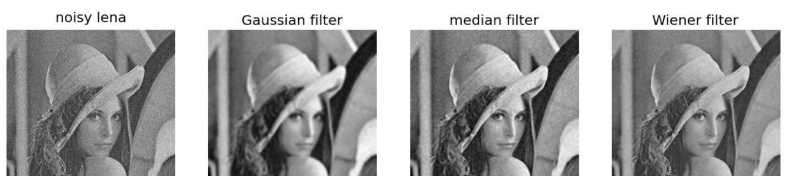

> 📎 **这些操作各做什么（超出 slides）**
>
> - **Scaling / translation / rotation（缩放 / 平移 / 旋转）**：改变像素的位置，不改变图里的内容。
> - **Filtering（滤波）**：用每个像素周围一小块邻域的值，重新计算这个像素。**Gaussian filter** 取邻域的加权平均（越近权重越大），能压低噪声，代价是边缘也被抹平；**median filter** 取邻域的中位数，对零星的黑白噪点特别有效，边缘也保留得更好；**Wiener filter** 根据每个局部区域的噪声大小，自动决定平滑多少。图 2 里三张输出图的差别就在这里。
> - **Enhancement（增强）**：调整亮度、对比度，或者锐化。
> - **Histogram equalisation（直方图均衡化）**：重新分配像素的亮度，让亮度直方图尽量铺满 0–255 的整个范围，于是又暗又灰的图对比度会明显提高。
>
> 记住"滤波"这个想法：用一个小模板在图上逐点滑动，对邻域做加权求和。§21 的 convolution 做的正是这件事，区别只在于模板里的数值不是人定的，而是从数据中学出来的。

### Image recognition：从图像到概念

Slide 5 列出了 **image recognition（in a narrow sense，狭义的图像识别）** 的四类任务：

> - **Image classification**
> - **Object detection, localisation, tracking**
> - **Scene segmentation and reconstruction**
> - **Image search and retrieval**

这几类任务的区别在于**输出**。图 3 用同一张示意街景，画出了前三种最常被混淆的任务：

```plot 图 3 · 同一张街景，三种任务要的输出不同：一个标签、几个框、每个像素一个类别
H, W = 60, 90
lab = np.zeros((H, W), dtype=int)           # 0 sky
lab[34:, :] = 1                             # 1 road
lab[8:34, 4:30] = 2                         # 2 building
lab[36:48, 52:80] = 3                       # 3 car
lab[20:50, 36:42] = 4                       # 4 person
lab[16:21, 37:41] = 4
pal = np.array([[0.80, 0.89, 0.96], [0.72, 0.72, 0.72], [0.86, 0.78, 0.64],
                [0.85, 0.42, 0.36], [0.30, 0.30, 0.38]])
rgb = pal[lab]
seg = np.array([[0.55, 0.75, 0.95], [0.60, 0.60, 0.60], [0.95, 0.75, 0.30],
                [0.20, 0.55, 0.30], [0.80, 0.30, 0.60]])[lab]
fig, axes = plt.subplots(1, 3, figsize=(8, 2.7))
for ax in axes:
    ax.axis("off")
axes[0].imshow(rgb)
axes[0].set_title("分类 classification", fontsize=10)
axes[0].text(45, 56, "→ 标签：“street”", ha="center", fontsize=10, color="#2f6f4f",
             bbox=dict(fc="white", ec="#2f6f4f", lw=1))
axes[1].imshow(rgb)
axes[1].set_title("检测 detection + 定位", fontsize=10)
for (r0, r1, c0, c1, name) in [(36, 48, 52, 80, "car"), (16, 50, 36, 42, "person")]:
    axes[1].add_patch(plt.Rectangle((c0 - 1, r0 - 1), c1 - c0 + 1, r1 - r0 + 1,
                      fill=False, ec="#2f6f4f", lw=2))
    axes[1].text(c0 - 1, r0 - 2, name, fontsize=9, color="#2f6f4f", va="bottom")
axes[2].imshow(seg)
axes[2].set_title("分割 segmentation：逐像素", fontsize=10)
for (x, y, name) in [(60, 8, "sky"), (16, 22, "building"), (20, 52, "road"), (66, 42, "car")]:
    axes[2].text(x, y, name, fontsize=8.5, ha="center", va="center", color="white" if name in ("car",) else "#22272e")
```

**Image classification（图像分类）** 给整张图一个类别。讲师的例子是：一张图里是猫，就把它归入 cat 类，而不是 dog、bicycle 或 airplane 类，这通常叫 **object recognition（物体识别）**。Slide 6 还列了另外三种常见的分类任务：

- **Face recognition（人脸识别）**：给一张人脸照片，判断它是谁，每个人是一个类别。
- **OCR（optical character recognition，光学字符识别）**：识别手写或印刷的数字 0–9。讲师举了两个应用：银行自动识别支票，邮局识别邮政编码来分拣信件。
- **Scene recognition（场景识别）**：讲师说这对机器人很有用。移动机器人走进一个房间，环顾一周，就要判断自己是在厨房、卧室还是书房。

**Object detection and localisation（物体检测与定位）** 不仅要说出图里有什么，还要说出**在哪里**，通常用一个矩形框（bounding box）圈出每个物体。Slide 7 的例子是找出图里的椅子、人和马。**Object tracking（物体跟踪）** 把检测延伸到视频：在每一帧里找到同一个物体，连成轨迹。讲师举了抛球的例子，又说在篮球比赛里可以跟踪篮球和每一名球员，用来分析球员表现、理解球队战术。

**Scene segmentation（场景分割）** 更细，要给**每一个像素**一个类别标签，比如 sky、building、road、pedestrian。讲师说这对自动驾驶至关重要：车顶或车头的摄像头不停地拍，系统必须准确知道哪些像素是路面、哪些是行人，这需要非常精确的图像理解。**Reconstruction（重建）** 则是理解三维世界：机器人从不同角度、不同距离给一栋楼拍很多照片，把它们合起来，就能重建出这栋楼的 3D 模型，之后可以从任意角度查看。

**Image search and retrieval（图像搜索与检索）** 面对的是一个很大的图像库。讲师的例子是：你有一张历史建筑的照片，想多了解一些，就拿它去搜大学图书馆、Wollongong 市图书馆或国家档案馆的图像库，找出这栋建筑的其他照片，以及附在这些照片上的资料。Slide 9 是 UOW 的一个 object-level 图像检索演示：输入一张建筑照片（文件名 all_souls_000013，📎 是牛津大学 All Souls 学院），系统返回的一排排结果，都是同一栋建筑从不同角度、在不同光照下拍的照片。能在这么多变化之下认出同一栋楼，靠的正是 §7 要讲的 invariant 表示。

把这些任务的输出列在一起：

| 任务 | 输出 | 回答的问题 |
|---|---|---|
| Classification | 整张图一个类别 | 这是什么？ |
| Detection + localisation | 每个物体：类别 + 框 | 有什么？在哪里？ |
| Tracking | 同一物体在每一帧里的位置 | 它怎么移动？ |
| Segmentation | 每个像素一个类别 | 哪些像素属于什么？ |
| Reconstruction | 3D 模型 | 三维结构是什么样？ |
| Search & retrieval | 库里相似的图像 | 哪些图里有同样的东西？ |

讲师强调，这只是一个简短、远不完整的列表。

> ⚠️ **别把 object recognition 和 object detection 混为一谈。** Slide 6 的 object recognition 属于 **classification**：一张图（通常只有一个主体）给一个类别。Detection 要在一张图里找出**多个**物体，并给出各自的位置。一个判断办法：看输出里有没有坐标。

<details>
<summary>自测：下面各是哪类任务？(a) 停车场入口自动读出车牌号；(b) 医生想知道 CT 图像里肿瘤的精确边界；(c) 在网店里拍照搜同款；(d) 去掉一张老照片上的噪点。</summary>

(a) 先 **detection**（找到车牌在哪里），再对车牌上的字符做 **OCR**（分类）；(b) **segmentation**，要逐像素地标出哪些属于肿瘤；(c) **image search and retrieval**；(d) **image processing**，输入输出都是图，不涉及概念，不算狭义的图像识别。

</details>

## §3 Benchmark datasets

任何分析任务都需要数据。Slide 10 列出了图像识别领域著名的 **benchmark datasets（基准数据集）**：大家在同一份数据上测试，不同方法的结果才能直接比较。

| 数据集 | 主要用途 | 📎 规模（约） |
|---|---|---|
| Caltech101 / Caltech256 | object recognition | 101 类约 9 千张 / 256 类约 3 万张 |
| PASCAL VOC | 分类、检测、分割竞赛（2005–2012） | 20 类物体 |
| ImageNet | 大规模分类，ILSVRC 竞赛 | 竞赛用 1000 类、约 120 万张训练图；全库 1400 多万张 |
| Microsoft COCO | 检测、分割、图像描述 | 约 33 万张，80 类物体 |
| ORL database of faces | 人脸识别（受控条件） | 40 人 × 每人 10 张 = 400 张 |
| Labelled Faces in the Wild（LFW） | 人脸识别（不受控条件） | 5,749 人的约 1.3 万张 |

讲师点评了其中几个。Caltech 101 和 Caltech 256 是早期物体识别的两个基准。**ImageNet 可能是最著名的**，因为"*ImageNet 加上卷积神经网络，开启了图像分析的深度学习时代*"（§23 讲这段历史）。ImageNet 之后又出现了 Microsoft COCO，用得也很广。ORL 是一个很老的人脸识别数据库；LFW 用于更难的不受控场景。他最后说，如今针对不同用途开发的图像数据集比这多得多。

<details>
<summary>自测：同样是人脸识别，为什么在 LFW 上比在 ORL 上难？</summary>

ORL 的照片在受控条件下拍摄，背景、光照、距离基本一致，同一个人的照片之间变化很小。LFW 的照片来自网络，光照、姿态、表情、遮挡、背景都不受控，同一个人的两张照片之间的差别可能比两个不同的人还大。这正是 §7 要讲的 invariant 难题。

</details>

---

# Part II · 图像分析的步骤

## §4 三个步骤

Slide 11 把图像分析分成三步：

> - **Collection and labelling** — Collect representative images from a given task and label the ground truth
> - **Image representation** — Select and/or design appropriate image representations (**invariant** and **discriminative**)
> - **Image analysis techniques** — Apply and/or design appropriate analysis techniques for the given tasks (classification, detection, tracking, segmentation, etc.)

讲师请大家把它和 Week 8 的文本分析流程对照着看：

| | Week 8 文本分析 | Week 9 图像分析 |
|---|---|---|
| 第一步 | collect raw text | collect images，并**标注 ground truth** |
| 第二步 | represent text（BoW、TFIDF、topic、embedding） | represent images（要求 invariant 且 discriminative） |
| 第三步 | TFIDF / topic modeling / sentiment analysis | classification、detection、tracking、segmentation…… |

**第一步：收集与标注。** 要针对具体任务收集**有代表性的**图像，并标注 **ground truth（真实标签）**。标注什么取决于任务。讲师举例：这张图是猫还是狗（类别）？猫在图的什么位置（位置）？猫是什么颜色（属性）？他特别指出，标注 ground truth **费人力，也很耗时间**。

> 📎 **补充（超出 slides）** — 任务越细，标注越费工夫：分类只要给每张图选一个类别；检测要给每个物体画框；分割要沿着物体轮廓逐像素描边。这也是 Part VII 的 self-supervised learning 想摆脱人工标注的原因。

**第二步：表示。** 讲师说，图像和文本一样，在计算机里以数值的形式存放（像素值、RGB 值），问题是怎样表示才便于算法分析。Slide 在这里第一次出现了两个关键词：**invariant（不变）** 和 **discriminative（有区分力）**，§7 会详细解释。

**第三步：分析技术。** 借用机器学习的方法：classifier、clustering 算法，以及各种统计机器学习算法。这正是 Week 4–7 学过的东西。

## §5 案例：用监控视频分析顾客购物行为

Slide 12 给出了贯穿 Part II 的例子：

> **A shop would like to analyse customer shopping behaviour via surveillance video** — Who are their main customers? What are their shopping patterns?

讲师把场景讲得很具体：你是一家商店的数据工程师，店长想更好地了解顾客的行为，以便更好地服务顾客、提高利润。店里的天花板上装了监控摄像头。他特别加了一个前提：所有顾客都已被告知会被录像，并同意参与分析；项目保证不向任何一方泄露顾客的隐私和身份，除非确有必要或符合法律规定。

接下来的问题是：**回答这两个业务问题，需要做哪些图像任务？** 讲师的拆解如图 4：

```d2 图 4 · 商店案例：两个业务问题，分别对应哪些图像任务
direction: right
Q1: 谁是主要顾客？ {class: key}
Q2: 购物模式是什么？ {class: key}
T1: 年龄估计 age estimation
T2: 性别估计 gender estimation
T3: "顾客检测与跟踪\nobject tracking"
T4: "识别拿起、看过、\n放回了哪些商品"
D: 收银数据 checkout data {shape: cylinder}
Q1 -> T1
Q1 -> T2
Q2 -> T3
Q2 -> T4
Q2 -> D: 最终买了什么
```

- **谁是主要顾客？** 要知道顾客是男是女、是孩子还是老人，对应 **age estimation（年龄估计）** 和 **gender estimation（性别估计）**。
- **购物模式是什么？** 要跟着顾客走，对应 **object tracking**；还要知道顾客拿起、看过、又放回了哪些商品，对应商品的检测与识别。顾客最终买了什么，可以从收银台的数据得到。

把这些信息合在一起，两个问题就都能回答了。注意这里的思路：业务问题不会直接告诉你用哪个算法，数据科学家要先把它**翻译**成 §2 里那些标准的图像任务。

## §6 收集原始图像

Slide 13 讲第一步的细节：

> - For image analysis, data must be collected before anything can happen
> - The team starts by actively monitoring various sources for representative images or videos; will deal with unstructured data
> - Public APIs and Web scraper
> - Be careful about the rights of the owner

回到商店的例子，讲师说：天花板上的摄像头能从不同角度拍下顾客的行为，这就是数据来源。图像数据还可以和收银台的数据关联起来：收银台记录了顾客最终买了哪些商品，这是文本或表格数据，可以和图像数据结合使用。

如果数据不在自己手里，可以用 **public APIs（公开接口）** 或 **web scraper（网络爬虫）** 去网上收集。

> 📎 **例（超出 slides）** — Slide 13 的链接指向 CMU 的 im2gps 项目：研究者通过 Flickr 的 API 下载了大量带 GPS 坐标的照片，用来训练"看照片猜拍摄地点"的模型。

和 Week 8 收集文本时一样，收集图像也要尊重数据所有者的权利，并注意隐私和伦理问题。商店例子里顾客的知情同意和身份保护，就是这方面的要求。

<details>
<summary>自测：一家健身房想知道"哪些器械最受欢迎、高峰时段是几点"。请仿照图 4，列出需要的图像任务和数据。</summary>

"哪些器械受欢迎"：在监控画面里**检测**人和器械，判断某台器械上有没有人在用（比如看人和器械的框是否重叠），按器械累计使用时长；"高峰时段"：在每一帧里**检测并计数**人数，再按时间汇总。可以结合刷卡入场记录这类表格数据核对。前提仍然是会员知情同意、保护个人身份。

</details>

---

# Part III · 表示图像：既要不变，又要能区分

## §7 为什么表示图像这么难

讲师先抛出一个看似合理的想法：图像有红、绿、蓝三种颜色，那就用三种颜色各占多少来表示图像的内容，行不行？他的回答是：可以这么做，但这种表示不可靠，颜色本身就不可靠。更麻烦的是，同一类东西在不同照片里，样子会有大量变化。Slide 14 列出了这些变化：

> **Why representing images is difficult?** — Scale, rotation, illumination, occlusion, background clutter, deformation, …

并配了六张猫的照片（图 5）：

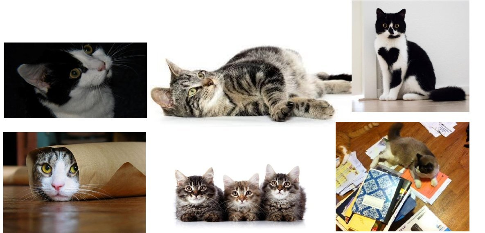

讲师逐一指给大家看：

- **Scale（尺度）**：有的猫占满画面，有的很小；
- **Rotation（旋转 / 姿态）**：有的趴着，有的站着；
- **Illumination（光照）**：大多数照片光线充足，左上那张却很暗；
- **Occlusion（遮挡）**：纸袋里的猫只露出脸，看不到身体；
- **Background clutter（背景杂乱）**：右下那只猫趴在一堆书本杂物上；
- **Deformation（形变）**：猫的身体可以摆出各种形状；
- 还有**多个个体**：中间一张有三只小猫。

人一眼就知道六张都是猫。可要找到一种表示，让这六张图在高维空间里**待在一起**，就非常难了。Slide 30 用熊猫又举了一组（图 6），新增了 **pose（姿态）**、**multiple objects（多个物体）** 和 **inter-class similarity（类间相似）**。

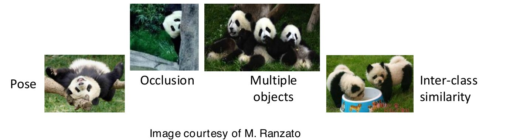

> 📎 Slides 没有解释最右边那张：乍看是熊猫，其实是被染成熊猫配色的小狗。不同类的东西看起来很像，这就是 inter-class similarity。

由此得出 slide 14 的核心要求：

> **Invariant and Discriminative representation**

讲师的解释：

> 🎙️ "*你的表示应该是 invariant 的，对尺度变化、旋转变化、光照和遮挡保持不变，也就是对这些无关的变化保持稳健。同时它又必须是 discriminative 的：一旦换成一张狗的图，表示就应该发生显著变化，否则你就把猫和狗混在一起了。好的表示既要 invariant，又要 discriminative，可这被证明是一件非常困难的事。*"

**Invariant（不变性）**：同一类东西因为拍摄条件不同而产生的变化（尺度、姿态、光照……），不应该改变它的表示。**Discriminative（区分力）**：不同类的东西，表示要明显不同。图 7 把这两条要求画在"特征空间"里，每张图是一个点：

```plot 图 7 · 好的表示：同一类的图挤在一起（invariant），不同类分得开（discriminative）
rng = np.random.default_rng(4)
fig, (a, b) = plt.subplots(1, 2, figsize=(8, 3.6), sharex=True, sharey=True)
cats_bad = np.array([[1.2, 3.8], [3.9, 1.0], [2.4, 2.2], [4.6, 3.6], [1.0, 1.4], [3.2, 4.4]])
dogs_bad = np.array([[2.0, 3.2], [3.6, 2.0], [1.6, 2.4], [4.2, 2.6], [2.8, 1.2], [2.6, 3.9]])
a.scatter(*cats_bad.T, s=60, color="#2f6f4f", label="猫的 6 张图")
a.scatter(*dogs_bad.T, s=60, marker="^", color="#c0714f", label="狗的图")
for (x, y), t in zip(cats_bad[:5], ["暗光", "缩小", "旋转", "遮挡", "背景杂乱"]):
    a.annotate(t, (x, y), xytext=(6, 5), textcoords="offset points", fontsize=9, color="#2f6f4f")
a.set_title("差的表示：猫散开了，还和狗混在一起", fontsize=10.5)
cats = rng.normal([2.3, 3.8], 0.22, (6, 2))
dogs = rng.normal([4.0, 1.4], 0.25, (6, 2))
b.scatter(*cats.T, s=60, color="#2f6f4f")
b.scatter(*dogs.T, s=60, marker="^", color="#c0714f")
b.add_patch(matplotlib.patches.Ellipse((2.3, 3.8), 1.3, 1.1, fill=False, ec="#2f6f4f", ls="--"))
b.text(2.3, 4.6, "invariant：变化再大也挤在一起", ha="center", fontsize=9.5, color="#2f6f4f")
b.annotate("", xy=(3.7, 1.8), xytext=(2.6, 3.3), arrowprops=dict(arrowstyle="<->", color="#3b6ea8"))
b.text(3.25, 2.75, "discriminative：\n猫和狗离得远", fontsize=9.5, color="#3b6ea8")
b.set_title("好的表示：两条要求同时满足", fontsize=10.5)
for ax in (a, b):
    ax.set_xticks([]); ax.set_yticks([])
    ax.set_xlabel("特征 1")
a.set_ylabel("特征 2")
a.set_xlim(0.4, 5.2); a.set_ylim(0.5, 5.0)
fig.legend(*a.get_legend_handles_labels(), loc="lower center", ncol=2, fontsize=9.5, bbox_to_anchor=(0.5, -0.06))
```

左图是差的表示：同一只猫换个光照、换个大小，点就跑到了很远的地方（不 invariant），还和狗的点混在一起（不 discriminative）。右图是好的表示：猫的点挤成一团，狗的点挤成另一团，两团之间隔得很远。有了右边这样的表示，Week 4 的 clustering 能把它们自然分开，Week 5 的分类器画一条线就能分好。

**为什么两条必须同时满足？** 只追求其中一条，其实都很容易：

> 📎 **两个极端（超出 slides）**
>
> - 把每张图都映射成同一个向量，比如全是 0：它对任何变化都完全 invariant，可猫和狗也变得一模一样，毫无区分力。
> - 直接用原始像素值：任何两张不同的图都会得到不同的向量，看上去"区分力"极强；可猫往右挪一个像素，几乎每个数都会变（回想图 1），完全谈不上 invariant。
>
> 难点在于**有选择地敏感**：对无关的变化（光照、尺度、姿态）不敏感，对类别的变化（猫 vs 狗）很敏感。Part III–VII 讲的，就是不同时代对这个难题给出的不同答案。

<details>
<summary>自测：图 6 里“染成熊猫配色的狗”主要挑战的是 invariant 还是 discriminative？图 5 里“纸袋里只露出脸的猫”呢？</summary>

染色的狗是 **inter-class similarity**：不同类的东西看起来很像，挑战的是 **discriminative**，表示必须把它和真熊猫分开。纸袋里的猫是 **occlusion**：同一类的东西因为遮挡而看起来不一样，挑战的是 **invariant**，表示不应该因为身体被挡住就认不出是猫。

</details>

## §8 三个时代：特征从哪里来

讲师把图像表示的发展分成三个阶段（slides 15–17）：

| 时代 | 特征从哪里来 | 代表 | 主要局限 |
|---|---|---|---|
| **Traditional（2000 年以前）** | 人工设计的**全局**特征（hand-crafted, global） | intensity、colour、texture、shape、structure；颜色直方图；原始像素值 | 对尺度、旋转、光照变化不稳定；只能做很窄的任务 |
| **BoVW 时代（2000–2012）** | 人工设计的**局部不变**特征，再用 bag-of-visual-words 汇总 | SIFT、HOG、SURF、CENTRIST、filter-based | 描述子仍由人设计；特征提取和分类器分开设计 |
| **Deep learning（2012 至今）** | **直接从数据中学**（directly learn feature representations from data） | CNN（AlexNet、VGG、ResNet……）、ViT | 需要大量数据和算力（Part V–VII） |

讲师总结说，这是一条从"人工设计"走向"全自动"的路：最早靠先验知识设计全局特征；后来改用局部不变特征，但仍要套用 bag-of-words 的框架；最后"*让数据自己决定什么是最好的表示*"。下面两节展开前两个时代，第三个时代放到 Part V。

## §9 时代一：手工设计的全局特征

Slide 15：

> **Traditional representation (before year 2000)** — Hand-crafted, global features. Intensity, colour, texture, shape, structure, etc.

**Hand-crafted（手工设计）** 指特征由工程师凭经验和先验知识来定义，比如"颜色分布能代表图像内容"。**Global（全局）** 指特征是从**整张图**算出来的。Slide 15 配了两个例子：

1. **Colour histogram in an RGB space（RGB 颜色直方图）**：分别统计红、绿、蓝三个通道里每个亮度值出现了多少次，得到三条分布曲线，再拼成一个向量。
2. **Face recognition with raw pixel intensities（直接用像素亮度做人脸识别）**：把一张对齐好的人脸照片的全部像素值排成一个长向量，直接拿去比较。

讲师指出了颜色直方图的问题：slide 上那张图其实是一位女士的照片，可换成一只猫、一只狗，它们完全可能有相同或非常相似的红、绿、蓝分布，你根本分不出这是人、是猫，还是一架飞机。图 8 把这个问题推到了极端：

```plot 图 8 · 把像素打乱，颜色直方图一点没变：全局颜色特征看不见“东西在哪”
rng = np.random.default_rng(1)
H, W = 48, 48
yy, xx = np.mgrid[0:H, 0:W]
img = np.zeros((H, W, 3))
img[...] = np.stack([0.35 + 0.004 * yy, 0.55 + 0.004 * yy, 0.95 - 0.002 * yy], -1)   # sky
grass = yy > 32
img[grass] = np.stack([0.25 + 0.05 * rng.random(grass.sum()), 0.60 + 0.15 * rng.random(grass.sum()),
                       0.20 + 0.05 * rng.random(grass.sum())], -1)
sun = (yy - 12) ** 2 + (xx - 34) ** 2 < 49
img[sun] = [0.98, 0.82, 0.25]
img = np.clip(img, 0, 1)
flat = img.reshape(-1, 3).copy()
shuffled = flat[rng.permutation(len(flat))].reshape(H, W, 3)
fig = plt.figure(figsize=(8, 2.9))
gs = fig.add_gridspec(1, 3, width_ratios=[1, 1, 1.6], wspace=0.45)
a, b, c = (fig.add_subplot(gs[0, i]) for i in range(3))
a.imshow(img); a.set_title("原图：天、太阳、草地", fontsize=10); a.axis("off")
b.imshow(shuffled); b.set_title("同一批像素，随机打乱", fontsize=10); b.axis("off")
bins = np.linspace(0, 1, 33)
for ch, col, name in [(0, "tab:red", "R"), (1, "tab:green", "G"), (2, "tab:blue", "B")]:
    h1, _ = np.histogram(img[..., ch], bins)
    h2, _ = np.histogram(shuffled[..., ch], bins)
    assert (h1 == h2).all()
    c.step(bins[:-1], h1, where="post", color=col, lw=1.4, label=name)
    nz = h2 > 0
    c.plot((bins[:-1] + 1 / 64)[nz], h2[nz], "o", ms=2.5, color=col)
c.set_title("RGB 直方图：线 = 原图，点 = 打乱后", fontsize=10)
c.set_xlabel("强度 intensity", fontsize=9.5); c.set_ylabel("像素个数", fontsize=9.5)
c.tick_params(labelsize=8.5)
c.legend(fontsize=9, loc="upper left")
```

左边两张图由同一批像素组成，只是右边那张被随机打乱了位置。它们的颜色直方图一模一样：图 8 右边，代表原图的线和代表打乱后的点完全重合。直方图只记录"每种颜色有多少"，不记录"这些颜色在哪里"，而"东西在哪里、长什么形状"恰恰是识别物体最需要的信息。用 §7 的话说，颜色直方图**不够 discriminative**；它也**不够 invariant**：同一只猫在灯光下和阴影里，颜色分布会差很多。

原始像素值的问题正好相反（见 §7 的拓展框）：物体稍微移动、放大或换个光照，几乎每个像素值都会变。所以讲师说，这些基于亮度、颜色、形状的全局特征，一旦图像的尺度、旋转、光照发生变化就会跟着变，**不可靠**。

结果是，2000 年以前的图像分析只能做**很窄的任务**。讲师的例子是：如果你知道某个任务里只会出现人，不会出现猫、狗、飞机，那么简单的表示也能用。

> 📎 **例（超出 slides）** — 用原始像素做人脸识别的经典方法是 1991 年的 **Eigenfaces**：先用 PCA 把像素向量压缩到几十维，再比较距离。它在 ORL 这类"正脸、对齐、光照一致"的数据上效果不错，换成 LFW 那种不受控的照片就很难用了。

## §10 时代二：局部不变特征

讲师讲到了 2000 年前后研究者的思路转变：既然从整张图算出的全局特征对视角、尺度、光照的变化不稳健，那**局部**特征呢？

> 🎙️ "*所谓局部特征，就是图像里某些非常显眼的小区域。你可以想象，即使旋转图像或者换个视角，这些小的局部特征也不会变。这就引出了局部不变特征。我们只检测这些局部特征，用小区域内像素值的梯度分布，也就是梯度直方图，来表示这个小区域里的视觉内容。其他区域我们忽略掉，只考虑这几个局部不变特征，因为它们对比度高、图案显眼，这些图案在视角、尺度、光照变化之后依然能保留下来。*"

Slide 16：

> **Days of the BoVW model (2000 ~ 2012)** — SIFT, HOG, SURF, CENTRIST, filter-based, … Invariant to view angle, scale, illumination, …

其中最著名的是 **SIFT（Scale Invariant Feature Transform，尺度不变特征变换）**。图 9 是 slide 16 的配图：

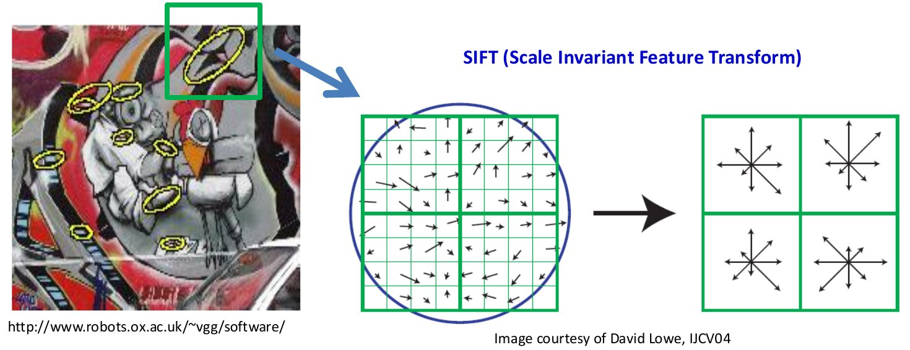

左边那张涂鸦照片上的黄色椭圆，是算法检测到的局部区域，它们都落在对比度高、纹理丰富的地方。取出其中一个（绿框），SIFT 这样描述它：

1. 计算区域内每个像素的**梯度（gradient）**：亮度朝哪个方向变化最快、变化有多大。图中圆圈里的小箭头就是梯度，箭头的方向是变化方向，长度是变化大小。
2. 把区域分成若干小格，在每个小格里按方向统计梯度，得到一个**方向直方图**。图中右边每个格子里的"星形"就是一个直方图：每条射线代表一个方向，射线越长，这个方向上的梯度越强。
3. 把所有小格的直方图首尾相接，就得到描述这个区域的向量。

讲师在讲 BoVW 时说："*如果用 SIFT，每个小区域最后会得到一个 128 维的向量。*"

> 📎 **128 是怎么来的（超出 slides）** — 标准 SIFT 把区域分成 **4×4 = 16 个小格**，每格统计 **8 个方向**，$16\times8=128$。图 9 为了画得清楚，只画了 2×2 个格子。SIFT 的"不变性"来自三个设计：在多个尺度上检测区域（尺度不变）；按区域的主方向把区域"转正"之后再描述（旋转不变）；用梯度而不是亮度本身，并把向量归一化（对光照变化稳健）。
>
> 其余几个描述子一句话带过：**HOG**（histogram of oriented gradients）在规则网格上统计梯度方向，2005 年被用于行人检测；**SURF** 是 SIFT 的快速近似；**CENTRIST** 为场景识别设计，统计每个像素和邻居之间亮度的大小关系；**filter-based** 特征用一组滤波器（比如不同方向、不同粗细的条纹模板）的响应来描述纹理。

注意局部特征的分工：它回答的是"**怎样描述一个小区域**"。可一张图里有成百上千个这样的小区域，每个区域一个 128 维向量，不同图取出的区域数还不一样。怎样把它们汇总成**一张图一个固定长度的向量**？讲师说，答案是把每个小区域当作一个"词"，叫作 **visual word**，在此基础上建立 **bag-of-visual-words** 模型。这正是 Part IV 的内容。

<details>
<summary>自测：为什么说局部特征比全局颜色直方图更 invariant？举一个局部特征也会失效的情况。</summary>

全局特征从整张图算出，背景、光照、物体大小一变，整体分布就跟着变。局部特征只描述几个对比度高、图案显眼的小区域，描述的又是梯度方向的分布，这些图案在视角、尺度、光照变化之后仍能被重新找到，描述也基本不变。会失效的情况：物体几乎没有纹理（一面白墙、一只纯色杯子），找不到显眼的局部区域；或者遮挡太严重，关键区域都被挡住了。

</details>

---

# Part IV · Bag-of-Visual-Words 模型

## §11 从 bag-of-words 到 bag-of-visual-words

Slide 18 先请大家回忆 Week 8：

> **Remember the Bag-of-Words representation?** — A document becomes a high-dimensional vector, indicating the presence/absence/frequency of various words in this document.

讲师的回顾：一篇文档被切分成词，再按照词典，根据每个词出现与否（或出现几次），把文档表示成一个高维向量。把这个想法和局部不变特征结合起来，就得到了 **bag-of-visual-words（BoVW）** 模型。Slide 19 说得很直白：

> **BoVW model is borrowed from text analysis.**

Slide 19 的图里，一张火车照片对应一篇文档，从照片里取出的一个个小图块对应文档里的一个个词。逐项对照：

| 文本：bag-of-words | 图像：bag-of-visual-words |
|---|---|
| 一篇文档 document | 一张图像 image |
| 一个词 word | 一个局部图块（patch），用一个描述子向量表示 |
| 词典 vocabulary：**现成的** | visual vocabulary：**没有现成的**，要用 K-means 从数据里"造"出来 |
| 一个词条（如 "cat"） | 一个 **visual word**（一类相似的图块，即一个聚类中心） |
| 词频向量 | visual word 直方图 $[n_1,n_2,\dots,n_k]$ |
| 忽略词序 | 忽略图块在图中的位置 |

表里最关键的是"词典"那一行。文本里的词是离散符号，cat 永远就是 cat，查一下词典就知道是第几个词。图块却是**连续的**向量：两个图块的 SIFT 向量几乎不可能完全相同。讲师说："*图像没有词典，我们需要自己造一个类似词典的东西。*" 办法是把相似的图块归成一类，每一类当作一个"词"。下面按 slides 20–27 的顺序，把这个过程拆成四步。

## §12 第一步：提取局部特征

Slide 20 展示了第一步（图 10）：

> **Interest point detection or Dense sampling** → The cropped detected regions

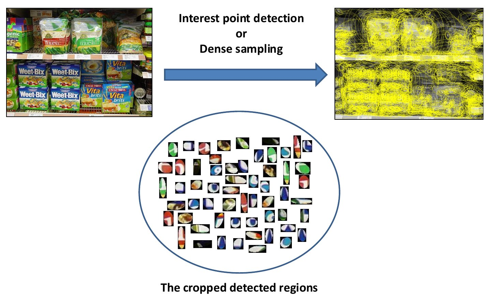

讲师说，可以把一张图像划分成大量小图块（image patch），每个图块好比一个词。取图块有两种方式：

- **Dense sampling（密集采样）**：按规则的网格在图上密密地取很多图块，不挑位置。
- **Interest point detection（兴趣点检测）**：用检测器找出"有意思"的点，在这些点周围取图块。讲师解释了什么叫"有意思"：亮度变化剧烈的地方，比如从白色突然变成红色、从白色变成绿色。如果只是一块平坦的区域，就没意思，"*因为那里没有信号*"。

> 📎 **两种方式怎么选（超出 slides）** — Interest points 少而精，集中在纹理丰富、能被反复检测到的位置，适合物体识别和检索；dense sampling 覆盖整张图，不会漏掉平坦但有意义的区域（比如天空、草地），适合场景分类。

Slide 21 是取出的图块的特写。Slide 22 说明这一步要对**数据集里的每一张图**都做一遍：每张图取出很多图块，**每个图块表示成一个向量**。讲师说："*比如用 SIFT，就会得到一个 128 维的向量，表示这个小区域里的视觉信息。*" 一个有一万张图的数据集，很容易得到几百万个 128 维向量。

## §13 第二步：K-means 聚类，生成 visual words

有了一大堆图块向量，接下来要"造词典"。Slide 23：

> **Cluster all features to generate "Visual Words"** — (in $\mathbb{R}^d$) K-means clustering

> ⚠️ Slide 23 原文是 "to generated"，应为 *to generate*。

$\mathbb{R}^d$ 是描述子所在的 $d$ 维空间（用 SIFT 时 $d=128$），每个图块是其中的一个点。讲师解释：对这些向量做聚类，是为了找出它们的**典型模式（typical pattern）**。用 Week 4 的 **K-means**，模式相同或相似的图块会被分到同一个簇，**每个簇定义一个 visual word**，簇的中心就是这个词的"标准长相"。

> 📎 **回顾 Week 4（超出本周 slides）** — K-means 先指定簇数 $k$，选 $k$ 个初始中心；然后反复做两件事：把每个点分给离它最近的中心；把每个中心更新为分给它的那些点的平均值。直到分配不再变化为止。

Slide 24 展示了聚类的结果（图 11）：

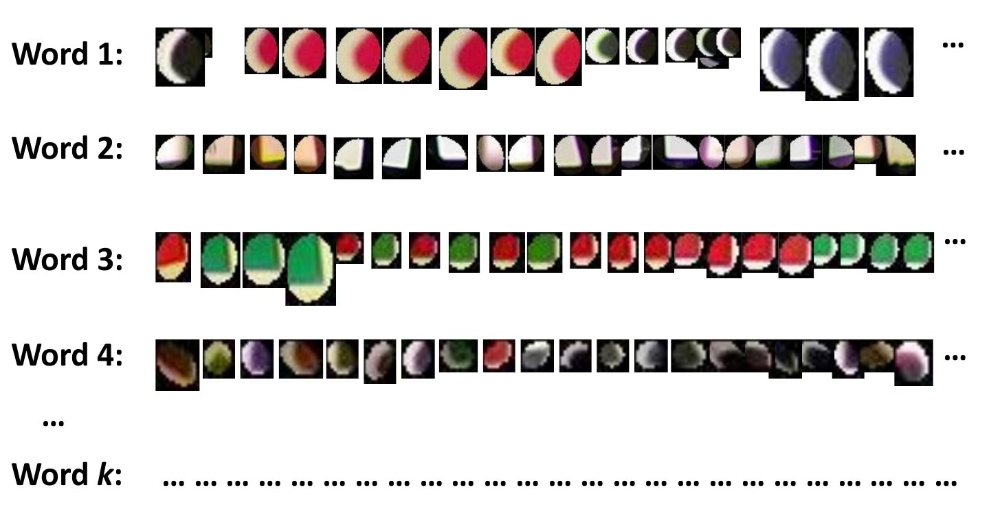

讲师请大家看每一行：Word 1 里的图块多是一侧亮、一侧暗的圆弧；Word 3 里大多是圆形的色块；同一行里的图块，亮度图案都很相似。他特别提醒：

> 🎙️ "*请忽略颜色，因为我们表示这些向量时没有用颜色信息，只用了亮度信息。*"

所以 Word 3 里红色和绿色的圆块会被归到一起：在亮度上，它们是同一种图案（📎 SIFT 本来就在灰度图上计算）。这样就有了一份 visual vocabulary：Word 1、Word 2、……、Word $k$，"*就像文本分析里的词典一样*"。

> 📎 **$k$ 取多大（超出 slides）** — 这又回到了 §7 的两条要求。$k$ 太小，不同的图案被并进同一个词，区分力下降（不够 discriminative）；$k$ 太大，同一种图案因为细微差别被拆成好几个词，稳定性下降（不够 invariant），每张图的直方图也会变得很稀疏。实践中常见的词典大小是几百到几千个词，要用验证集来挑。

## §14 第三步：把一张图变成直方图

有了词典，就可以给任意一张图建立表示了。Slide 25：

> **From an image to a histogram** — $[n_1, n_2, \dots, n_k]$, where $n_1$ = the number of occurrence of 1st "word" in this image

讲师描述了这一步：拿到一张图，取出它的图块；对每个图块，计算它到各个聚类中心的距离，把它归入**最近的** visual word；归入第 1 个词，就在第 1 个位置记一个 1。于是每个图块变成一个只有一个 1、其余都是 0 的向量（slide 25 下方的 $[0,0,1,\dots,0]$、$[1,0,0,\dots,0]$……）。把这些向量加起来，就知道每个 visual word 在这张图里出现了几次，"*就像一个词在文档里出现了几次*"。这就是 bag-of-visual-words 这个名字的由来。

用式子写：

$$
c(\mathbf{p}_i)=\arg\min_{j\in\{1,\dots,k\}}\lVert\mathbf{p}_i-\boldsymbol{\mu}_j\rVert,\qquad n_j=\sum_{i=1}^{m}\mathbb{1}\big[c(\mathbf{p}_i)=j\big]
$$

其中 $\mathbf{p}_1,\dots,\mathbf{p}_m$ 是这张图的 $m$ 个图块描述子，$\boldsymbol{\mu}_1,\dots,\boldsymbol{\mu}_k$ 是 $k$ 个聚类中心（visual words），$c(\mathbf{p}_i)$ 是第 $i$ 个图块被归入的词，$\mathbb{1}[\cdot]$ 在条件成立时取 1、否则取 0。第一个式子说"每个图块找最近的中心"，第二个式子说"数一数每个词出现了几次"。（📎 slides 用图来表达这两步，式子是补的。）

图 12 把第二步和第三步画在了一起：

```plot 图 12 · BoVW 的核心：K-means 在描述子空间里定出 visual words，新图的每个图块归入最近的 word，数一数就是直方图
rng = np.random.default_rng(2)
centers = np.array([[1.0, 1.2], [4.2, 1.6], [1.8, 4.2], [4.8, 4.4]])
train = np.vstack([rng.normal(c, 0.45, (40, 2)) for c in centers])
k = 4
cent = train[[0, 40, 80, 120]].copy()
for _ in range(10):
    lab = np.argmin(((train[:, None, :] - cent[None]) ** 2).sum(-1), 1)
    cent = np.array([train[lab == j].mean(0) for j in range(k)])
new = np.array([[0.7, 1.5], [1.3, 0.8], [1.2, 1.6], [4.5, 1.2],
                [1.5, 4.6], [2.2, 3.9], [1.9, 4.8], [1.4, 3.8], [5.1, 4.0]])
asg = np.argmin(((new[:, None, :] - cent[None]) ** 2).sum(-1), 1)
hist = [int(v) for v in np.bincount(asg, minlength=k)]
fig = plt.figure(figsize=(8, 3.6))
gs = fig.add_gridspec(1, 2, width_ratios=[1.45, 1], wspace=0.3)
a, b = fig.add_subplot(gs[0, 0]), fig.add_subplot(gs[0, 1])
a.scatter(*train.T, s=8, color="#8a9199", alpha=0.45, label="训练集里所有图块的描述子")
for p, j in zip(new, asg):
    a.plot([p[0], cent[j, 0]], [p[1], cent[j, 1]], color="#2f6f4f", lw=0.8, alpha=0.7)
a.scatter(*new.T, s=45, marker="^", color="#2f6f4f", zorder=3, label="新图像的 9 个图块")
a.scatter(*cent.T, s=260, marker="*", color="#3b6ea8", edgecolor="white", zorder=4, label="聚类中心 = visual word")
for j, (x, y) in enumerate(cent):
    a.text(x + 0.3, y + 0.2, f"w{j + 1}", fontsize=11, color="#3b6ea8", fontweight="bold")
a.set_xticks([]); a.set_yticks([])
a.set_xlabel("描述子空间 ℝᵈ（示意为 2 维）")
a.set_ylim(-0.4, 7.4)
a.legend(loc="upper left", fontsize=8.5)
bars = b.bar([f"w{j + 1}" for j in range(k)], hist, color="#3b6ea8", width=0.6)
for bar, v in zip(bars, hist):
    b.text(bar.get_x() + bar.get_width() / 2, v + 0.08, str(v), ha="center", fontsize=11)
b.set_ylim(0, max(hist) + 1)
b.set_yticks([])
b.spines["left"].set_visible(False)
b.set_title(f"新图像的表示 x = {list(hist)}", fontsize=10.5)
b.set_xlabel("visual word")
```

左图灰色的小点是训练集所有图块的描述子（真实的 $d$ 是 128，这里画成 2 维示意），K-means 找出 4 个中心（蓝色星号），也就是 4 个 visual words。绿色三角形是一张新图像的 9 个图块，每个都连到离它最近的星号。右图数一数每个星号连了几个三角形，就是这张图的直方图。

> **🔑 例 — 手算一张图的 BoVW 直方图**
>
> 词典有 $k=4$ 个 visual words。一张图取出 9 个图块，按最近的中心分别归入：
> w1、w1、w1、w2、w3、w3、w3、w3、w4。
>
> 1. 每个图块写成 one-hot 向量：归入 w1 的是 $[1,0,0,0]$，归入 w2 的是 $[0,1,0,0]$，依此类推。
> 2. 把 9 个向量相加：w1 出现 3 次，w2 1 次，w3 4 次，w4 1 次。
> 3. 这张图的表示是 $\mathbf{x}=[3,1,4,1]$，正是图 12 右边的柱状图。
>
> 不管原图多大、取了多少个图块，表示的长度总是 $k=4$。

> 📎 **归一化（超出 slides）** — 大图通常取出更多图块，计数也会更大。和 Week 8 的 $\text{TF}_3$（除以文档长度）一样，可以把直方图除以图块总数 $m$，变成比例：$[3,1,4,1]/9\approx[0.33,0.11,0.44,0.11]$。这样，大小不同的图也能直接比较。

## §15 第四步：分类，以及完整流程

每张图都变成了 $\mathbb{R}^k$ 中的一个点，接下来就回到了前几周的老问题。讲师说，有了 BoVW 表示，既可以做 clustering，也可以做 classification。Slide 26 画的是分类：

> **Classifying images** — (in $\mathbb{R}^k$) A histogram of visual words; $y=\mathbf{w}'\mathbf{x}+b$

图上每个点是一张图的直方图：蓝点是谷物货架的照片，红点是饮料货架的照片，虚线是一个**线性分类器**的决策边界。式子里 $\mathbf{x}$ 是直方图向量，$\mathbf{w}'$ 表示权重向量 $\mathbf{w}$ 的**转置**，所以 $\mathbf{w}'\mathbf{x}=\sum_{j=1}^{k}w_jx_j$，也就是把每个 visual word 的出现次数乘上各自的权重再相加；$b$ 是偏置。$y>0$ 判为一类，$y<0$ 判为另一类，$y=0$ 就是那条虚线。

> 📎 **回顾 Week 5–6（超出本周 slides）** — 这样的线性分类器可以是 Week 5 的 linear SVM，也可以是 Week 6 的 logistic regression（它把 $y$ 再送进 sigmoid，变成概率）。$\mathbf{w}$ 和 $b$ 从带标签的训练图像中学出来。换成 Naïve Bayes、kNN、决策树也完全可以：BoVW 的好处就在于，它把图像变成了一个普通的特征向量。

> **🔑 例 — 用 $y=\mathbf{w}'\mathbf{x}+b$ 给两张图分类**
>
> 设训练好的分类器为 $\mathbf{w}=(0.5,\,-1.0,\,0.8,\,-0.6)$，$b=-2$；$y>0$ 判为"谷物货架"，$y<0$ 判为"饮料货架"。
>
> - 上例的图 $\mathbf{x}=[3,1,4,1]$：$y=0.5\times3-1.0\times1+0.8\times4-0.6\times1-2=1.5-1+3.2-0.6-2=1.1>0$，判为**谷物货架**。
> - 另一张图 $\mathbf{x}=[0,4,1,3]$：$y=0-4+0.8-1.8-2=-7.0<0$，判为**饮料货架**。
>
> 权重的正负说明了模型学到了什么：w1、w3 越多（权重为正），越像谷物货架；w2、w4 越多（权重为负），越像饮料货架。

Slide 27 把整个流程画成五个框：

> **Procedure of the BoVW model based Image Recognition** — Image dataset → Local feature extraction → Visual word creation → Histogram generation → Image Recognition

讲师用一句话串了起来：有一个图像数据集，先提取局部特征（找到局部图块，用向量表示），再聚类生成 visual words，然后基于 visual words 把每张图变成直方图，最后在这个表示上做识别或分类。

这五步里有一个容易忽略的区别：**造词典只做一次，编码要对每张图都做**。图 13 把两部分分开画：

```d2 图 13 · BoVW 完整流程：词典只建一次，每张图都用它来编码
grid-rows: 2
grid-gap: 36
train: 建词典（离线，只做一次） {
  grid-columns: 4
  horizontal-gap: 28
  ds: 全部训练图像
  lf: "提取局部特征\npatch → 向量"
  km: K-means 聚类
  vocab: "k 个 visual words" {shape: cylinder; class: key}
  ds -> lf -> km -> vocab
}
use: 编码与识别（每张图都做） {
  grid-columns: 4
  horizontal-gap: 28
  img: "一张图像\n提取局部特征"
  asg: "查词典：每个 patch\n归入最近的 word"
  hist: "直方图\n[n₁, …, n_k]" {class: key}
  clf: "分类器\ny = w'x + b" {class: good}
  img -> asg -> hist -> clf
}
```

上面一行在训练集上离线完成，产物是一份词典（$k$ 个聚类中心）；下面一行对每一张图（训练图像和以后的新图像）都要做，用的是同一份词典。新图像来了，不需要重新聚类，只需查词典、数次数、送进分类器。

## §16 BoVW 的得与失

BoVW 在 2000–2012 年间是图像识别的主流方法，原因很清楚：

- **继承了局部特征的不变性**：SIFT 这类描述子对尺度、旋转、光照都比较稳健。
- **得到固定长度的向量**：不管一张图取出多少个图块，表示的长度都是 $k$，可以直接交给任何分类或聚类算法。
- **能直接借用文本分析的工具**：📎 比如给 visual word 加上 TFIDF 权重，用倒排索引在海量图像里快速检索（2003 年的 "Video Google" 就是这么做的）。

它的局限也很明显（📎 下面的整理超出 slides，不过第三条正是讲师引出 deep learning 的理由）：

- **丢掉了空间位置**。和 BoW 忽略词序一样，BoVW 只数每个 visual word 出现了几次，不管它们在哪里，"两只眼睛在上、嘴巴在下"这类结构信息就丢了。后来的 spatial pyramid 把图分成几块、每块各算一个直方图，弥补了一部分。
- **量化误差**。每个图块只能归入一个词（hard assignment），落在两个簇边界附近的图块，稍有变化就会被归到另一个词去。
- **特征和分类器是分开设计的**。SIFT 由人设计，事先就定好了；分类器只能在给定的特征上尽力而为，没法反过来要求特征"为这个任务提取更有用的信息"。

最后这一条，正是 Part V 的出发点。

<details>
<summary>自测：一位同学说“BoVW 和 BoW 一样，词典是现成的，直接查就行”。错在哪里？</summary>

文本的词是离散符号，词典现成；图像的局部图块是连续的向量，两个图块几乎不会完全相同，没有现成的词典。BoVW 必须先在训练集全部图块的描述子上做 K-means 聚类，把聚类中心当作 visual words，这份词典是从数据中"造"出来的。之后每个图块按距离归入最近的中心。

</details>

<details>
<summary>自测：词典有 3 个 visual words，中心为 μ₁=(0,0)、μ₂=(4,0)、μ₃=(0,4)（二维示意）。一张图的 6 个图块描述子是 (1,0)、(3,1)、(0,3)、(−1,1)、(4,−1)、(1,1)。求这张图的直方图。</summary>

逐个算到三个中心的距离平方：(1,0) → 1、9、17，归 w1；(3,1) → 10、2、18，归 w2；(0,3) → 9、25、1，归 w3；(−1,1) → 2、26、10，归 w1；(4,−1) → 17、1、41，归 w2；(1,1) → 2、10、10，归 w1。直方图 $\mathbf{x}=[3,2,1]$，归一化后约为 $[0.5,0.33,0.17]$。

</details>

---

# Part V · Deep learning 与卷积神经网络

## §17 为什么是 deep learning

Slide 28 的左边是 *MIT Technology Review* 评出的 "10 Breakthrough Technologies 2013"，第一项就是 **deep learning**。讲师转述了这条评语的大意：借助海量的计算能力，机器现在能识别物体，能实时翻译语音，人工智能终于变聪明了。Slide 右边列出了 deep learning 能处理的数据：

> **Visual**（images, videos）· **Audio**（speech, music）· **Text**（natural language）· **Planning** · …

Slide 29 列出了它在视觉上的应用：

> - **Image recognition** — faces, objects, poses, scenes, …
> - **Video content analysis** — action, activities, events, summarization, …
> - **Visual information management** — search, retrieval, indexing, browsing, …
> - **Potential outcome: AI** — computers can see and understand visual information; robotics, self-driving cars, surveillance, …

讲师补充说，机器人、自动驾驶、智能监控、医学图像分析，如今都离不开 deep learning 模型。

## §18 范式转变：从"设计特征"到"学习特征"

Slide 30 先摆出旧的做法：图像 → **Feature Extraction**（依靠 *prior knowledge, experience*，即先验知识和经验）→ **Classification** → "Panda"? 讲师说，原来的做法是靠先验知识和经验定义特征（全局特征，或者 BoVW），再接一个分类器（Naïve Bayes、k-nearest neighbour 或 support vector machine）。Slide 30 的标题点出了这个范式的目标：

> **We need invariant and discriminative features!**

图 6 的熊猫照片就出自这一页，提醒我们：靠人设计的特征，要应付多少种变化。

Slide 31 给出了 deep learning 的回答：

> - **Directly learn** features representations from data.
> - **Joint learn** feature representation and classifier.

两句话各有分量。**Directly learn**：不再由人决定"该看颜色还是看梯度"，而是设计一个神经网络，让它从数据中自动学出特征，讲师说"*没有人为干预*"。**Joint learn**：特征和分类器在**同一个网络里一起训练**。讲师指着 slide 31 的图解释：前三块分别学 **low-level、mid-level、high-level features**（低层、中层、高层特征），越往后越抽象（图上方的箭头 *More abstract representation*）；最后一块是分类器。输入是原始图像，输出是分类结果，两部分连在一起训练，保证学到的特征最能为分类器所用。Slide 底部那句话是整页的要点：

> **Deep Learning: train layers of features so that classifier works well.**

图 14 把两个范式放在一起：

```d2 图 14 · 旧范式靠人设计特征，再接分类器；深度学习让特征从数据中学出来，并和分类器一起训练
grid-rows: 2
grid-gap: 24
old: 旧范式（2012 年以前）：特征靠人设计 {
  grid-columns: 4
  horizontal-gap: 36
  img1: 图像
  fe: "特征提取\n先验知识、经验" {class: warn}
  clf1: "分类器\nNB / kNN / SVM"
  out1: "“Panda”?"
  img1 -> fe -> clf1 -> out1
}
new: 深度学习（2012 年至今）：特征从数据中学 {
  grid-columns: 4
  horizontal-gap: 36
  img2: 图像
  learn: "低层 → 中层 → 高层特征\n和分类器一起训练" {class: key}
  clf2: 分类器
  out2: "“Panda”?"
  img2 -> learn -> clf2 -> out2
}
```

为什么"一起训练"这么重要？回想 §9 的图 8：颜色直方图一旦算出来，"东西在哪里"的信息就永远丢了，分类器再好也找不回来。旧范式里，分类器只能在人给定的特征上尽力而为；新范式里，分类一旦出错，误差会一路传回特征层，告诉它们"该提取些别的"。

> 📎 **这一步怎么实现（超出 slides）** — 靠 **backpropagation（反向传播）**：根据分类误差，用链式法则算出每一层的参数该往哪个方向调、调多少，从最后一层一路调整到第一层。所以特征层的参数和分类器的参数，是朝着**同一个目标**（分类误差最小）一起训练出来的。

## §19 受大脑启发：多层非线性处理

Slide 32：

> - **Inspired by the way that human brain processes information.**
> - **Many layers of non-linear processing stages.**

讲师先讲了生物学背景。人脑里有大量神经元组成的网络，它们协同工作，让我们能识别图像、理解文字和语音。看东西靠的是大脑里的一条 **visual pathway（视觉通路）**：视觉信号先由视网膜（retina）接收，然后依次经过 **V1、V2、V4** 等区域，最后形成"这是猫""这是狗"的概念。Slide 32 左图标出了各区域的分工：V1 是 *edge detectors*（边缘检测器），V2 是 *primitive shape detectors*（简单形状检测器），V4 是 *higher level visual abstractions*（更高层的视觉抽象）。

**Artificial neural network（人工神经网络）** 就是受这种生物神经网络启发而来的。我们常说一个网络有 3 层、5 层或 20 层：图像输入网络后，信息被一层一层地提取，被组织、混合、组合、再组织，逐渐提炼出高层的概念。这和 V1 → V2 → V4 的分工如出一辙，也和 slide 31 的 low → mid → high 一一对应。

Slide 上的 **non-linear（非线性）** 一词值得多说几句。

> 📎 **为什么必须是"非线性"（超出 slides）** — 神经网络的每一层先对输入做加权求和（一个线性运算），再经过一个**非线性的激活函数**，比如 ReLU：$\text{ReLU}(z)=\max(0,z)$。假如去掉激活函数，每层都只是乘一个矩阵，两层叠起来是 $W_2(W_1\mathbf{x})=(W_2W_1)\mathbf{x}$，仍然只是乘一个矩阵；叠一百层，效果也等于一层，深度就白加了。正是层与层之间的非线性，让网络能一层层组合出越来越复杂的模式。

## §20 "我们以前来过这里吗？"

Slide 33 问了一个好问题：**Have we been here before?** 答案是"是，也不是"：

> - **Yes.** Basic ideas common to past neural networks research. Standard machine learning strategies still relevant.
> - **No.** Today's Deep Learning ← **Computational Power** + **Large-scale Data** + **New Algorithms**

讲师解释："是"，因为 deep learning 本质上就是人工神经网络，神经网络的研究已经有几十年了，训练时用的也仍是标准的机器学习策略。那为什么它到 2010–2012 年前后才成功，而不是在 1980 或 1990 年代？讲师列出了三根支柱：

| 支柱 | 1980–90 年代 | 如今 |
|---|---|---|
| **Computational power（算力）** | 没有强大的 CPU、GPU，内存也小 | 强大的 CPU 和 GPU，大内存 |
| **Large-scale data（大规模数据）** | 拍照要用胶卷，胶卷和相机都要花不少钱，图像数据很少 | 互联网、手机、数码相机让拍照几乎没有成本；网上的海量文本也让训练大语言模型成为可能 |
| **New algorithms（新算法）** | — | 新的优化算法（📎 以及 ReLU、dropout 等训练技巧，见 §23） |

讲师说，这三者构成了今天 deep learning 的支柱。

## §21 CNN 的两个基本操作：convolution 与 pooling

图像上最典型的 deep learning 模型是 **convolutional neural network（CNN，卷积神经网络）**。Slide 34：

> **Convolutional Neural Networks (CNNs)** — A special **multi-stage architecture** inspired by visual system. Higher stages compute more global, more invariant features. The number of trainable parameters of LeNet-5 is around 60K.

要读懂这段话，先要弄清 CNN 的两个基本操作。讲师在讲 LeNet-5 时用自己的话解释了它们；本节把他的解释配上具体的数字。

### Convolution（卷积）

讲师说，我们要训练一些 **filter（滤波器）**，也可以叫 **template（模板）**：用模板和整张图做卷积，去检测特定的信号。filter 是一个小矩阵，矩阵里的数值就是神经网络的**权重**，要从数据中学出来。一个 filter 和图像卷积后，得到一张 **feature map（特征图）**。

卷积的算法很简单：把 filter 放在图像左上角，对应位置的数相乘再求和，得到一个数；然后向右滑一格再算，滑完一行换下一行。图 15 是一个例子：

```plot 图 15 · 卷积：3×3 的 filter 在图上滑动，每个位置“对应相乘再求和”，竖直边缘处响应最大
X = np.array([[10, 10, 10, 0, 0, 0]] * 6)
K = np.array([[1, 0, -1]] * 3)
Y = np.array([[(X[r:r + 3, c:c + 3] * K).sum() for c in range(4)] for r in range(4)])
fig = plt.figure(figsize=(8, 3.0))
gs = fig.add_gridspec(1, 5, width_ratios=[6, 0.8, 3, 0.8, 4])
def grid(ax, M, title, cmap="Greys", vmin=None, vmax=None):
    ax.imshow(M, cmap=cmap, vmin=vmin, vmax=vmax, alpha=0.35)
    for r in range(M.shape[0]):
        for c in range(M.shape[1]):
            ax.text(c, r, str(M[r, c]), ha="center", va="center", fontsize=10)
    ax.set_xticks(np.arange(-0.5, M.shape[1], 1), minor=True)
    ax.set_yticks(np.arange(-0.5, M.shape[0], 1), minor=True)
    ax.grid(which="minor", color="#8a9199", lw=0.6)
    ax.tick_params(which="both", length=0, labelbottom=False, labelleft=False)
    for s in ax.spines.values():
        s.set_visible(False)
    ax.set_title(title, fontsize=10)
a = fig.add_subplot(gs[0, 0]); grid(a, X, "输入 6×6（左亮右暗）", vmin=-5, vmax=12)
a.add_patch(plt.Rectangle((0.5, -0.5), 3, 3, fill=False, ec="#2f6f4f", lw=2.5))
s1 = fig.add_subplot(gs[0, 1]); s1.axis("off"); s1.text(0.5, 0.5, "∗", fontsize=20, ha="center", va="center")
k = fig.add_subplot(gs[0, 2]); grid(k, K, "filter 3×3", cmap="coolwarm", vmin=-2, vmax=2)
s2 = fig.add_subplot(gs[0, 3]); s2.axis("off"); s2.text(0.5, 0.5, "=", fontsize=20, ha="center", va="center")
o = fig.add_subplot(gs[0, 4]); grid(o, Y, "feature map 4×4", vmin=-5, vmax=40)
o.add_patch(plt.Rectangle((0.5, -0.5), 1, 1, fill=False, ec="#2f6f4f", lw=2.5))
```

> **🔑 例 — 手算卷积**
>
> 输入是 6×6 的图，左边三列亮（10），右边三列暗（0）；filter 是 3×3，每行都是 $[1,0,-1]$，意思是"左列减右列"。
>
> - filter 放在最左边（覆盖第 1–3 列）：每行 $10\times1+10\times0+10\times(-1)=0$，三行合计 **0**。窗口里全是亮的，左右没有差别。
> - 向右滑一格（覆盖第 2–4 列，图 15 的绿框）：每行 $10\times1+10\times0+0\times(-1)=10$，三行合计 **30**。窗口正好跨在亮暗交界上。
> - 再滑一格（第 3–5 列）：每行 $10-0=10$，合计 **30**；最后一格（第 4–6 列）全暗，结果 **0**。
>
> 每一行都一样，所以输出是 4×4 的 feature map，每行都是 $[0,30,30,0]$：**只在竖直边缘处有强响应**，平坦区域都是 0。

这个结果值得细品。这个 filter 就是一个"竖直边缘检测器"：哪里有从亮到暗的竖直边缘，feature map 上哪里就亮。还记得 §12 讲师说的吗？平坦区域"没有信号"，亮度变化剧烈的地方才有意思。卷积用一个可以学习的模板，自动把这些"有意思的地方"找了出来。

输出为什么是 4×4？filter 在 6 列里能放的位置只有 $6-3+1=4$ 个，行也一样。

> 📎 **输出尺寸公式（超出 slides）** — 输入边长 $N$，filter 边长 $F$，每次滑动 $S$ 格（stride），四周补 $P$ 圈 0（padding）时，输出边长为
> $$\frac{N-F+2P}{S}+1$$
> 上例 $N=6$、$F=3$、$S=1$、$P=0$，得 4。§22 会用它核对 LeNet-5 每一层的尺寸。

一个 filter 得到一张 feature map；用 6 个不同的 filter，就得到 6 张，每张检测一种模式（竖边、横边、斜边……）。讲师说 LeNet-5 第一层正是用了 6 个 filter，所以有 6 张 feature map。

> 📎 **卷积层的参数为什么这么少：weight sharing（权重共享）** — 同一个 filter 在图上每个位置都用**同一组**权重。一个 5×5 的 filter 只有 25 个权重（再加 1 个偏置），却能在整张图的每个位置检测同一种模式。如果改用普通的全连接层，把 32×32 的输入连到 6 张 28×28 的输出，需要 $1024\times4704\approx480$ 万个权重；用卷积只要 $6\times26=156$ 个。权重共享还有一个好处：猫出现在图的左上角还是右下角，都由同一个 filter 来检测。

### Pooling（池化）

讲师说：卷积之后，要把 feature map 缩小，比如用 **max pooling（最大池化）** 或 **average pooling（平均池化）**。这样做有两个目的：一是**减少计算量**；二是**挑出小区域里最强的信号**，用 max pooling 时就是这样。具体做法见图 16：把 feature map 切成不重叠的 2×2 小块，每块只留一个数。

```plot 图 16 · 2×2 pooling：每个 2×2 小块只留一个数，max 取最大，average 取平均
F = np.array([[1, 3, 2, 1], [4, 6, 0, 2], [3, 1, 1, 0], [0, 2, 5, 3]])
blocks = lambda M: M.reshape(2, 2, 2, 2).swapaxes(1, 2)
mx = blocks(F).max(axis=(2, 3))
av = blocks(F).mean(axis=(2, 3))
tint = np.array([[0, 1], [2, 3]])
colors = ["#eaf3ee", "#e8f0fa", "#fdf0e6", "#efe9f5"]
fig = plt.figure(figsize=(8, 2.9))
gs = fig.add_gridspec(1, 3, width_ratios=[4, 2, 2], wspace=0.35)
def show(ax, M, title, region_of, fmt):
    n = M.shape[0]
    for r in range(n):
        for c in range(n):
            ax.add_patch(plt.Rectangle((c - 0.5, r - 0.5), 1, 1, fc=colors[region_of(r, c)], ec="#8a9199", lw=0.8))
            ax.text(c, r, fmt(M[r, c]), ha="center", va="center", fontsize=11)
    ax.set_xlim(-0.5, n - 0.5); ax.set_ylim(n - 0.5, -0.5); ax.set_aspect("equal"); ax.axis("off")
    ax.set_title(title, fontsize=10)
show(fig.add_subplot(gs[0, 0]), F, "feature map 4×4", lambda r, c: tint[r // 2, c // 2], str)
show(fig.add_subplot(gs[0, 1]), mx, "max pooling", lambda r, c: tint[r, c], str)
show(fig.add_subplot(gs[0, 2]), av, "average pooling", lambda r, c: tint[r, c], lambda v: f"{v:g}")
```

> **🔑 例 — 手算 pooling**
>
> 左上那块是 $\{1,3,4,6\}$：max pooling 留下 **6**，average pooling 留下 $(1+3+4+6)/4=$ **3.5**。另外三块同理。4×4 的 feature map 变成 2×2，数据量减为四分之一。

> 📎 **pooling 带来一点"不变性"（超出 slides）** — 假设左上块里的 6 往旁边挪了一格，只要还在同一个 2×2 块里，max pooling 的输出仍然是 6。也就是说，图像里的模式**小幅移动**时，pooling 之后的结果不变。这是 slide 34 那句 "*higher stages compute more global, more invariant features*" 的来源之一。

## §22 LeNet-5：一个完整的 CNN

有了这两个操作，就能读懂 slide 34 的结构图了（图 17）：

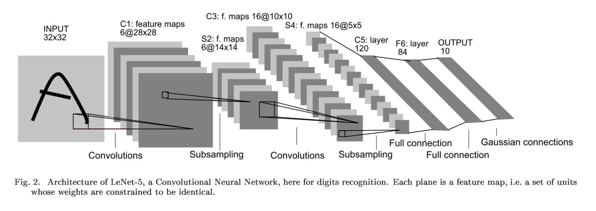

讲师说，LeNet-5 是 1990 年代开发的一个很简单的 CNN（📎 LeCun 等人 1998 年发表，用来识别手写数字，也就是 §2 讲的 OCR），"*但它至今仍然管用*"。他按图从左到右讲了一遍：

1. 输入是一张 32×32 的小图。
2. 用 6 个 filter 和图像卷积，得到 6 张 feature map（**C1：6@28×28**，"6@" 表示 6 张）。
3. 下采样（subsampling），比如 max pooling 或 average pooling，得到 **S2：6@14×14**。
4. 在这 6 张 feature map 上再设计 16 个 filter 做卷积。讲师说，可以把这 6 张 feature map 看成一张 6 通道的图像，卷积后得到 **C3：16@10×10**。
5. 再下采样，减少计算量、挑出最显著的特征，得到 **S4：16@5×5**。
6. 把 feature map 拉成一个长向量，送进普通的多层感知机（multilayer perceptron），也就是**全连接层**（full connection）：**C5 有 120 个单元，F6 有 84 个**，最后输出 10 类（OUTPUT 10，对应数字 0–9）。

讲师把它总结为两个阶段：前面的"卷积、下采样、卷积、下采样"负责**学习特征表示**，一步步学到越来越复杂的特征；最后的全连接层负责**分类**。这正是 slide 31 那张图的具体实现。

> **🔑 例 — 逐层核对尺寸和参数个数**
>
> 用 §21 的公式（$S=1$，$P=0$），以及"每个 filter 的参数 = $F\times F\times$ 输入通道数 + 1 个偏置"：
>
> | 层 | 操作 | 输出 | 参数个数 |
> |---|---|---|---|
> | INPUT | — | 1×32×32 | 0 |
> | C1 | 6 个 5×5 filter | 6×28×28（$32-5+1=28$） | $6\times(5\times5\times1+1)=156$ |
> | S2 | 2×2 下采样 | 6×14×14 | 0 |
> | C3 | 16 个 5×5 filter，每个看 6 个通道 | 16×10×10（$14-5+1=10$） | $16\times(5\times5\times6+1)=2{,}416$ |
> | S4 | 2×2 下采样 | 16×5×5 | 0 |
> | C5 | 120 个 5×5 filter（相当于全连接） | 120×1×1（$5-5+1=1$） | $120\times(5\times5\times16+1)=48{,}120$ |
> | F6 | 全连接 | 84 | $84\times(120+1)=10{,}164$ |
> | OUTPUT | 全连接 | 10 | $10\times(84+1)=850$ |
> | **合计** | | | **61,706 ≈ 60K** |
>
> 📎 原论文的细节略有不同：S2、S4 的下采样各带少量可训练参数（12 个和 32 个）；C3 的每张输出图只连接部分输入通道（1,516 个参数）。这样算，C1 到 F6 合计恰好 60,000 个；输出层是 *Gaussian connections*，它的 840 个参数最初由人工设定。两种算法都和 slide 的 "around 60K" 一致。

这张表还揭示了一个规律：两个卷积层 C1、C3 合计不到 2,600 个参数，C5 和 F6 却有约 5.8 万个，占了九成以上。**参数主要集中在全连接的部分**，卷积层靠 weight sharing，只用很少的参数就完成了特征提取。§23 的 AlexNet 也是这样。

> 📎 **"更全局"是什么意思（超出 slides）** — 看每一层的一个单元在原图上"看得到"多大范围（感受野，receptive field）：C1 的一个单元只看 5×5；经过 S2 和 C3，一个 C3 单元能看到原图的 14×14；到 C5，一个单元正好看到整张 32×32 的图。层数越高，看到的范围越大，特征也就越"全局"。

## §23 AlexNet 与 ImageNet 突破

Slide 35：

> **CNNs (AlexNet): ImageNet Breakthrough** [Krizhevsky et al. NIPS 2012]
> Krizhevsky et al. win 2012 ImageNet classification with a much bigger ConvNet:
> - **deeper**: 8 learnable layers
> - **larger**: 60 million parameters
> - **16.4% error (top-5)** vs next best 26.2% error
>
> This was made possible by:
> - **fast hardware**: GPU-optimized code
> - **big dataset**: 1.2 million images vs thousands before
> - **better regularization**: dropout et al.

讲师说，AlexNet 是 2012 年开发的一个非常著名的 CNN，在 ImageNet 数据集上的分类错误率比第二名低了 10% 左右，差距非常大。它**开启了计算机视觉领域的深度学习时代**，是一座里程碑。他把它和 LeNet-5 做了比较：

| | LeNet-5（1998） | AlexNet（2012） |
|---|---|---|
| 任务 | 手写数字，10 类 | ImageNet，1000 类 |
| 输入 | 32×32 灰度图 | 📎 224×224 彩色图 |
| 深度 | 📎 7 层（不含输入层） | 8 个可学习的层（📎 5 个卷积层 + 3 个全连接层） |
| 参数 | 约 60K | 约 60M（讲师："*准确地说是 6100 万*"），大了一千倍 |
| 训练数据 | 📎 6 万张手写数字 | 120 万张图像 |
| 硬件 | 📎 CPU | GPU |

> 📎 **top-5 错误率是什么（超出 slides）** — ImageNet 有 1000 类，很多类之间很像（各种犬种）。所以比赛允许模型给出 5 个最可能的类别，只要真实类别在这 5 个里面就算对，不在才算错。

AlexNet 的优势有多大？图 18 是 ImageNet 竞赛（ILSVRC）历年冠军的 top-5 错误率：

```plot 图 18 · ImageNet 竞赛（ILSVRC）冠军的 top-5 错误率：2012 年 AlexNet 一下子拉开差距
years = ["2010\nNEC", "2011\nXRCE", "2012\nAlexNet", "2013\nZFNet", "2014\nGoogLeNet", "2015\nResNet"]
err = [28.2, 25.8, 16.4, 11.7, 6.7, 3.57]
cols = ["#8a9199", "#8a9199", "#2f6f4f", "#3b6ea8", "#3b6ea8", "#3b6ea8"]
bars = plt.bar(years, err, color=cols, width=0.62)
for bar, v in zip(bars, err):
    plt.text(bar.get_x() + bar.get_width() / 2, v + 0.6, f"{v:g}%", ha="center", fontsize=10,
             bbox=dict(fc="white", ec="none", pad=0.6))
plt.axhline(5.1, color="#c0714f", ls="--", lw=1, label="人类水平约 5.1%")
plt.hlines(26.2, 1.69, 2.31, colors="#5b636b", linestyles="--", lw=1.5)
plt.text(2.55, 26.2, "同年第二名 26.2%", va="center", fontsize=9.5, color="#5b636b")
plt.annotate("", xy=(2.42, 16.4), xytext=(2.42, 26.2), arrowprops=dict(arrowstyle="<->", color="#2f6f4f"))
plt.text(2.55, 21.3, "差 9.8 个\n百分点", fontsize=9.5, color="#2f6f4f", va="center")
plt.legend(loc="upper right", fontsize=9.5)
plt.ylabel("top-5 错误率 (%)")
plt.ylim(0, 32)
plt.tick_params(axis="x", labelsize=9.5)
```

> 📎 图 18 除 2012 年的两个数字外都超出 slides，取自 ILSVRC 公布的结果（"人类水平"是 Andrej Karpathy 自己做测试得到的估计值）。图里灰色是深度学习之前的方法；2012 年以后的冠军全是 CNN，错误率逐年下降，2015 年的 ResNet 已经低于人类的估计值。

注意 2012 年之前，冠军的成绩每年只进步一两个百分点；AlexNet 一出来就降了将近 10 个百分点。这就是 slide 标题说的 *breakthrough*。

Slide 35 把成功归功于三点，正好对应 §20 的三根支柱：

- **Fast hardware：GPU-optimized code。** 📎 AlexNet 在两块 GPU 上训练了五六天。没有 GPU，这样规模的网络在当时根本训练不完。
- **Big dataset：1.2 million images vs thousands before。** 以前的数据集只有几千到几万张图（比如 §3 的 Caltech101），六千万个参数的模型在这么少的数据上会严重过拟合。
- **Better regularization：dropout et al.**

> 📎 **dropout 是什么（超出 slides）** — 训练时，每一步都随机让一部分神经元（AlexNet 里是一半）"休息"，输出置 0。网络于是不能依赖任何一个特定的神经元，只能学到更稳健、更分散的特征，从而减轻 Week 5 讲过的 overfitting（过拟合）。这就是 regularization（正则化）的作用。"et al." 还包括数据增强（随机裁剪、翻转训练图像）等手段。§35 的 keras3 代码里就有 `layer_dropout(0.3)`。

> ⚠️ **两处要留意。** 第一，讲师口头说的是 AlexNet 有"*更好的优化算法*"，slide 写的是 *better regularization: dropout*。考试以 slide 为准。第二，讲师说 AlexNet 的错误率"*比第二名低 10%*"，指的是**百分点**：$26.2\%-16.4\%=9.8$ 个百分点。如果按相对比例算，是低了 $9.8/26.2\approx37\%$。
>
> 📎 和 LeNet-5 一样，AlexNet 的参数也集中在全连接层：第一个全连接层把 $6\times6\times256=9{,}216$ 个输入连到 4,096 个单元，单这一层就有约 3,770 万个参数。

## §24 CNN 学到了什么

前面一直在说 low-level、mid-level、high-level features，它们到底长什么样？Slide 36 来自 Zeiler 和 Fergus 2014 年的论文，把 CNN 各层学到的特征可视化了出来（图 19）：

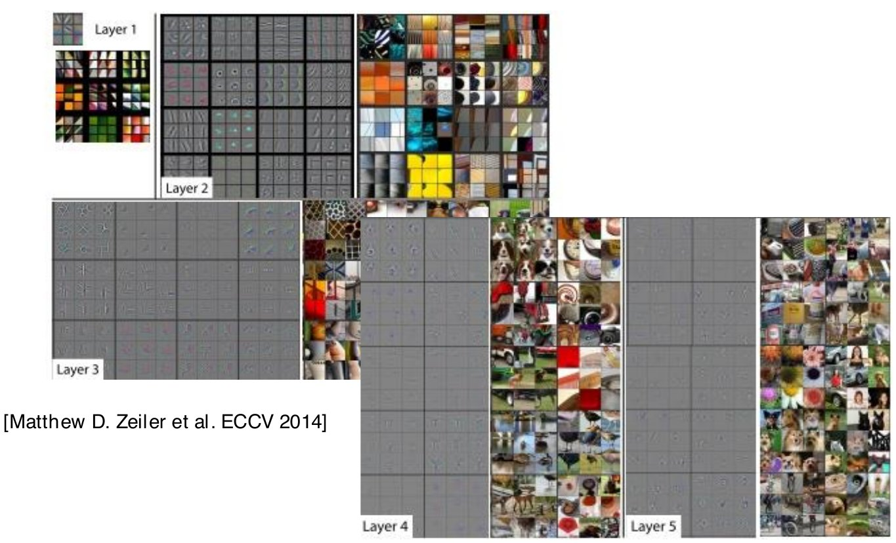

讲师带大家逐层看：

- **Layer 1**：只是一些简单的、有方向的**边缘**，看不出任何有意义的东西。
- **Layer 2**：开始出现**纹理**，能看到圆圈、L 形的拐角、大致的圆形，比第一层复杂一些。
- **Layer 3**：由这些图案组合出更复杂的图案。
- **Layer 4**：已经能看到**脸**了（狗的脸）。
- **Layer 5**：更复杂的图案（物体或物体的大部分）。

每一层的右边是对应的原图图块，就是从这些地方提取出了左边的特征。讲师的结论是：低层只提取低层特征，层数越高，提取的特征越高层、越抽象，能表示越复杂的模式；到最后，网络得到了一个很强的特征表示，可以直接拿去分类。这就是 slide 31 那张图里 "More abstract representation" 的真实样子。

把图 19 的第一层和前面几节连起来看，会发现一件有意思的事。第 1 层学到的边缘检测器，和 §21 例子里人工写的那个 $[1,0,-1]$ filter 是同一类东西，也和 §19 里大脑 V1 区的 *edge detectors* 相呼应，SIFT 统计的梯度方向（§10）同样建立在边缘之上。CNN 没有被告知"边缘很重要"，它从数据中**自己发现**了这一点，然后在此基础上，又一层层学出了第 2–5 层那些从来没有人设计过的特征。

## §25 CNN 横扫各类视觉任务

讲师说，deep learning 一旦被计算机视觉界接受，很快就被用到了 §2 列出的所有任务上：检测、定位、跟踪、视频分析、图像检索。Slides 37–39 举了 2014 年前后的几项代表工作。以检测为例（图 20）：

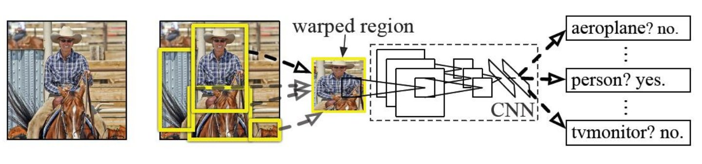

讲师的解释是：用 CNN 去判断某个区域是人还是自行车，借助 CNN 强大的能力，检测得更准。📎 换句话说，R-CNN 把检测变成了"在很多候选区域上做分类"：先用别的算法在图上找出约两千个可能包含物体的区域，每个区域都送进 CNN 提取特征，再逐类判断"是不是这一类"。

| 任务 | Slides 上的工作 | CNN 怎么用 |
|---|---|---|
| Object detection | R-CNN（CVPR 2014） | 对每个候选区域用 CNN 提特征、判断类别 |
| Face recognition | DeepFace（CVPR 2014） | 标题就是 *Closing the Gap to Human-Level Performance in Face Verification*；📎 先把人脸对齐、转正，再用深层网络提特征 |
| Human attribute classification | Ning Zhang 等（CVPR 2014） | 对人体各个部位分别用 CNN 提特征，再判断属性：戴不戴帽子、男或女、戴不戴墨镜、穿不穿短裤…… |
| Fine-grained recognition | Branson 等（2014） | detect → align → represent → classify，区分鸟的具体种类 |
| Large-scale video classification | Karpathy 等（CVPR 2014） | 📎 把视频的多帧送进 CNN，在时间维度上融合 |
| Action recognition | Simonyan 等（2014） | two-stream：spatial stream 看单帧画面，temporal stream 看多帧之间的运动（optical flow），最后融合两边的分数 |

讲师补充了几点。**Fine-grained recognition（细粒度识别）** 要区分同一大类下的子类：不同种的鸟、不同品种的狗、不同种的鱼，或者不同型号的飞机、汽车。视频分析除了每一帧画面的**空间**信息，还要考虑**时间**维度。最后他提醒，这些都是十多年前的技术了，如今已经有了更先进的、基于 deep learning 的视频分析方法。

<details>
<summary>自测：LeNet-5 的 C1 和 C3 用的都是 5×5 的 filter，为什么 C3 每个 filter 有 151 个参数，C1 只有 26 个？</summary>

filter 要覆盖输入的**所有通道**。C1 的输入是 1 通道的灰度图，一个 filter 有 $5\times5\times1=25$ 个权重加 1 个偏置，共 26 个；C3 的输入是 S2 的 6 张 feature map（6 个通道），一个 filter 有 $5\times5\times6=150$ 个权重加 1 个偏置，共 151 个。16 个 filter 合计 $16\times151=2{,}416$。

</details>

<details>
<summary>自测：有人说“AlexNet 的成功全靠网络更深”。按 slide 35，还漏了哪些原因？</summary>

Slide 35 说 AlexNet "deeper"（8 层）、"larger"（60M 参数），而这之所以做得成，靠的是三点：**fast hardware**（GPU-optimized code）、**big dataset**（1.2 million images vs thousands before）、**better regularization**（dropout et al.）。没有 GPU 训练不完，没有大数据会严重过拟合，没有 dropout 等正则化手段也会过拟合。这三点对应 slide 33 的 computational power、large-scale data、new algorithms。

</details>

---

# Part VI · 用好预训练的 CNN：从 SIFT 到 CNN 特征

## §26 三条路

训练一个 AlexNet 级别的网络，需要上百万张标注图像和大量 GPU 时间，大多数团队都负担不起。讲师说，好在大型 IT 公司和顶尖实验室会用 ImageNet 等大规模数据集把 CNN **预训练（pre-train）** 好，再把模型发布到 GitHub 或 Hugging Face 上。我们可以直接拿来用。Slide 40 的标题是 **Image Representation: From SIFT to CNNs**，列出了三种方法：

> **Three main approaches**
> - **Directly use pre-trained CNNs** models — to extract image feature representations
> - **Fine-tune pre-trained CNNs** models — with the images from recognition tasks
> - **BoVW model based on CNN features** — "Deep SIFT"

图 21 把三条路画在一起：

```d2 图 21 · 拿到一个预训练好的 CNN，有三种用法
direction: down
pre: "在 ImageNet 上预训练好的 CNN" {class: key}
r3: "③ “Deep SIFT”\n给 patch / 位置提特征"
r2: "② Fine-tune\n用新任务图像接着训练"
r1: "① 直接用\n取一层输出 + pooling"
c3: "visual words → 直方图"
c2: "适应新任务的 CNN" {class: good}
c1: "特征向量 → 你的分类器"
pre -> r3 -> c3
pre -> r2 -> c2
pre -> r1 -> c1
```

讲师逐一解释：**第一种**，直接用预训练模型提取图像特征，得到一个稳健的特征表示，再在上面接你自己的分类器，"*效果会相当好，因为这些特征表示相当可靠*"。**第二种**，如果还想要更好的效果，就用你自己的图像对预训练模型做 **fine-tune（微调）**，训练少量几个 epoch，让模型和你的数据更契合，在你的具体任务上表现更好。**第三种**，从每张图取出很多图块，不再用 SIFT 或 HOG 这些人工设计的特征，而是用 CNN 给每个图块提特征，叫作 **"Deep SIFT"**，再在上面建 BoVW 模型。他特别说明：**前两种方法常用**，第三种没那么常见。

| | ① 直接用 | ② Fine-tune | ③ "Deep SIFT" + BoVW |
|---|---|---|---|
| 预训练 CNN 的参数 | 不动 | 用新数据接着训练 | 不动 |
| 你要训练什么 | 只训练自己的分类器 | 网络（全部或后几层）+ 新的输出层 | visual words（K-means）和分类器 |
| 📎 需要的数据 | 少 | 较多 | 少 |
| 讲师的评价 | 常用，效果相当好 | 常用，效果通常更好 | 不如前两种常见 |

> 📎 **迁移学习（超出本节 slides，slide 63 提到了这个词）** — 在一个任务上学到的知识，拿到另一个任务上用，叫 **transfer learning（迁移学习）**。在 ImageNet 上学会识别 1000 类物体的 CNN，已经学会了边缘、纹理、物体部件（图 19），这些对识别场景、医学图像、商品同样有用。三种方法都是迁移学习的具体做法。

## §27 路线一：直接用预训练 CNN 提特征

Slide 41 提出了这条路上的两个问题：

> - **Which** layer to use?
> - How to **pool** the features in a **convolutional** layer?

### 用哪一层？

Slide 42 用的还是图 17 那张 LeNet-5 结构图，只是加了几个箭头："**Convolutional layer**" 指向 C3、S4 那几组 feature map，"**Fully connected layer**" 指向 F6。讲师的建议很明确：

> 🎙️ "*通常用最后一个卷积层，或者一个全连接层，它们对应的都是相当高层的表示。不要用开头那几层，那些是低层特征，不够可靠。*"

原因在 §24 里已经看到了：前几层学到的是边缘和纹理，和手工设计的局部特征差不多，离"物体"还很远；越往后，特征越接近物体的部件和整体，也就越能区分类别。

> 📎 **卷积层还是全连接层（超出 slides）** — 两者各有所长。卷积层的输出保留了空间结构（$H\times W\times D$），更通用，但要先 pooling 成向量；全连接层的输出本身就是一个向量，可以直接用，不过它更贴近原来那 1000 个训练类别。最后的输出层（1000 个类别的分数）太"专"了，一般不用。

### 卷积层的输出怎样变成向量？

卷积层的输出不是一个向量，而是一个三维的"块"：高 $H$ × 宽 $W$ × 深 $D$。$D$ 是这一层 filter 的个数，也就是 feature map 的张数（通道数）。分类器要的是一个向量 $x_1,\dots,x_n$。Slide 43 在这两者之间画了一个大大的 "**How?**"，slide 44 给出了五种答案：

> - **Sum-pooling**
> - **Max-pooling**
> - **Grid-based max-pooling**
> - **Region-based pooling**
> - **Mixed sum & max pooling**

讲师讲了最常用的两种：**sum pooling** 对每个通道（每一片 $H\times W$）求和或求平均，得到一个数；**max pooling** 取每个通道里最大的激活值。不管哪种，都把三维的特征图压成一个 $D$ 维向量。图 22 画出了这个过程（上半部分），下半部分留给 §29：

```svg 图 22 · 同一个卷积特征图的两种用法：整体 pooling 成一个向量，或把每个位置当成一个局部描述子
<svg viewBox="0 0 640 290">
  <defs>
    <marker id="arrow" viewBox="0 0 10 10" refX="9" refY="5" markerWidth="7" markerHeight="7" orient="auto">
      <path d="M0,0 L10,5 L0,10 z" class="solid-ink"/>
    </marker>
  </defs>
  <rect x="86" y="40" width="120" height="120" class="ink fill-muted" stroke-width="1.5"/>
  <rect x="74" y="52" width="120" height="120" class="ink fill-muted" stroke-width="1.5"/>
  <rect x="62" y="64" width="120" height="120" class="ink fill-muted" stroke-width="1.5"/>
  <rect x="50" y="76" width="120" height="120" class="ink fill-soft" stroke-width="1.5"/>
  <path d="M80,76 V196 M110,76 V196 M140,76 V196 M50,106 H170 M50,136 H170 M50,166 H170" class="muted" stroke-width="1" fill="none"/>
  <path d="M110,106 L146,70 L176,70 L176,100 L140,136 L110,136 Z M140,106 L176,70" class="accent fill-soft" stroke-width="2.5" fill-opacity="0.85"/>
  <rect x="110" y="106" width="30" height="30" class="accent" fill="none" stroke-width="2.5"/>
  <text x="110" y="218" text-anchor="middle">W</text>
  <text x="34" y="141" text-anchor="middle">H</text>
  <text x="56" y="56" text-anchor="middle">D</text>
  <text x="125" y="250" text-anchor="middle" class="accent">xᵢ ∈ ℝᴰ：一个位置上</text>
  <text x="125" y="270" text-anchor="middle" class="accent">D 个通道的值</text>
  <line x1="214" y1="96" x2="330" y2="72" class="ink" stroke-width="1.5" marker-end="url(#arrow)"/>
  <text x="272" y="116" text-anchor="middle" class="muted">sum / max pooling</text>
  <rect x="338" y="36" width="284" height="72" rx="8" class="good fill-good" stroke-width="2"/>
  <text x="480" y="66" text-anchor="middle">一个 D 维向量（整张图的特征）</text>
  <text x="480" y="90" text-anchor="middle" class="good">→ 你的分类器（路线 ①）</text>
  <line x1="214" y1="168" x2="330" y2="196" class="ink" stroke-width="1.5" marker-end="url(#arrow)"/>
  <text x="262" y="206" text-anchor="middle" class="muted">逐个位置取出</text>
  <rect x="338" y="160" width="284" height="96" rx="8" class="warn fill-warn" stroke-width="2"/>
  <text x="480" y="190" text-anchor="middle">H×W 个 D 维局部描述子</text>
  <text x="480" y="214" text-anchor="middle">= “Deep SIFT”</text>
  <text x="480" y="238" text-anchor="middle" class="warn">→ visual words → 直方图（路线 ③）</text>
</svg>
```

> **🔑 例 — sum pooling 和 max pooling 会给出不同的答案**
>
> 一个卷积层的输出有 $D=3$ 个通道，每个通道是 2×2：
>
> - 通道 1：$\begin{bmatrix}0&2\\1&5\end{bmatrix}$，和为 8，最大值为 5；
> - 通道 2：$\begin{bmatrix}3&0\\0&0\end{bmatrix}$，和为 3，最大值为 3；
> - 通道 3：$\begin{bmatrix}1&1\\1&1\end{bmatrix}$，和为 4，最大值为 1。
>
> Sum pooling 得到 $(8,3,4)$，max pooling 得到 $(5,3,1)$。注意通道 2 和通道 3：按 sum，通道 3 更大（4 > 3）；按 max，通道 2 更大（3 > 1）。sum 衡量的是"这种模式**总共**有多少"，和 BoVW 数次数的想法一样；max 衡量的是"这种模式**有没有在哪里强烈地出现**"，对图里的小物体更敏感。

> 📎 **另外三种（超出 slides）**
>
> - **Grid-based max-pooling**：先把 $H\times W$ 平面切成几个格子（比如 2×2），每个格子各做一次 max pooling，再拼起来，得到 $4D$ 维的向量。这样保留了一点"在左上还是右下"的空间信息，和 §16 提到的 spatial pyramid 是同一个思路。
> - **Region-based pooling**：在很多个大小不一、可以重叠的区域上分别做 pooling，再汇总，常用于图像检索。
> - **Mixed sum & max pooling**：把 sum 和 max 的结果结合起来（比如拼接，或加权平均），兼顾两者。

## §28 路线二：fine-tune

Slide 45：

> **Fine-tune pre-trained CNNs** — To incorporate extra information from the images of a new recognition task. Make the pre-trained CNNs adapt to this new task.

Slide 的配图左边是 ImageNet（预训练用的数据），右边是新的识别任务：veterinarians office、elevator door、fishpond、bedroom、cafeteria、watering hole、staircase、bar、field road、conference center、shoe shop、rainforest……全是**场景**类别。讲师用这个例子解释：你有一个在 ImageNet 上预训练的 CNN，可 ImageNet 主要是做物体识别的，你的新任务是场景识别。这时就用你的数据去 fine-tune 这个预训练的 CNN，让它适应新任务。

> 📎 **Fine-tune 具体怎么做（超出 slides）**
>
> 1. 把最后的输出层换掉：原来输出 ImageNet 的 1000 类，现在改成新任务的类别数。
> 2. 其余各层用预训练好的权重作为起点，而不是随机初始化。
> 3. 用新任务的图像接着训练，学习率设得小一些，训练几个 epoch（一个 epoch 是把训练集完整过一遍）就够了。讲师说的"*少量几个 epoch*"就是这个意思。
> 4. 数据很少时，可以**冻结**前几层（不更新它们的参数），只训练后面几层。前几层学的是边缘、纹理（图 19），对各种任务都通用，不需要改。
>
> **路线一还是路线二？** 有标注的数据很少，或者新任务和 ImageNet 很像，用路线一就够了，也不容易过拟合；数据较多，或者新任务和 ImageNet 差别很大（医学影像、卫星图），fine-tune 通常效果更好。

## §29 路线三："Deep SIFT" + BoVW

第三条路是把 Part IV 的 BoVW 和 CNN 结合起来：BoVW 的流程不变，只是把局部特征从 SIFT 换成 CNN 特征。讲师说，这样得到的不是真正的 SIFT，而是深度学习层面上的 SIFT，所以叫 "Deep SIFT"，在它上面建的 BoVW 模型更强。Slides 46–47 给出了两种得到 Deep SIFT 的办法：

- **在多个尺度上裁图块，每块送进 CNN**（slide 46，来自 ECCV 2014 的 *Multi-scale Orderless Pooling of Deep Convolutional Activation Features*）。图上那张海豚照片被红框切成大小不同的图块：整张图、较大的块、更小的块。每个图块经过 CNN 得到一个特征向量，相当于一个"深度版"的 SIFT 描述子。
- **整张图只过一次 CNN，把特征图上的每个位置当作一个描述子**（slide 47，来自 Cao 等人的 *Where to Focus: Query Adaptive Matching for Instance Retrieval Using Convolutional Feature Maps*）。卷积层的输出是 $H\times W\times D$ 的特征图，在其中任取一个位置，沿深度方向的 $D$ 个数组成一个向量 $\mathbf{x}_i\in\mathbb{R}^D$，它描述的是原图上对应的那一小块区域。图 22 下半部分画的就是这种用法：一张图得到 $H\times W$ 个这样的局部描述子。

Slide 48 把两种办法汇到同一个流程里：图块（或特征图上的位置）→ **Visual word creation** → **Histogram generation** → **Image recognition**。这就是图 13 的流程，只是把"提取局部特征"那一步从 SIFT 换成了 CNN。

<details>
<summary>自测：三个场景各选哪条路？(a) 一家医院只有 200 张标注好的皮肤病照片，想分 3 类；(b) 一家公司有 5 万张标注好的卫星图像；(c) 一家图库公司已有一套基于 SIFT 的 BoVW 检索系统，想升级特征。</summary>

(a) **路线一**：数据太少，fine-tune 容易过拟合；用预训练 CNN 的最后一个卷积层（pooling 后）或全连接层提特征，再训练一个小分类器（比如 SVM）。(b) **路线二**：数据较多，卫星图又和 ImageNet 的照片差别很大，fine-tune 能让网络适应新领域。(c) **路线三**：保留原来的 visual word → 直方图 → 检索流程，只把 SIFT 换成 Deep SIFT。

</details>

<details>
<summary>自测：直接用预训练 CNN 时，为什么不用第一层的输出？sum pooling 和 max pooling 分别适合回答什么问题？</summary>

第一层学到的只是边缘和颜色斑块（图 19 的 Layer 1），属于低层特征，离物体概念太远，讲师说"不够可靠"；应该用最后一个卷积层或全连接层的高层表示。Sum pooling 衡量某种模式在全图**总共**有多少；max pooling 衡量某种模式**有没有在某处强烈出现**，对小物体更敏感。

</details>

---

# Part VII · 现代图像分析：从 CNN 到基础模型

## §30 更深、更强的 CNN

Slide 49 的前半部分：

> **Major developments since AlexNet (2012)** — Deeper and more powerful CNN architectures: **VGG (2014), ResNet (2015), EfficientNet (2019)**. Improve feature learning, accuracy and computational efficiency.

讲师说，"CNN"其实是一大类模型的统称。2014 年有著名的 VGG16、VGG19，2015 年有 ResNet，2019 年有 EfficientNet，这三个都很常用；想用预训练的 CNN，可以去找 VGG 或 ResNet。它们提升了特征学习的效果，准确率更高，计算效率也更好。CNN 至今仍被广泛使用。

> 📎 **三个架构各有什么特点（超出 slides）**
>
> - **VGG**：只用 3×3 的小 filter，一层层叠到 16 或 19 层，结构非常规整，VGG16 约有 1.38 亿个参数。
> - **ResNet**：加入了 **residual connection（残差连接，也叫 skip connection）**，每个模块的输出是"输入本身 + 模块学到的修正量"。信号和梯度可以沿着这条捷径直接穿过很多层，于是网络能做到 50、101、152 层还训练得动。它是 ILSVRC 2015 的冠军（图 18 的 3.57%）。
> - **EfficientNet**：把网络的深度、宽度和输入图像的分辨率**按比例一起放大**，用更少的参数和计算量达到更高的准确率。

## §31 Vision Transformer：把图像当成一句话

Slide 49 的后半部分：

> **Vision Transformers (ViT, 2020)**: Divide an image into patches and represent them as tokens. Use self-attention to learn relationships among image regions. Provide an alternative to CNNs for learning visual representations.
>
> **CNNs and Transformers are now both widely used.**

讲师先把它和 Week 8 联系起来：Transformer 我们在文本分析里见过。之后人们想，能不能用 Transformer 来分析图像？如果把一张图切成很多小块，就可以把它看成一句话：一句话由很多词组成，一张图由很多图块（patch）组成。图块就相当于文本里的 **token**。Transformer 里最重要的是 **attention（注意力）** 机制，把图切成图块之后，就能用 **self-attention** 学习图块之间的关系。

他接着点出了 ViT 相对 CNN 的优势：

> 🎙️ "*卷积神经网络用一个小 filter 和图像做卷积，这个小 filter 只能看一个局部区域。Transformer 却能考虑不同图像区域之间的关系，也就是长距离依赖（long-range dependency）。这是 vision transformer 的优势。*"

图 23 画出了这个区别：

```plot 图 23 · CNN 的 filter 一次只看一小块；ViT 的 self-attention 让每个图块直接看到全图
N = 6
fig, (a, b) = plt.subplots(1, 2, figsize=(8, 3.8))
for ax in (a, b):
    for r in range(N):
        for c in range(N):
            ax.add_patch(plt.Rectangle((c, r), 1, 1, fc="#f4f5f6", ec="#c9ced3", lw=0.8))
    ax.set_xlim(-0.2, N + 0.2); ax.set_ylim(N + 0.8, -0.2); ax.set_aspect("equal"); ax.axis("off")
a.add_patch(plt.Rectangle((1, 1), 3, 3, fc="#eaf3ee", ec="#2f6f4f", lw=2.5))
a.add_patch(plt.Rectangle((2, 2), 1, 1, fc="#2f6f4f", ec="#2f6f4f"))
a.add_patch(plt.Rectangle((5, 5), 1, 1, fc="#fdf0e6", ec="#c0714f", lw=1.5))
a.text(5.5, 6.5, "这里看不到", ha="center", fontsize=9.5, color="#c0714f")
a.set_title("CNN：3×3 filter 的视野是局部的", fontsize=10.5)
q = (2.5, 2.5)
rng = np.random.default_rng(5)
w = rng.random((N, N)) ** 3
for r in range(N):
    for c in range(N):
        if (r, c) != (2, 2):
            b.plot([q[0], c + 0.5], [q[1], r + 0.5], color="#3b6ea8", lw=0.4 + 2.2 * w[r, c], alpha=0.25 + 0.6 * w[r, c])
b.plot([q[0], 5.5], [q[1], 5.5], color="#3b6ea8", lw=3)
b.add_patch(plt.Rectangle((5, 5), 1, 1, fc="#e8f0fa", ec="#3b6ea8", lw=1.5))
b.add_patch(plt.Rectangle((2, 2), 1, 1, fc="#2f6f4f", ec="#2f6f4f"))
b.text(5.0, 6.5, "远处也能直接关联", ha="center", fontsize=9.5, color="#3b6ea8")
b.set_title("ViT：每个图块和所有图块算 attention", fontsize=10.5)
```

左图里，CNN 的一个 3×3 filter 只覆盖中心周围一圈，右下角的格子它看不到，要靠很多层叠起来才能慢慢"看"过去（§22 的感受野）。右图里，ViT 的一个图块（绿色）在第一层就和所有图块建立了联系，线越粗表示关系越强，右下角那块也能直接关联上。

Slide 50 是 ViT 论文里的结构图（图 24）：

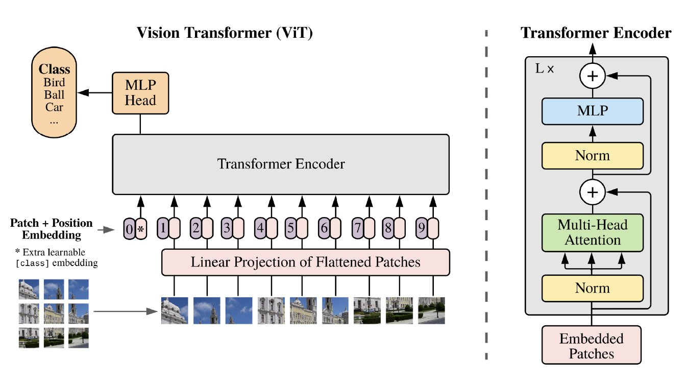

讲师按图讲了一遍流程：

1. 把图像切成多个图块（图左下的九个小图块）。每个图块被看作一个"词"，所以这篇论文叫 *An Image is Worth 16x16 Words*。
2. 先做一次 **linear projection（线性投影）**，把每个图块拉平并变成一个向量（*Linear Projection of Flattened Patches*）。
3. 每个图块在原图里都有自己的位置，所以要把位置信息一起加进去：**patch + position embedding**（图中编号 1–9 的小框）。📎 编号 0 带星号的那个是额外加入的 **[class] token**，它的向量也是学出来的，专门用来汇总全图的信息、做最后的分类。
4. 送进 **Transformer Encoder**。它基于 attention 机制分析图块之间的关系。右边是 encoder 内部的结构：Norm → Multi-Head Attention → 相加 → Norm → MLP → 相加，重复 $L$ 次。
5. 最后经过 **MLP Head**（多层感知机）输出分类结果（Bird、Ball、Car……）。

讲师指出，原来这部分是由 CNN 完成的，现在换成了 Transformer。他还加了一个条件："*当数据集足够大时*"，基于 Transformer 的方法能给出非常好的效果。

> **🔑 例 — ViT 的 token 是怎么数出来的**
>
> 输入一张 224×224 的彩色图，图块大小 16×16：
>
> - 每边切成 $224/16=14$ 块，共 $14\times14=$ **196 个图块**；
> - 每个图块有 $16\times16\times3=$ **768 个数**，拉平后经过线性投影，变成一个 token 向量（📎 ViT-Base 的 token 维度也是 768）；
> - 再加上 1 个 [class] token，一共 **197 个 token** 送进 Transformer。
>
> 📎 **为什么切图块，而不是一个像素一个 token？** Self-attention 要计算每一对 token 之间的关系。197 个 token 是 $197^2\approx3.9$ 万对；如果每个像素当一个 token，$224\times224=50{,}176$ 个 token 就是约 25 亿对，多出六万多倍，根本算不动。

> 📎 **position embedding 为什么不能省（超出 slides）** — Self-attention 本身不管 token 的先后顺序：把输入的图块打乱，它算出来的关系完全一样。没有位置信息，ViT 就和 BoVW 一样成了"一袋图块"，也会像图 8 那样看不见"东西在哪"。加上 position embedding，模型才知道每个图块原本在图的哪个位置。

| | CNN | ViT |
|---|---|---|
| 基本单位 | 像素，小 filter 在图上滑动 | 图块（patch），每块一个 token |
| 一层能看多大范围 | 局部（3×3、5×5），层数加深后才逐渐变大 | 第一层起就能看全图（self-attention） |
| 位置信息 | 卷积天然保留了空间结构 | 要靠 position embedding 加进去 |
| 📎 数据需求 | 中等数据量就能训练好 | 需要非常大的数据集，数据少时常常不如 CNN |
| 现状 | 仍然广泛使用 | 广泛使用，也是多模态大模型里的视觉部分 |

> 📎 **为什么 ViT 更"吃"数据（超出 slides）** — CNN 的结构里预先装了两条关于图像的假设：相邻的像素关系密切（局部性），同一种模式出现在哪里都一样（权重共享）。这两条对图像几乎总是成立，等于白送的知识。ViT 没有这些预设，只能从数据中自己学出来，所以要在上亿张图上预训练，才能超过 CNN。这正是讲师说"数据集足够大时"的原因。

## §32 Visual foundation models：从专用到通用

Slide 51：

> **Visual Foundation Models — Learning from Large-Scale Data**
> **Task-specific → general-purpose visual representations**
> - **Self-supervised learning (DINO, MAE and DINOv2)**: Learn visual representations from large amounts of unlabelled images.
> - **Vision–Language pretraining (CLIP, 2021)**: Learn relationships between images and their textual descriptions. Image classification using natural language descriptions.
> - **Visual foundation models (SAM, 2023)**: Pretrained on large and diverse datasets. Can be transferred or adapted to multiple downstream tasks.

讲师说："*你会觉得这页 slide 似曾相识。没错。*" 在 Week 8 里，文本分析从 **task-specific（专用）** 模型走向了 **general-purpose（通用）** 的大语言模型；图像分析也一样，从专用的模型走向通用的视觉表示、通用的视觉分析器。以前，人脸识别、场景识别、汽车分割，每个任务都要单独收集数据、单独训练一个模型；现在，一个在海量数据上预训练的大模型能为很多下游任务提供现成的视觉能力，只需很少的额外训练，甚至完全不用训练。Slide 51 列了三条通向这里的路。

### Self-supervised learning：不用标注也能学

讲师说，self-supervised learning（自监督学习）用大量**没有标注**的图像来学习图像表示。著名的有 DINO、MAE 和 DINOv2，它们能提供相当好的图像表示。§4 说过，人工标注费时费力；没有标注的图像却几乎取之不尽。

> 📎 **没有标签，学什么（超出 slides）？** 关键是让数据自己出题：
>
> - **MAE（Masked Autoencoder）**：随机遮住一张图大约 75% 的图块，让模型根据剩下的部分把被遮住的图块补出来。要补出一只被遮住的狗耳朵，模型就得"懂"狗长什么样。这和 BERT 遮住句子里的词、让模型去猜（Week 8）是同一个思路。
> - **DINO / DINOv2**：把同一张图做两种不同的裁剪和颜色变换，要求模型对这两个版本给出一致的输出。模型于是学会了对裁剪、颜色这些变化**保持不变**，这不正是 §7 的 invariant 吗？只是这一次，不变性是模型自己从数据里学出来的，不需要任何标签。

### CLIP：让图像和文字住进同一个空间

讲师这样解释 **vision–language pretraining（视觉–语言预训练）**：把每张图和描述它的一段文字配对，用一个视觉分支和一个文本分支，把图像和文字投影到**同一个空间**里，并且保证配成一对的图像 embedding 和文本 embedding 彼此靠近。这就是 **CLIP（Contrastive Language–Image Pre-training，对比式语言–图像预训练）**，它学习的是图像和文字描述之间的关系。训练数据从哪来？讲师说，网上的图片，比如新闻和旅游博客里的图片，周围通常都有文字描述，可以直接利用。

```plot 图 25 · CLIP 把图像和文字放进同一个空间：配对的挨在一起；新图离哪句描述最近，就判成哪一类
pairs = {"dog": (1.0, 3.6), "cat": (1.9, 1.3), "car": (4.6, 3.8), "bird": (5.2, 1.4)}
for name, (x, y) in pairs.items():
    ix, iy = x + 0.35, y + 0.25
    plt.plot([x, ix], [y, iy], color="#8a9199", ls=":", lw=1)
    plt.scatter([x], [y], s=70, color="#2f6f4f", zorder=3)
    plt.scatter([ix], [iy], s=70, marker="s", color="#3b6ea8", zorder=3)
    plt.text(x - 0.12, y - 0.32, f"“a photo of a {name}”", fontsize=9, color="#2f6f4f", ha="center")
    plt.text(ix + 0.12, iy + 0.12, f"{name} 的照片", fontsize=9, color="#3b6ea8")
nx, ny = 2.75, 0.85
plt.scatter([nx], [ny], s=180, marker="*", color="#c0714f", zorder=4)
plt.annotate("新图片 → 最近的描述是\n“a photo of a cat” → 预测 cat", xy=(nx, ny), xytext=(3.2, 2.45),
             fontsize=9.5, color="#c0714f", arrowprops=dict(arrowstyle="->", color="#c0714f"))
plt.plot([nx, 1.9], [ny, 1.3], color="#c0714f", lw=1.2, ls="--")
plt.scatter([], [], color="#2f6f4f", label="文本 embedding")
plt.scatter([], [], marker="s", color="#3b6ea8", label="图像 embedding")
plt.legend(loc="center left", bbox_to_anchor=(1.0, 0.5), fontsize=9)
plt.xlim(-0.3, 6.4); plt.ylim(0.05, 4.8)
plt.xticks([]); plt.yticks([])
plt.xlabel("共享 embedding 空间（示意为 2 维）")
```

图 25 里，每张照片（蓝色方块）都紧挨着描述它的那句话（绿色圆点）。这和 Week 8 的 word embedding 是同一种想法："意思相近的东西在空间里离得近"，只不过现在一个是图、一个是文字。

> 📎 **"contrastive"指什么（超出 slides）** — 训练时一次取 $N$ 对"图像–文字"，模型要把 $N$ 个真正配对的拉近，同时把 $N^2-N$ 个错配的推远。CLIP 用了约 4 亿对网上收集的图文数据。

Slide 51 说 CLIP 能做 **image classification using natural language descriptions（用自然语言描述来分类）**。做法是：把每个类别名写进一句描述，比如 "a photo of a cat""a photo of a dog"，算出它们的文本 embedding；再算出待分类图片的图像 embedding；离图片最近的那句描述，就是预测的类别（图 25 的橙色星号）。

> **🔑 例 — CLIP 的零样本分类**
>
> 要把一张新照片分到 {cat, dog, car, bird} 四类。四句描述和这张照片的 cosine similarity（余弦相似度）算出来分别是 0.31、0.22、0.08、0.12，最大的是 "a photo of a cat"，于是预测为 cat。
>
> 整个过程没有用到任何一张"标注为 cat 的训练图片"，这叫 **zero-shot（零样本）** 分类。想加一个新类别，比如 "zebra"，只要多写一句 "a photo of a zebra"，不需要重新训练。对比 Part IV：BoVW 加分类器的方案，每加一个类别都要收集标注图像、重新训练分类器。

### SAM：分割一切

**Visual foundation model（视觉基础模型）** 的代表是 Meta 的 **SAM（Segment Anything Model）**，用于图像分割。讲师说，它在大规模数据上预训练，可以直接用到下游任务上。SAM 已经有了三代（slide 52）：

| | 怎样指定目标（prompt） | 能做什么 |
|---|---|---|
| SAM 1 | 点一下（click） | 分割任意图像里的任意物体 |
| SAM 2 | 点、框或 mask | 在图像**和视频**里分割、跟踪任意物体 |
| SAM 3 | 文字描述或示例 | 检测、分割、跟踪某一类物体的**所有**实例，图像和视频都行 |

讲师强调了它的意义：你可以把这个模型用在任何图像、任何视频上，不需要为自己的数据、自己的领域专门开发一个分割模型。这就是 task-specific 和 general-purpose 的区别。

> 📎 SAM 1 的训练数据 SA-1B 有约 1100 万张图、超过 10 亿个分割 mask。"Large and diverse datasets"指的就是这种规模。

## §33 新前沿：多模态理解与生成式 AI

Slide 53：

> **The New Frontier — Multimodal Image Understanding and Generative AI**
> **Beyond recognising objects: Understanding, reasoning and generating visual content**
> - **Vision–Language Models (LLaVA, Qwen-VL and GPT-4o)**: Support image captioning, visual question answering and image-based dialogue.
> - **Generative image models (Diffusion models)**: Generate and edit images using natural-language instructions.
> - **Emerging applications**: Autonomous driving, robotic manipulation; medical image analysis, etc.; visual assistants and intelligent surveillance.

讲师说，前面反复讲的是图像分类、人脸识别、检测、定位，可我们已经不满足于**认出**物体了，还要能**理解**、能**推理**、能**创造**新的视觉内容。

**Vision–language models（VLM，视觉–语言模型）** 就是能看懂图像的大语言模型，比如 GPT-4o。给它一张图，它能描述图里有什么，还能理解图的含义。讲师在这里回到了本章的起点：

> 🎙️ "*你还记得 semantic gap 吗？这道鸿沟已经被大大缩小了，虽然还没有被填平。*"

VLM 能做 **image captioning（看图写描述）**；能做 **visual question answering（视觉问答）**：给一张图，问"图里有几个人？他们在做什么？"，它能回答；还能围绕图像展开对话。Slide 54 是 GPT-4 的一个例子（图 26）：

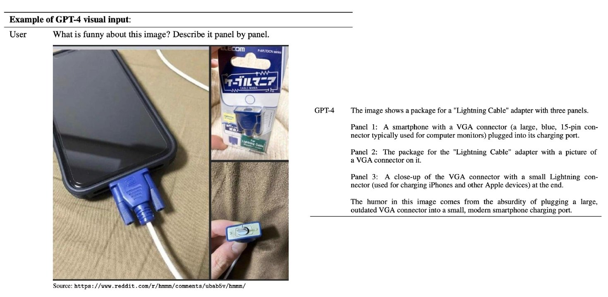

GPT-4 的回答大意是：这是一个 "Lightning Cable" 转接头的包装，有三格画面。第一格，一部智能手机的充电口插着一个 VGA 接头（一种又大又蓝、有 15 个针脚、通常用来连电脑显示器的接头）；第二格，转接头的包装，上面印着 VGA 接头的图片；第三格，VGA 接头的特写，末端是一个小小的 Lightning 接头（iPhone 等苹果设备的充电接口）。笑点在于：把一个又大又过时的 VGA 接头，插进一部小巧的现代手机的充电口，非常荒诞。讲师说，这种语义层面的分析和理解，以前很难做到；有了大型的视觉–语言模型，才能把图像分析到这个程度。

**Generative image models（生成式图像模型）** 走的是相反的方向：从文字到图像。讲师举例说，输入"一只狗在追一只兔子"，就能得到一张这样的图；也可以用自然语言指令编辑已有的图像。这类模型的代表是 **diffusion models（扩散模型）**。

> 📎 **diffusion model 怎么生成图像（超出 slides）** — 训练时，往真实图像上一步步加噪声，直到变成纯噪声，再训练一个网络学会"每一步去掉一点噪声"。生成时反过来：从一张随机噪声图出发，在文字描述（文本 embedding）的引导下一步步去噪，最后得到一张符合描述的图。有意思的是，这和 §2 的去噪滤波在同一条线上：从"给照片去噪"，走到了"从噪声里去出一张照片"。

讲师说，把文本、图像、视频、图形甚至音频结合起来，处理**多模态（multimodal）**信息，正在让图像分析的能力大大提升。他展开讲了几个应用：

- **Autonomous driving（自动驾驶）**；
- **Robotic manipulation（机器人操作）**：机器人要知道物体在桌上的什么位置，把它抓起来，放到别处；
- **Medical image analysis（医学图像分析）**：做手术规划时，要把器官、肿瘤等关键部分分割出来；
- **Visual assistants（视觉助手）**：帮助视障人士。摄像头不断拍下周围的环境，模型迅速用语音告诉他们周围在发生什么；
- **Intelligent surveillance（智能监控）**：更快、更高效地处理大规模监控视频。

讲师在课的最后补充：AI agents 也开始被用于计算机视觉，出现了 **agentic computer vision** 这样的研究，用 AI agent 来分析图像和视频数据。这和 Week 8 §31 文本分析里看到的趋势完全一样。

<details>
<summary>自测：一张 224×224 的图用 16×16 的图块切分，ViT 要处理多少个 token？如果把图块打乱顺序再送进去，又没有 position embedding，会出什么问题？</summary>

$(224/16)^2=196$ 个图块，加 1 个 [class] token，共 197 个。Self-attention 本身不区分顺序，没有 position embedding，打乱前后的输出会完全一样：模型只知道"有哪些图块"，不知道"它们在哪里"，和 BoVW 一样丢掉了空间结构。

</details>

<details>
<summary>自测：用 CLIP 给图片分类，和 Part IV 的 BoVW + 分类器相比，最大的区别是什么？</summary>

BoVW + 分类器是 task-specific 的：每个类别都要收集标注图像，加一个新类别就要重新训练。CLIP 在海量图文对上预训练，把图像和文字放进同一个空间；分类时只需把类别写成一句描述，比较图像 embedding 和各句描述的相似度，就能 zero-shot 分类，加新类别只要多写一句话。这正是 slide 51 说的 task-specific → general-purpose。

</details>

---

# Part VIII · 工具，以及回顾

讲师最后快速介绍了常用工具，并提醒大家后面会有图像分析的 lab。

## §34 OpenCV

Slide 55：

> **OpenCV (A widely used tool for Computer Vision)**
> - Open Source Computer Vision Library (since 1999), with 2,500+ algorithms.
> - Enables image/video processing, object detection, and real-time vision tasks.
> - Face recognition, surveillance, robotics, medical imaging, etc.
> - Written in C++ and work with Python and R languages.

讲师说，如果你要自己写计算机视觉、图像分析的算法，**首选 OpenCV**：它包含大量算法和现成的函数，运行效率很高，适合图像和视频处理、检测、实时视觉任务。Slide 上的示例代码只有五行：

```python
import cv2
img = cv2.imread('example.jpg')                 # 读入图像
gray = cv2.cvtColor(img, cv2.COLOR_BGR2GRAY)    # 彩色 → 灰度
edges = cv2.Canny(gray, 100, 200)               # Canny 边缘检测
cv2.imshow('Edges', edges)                      # 显示结果
```

> **With just a few lines of code, OpenCV turns raw pixels into actionable insights.**

> 📎 **逐行说明（超出 slides）**
>
> - `cv2.imread` 把图像读成一个 $H\times W\times3$ 的数组，也就是图 1 那样的数字表。要注意，OpenCV 的通道顺序是 **BGR**，不是常见的 RGB，所以下一行写的是 `COLOR_BGR2GRAY`。
> - `cv2.cvtColor(..., COLOR_BGR2GRAY)` 把三个通道合成一个灰度通道，得到 $H\times W$ 的数组。
> - `cv2.Canny(gray, 100, 200)` 是经典的 **Canny 边缘检测**。它先算每个像素的梯度大小（和 §10、§21 讲的一样，看亮度变化有多剧烈）；梯度高于 200 的像素一定算边缘，低于 100 的一定不算，介于两者之间的，只有和"一定算"的边缘连在一起时才保留。输出是一张黑底白线的边缘图。
> - `cv2.imshow` 在窗口里显示结果。在脚本里运行时，通常还要加一句 `cv2.waitKey(0)`，否则窗口会一闪而过。

## §35 R 的深度学习包

Slide 56 说 R 也支持深度学习，列了两个包：

```r
library(deepnet)
nn <- nn.train(x, y, hidden = c(5))   # 训练：一个隐藏层，5 个神经元
yy <- nn.predict(nn, x)               # 预测
print(head(yy))
```

```r
library(neuralnet)
df = data.frame(cbind(x, y))
nn = neuralnet(y~V1+V2+V3+V4+V5+V6+V7+V8+V9, data=df, hidden = 5)
yy = nn$net.result[[1]]               # 训练数据上的输出
```

`hidden = c(5)` 和 `hidden = 5` 都表示一个隐藏层、5 个神经元（📎 写成 `c(10, 5)` 就是两个隐藏层）。`neuralnet` 用公式指定模型：`y` 由 `V1` 到 `V9` 这 9 个输入列预测（📎 `V1`…`V9` 是 `cbind` 一个没有列名的矩阵时 R 自动起的名字）。讲师的评价很直接：这两个包**比较老了，只能做多层感知机，算不上真正的"深度"网络**，简单的任务可以用。更复杂的任务，如今应该用下面两个。

Slide 57 是 **torch**（low-level，flexible）：

> A scientific computing framework for machine learning that puts GPUs first. It is easy to use and efficient. Native R interface. Provides tensors, autograd, optimizers…

```r
library(torch)
x <- torch_randn(2, 3)   # 2×3 的随机张量（标准正态分布）
y <- torch_randn(3, 2)   # 3×2
z <- x$matmul(y)         # 矩阵乘法，结果是 2×2
```

> 📎 **几个词（超出 slides）** — **tensor（张量）** 就是多维数组，可以放在 GPU 上计算；**autograd** 是自动求导，训练时自动算出每个参数的梯度（§18 的 backpropagation 就靠它）；**optimizers** 是 SGD、Adam 这类按梯度更新参数的算法。"Native R interface"指 R 的 torch 直接调用底层的 C++ 库 LibTorch，不需要先装 Python。

Slide 58 是 **keras3**（high-level，fast prototyping）：

> Successor of old Keras package. High-level API, quick to build models. Runs on TensorFlow backend.

```r
library(keras3)

model <- keras_model_sequential() |>
  layer_dense(units=128, activation="relu", input_shape=784) |>
  layer_dropout(0.3) |>
  layer_dense(units=10, activation="softmax")

model |> compile(
  loss="categorical_crossentropy",
  optimizer="adam",
  metrics="accuracy"
)
```

逐行看：`|>` 是 R 的管道符，把模型一层层接起来。第一层是 128 个神经元的全连接层，激活函数是 ReLU（§19），输入是 784 维（📎 $28\times28=784$，正是一张 MNIST 手写数字图拉平后的长度）；然后是 `layer_dropout(0.3)`，训练时随机丢掉 30% 的神经元，就是 §23 AlexNet 用的 dropout；最后一层 10 个神经元，`softmax` 把输出变成 10 个类别的概率。`compile` 指定了损失函数（多分类用 categorical cross-entropy）、优化器（Adam）和评估指标（accuracy）。

> **🔑 例 — 数一数这个模型的参数**
>
> - 第一层：$784\times128$ 个权重 + 128 个偏置 $=100{,}480$；
> - dropout 层没有参数；
> - 最后一层：$128\times10+10=1{,}290$；
> - 合计 **101,770** 个参数。
>
> 📎 对比一下 §22：LeNet-5 只有约 6 万个参数，比这个简单的全连接网络还少，在手写数字识别上效果却明显更好（LeCun 等人 1998 年的论文里，它的错误率只有同类全连接网络的几分之一）。差别就在 weight sharing：卷积层用很少的参数，就能在整张图上检测同一种模式。
>
> ⚠️ 注意 slides 58–60 的示例模型都只有全连接层（dense / linear），是**多层感知机，不是 CNN**。要做 CNN，需要加卷积层和池化层，见下一节的 📎 代码。

## §36 Python 的深度学习包

Slide 59 是 **PyTorch**（Python front-end + LibTorch backend）：

> Maintained by PyTorch Foundation. Dynamic computation graph, intuitive API. Ecosystem: torchvision, torchaudio, torchtext. Dominant in research & LLM training.

```python
import torch
import torch.nn as nn

model = nn.Sequential(
    nn.Linear(784, 128),
    nn.ReLU(),
    nn.Linear(128, 10)
)
```

这是和上面 keras3 例子一样的多层感知机（少了 dropout）。讲师说，Python 里**排第一的是 PyTorch**：他的博士生每天都用，做研究时尤其常用，大家分享代码时，代码通常也是 PyTorch 写的。

> 📎 **补充（超出 slides）** — PyTorch 版的最后一层没有 softmax，因为 PyTorch 的 `CrossEntropyLoss` 接收的是没归一化的分数，内部会自己做 softmax。**Dynamic computation graph（动态计算图）** 指计算图随着 Python 代码的执行即时建立，所以可以直接写普通的 if、for，也能用 print 调试，这是它在研究中流行的原因之一。**torchvision** 里有常用的图像数据集、预训练模型（如 §30 的 VGG、ResNet）和图像变换工具。

> 📎 **把 §22 的 LeNet-5 写成 PyTorch（超出 slides）** — 和上面的多层感知机对比，多了卷积层（`Conv2d`）和池化层（`AvgPool2d`），注释里的尺寸和参数个数都能和 §22 的表一一对上：
>
> ```python
> import torch.nn as nn
>
> lenet5 = nn.Sequential(
>     nn.Conv2d(1, 6, kernel_size=5),    # C1：1×32×32 → 6×28×28，156 个参数
>     nn.Tanh(),
>     nn.AvgPool2d(2),                   # S2：→ 6×14×14
>     nn.Conv2d(6, 16, kernel_size=5),   # C3：→ 16×10×10，2,416 个参数
>     nn.Tanh(),
>     nn.AvgPool2d(2),                   # S4：→ 16×5×5
>     nn.Flatten(),                      # 拉成 16×5×5 = 400 维向量
>     nn.Linear(400, 120),               # C5：48,120 个参数
>     nn.Tanh(),
>     nn.Linear(120, 84),                # F6：10,164 个参数
>     nn.Tanh(),
>     nn.Linear(84, 10),                 # OUTPUT：850 个参数
> )
> ```

Slide 60 是 **TensorFlow 2.x / Keras**：

> Google-backed, production-ready. High-level Keras API for rapid prototyping. Strong deployment ecosystem (TensorBoard). Great for enterprise & mobile.

```python
from tensorflow import keras

model = keras.Sequential([
    keras.layers.Dense(128, activation='relu', input_shape=(784,)),
    keras.layers.Dropout(0.3),
    keras.layers.Dense(10, activation='softmax')
])

model.compile(optimizer='adam',
              loss='categorical_crossentropy',
              metrics=['accuracy'])
```

这段和 §35 的 keras3 代码几乎逐行对应，只是换成了 Python 的写法：R 版本用 `|>` 一层层接，Python 版本把各层放进一个列表。讲师说，如果你看重**部署能力**，TensorFlow / Keras 是不错的选择，适合企业和移动端。

> 📎 TensorBoard 主要是训练过程的可视化工具（看损失曲线、准确率曲线）；TensorFlow 的部署工具还包括服务器端的 TF Serving 和移动端的 TensorFlow Lite。

Slide 61 是 **Hugging Face** 生态：

> Machine learning community collaborates on models, datasets, and applications. Pretrained models for NLP, vision, speech, multimodal, diffusion, etc. 1M+ models, 400k+ applications, and 250k+ datasets. Access to the state-of-the-art AI.

讲师说，Hugging Face 如今非常流行，上面有大量自然语言处理和计算机视觉的预训练模型，大家都在大量使用。他鼓励大家："*如果你对 AI 的最新进展感兴趣，就去看看 Hugging Face 生态，你会找到很多有意思的东西。*" §26 说的"别人预训练好的模型"，很多就发布在这里。

Slide 62 把几个 Python 库放在一起比较：

| Library | Backend | Abstraction | Best For | Status |
|---|---|---|---|---|
| PyTorch | Native | Low/Mid | Research, LLMs | Active |
| TensorFlow/Keras | Native | High-level | Production, Enterprise | Active |
| JAX + Flax | XLA | Low/Mid | Cutting-edge research | Active |
| Hugging Face | Multiple | High-level | Pretrained models | Active |
| Lightning | PyTorch | High-level | Structured training | Active |

讲师的总结：PyTorch 最适合研究，TensorFlow / Keras 适合生产和企业，Hugging Face 上有大量预训练模型。

> 📎 **表里另外两个（超出 slides）** — **JAX + Flax** 是 Google 的另一套框架，用 XLA 编译器把计算编译成高效的 GPU/TPU 代码，常见于前沿研究。**Lightning**（PyTorch Lightning）建立在 PyTorch 之上，把训练循环、日志、多 GPU 这些重复的工程代码整理成固定结构，让训练代码更规整。

## §37 回顾：图像分析的演进

Slide 63 总结了这一章：

> **Summary — The Evolution of Image Analytics**
> - Image representation is fundamental to analysis. **Handcrafted features → BoVW → CNNs → ViT.**
> - Modern image analysis increasingly relies on: large-scale pretraining and self-supervised learning; visual foundation models and transfer learning; multimodal AI and generative models.
> - Image analysis has extensive applications.
> - Important challenges remain in **reliability, interpretability, computational efficiency and the semantic gap**.

图 27 把这条演进路线画成了时间线：

```plot 图 27 · 图像表示的演进：手工全局特征 → 局部不变特征 + BoVW → 深度学习
up = [(1998, "LeNet-5", 1.0), (2003, "BoVW", 1.0), (2005, "HOG", 1.8), (2012, "AlexNet", 1.0),
      (2015, "ResNet", 1.8), (2020, "ViT", 1.0), (2023, "SAM · DINOv2", 1.8)]
down = [(2004, "SIFT", -1.0), (2009, "ImageNet", -1.0), (2014, "VGG", -1.0),
        (2019, "EfficientNet", -1.8), (2021, "CLIP\nDINO", -1.0), (2024, "GPT-4o", -1.8)]
def era(y):
    return "#8a9199" if y < 2000 else ("#c0714f" if y < 2012 else "#2f6f4f")
plt.figure(figsize=(8, 3.6))
plt.axvspan(1995, 2000, color="#8a9199", alpha=0.10)
plt.axvspan(2000, 2012, color="#c0714f", alpha=0.10)
plt.axvspan(2012, 2026, color="#2f6f4f", alpha=0.08)
plt.text(1997.5, 2.55, "手工全局特征", ha="center", fontsize=9.5, color="#5b636b")
plt.text(2006, 2.55, "局部不变特征 + BoVW", ha="center", fontsize=9.5, color="#c0714f")
plt.text(2019, 2.55, "深度学习：CNN → ViT → 基础模型", ha="center", fontsize=9.5, color="#2f6f4f")
for (y, name, h) in up + down:
    c = era(y)
    plt.plot([y, y], [0, h], color=c, lw=1)
    plt.scatter([y], [0], color=c, zorder=3, s=18)
    plt.text(y, h + (0.08 if h > 0 else -0.08), name, ha="center",
             va="bottom" if h > 0 else "top", fontsize=9.5, color=c,
             fontweight="bold" if name == "AlexNet" else "normal")
plt.axhline(0, color="#5b636b", lw=1)
plt.xlim(1995, 2026); plt.ylim(-2.4, 2.95)
plt.yticks([])
plt.gca().spines["left"].set_visible(False)
plt.xlabel("年份")
```

> 📎 图 27 中 slides 没有给出的年份（LeNet-5、SIFT、BoVW、HOG、ImageNet、DINOv2、GPT-4o 等）是补充的，按论文或模型首次发表的年份标注。

讲师强调，现代图像分析越来越依赖大规模预训练模型、视觉基础模型和多模态 AI，"*我们应该好好利用它们，而不是什么都从头开发*"。图像分析的应用越来越广；semantic gap 被缩小了，但还没有被填平，可靠性、效率、可解释性和 semantic gap 这些挑战依然存在。

> 📎 **四个挑战各指什么（超出 slides）**
>
> - **Reliability（可靠性）**：模型在训练时没见过的条件下（罕见的光照、天气、角度）可能突然出错；视觉–语言模型还可能"一本正经地"描述图里并不存在的东西。
> - **Interpretability（可解释性）**：深度模型有上千万甚至更多参数，很难说清它为什么做出某个判断，这在医疗、司法这类场景里尤其要紧。
> - **Computational efficiency（计算效率）**：大模型的训练和推理都需要大量算力，开销大、耗电多，也难以部署到手机等设备上。
> - **Semantic gap**：§1 的那道鸿沟。

Slide 64 是全章的最后一句话：

> **The fundamental goal remains the same: transforming unstructured image into useful information, knowledge and insights.**
>
> **Take-home message: From task-specific analysis towards general-purpose intelligence through foundation models.**

讲师说，这和上周文本分析最后一页的结论完全一样：根本目标没有变，变的是工具。我们正在借助基础模型，从 task-specific 的分析走向 general-purpose 的智能，这是当下的主要趋势。

回头看这一章，每一个时代都在回答 §7 提出的同一个问题：怎样得到一个既 invariant 又 discriminative 的表示。手工全局特征靠人的经验，两条都做得不好；局部不变特征 + BoVW 靠精心设计的描述子换来了不变性，却丢了空间结构，特征也没法为任务调整；CNN 把特征交给数据去学，并和分类器一起训练；ViT 和基础模型进一步借助海量数据和 Transformer，学到了能迁移到各种任务上的通用表示。从像素到概念的那道 semantic gap，就在这一步步之中被缩小。

---

# 本章小结 (Key takeaways)

- **Image analysis** 是对视觉数据的 representation、processing 和 modelling，目标是得到有用的洞察。视觉数据是 unstructured 的，而且存在 **semantic gap**：计算机拿到的是像素值这类 low-level features，人理解的是 high-level concepts。
- **Image processing** 的输入和输出都是图像（缩放、平移、旋转、滤波、增强、直方图均衡化），不涉及概念。**Image recognition**（狭义）包括 classification；detection、localisation、tracking；segmentation、reconstruction；search、retrieval，区别在于输出：一个标签、类别加位置、轨迹、逐像素的类别、3D 模型、相似图像。
- 图像分析分三步：**collection & labelling**（收集有代表性的图像并标注 ground truth，标注费时费力）→ **representation** → **analysis techniques**。业务问题要先翻译成具体的图像任务：商店例子里是年龄和性别估计、顾客跟踪、商品识别，再结合收银数据。
- 好的表示要 **invariant**（对尺度、旋转、光照、遮挡、背景杂乱、形变这类无关变化不敏感），又要 **discriminative**（不同类别差别明显）。只满足其中一条很容易，难在同时满足。
- 表示经历了三个时代：**手工全局特征**（2000 年以前：intensity、colour、texture、shape；不可靠，只能做窄任务）→ **局部不变特征 + BoVW**（2000–2012：SIFT、HOG、SURF、CENTRIST）→ **deep learning**（2012 至今：直接从数据中学特征，并和分类器一起训练）。
- **BoVW** 借鉴 BoW：提取局部特征（interest point detection 或 dense sampling，每个图块一个向量，如 128 维的 SIFT）→ 用 **K-means** 聚类，生成 visual words → 把每个图块归入最近的 word，数出直方图 $[n_1,\dots,n_k]$ → 送进分类器（如 $y=\mathbf{w}'\mathbf{x}+b$）。词典只建一次；BoVW 忽略空间位置，特征和分类器分开设计。
- **Deep learning** 受大脑视觉通路启发（V1 → V2 → V4），由多层非线性处理组成，逐层学到 low → mid → high-level features。它并非全新的想法，2012 年前后才成功，靠的是三根支柱：**computational power、large-scale data、new algorithms**。
- **CNN** 的 convolution 用可学习的 filter 在图上滑动、检测模式（weight sharing 让参数很少），pooling 缩小 feature map、保留最强的信号；层越高，特征越全局、越 invariant。**LeNet-5** 约 60K 参数；**AlexNet** 有 8 个可学习层、60M 参数，ImageNet top-5 错误率 16.4%（第二名 26.2%），得益于 GPU、120 万张图像和 dropout。
- 使用预训练 CNN 有三种方法：**直接提特征**（用最后的卷积层或全连接层，不用前几层；卷积层的输出要 pooling：sum、max、grid-based max、region-based、mixed sum & max）、**fine-tune**（让模型适应新任务）、**"Deep SIFT" + BoVW**（较少用）。前两种最常用。
- CNN 之后：更深更强的 CNN（VGG 2014、ResNet 2015、EfficientNet 2019）；**ViT**（2020）把图像切成图块当作 token，用 self-attention 建立全图范围的关系，数据足够大时效果很好；**visual foundation models** 推动 task-specific → general-purpose：DINO / MAE / DINOv2 从无标注图像中自监督学习，CLIP（2021）把图像和文字对齐、能用自然语言做分类，SAM（2023）可迁移到各种分割任务。
- 新前沿是 **多模态理解与生成式 AI**：vision–language models（LLaVA、Qwen-VL、GPT-4o）能看图写描述、做视觉问答、围绕图像对话；diffusion models 能用自然语言生成、编辑图像。Semantic gap 被大大缩小，但还没有被填平。
- 工具：OpenCV（1999 年起，2,500+ 算法，C++ 编写，可用于 Python 和 R）；R 的 deepnet、neuralnet（老，只能做多层感知机）、torch（低层、灵活）、keras3（高层、快速搭模型）；Python 的 PyTorch（研究、LLM）、TensorFlow / Keras（生产、企业、移动端）、Hugging Face（预训练模型）。
- 挑战依然存在：reliability、interpretability、computational efficiency、semantic gap。**根本目标不变：把非结构化的图像变成有用的信息、知识和洞察。** Take-home message：借助基础模型，从 task-specific analysis 走向 general-purpose intelligence。

# 公式与数字速查

| 量 | 公式 / 数字 | 说明 |
|---|---|---|
| 彩色图的数据量 | $H\times W\times3$ 个数 | RGB 三个通道；1920×1080 约 620 万个数 |
| 归入最近的 visual word | $c(\mathbf{p}_i)=\arg\min_j\lVert\mathbf{p}_i-\boldsymbol{\mu}_j\rVert$ | $\boldsymbol{\mu}_j$ 是 K-means 的聚类中心 |
| BoVW 直方图 | $n_j=\sum_{i=1}^m\mathbb{1}[c(\mathbf{p}_i)=j]$，$\mathbf{x}=[n_1,\dots,n_k]$ | slide 25；📎 可除以 $m$ 归一化 |
| 线性分类器 | $y=\mathbf{w}'\mathbf{x}+b=\sum_j w_jx_j+b$ | slide 26；按 $y$ 的正负分类，$y=0$ 是决策边界 |
| 📎 SIFT 描述子 | $4\times4$ 格 × 8 个方向 = 128 维 | 讲师："128 维的向量" |
| 📎 卷积输出边长 | $\dfrac{N-F+2P}{S}+1$ | LeNet C1：$32-5+1=28$ |
| 📎 卷积层参数 | $(F\times F\times C_{\text{in}}+1)\times C_{\text{out}}$ | LeNet C3：$(5\times5\times6+1)\times16=2{,}416$ |
| 📎 全连接层参数 | $(n_{\text{in}}+1)\times n_{\text{out}}$ | LeNet F6：$(120+1)\times84=10{,}164$ |
| 📎 ReLU | $\max(0,z)$ | 非线性激活函数 |
| LeNet-5 | 约 60K 参数；C1 6@28×28 → S2 6@14×14 → C3 16@10×10 → S4 16@5×5 → C5 120 → F6 84 → 10 | slide 34 |
| AlexNet | 8 个可学习层，60M 参数，top-5 错误率 16.4% vs 26.2%，120 万张图 | slide 35；差 9.8 个百分点 |
| 📎 ViT 的 token 数 | $(224/16)^2=196$ 个图块 + 1 个 [class] token；每个图块 $16\times16\times3=768$ 个数 | "An Image is Worth 16x16 Words" |
| 📎 keras3 示例模型 | $(784+1)\times128+(128+1)\times10=101{,}770$ 个参数 | slides 58、60 的多层感知机 |

# 全章概念地图

图 28 把全章串成一条线。绿色是本章的两个核心概念，橙色是始终没有完全填平的鸿沟，蓝色是目前走到的地方；最后那条虚线表示"缩小了，但还没有填平"。和前几周的联系见本讲义末尾的图 29。

```d2 图 28 · 全章概念地图
direction: down
ia: "Image analysis\n表示 · 处理 · 建模" {class: key}
gap: "Semantic gap\n像素 ↔ 概念" {class: warn}
tasks: "Processing：图 → 图\nRecognition：分类 · 检测 · 分割 · 检索"
rep: "Representation\ninvariant + discriminative" {class: key}
bovw: "局部特征 + BoVW\n2000–2012"
cnn: "CNN\n2012 起"
vit: "ViT\n2020 起"
fm: "基础模型 · VLM\nCLIP · SAM · GPT-4o" {class: good}
ia -> gap: 受困于
ia -> tasks: 两个层次
gap -> rep: 跨越它要靠
rep -> bovw: "人工设计\n（借鉴 BoW + K-means）"
bovw -> cnn: 特征改为从数据中学
cnn -> vit: "另一种架构\n（借鉴 Transformer）"
cnn -> fm: 预训练 + 迁移
vit -> fm
fm -> gap: 缩小，未填平 {style.stroke-dash: 4}
```

# 考点提示与易错点

1. **定义要背准**：image analysis 是 *the representation, processing, and modelling of visual data to derive useful insights*；semantic gap 是 *the gap between high-level concepts used by human and the low-level features used by computer*。视觉数据是 **unstructured** 的。
2. **Image processing 与 image recognition 的区别**：processing 输入输出都是图（scaling、translation、rotation；filtering、enhancement、histogram equalisation），不涉及概念；recognition（in a narrow sense）有四类：classification；detection、localisation、tracking；segmentation、reconstruction；search、retrieval。
3. **四类分类任务的例子**（slide 6）：face recognition、OCR recognition、scene recognition、object recognition。⚠️ object recognition 属于 classification，不是 detection。
4. **Benchmark datasets** 的名字（slide 10）：Caltech101 / 256、PASCAL VOC、ImageNet、Microsoft COCO、ORL database of faces、Labelled Faces in the Wild。
5. **三个步骤**（slide 11）：collection and labelling（representative images + ground truth）；image representation（**invariant and discriminative**）；image analysis techniques。
6. **商店案例**：who are the main customers → age / gender estimation；what are the shopping patterns → tracking + 商品识别 + checkout data。收集数据要注意 rights of the owner、隐私和伦理。
7. **表示为什么难**（slide 14）：scale、rotation、illumination、occlusion、background clutter、deformation；slide 30 还有 pose、multiple objects、**inter-class similarity**。能分清哪些挑战 invariant、哪些挑战 discriminative。
8. **三个时代的年份和代表**：before 2000（hand-crafted, global：intensity、colour、texture、shape、structure）；2000–2012（BoVW：SIFT、HOG、SURF、CENTRIST、filter-based；invariant to view angle, scale, illumination）；2012–present（directly learn feature representations from data）。
9. **BoVW 五步**（slide 27）按顺序背：image dataset → local feature extraction → visual word creation → histogram generation → image recognition。Visual words 由 **K-means** 聚类生成；直方图的 $n_1$ 是第 1 个 word 在这张图里出现的次数；分类在 $\mathbb{R}^k$ 中进行，$y=\mathbf{w}'\mathbf{x}+b$。
10. **分清三个层次**：局部特征（一个图块 → 一个描述子向量，如 SIFT 128 维）、visual word（一个聚类中心）、BoVW 直方图（一张图 → 一个 $k$ 维向量）。
11. **Deep learning 的两句话**：directly learn feature representations from data；joint learn feature representation and classifier。"Train layers of features so that classifier works well." 特征分 low-level、mid-level、high-level。
12. **Have we been here before?** Yes：basic ideas common to past neural networks research；standard ML strategies still relevant。No：computational power + large-scale data + new algorithms。
13. **CNN**（slide 34）：multi-stage architecture inspired by visual system；higher stages compute more global, more invariant features；LeNet-5 约 **60K** 参数。读得懂 LeNet-5 图上的标注（C1 6@28×28 等），知道卷积负责特征学习、全连接负责分类。
14. **AlexNet**（slide 35）：8 learnable layers、60 million parameters、16.4% vs 26.2%（top-5）；fast hardware（GPU）、big dataset（1.2 million images vs thousands before）、better regularization（dropout）。⚠️ 讲师口头说"更好的优化算法"，以 slide 为准；"低 10%"指百分点。
15. **CNN 学到的特征**（slide 36）：低层是边缘、纹理，高层是物体部件、物体，越往上越抽象。
16. **预训练 CNN 的三种方法**（slide 40）：directly use pre-trained CNNs（extract features）；fine-tune pre-trained CNNs（with images from recognition tasks）；BoVW based on CNN features（"Deep SIFT"）。前两种最常用。
17. **Which layer**：最后一个卷积层或全连接层，不用前几层。**How to pool**（slide 44）五种：sum-pooling、max-pooling、grid-based max-pooling、region-based pooling、mixed sum & max pooling。
18. **Fine-tune 的两句话**（slide 45）：to incorporate extra information from the images of a new recognition task；make the pre-trained CNNs adapt to this new task。
19. **CNN 之后**（slide 49）：VGG（2014）、ResNet（2015）、EfficientNet（2019）；ViT（2020）：divide an image into patches → tokens；self-attention learns relationships among image regions；alternative to CNNs。CNNs and Transformers are now both widely used。
20. **Visual foundation models**（slide 51）：task-specific → general-purpose；self-supervised（DINO、MAE、DINOv2）用**无标注**图像；CLIP（2021）学图像与文字描述的关系，能用自然语言分类；SAM（2023）在大而多样的数据上预训练，可迁移到多种下游任务。
21. **New frontier**（slide 53）：VLMs（LLaVA、Qwen-VL、GPT-4o）→ image captioning、visual question answering、image-based dialogue；diffusion models → 用自然语言生成和编辑图像；应用：autonomous driving、robotic manipulation、medical image analysis、visual assistants、intelligent surveillance。
22. **工具**：OpenCV（since 1999、2,500+ algorithms、C++、works with Python and R）；R：deepnet、neuralnet、torch（low-level）、keras3（high-level、TensorFlow backend）；Python：PyTorch（research、LLMs、dynamic computation graph）、TensorFlow / Keras（production、enterprise、mobile）、Hugging Face（pretrained models；1M+ models、400k+ applications、250k+ datasets）、JAX + Flax、Lightning。⚠️ slides 58–60 的示例模型是多层感知机，不是 CNN。
23. **Summary**（slides 63–64）：handcrafted features → BoVW → CNNs → ViT；四个挑战：reliability、interpretability、computational efficiency、semantic gap；根本目标不变；take-home message：from task-specific analysis towards general-purpose intelligence through foundation models。

# 自测题

1. 写出 image analysis 的定义。什么是 semantic gap？各举一个 high-level concept 和 low-level feature 的例子。
2. 下列各属于哪类任务：(a) 在超市监控视频里持续标出某位顾客的位置；(b) 判断一张胸部 X 光片是否显示肺炎；(c) 自动驾驶中标出哪些像素是可行驶的路面；(d) 用一张景点照片在图库里找同一景点的其他照片；(e) 把一张逆光拍暗了的照片调亮。
3. 商店想知道"谁是主要顾客""购物模式是什么"。各需要哪些图像任务？还应结合什么数据？收集数据时要注意什么？
4. 解释 invariant 和 discriminative。为什么"把每张图都映射成零向量"和"直接用原始像素值"都不是好的表示？
5. 为什么颜色直方图很难区分"一位穿棕色衣服的人"和"一只棕色的狗"？从 invariant 和 discriminative 两方面回答。
6. 计算题。BoVW 词典有 3 个 visual words，中心为 $\boldsymbol\mu_1=(1,1)$、$\boldsymbol\mu_2=(5,1)$、$\boldsymbol\mu_3=(3,5)$（二维示意）。一张图的 5 个图块描述子为 $(0,1)$、$(4,2)$、$(3,4)$、$(5,0)$、$(2,1)$。
   - (a) 求这张图的 BoVW 直方图，以及归一化后的直方图；
   - (b) 线性分类器 $\mathbf{w}=(1,-0.5,2)$，$b=-2$，用未归一化的直方图算 $y$，$y>0$ 判为 A 类，否则判为 B 类。这张图属于哪类？
7. 为什么 BoVW 需要 K-means，而 Week 8 的 BoW 不需要？visual word 的个数 $k$ 太大或太小，各会出什么问题？
8. 计算题。输入是 5×5 的图：前两行全是 0，后三行全是 9。用 3×3 的 filter $\begin{bmatrix}1&1&1\\0&0&0\\-1&-1&-1\end{bmatrix}$（上行减下行）做卷积（stride 1，不补零）。输出多大？写出输出，并解释它检测的是什么。
9. 对 feature map $\begin{bmatrix}2&0&1&1\\4&2&3&1\\0&0&5&6\\1&1&7&8\end{bmatrix}$ 做 2×2 的 max pooling 和 average pooling。
10. LeNet-5：用公式验证 C1、C3 的输出尺寸和参数个数。整个网络哪一部分的参数最多？卷积层为什么参数少？
11. Slide 35 给出了 AlexNet 成功的哪三个原因？它们对应 slide 33 的哪三根支柱？讲师说 AlexNet 的错误率"比第二名低 10%"，这个 10% 应该怎么理解？
12. 解释 "directly learn" 和 "joint learn"。为什么特征和分类器一起训练，比先设计特征、再训练分类器好？
13. 预训练 CNN 的三种用法各是什么？哪两种最常用？
14. 直接使用预训练 CNN 时，应该用哪一层的输出？为什么不用第一层？某卷积层输出有 2 个通道：通道 1 为 $\begin{bmatrix}0&0\\0&8\end{bmatrix}$，通道 2 为 $\begin{bmatrix}2&2\\2&2\end{bmatrix}$。分别写出 sum pooling 和 max pooling 得到的向量，并说明两者的差别。
15. ViT：一张 224×224 的彩色图、16×16 的图块，会得到多少个 token？每个图块原本有多少个数？为什么需要 position embedding？和 CNN 比，ViT 的优势是什么？什么条件下它效果好？
16. CLIP 是怎样训练的？它怎样在没有任何标注训练图像的情况下，把一张图分到 {cat, dog, car} 之一？这和 Week 8 的哪个概念相似？
17. 什么是 task-specific → general-purpose？用文本（Week 8）和图像（本周）各举一个例子。
18. 代码题：(a) `cv2.Canny(gray, 100, 200)` 做什么？两个数字是什么意思？(b) slide 58 的 keras3 模型有多少个参数？为什么说它不是 CNN？

<details>
<summary><b>参考答案（先自己做完再展开）</b></summary>

1. Image analysis 是对视觉数据的 representation、processing 和 modelling，目的是得到有用的洞察（refers to the representation, processing, and modelling of visual data to derive useful insights）。Semantic gap 是人使用的 high-level concepts 和计算机使用的 low-level features 之间的鸿沟。High-level concept 如"一场生日聚会""这只猫很开心"；low-level feature 如像素值、红色所占比例、一条直线。

2. (a) object **tracking**；(b) image **classification**；(c) scene **segmentation**；(d) image **search and retrieval**；(e) image **processing**（enhancement），不属于狭义的图像识别。

3. "谁是主要顾客"：age estimation、gender estimation；"购物模式"：顾客的检测与跟踪（object tracking），以及识别顾客拿起、看过、放回了哪些商品。还应结合收银台数据（最终买了什么）。收集时要注意数据所有者的权利、隐私与伦理：顾客知情并同意，身份不被泄露。

4. Invariant：同一类东西因拍摄条件不同（尺度、旋转、光照、遮挡……）而产生的变化，不应改变它的表示。Discriminative：不同类的东西，表示要明显不同。零向量对任何变化都不变（完全 invariant），但猫狗无法区分（毫无区分力）；原始像素值让任何两张图都不同，可物体稍微一动、光照稍微一变，向量就大变（不 invariant），同类的图也会散开。

5. 颜色直方图只统计每种颜色有多少，不记录颜色在哪里、组成什么形状。人和狗的颜色分布可以非常相似，所以它**不够 discriminative**；同一只狗在灯光下和阴影里颜色分布差很多，所以它也**不够 invariant**。

6. (a) 距离平方：$(0,1)$ → 1、25、25，归 w1；$(4,2)$ → 10、2、10，归 w2；$(3,4)$ → 13、13、1，归 w3；$(5,0)$ → 17、1、29，归 w2；$(2,1)$ → 1、9、17，归 w1。直方图 $\mathbf{x}=[2,2,1]$，归一化后为 $[0.4,0.4,0.2]$。(b) $y=1\times2-0.5\times2+2\times1-2=1>0$，判为 **A 类**。

7. 文本的词是离散符号，词典现成；图像的图块是连续的向量，几乎不会有两个完全相同，没有现成的词典，所以要用 K-means 把相似的图块聚成一类，每个聚类中心当作一个 visual word。$k$ 太小：不同的图案被并进同一个词，区分力下降；$k$ 太大：同一种图案被拆成多个词，稳定性下降，直方图也很稀疏。

8. 输出边长 $(5-3)/1+1=3$，是 3×3。每个输出 = 窗口上行之和 − 窗口下行之和。窗口覆盖第 1–3 行时：$0-27=-27$；覆盖第 2–4 行时：$0-27=-27$；覆盖第 3–5 行时：$27-27=0$。输出为 $\begin{bmatrix}-27&-27&-27\\-27&-27&-27\\0&0&0\end{bmatrix}$。它检测的是**水平边缘**：窗口跨在暗（上）亮（下）交界上时响应强（绝对值大），在均匀区域里为 0。

9. Max pooling：$\begin{bmatrix}4&3\\1&8\end{bmatrix}$；average pooling：$\begin{bmatrix}2&1.5\\0.5&6.5\end{bmatrix}$。（四块分别是 $\{2,0,4,2\}$、$\{1,1,3,1\}$、$\{0,0,1,1\}$、$\{5,6,7,8\}$。）

10. C1：$32-5+1=28$，6@28×28，参数 $6\times(5\times5\times1+1)=156$；C3：输入 14×14，$14-5+1=10$，16@10×10，参数 $16\times(5\times5\times6+1)=2{,}416$。参数最多的是全连接部分（C5 的 48,120 和 F6 的 10,164，合计占九成以上）。卷积层靠 weight sharing：一个 filter 的一组权重在全图每个位置重复使用。

11. Fast hardware（GPU-optimized code）、big dataset（1.2 million images vs thousands before）、better regularization（dropout et al.），对应 computational power、large-scale data、new algorithms。"低 10%"是指错误率低了约 10 个**百分点**（26.2% − 16.4% = 9.8），按相对比例算是低了约 37%。

12. Directly learn：特征不由人设计，而是由神经网络从数据中自动学出来。Joint learn：特征学习和分类器在同一个网络里一起训练。分开设计时，特征一旦算出就固定了，丢掉的信息（比如颜色直方图丢掉的空间位置）分类器再好也找不回来；一起训练时，分类误差会一路传回特征层（backpropagation），让特征朝着"最有利于分类"的方向调整。

13. ① 直接用预训练 CNN 提取图像特征，再接自己的分类器；② 用新任务的图像 fine-tune 预训练 CNN，让它适应新任务；③ 用 CNN 给图块或特征图上的每个位置提取特征（"Deep SIFT"），再建 BoVW 模型。①、② 最常用。

14. 用最后一个卷积层或全连接层，它们是高层表示；第一层只是边缘、颜色斑块这类低层特征，不够可靠。Sum pooling：$(8,8)$；max pooling：$(8,2)$。两个通道的总量一样，sum pooling 分不出来；max pooling 能看出通道 1 在某处有一个很强的响应，通道 2 处处都弱。

15. $(224/16)^2=196$ 个图块，加 1 个 [class] token 共 197 个 token；每个图块有 $16\times16\times3=768$ 个数。Self-attention 本身不区分顺序，position embedding 告诉模型每个图块原本在图的哪里，否则模型会像 BoVW 一样丢掉空间结构。优势：self-attention 让每个图块在第一层就能和全图所有图块建立关系（long-range dependency），而 CNN 的小 filter 只能看局部。数据集足够大时，ViT 效果很好。

16. CLIP 用一个视觉分支和一个文本分支，把大量网上收集的"图像–文字描述"对投影到同一个 embedding 空间，训练时把配对的拉近、不配对的推远（contrastive）。分类时，把类别写成 "a photo of a cat / dog / car"，算出文本 embedding，再和图片的 embedding 比相似度，最相似的那句就是预测类别（zero-shot）。这和 Week 8 的 word embedding（意思相近的东西在空间里离得近）是同一种想法。

17. 以前每个任务都要单独收集数据、单独训练一个专用模型；现在一个在海量数据上预训练的通用模型能完成很多任务。文本：以前情感分析、主题发现、文档分类各用一个模型（如 BoW + Naïve Bayes、LDA），现在一个 LLM 按指令完成各种任务。图像：以前每个领域都要开发专门的分割模型，现在 SAM 能直接分割任意图像和视频里的物体；CLIP 能用自然语言对任意类别做分类。

18. (a) Canny 边缘检测：梯度大小高于 200 的像素一定算边缘，低于 100 的一定不算，介于两者之间的，只有和强边缘相连时才保留；输出一张边缘图。(b) $(784\times128+128)+(128\times10+10)=100{,}480+1{,}290=101{,}770$ 个参数。它只有全连接层（dense）和 dropout，是多层感知机；CNN 需要卷积层和池化层。

</details>

---

# 与前后各周的连接

```d2 图 29 · Week 9 和其他各周的关系
direction: right
W2: "Week 2 · Lifecycle\n非结构化数据"
W4: "Week 4 · Clustering\nK-means"
W5: "Week 5 · Classification\nSVM · kNN · NB"
W6: "Week 6 · Regression\nlogistic regression"
W8: "Week 8 · Text\nBoW · Transformer"
W9: "Week 9\nImage Analysis" {class: key}
W11: "Week 11\nTime Series"
W12: "Week 12\nGraph Neural Networks"
W2 -> W9
W4 -> W9
W5 -> W9
W6 -> W9
W8 -> W9
W9 -> W11
W9 -> W12
```

- **承接 Week 2**：图像和视频是典型的 unstructured 数据，这是 §1 的出发点。
- **承接 Week 4**：BoVW 的词典就是用 **K-means** 聚类得到的（§13），$k$ 的选择和 Week 4 一样要权衡。图像一旦变成向量，也可以直接拿去做聚类。
- **承接 Week 5**：BoVW 直方图或 CNN 特征可以接任何分类器，slide 30 点名的 Naïve Bayes、kNN、SVM 都是 Week 5 学过的；slide 26 的 $y=\mathbf{w}'\mathbf{x}+b$ 就是线性分类器；dropout 要对付的正是 Week 5 讲过的 overfitting。
- **承接 Week 6**：📎 logistic regression 可以接在 BoVW 后面做分类；CNN 最后的 softmax 层，其实就是多类别的 logistic regression，只不过它的输入是网络自己学出来的特征。
- **承接 Week 8**：这是联系最紧的一周。BoVW 直接借鉴 BoW（§11），归一化和 $\text{TF}_3$ 同理（§14）；ViT 把图块当作 token、用 Transformer 处理（§31）；MAE 的"遮住再补全"和 BERT 是同一个思路；CLIP 的共享空间延续了 word embedding 的想法（§32）；task-specific → general-purpose 的趋势、AI agents 的应用，以及"根本目标不变"的结论，两周完全对称。
- **本周 lab**：讲师提到，后面会有图像分析的 lab，用到 §34–§36 介绍的工具。
- **指向 Week 11**：📎 时间序列也可以用神经网络和深度学习方法建模（Week 11 的 slides 提到了 *neural networks and deep learning methods*），卷积、Transformer 这些结构同样能用在序列数据上。
- **指向 Week 12**：📎 Week 12 的 slides 把图像看成一种特殊的图（*images as graphs*：规则网格上的像素就是节点，相邻像素之间有边）。GNN 的 message passing 汇总每个节点的邻居信息，可以看作把 CNN"汇总邻域"的卷积从规则网格推广到了任意的图上。

# 附：录音转写的误识别对照

录音转写里有不少技术词被识别错了，读录音稿时可以对照这张表：

| 转写里的写法 | 实际是 |
|---|---|
| back of visual words、backward visual worlds、background visual model、back a visual world model、backward which work | bag-of-visual-words（BoVW）model |
| backwards model（回顾 Week 8 时） | bag-of-words model |
| visual world、ward 1 / ward 2 | visual word、word 1 / word 2 |
| local environment features、local environmental features | local invariant features |
| Kamians clustering | K-means clustering |
| shift、6 the features | SIFT、SIFT features |
| deep shift | deep SIFT |
| indirect nation、Indirectcognition | image recognition |
| sin segmentation、thin segmentation | scene segmentation |
| class file | classifier |
| Imaging that | ImageNet |
| LANET 5、the net（"the net only has 60K"） | LeNet-5 |
| AIXNET、ALINET、adding SNT、AlexNT | AlexNet |
| conversion / conventional / completion / combustion neural network | convolutional neural network |
| the future（讲 filter 时） | the filter |
| we 1、week 2、week 4（讲视觉通路时） | V1、V2、V4 |
| portrayed、protein、perrino、Prino、Percino、pretuned、perutrino | pre-trained |
| conclusion layer | convolutional layer |
| sampling or max pulling、some pulling | sum pooling or max pooling、sum pooling |
| I'm now victim | into a vector |
| VG16、VHG19、resNNT 25、efficient at 2019 | VGG16、VGG19、ResNet（2015）、EfficientNet（2019） |
| transform（讲 ViT 时） | transformer |
| self-suplied learning | self-supervised learning |
| Dino MAE of Dino V2、dinner | DINO、MAE、DINOv2 |
| approaching（vision language approaching、large scale approaching models） | pretraining |
| SM1、SM 2、SM 3、metal | SAM 1、SAM 2、SAM 3、Meta |
| GPT 40 | GPT-4o |
| Pytoch、Pytouch、pi torch | PyTorch |
| leap lodge | LibTorch |
| Kiras | Keras |
| hugging fees、hugging fish、hugging phase | Hugging Face |
| NBS classifier、cleaner neighbor、supported by machine | Naïve Bayes classifier、k-nearest neighbour、support vector machine |
| Eucliar distance | Euclidean distance |
| bird（补讲 Week 8 时） | BERT |
| primacy | privacy |
| LMM | LLM |
| graph it（讲机器人时） | grasp it |

---

> **本讲义覆盖 slides 全部 65 页，以及 Week 9 课堂录音中图像分析部分的全部内容**（录音开头补讲的 Week 8 slides 61–70 见 Week 8 讲义 §29–§32）。
> 标注为 📎 的内容超出 slides 范围，为补足理解所加；标注为 🎙️ 的内容不在 slides 上，但讲师课堂明确讲授，按考试范围对待；标注为 ⚠️ 的是 slides / 录音里的笔误，或需要特别注意的坑。
