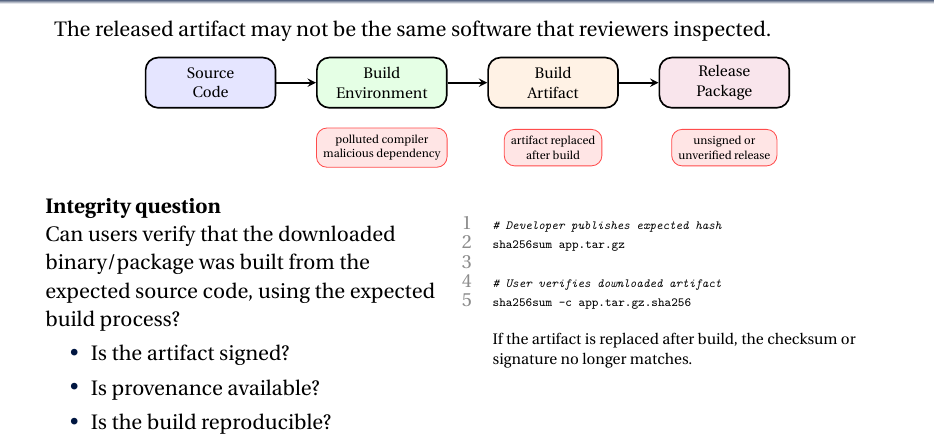
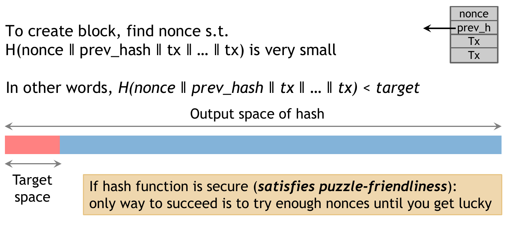
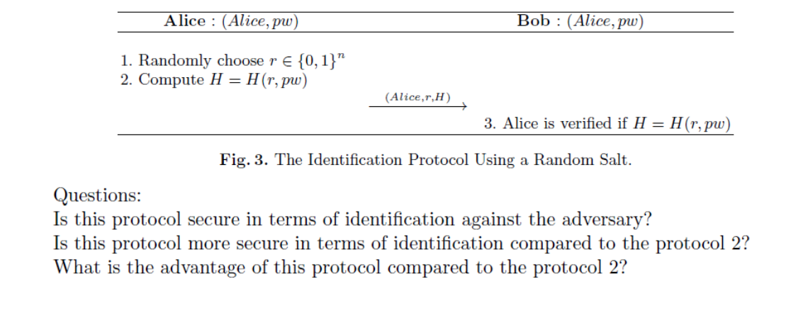
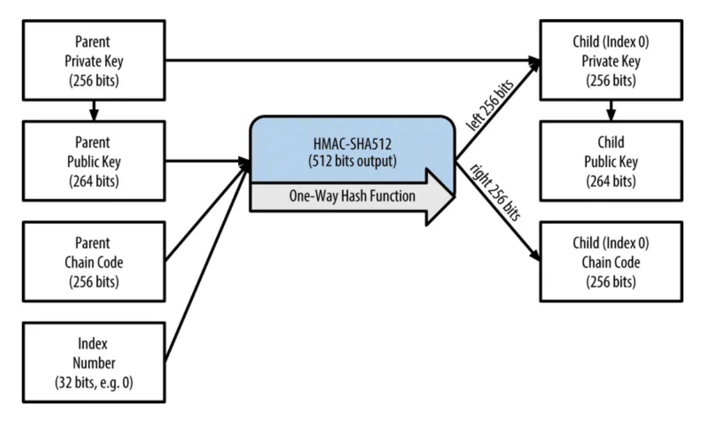
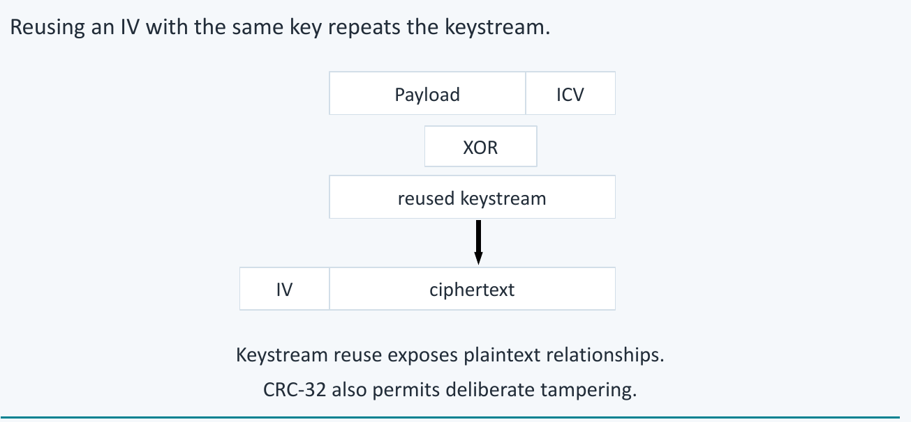

# CSIT953 考试复习 · 第 1 章 哈希与 MAC

> 🎯 **考纲** — *Cryptographic Hashes and Message Authentication Codes — Security properties and their different uses.*
>
> 可能的题型：单选题考性质，以及"该用哪种工具"；填空题考算法名（SHA-256、Keccak-256、HMAC-SHA512、CRC-32）和术语（digest、salt、dictionary attack）；简答题考哈希和 MAC 的区别、加盐的作用；问答题可能给一个场景，让你选工具并说明理由。

> 📚 **来源** — slides：W2 S11–12、S24、S33–34；W3 S2–6、S22–26、S33、S38；W4 S23–29；W5 S8、S11；W6 S9–15、S20；W8 S18–24、S44；W9 S30–31。录音：W2（哈希、区块链接、工作量证明）、W4（安全目标、checksum 与签名）、W6（字典攻击与加盐）、W11 开头（WEP 的 CRC-32）。实验：Lab 3、Quiz 2（先哈希再签名）。

哈希函数几乎出现在这门课的每一周。区块链靠它把区块串起来，钱包靠它从公钥算出地址，网站靠它存口令，下载页面靠它让你核对文件。MAC 出现得少一些，但它回答一个哈希答不了的问题：数据是不是真的来自持有密钥的人。

本章先分清四种密码学工具各回答什么问题（§1），再讲哈希的性质（§2）和四种用途（§3–§6），然后讲 MAC（§7），最后看 WEP 怎样因为用错工具而失败（§8）。

## 1. 先问要保护什么 (W4 S23, S27)

讨论安全时，先说清楚要达到哪个目标：

- **机密性**（confidentiality）：未授权的人读不到内容。
- **完整性**（integrity）：未授权的修改能被发现。注意是"能被发现"，不是"改不了"。
- **真实性**（authenticity）：能确认数据来自谁，或者确认谁持有某把密钥。
- **可用性**（availability）：授权用户需要时能拿到数据和服务。

没有哪一种密码学工具能同时提供这四项。可用性主要靠冗余、备份和恢复，密码学帮不上多少。

拿一份写着"明天付你 10 块"的文件来说。把它加密，别人复制走也读不懂，但可以把它删掉，因为加密只管机密性。给它附上哈希值，别人把 10 改成 100 你能发现，但你不知道这份文件是谁写的。签上名，别人能确认是你写的，但内容人人可读。

| 工具 | 回答的问题 | 需要什么秘密 | 谁能验证 | 提供什么 |
|---|---|---|---|---|
| 哈希 hash | 这些字节变了没有？ | 不需要 | 任何人 | 完整性（前提：期望的哈希值可信） |
| MAC | 是不是持有共享密钥的人认证了这份数据？ | 双方共享的密钥 | 只有持有密钥的人 | 完整性 + 真实性 |
| 签名 signature | 是不是私钥持有者签了这些字节？ | 签名者的私钥 | 任何有公钥的人 | 完整性 + 真实性 |
| 加密 encryption | 未授权的人能不能读到内容？ | 解密密钥 | — | 机密性 |

选工具要看要回答哪个问题，而不是看哪个用得顺手。真实系统通常组合使用：HTTPS 里同时用到哈希、签名和加密。

> ✍️ **English answer** — A hash answers "did the bytes change?" and needs no secret, so anyone can compute and check it. A MAC answers "did someone holding the shared key authenticate this data?", so it gives integrity and authenticity between the key holders. A digital signature answers "did the holder of this private key sign these bytes?", and anyone with the public key can verify it. Encryption provides confidentiality only. No single primitive provides every security goal, so we choose the primitive by the security question.

## 2. 哈希函数：数据的指纹 (W2 S11)

**哈希函数**（hash function）把任意长度的输入变成固定长度的输出。输出叫**摘要**（digest），也叫哈希值。它像数据的指纹：数据可以很大，指纹很短，却足以认出这份数据。

课件列了四条特征：

1. 固定长度。输入是一个字还是几 GB 的系统镜像，SHA-256 的输出都是 256 位，写成 64 个十六进制字符。
2. 确定性（deterministic）。同样的输入永远得到同样的输出。正因如此，验证者才能自己重算一遍再比较。
3. 雪崩效应（avalanche effect）。输入改一点点，输出就面目全非。
4. 正向好算，反向不可行。给出输入，一瞬间就能算出摘要；只给摘要，找不回输入。

两句话只差一个 0：

```text
SHA-256("I will pay you 10 dollars tomorrow.")
  = 37c0ec31cecc25a9d5fc78cd40b46c56e8646c75ba6022b7199967a387fc8308
SHA-256("I will pay you 100 dollars tomorrow.")
  = 1dcaf2708b60ab3c648d51b156e0d4bf3c88e5daed760af52b8c25adfa8334a6
```

两个摘要没有任何相似之处。所以只要比较摘要，就能发现原文被改过，不必逐字节比较原文。

> 📎 **拓展（超出 slides）** — 密码学教材把"安全"拆成三个正式性质：
>
> | 性质 | 含义 | 被破坏后会怎样 |
> |---|---|---|
> | 抗原像 preimage resistance | 给定摘要 h，找不到任何 x 使 H(x) = h | 存下的口令哈希可以直接反推 |
> | 抗第二原像 second-preimage resistance | 给定 x，找不到另一个 x′ 使 H(x′) = H(x) | 攻击者可以换掉一个已经公布了摘要的文件 |
> | 抗碰撞 collision resistance | 找不到任何一对不同的 x、x′ 使 H(x) = H(x′) | 一份签名可以套用到另一份文件上 |
>
> 课件说的"不可逆"就是抗原像。碰撞一定存在，因为输入有无穷多种，SHA-256 的输出只有 $2^{256}$ 种；抗碰撞是说"找不到"，不是说"不存在"。

除了这几条，课件在工作量证明里还提到一个性质：谜题友好性（puzzle-friendliness），见 §4。

课上出现过的哈希算法：

| 算法 | 输出长度 | 在课程里的用途 |
|---|---|---|
| SHA-256 | 256 位 | Bitcoin 的区块和交易、BIP39 校验和、下载校验、Lab 3 签名前的哈希 |
| Keccak-256 | 256 位 | Ethereum 地址 |
| SHA-512（在 HMAC-SHA512 里） | 512 位 | BIP32 子密钥派生、BIP39 种子 |
| MD5、SHA-1 | 128 位、160 位 | 旧算法，不要用于安全用途 |

SHA-1 的问题出在抗碰撞上。研究者已经造出了两份摘要相同的不同文件，但仍然没法从摘要反推出输入。MD5 也已被攻破。今天做安全用途用 SHA-256 或更强的算法；MD5 和 SHA-1 最多用来检查意外损坏。

> 👨‍🏫 **课堂强调** — 算法名字不用全记，但要认得出旧的、不安全的算法：SHA-1、RC4、3DES、DSS，以及只用 CBC 的模式。考题里看到它们，答案通常是"不安全，不要重新启用"。

> ✍️ **English answer** — A cryptographic hash function maps an input of any length to a fixed-length digest. It is deterministic, so anyone can recompute and compare the digest; a tiny change in the input produces a completely different digest (the avalanche effect); and it is easy to compute but infeasible to reverse (one-way, or preimage resistant). A secure hash must also be collision resistant: it should be infeasible to find two different inputs with the same digest. MD5 and SHA-1 are broken for this purpose, so SHA-256 or stronger should be used.

## 3. 用途一：发现数据被改动

### 3.1 文件校验 (W9 S30–S31)

下载系统镜像或软件包时，发布方会公布文件的 SHA-256 值。下载完自己算一遍，结果一致，就说明文件在路上没有损坏，也没有被换掉。



图 1 的上半部分是软件从源代码到发布包要经过的几站。每一站都可能被做手脚：编译器被污染、构建之后产物被替换、发布的包没有签名。右下角是校验的做法：开发者用 `sha256sum app.tar.gz` 算出期望值并公布，用户下载后用 `sha256sum -c` 核对。

这里有一个前提。哈希不用密钥，谁都能算。如果攻击者控制了下载服务器，他可以同时换掉文件和网页上公布的哈希值，用户核对时照样通过。所以期望的哈希值本身必须从可信的渠道拿到。更可靠的做法是让发布方对产物签名：攻击者没有发布方的私钥，伪造不了签名。图 1 左下角的第一个问题"Is the artifact signed?"问的就是这个；另外两个问题（有没有来源证明、能否复现构建）见第 11 章。

### 3.2 区块链：每个区块记住前一个区块的哈希 (W2 S12, S24)

每个区块的头部存着前一个区块的哈希。区块 101 存着区块 100 的哈希 7a9c…，区块 102 存着区块 101 的哈希 19f2…。所有区块就这样串成一条承诺链（chain of commitments）。

```d2 图 2 · 改动区块 100 之后，区块 101 存的旧哈希就对不上了
direction: left
b100: "区块 100（被改）\nhash 变成 a1d0…" {class: warn}
b101: "区块 101\nprev = 7a9c…"
b102: "区块 102\nprev = 19f2…"
b101 -> b100: "7a9c… ≠ a1d0…" {style.stroke-dash: 4}
b102 -> b101: 仍然匹配
```

假设有人改了区块 100 里的一笔交易。区块 100 的哈希随之改变，区块 101 里存的还是旧值，链接断了（图 2）。要让链重新对上，攻击者必须重算区块 101；这又改变了 101 的哈希，于是 102 也得重算，一直重算到最新的区块。在 Bitcoin 里，每重算一个区块都要重新完成工作量证明，还要追上全网新出的区块，所以篡改历史需要超过全网一半的算力（51% 攻击，见第 7 章）。

哈希只能证明数据写入之后没有变，证明不了写入的内容本身是真的。传感器一开始就上报了假数据，链上会原样保存这份假数据。

> ✍️ **English answer** — Each block stores the hash of the previous block. If an attacker changes a transaction in block 100, its hash changes and block 101 no longer points to it, so every later block must be rebuilt (and in Bitcoin its proof of work must be redone). A published file checksum works in the same way: if the file is replaced, the recomputed SHA-256 no longer matches. However, a hash needs no key, so it only helps when the expected hash comes from a trusted source; otherwise the publisher should sign the artifact. A hash also proves only that data has not changed since it was recorded, not that the data was true.

## 4. 用途二：工作量证明的谜题 (W2 S33–S34)

Bitcoin 要随机选出下一个出块的节点，可网络里没有可信的抽签人。办法是按算力抽签：谁先解出一道哈希谜题，谁就有权出下一个块。这就是**工作量证明**（proof of work, PoW）。



谜题是：找一个 nonce，使 H(nonce ‖ prev_hash ‖ tx ‖ … ‖ tx) 小于目标值 target。哈希的输出可以看成一个很大的数，所有可能的输出排成图 3 里那条长条，target 以下只占左边红色的一小段。target 越小，也就是要求摘要开头的 0 越多，红色区间越短，谜题越难。全网出块太快，网络就把 target 调小；出块太慢就调大，让出块速度大致稳定。

为什么只能一个个地试？这要求哈希具有**谜题友好性**（puzzle-friendliness）：输出看起来完全随机，没有捷径能算出哪个 nonce 会落进目标区间，只能不断换 nonce 重算，直到碰上为止。验证却很容易，别人拿到你的 nonce，算一次哈希就知道对不对。找起来难、验证起来快，这正是工作量证明需要的。

> ✍️ **English answer** — To create a block, a miner must find a nonce such that H(nonce ‖ prev_hash ‖ transactions) < target. Because a secure hash is puzzle-friendly, there is no shortcut: the only way is to try many nonces until one works, while anyone can verify the solution with a single hash computation. A smaller target (more leading zeros) makes the puzzle harder, and the network adjusts the target to keep block production steady.

## 5. 用途三：生成地址，签名前先哈希 (W3 S2–S6; Lab 3)

Ethereum 地址是这样得到的：随机生成一个 256 位私钥，在 secp256k1 曲线上算出 64 字节的公钥，对公钥做 Keccak-256，取结果的最后 20 字节，前面加上 0x。地址就是从公钥派生出来的一个更短的标识，方便抄写和展示。地址还可以按 EIP-55 规则混排大小写，用来发现抄错的字符。完整流程见第 8 章。

Lab 3 和 Quiz 2 里，ECDSA 不是直接签文件，而是先算 z = SHA-256(文件)，再对 z 签名。原因有两个。第一，签名算法只能处理固定大小的数，文件却可大可小，哈希把它压成固定的 256 位。第二，文件改动一个字节，z 就完全不同，原来的签名就验证不过。这一点依赖抗碰撞：如果攻击者能造出两份摘要相同的文件，一份签名就能同时当作两份文件的签名。

签名和加密是两回事。签名不隐藏内容，消息照样人人可读。它像一个防拆封条：只证明"持有这把私钥的人签了这些字节"，内容被改过就能看出来。

> ✍️ **English answer** — ECDSA does not sign a file directly; it signs z = SHA-256(file). Hashing turns a file of any size into a fixed-size value, and any change to the file changes z, so the old signature no longer verifies; this relies on collision resistance. A signature does not hide the message: it protects integrity and authenticity, not confidentiality. Ethereum also uses hashing to derive an address: it hashes the public key with Keccak-256 and keeps the last 20 bytes.

## 6. 用途四：保存口令 (W6 S9–S15, S20)

### 6.1 为什么存哈希

服务器如果明文保存口令，数据库一旦泄露，所有口令立刻曝光。改存 H(pw)，登录时把用户输入的口令哈希之后再比较。数据库泄露时，攻击者拿到的只是哈希值，不能立刻得到口令。

### 6.2 字典攻击

"不能立刻得到"不等于"得不到"。人选的口令很好猜。攻击者根本不用反算哈希，只要把常见口令一个个正向算一遍，看哪个对得上。这就是**字典攻击**（dictionary attack），一种暴力破解：拿成百上千、甚至上百万个可能的口令去试。

更进一步，攻击者可以事先把所有可能口令的 (pw, H(pw)) 算好，存成一个数据库，也就是"字典"。拿到哈希值后直接查表，马上得到口令。这叫**离线字典攻击**（offline dictionary attack）。

```text
口令        SHA-256（前 16 个十六进制字符）
123456      8d969eef6ecad3c2…
password    5e884898da280471…
12345678    ef797c8118f02dfb…
qwerty      65e84be33532fb78…
```

截获的哈希只要以 ef797c8118f02dfb 开头，查表就知道口令是 12345678。

"离线"是关键。攻击者在自己的电脑上用 GPU 计算，一秒能试上万个口令，也不会因为输错太多次被锁号。在线猜测要一次次去登录服务器，每次都要等服务器回应，输错几次账号就被锁住了。

> 👨‍🏫 **课堂强调** — 两个用户的口令相同，存下的哈希也相同。很多人用 12345678、生日或手机号当口令，网上能下载到按真实泄露数据整理的口令字典，这类口令一查就中。只有真正随机的长口令不在任何字典里。

### 6.3 加盐



**加盐**（salt）：随机选一个数 r，计算 H(r, pw)，把 r 和结果放在一起保存或发送（图 4）。r 不是秘密，可以公开。

盐让事先算好的字典失效。字典里存的是 H(pw)，而现在要比对的是 H(r, pw)。攻击者必须先看到 r，再针对这个 r 把所有可能的口令重算一遍；这本新字典换一个 r 就没用了。课件把这种"拿到 r 之后才能开始算"的攻击称为 online dictionary attack，用来和事先算好的离线字典攻击相区分。

> 📎 **拓展（超出 slides）** — 多数教材里的"在线攻击"指对着服务器一次次登录试口令，课上口头也用过这层意思。课件在加盐这一页的用法不同。考试时按课件的说法写，必要时用一句话说明你指的是哪一种。

盐不能让弱口令变强。攻击者针对某个 r 去试 12345678，照样一试就中。盐的作用是让攻击者无法预先计算，也无法用一本字典同时破解所有用户。所以每个用户的盐必须不同。

第 6 周的协议 5 用了同样的思路：服务器存 H(Alice, Bob, pw)。用户名 Alice 相当于每个用户一个盐；去掉它，所有用户的哈希只取决于口令，一本字典就能破解全部账号。服务器名 Bob 让同一个口令在不同服务器上的哈希不同；去掉它，攻击者在一台服务器上得到的值，可以拿去冒充用户登录另一台用了相同用户名和口令的服务器。第 3 章会完整分析这个协议。

最后注意：哈希和加盐只防"从截获的值算出口令"，不防重放。只要协议发送的是 H(pw) 或 (r, H(r, pw)) 这样固定能用的值，攻击者原样重发一遍就能冒充用户。这是第 3 章的主题。

> ✍️ **English answer** — Storing H(pw) instead of pw means a database leak does not immediately reveal the passwords, but human-chosen passwords are easy to guess. In an offline dictionary attack, the attacker precomputes (pw, H(pw)) for likely passwords and simply looks up the stolen hash; this is fast and avoids account lock-out. A random salt r, stored as H(r, pw), makes a precomputed dictionary useless: the attacker must build a new dictionary for that particular r, and it cannot be reused for other users. A salt does not make a weak password strong, and hashing does not stop replay.

## 7. MAC：只有持有密钥的人才算得出的指纹 (W4 S27; W3 S22–S26, S33, S38; W5 S8, S11)

### 7.1 为什么哈希不够

哈希能发现意外损坏，却挡不住有意篡改。攻击者改完数据，重新算一个哈希附上就行，因为算哈希不需要任何秘密。面对主动攻击者，校验值必须是攻击者算不出来的。

### 7.2 MAC 是什么

**消息认证码**（message authentication code, MAC）是带密钥的校验值：tag = MAC(K, m)。发送方和接收方事先共享密钥 K。接收方收到 (m, tag) 后自己重算一遍，相等才接受。攻击者可以改 m，但没有 K，就算不出与新消息匹配的 tag。

```text
HMAC-SHA256(K, "Transfer 10 to Bob")  = e558837b57e377dc…
HMAC-SHA256(K, "Transfer 100 to Bob") = d84f67ba1db863f9…
```

攻击者能把 10 改成 100，却写不出第二行那个 tag。所以 tag 验证通过，说明消息没有被改过，而且来自持有 K 的一方：MAC 同时提供完整性和真实性。

MAC 也有做不到的事：

- 不提供机密性。消息本身还是明文。
- 不能向第三方证明是谁算的。双方都有 K，tag 可能出自任何一方。接收方知道"不是外人发的"，却无法向法官证明是对方发的。签名没有这个问题，因为私钥只在签名者手里，任何人都能用公钥验证。
- 不防重放。攻击者把一条带着正确 tag 的旧消息原样重发，tag 依然正确。防重放要靠序号、计数器或时间戳（§8）。

> 📎 **拓展（超出 slides）** — 标准做法是 **HMAC**：用一个哈希函数和密钥按固定结构计算，写作 HMAC-SHA256、HMAC-SHA512。不要自己拼 H(K ‖ m) 当 MAC，这种拼法对某些哈希函数不安全。

### 7.3 课程里的三个例子

**BIP32 派生子密钥。** 确定性钱包用单向的哈希函数，从一颗种子派生出大量密钥。BIP32 的第一步是对种子做 HMAC-SHA512：左 256 位成为主私钥，右 256 位成为主 chain code。之后每一层都用 HMAC-SHA512 从父密钥派生子密钥（图 5）。输入是父公钥和子索引，父 chain code 充当 HMAC 的密钥。512 位的输出一分为二：左边 256 位与父私钥结合，得到子私钥；右边 256 位成为子 chain code。这里 HMAC 被当作一个带密钥的单向函数来用。chain code 的作用是：如果派生时不加它，任何人只要知道父公钥，就能算出所有子公钥，钱包里的地址就都关联起来了。细节见第 8 章。



**BIP39 助记词。** 生成助记词时，用 SHA-256 算出一个校验和（checksum）附在熵后面；把助记词变成种子时，用 PBKDF2-HMAC-SHA512 重复计算 2048 轮，盐是字符串 "mnemonic" 加上用户可选的口令（passphrase）。校验和只用来发现抄错的单词，助记词一旦泄露，它什么也保护不了。PBKDF2 重复计算很多轮，是为了让每一次猜测都变慢。

**SSH。** 密钥交换得到共享秘密之后，双方再从它派生出加密密钥、MAC 密钥和 IV；协商的算法套件里也包括 MAC 算法。现代配置多用认证加密 ChaCha20-Poly1305 或 AES-GCM（§8），SHA-1 时代的选项不应随手重新启用。详见第 5 章。

> ✍️ **English answer** — A plain hash cannot stop deliberate modification, because the attacker can change the data and recompute the hash without any secret. A MAC is a keyed checksum, tag = MAC(K, m), where K is shared by the sender and the receiver. Without K the attacker cannot produce a valid tag for a modified message, so a MAC provides integrity and data-origin authenticity. Unlike a signature, it cannot prove to a third party which key holder created the tag; it provides no confidentiality and does not prevent replay by itself. HMAC-SHA512, for example, is used in BIP32 child key derivation.

## 8. CRC 不是 MAC：WEP 的教训 (W8 S18–S24, S44)

WEP 是早期的 Wi-Fi 加密方案。它用 RC4 流密码加密，每个包带一个 24 位的初始向量（IV），全网共用一把长期密钥。完整性靠 CRC-32 校验值，在 WEP 里叫 ICV，和数据一起被加密。



CRC-32 是为发现传输中的意外错误设计的。它不用密钥，攻击者自己就能算，也就不是为对付攻击者设计的。结果，攻击者可以在密文里翻转选定的位，再把 ICV 改成相应的值，接收方校验照样通过。WEP 把"发现错误"当成了"认证消息"。

> 📎 **拓展（超出 slides）** — 为什么能做到：流密码的密文翻转某一位，解密后明文的同一位也跟着翻转；而 CRC 是线性的，数据翻转哪些位，CRC 就按一个能事先算出的模式变化。攻击者把这个模式也异或到密文里加密的 ICV 上，整包就仍然"校验正确"。

教训是使用**认证加密**（authenticated encryption, AE）：机密性和完整性一起设计、一起检查。常见的认证加密算法有 AES-GCM 和 ChaCha20-Poly1305。它们输出密文和一个认证标签（tag）。接收方必须先验证 tag，通过之后才能把明文交给应用。实现时用标准化的构造，不要自己拼凑；条件允许时把密钥放在硬件里保护。

认证加密仍然不保证**新鲜性**（freshness）。攻击者录下一条合法的"开门"指令，过一会儿原样重发，tag 完全正确。防重放要加计数器或序号，接收方拒绝重复的或过期的值。

资源受限的 IoT 设备可以用轻量级算法 Ascon。NIST 在 2025 年 8 月发布的 SP 800-232 以 Ascon 为基础，规定了认证加密、哈希和可扩展输出函数（XOF）。换成轻量级算法并不能省掉其他要求：nonce 仍然要唯一，密钥仍然要保护，还要防侧信道泄露。

> ✍️ **English answer** — WEP used CRC-32 as its integrity check value. CRC is designed to detect accidental errors; it has no key, so an attacker can make controlled bit changes in the ciphertext and adjust the checksum without being detected. The lesson is to use authenticated encryption, such as AES-GCM, which protects confidentiality and integrity together; the receiver must verify the tag before accepting the plaintext. Authenticated encryption alone does not ensure freshness, so counters or sequence numbers are also needed to reject replayed messages.

## 9. 按场景选工具

| 场景 | 选什么 | 理由 |
|---|---|---|
| 核对下载的文件 | 哈希（期望值从可信渠道获得），或发布方的签名 | 哈希没有密钥，期望值本身必须可信 |
| 两台服务器之间传消息，事先共享了密钥 | MAC 或认证加密 | 攻击者没有密钥，改了消息就造不出 tag |
| 区块链交易、公开发布的软件 | 数字签名 | 任何人都能用公钥验证，私钥只在签名者手里 |
| 存储用户口令 | 每个用户不同的盐 + 哈希 | 让预先算好的字典失效 |
| 保存或传输机密数据 | 认证加密 | 同时提供机密性和完整性 |
| 防止旧消息被重放 | 计数器、序号或随机挑战，配合 MAC 或签名 | 以上工具本身都不保证新鲜性 |

## ⚠️ 易混易错

- 哈希不是加密。它没有密钥，也"解不开"。说"用哈希加密口令"是错的。
- checksum、CRC 不是 MAC。它们能发现意外错误，挡不住有意篡改。
- 有了哈希不等于有了完整性保护。期望的哈希值必须来自可信渠道。
- 盐不是秘密，它和哈希放在一起保存或发送。盐防的是预先计算，不是猜测。
- MAC 不是签名。MAC 用共享密钥，只有持有密钥的人能验证，也无法向第三方证明是谁算的。
- 认证加密不等于防重放。新鲜性要靠计数器、序号或挑战。
- BIP39 的校验和只能发现抄错的单词，助记词泄露后它什么也保护不了。
- 抗碰撞是说找不到碰撞，不是说碰撞不存在。
- 哈希证明数据写入后没有变，不证明写入的内容是真的。

## 📝 Practice

### Part A · Multiple choice

**A1.** Which property means that changing one bit of the input produces a completely different digest?
A. Determinism  B. Avalanche effect  C. Fixed-length output  D. Puzzle-friendliness

<details>
<summary>Answer A1</summary>

**B.** Determinism means the same input always gives the same digest; the avalanche effect is about small input changes giving very different outputs.

</details>

**A2.** Which primitive answers the question "did someone holding the shared secret authenticate this data?"
A. Hash  B. MAC  C. Digital signature  D. Encryption

<details>
<summary>Answer A2</summary>

**B.** A signature uses a private key, not a shared secret; a hash uses no secret at all.

</details>

**A3.** WEP's integrity protection failed mainly because CRC-32:
A. produces a digest that is too long
B. has no secret key and allows controlled modifications
C. is too slow for wireless networks
D. requires a public key that was never distributed

<details>
<summary>Answer A3</summary>

**B.** CRC detects accidental errors only. Without a key, an attacker can flip chosen bits and fix the checksum.

</details>

**A4.** A server stores H(r, pw) with a different random salt r for each user. What does the salt mainly prevent?
A. Replay of the login message
B. Guessing a weak password
C. Using one precomputed dictionary against all users
D. An eavesdropper learning the username

<details>
<summary>Answer A4</summary>

**C.** The salt is public, so a weak password can still be guessed for that one r, and a captured value can still be replayed.

</details>

**A5.** Which statement about a MAC is TRUE?
A. It keeps the message confidential.
B. Anyone with the sender's public key can verify it.
C. It cannot prove to a third party which of the two key holders created the tag.
D. It prevents replay attacks without any extra mechanism.

<details>
<summary>Answer A5</summary>

**C.** Both parties hold the same key K, so either could have computed the tag.

</details>

### Part B · Fill in the blank / short answer

**B1.** An Ethereum address is the last ______ bytes of the ______ hash of the public key.

<details>
<summary>Answer B1</summary>

20; Keccak-256.

</details>

**B2.** In BIP32 child key derivation, ______ produces 512 bits: the left 256 bits are used to obtain the child private key and the right 256 bits become the child ______.

<details>
<summary>Answer B2</summary>

HMAC-SHA512; chain code.

</details>

**B3.** Explain the difference between a hash and a MAC (2–3 sentences).

<details>
<summary>Answer B3</summary>

A hash is computed without any key, so anyone can compute it; it detects changes only if the expected hash value is trusted. A MAC is computed with a secret key shared by the two parties, so an attacker who modifies the message cannot compute a valid tag. Therefore a MAC provides integrity and authenticity against an active attacker, while a hash alone does not.

</details>

**B4.** Why is an offline dictionary attack faster and harder to stop than online password guessing?

<details>
<summary>Answer B4</summary>

In an offline attack the attacker already has the password hash and tests guesses on their own machine, so they can try thousands of passwords per second with a GPU. The server never sees the guesses, so rate limiting and account lock-out cannot stop it. Online guessing must send each guess to the server, which is slow and can be limited or locked.

</details>

### Part C · Questions and answers

**C1.** A software project publishes `app.tar.gz` and its SHA-256 value on the same download page.
(a) What does the checksum protect against?
(b) An attacker takes control of the download server. Does the checksum still protect users? Explain.
(c) Propose a better mechanism and explain why it works.

<details>
<summary>Model answer C1</summary>

(a) The checksum lets users detect whether the downloaded file differs from the file the project published, for example because of corruption in transit or a modified mirror. Because SHA-256 is collision resistant and has the avalanche effect, any change to the file gives a different digest.

(b) No. A hash uses no secret key. An attacker who controls the server can replace the file with malware, compute the SHA-256 of the malicious file, and replace the published value as well. The user's check then succeeds. The checksum only helps if the expected value comes from a channel the attacker cannot change.

(c) The developer should digitally sign the release (for example, sign the SHA-256 digest of the file with the developer's private key) and users should verify the signature with the developer's public key obtained from a trusted source. The attacker does not have the private key, so they cannot produce a valid signature for a modified file. Even if the server is compromised, a replaced file will fail verification.

**Marking points:** hash detects change (1); hash has no key so the attacker can recompute it (1); the reference value must be trusted (1); signature with private key, verify with trusted public key (1); attacker cannot forge without the private key (1).

</details>

**C2.** A smart lock receives commands such as "unlock" from a phone. Each command is encrypted with a key shared by the phone and the lock, and a CRC-32 checksum is appended before encryption. Identify two weaknesses of this design and propose an improved design.

<details>
<summary>Model answer C2</summary>

Weakness 1 — no real integrity: CRC-32 detects accidental errors but has no key. An attacker can make controlled bit changes to the ciphertext and adjust the encrypted checksum so that the lock accepts a modified command, as happened with WEP. Encryption alone does not prove a message is genuine.

Weakness 2 — replay: even a correctly protected "unlock" command can be recorded and sent again later. Nothing in the message shows whether it is fresh, so the lock will open again.

Improved design: use authenticated encryption such as AES-GCM (or encrypt and then add a MAC such as HMAC-SHA256 under a separate key). The lock verifies the authentication tag before acting on the command, so any modification is rejected. Add a counter or sequence number inside the authenticated data; the lock stores the last value it accepted and rejects any command whose counter is not larger. Keys should be unique per device and protected in hardware where possible.

**Marking points:** CRC has no key so tampering is undetectable (1); explain replay (1); authenticated encryption or MAC with tag verified first (1); counter/sequence number to ensure freshness (1); key management remark (1).

</details>

## 本章小结

- 四个目标对应四种工具：哈希管"变没变"，MAC 管"是不是持钥人"，签名管"是不是私钥持有者"，加密管"读不读得到"。—— *hash / MAC / signature / encryption; choose by the security question*
- 哈希把任意输入变成固定长度的摘要：确定、雪崩、单向；安全的哈希还要抗碰撞。—— *fixed-length digest, deterministic, avalanche effect, one-way, collision resistance*
- 哈希的用途：文件校验、区块链接、PoW 谜题、地址、先哈希再签名、存口令。—— *checksum, hash chain, hash puzzle, address derivation, hash-then-sign, password hashing*
- 哈希没有密钥，期望值必须可信；否则用签名。—— *trusted reference value; sign the artifact*
- 字典攻击是正向猜口令；盐让预先算好的字典失效，但救不了弱口令，也不防重放。—— *offline dictionary attack, salt*
- MAC 是带密钥的校验值，提供完整性和真实性；不提供机密性，不能向第三方证明，不防重放。—— *keyed tag, HMAC, no non-repudiation*
- CRC 不是 MAC。用认证加密，先验证 tag 再用明文；再加计数器防重放。—— *CRC-32, authenticated encryption, freshness*
