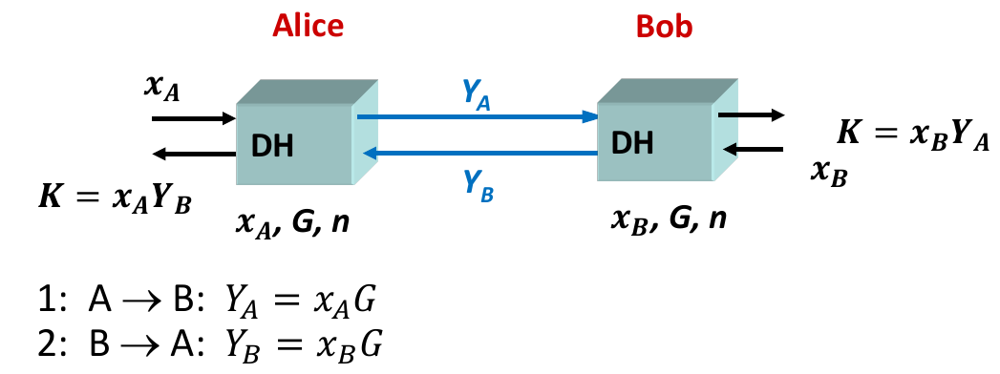
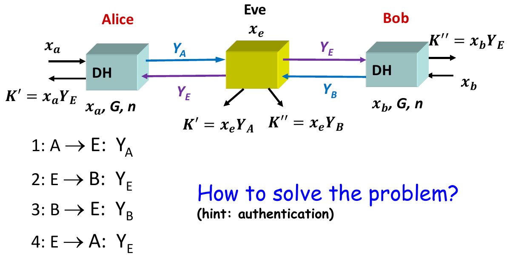

# CSIT953 考试复习 · 第 2 章 Diffie–Hellman 密钥交换

> 🎯 **考纲** — *Diffie–Hellman Key Exchange — How a shared secret is established and why authentication matters.*
>
> 可能的题型：单选题考"窃听者能算出什么""中间人怎样得手""TLS 1.3 去掉了什么"；填空题考公式和术语（base point、man-in-the-middle、ephemeral、forward secrecy）；简答题考 DH 为什么能防窃听、为什么必须认证；问答题可能要求写出中间人攻击的步骤并给出修补，或者分析一个类似 Lab 4 的加密聊天程序。第 0 章 §5 的样题范答里，MITM 分析那一段就建立在本章 §4、§5 上。

> 📚 **来源** — slides：W6 S2–S5；W5 S8、S11；W7 S4–S5、S14、S16–S18。录音：W6 录音约 17.3k–31k（DH、窃听者与中间人）；W7 录音末尾（三种密钥、前向安全）；W5 录音的 SSH 部分。实验：Lab 4（ECDH + AES-CTR）、Quiz 3（在 Lab 4 上加图形界面和加密开关）。Assignment 2 设计文档里的 ECIES 只作对比。

第 1 章的 MAC 和对称加密都有一个前提：双方事先共享同一把密钥。可是两个从没见过面的人，隔着一条谁都能偷听的网络，怎样得到同一把密钥？Diffie–Hellman（DH）密钥交换回答的就是这个问题。

本章先讲 DH 怎样让双方算出同一个秘密（§1–§3），再讲它为什么挡不住中间人、怎样用认证补上（§4–§5），然后讲临时密钥带来的前向安全（§6）。最后看课程里哪些地方用到 DH，用本章的知识检查 Lab 4 的设计，并逐一判断几种常见做法能不能挡住中间人（§7–§9）。

## 1. 为什么需要密钥交换 (W6 S2)

设想你在写一个聊天软件。消息不加密，路上经过的路由器和运营商都能读到。用 AES 加密，双方就得持有同一把密钥。

难处在于怎样把这把密钥交给对方。直接发过去，窃听者也收到了。事先当面交换，网上的通信双方大多从没见过面，也不可能和每个网站都见一次。

DH 换了一个思路。双方各自选一个只有自己知道的数，只把由它算出的公开值发给对方。每一方用"自己的秘密数 + 对方的公开值"算出同一个结果，这个结果叫**共享秘密**（shared secret）。窃听者看到了两个公开值，却算不出共享秘密。

DH 本身不加密任何消息，它只负责让双方得到同一个秘密。之后再从这个秘密派生出 AES 密钥，用来加密真正的消息。HTTPS 和 SSH 建立连接时，第一件事就是做一次 DH。

> ✍️ **English answer** — Diffie–Hellman key exchange lets two parties who share no secret establish a shared secret over a public channel. Each party keeps a private value and sends only a public value derived from it; each then combines its own private value with the other party's public value and obtains the same result. DH does not encrypt messages itself: the shared secret is used to derive symmetric keys, such as an AES key, which protect the messages that follow.

## 2. 椭圆曲线上的 DH (W6 S3–S4)

课件讲的是椭圆曲线版本（ECDH），共五步：

1. 公开参数。双方约定一条椭圆曲线 $E_p(a,b)$ 和曲线上的一个**基点**（base point）$G$。$G$ 的阶（order）$n$ 很大，满足 $nG = O$，$O$ 相当于曲线上的零点。这些参数谁都可以知道。
2. 私钥。Alice 随机选 $x_A < n$，Bob 随机选 $x_B < n$，各自保密。
3. 公钥。Alice 算 $Y_A = x_A G$，Bob 算 $Y_B = x_B G$。这里的乘法是点乘：把点 $G$ 自己加 $x_A$ 次。
4. 交换。Alice 把 $Y_A$ 发给 Bob，Bob 把 $Y_B$ 发给 Alice（图 1）。
5. 算共享密钥。Alice 算 $K = x_A Y_B$，Bob 算 $K = x_B Y_A$。



两人算出的 $K$ 相同，因为

$$x_A Y_B = x_A (x_B G) = x_A x_B G = x_B (x_A G) = x_B Y_A$$

窃听者为什么算不出 $K$？点乘正着算很快，给出 $x_A$ 和 $G$，一瞬间就能得到 $Y_A$。反过来，给出 $Y_A$ 和 $G$ 求 $x_A$，在计算上不可行。所以公钥可以公开发送，私钥依然安全。钱包从私钥算公钥用的也是这个运算（第 8 章）。Lab 4 用的正是 Bitcoin 和 Ethereum 采用的 secp256k1 曲线。

> 📎 **拓展（超出 slides）** — "从 $Y_A$ 求 $x_A$"叫椭圆曲线离散对数问题（ECDLP）。DH 最早用的是模幂运算：公开一个大素数 $p$ 和底数 $g$，公钥 $Y = g^{x} \bmod p$。用小数字演示：取 $p = 23$，$g = 5$。Alice 选 $x_A = 6$，发出 $5^{6} \bmod 23 = 8$；Bob 选 $x_B = 15$，发出 $5^{15} \bmod 23 = 19$。Alice 算 $19^{6} \bmod 23 = 2$，Bob 算 $8^{15} \bmod 23 = 2$，两人得到同一个 $K = 2$。窃听者只看到 8 和 19。真实的 $p$ 有两千多位，从 8 反推出 6 这一步做不到。椭圆曲线版本把"乘方"换成"点乘"，达到同样的安全强度，密钥要短得多。

> ✍️ **English answer** — In elliptic-curve Diffie–Hellman (ECDH), both parties agree on a curve and a base point $G$ of large order $n$. Alice picks a random private key $x_A < n$ and sends $Y_A = x_A G$; Bob picks $x_B$ and sends $Y_B = x_B G$. Alice computes $K = x_A Y_B$ and Bob computes $K = x_B Y_A$; both equal $x_A x_B G$, so they obtain the same key without ever sending it. Computing $x_A G$ is easy, but recovering $x_A$ from $Y_A$ and $G$ is computationally infeasible, so the public keys can be sent in the open.

## 3. 从共享秘密到会话密钥 (W5 S8; Lab 4; Quiz 3)

ECDH 算出的 $K$ 是曲线上的一个点，不能直接当 AES 密钥用。Lab 4 和 Quiz 3 取它的 x 坐标 k，再算 SHA-256(str(k))，得到的 32 字节正好是一把 AES-256 密钥。这是哈希的又一种用途：把长度和格式都不合适的秘密值，变成一把固定长度的密钥（第 1 章 §2）。

真实协议从一个共享秘密派生出好几把密钥。SSH 派生出加密密钥、MAC 密钥和 IV；TLS 1.3 派生出握手阶段用的密钥和保护应用数据的流量密钥（traffic keys）。共享秘密像一颗种子，种子换了，派生出的所有密钥都跟着换。

> 📎 **拓展（超出 slides）** — 标准做法是用专门的密钥派生函数（key derivation function, KDF），例如 HKDF。它可以加盐，可以把用途和上下文写进派生过程，从一个秘密派生出多把互不相关的密钥。Assignment 2 把 Lab 4 的 SHA-256(str(k)) 换成了 HKDF-SHA256，并把文件 ID 和接收者写进派生过程（第 9 章）。

> ✍️ **English answer** — The ECDH result is a curve point, not a ready-made key. Lab 4 hashes its x-coordinate, SHA-256(str(k)), to obtain a 256-bit AES key. Real protocols treat the shared secret as a seed and derive several independent keys from it: SSH derives encryption keys, MAC keys and IVs, and TLS 1.3 derives handshake and traffic keys, normally with a key derivation function such as HKDF.

## 4. 窃听者算不出 K，中间人却能读到一切 (W6 S4–S5)

### 4.1 只会听的攻击者

窃听者（eavesdropper）能看到 $G$、$n$、$Y_A$ 和 $Y_B$，但看不到 $x_A$ 和 $x_B$。算 $K$ 必须用到其中一个私钥，所以她算不出 $K$，后面加密的消息也读不了。**DH 能抵抗被动的窃听者**。

### 4.2 能改消息的攻击者

现在让攻击者 Eve 更强一些。她坐在 Alice 和 Bob 中间，比如控制了某个路由器，所有消息都要经过她，她不但能看，还能改。这就是**中间人攻击**（man-in-the-middle attack, MITM）。攻击分四步（图 2）：



1. Alice 发出 $Y_A$。Eve 截下它，自己选一个 $x_E$。
2. Eve 把 $Y_E = x_E G$ 发给 Bob，假装它来自 Alice。
3. Bob 发出 $Y_B$。Eve 截下它。
4. Eve 把 $Y_E$ 发给 Alice，假装它来自 Bob。

结果出现了两把密钥。Alice 算 $K' = x_A Y_E$，Eve 算 $K' = x_E Y_A$，两人相同；Bob 算 $K'' = x_B Y_E$，Eve 算 $K'' = x_E Y_B$，两人也相同。之后 Alice 用 $K'$ 加密的消息，Eve 解开、读完、想改就改，再用 $K''$ 加密转给 Bob。反方向也一样。Alice 和 Bob 都以为自己在和对方私密通话。

Eve 什么也没破解。她没有求任何人的私钥，只是和两边各做了一次正常的 DH。

问题出在公开值不带任何证明。Alice 的消息相当于"我是 Alice，我的公钥是 $Y_A$"，Eve 把 $Y_A$ 换成 $Y_E$，其余照抄，Bob 无从核实。**DH 只保证"我和发来这个公开值的人共享 K"，不保证这个人是谁**。

> ✍️ **English answer** — DH is secure against a passive eavesdropper: she sees $G$, $Y_A$ and $Y_B$ but cannot compute $K$ without $x_A$ or $x_B$. It is not secure against an active man-in-the-middle. Eve intercepts $Y_A$ and sends her own $Y_E$ to Bob, then intercepts $Y_B$ and sends $Y_E$ to Alice. Alice then shares $K' = x_A Y_E$ with Eve and Bob shares $K'' = x_B Y_E$ with Eve, so Eve can decrypt, read, modify and re-encrypt every message while both victims believe they are talking to each other. The root cause is that the public values are not authenticated.

## 5. 修补：认证公开值 (W6 S5; W7 S4–S5, S14)

课件给的提示是认证（authentication）。要证明的是"$Y_A$ 确实来自 Alice"，也就是把公开值和身份绑在一起。公开值本来就不需要保密。把它加密后发送也没用，因为加密需要事先共享的密钥，问题又绕回了原点。

绑定的办法有三种：

1. 通过另一条可信渠道核对。两人当面交换公钥，或者打电话念一遍公钥的指纹。SSH 第一次连接服务器时让用户核对主机公钥的指纹，就是这种做法（第 5 章）。这种办法可靠，却推广不到成千上万个网站。
2. 证书加签名。服务器有一对长期的签名密钥，CA 签发的证书把服务器的名字和它的公钥绑在一起（第 4 章）。握手时，服务器用私钥对握手内容签名，签名覆盖双方的公开值（图 3）。
3. 事先登记公钥。服务器已经存着用户的公钥，用户用私钥签名证明身份（第 3 章的协议 9）。Assignment 2 让每个用户用自己的账户把公钥登记在链上，也是这个思路。

```d2 图 3 · 签名把公开值和身份绑在一起：Eve 换掉 YB，签名就验证不过
shape: sequence_diagram
A: Alice（客户端）
B: Bob（服务器）
A -> B: "YA"
B -> A: "YB、Bob 的证书、Sig(skB, YA‖YB)"
A -> A: "证书有效、名字对 → pkB 属于 Bob\n签名验证通过 → YB 来自 Bob"
A -> B: "此后用 K 派生的密钥加密"
```

Eve 这次为什么得不了手？她仍然可以把 $Y_B$ 换成 $Y_E$，但签名是 Bob 对 $Y_A$ 和 $Y_B$ 签的，换掉之后签名就对不上。她想重签，手里没有 Bob 的私钥。她想换上自己的证书，CA 不会给她签发写着 Bob 名字的证书。Alice 一旦验证失败，就中止连接。

签名里包含 Alice 这次新选的 $Y_A$，也有用意：这样签名只对这一次握手有效。如果 Bob 只签自己的 $Y_B$，录下的旧"$Y_B$ + 签名"在以后的握手里照样能通过验证，攻击者一旦弄到过某一次的临时私钥，就能拿那一次的记录反复冒充 Bob。TLS 1.3 的 CertificateVerify 消息签的是整个握手过程，每次握手都不同，旧签名在新握手里用不上。还要注意，证书本身是公开的，谁都能下载，光出示证书证明不了什么。证明对方握有与证书公钥配对的私钥的，是这个签名（第 4 章）。

> 👨‍🏫 **课堂强调** — 证书能解决 DH 的中间人问题，代价是必须信任第三方，也就是签发证书的 CA。HTTPS 的安全最终落在"客户端信任的 CA 可靠"这个前提上（第 4 章）。

> ✍️ **English answer** — To stop the man-in-the-middle, the DH public values must be authenticated, i.e. bound to the identity of the sender. In TLS the server holds a certificate, issued by a trusted CA, that binds its name to its public key, and it signs the handshake, including both key shares, with the matching private key. The client verifies the certificate and the signature. Eve can still replace $Y_B$ with $Y_E$, but she cannot produce a valid signature without the server's private key, so the attack is detected and the connection is aborted. Encrypting the public values would not help, because encryption already requires a shared key.

## 6. 临时密钥与前向安全 (W7 S16–S18)

一次 TLS 连接里有三种密钥，分工不同：

| 组成 | 作用 |
|---|---|
| 证书和长期签名密钥（certificate and long-term signing key） | 认证服务器的身份 |
| 临时密钥协商（ephemeral key agreement） | 建立新鲜的共享秘密 |
| 对称流量密钥（symmetric traffic keys） | 高效地保护应用数据 |

长期密钥只用来签名，不用来加密网页。每次连接都重新做一次 DH，私钥 $x_A$、$x_B$ 用完就删，这叫**临时**（ephemeral）DH。与它相对的是静态（static）做法：同一对密钥在所有连接里反复使用。

分开有什么好处？设想攻击者今天录下你和银行之间的全部密文，一年后偷到了银行服务器的长期私钥。

- 如果会话密钥是用长期密钥传送的，所有录下的会话都能解开。TLS 1.2 的静态 RSA 密钥传输就是这样：客户端用服务器的 RSA 公钥加密一个秘密值发过去，拿到服务器私钥就能解出这个值。静态 DH 也一样，服务器的 DH 私钥长期不变。
- 如果用临时 DH，长期私钥只签过名，从没参与计算会话密钥；当年的 $x_A$、$x_B$ 早已删除。偷到长期私钥，也算不出过去的会话密钥。

这个性质叫**前向安全**（forward secrecy）：长期密钥日后泄露，不会暴露此前录下的会话。TLS 1.3 因此去掉了静态 RSA 密钥传输和静态 DH 套件，每次握手都用临时 (EC)DH。RSA 并没有消失，仍然可以用来签名、认证服务器。

| | 静态 | 临时 |
|---|---|---|
| DH 私钥 | 长期保存，每次连接都用同一个 | 每次连接新选，用完删除 |
| 每次连接的共享秘密 | 都一样 | 每次不同 |
| 长期私钥日后泄露 | 录下的旧会话都能解开 | 旧会话仍然安全 |
| 例子 | Lab 4；TLS 1.2 的静态 RSA 和静态 DH | TLS 1.3；现代 SSH |

前向安全只保护过去。长期私钥泄露之后，攻击者可以冒充服务器，对以后的连接发起中间人攻击，这要靠吊销证书来补救（第 4 章）。

> ✍️ **English answer** — TLS separates three kinds of keys: the certificate's long-term signing key authenticates the server, an ephemeral key agreement establishes a fresh shared secret for each connection, and symmetric traffic keys derived from it protect the application data efficiently. Because the ephemeral DH private values are new for every connection and deleted afterwards, an attacker who records traffic today and steals the server's long-term private key later still cannot compute the old session keys. This property is forward secrecy, and it is why TLS 1.3 removed static RSA key transport and static DH; RSA can still be used for signatures.

## 7. DH 在课程里的位置 (W5 S8, S11; W7 S17)

| 场景 | DH 怎样用 | 公开值靠什么认证 | 详见 |
|---|---|---|---|
| HTTPS（TLS 1.3） | ClientHello 和 ServerHello 各带一个 key share，算出共享秘密后派生流量密钥 | 服务器证书 + CertificateVerify 签名 | 第 4 章 |
| SSH | 传输层做密钥交换，常用 Curve25519 或现代 DH 组；派生加密密钥、MAC 密钥和 IV | 服务器的主机密钥，第一次连接时核对指纹 | 第 5 章 |
| Lab 4、Quiz 3 | secp256k1 上的 ECDH，SHA-256(str(k)) 作 AES 密钥 | 没有认证 | §8 |
| Assignment 2（ECIES） | 发送方每次生成一个临时密钥对，和接收方登记的公钥做 ECDH，再经 HKDF 和 AES-GCM 加密文件密钥 | 接收方的公钥由本人登记在链上 | 第 9 章 |

最后一行说明 DH 不一定要双方同时在线。ECIES 是"一方临时、一方长期"的 DH：接收方的公钥事先公布，发送方独自就能算出共享秘密，接收方之后再用自己的私钥算出同一个值。

SSH 的算法列表里还有混合（hybrid）选项，把传统的 DH 和抗量子的算法组合起来用。算法名字不用记，但要认得出旧的不安全选项，见第 1 章 §2。

> ✍️ **English answer** — DH is used whenever two parties need a fresh shared key. TLS 1.3 sends key shares in ClientHello and ServerHello and authenticates them with the server's certificate and signature; SSH runs a key exchange such as Curve25519 and authenticates it with the server's host key; both derive symmetric keys from the result. ECIES, used in Assignment 2, combines a fresh ephemeral key with the recipient's long-term public key, so the recipient does not need to be online.

## 8. 用本章知识检查 Lab 4 (Lab 4; Quiz 3)

Lab 4 是一个客户端–服务器聊天程序：双方交换 secp256k1 公钥，算出 ECDH 共享点，用 SHA-256(str(k)) 作 AES 密钥，消息用 AES-CTR 加密。Quiz 3 在它上面加了图形界面，能显示共享秘密、密文和解密结果，还能随时关掉加密。对照本章，它有两个设计问题：

- 公开值直接通过 TCP 交换，没有任何认证。中间人可以按 §4 的步骤换掉双方的公钥，读到每一条消息。
- 密钥对第一次生成后存进文件，以后每次连接都读出来再用。这是静态 DH：每次会话算出的 AES 密钥都一样，没有前向安全。私钥文件一旦泄露，录下的所有会话都能解开。

> 📎 **拓展（超出 slides）** — 代码层面还有三处问题，Assignment 2 都换了做法：
>
> | 问题 | 后果 | 改法 |
> |---|---|---|
> | AES-CTR 的计数器每条消息都从同一个值开始 | 每条消息用同一段密钥流：两段密文异或，等于两段明文异或；开头相同的消息，密文开头也相同 | 每条消息用不同的 nonce，改用 AES-GCM |
> | 只加密，不认证 | CTR 的密文可以被定向翻转比特，接收方发现不了（同第 1 章 §8 的 WEP） | 用认证加密，先验证 tag |
> | 私钥由 random.randint 生成 | 普通随机数生成器的输出可以预测，私钥可能被推算出来 | 用 secrets 或操作系统的密码学安全随机数 |

> ✍️ **English answer** — The Lab 4 chat exchanges public keys over plain TCP without authentication, so a man-in-the-middle can substitute his own keys and read every message. It also reuses the same key pairs from files for every connection, so each session derives the same AES key and there is no forward secrecy. A better design authenticates the key exchange with certificates or signatures, generates fresh ephemeral key pairs for each session, derives keys with a KDF, and protects every message with authenticated encryption such as AES-GCM under a unique nonce.

## 9. 哪些做法挡得住中间人

考题常给出一种"加固"过的 DH，问它能不能防中间人。判断标准只有一条：**Eve 换掉公开值之后，受害者有没有办法发现**。发现的依据必须是 Eve 拿不到的东西：对方的私钥、CA 的签名，或者一条 Eve 碰不到的渠道。

| 做法 | 挡得住吗 | 原因 |
|---|---|---|
| 公开值后面附上它的哈希 $H(Y_A)$ | 挡不住 | 哈希不用密钥，Eve 换成 $Y_E$ 后重算 $H(Y_E)$ 附上即可（第 1 章 §7.1） |
| 先用 AES 加密公开值再发送 | 无从做起 | AES 需要的共享密钥，正是 DH 要建立的东西 |
| 服务器用证书对应的私钥签名握手，客户端验证 | 挡得住 | Eve 没有服务器私钥，也拿不到写着服务器名字的证书（§5） |
| 只认证服务器，不认证客户端 | 挡得住 | Eve 冒充不了服务器，连接就劫持不了；客户端的身份之后在加密信道里另行证明，例如登录口令（第 3 章） |
| 双方通过电话或当面核对公钥指纹 | 挡得住 | 前提是用户真的去核对，而且核对渠道 Eve 改不了 |
| 第一次连接时直接信任对方公钥，以后核对是否变化（SSH 的做法） | 第一次挡不住，以后挡得住 | 第一次连接若已被劫持，记住的就是 Eve 的公钥（第 5 章） |
| 浏览器提示证书有问题，用户点了"继续访问" | 挡不住 | 用户放弃了验证，Eve 用自己的证书就能通过（第 4 章） |

> ✍️ **English answer** — A countermeasure stops the man-in-the-middle only if the victim can detect a substituted public value using something Eve cannot obtain, such as the peer's private key, a CA signature or an independent channel. Attaching a hash of the public value does not help, because Eve can recompute the hash for her own value, and encrypting the public values is impossible without a key that is already shared. A signature over the handshake verified with a certificate, or fingerprints compared over an independent channel, does stop the attack. Trust on first use fails if the first connection is already intercepted, and a user who ignores a certificate warning gives up the protection completely.

## ⚠️ 易混易错

| 容易混的 | 区别 |
|---|---|
| 被动窃听者 vs 中间人 | 窃听者只能看，算不出 $K$；中间人能改消息，换掉公开值后和两边各建一把密钥 |
| 给公开值保密 vs 给公开值认证 | $Y_A$ 本来就公开，需要的是证明它来自 Alice |
| 长期签名密钥 vs 临时 DH 密钥 | 前者只用来签名、认证身份；后者每次连接新选，用来算共享秘密 |
| 静态 RSA 密钥传输 vs RSA 签名 | TLS 1.3 去掉了前者，保留了后者 |
| 共享秘密 vs 会话密钥 | 共享秘密是曲线上的点，要经哈希或 KDF 派生成会话密钥 |

常见误解：

- "DH 加密了消息"：DH 只产生共享秘密，加密靠之后派生的对称密钥。
- "DH 是安全的"：要说清对谁。它能防窃听，不能防中间人。
- "把公开值加密后发送就能防中间人"：加密需要事先共享的密钥，问题又绕回原点。
- "中间人得先破解私钥"：不用。Eve 自己选 $x_E$，和两边各做一次正常的 DH。
- "临时密钥就是短密钥"：临时指每次连接新生成、用完即删，与长度无关。
- "有了前向安全，长期私钥泄露也无所谓"：过去的会话安全，但攻击者可以冒充服务器攻击以后的连接。
- "出示证书就能证明身份"：证书谁都能下载，要靠对握手的签名证明握有私钥。

## 📝 Practice

### Part A · Multiple choice

**A1.** In ECDH, Alice has the private key $x_A$ and receives $Y_B$ from Bob. Which value does she compute as the shared key?
A. $x_A G$  B. $x_A Y_B$  C. $Y_A + Y_B$  D. $x_A x_B$

<details>
<summary>Answer A1</summary>

**B.** $x_A G$ is her own public key, and she never learns $x_B$.

</details>

**A2.** A passive eavesdropper records $G$, $Y_A$ and $Y_B$. Which statement is TRUE?
A. She can compute $K$ because all three values are public.
B. She can recover $x_A$ by dividing $Y_A$ by $G$.
C. She cannot compute $K$ without $x_A$ or $x_B$.
D. She can compute $K$ but cannot decrypt the messages.

<details>
<summary>Answer A2</summary>

**C.** Recovering a private key from a public key is computationally infeasible, so the public values alone do not give $K$.

</details>

**A3.** Which measure prevents the man-in-the-middle attack on Diffie–Hellman?
A. Using a larger elliptic curve
B. Encrypting $Y_A$ and $Y_B$ with AES
C. Authenticating the public values, for example with a certificate and a signature over the handshake
D. Hashing the shared secret with SHA-256

<details>
<summary>Answer A3</summary>

**C.** The attack works because the public values are not authenticated. A larger curve or a hash does not change that, and AES would need a key that the parties do not yet share.

</details>

**A4.** A server's long-term private key is stolen in 2027. The server used TLS 1.3 with ephemeral ECDH. What happens to sessions an attacker recorded in 2026?
A. All of them can be decrypted.
B. They stay confidential, because their keys came from ephemeral values that were deleted.
C. Only sessions authenticated with RSA signatures can be decrypted.
D. They stay confidential only if the certificate has already expired.

<details>
<summary>Answer A4</summary>

**B.** This is forward secrecy. The long-term key only signed the handshakes; it never took part in computing the session keys.

</details>

**A5.** Which of the following did TLS 1.3 remove?
A. RSA signatures  B. Static RSA key transport  C. Ephemeral (EC)DH  D. Symmetric traffic keys

<details>
<summary>Answer A5</summary>

**B.** TLS 1.3 removed static RSA key transport and static DH suites; RSA signatures can still authenticate a connection.

</details>

**A6.** To detect tampering, Alice sends $Y_A$ together with SHA-256($Y_A$), and Bob checks the hash before using $Y_A$. Does this stop a man-in-the-middle?
A. Yes, because SHA-256 is collision resistant.
B. Yes, because Eve cannot compute $x_A$.
C. No, because Eve can send $Y_E$ with SHA-256($Y_E$).
D. No, because SHA-256 output is too short.

<details>
<summary>Answer A6</summary>

**C.** A hash needs no key, so anyone can compute a matching hash for a substituted value. Only something Eve cannot produce, such as a signature, detects the substitution.

</details>

### Part B · Fill in the blank / short answer

**B1.** In ECDH both parties agree on a curve and a base point ______ of large order $n$. Alice's public key is $Y_A$ = ______, and both parties obtain $K$ = ______.

<details>
<summary>Answer B1</summary>

$G$; $x_A G$; $x_A x_B G$ (which equals $x_A Y_B = x_B Y_A$).

</details>

**B2.** In TLS, the certificate's ______ key authenticates the server, ______ key agreement establishes a fresh shared secret, and symmetric ______ keys protect the application data.

<details>
<summary>Answer B2</summary>

long-term signing; ephemeral; traffic.

</details>

**B3.** Why does unauthenticated Diffie–Hellman fail against an active attacker? (2–3 sentences)

<details>
<summary>Answer B3</summary>

The public values carry no proof of who sent them, so an attacker in the middle can replace $Y_A$ and $Y_B$ with her own value $Y_E$. Each victim then shares a key with the attacker instead of with each other, and the attacker can decrypt, read and re-encrypt all traffic. Neither party notices, because each completes a normal DH exchange.

</details>

**B4.** Explain forward secrecy and how ephemeral Diffie–Hellman provides it.

<details>
<summary>Answer B4</summary>

Forward secrecy means that if a long-term key is compromised later, the keys of sessions recorded earlier are not revealed. With ephemeral DH, each session uses fresh private values that are deleted after the handshake, and the long-term key is only used to sign. An attacker who later steals the long-term key therefore cannot recompute the old shared secrets.

</details>

### Part C · Questions and answers

**C1.** Alice and Bob want to agree on an AES key over the Internet using elliptic-curve Diffie–Hellman.
(a) Describe the protocol and show that both parties obtain the same key.
(b) An attacker, Eve, controls a router between them. Describe step by step how she can read their messages.
(c) Propose a fix and explain why Eve's attack then fails. State the assumptions your fix depends on.

<details>
<summary>Model answer C1</summary>

(a) Alice and Bob agree on public parameters: an elliptic curve and a base point $G$ of large order $n$. Alice picks a random private key $x_A < n$ and sends $Y_A = x_A G$; Bob picks $x_B < n$ and sends $Y_B = x_B G$. Alice computes $K = x_A Y_B = x_A x_B G$ and Bob computes $K = x_B Y_A = x_B x_A G$, so both obtain the same $K$, from which they derive the AES key, for example by hashing it. An eavesdropper sees $G$, $Y_A$ and $Y_B$ but cannot compute $x_A$ or $x_B$, so she cannot compute $K$.

(b) Eve intercepts $Y_A$ and sends $Y_E = x_E G$ to Bob as if it came from Alice; she intercepts $Y_B$ and sends $Y_E$ to Alice as if it came from Bob. Alice computes $K' = x_A Y_E$, which Eve also computes as $x_E Y_A$; Bob computes $K'' = x_B Y_E$, which Eve computes as $x_E Y_B$. When Alice sends a message encrypted under $K'$, Eve decrypts it, reads or modifies it, re-encrypts it under $K''$ and forwards it to Bob, and the same in the other direction. Neither Alice nor Bob notices, because each has completed a normal DH exchange. The attack works because the public values are not authenticated.

(c) Authenticate the key exchange. Bob obtains a certificate from a trusted CA that binds his identity to his signing public key. In the exchange, Bob sends $Y_B$ together with his certificate and a signature over both $Y_A$ and $Y_B$ made with his private key. Alice verifies the certificate chain, the name and the validity period, and then verifies the signature. If Eve replaces $Y_B$ with $Y_E$, the signature no longer verifies, and she cannot create a new one without Bob's private key; because the signature also covers Alice's fresh $Y_A$, Eve cannot replay an old signed $Y_B$ either. Alice can sign her value in the same way if mutual authentication is needed. The fix assumes that the CA is trustworthy, that Bob's private key stays secret, and that users do not ignore certificate warnings. Using fresh ephemeral values for every session also gives forward secrecy.

**Marking points:** protocol and why both keys are equal (1); passive eavesdropper cannot compute $K$ (1); the MITM steps with $K'$ and $K''$ (1); root cause: public values not authenticated (1); certificate plus signature over both public values, and why Eve fails (1); assumptions or limitations (1).

</details>

**C2.** A student's chat program works as follows. When it starts, each side loads its key pair from a file (created once and reused), sends its public key over TCP, computes the ECDH shared point, and uses the SHA-256 hash of its x-coordinate as an AES key. Every message is encrypted with AES in CTR mode, with the counter restarting from the same initial value for each message.
(a) Identify three security weaknesses.
(b) Propose an improved design.

<details>
<summary>Model answer C2</summary>

(a) Weakness 1 — unauthenticated key exchange: the public keys are sent over plain TCP, so a man-in-the-middle can substitute his own public key in each direction, establish one key with each side, and read or modify every message.

Weakness 2 — static keys: the same key pairs are loaded from files for every connection, so every session derives the same AES key. There is no forward secrecy, and anyone who later obtains a private key file can decrypt all recorded sessions.

Weakness 3 — keystream reuse and no integrity: because the CTR counter restarts at the same value, every message is encrypted with the same keystream, so XORing two ciphertexts gives the XOR of the two plaintexts. CTR mode also provides no integrity, so an attacker can flip chosen bits of a message without being detected.

(b) Authenticate the exchange: the server (or both sides) signs the key exchange with a long-term key that the peer knows through a certificate or a pre-registered public key. Generate a fresh ephemeral key pair for every connection and delete it afterwards. Derive separate keys for each direction from the shared secret with a KDF such as HKDF. Encrypt every message with AES-GCM under a unique nonce, for example a message counter; verify the tag before displaying a message, and reject repeated counters. In practice the simplest solution is to run the chat over TLS 1.3, which provides all of these properties.

**Marking points:** MITM because keys are unauthenticated (1); static keys, no forward secrecy (1); keystream reuse or missing integrity (1); authenticated exchange (1); ephemeral keys and a KDF (1); authenticated encryption with a unique nonce (1).

</details>

## 本章小结

- DH 让双方只交换公开值就得到同一个秘密：$Y_A = x_A G$，$K = x_A Y_B = x_B Y_A = x_A x_B G$。—— *base point, public value, shared secret*
- 从公钥求私钥在计算上不可行，所以被动窃听者算不出 $K$。—— *passive eavesdropper cannot compute K*
- 共享秘密要经哈希或 KDF 派生成会话密钥，Lab 4 用的是 SHA-256(str(k))。—— *key derivation, session keys*
- 公开值没有认证，中间人就能换成自己的值，和两边各建一把密钥。—— *man-in-the-middle, unauthenticated DH*
- 修补靠认证：证书把身份和公钥绑在一起，签名把这个公钥和本次握手的公开值绑在一起。—— *certificate, signature over the handshake*
- 临时 DH 加长期签名密钥带来前向安全，这是 TLS 1.3 去掉静态 RSA 和静态 DH 的原因。—— *ephemeral, forward secrecy*
- TLS、SSH、ECIES 都用 DH；Lab 4 不认证公开值、反复使用同一对密钥，是反面例子。—— *key share, SSH key exchange, ECIES*
