# CSIT953 考试复习 · 第 3 章 认证协议的弱点

> 🎯 **考纲** — *Authentication Protocols — Recognising weaknesses in protocols used over an insecure channel.*
>
> 这是全卷最确定的一道问答：给出第 6 周的某个识别协议，问它是否安全、为什么，问法和 quiz 里的简答题相似。可能的题型：问答题分析协议 1–9 中的一个，或者一个改动过的变体；简答题比较两个协议，或者解释某个改动的作用（"协议 5 去掉 Bob 会怎样"）；单选题考攻击名称、随机数由谁选、哪个协议匿名；填空题考 impersonation attack、dictionary attack、anonymous identification、IMSI、TMSI、SRES。

> 📚 **来源** — slides：W6 S6–S39；W8 S25、S29；W9 S52–S57。录音：W6 录音约 31k 之后（协议 1–4）；W7 录音前约 31k（协议 5–9、GSM）；W11 录音开头（WEP 共享密钥认证、WPA2 离线猜口令）；W9 录音（口令泄露、passkey）。`quiz/` 下没有 quiz 简答题的原题，本章练习按考试题型自拟。

第 6 周用九个识别协议（identification protocol）演示一件事：在不安全的信道上证明"我是 Alice"，比看上去难得多。每个协议补上前一个的漏洞，又留下新的问题。

本章先说明场景和攻击者（§1），给出分析协议的五个步骤（§2），然后逐个分析协议 1–9（§3–§10），§11 把九个协议放在一张表里对照。§12 分析 GSM 的认证，§13 看同样的弱点怎样出现在 Wi-Fi 和网站登录里，§14 用几个课上没讲过的变体练手。字典攻击和加盐的原理第 1 章 §6 已经讲过，本章只引用结论，重点放在重放、冒充和修补上。

## 1. 场景与攻击者 (W6 S6–S8)

课件把这部分放在访问控制（access control）的标题下：先确认你是谁，才能决定你能做什么。

Alice 是客户端，Bob 是服务器。Alice 要向 Bob 证明自己的身份，Bob 事先存着用来核对的数据，比如口令或密钥。两人之间的信道不安全，没有 HTTPS 保护。现实中并非处处都有 HTTPS 可用，所以协议自身必须安全。

分析时假定攻击者能做三件事：

1. 窃听信道上的每一条消息。
2. 重放、篡改、伪造消息，可以用 Alice 的名义找 Bob 登录任意多次。
3. 在一些问题里，拿到 Bob 的数据库，也就是服务器被攻破。

攻击者最主要的目标是**冒充攻击**（impersonation attack）：成功冒用系统或协议中某个合法参与方的身份，例如以 Alice 的身份登录。次要目标是拿到口令或密钥，以及弄清是谁在登录。

判断一个识别协议是否安全，首先看能不能被冒充。"攻击者算不出口令"并不等于安全：协议 2、3 里攻击者一个口令都不知道，照样能登录。

> ✍️ **English answer** — An impersonation attack is an attack in which an adversary successfully assumes the identity of a legitimate party in a system or protocol, for example by logging in as Alice. When analysing an identification protocol over an insecure channel, we assume the adversary can eavesdrop on every message, replay, modify or inject messages, and in some cases obtain the server's database. A protocol is not secure if the adversary can impersonate Alice, even if he never learns her password.

## 2. 分析一个协议的五个步骤

拿到一个协议，按下面五步检查，答案的骨架就出来了。

1. 列清楚。双方各存什么，线路上传什么；哪些值每次都一样，哪些每次都变，变的值由谁选。
2. 重放检查。攻击者把截获的消息原样重发，Bob 会不会接受？关键看 Bob 要的回答是否每次都不同，而且由 Bob 出的题决定。回答能照抄，协议就不安全。
3. 猜测检查。截获的值里，除了口令以外是不是全是公开的数？是的话，攻击者可以在自己的电脑上逐个试口令（第 1 章 §6）。长随机密钥不怕这一步。
4. 服务器检查。Bob 的数据库泄露后，攻击者能直接登录吗？要逐个用户破解吗？偷来的值能拿到别的服务器上用吗？
5. 隐私与效率。窃听者能否看出是谁在登录？Bob 验证一次要算多少次？

然后写结论：对哪种攻击安全或不安全，攻击怎样一步步进行，根本原因是什么，怎样修补。下面是常用的英文句子，后面各节的 English answer 都按这个骨架写：

```text
Protocol N is not secure against impersonation.
An adversary who eavesdrops on (Alice, X) can replay it to Bob and log in as Alice,
because Bob accepts the same X every time.
It is better than Protocol N-1 because ..., but it is still vulnerable to ...
Root cause: the response is not bound to a fresh challenge chosen by Bob.
To fix it, Bob should send a fresh random challenge r, and Alice should reply with H(r, K).
```

## 3. 协议 1：明文发送口令 (W6 S7–S8)

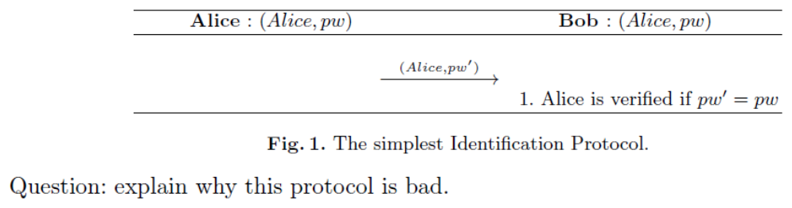

Bob 存着 (Alice, pw)。Alice 登录时发送用户名和这次输入的口令 pw′。写成 pw′ 是因为输入可能有误，Bob 要比较它和存下的 pw 是否相等。

这个协议有两个问题。第一，口令明文传输。窃听者截获 (Alice, pw) 就拿到了口令，之后随时可以冒充 Alice 登录。第二，Bob 明文保存口令。数据库一旦泄露，所有用户的口令同时曝光；用户在别处用了同一个口令的话，那些账户也跟着失守（§13.3）。

> ✍️ **English answer** — Protocol 1 is not secure. Alice sends her username and password in plaintext, so an eavesdropper obtains pw directly and can later log in as Alice; this is an impersonation attack. Bob also stores pw in plaintext, so a leak of his database exposes every user's password.

## 4. 协议 2：发送口令的哈希 (W6 S9–S12)

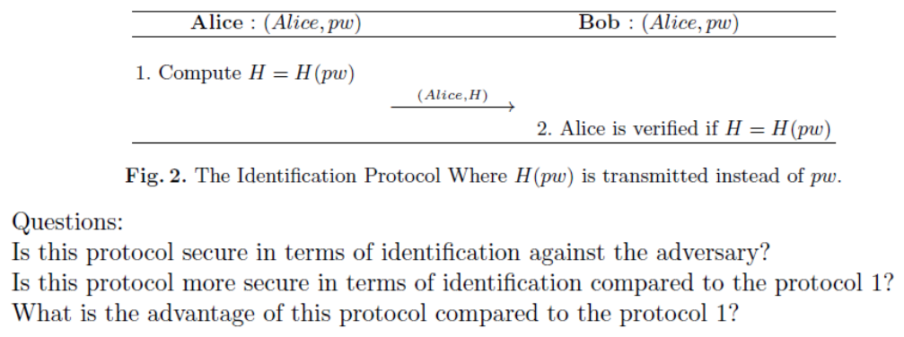

Alice 不再发送口令，改发 H(pw)。Bob 存的仍是 pw，收到后算出 H(pw) 再比较。

窃听者看不到口令了，但协议仍不安全。Bob 只检查收到的值是否等于 H(pw)，分不清它是 Alice 现场算的，还是别人录下来重放的。H(pw) 实际上成了新的口令：攻击者截获 (Alice, H(pw)) 后原样发给 Bob，就能冒充 Alice。网站上的哈希通常由浏览器里的登录表单计算，攻击者不必经过表单，自己构造一个登录请求，把截获的值直接发给服务器就行。所以在识别这件事上，它和协议 1 一样不安全。

它比协议 1 只好一点：攻击者不能立刻得到 pw。但口令容易猜，攻击者可以先算好常见口令的哈希表，再查表反推 pw，这就是离线字典攻击（offline dictionary attack，第 1 章 §6.2）。

> ✍️ **English answer** — Not secure. H(pw) acts as the password: an eavesdropper can replay (Alice, H(pw)) to impersonate Alice, so in terms of identification it is as insecure as Protocol 1. It is only slightly better than Protocol 1 because pw is not revealed directly, but a low-entropy pw can still be recovered by an offline dictionary attack.

## 5. 协议 3：加一个随机盐 (W6 S13–S15)

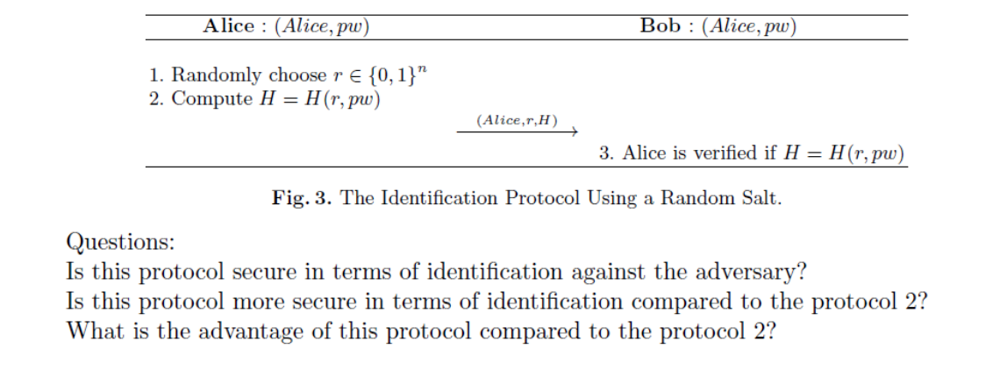

Alice 每次随机选一个 r，发送 (Alice, r, H(r, pw))。Bob 用收到的 r 和自己存的 pw 重算一遍再比较。

它仍然不安全，原因和协议 2 一样。r 是 Alice 选的，Bob 不关心 r 是多少，只要哈希对得上就接受。攻击者截获 (Alice, r, H(r, pw)) 后原样重发，连 r 都不用改，就能冒充 Alice。所以在识别这件事上，它和协议 2 一样不安全。

改进在口令的保护上。r 起到盐的作用，事先算好的 (pw, H(pw)) 字典失效了。攻击者要等截获 r 之后，再针对这个 r 把候选口令重算一遍，而这本字典换一个 r 就没用了（课件把这叫 online dictionary attack，见第 1 章 §6.3）。弱口令仍然能被猜出来，只是没法预先算好。

这个协议说明，随机数由谁来选，决定了它起什么作用。由 Alice 选的随机数只能当盐；要防重放，随机数必须由验证方 Bob 来选。

> ✍️ **English answer** — Not secure. The random value r is chosen by Alice, so Bob accepts any r as long as the hash matches; an adversary can replay the recorded (Alice, r, H(r, pw)) without changing r and impersonate Alice. It is therefore as insecure as Protocol 2. Its advantage is that r acts as a salt: a precomputed dictionary of (pw, H(pw)) is useless, and the adversary must build a new dictionary for the particular r after eavesdropping, which cannot be reused for a different r.

## 6. 协议 4：Bob 出挑战 (W6 S16–S17)

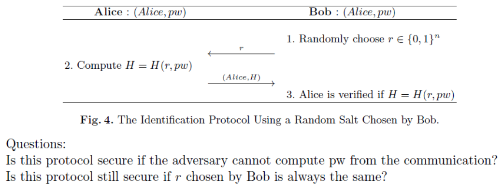

这一次 r 由 Bob 随机选。Alice 用 r 和口令算出 H(r, pw) 发回，Bob 用同样的 r 和存下的 pw 核对。验证方出一个新的随机数，证明方用秘密算出回答，这种结构叫**挑战–响应**（challenge–response），r 叫挑战（challenge）。

课件问了两个问题。

第一，假设攻击者没法从通信中算出 pw，协议安全吗？安全。攻击者录下的 (r, H(r, pw)) 下次用不上：他冒充 Alice 时，Bob 会发来一个新的 r′，正确的回答是 H(r′, pw)。不知道 pw，就算不出这个回答。

第二，如果 Bob 每次选的 r 都一样呢？不安全。挑战不变，回答也就不变，攻击者重放录下的回答就能登录，协议退回到协议 3 的水平。同理，r 必须足够长、真正随机，否则一旦重复，旧回答又能用了。

第一问的前提很要紧。窃听者同时拿到了 r 和 H(r, pw)，r 是公开的，只剩 pw 未知。口令弱的话，攻击者可以离线逐个试，前提就不成立了。另外 Bob 还是明文存着 pw，数据库泄露的问题和协议 1 一样。协议 5 改的就是这一点。

> ✍️ **English answer** — Protocol 4 is secure against replay if the adversary cannot compute pw from the communication. Bob chooses a fresh random challenge r for every login, so a recorded response H(r, pw) is useless later: the adversary would need H(r′, pw) for a new r′, which requires pw. If Bob always uses the same r, the response never changes and can be replayed, so the protocol becomes as insecure as Protocol 3. It is still open to a dictionary attack on a weak password, because r and H(r, pw) are both visible to an eavesdropper, and Bob still stores pw in plaintext.

## 7. 协议 5：服务器只存哈希 (W6 S18–S20)

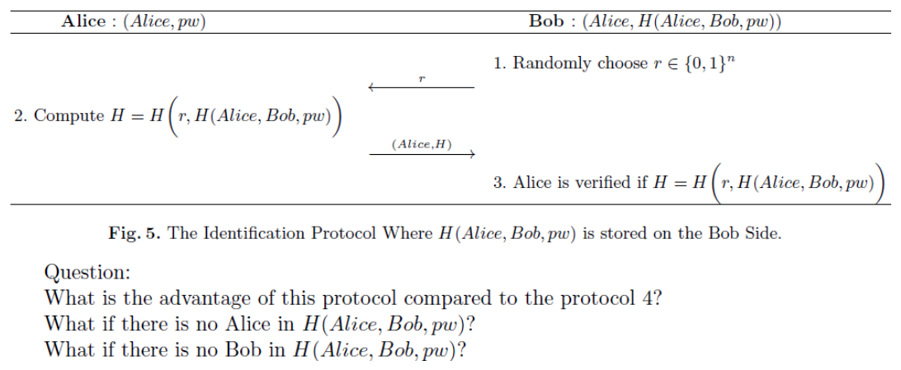

Bob 不再存 pw，改存 H(Alice, Bob, pw)。Alice 记得 pw，可以现场算出 H(Alice, Bob, pw)，再和挑战 r 一起哈希发回。挑战–响应部分和协议 4 相同，防重放的结论不变。新的问题是：服务器的数据库泄露后会怎样。课件就此问了三个问题。

和协议 4 相比有什么好处？数据库泄露后，攻击者不能立刻得到用户的口令。他只能对每个用户分别做字典攻击：每个用户的用户名不同，每破解一个用户，都得用这个用户名把字典重算一遍。

去掉 Alice 会怎样？Bob 存的变成 H(Bob, pw)。同一台服务器上口令相同的用户，存的值也相同。攻击者为这台服务器算一本 (pw, H(Bob, pw)) 字典，就能一次破解所有用户。课件把这叫 offline dictionary attack，和逐个用户计算的 online dictionary attack 相对（第 1 章 §6.3）。

去掉 Bob 会怎样？Bob 存的变成 H(Alice, pw)，这个值在所有服务器上都一样。很多人在不同网站用同一套用户名和口令。攻击者从一台服务器偷到 H(Alice, pw)，不必破解口令，就能用它回答另一台服务器的挑战，冒充 Alice 登录。服务器 X 的管理员如果心怀不轨，也能这样登录 Alice 在服务器 Y 上的账户。写进 Bob 的名字后，每台服务器存的值互不相同。

> 📎 **拓展（超出 slides）** — 同样的推理说明了协议 5 的一个局限：数据库里的 H(Alice, Bob, pw) 本身就足以回答 Bob 的挑战。数据库泄露后，攻击者不用破解口令，也能冒充 Alice 登录 Bob 这一台服务器。写进 Bob，只是把损失限制在这一台服务器上。要彻底解决，得像协议 8、9 那样让服务器只存公钥。

> ✍️ **English answer** — Advantage over Protocol 4: even if Bob's database is leaked, the adversary cannot immediately obtain users' passwords; because usernames are distinct, he must run a separate (online) dictionary attack for each user. Without Alice in the hash, users with the same password would have the same stored value, so one precomputed dictionary would crack all passwords (an offline dictionary attack). Without Bob in the hash, H(Alice, pw) would be the same on every server, so a value stolen from one server could be used to answer challenges and impersonate Alice on other servers where she uses the same username and password.

## 8. 协议 6：用对称密钥代替口令 (W6 S21–S22)

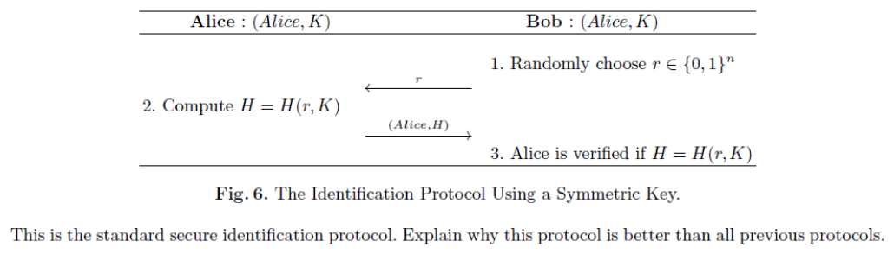

结构和协议 4 一样，只是把口令 pw 换成了 Alice 和 Bob 共享的对称密钥 K。课件称它为标准的安全识别协议。它比前面所有协议都好，原因有两点：

- K 是随机生成的长密钥，保存在设备里，不是人选的口令，没有字典能覆盖它。截获 (r, H(r, K)) 也无从猜起，字典攻击失效。
- 每次由 Bob 选新的 r，回答无法重放。

**只要 r 和 K 足够长、K 保密，协议就是安全的**。反过来，K 要是短到 123456，它和口令就没有区别了。

协议 6 还有两个局限。Bob 也要保存 K，服务器被攻破，K 就泄露了，攻击者可以直接冒充 Alice。另外 Alice 的用户名明文发送，窃听者能看出是谁在登录。协议 7 和协议 8、9 分别处理这两个问题。

> 📎 **拓展（超出 slides）** — 实际系统用 MAC 计算这个回答，例如 HMAC(K, r)，而不是自己拼接 H(r, K)（第 1 章 §7）。

> ✍️ **English answer** — Protocol 6 is the standard secure identification protocol. Bob sends a fresh random challenge r, so a recorded response cannot be replayed, and Alice answers with H(r, K) using a long random symmetric key K instead of a password, so there is no dictionary attack. As long as r and K are long enough and K is kept secret, an adversary cannot compute the response to a new challenge. Its limitations are that Bob must store K, so a server compromise leaks it, and that the username is sent in clear.

## 9. 协议 7：匿名识别 (W6 S23–S24)

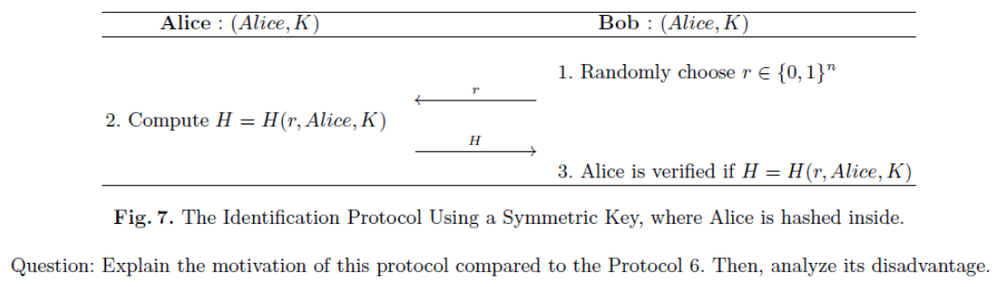

改动只有一处：Alice 不再单独发送用户名，只发 H = H(r, Alice, K)，用户名被放进了哈希里。

动机是**匿名识别**（anonymous identification）：窃听者看不出是谁在被识别。协议 6 里，攻击者冒充不了 Alice，却能看到"Alice 某天某时登录了某个服务器"，这本身就是隐私。协议 7 里，窃听者只看到一个随机数和一个看起来随机的哈希值。

代价落在 Bob 身上。他也不知道来的是谁，只能对每个用户 i 算一遍 $H(r, ID_i, K_i)$，直到找到相等的那个。有 n 个用户，最坏要算 n 次哈希，n 可能是 10,000。识别效率低，用户一多就难以扩展；几十个用户的小系统还能接受。

> ✍️ **English answer** — The motivation is anonymous identification. In Protocol 6 the username is sent in clear, so an eavesdropper learns who is being identified and when; in Protocol 7 Alice's identity is hashed inside H(r, Alice, K), so the eavesdropper sees only random-looking values. The disadvantage is that Bob does not know who is responding either: he must compute $H(r, ID_i, K_i)$ for each user until one matches, which takes up to n hash computations for n users (n could be 10,000). Identification is inefficient and does not scale.

## 10. 协议 8、9：用公钥代替共享密钥 (W6 S25–S27)

前面的协议里，Bob 手里的数据都能用来冒充 Alice。协议 8、9 换成公钥密码：Alice 有一对密钥 (pk, sk)，Bob 只存 Alice 的公钥 pk。

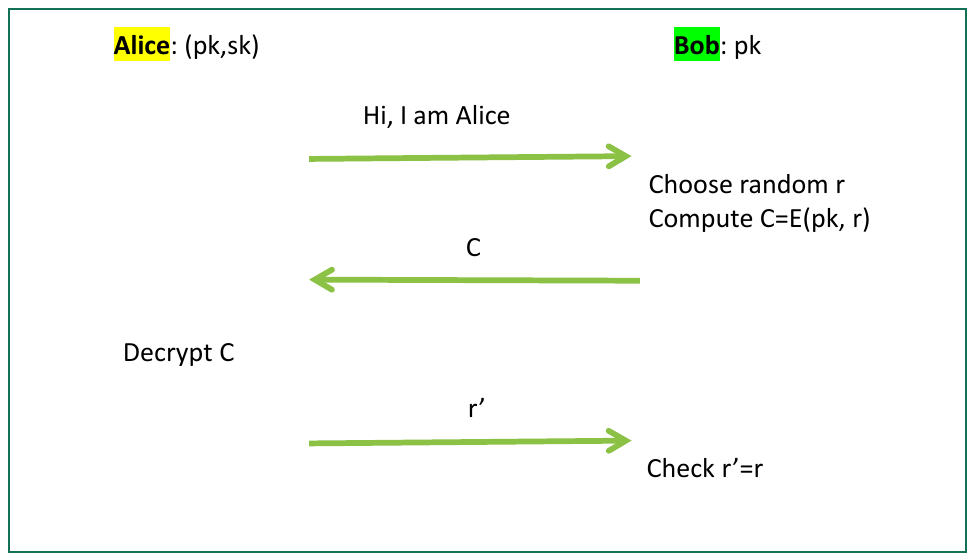

协议 8 基于公钥加密。Alice 先说"Hi, I am Alice"。Bob 随机选 r，用 Alice 的公钥加密成 C = E(pk, r) 发给她。Alice 用私钥解密，把得到的 r′ 发回，Bob 检查 r′ = r。只有持有私钥的人才能解出 r。

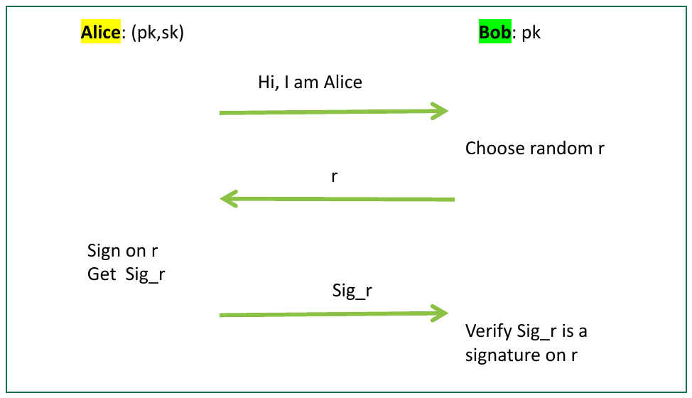

协议 9 基于数字签名。Bob 随机选 r 发给 Alice，Alice 用私钥对 r 签名，把 Sig_r 发回，Bob 用 Alice 的公钥验证。只有持有私钥的人才能生成有效的签名。

两个协议的挑战都是 Bob 每次新选的 r，旧回答无法重放；私钥是长随机数，也不怕字典攻击。最大的好处在服务器一侧：Bob 只存公钥，服务器被攻破，攻击者拿到的是本来就公开的东西，没法用它冒充 Alice。私钥始终只在 Alice 的设备里。

> 👨‍🏫 **课堂强调** — 协议 6 到 9 没有绝对的高下，要看用户注册时用的是口令、对称密钥还是公钥。不在乎复杂度的话，公钥方案更好：协议 6、7 的服务器存着用户的密钥，协议 8、9 只存公钥。

课件接着问：这两个协议匿名吗？不匿名。第一条消息就是明文的"Hi, I am Alice"，Bob 要靠它找到 Alice 的公钥。

> 📎 **拓展（超出 slides）** — 课件问的"怎样改进"课上没有给出答案。常见的思路有三种：（1）先保护身份再发送。Alice 用 Bob 的公钥加密自己的身份，或者先做一次 DH 建立加密信道，再在信道里发送身份（第 2 章）。（2）学协议 7，不发身份，让 Bob 用每个用户的公钥逐个验证，同样低效。（3）用临时化名代替真实身份，GSM 的 TMSI 就是这样（§12）。
>
> 另外，认证用的密钥最好专用。协议 8 里 Alice 会解密任何发来的密文，协议 9 里她会签任何发来的 r。同一把密钥若还用来签交易，恶意的"Bob"就可以把一笔交易的哈希当作挑战发过来，骗她签名。

> ✍️ **English answer** — Protocols 8 and 9 replace the shared key with a public-key pair. Bob stores only Alice's public key and sends a fresh random challenge; Alice proves that she holds the private key by decrypting C = E(pk, r) (Protocol 8) or by signing r (Protocol 9). Replay fails because r changes every time, and a server compromise reveals only public keys, which cannot be used to impersonate Alice. Neither protocol is anonymous, because Alice announces her identity in clear; this could be improved by sending the identity encrypted under Bob's public key or inside an encrypted channel.

## 11. 九个协议一览

| 协议 | Alice 发送 | Bob 存储 | 主要弱点 | 下一个协议的改动 |
|---|---|---|---|---|
| 1 | (Alice, pw′) | pw | 窃听即得口令；数据库是明文 | 改发哈希 |
| 2 | (Alice, H(pw)) | pw | 可重放；离线字典攻击 | 加盐 |
| 3 | (Alice, r, H(r, pw))，r 由 Alice 选 | pw | 可重放；弱口令仍可逐个猜 | 改由 Bob 选 r |
| 4 | (Alice, H(r, pw))，r 由 Bob 选 | pw | 弱口令可猜；r 固定就能重放；数据库是明文 | 服务器只存哈希 |
| 5 | (Alice, H(r, H(Alice, Bob, pw))) | H(Alice, Bob, pw) | 弱口令仍可逐个用户猜；泄露的值能登录 Bob（§7 📎） | 用随机密钥代替口令 |
| 6 | (Alice, H(r, K)) | K | 服务器泄露 K；不匿名 | 把用户名藏进哈希 |
| 7 | H(r, Alice, K) | K | Bob 最坏要算 n 次 | — |
| 8 | 解密 E(pk, r) 得到的 r′ | pk | 不匿名 | — |
| 9 | 对 r 的签名 Sig_r | pk | 不匿名 | — |

协议 1 到 5 是口令协议的演进：先藏住口令，再防重放，最后保护服务器上的数据。协议 6 到 9 不再依赖口令，按用户手里是对称密钥还是公钥来选。

这九个协议只证明身份，不产生会话密钥。认证通过之后，如果后面的消息没有保护，攻击者仍然可以篡改或者接管连接。要保护后续通信，就得像 GSM 那样在认证时一并协商会话密钥（§12），或者像 TLS 那样把认证和 DH 结合起来（第 2 章）。

## 12. GSM 的认证与密钥协商 (W6 S28–S39)

手机通过基站接入运营商的网络，网络里有位置寄存器、交换系统和认证服务器。从 2G 到 5G，移动通信要解决四个安全问题：认证、机密性、完整性和匿名性。GSM（2G）用一个协议同时完成认证和密钥协商（图 10）。

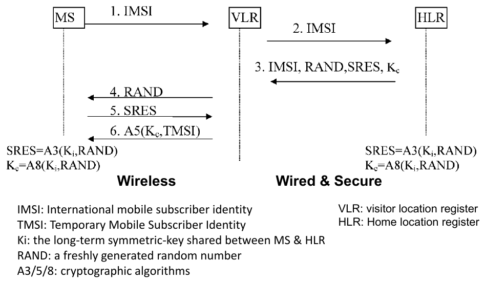

先认识参与者和几个缩写：

- MS（mobile station）：手机和插在里面的 SIM 卡。
- HLR（home location register，归属位置寄存器）：用户所属运营商的数据库，例如 Telstra 的。
- VLR（visitor location register，拜访位置寄存器）：手机当前所在网络的服务器。手机在本地时，VLR 属于本地运营商；漫游到外国时，属于当地的运营商。
- IMSI：国际移动用户识别码，是 SIM 卡的长期身份。TMSI：临时身份。
- Ki：SIM 卡和 HLR 共享的长期对称密钥。RAND：新生成的随机数。A3、A5、A8：三个密码算法。

开户时（第 0 步），运营商发给用户一张 SIM 卡，卡里写入 IMSI 和 Ki，HLR 也存一份。之后每次接入网络：

1. MS → VLR：IMSI。手机开机时发出 IMSI，VLR 据此找到它的 HLR。
2. VLR → HLR：IMSI。VLR 向 HLR 申请认证材料。
3. HLR → VLR：IMSI、RAND、SRES、Kc。HLR 找到这个 IMSI 的 Ki，生成随机数 RAND，算出 SRES = A3(Ki, RAND) 和 Kc = A8(Ki, RAND)。VLR 和 HLR 之间是安全的有线信道。
4. VLR → MS：RAND。这是给手机的挑战。
5. MS → VLR：SRES。SIM 卡用自己的 Ki 算出 SRES 和 Kc，把 SRES 发回。VLR 把它和 HLR 给的 SRES 比较，相等就认证通过。
6. VLR → MS：A5(Kc, TMSI)。VLR 给手机分配一个临时身份 TMSI，用 Kc 加密后发送。手机用 RAND 和 Ki 算出 Kc，解密得到 TMSI，此后用 TMSI 代替 IMSI 通信。

用五个步骤来看：

- 认证部分就是协议 6。共享的对称密钥是 Ki，挑战 RAND 由网络一方随机选，回答 SRES = A3(Ki, RAND)。窃听者看到 RAND 和 SRES 也没用，下次会换一个 RAND；Ki 是长随机密钥，猜不出来。
- Ki 从不离开 SIM 卡和 HLR。拜访网络只拿到一组 (RAND, SRES, Kc)，够认证这一次，却得不到 Ki。漫游时，外国的运营商用不着知道你的长期密钥。
- 认证的同时得到会话密钥 Kc，此后的通信用 A5 和 Kc 加密。认证和密钥协商一步完成。
- 匿名靠 TMSI。IMSI 是长期身份，如果一直明文发送，窃听者就能跟踪这部手机。TMSI 是加密下发的临时化名，之后的通信都用它，窃听者无法把它和 IMSI 对应起来。
- Ki 的安全依赖 SIM 卡芯片。Ki 不能从卡里直接读出，SRES 也由卡内的芯片计算。但老式 SIM 卡曾被复制，能接触 HLR 数据的内部人员也可能拿到 Ki；有了 Ki 就能复制出一张一样的卡，收到机主的短信验证码。新一代 SIM 卡已经很难复制。

> 📎 **拓展（超出 slides）** — GSM 还有两个公认的弱点。第一，第 1 步的 IMSI 是明文发送的。开机时，或者 VLR 不认识手机的 TMSI 时，真实身份仍会暴露，伪基站（IMSI catcher）就靠这一点收集 IMSI。第二，只有手机被认证，网络从没向手机证明过自己，所以伪基站可以冒充运营商。3G 起改成了双向认证。
>
> 课件最后问：有了公钥密码，怎样保护匿名？这个问题课上没有讲。思路是：手机用归属网络的公钥加密 IMSI 再发送，每次加密都带新的随机数，所以密文每次都不一样。窃听者读不出 IMSI，也无法把两次连接关联起来。这样连第一条消息也不暴露身份，补上了 TMSI 管不到的那一步。5G 的 SUCI 就是这样做的，用的正是第 2 章 §7 提到的 ECIES。

> ✍️ **English answer** — GSM authentication is a challenge–response protocol based on a long-term symmetric key Ki shared by the SIM card and the HLR. The VLR obtains (RAND, SRES, Kc) from the HLR and sends the fresh random RAND to the phone; the SIM computes SRES = A3(Ki, RAND) and the session key Kc = A8(Ki, RAND), and the VLR accepts the phone if its SRES matches. A recorded SRES cannot be replayed because RAND changes, and Ki never leaves the SIM and the HLR, so the visited network never learns it. For anonymity, the VLR sends a temporary identity TMSI encrypted with Kc, and the phone uses TMSI instead of IMSI afterwards. However, the IMSI is still sent in clear in the first step, and only the phone is authenticated, not the network.

## 13. 同样的弱点在别处

### 13.1 WEP 共享密钥认证：回答泄露了能反复使用的材料 (W8 S25)

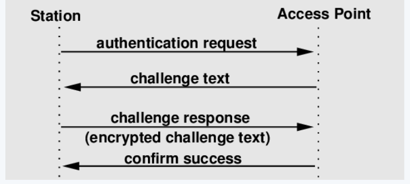

形式上这也是挑战–响应：接入点（AP）发出一段明文挑战，终端用 WEP（RC4 流密码加共享密钥）加密后返回。问题出在流密码上：密文等于明文和密钥流的异或。窃听者同时看到明文挑战和它的密文，两者一异或，就得到这个 IV 对应的密钥流。下次认证时，攻击者选用同一个 IV，把新挑战和这段密钥流异或，就能交出正确的回答，根本不需要知道密钥。

对比协议 6：H(r, K) 换一个 r 就面目全非，旧回答里没有任何能再用的东西。WEP 的回答却泄露了能反复使用的密钥流。**挑战–响应的回答不能泄露可以重复使用的密码学材料**。现代做法是用标准化的认证方法，配合新鲜的挑战和防重放机制。WEP 的其他问题见第 1 章 §8 和第 6 章。

### 13.2 WPA2-PSK：截获握手就能离线猜口令 (W8 S29)

WPA2 个人版全网共用一个口令（passphrase）。攻击者截获一次连接时的握手，就能在自己的电脑上逐个试口令，和协议 2 到 5 面对的离线字典攻击是一回事。这时 AP 已经限制不了猜测次数，攻击者可以动用 GPU，或者花钱用云服务来算。

网络名 SSID 参与从口令派生密钥，起到盐的作用。可是很多网络用同样的默认 SSID，攻击者可以为常见的 SSID 预先算好字典。盐不唯一，作用就打了折扣。防御办法是用一个长而随机、这个网络专用的口令，优先用 WPA3-SAE 或企业认证，再把访客和 IoT 设备放进单独的网络。详见第 6 章。

### 13.3 口令泄露与撞库 (W9 S52–S53)

泄露的数据库显示，口令大多简单好猜。排名第一的是 123456，出现了约 760 万次，后面是 12345678、123456789 和 admin。弱口令好猜，泄露的口令直接暴露账户，用户还常在多个服务里重复使用同一个口令。

攻击者拿泄露的用户名和口令去别的网站逐个尝试，这叫**撞库**（credential stuffing）。这正是协议 5 不写 Bob 时的问题，只是范围扩大到了整个互联网（图 12）。

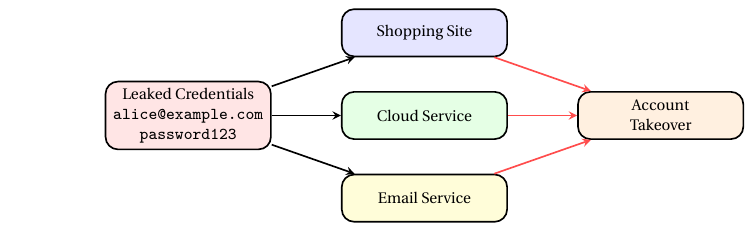

防御撞库：每个服务用不同的口令，用口令管理器保存，开启多因素认证（MFA），限制登录频率，检测可疑的登录。

### 13.4 Passkey：协议 9 的实际应用 (W9 S54–S57)

口令有四个毛病：在多个服务间重复使用，容易被钓鱼，会随数据库一起泄露，而且往往很弱。Passkey 用一对密钥代替口令：私钥留在用户设备里，服务器只登记公钥。登录时服务器发一个随机挑战，设备用私钥签名，服务器用公钥验证（图 13）。这就是协议 9。

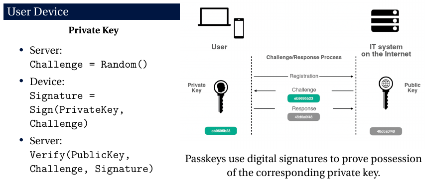

Passkey 还能防钓鱼（图 14）。用户在假冒的 GitHub 登录页输入口令，口令就落到了攻击者手里，攻击者转身就能登录真正的 `github.com`。用 passkey 时，设备会先检查请求来自哪个网站。假页面的地址是 `github-login.example.com`，不是 `github.com`，设备拒绝签名。签名和网站绑定，攻击者在假网站上拿不到能在真网站用的东西。

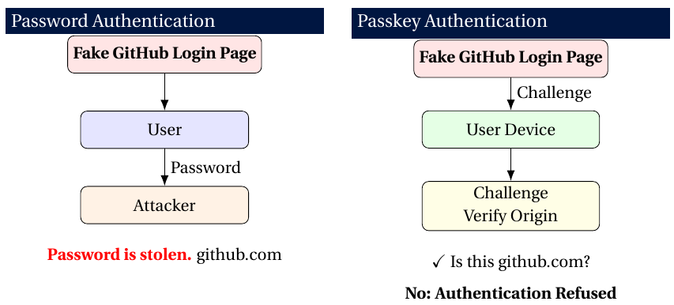

私钥不离开设备，换了手机怎么办？Passkey 先做端到端加密，再经 iCloud 钥匙串或 Google 密码管理器同步到用户的其他可信设备，云服务商看不到私钥。

> ✍️ **English answer** — The same weaknesses appear in real systems. WEP shared-key authentication sent a plaintext challenge and its RC4-encrypted response, so an observer could XOR them to obtain the keystream for that IV and answer later challenges without the key; a challenge–response protocol must not reveal reusable cryptographic material. A captured WPA2-PSK handshake allows an offline dictionary attack on the passphrase, and leaked, reused passwords enable credential stuffing. Passkeys apply Protocol 9: the device signs a fresh random challenge with a private key that never leaves it, the server stores only the public key, and the device checks the website's origin, which makes passkeys phishing resistant.

## 14. 变体协议：用五个步骤练手

考试可能给出课上没讲过的协议。下面四个变体各改了一处。先自己按 §2 的五步分析，再展开对照。

**V1 · 用异或代替哈希。** Bob 发随机数 r，Alice 返回 (Alice, r ⊕ pw)，Bob 检查收到的值与 r 异或后是否等于 pw。

<details>
<summary>分析 V1</summary>

不安全，而且比协议 2 还糟。窃听者知道 r，也看到了 r ⊕ pw，两者再异或一次就得到 pw。异或可以逆算，起不到哈希的单向作用。窃听一次，攻击者就拿到了口令。

</details>

**V2 · 用时间戳代替挑战。** Alice 发送 (Alice, T, H(T, pw))，T 是当前时间。Bob 检查 T 和自己的时钟相差不超过 5 分钟，并且哈希正确。

<details>
<summary>分析 V2</summary>

时间戳省掉了 Bob 发挑战的那条消息，新鲜性改由时间保证，但有四个问题。第一，5 分钟之内，攻击者可以重放截获的消息；Bob 要记住窗口内收到过的值，才能拒绝重复的消息。第二，安全依赖双方时钟同步，攻击者如果能拨动某一方的时钟，旧消息又能用了。第三，T 是公开的，弱口令仍然可以离线逐个猜。第四，Bob 明文存着 pw。

</details>

**V3 · 把固定凭据加密后发送。** Bob 有一对密钥，Alice 发送 (Alice, E(pk_B, H(pw)))，Bob 解密后与 H(pw) 比较。

<details>
<summary>分析 V3</summary>

窃听者解不开密文，拿不到 H(pw)，也就没法猜口令。但这条密文每次登录都有效：攻击者原样重放，Bob 解密得到正确的 H(pw)，照样接受。即使加密是随机化的、每次密文都不同，攻击者重放的那一条也能解出正确的值。加密提供的是机密性，不是新鲜性。修补办法仍然是让 Bob 先发随机挑战 r，Alice 把 r 一起放进加密的内容，Bob 检查 r 是不是自己刚发的。

</details>

**V4 · 递增的挑战。** 协议 6 中，Bob 用计数器当挑战：第一次 r = 1，第二次 r = 2，依此类推。

<details>
<summary>分析 V4</summary>

挑战从不重复，单纯重放旧回答行不通，但挑战可以预测。攻击者如果能冒充 Bob 和 Alice 对话，比如搭一个假服务器，或者在 Alice 的卡旁边放一个假读卡器，就能提前拿 r = 101 去问 Alice，得到 H(101, K)。等真正的 Bob 发出 r = 101 时，把这个回答交上去。挑战不但不能重复，还必须不可预测，所以要用足够长的随机数。

</details>

> ✍️ **English answer** — Lessons from the variants: XOR is reversible, so r ⊕ pw reveals pw to anyone who also sees r. A timestamp gives freshness only within its time window and depends on synchronised clocks. Encrypting a fixed credential protects confidentiality but not freshness, so the ciphertext itself can be replayed. A challenge must be unpredictable as well as non-repeating; otherwise an attacker who can talk to Alice can collect responses to future challenges in advance.

## ⚠️ 易混易错

| 容易混的 | 区别 |
|---|---|
| 冒充攻击 vs 中间人攻击 | 冒充：假装成 Alice 通过 Bob 的认证；中间人：夹在两方之间转发、篡改消息（第 2 章） |
| 重放 vs 字典攻击 | 重放不需要知道口令，原样重发即可；字典攻击是把口令猜出来 |
| 盐 vs 挑战 | 盐让预先算好的字典失效；挑战让录下的回答失效。协议 3 有盐，没有挑战 |
| 离线 vs 在线字典攻击（课件用法） | 离线：预先算好一本字典，查表即得；在线：拿到 r 或用户名之后才能开始算（第 1 章 §6.3） |
| 匿名 vs 机密 | 协议 7 隐藏的是"谁在登录"，不是消息内容 |
| 协议 6 vs 协议 8、9 | 6 的服务器存着 K，被攻破就能冒充；8、9 只存公钥 |

常见误解：

- "攻击者算不出口令，协议就安全"：能重放就能冒充（协议 2、3）。
- "加了随机数就能防重放"：要看随机数由谁选。协议 3 的 r 由 Alice 选，防不了重放。
- "挑战不重复就够了"：还必须不可预测（V4）。
- "把凭据加密后发送就安全"：加密不提供新鲜性，密文照样能重放（V3）。
- "协议 5 的数据库泄露没关系"：口令不会立刻暴露，但仍可逐个用户猜；存的值本身还能登录这台服务器（§7 📎）。
- "协议 7 比协议 6 更难冒充"：两者的认证强度一样，协议 7 多了隐私，代价是效率。
- "用了密钥 K，协议 6 就一定安全"：K 短到能猜，它就和口令没有区别。
- "GSM 是双向认证"：只有手机被认证；第一次接入时 IMSI 仍是明文发送。

## 📝 Practice

### Part A · Multiple choice

**A1.** In Protocol 3, Alice sends (Alice, r, H(r, pw)) with a random r that she chooses herself. Why can an adversary impersonate Alice?
A. He can compute pw from H(r, pw).
B. He can replay the recorded message, because Bob accepts any r.
C. He can change r to a value of his choice.
D. Bob stores pw in plaintext.

<details>
<summary>Answer A1</summary>

**B.** The adversary does not need pw or a new r. D is a separate weakness that concerns database leaks, not this attack.

</details>

**A2.** In Protocol 4, Bob always sends the same r. Which statement is TRUE?
A. The protocol is still secure because r was chosen randomly once.
B. The protocol becomes vulnerable to replay, like Protocol 3.
C. Only a dictionary attack becomes possible.
D. The protocol becomes anonymous.

<details>
<summary>Answer A2</summary>

**B.** With a fixed challenge the correct response never changes, so a recorded response can be replayed.

</details>

**A3.** Protocol 5 stores H(Alice, Bob, pw). What does including "Bob" prevent?
A. Replay of Alice's response to Bob
B. Cracking all users' passwords with one dictionary
C. Using a value stolen from one server to impersonate the user on other servers
D. Eavesdroppers learning the username

<details>
<summary>Answer A3</summary>

**C.** B is what including "Alice" prevents; A is prevented by the fresh challenge r.

</details>

**A4.** What is the main disadvantage of Protocol 7 (anonymous identification)?
A. An eavesdropper learns the username.
B. Bob must try every user's key, up to n hash computations.
C. Responses can be replayed.
D. A dictionary attack recovers K.

<details>
<summary>Answer A4</summary>

**B.** Without the username, Bob does not know which key to use and must try them one by one.

</details>

**A5.** In GSM, which value never leaves the SIM card and the HLR?
A. RAND  B. SRES  C. Ki  D. TMSI

<details>
<summary>Answer A5</summary>

**C.** RAND and SRES travel over the air, and TMSI is sent encrypted with Kc; the VLR receives only (RAND, SRES, Kc).

</details>

**A6.** Why are passkeys phishing resistant?
A. The password is hashed before it is sent.
B. The private key is sent to the server only over HTTPS.
C. The device checks the website's origin, and the private key never leaves the device.
D. The server stores a salted hash of the key.

<details>
<summary>Answer A6</summary>

**C.** A fake site has a different origin, so the device refuses to sign, and there is no reusable secret that a fake site could collect.

</details>

### Part B · Fill in the blank / short answer

**B1.** An ______ attack is one in which an adversary successfully assumes the identity of a legitimate party, for example by logging in as Alice.

<details>
<summary>Answer B1</summary>

impersonation

</details>

**B2.** In GSM, the HLR computes SRES = ______(Ki, RAND) and Kc = ______(Ki, RAND). After authentication, the VLR sends the ______ encrypted with Kc, so that the phone no longer needs to reveal its ______.

<details>
<summary>Answer B2</summary>

A3; A8; TMSI (temporary mobile subscriber identity); IMSI.

</details>

**B3.** Explain why Protocol 6 is better than Protocols 1–5. (2–3 sentences)

<details>
<summary>Answer B3</summary>

Protocol 6 uses a fresh random challenge chosen by Bob, so a recorded response cannot be replayed. It replaces the low-entropy password with a long random symmetric key K, so an eavesdropper who sees r and H(r, K) cannot run a dictionary attack. As long as r and K are long enough and K is kept secret, an adversary cannot compute the response to a new challenge.

</details>

**B4.** In WEP shared-key authentication, what does an eavesdropper learn, and why does it break the authentication?

<details>
<summary>Answer B4</summary>

The access point sends the challenge in plaintext and the station returns it encrypted with RC4, i.e. XORed with the keystream for a given IV. XORing the plaintext challenge with the response gives the eavesdropper that keystream. Later he can reuse the same IV and XOR any new challenge with the keystream, producing a valid response without knowing the key. The response reveals reusable cryptographic material.

</details>

**B5.** Can an eavesdropper on Protocol 8 or Protocol 9 tell who is being identified? Suggest one improvement.

<details>
<summary>Answer B5</summary>

Yes. Alice's first message, "Hi, I am Alice", is sent in clear, so the protocols are not anonymous. One improvement is to send the identity encrypted, for example under Bob's public key or inside a channel established by an authenticated key exchange; another is to use a temporary pseudonym instead of the real identity, as GSM does with the TMSI.

</details>

### Part C · Questions and answers

**C1.** Consider the following identification protocol. Bob stores (Alice, pw).
1. Bob randomly chooses $r \in \{0,1\}^n$ and sends r to Alice.
2. Alice computes H = H(r, pw) and sends (Alice, H) to Bob.
3. Bob accepts Alice if H = H(r, pw).

(a) Is this protocol secure if the adversary cannot compute pw from the communication? Explain.
(b) Is it still secure if the r chosen by Bob is always the same?
(c) Identify two remaining weaknesses and explain how later protocols address them.

<details>
<summary>Model answer C1</summary>

(a) Yes. Bob chooses a fresh random r for every login, so the expected response H(r, pw) is different each time. An adversary who recorded (r, H(r, pw)) cannot reuse it: when he tries to log in as Alice, Bob sends a new challenge r′, and the correct response H(r′, pw) cannot be computed without pw. Since the adversary cannot compute pw, the impersonation attack fails.

(b) No. If r is always the same, the correct response is always the same, so the adversary can replay the recorded (Alice, H(r, pw)) and impersonate Alice. The protocol becomes as insecure as Protocol 3.

(c) First, the assumption in (a) fails for weak passwords. An eavesdropper sees both r and H(r, pw), so he can test candidate passwords offline with a dictionary attack. Protocol 6 removes this weakness by replacing the password with a long random symmetric key K. Second, Bob stores pw in plaintext, so a database leak reveals every password. Protocol 5 stores H(Alice, Bob, pw) instead, so the adversary must attack each user separately, and Protocols 8 and 9 store only public keys.

**Marking points:** a fresh challenge chosen by Bob makes recorded responses useless (1); a new response cannot be computed without pw (1); a fixed r allows replay, as in Protocol 3 (1); dictionary attack on a weak password (1); plaintext storage at Bob and how a later protocol fixes it (1).

</details>

**C2.** In Protocol 5, Bob stores (Alice, H(Alice, Bob, pw)). He sends a random challenge r, Alice replies with (Alice, H(r, H(Alice, Bob, pw))), and Bob checks the reply.
(a) What is the advantage of this protocol compared with Protocol 4?
(b) What if there is no "Alice" in H(Alice, Bob, pw)?
(c) What if there is no "Bob" in H(Alice, Bob, pw)?

<details>
<summary>Model answer C2</summary>

(a) Bob no longer stores pw; he stores H(Alice, Bob, pw). Even if the adversary breaks into Bob's database, he cannot immediately obtain any user's password. Because usernames are distinct, he must run a separate (online) dictionary attack for each user. The fresh challenge r still prevents replay, as in Protocol 4.

(b) Without "Alice", Bob would store H(Bob, pw). Users with the same password would have the same stored value, so the adversary could precompute one dictionary of (pw, H(Bob, pw)) and crack the passwords of all users at once. This is an offline dictionary attack instead of an online dictionary attack per user.

(c) Without "Bob", the stored value H(Alice, pw) would be the same on every server. Many users reuse the same username and password on several servers. An adversary who steals H(Alice, pw) from one server, or a malicious server operator, could use it directly to answer the challenges of another server and impersonate Alice there, without cracking the password. Including the server name makes the stored value different on every server. Note that the stolen value can still be used to log in to Bob itself; only public-key protocols such as Protocols 8 and 9 avoid this.

**Marking points:** stored hash means no immediate password exposure (1); a per-user dictionary attack is needed (1); without "Alice", one dictionary cracks all users (1); without "Bob", the same value on every server (1); impersonation on other servers without cracking pw (1).

</details>

**C3.** Alice and Bob share a symmetric key K and want to authenticate each other with the following protocol:
1. A → B: Alice, $r_A$
2. B → A: $r_B$, H($r_A$, K)
3. A → B: H($r_B$, K)

Each party accepts if the hash it receives is correct.
(a) Show that an attacker who does not know K can make Bob accept him as Alice.
(b) Explain the root cause and propose a fix.

<details>
<summary>Model answer C3</summary>

(a) The attacker, Eve, uses two sessions with Bob (a reflection attack). In session 1, Eve sends (Alice, $r_E$). Bob replies with ($r_B$, H($r_E$, K)) and waits for H($r_B$, K), which Eve cannot compute. Eve then opens session 2 and sends (Alice, $r_B$), reusing Bob's own challenge as her challenge. Bob replies with ($r_B'$, H($r_B$, K)). Eve abandons session 2 and sends H($r_B$, K) in session 1, so Bob accepts her as Alice. Bob has answered his own challenge for her.

(b) Root cause: both directions use the same key and the same function, so a response computed by Bob is also a valid response from Alice; the response does not show who computed it or for which session. Fix: make the responses direction-specific by including the responder's identity, for example Bob replies H($r_A$, Bob, K) and Alice replies H($r_B$, Alice, K), as Protocol 7 hashes the identity inside; or use a different key for each direction. Including both nonces, for example H($r_A$, $r_B$, Alice, K), also binds the response to this session.

**Marking points:** uses a second session with Bob (1); reflects $r_B$ as Eve's own challenge (1); Bob accepts the reflected response (1); root cause: identical responses in both directions (1); fix: identity or direction inside the hash, or separate keys (1).

</details>

## 本章小结

- 判断识别协议是否安全，先看能不能被冒充；攻击者算不出口令并不等于安全。—— *impersonation attack*
- 分析协议的五步：列清楚、重放检查、猜测检查、服务器检查、隐私与效率。—— *replay, dictionary attack, server compromise, anonymity*
- 防重放靠验证方每次新选、不可预测的挑战；协议 3 的 r 由 Alice 选，只能当盐。—— *fresh random challenge chosen by the verifier*
- 协议 5 让服务器只存 H(Alice, Bob, pw)：写进 Alice，一本字典破解不了所有用户；写进 Bob，偷来的值拿到别的服务器上没用。—— *per-user dictionary attack, impersonation on other servers*
- 协议 6 是标准的安全识别协议：随机挑战加长随机密钥；局限是服务器存着 K、用户名明文发送。—— *standard secure identification protocol*
- 协议 7 匿名但低效；协议 8、9 让服务器只存公钥，但不匿名。—— *anonymous identification, public-key identification*
- GSM 等于协议 6 加会话密钥 Kc 加 TMSI 化名；IMSI 第一次明文发送，网络一方不被认证。—— *IMSI, TMSI, Ki, RAND, SRES, Kc*
- 同类问题在现实中：WEP 的回答泄露密钥流，WPA2 握手可离线猜口令，口令重复使用导致撞库；passkey 是带来源检查的协议 9。—— *keystream, offline guessing, credential stuffing, passkey*
