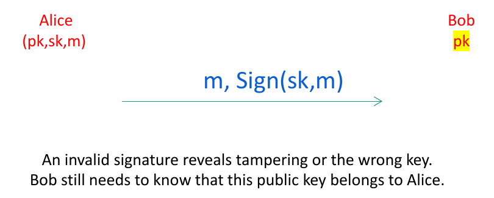
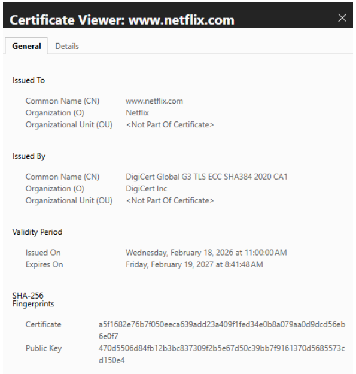
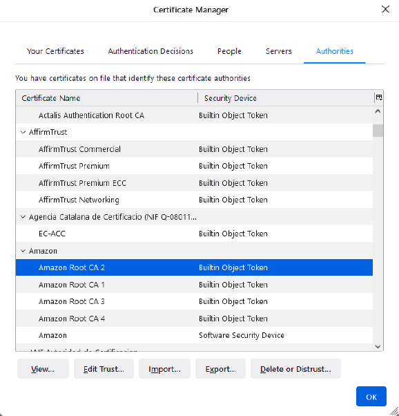
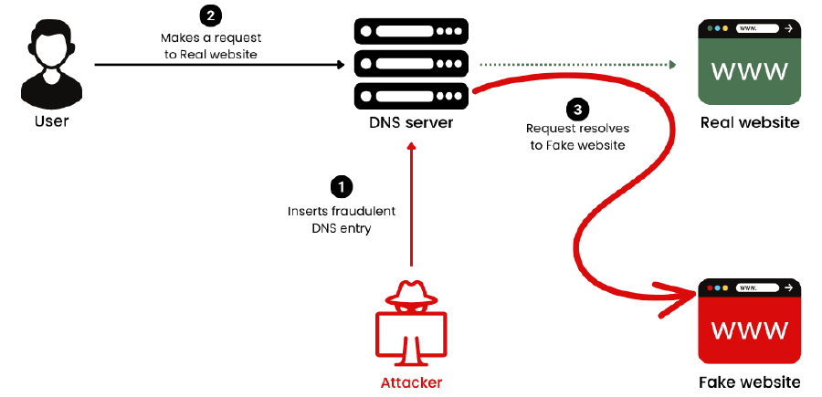

# CSIT953 考试复习 · 第 4 章 HTTPS、TLS 与证书

> 🎯 **考纲** — *HTTPS, TLS and Digital Certificates — Certificate trust, validity and secure connections.*
>
> 唯一的样题出自这一章：一个用 HTTP 的聊天应用，怎样保护通信，能否抵抗中间人。问答题还可能问 DNS 投毒对 HTTP 和 HTTPS 的不同影响、自签名证书能不能用、企业代理为什么能看到 HTTPS 的明文。单选题考证书失败的原因、DV 证书证明什么、TLS 1.3 握手里有哪些消息、到期和吊销的区别；填空题考 SAN、trust anchor、CertificateVerify、OCSP stapling、Certificate Transparency、mTLS、ACME 这些术语；简答题考"为什么复制证书没用""根证书凭什么可信""CRL 和 OCSP 有什么不同"。

> 📚 **来源** — slides：W7 S1–S39；W13 S13（样题）。录音：W7 录音约 31k 之后（S1–S18）；W8 录音前约 40.8k（S19–S39，S30 课上跳过）。作业：Assignment 2 设计文档（把公钥登记在链上，解决公钥替换问题）。DH 为什么需要认证、三种密钥和前向安全，第 2 章 §4–§6 已经讲过，本章只引用。

第 2 章的结论是：DH 的公开值必须认证，办法是证书加签名。本章把这个办法讲完整。§1–§4 讲证书是什么、证明了什么、客户端凭什么相信它；§5–§7 讲客户端的检查，以及 TLS 1.3 握手怎样用证书建立安全连接；§8–§11 讲证书在现实中怎样到期、被吊销、被绕过；§12 用三个案例把这些串起来；§13 逐段解释第 0 章样题的范答，并分析几种变体。

## 1. 公钥属于谁 (W7 S2–S4)

数字签名的用法是：Alice 保管私钥 sk，公开公钥 pk；她用 sk 对消息 m 签名，把 m 和 Sign(sk, m) 一起发给 Bob；Bob 用 pk 验证（图 1）。验证失败，说明消息被改过，或者用错了公钥。



签名只能证明"这条消息出自与 pk 配对的私钥"，说明不了 pk 是谁的。这就是**公钥替换问题**（public key substitution）：Alice 公布公钥，攻击者把它换成自己的公钥。换上的公钥看起来完全正常，算法强，格式也对。Bob 用它加密，攻击者就能解密；Bob 用它验证签名，攻击者签的东西都能通过。第 2 章的中间人攻击正是这样：Eve 把 $Y_A$ 换成了自己的 $Y_E$。

再发一条消息声明"这是我的公钥"也没用，这条消息同样可以被换掉。Bob 需要一份自己能独立核实的证据，把公钥和身份绑在一起，证书就是这份证据。Assignment 2 用的是另一种绑定办法：每个用户用自己的账户把公钥登记在链上（第 9 章）。

证书技术并不新，难处在规模和运维。网站和 API 都需要可靠的服务身份，云上的工作负载（workload）又带来大量机器身份。证书过期、配置出错、私钥被盗，既影响安全，也影响可用性：证书一过期，服务就连不上了。证书的有效期越来越短，手工续期跟不上，必须自动化（§8）。

> ✍️ **English answer** — A digital signature proves that a message was signed with the private key matching a public key, but not who owns that public key. In the public key substitution problem, an attacker replaces Alice's published public key with his own, so Bob encrypts to the attacker or accepts the attacker's signatures. Sending the key in another unauthenticated message does not help. A public key needs an authenticated association with an identity, and a certificate provides it.

## 2. 证书是什么 (W7 S5, S8–S9)

**证书**（certificate）是签发者（issuer）签过名的一份声明：这个身份对应这把公钥。网站证书里的身份通常是一个或几个域名。证书里还写着签发者、有效期（validity period）和用途限制（usage constraints）。

签发者用自己的私钥对证书的全部数据签名。名字、公钥或其他任何字段被改动，签名就验证不过。证书只含公开信息，可以随意分发；与证书公钥配对的私钥是另一回事，必须保密。

图 2 是 Netflix 网站的证书：颁发给 `www.netflix.com`，签发者是 DigiCert 的一个中间 CA（§4），有效期从 2026 年 2 月 18 日到 2027 年 2 月 19 日，最下面是证书和公钥的 SHA-256 指纹。



HTTPS 等系统用的证书格式是 X.509。几个要认得的字段：

| 字段 | 作用 |
|---|---|
| SAN（Subject Alternative Name） | 列出证书覆盖的域名或其他身份，客户端拿它和要访问的主机名比较 |
| Issuer、Serial number | 签发者和序列号，在签发者的记录里唯一确定这张证书 |
| Validity | not-before 和 not-after 两个时间，证书只在这段时间内有效 |
| Public key、Signature | 被认证的公钥；签发者对证书数据的签名 |
| Basic Constraints | 区分 CA 证书和普通的终端证书，只有 CA 证书能签发别的证书 |
| Key Usage、EKU（Extended Key Usage） | 允许的用途，例如服务器认证；用途不对，签名再正确也要拒绝 |

> 👨‍🏫 **课堂强调** — X.509 的字段不用背。认得 SAN、有效期、签发者这几个，知道它们各自支持客户端的哪一项检查（§5）就够了。

> ✍️ **English answer** — A certificate is a signed statement that binds an identity, usually the domain names listed in its SAN, to a public key. It also records the issuer, the validity period (not-before and not-after) and usage constraints such as Basic Constraints and Key Usage/EKU. The issuer signs all of this data with its private key, so changing the name or the key invalidates the signature. The certificate contains only public information and can be copied by anyone; the matching private key must stay secret.

## 3. 证书证明了什么 (W7 S6–S7)

签发分三步。申请者（applicant）自己生成密钥对，提交一份证书签名请求（certificate signing request, CSR）。CSR 里有公钥和申请的身份，并用对应的私钥签了名，这证明申请者持有私钥。登记机构（registration authority, RA）核查申请的身份或域名控制权，这个角色也可以由 CA 自己承担。最后 CA 按自己的策略决定是否签发，然后签名。

CA 从头到尾拿不到申请者的私钥。证明持有私钥，也不等于证明私钥生成得好：生成时随机数够不够随机，私钥有没有被复制过，CA 都无从知道。

证书的类型决定 CA 核查了什么。DV（domain-validated）证书只说明一件事：CA 核实过申请者控制着证书里的域名。OV（organisation-validated）和 EV（extended-validation）证书还核查了申请组织的身份。

HTTPS 不保证网站内容诚实、下载的文件安全，也不保证对方是正当的生意。钓鱼网站可以给自己的域名拿到完全有效的证书：注册一个和学校域名只差一两个字母的域名，一年十几美元，再向 CA 证明自己控制这个域名就行。CA 只查域名控制权，不查网站上放了什么。

所以，**HTTPS 证明的是"你连上的正是这个域名的服务器"，不证明这个域名值得信任**。看清域名仍是用户自己的事。

> ✍️ **English answer** — To obtain a certificate, the applicant generates a key pair and submits a certificate signing request signed with the private key, which proves possession; a registration authority checks the identity or domain control, and the CA signs the approved certificate without ever seeing the private key. A DV certificate only shows that the CA validated control of the listed domain names; OV and EV certificates add checks on the organisation. HTTPS therefore authenticates the domain, not the honesty of its content: a phishing site can obtain a valid certificate for its own look-alike domain.

## 4. 证书链与信任锚 (W7 S10–S12, S36–S37)

服务器证书一般不由根 CA 直接签发。典型的证书链（certificate chain）有三层（图 3）：根 CA（root CA）签发中间 CA（intermediate CA）的证书，中间 CA 再签发服务器证书。

```d2 图 3 · Netflix 的证书链：根证书预装在客户端的信任库里，另外两张由服务器在握手时发来（W7 S10–S12）
direction: down
root: "根 CA：DigiCert Global Root G3\n自签名，预装在客户端的信任库里" {class: key}
inter: "中间 CA：DigiCert Global G3 TLS ECC SHA384 2020 CA1\n由服务器在握手时发来"
leaf: "服务器证书：www.netflix.com\n由服务器在握手时发来"
root -> inter: 根 CA 的私钥签名
inter -> leaf: 中间 CA 的私钥签名
```

握手时，服务器发来自己的证书和所需的中间证书。根证书不由服务器提供，客户端从自己的**信任库**（trust store）里取。服务器发来一张自称是根的证书，客户端并不会因此信任它。

客户端从服务器证书出发，逐级往上验证签名，直到遇到信任库里的一张根证书。这张根证书叫**信任锚**（trust anchor），验证到这里为止。

| 证书 | 角色 | 客户端为什么接受它 |
|---|---|---|
| 根 CA | 信任锚 | 通过可信的流程预先配置在客户端 |
| 中间 CA | 签发其他证书 | 由一条可信的链合法授权 |
| 服务器证书 | 标识一个服务 | 链有效，名字、时间和用途都对 |

为什么要有中间 CA？网站多得数不清，可信的根 CA 只有一两百个。让根 CA 天天直接给网站签证书，根私钥就要频繁使用；它一旦泄露，挂在它下面的所有证书都不再可信。中间 CA 把日常的签发工作和高度敏感的根私钥分开，一个中间 CA 出了问题，影响范围小得多。

根证书凭什么可信？根证书通常是**自签名**（self-signed）的：用自己的私钥签自己的证书。任何人都能造一张自签名证书，所以这个签名本身不产生信任。信任来自签名之外：操作系统和浏览器厂商通过根证书计划，把选定的根证书随软件分发；企业管理员按策略往设备里添加根证书。图 4 是 Firefox 信任库里的一部分根证书。



往信任库里加一张根证书，是一项重要的安全决定。加进去之后，这个根签发的任何证书，客户端都会接受，包括写着别人域名的证书（§10）。

实际的证书体系不一定是一棵简单的树。不同客户端信任的根可能不同；一个 CA 的密钥也可以再由另一个 CA 认证，这叫交叉签名（cross-signing）。它让客户端多一条路径通向自己信任的根，方便兼容和过渡。每条路径仍要满足自己的约束和客户端的策略。

这一整套东西叫公钥基础设施（public key infrastructure, PKI），它包括：

- 密钥、证书、CA、存放证书的仓库（repository）和查询证书状态的服务（§8）；
- 策略：谁能拿到证书，证书能做什么，接受哪些信任锚；
- 负责部署、续期、审计和处理事故的人和软件。

公开的证书仓库和受保护的信任库作用不同：仓库只供人下载，内容本来就公开；信任库决定客户端接受哪些身份，谁能改动它，必须严格控制。

> ✍️ **English answer** — In a typical chain, a root CA certifies an intermediate CA, which issues the server certificate. The server sends its own certificate and the intermediate certificates, and the client verifies each signature upward until it reaches a root in its own trust store, the trust anchor. A root certificate is usually self-signed, so its signature creates no trust by itself; trust comes from the vendor's root programme or the administrator's policy that installed it. Intermediate CAs separate routine issuing from the highly sensitive root key, so a compromised intermediate affects far fewer certificates. Because adding a root expands which identities a client accepts, the trust store must be protected.

## 5. 客户端检查什么 (W7 S13, S15)

收到服务器证书后，客户端做四项检查：

1. 路径：能否从服务器证书构建一条通向信任锚的认证路径（certification path），沿途每个签名都验证通过。
2. 名字：要访问的主机名是否出现在证书的 SAN 里。
3. 时间和用途：现在是否在有效期内；链上的中间证书是否确实是 CA 证书；证书是否允许用于服务器认证。
4. 状态和策略：证书有没有被吊销（§8），客户端的其他策略是否允许这次连接。

每一项都不可少。一张 `example.com` 的证书，本身完全有效、可信，却不能用来认证你和银行网站的连接，名字检查会拒绝它。反过来，名字正确的证书过期了或者链不完整，同样不能接受。

任何一项失败，客户端就无法确认某件事，浏览器会给出警告：

| 失败 | 客户端无法确认的是 |
|---|---|
| 证书过期（expired certificate） | 证书在当前时间有效 |
| 主机名不符（wrong hostname） | 对方就是你要访问的服务 |
| 缺中间证书（missing intermediate） | 存在一条完整、可接受的认证路径 |
| 根未知（unknown root） | 有一个经过认可的信任起点 |
| 证书已吊销（revoked certificate） | 按状态策略，证书仍可接受 |

> ✍️ **English answer** — The client checks that it can build and validate a certification path to an accepted trust anchor, that the intended hostname matches the certificate's SAN, that the validity time, signatures, CA constraints and permitted uses are acceptable, and that revocation and other policies allow the connection. Each failure leaves something unproven: an expired certificate fails validity at the current time, a wrong hostname fails the identity of the intended service, a missing intermediate breaks the path, an unknown root gives no approved starting point for trust, and a revoked certificate is no longer acceptable. A valid certificate for one domain never authenticates a different domain.

## 6. 复制证书为什么没用 (W7 S14)

证书谁都能下载。在浏览器里点开地址栏的锁形图标，就能导出 Netflix 或 Google 的证书。攻击者把银行的证书原样放到自己的假网站上，名字、链、有效期全对，为什么还冒充不了银行？

缺的是私钥。在用证书认证的 TLS 1.3 握手里，服务器用私钥对握手数据签名，放在 CertificateVerify 消息里发送；客户端用证书里的公钥验证这个签名。验证通过，说明对方确实握有与证书配对的私钥。

签名的内容是这一次握手，其中包括双方新生成的 key share（第 2 章 §5）。每次握手都不同，旧签名放到新握手里验证不过，录下来重放也没用。

证书回答"这把公钥属于谁"，签名回答"对方是否握有这把公钥的私钥"，两者缺一不可。**冒充一个 HTTPS 网站，需要的是它的私钥，不是它的证书**。所以私钥要严格保护（§11），泄露后要吊销证书（§8）。

> ✍️ **English answer** — Certificates are public, so anyone can download a bank's certificate and present it, but this proves nothing. In certificate-authenticated TLS 1.3 the server signs the handshake data with its private key in the CertificateVerify message, and the client verifies the signature with the public key in the certificate; only the holder of the matching private key can produce it. Because the signature covers the fresh handshake context, an old proof cannot be replayed in a new connection. To impersonate the server, an attacker needs its private key, not its certificate.

## 7. TLS 1.3 握手 (W7 S16–S18)

一次 TLS 连接用到三种密钥：证书和长期签名密钥认证服务器身份，临时密钥协商建立新鲜的共享秘密，对称流量密钥保护应用数据（第 2 章 §6）。握手把三者串起来（图 5）。

```d2 图 5 · TLS 1.3 证书握手：花括号里的消息已经用握手密钥加密（W7 S17）
shape: sequence_diagram
C: 客户端
S: 服务器
C -> S: "① ClientHello：可选的参数 + key share"
S -> C: "② ServerHello：选定的参数 + key share"
S -> S: "算出共享秘密\n派生握手密钥"
S -> C: "③ {EncryptedExtensions、Certificate、\nCertificateVerify、Finished}"
C -> C: "④ 算出同样的密钥\n验证证书、签名和 Finished"
C -> S: "④ {Finished}"
C -> S: "⑤ 应用数据（用流量密钥加密）" {style.stroke-dash: 4}
S -> C: "⑤ 应用数据" {style.stroke-dash: 4}
```

1. ClientHello：客户端列出自己支持的参数，例如协议版本和算法，附上自己的 key share，也就是 DH 公开值。
2. ServerHello：服务器选定参数，附上自己的 key share。这时双方都能算出 DH 共享秘密，并派生出握手密钥。
3. 服务器认证：服务器发送 EncryptedExtensions、Certificate、CertificateVerify 和 Finished。它们已经用握手密钥加密，窃听者连证书都看不到。
4. 客户端确认：客户端验证证书（§5）和 CertificateVerify 的签名（§6），核对 Finished，再发送自己的 Finished。
5. 应用数据：双方用派生出的对称流量密钥（traffic keys）加密应用数据。

Finished 用来确认整个握手没有被篡改。服务器也可以在握手中要求客户端出示证书，这就是双向认证（§11）。

> 📎 **拓展（超出 slides）** — Finished 的内容是一个 MAC（第 1 章 §7）：用从握手密钥派生的密钥，对此前所有的握手消息计算。中间人改动任何一条握手消息，例如删掉 ClientHello 里较强的算法，诱使双方选用较弱的，两边算出的 MAC 就对不上。Finished 也证明了对方确实算出了同一把密钥。

TLS 1.2 的握手不同，还保留着遗留的密钥交换方式。TLS 1.3 去掉了静态 RSA 密钥传输和静态 DH（第 2 章 §6），RSA 签名仍可用来认证。ServerKeyExchange 消息和旧的 ChangeCipherSpec 作用属于 TLS 1.2，不能用来描述 TLS 1.3 的握手。

> ✍️ **English answer** — In a TLS 1.3 certificate handshake, the ClientHello offers parameters and a key share, and the ServerHello selects the parameters and supplies the server's key share, so both sides compute an ephemeral (EC)DH shared secret and derive handshake keys. The server then sends EncryptedExtensions, Certificate, CertificateVerify and Finished, all encrypted. The client validates the certificate and the signature, checks Finished and sends its own Finished, after which both sides protect application data with symmetric traffic keys. TLS 1.3 removed static RSA key transport and static DH suites; ServerKeyExchange and the old ChangeCipherSpec role belong to TLS 1.2.

## 8. 证书的一生：签发、续期、到期与吊销 (W7 S19–S23, S38)

一张证书的生命周期是：生成受保护的私钥，申请证书；CA 核实身份后签发，管理员部署整条链；监控使用情况和到期时间，在截止日期前续期并部署新证书；失去信任时吊销并更换，最后清理旧的密钥和证书。

### 8.1 ACME：自动申请和续期

ACME 协议把申请和验证过程自动化，Let's Encrypt 这类 CA 用它免费签发证书。申请时，CA 发来一个挑战（challenge），申请者要证明自己控制这个域名。常见的做法有两种：

- HTTP 方式：在这个域名的网站上放一个文件，内容由 CA 指定；CA 访问该域名，取回文件核对。
- DNS 方式：在这个域名的 DNS 里加一条 CA 指定的 TXT 记录。只有域名的控制者才能改它的 DNS。

通过后 CA 签发证书，acme.sh 这类工具还能定时自动续期。自动化不能只管申请：新证书要部署到服务器，服务要重新加载；挑战用到的凭据，比如能修改 DNS 的 API 密钥，要保护好；整个续期过程都要有监控。

### 8.2 到期与吊销

到期（expiry）是证书按计划结束有效期。**吊销**（revocation）是在到期之前提前收回证书。触发吊销的原因有：私钥泄露，证书签错了（misissuance），申请者失去了使用这个身份的授权，例如域名转了手。

公钥被别人看到不算泄露，公钥本来就是公开的；要紧的是私钥失去控制。吊销也抹不掉攻击者手里的私钥副本。私钥泄露后，要生成新密钥、申请新证书、更新所有用到它的服务，再查清泄露是怎样发生的。浏览器提示证书已被吊销时，说明网站发现私钥可能出了问题，这时不要输入用户名和口令。

客户端怎样得知证书被吊销：

| 机制 | 做法 | 要考虑的问题 |
|---|---|---|
| CRL（Certificate Revocation List） | CA 发布一份签过名的吊销列表 | 列表是否够新、覆盖哪些证书、怎样分发 |
| OCSP（Online Certificate Status Protocol） | 客户端向 CA 的应答服务器（responder）查询某张证书，得到签过名的状态回复 | 隐私（应答服务器知道你在访问哪个网站）、应答服务器是否可用、回复是否够新 |
| OCSP stapling | 服务器自己取回签过名的状态回复，握手时随证书一起发给客户端 | 客户端仍要检查回复的签名和新鲜度 |
| 客户端策略 | 浏览器或应用按自己的机制处理 | 各家实现不同，不能假定每个浏览器每次访问都会查 CRL 或 OCSP |

### 8.3 证书透明日志

证书透明（Certificate Transparency, CT）把 CA 签发的证书记录在公开日志里，签发行为因此可见、可审计。域名所有者可以监控日志，发现有人给自己的域名签了意料之外的证书，就去调查是误签还是滥用。日志只帮助发现问题，既不吊销证书，也不决定证书是否有效。企业自己安装的本地根证书（§10）也不受公网 CT 要求的约束。

### 8.4 有效期越来越短

2026 年 3 月 15 日起签发的公网 TLS 证书，最长有效期是 200 天，以后还会继续缩短。图 2 那张 Netflix 证书在这之前签发，所以还能用一年；Let's Encrypt 签发的证书只有三个月。

缩短的理由和吊销有关：吊销信息不一定送得到每个客户端。有的设备拿不到吊销列表，会一直信任一张私钥已经泄露的证书，直到它过期。有效期越短，这个窗口越小。代价是续期更频繁，必须依靠自动化和一份完整的证书清单（inventory），清楚每个端点用着哪张证书。更换证书的算法也一样，需要签发方、客户端和服务一起改。

> ✍️ **English answer** — Expiry ends a certificate's scheduled validity period, while revocation withdraws it earlier, for example after private-key compromise, misissuance or loss of authorisation; since revocation does not erase the attacker's copy of the key, the key and certificate must be replaced. Clients learn the status from a CRL, a signed list published by the CA, or from OCSP, a signed response from a responder; with OCSP stapling the server supplies the signed response, and the client still checks its validity and freshness. Certificate Transparency logs make issuance publicly auditable but do not revoke certificates. Public TLS certificates issued from 15 March 2026 last at most 200 days, which limits how long a compromised key remains usable and makes automation such as ACME essential.

## 9. 自签名证书与私有 CA (W7 S24–S26)

自签名证书的签名用证书里自己的公钥验证。它可以是格式完全正确的 X.509 证书，也可以用很强的密码算法。问题出在信任的依据：任何人都能造一张自签名证书，在里面写上一个熟悉的名字。它的签名证明不了创建者控制这个名字，客户端需要另外建立信任。没有这个依据，浏览器会给出警告。

三种部署模型的区别在于信任怎样建立：

| 模型 | 信任怎样建立 | 典型场景 |
|---|---|---|
| 公共 CA | 客户端预装的公共根证书计划 | 公共网站和 API |
| 私有 CA | 组织自己分发和管理信任锚 | 内部服务、受管理的设备 |
| 自签名服务器证书 | 客户端通过独立渠道事先信任这张证书 | 小规模、受控的环境或开发环境 |

例如，家用路由器的管理页面也用 HTTPS，证书是路由器自己签的，浏览器访问时会报警。这时如果有中间人，浏览器无从发现，因为它没有任何判断依据。补救办法是先通过可信渠道拿到这张证书：直接从路由器上导出，或者由管理员当面交给你。访问时核对证书是否一致，或者把它装进系统的信任库，之后就不再报警。有了这个依据，自签名证书同样能支撑安全的连接。

安全使用自签名证书的要点：

- 通过可信渠道分发预期的证书或信任锚。
- 主机名、有效期和用途检查照常开启，不要因为是自签名就关掉验证。
- 部署前想好怎样更换、移除和恢复。
- 遇到不认识的自签名证书，警告是正常的，不要随手点"继续"。

反过来，来路不明的证书不要往信任库里装。恶意软件或不可信的人把自己的根证书装进你的系统，它之后签发的假证书就不会再触发任何警告（§10）。

> ✍️ **English answer** — A self-signed certificate verifies with its own public key, so it can be a well-formed X.509 certificate with strong cryptography and still prove nothing about who created it: anyone can put any name in it. It supports a secure connection only when the client has an independently established reason to trust that certificate, for example because it was obtained directly from the device or distributed through a trusted channel and installed, while hostname, validity and purpose checks stay enabled. Public CAs suit public websites, private CAs suit internal services on managed devices, and self-signed certificates suit small controlled or development environments. An unknown self-signed certificate normally produces a warning that should not be ignored.

## 10. DNS 投毒、受管设备与拦截代理 (W7 S27–S31)

### 10.1 DNS 投毒

访问网站前，客户端先问 DNS 服务器"这个域名的 IP 地址是多少"。DNS 投毒（DNS poisoning）让 DNS 给出假答案：攻击者往 DNS 服务器里插入一条伪造记录（图 6 第 1 步）；用户请求真网站（第 2 步）；DNS 把请求解析到攻击者的假网站（第 3 步）。



攻击者不一定要攻破远方的 DNS 服务器。家里或办公室的 Wi-Fi 路由器通常兼任 DNS 服务器，控制路由器的人可以给银行的域名写一条记录，指向自己的服务器，连上这个 Wi-Fi 的人就会被带到假网站。只知道 Wi-Fi 口令的普通用户登录不了路由器的管理页面，改不了 DNS。

对 HTTP，这一招直接奏效。浏览器没有证书可查，无法核实对方身份，假网站可以完全冒充，用户输入的口令全部落到攻击者手里。DNS 只告诉客户端去连哪个地址，地址本身证明不了服务器由谁控制。

对 HTTPS，投毒后客户端仍可能连到攻击者的地址，但它依然按原来的主机名检查证书。攻击者拿不出这个域名的有效证书：要么证书上的名字不对，要么链通不到可信的根。浏览器会拒绝连接或给出警告。

**单靠 DNS 投毒绕不过 HTTPS，攻击者还需要另一处失败，或者改变信任前提**：用户无视警告继续访问；攻击者偷到了网站的私钥；CA 签错了证书；攻击者能往受害者设备的信任库里装根证书。

### 10.2 管理员控制信任的设备

公司或学校发的电脑由管理员控制，管理员可以往信任库里装自己的根证书。企业的拦截代理（interception proxy）用这个根，为用户请求的任何主机名现场签发证书。这张证书名字正确，链通向一个本机信任的根，能通过浏览器的全部检查，不会报警。这时的安全边界包括设备本身和它的信任配置。

把两件事放在一起看：如果 IT 部门既控制 DNS，又控制你的电脑，它可以把银行域名指向自己的服务器，再用自己的根证书签一张银行的证书。你在这台电脑上看到的是一个"有效"的 HTTPS 连接。换成你自己的电脑，同样的攻击只会触发证书警告。

拦截代理实际上建立了两段 TLS 连接：

| 连接 | 客户端看到的证书 | 哪里能看到明文 |
|---|---|---|
| 浏览器 → 拦截代理 | 请求的主机名，由本机信任的企业 CA 签发 | 浏览器和代理 |
| 拦截代理 → 真实网站 | 网站正常的服务器证书 | 代理和网站 |

代理在中间解密再加密，能看到全部明文。浏览器地址栏的锁只说明"浏览器到代理"这一段加了密。

### 10.3 保护信任边界

- 控制谁能添加根证书、谁能修改证书验证设置，并审计这些改动。
- 审查企业检查的范围，保护好代理的签发私钥，它能为任何网站签发证书。
- 保持验证开启。遇到警告先查明原因，不要当成麻烦一律忽略。
- 终端被完全控制时，攻击者可以在加密前、解密后读取数据，或者直接篡改应用程序。这超出了网络层 TLS 能保护的范围。

> 👨‍🏫 **课堂强调** — 很多人看到证书警告就随手点掉，攻击正是利用这个习惯。处理银行这类敏感事务时，用自己的设备，不要在不受保护的公共 Wi-Fi 上登录，看到警告就停下来查原因。

> ✍️ **English answer** — DNS poisoning sends the client to the attacker's address. With HTTP there is no certificate validation, so the fake site succeeds; with HTTPS the client still validates the certificate for the original hostname, so a wrong-name or untrusted certificate is rejected. Bypassing HTTPS requires an additional failure or a changed trust assumption, such as the user clicking through a warning, a stolen server private key, a misissued certificate or a root installed on the victim's device. On a managed device, an administrator-installed root lets an interception proxy issue certificates for any hostname that pass every check; the proxy terminates two TLS connections and sees the plaintext, so the security boundary includes the device and its trust configuration.

## 11. 双向 TLS、私钥保护与运维故障 (W7 S32–S34)

普通的浏览器场景里，只有服务器出示证书，用户之后在加密连接里用口令之类的应用凭据登录。**双向 TLS**（mutual TLS, mTLS）里，服务器也要求客户端出示证书，按自己的策略验证，并要求客户端证明持有对应的私钥：双方各自证明持有自己的私钥。云服务之间、设备与服务之间常用它认证机器身份。证书只回答"你是谁"，这个身份能调用哪些 API、访问哪些资源，仍由应用的授权策略决定。服务随时上线下线，它们的证书也要跟着签发、审查和移除。

证书是公开的，私钥要做访问控制。条件允许时，把私钥放在硬件安全模块（HSM）或云上的托管密钥服务里，只在里面签名，不导出成普通文件。但有权调用签名的人，不用下载私钥也能让它签任何东西，所以签名权限只给指定的服务。还要维护一份清单，记下每把私钥和每张证书用在哪里，备好恢复计划和泄露后的处置流程。

很多证书事故并没有破解任何密码，而是运维出了错：

- 续期拿到了新证书，但负载均衡器或 Web 服务器还在用缓存里的旧证书，因为服务没有重新加载。
- 某个被遗忘的端点证书过期了，或者只部署了服务器证书，漏了中间证书。
- 换证书后，证书和私钥对不上。

每一种都能让一个本来正常的应用停摆。监控要站在客户端一侧，检查真实客户端收到的是什么，不能只确认 CA 签发了新证书。续期任务、证书负责人和到期提醒也要纳入监控。

> ✍️ **English answer** — In mutual TLS the server also requests and validates a client certificate, so each side proves possession of its own private key; this authenticates machine identities, while application policy still decides what each identity may do. Certificates are public, but private keys need access control: hardware security modules or managed key services can sign without exporting the key, and signing permission should be granted only to the intended service. Many certificate outages involve no broken cryptography: a renewed certificate that was never reloaded, a forgotten endpoint that expires or serves an incomplete chain, or a certificate that does not match its private key, so monitoring should check what real clients receive.

## 12. 一次完整的信任判断 (W7 S35, S39)

把前面各节合起来，接受一个服务器的身份要满足四个条件：

1. 证书在签发者的策略下，把身份和公钥绑在一起。
2. 客户端验证了链、名字、时间、用途和状态。
3. 对方证明自己持有与证书配对的私钥。
4. 信任库、端点和证书运维都没有出问题。

用三个案例检验：

| 案例 | 结果 | 由哪项检查或信任前提决定 |
|---|---|---|
| 要访问 `your-bank.com`，对方出示一张有效的 `shop-example.com` 证书 | 拒绝 | 名字检查：证书再有效，认证的也是另一个服务 |
| 一张不认识的自签名证书，算法很强，主机名也对 | 一般应拒绝或警告 | 缺少信任依据，算法强弱与此无关；事先通过可信渠道信任了这张证书，才能接受 |
| 受管理的浏览器收到一张名字正确的证书，签发者是本机安装的公司 CA | 其他检查都通过、对方证明持有私钥的话，接受 | 信任前提：公司根证书在信任库里，拦截代理正是这样工作的 |

三个案例的差别在于名字是否匹配、信任从哪里来，与加密强度无关。

> ✍️ **English answer** — A certificate decision depends on identity matching and on where trust comes from, not on the strength of the encryption. A valid certificate for shop-example.com presented for your-bank.com is rejected by the hostname check. An unknown self-signed certificate with strong cryptography and the correct hostname still lacks a trust decision, so it should produce a warning unless it was trusted through an independent channel. A managed browser accepts a correct-name certificate from its installed company CA if all other checks pass and the peer proves possession of the private key, because the company root is in its trust store.

## 13. 样题：保护一个用 HTTP 的聊天应用 (W13 S13)

> *You want to send a message to your friend Alice via an application. However, you find that this application uses the HTTP protocol. How will you secure this communication? Describe your method and analyze whether it can resist a man-in-the-middle (MITM) attack.*

第 0 章 §5 给出了满分范答。下表逐段说明它为什么这样写：

| 范答的内容 | 作用 | 依据 |
|---|---|---|
| 开头：HTTP 明文传输，也不认证服务器，路径上的人能读、改、插入消息 | 先说清要防什么，后面每一步都对着它 | §10.1 |
| 方法：改用 HTTPS，即 HTTP over TLS 1.3 | 给出总方案；写明 TLS 1.3，因为它每次都用临时 DH，自带前向安全 | §7、第 2 章 §6 |
| 第 1 步：服务器向可信 CA 申请证书，证书把域名和公钥绑在一起 | 解决"公钥属于谁" | §1–§3 |
| 第 2 步：握手里做临时 (EC)DH，服务器用证书对应的私钥签名握手 | 建立新鲜的共享秘密；签名把公开值和服务器身份绑在一起 | §6–§7、第 2 章 §5 |
| 第 3 步：客户端验证链、域名、有效期和吊销状态，再验证签名 | 对应客户端的四项检查，加上私钥持有证明 | §5–§6 |
| 第 4 步：派生对称密钥，用 AES-GCM 这类认证加密保护每条消息 | 同时提供机密性和完整性 | §7、第 1 章 §8 |
| MITM 分析：攻击者拿不出这个域名的有效证书，也签不出握手签名，客户端发现后中止连接；不认证的 DH 挡不住中间人 | 说清攻击者具体缺什么，并与反例对比 | §6、第 2 章 §4 |
| 前提：用户不忽略证书警告，信任库里没有恶意根证书，服务器私钥保密 | 写出安全依赖的前提，这是满分答案和普通答案的差别 | §9–§10 |
| 补充：不信任聊天服务器时，加端到端加密 | 指出 TLS 保护范围的边界 | 下面的变体表 |

只写"用 HTTPS"拿不到几分。分数在推理链上：方法 → 每一步的作用 → 攻击为什么失败 → 依赖哪些前提。

考题可能改动样题的条件。判断的标准只有一个：攻击者能不能拿到客户端认可的身份证明，即这个域名的有效证书加上配对的私钥，或者干脆让客户端不做检查。

| 变体 | 能防中间人吗 | 理由 |
|---|---|---|
| 只做 DH 密钥交换，不用证书 | 不能 | 公开值没有认证，中间人和两边各做一次 DH（第 2 章 §4） |
| 服务器用自签名证书，App 内置这张证书，只认它 | 能 | 信任通过独立渠道（随 App 分发）建立，攻击者没有对应的私钥（§9） |
| 用户看到证书警告，点了"继续" | 不能 | 用户放弃了验证，攻击者用自己的证书就能通过 |
| 设备里被装了攻击者的根证书（受管设备、恶意软件） | 不能 | 攻击者能为任何域名签出"有效"的证书，拦截代理看到明文（§10.2） |
| DNS 被投毒，App 连到攻击者的地址 | 能 | 证书按原主机名检查，攻击者拿不出有效证书；换成 HTTP 就挡不住了（§10.1） |
| 服务器私钥被盗 | 被盗后不能，直到吊销证书、换了新密钥；被盗前录下的会话仍然安全 | 攻击者能完成 CertificateVerify；临时 DH 带来前向安全（§8、第 2 章 §6） |
| 攻击者注册了相似的域名，并拿到有效证书 | TLS 本身管不了 | 证书只证明域名控制权（§3）；要靠用户看清域名，或者 App 只连固定的服务器域名 |
| 聊天服务器本身不可信 | HTTPS 不够 | TLS 只保护客户端到服务器这一段，服务器上是明文；要加端到端加密 |

> 📎 **拓展（超出 slides）** — 端到端加密（end-to-end encryption, E2EE）：消息在发送方的设备上加密，只有接收方的设备能解密，服务器只转发密文。双方的公钥仍要认证，否则服务器自己就能当中间人，这和第 2 章的问题完全一样；常见的做法是两人当面或通过另一渠道比对公钥指纹。另外，App 必须只接受 HTTPS，连接失败时不能退回 HTTP。否则中间人可以故意让 HTTPS 连不上，迫使通信回到明文。

> ✍️ **English answer** — For any variant, ask whether the attacker can obtain what the client accepts as proof of the server's identity, a valid certificate for the name plus the matching private key, or can make the client skip the check. Unauthenticated DH, an ignored certificate warning and a malicious root in the trust store all let the man-in-the-middle succeed, whereas DNS poisoning alone does not defeat HTTPS. A stolen server key allows impersonation until the certificate is revoked and the key replaced, but ephemeral DH keeps earlier sessions confidential. TLS protects only the link between client and server, so end-to-end encryption is needed if the server itself is not trusted.

## ⚠️ 易混易错

| 容易混的 | 区别 |
|---|---|
| 证书 vs 私钥 | 证书公开，谁都能复制；证明身份靠私钥签出的 CertificateVerify |
| 到期 vs 吊销 | 到期是计划内的结束；吊销是提前收回，原因是私钥泄露、误签或失去授权 |
| CRL vs OCSP vs OCSP stapling | CA 发布的吊销列表；客户端向应答服务器查单张证书；服务器自己附上签名的状态回复 |
| CT vs 吊销 | CT 让签发可见、可审计，不吊销任何证书 |
| 自签名的根证书 vs 自签名的服务器证书 | 两者都是自签名；根证书的信任来自厂商或管理员把它装进信任库，服务器证书的信任要另外通过独立渠道建立 |
| 信任库 vs 证书仓库 | 信任库决定接受哪些身份，必须保护；仓库只供下载，内容本来公开 |
| DV vs OV / EV | DV 只核实域名控制权；OV 和 EV 还核查组织 |
| TLS 1.2 vs TLS 1.3 | ServerKeyExchange、ChangeCipherSpec 的旧作用、静态 RSA 密钥传输属于 1.2；1.3 只用临时 (EC)DH，证书在加密后的握手消息里发送 |
| mTLS 的认证 vs 授权 | 客户端证书证明是谁，能做什么由应用策略决定 |

常见误解：

- "有锁就是安全的网站"：锁只说明连接加密、域名经过验证，钓鱼网站也能有锁。
- "攻击者把证书复制过去就能冒充"：缺私钥，签不出 CertificateVerify。
- "自签名证书的加密比较弱"：算法可以和公共 CA 的一样强，缺的是信任依据。
- "根证书可信，是因为它签过名"：根证书是自签名的，信任来自把它装进信任库的厂商或管理员。
- "吊销之后私钥就安全了"：吊销抹不掉攻击者手里的副本，要换新密钥。
- "DNS 被投毒，HTTPS 也就失效了"：证书按原主机名检查，单靠 DNS 投毒绕不过 HTTPS。
- "HTTPS 能防住企业代理"：受管设备装了企业根证书，代理能看到全部明文。
- "CT 日志能阻止误签的证书"：它只帮助发现。

## 📝 Practice

### Part A · Multiple choice

**A1.** A user wants to reach your-bank.com, and the server presents a valid, unexpired certificate for shop-example.com issued by a trusted CA. What should the client do?
A. Accept it, because the chain leads to a trusted root.
B. Reject it, because the hostname does not match the certificate's SAN.
C. Accept it if the certificate uses strong cryptography.
D. Reject it, because a certificate for another domain must have been revoked.

<details>
<summary>Answer A1</summary>

**B.** Every other check may pass, but the certificate identifies a different service.

</details>

**A2.** An attacker downloads a bank's genuine certificate and installs it on his fake server. Why does the TLS 1.3 handshake still fail?
A. The certificate is encrypted under the bank's key.
B. The attacker cannot produce the CertificateVerify signature without the bank's private key.
C. A certificate can only be used from one IP address.
D. The client checks Certificate Transparency logs during every handshake.

<details>
<summary>Answer A2</summary>

**B.** The certificate is public; only the holder of the matching private key can sign the handshake, and the fresh handshake data prevents replaying an old signature.

</details>

**A3.** Which statement about a root CA certificate is TRUE?
A. The client trusts it because it is signed with its own private key.
B. The server sends it during the handshake so that the client can trust it.
C. It is commonly self-signed, and trust in it comes from software distribution or administrative policy.
D. It must be renewed every 200 days.

<details>
<summary>Answer A3</summary>

**C.** A self-signature creates no trust by itself; the root is trusted because a vendor or administrator placed it in the trust store.

</details>

**A4.** Which message is NOT part of a TLS 1.3 certificate handshake?
A. ClientHello with a key share  B. CertificateVerify  C. ServerKeyExchange  D. Finished

<details>
<summary>Answer A4</summary>

**C.** ServerKeyExchange belongs to TLS 1.2. In TLS 1.3 the key shares travel in ClientHello and ServerHello.

</details>

**A5.** A domain-validated (DV) certificate shows that
A. the website's content is honest.
B. the CA validated control of the listed domain names.
C. the organisation behind the website is a registered business.
D. files downloaded from the website are free of malware.

<details>
<summary>Answer A5</summary>

**B.** A phishing site can obtain a DV certificate for its own domain; OV and EV certificates add organisation checks.

</details>

**A6.** Which statement about OCSP stapling is TRUE?
A. The CA attaches revoked certificates to a public log.
B. The server sends a signed status response, and the client still checks its validity and freshness.
C. The client downloads the complete CRL on every visit.
D. It revokes a certificate automatically when its key is compromised.

<details>
<summary>Answer A6</summary>

**B.** Stapling saves the client a direct query to the responder, which helps privacy and availability, but the response must still be valid and fresh.

</details>

**A7.** The owner of a café's Wi-Fi router poisons its DNS so that a bank's domain resolves to his server. A customer visits the bank over HTTPS on her own laptop. What happens?
A. The attacker reads her password, because DNS decides where the browser connects.
B. The browser rejects the connection or warns her, because the attacker cannot present a valid certificate for the bank's hostname.
C. The connection succeeds silently, because the attacker's server also uses TLS.
D. The browser asks the DNS server for the correct certificate.

<details>
<summary>Answer A7</summary>

**B.** The client still validates the certificate for the original hostname. The attack needs an additional failure, such as the user clicking through the warning or a malicious root on the device.

</details>

### Part B · Fill in the blank / short answer

**B1.** The X.509 field that lists the domain names covered by a certificate is the ______. The root certificate at which path validation stops is called the ______. In TLS 1.3, the ______ message proves that the server holds the private key matching its certificate.

<details>
<summary>Answer B1</summary>

SAN (Subject Alternative Name); trust anchor; CertificateVerify.

</details>

**B2.** ______ ends a certificate's scheduled validity period, whereas ______ withdraws it before that time. Give two reasons for the latter. For public TLS certificates issued from 15 March 2026, the maximum validity is ______ days.

<details>
<summary>Answer B2</summary>

Expiry; revocation. Reasons: private-key compromise, misissuance, or loss of authorisation to use the identity (any two). 200 days.

</details>

**B3.** A root certificate is self-signed. Why does a client trust it? (2–3 sentences)

<details>
<summary>Answer B3</summary>

A self-signature proves nothing by itself, because anyone can create one. The root is trusted because of a process outside the certificate: the operating system or browser vendor distributes it through its root programme, or an administrator installs it by policy, into the client's trust store. Adding a root is therefore a security decision, because it expands the identities the client will accept.

</details>

**B4.** Compare CRL and OCSP. (2–3 sentences)

<details>
<summary>Answer B4</summary>

A CRL is a signed list of revoked certificates published by the CA; the client needs a sufficiently fresh list, and its scope and distribution matter. With OCSP the client asks a responder about one certificate and receives a signed status response, which raises privacy and availability concerns. With OCSP stapling the server supplies the signed response itself, and the client still checks its validity and freshness.

</details>

**B5.** Why can an enterprise interception proxy read HTTPS traffic from company laptops without causing certificate warnings? (3 sentences)

<details>
<summary>Answer B5</summary>

The administrator has installed the company's root CA in the laptops' trust store. The proxy uses it to issue, on the fly, a certificate for each hostname the user requests, and this certificate passes the hostname, chain and validity checks. The browser's TLS connection therefore ends at the proxy, which decrypts the traffic and opens a second TLS connection to the real website.

</details>

### Part C · Questions and answers

**C1.** A café owner controls the café's Wi-Fi router, which also acts as the DNS server for customers.
(a) Explain how the owner can steal customers' passwords for a website that uses plain HTTP.
(b) Explain why the same attack fails if the website uses HTTPS and a customer uses her own laptop.
(c) Describe two situations in which the attack could still succeed against HTTPS, and give a countermeasure for each.

<details>
<summary>Model answer C1</summary>

(a) The owner adds a forged DNS record that maps the website's domain to the IP address of a server he controls (DNS poisoning). When a customer types the domain, the router's DNS returns the attacker's address and the browser connects to the fake site. With plain HTTP there is no certificate validation, so the browser cannot tell that the server is not the real one; the fake page looks identical, and the customer submits her username and password to the attacker. DNS only tells the client where to connect; it does not prove who controls that server.

(b) With HTTPS the browser still validates the server certificate against the hostname the user intended. The attacker cannot obtain a certificate for that domain from a CA in the laptop's trust store, so he can present only a wrong-name, self-signed or otherwise untrusted certificate, and the checks fail. Even if he copied the website's real certificate, he could not sign the handshake (CertificateVerify) without the website's private key. The browser therefore rejects the connection or shows a warning, and no password is sent.

(c) First, the customer ignores the warning and continues, so the attacker's own certificate is accepted. Countermeasure: keep certificate verification enabled, do not allow users or applications to bypass warnings, and investigate a warning by its cause. Second, the attacker controls the device's trust store, for example on a managed device or through malware that installs his root CA; he can then issue a valid-looking certificate for the website's name, and no warning appears. Countermeasure: control and audit who can add roots, and use a personal trusted device for sensitive services. Other acceptable answers: a stolen server private key (protect keys, for example in an HSM; revoke and replace the certificate) or a misissued certificate (domain owners monitor Certificate Transparency logs).

**Marking points:** forged DNS record redirects to the attacker's server (1); no certificate validation with HTTP, so the password is captured (1); HTTPS checks the certificate for the original hostname, and the attacker lacks a valid certificate and the private key (1); the browser rejects or warns (1); two bypass situations (1); a matching countermeasure for each (1).

</details>

**C2.** Your company runs a chat service over HTTPS (TLS 1.3) with a certificate from a public CA.
(a) A colleague says: "Anyone can download our certificate, so an attacker can easily impersonate our server." Evaluate this claim.
(b) The server's private key was stolen yesterday. What can the attacker do now, and what about sessions recorded before the theft? What should the company do?
(c) Some customers use company laptops whose traffic passes through a TLS inspection proxy. What can the proxy see, and why does the browser show no warning?

<details>
<summary>Model answer C2</summary>

(a) The claim is wrong. The certificate is public by design: it only binds the company's domain to its public key. In a TLS 1.3 handshake the server must also sign the handshake data with the matching private key in the CertificateVerify message, and the client verifies the signature with the public key from the certificate. An attacker who has only the certificate cannot produce this signature, and because the signature covers the fresh handshake, an old one cannot be replayed. Impersonation requires the private key, not the certificate.

(b) With the private key the attacker can now produce valid CertificateVerify signatures. If he can also intercept traffic, for example through DNS poisoning or a malicious Wi-Fi network, he can impersonate the server and read new sessions. Sessions recorded before the theft remain confidential: TLS 1.3 uses ephemeral (EC)DH, the long-term key only signed the handshakes, and the ephemeral private values were deleted, so the old session keys cannot be recomputed (forward secrecy). The company should revoke the certificate, generate a new key pair, obtain a new certificate, deploy it on every endpoint and check that clients actually receive it, and investigate how the key was exposed. Revocation alone is not enough, because it does not remove the attacker's copy of the key, and some clients may not check revocation status.

(c) The proxy sees all the plaintext. The administrator has installed the company's root CA in the laptops' trust store, so the proxy can issue a certificate for the chat service's hostname that passes the browser's chain, hostname and validity checks. The browser's TLS connection ends at the proxy, which decrypts the traffic and opens a second TLS connection to the real server, where it sees the server's normal certificate. The security boundary therefore includes the device and its trust configuration; if customers need confidentiality even from the company, the chat would need end-to-end encryption.

**Marking points:** the certificate is public, and impersonation needs the private key to sign CertificateVerify (1); the fresh handshake prevents replay (1); a stolen key allows impersonation in future sessions (1); forward secrecy protects past sessions (1); revoke, rekey, redeploy and investigate (1); the installed root lets the proxy terminate two TLS connections and see the plaintext (1).

</details>

## 本章小结

- 签名只证明消息出自与这把公钥配对的私钥；公钥属于谁，要靠证书把身份和公钥绑在一起。—— *public key substitution, certificate binds an identity to a public key*
- DV 证书只证明域名控制权，钓鱼网站也能拿到有效证书；HTTPS 认证的是域名，不是内容。—— *DV, OV, EV*
- 证书链：根 CA → 中间 CA → 服务器证书；根证书是自签名的，它的可信来自厂商或管理员把它装进信任库。—— *certificate chain, trust anchor, trust store*
- 客户端检查四件事：路径通到信任锚、主机名对得上 SAN、时间和用途合格、没有被吊销。—— *certification path, SAN, validity, revocation*
- 证书公开、可复制；证明身份靠服务器用私钥签本次握手的 CertificateVerify。—— *proof of possession, CertificateVerify*
- TLS 1.3：ClientHello、ServerHello 交换 key share；加密的 Certificate、CertificateVerify、Finished；之后用流量密钥。—— *TLS 1.3 handshake, traffic keys*
- 到期是计划内的结束，吊销是提前收回；CRL、OCSP、stapling 传递状态，CT 让签发可审计；公网证书最长 200 天。—— *expiry, revocation, CRL, OCSP, Certificate Transparency*
- 自签名证书要通过独立渠道建立信任；单靠 DNS 投毒绕不过 HTTPS，企业根证书和被忽略的警告才能让中间人得手。—— *self-signed, DNS poisoning, interception proxy*
