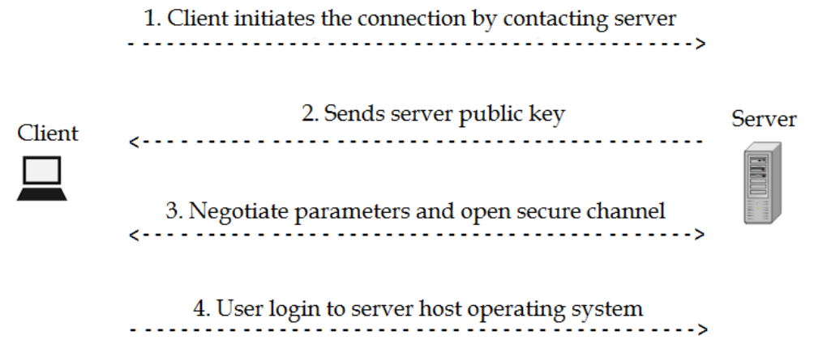
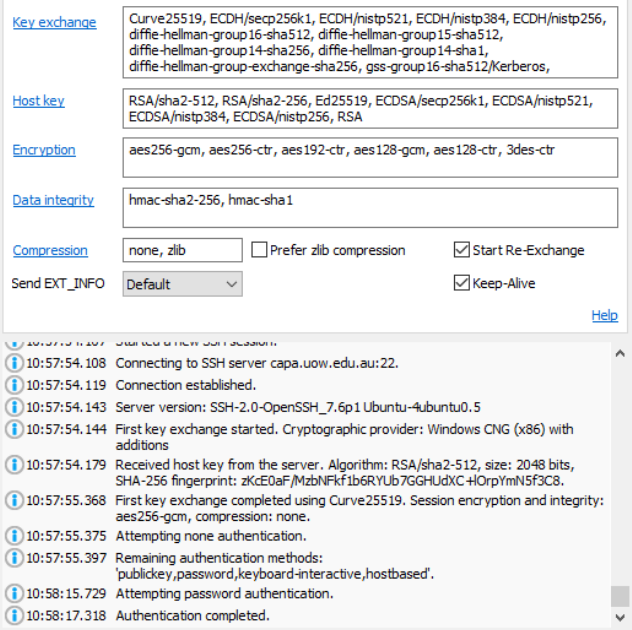
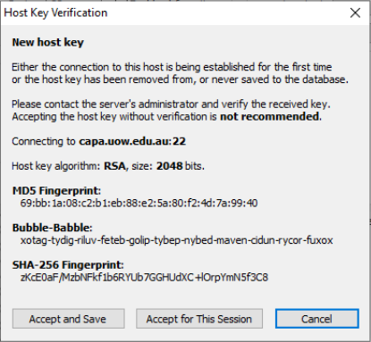
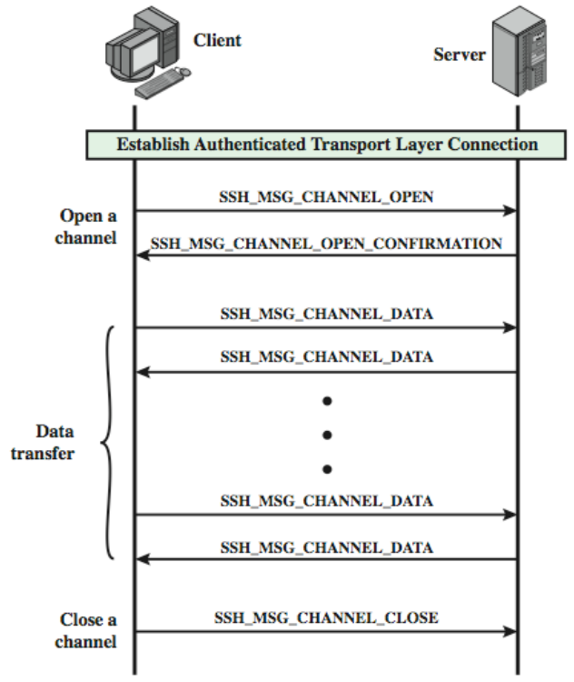
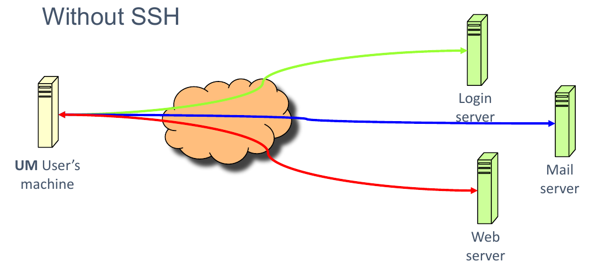
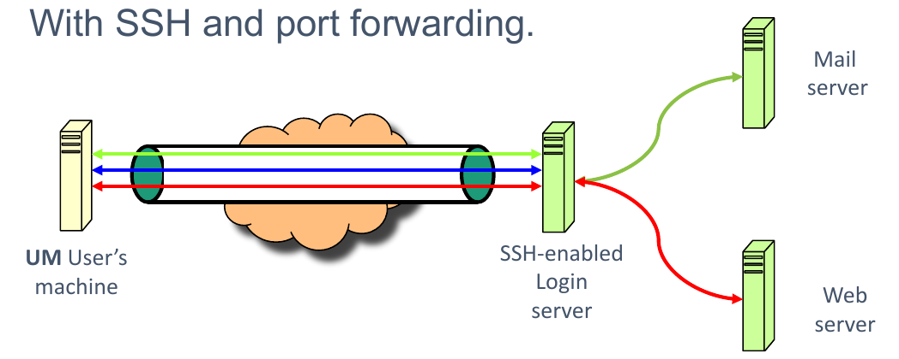

# CSIT953 考试复习 · 第 5 章 SSH

> 🎯 **考纲** — *SSH Security — Protecting remote login and understanding port forwarding.*
>
> 可能的题型：单选题考 SSH-2 三层各做什么、主机密钥指纹的作用、口令短语会不会发给服务器、-L 和 -R 的监听端口开在哪一端、改掉 22 端口有什么用；填空题考命令格式和术语（host key fingerprint、trust on first use、local / remote / dynamic forwarding、bastion、agent forwarding）；简答题考公钥认证为什么比口令好、第一次连接有什么风险、转发为什么要单独授权；问答题可能给出转发命令，让你说明数据怎样走、有什么风险，或者让你为云上的服务器设计安全的远程管理。

> 📚 **来源** — slides：W5 S1–S31，以及 S45 的 SSH 部分。录音：W5 录音约 17.7k 之后（S1–S30）；W6 录音开头约 1.5k（S30–S31）和约 15.3k 处（协议安全不等于系统安全）。DH 的过程和"哪些做法挡得住中间人"见第 2 章；SSH 的公钥认证就是第 3 章的协议 9；SSH 认证服务器的方式可以和第 4 章的证书对照着看。

SSH 是云上管理 Linux 服务器的主要通道。本章前半讲 SSH 怎样保护远程登录：它的用途和边界（§1），连接的步骤和三层结构（§2），传输层怎样建立加密通道（§3），怎样认证服务器（§4）和用户（§5），以及怎样加固、怎样接入（§6–§7）。后半讲端口转发：连接协议里的通道（§8），转发的思路（§9），三种转发的数据路径（§10），以及转发为什么会绕过网络隔离（§11）。

## 1. SSH 用来做什么 (W5 S2–S5, S30)

SSH（Secure Shell）最初用来替代 rsh、telnet 这些远程登录工具。它们在网上明文传输口令和命令，路上的人都能看到。SSH 为远程管理（主要是 Unix 和 Linux 系统）提供一条加密、经过认证的通道，后来又发展成网络应用通用的安全通道。

今天 SSH 承担的工作有：交互式 shell 和远程命令，用于日常管理和事故响应；用 SFTP、SCP 传文件；自动化工具用它部署软件、修改配置；端口转发打通到私有服务的路径（§9）。

在云上，SSH 的分量更重。一个凭据可能通向成百上千台短期存在的虚拟机；登录一台机器，还可能接触到这台机器绑定的云身份和附近的私有服务。所以目标是**受控的管理**（controlled administration），不只是加密流量：谁能访问哪台机器，拿什么权限，凭据用多久，留下什么记录。

云上的远程管理要守住两条信任边界。一条是管理访问：谁能以什么权限接触工作负载，靠主机密钥、用户密钥、证书和云 IAM 来管（§4–§6）。另一条是网络路径：公网端口、堡垒机、私有代理和隧道（§7、§9–§11）。日志、会话控制和事故响应则为两者留下证据。

SSH 也有明确的边界：

- 只保护明确走 SSH 的流量。其他应用要改造才能用它，端口转发能省掉一部分改造。
- 不能让两端变得可信。笔记本中了恶意软件，输入的命令和已经解密的私钥都可能被偷；服务器被攻破，攻击者能看到解密后的数据。
- 不是完整的 VPN，不是终端安全系统，也不是应用的授权模型。SFTP 能把文件安全送到，却不证明文件来源可靠，也不证明对方有权接收。

> ✍️ **English answer** — SSH (Secure Shell) was designed to replace insecure remote-login tools such as telnet and rsh, which send passwords and commands in cleartext. It provides an encrypted and authenticated channel for remote administration, remote commands, file transfer with SFTP and SCP, automation and port forwarding. It protects only the traffic sent through it and does not make the endpoints trustworthy, so it is not a complete VPN, endpoint-security system or authorisation model. In the cloud the goal is controlled administration, covering identity, privilege, credential lifetime and evidence, not merely encrypted traffic.

## 2. 连接的四步与三层结构 (W5 S6–S8)

建立一次 SSH 连接分四步（图 1）：客户端联系服务器；服务器发来自己的公钥，即主机密钥（host key）；双方协商参数，建立安全通道；用户登录服务器的操作系统。



顺序很重要。客户端要先确认服务器是真的，再发送口令之类的登录凭据。跳过这一步，凭据可能交到攻击者控制的机器手里。

SSH-2 把这些工作分成三层：

| 层 | 做什么 |
|---|---|
| 传输层协议（Transport Layer Protocol） | 建立初始连接；认证服务器；通过密钥交换建立加密通道 |
| 用户认证协议（Authentication Protocol） | 在传输层的安全通道里认证客户端，即用户 |
| 连接协议（Connection Protocol） | 在一条安全通道上复用多条逻辑连接，省去重复建立会话的开销 |

对应的安全目标有四个。服务器在传输层被认证。客户端在认证协议里被认证，用公钥或口令；课件列的公钥算法是 DSS 和 RSA，其中 DSS 已经过时（§3）。双方建立新鲜的共享秘密，派生出加密密钥、MAC 密钥和 IV，这一点和 TLS 相同。算法套件（加密、MAC、压缩算法）的协商是安全的，攻击者不能把它降到弱算法。

> ✍️ **English answer** — An SSH connection proceeds in four steps: the client contacts the server, the server sends its public host key, the two sides negotiate parameters and open a secure channel, and only then does the user log in. SSH-2 has three layers: the transport layer protocol sets up the connection, authenticates the server and establishes an encrypted channel through key exchange; the user authentication protocol authenticates the client over that channel; and the connection protocol multiplexes several logical channels over it. Its goals are server and client authentication, a fresh shared secret from which encryption keys, MAC keys and IVs are derived, and secure negotiation of the cipher suite.

## 3. 传输层：密钥交换与算法 (W5 S8, S11–S12)

传输层的做法和 TLS 1.3 很像（第 2 章 §5）：双方做一次临时 DH，常用 Curve25519；服务器用自己的长期主机私钥对这次交换签名，客户端用主机公钥验证。签名验证通过，说明对面握有主机私钥，中间人换不掉 DH 的公开值。共享秘密再派生出加密密钥、MAC 密钥和 IV。

和 TLS 的区别在主机公钥的来历。TLS 的服务器公钥有 CA 签发的证书担保；SSH 的主机公钥通常没有，客户端要靠指纹判断它是不是这台服务器的（§4）。

图 2 是一个 SSH 客户端的算法设置和连接日志。日志的前几行属于传输层：连上服务器，开始第一次密钥交换，收到服务器的主机密钥（RSA/sha2-512，附 SHA-256 指纹），用 Curve25519 完成密钥交换，会话的加密和完整性用 aes256-gcm。之后才进入用户认证：服务器列出可用的方式（publickey、password、keyboard-interactive、hostbased），用户用口令认证成功。



现代 SSH 的算法选择：

| 用途 | 现代选择 | 不要随手重新启用 |
|---|---|---|
| 密钥交换 | Curve25519、现代 DH 组、混合方案（传统 DH 加抗量子算法） | SHA-1 时代的 DH 组 |
| 主机和用户签名 | Ed25519、ECDSA、硬件安全密钥、RSA-SHA-2 | DSS、用 SHA-1 的 RSA |
| 流量保护 | ChaCha20-Poly1305、AES-GCM（认证加密）；AES-CTR 仍可能保留 | RC4、3DES、只用 CBC 的模式 |

图 2 的设置里新旧混在一起：diffie-hellman-group14-sha1、3des-ctr、hmac-sha1 都还在列表里。客户端和服务器会从双方都支持的算法里挑选，能用不等于应该用。实践中，保持 SSH 实现打上补丁，尽量用它的安全默认配置，检查实际生效的配置，不要照抄旧教程里的长配置。老设备确实需要旧算法时，只对那一台主机放开，并计划移除。认得出这些旧算法就够了，名字不用全记（第 1 章 §2）。

> 📎 **拓展（超出 slides）** — 服务器签的是一个交换哈希 H。它覆盖双方的版本字符串、算法协商消息、主机公钥、双方的 DH 公开值和共享秘密。第一次交换得到的 H 还被当作会话标识（session identifier）。签名覆盖双方新选的公开值，所以和 TLS 的 CertificateVerify 一样无法重放；算法协商消息也在 H 里，攻击者删掉强算法、迫使双方降级，签名就对不上。

> ✍️ **English answer** — The SSH transport layer runs an ephemeral Diffie–Hellman exchange, commonly Curve25519, and the server signs the exchange with its long-term host key, so a man-in-the-middle cannot substitute the DH values without the host private key; the shared secret then yields encryption keys, MAC keys and IVs. Unlike TLS, the host key is usually not vouched for by a CA, so the client must check its fingerprint. Modern choices are Curve25519 or hybrid key exchange, Ed25519, ECDSA or RSA-SHA-2 signatures, and ChaCha20-Poly1305 or AES-GCM. Legacy DSS, RC4, 3DES, CBC-only and SHA-1-era options should not be re-enabled casually, and the effective configuration should be checked instead of copying old examples.

## 4. 认证服务器：指纹与首次信任 (W5 S9–S10)

SSH 连接的安全建立在服务器向客户端证明身份上。第一次连接某台主机时，服务器发来主机公钥，客户端显示这把公钥的**指纹**（fingerprint），也就是公钥的哈希摘要，请用户核对（图 3）。指纹比完整的公钥短得多，方便人眼比较。



核对的方法是把显示的指纹和一个可信来源里的值比较，例如云控制台上显示的指纹、部署记录，或者管理员通过另一条渠道告诉你的值。

很多用户不核对就直接点接受，这叫**首次使用时信任**（trust on first use, TOFU）。客户端记下这把公钥（OpenSSH 存在 known_hosts 文件里），以后每次连接都拿来比较，公钥一变就警告。这比完全不检查好：第一次之后，中间人就换不掉公钥了。但它证明不了第一次连接是安全的。如果第一次就被劫持，客户端记住的就是攻击者的公钥（第 2 章 §9）。

出现"主机密钥已改变"的警告，可能是服务器重装、换了密钥，也可能是中间人。查明原因之前，不应接受新的公钥。

机器多了以后，逐台核对指纹不现实。规模大时可以用 SSH 证书：组织的 CA 给主机公钥签名，客户端只需信任这个 CA。也可以集中管理 known_hosts，或者通过托管的访问代理接入（§7）。

SSH 要求用户自己判断一串指纹，这对普通人太难了。HTTPS 把这件事交给了 CA 和浏览器，用户不用看指纹（第 4 章 §5）。

> 👨‍🏫 **课堂强调** — 大多数人第一次连接服务器时都直接点"接受并保存"，TOFU 的弱点就在这里。安全的做法是先核对指纹，再接受。

> ✍️ **English answer** — The security of an SSH connection relies on the server authenticating itself with its host key. On the first connection the client shows the fingerprint, a hash of the host's public key, which the user should compare with a value obtained through a trusted channel such as the cloud console or the administrator. Many users accept it blindly; this is trust on first use (TOFU): the client stores the key in known_hosts and warns if it changes later, which stops later man-in-the-middle attacks but cannot prove that the first connection was not intercepted. At scale, host certificates signed by an organisational CA, centrally managed known_hosts or managed access brokers make verification reliable.

## 5. 认证用户：公钥优于口令 (W5 S13–S14)

传输层建好之后，用户认证协议让用户向服务器证明身份。方式有三种：公钥（数字签名）、口令、基于主机（host-based）。基于主机的方式在普通的云管理中很少用。另有键盘交互（keyboard-interactive）方式，可以把 SSH 和第二因素等其他身份系统连起来。

口令容易被猜，会被钓鱼，还常在多个服务上重复使用（第 3 章 §13.3）。公钥认证没有这些问题：

- 私钥留在客户端，要防止被导出或偷走。
- 服务器存用户的公钥（OpenSSH 的 authorized_keys 文件），或者信任一个签发用户证书的 CA，或者按规则到外部系统查询。
- 登录时，客户端用私钥对与本次会话相关的数据签名，服务器用公钥验证。私钥从不经过网络。

这就是第 3 章的协议 9。会话数据每次都不同，起到随机挑战的作用，签名无法重放；服务器只存公钥，数据库泄露了也冒充不了用户。

口令短语（passphrase）保护的是存在本机的私钥文件，用来加密它，不会发给服务器。它和账户口令是两回事。攻击者复制了一个没有口令短语保护的私钥文件，就能冒充用户。即使私钥文件导不出来，攻击者也可能借用一个已经载入了密钥的 SSH agent 来签名（§6.4）。

SSH 的用户密钥只用来证明"我持有私钥"，不用来加密会话，会话的加密靠传输层派生的密钥。认证要成功，身份、密钥策略、账户状态和各项限制都得允许。认证只回答"连进来的是谁"，登录以后能做什么，是授权的事（§6.2）。

> ✍️ **English answer** — SSH user authentication supports public-key, password and host-based methods, and keyboard-interactive can add a second factor. In public-key authentication the private key stays on the client, the server stores only the public key or trusts a certificate authority, and the client signs session-related data, so the private key is never sent and the signature cannot be replayed; this is Protocol 9 from Week 6. Passwords, by contrast, can be guessed, phished and reused. A passphrase only encrypts the stored private-key file and is never sent to the server, and SSH keys prove possession rather than encrypt the session. Authentication answers who is connecting; what that user may do is a separate authorisation decision.

## 6. 加固 SSH (W5 S15–S18)

### 6.1 先收紧暴露面和身份

- 有私有网络或托管访问可用时，不开放公网管理端口；限制允许连接的来源和目的地址。
- 把 22 端口改成别的号码，主要只是减少扫描噪声，不改变谁被信任，也不改变登录后能做什么。
- 禁止 root 直接登录。几个人共用一个最高权限账户，出了事分不清是谁干的。改用具名账户，需要时再受控地提权，例如用 sudo。
- 优先用公钥、证书、硬件密钥或云身份认证。运维恢复用不到口令时，关掉口令登录。

一份按这些原则写的服务器配置（`/etc/ssh/sshd_config` 节选）：

```text
PermitRootLogin no          # 禁止 root 直接登录
PubkeyAuthentication yes    # 允许公钥认证
PasswordAuthentication no   # 关闭口令登录：知道 IP 和端口也无从猜口令
AllowUsers alice deploy     # 只允许这两个具名账户登录
DisableForwarding yes       # 默认关闭各种转发（§11）
```

### 6.2 限制登录以后能做什么

登录成功不应自动打开 SSH 的全部功能。有的账户需要完整的 shell，有的只需要传文件，自动化账户可能只需要执行一条固定的命令。按最小权限配置：

- 用 AllowUsers 或 AllowGroups 限定账户，用受限命令让自动化账户只能执行指定的命令，sudo 规则只给必要的权限。只能执行部署动作的部署密钥，泄露后的危害远小于能执行任意命令的密钥。
- 不需要时关闭或限制 TCP、agent、X11 和套接字转发：用 DisableForwarding 一并关闭，或用 PermitOpen 只允许转发到指定的目的地。
- 用 Match 块给不同的用户或来源套用不同的规则；设置空闲超时和会话总时长。
- 配置当作代码来审查，部署到大批机器之前先测试；SSH 实现及时打补丁。

### 6.3 管理凭据的整个生命周期

访问权限要发给具名的人或工作负载，写明用途和期限。永久密钥一旦复制进许多台机器的 authorized_keys，就很难盘点，还可能留在镜像、脚本、元数据或代码仓库里。规模大时，优先用短期证书、临时注入的密钥或基于云身份的登录，到期自动失效，撤销也容易。

要清楚在哪些地方授予过信任：本地文件、镜像、元数据、云项目、访问代理。角色变动、设备丢失、自动化任务退役时，撤销所有相关的信任关系。密钥泄露后要轮换，并确认旧密钥真的不能再用了。

### 6.4 管理员的电脑也在安全边界内

架构图里常常不画管理员的笔记本，它却存着私钥、令牌、API 密钥、known_hosts 和打开着的终端会话。恶意软件能利用已经解密的密钥、正在运行的会话、复制粘贴的命令和本地配置。

SSH agent 替你保管已经解密的私钥，用起来方便。**agent 转发**（agent forwarding）把"请求签名"的能力延伸到远程主机：私钥并没有复制过去，但如果这台中间主机被攻破，攻击者可以在你的会话期间借用转发过来的 agent，以你的身份登录别的机器。应对办法是专用的管理设备、硬件密钥、每次签名都要求确认、缩短 agent 的有效期；能用 ProxyJump 或托管访问代理时，就不要转发 agent。

> 📎 **拓展（超出 slides）** — ProxyJump（`ssh -J 跳板机 目标主机`）让客户端经跳板机和目标主机直接建立一条端到端的 SSH 连接。认证在你自己的电脑上完成，跳板机只转发加密的数据，碰不到你的 agent。

> ✍️ **English answer** — Hardening starts with exposure and identity: avoid public management ports when private or brokered access exists, restrict network sources, disable direct root login in favour of named accounts with controlled privilege elevation, prefer public-key, certificate or hardware-backed authentication, and disable password login; changing port 22 only reduces scanning noise. Sessions should follow least privilege, using AllowUsers, restricted commands, scoped sudo rules, disabled or limited forwarding and session time limits. Credentials should be issued for a defined purpose and duration, preferably as short-lived certificates, inventoried and revoked when roles change. The administrator's endpoint is part of the trust boundary: with agent forwarding, a compromised intermediate host can request signatures from the user's agent during the session, so ProxyJump or brokered access is preferred.

## 7. 云上的接入方式 (W5 S19–S20)

| 方式 | 优点 | 风险或代价 |
|---|---|---|
| 公网直连 SSH | 简单 | 每台机器都暴露在公网，防火墙、凭据、补丁和监控分散在各处 |
| 私有网络或 VPN | 去掉了公网可达性 | 用户往往拿到范围很大的网络访问权 |
| 堡垒机（bastion host） | 入口、策略、补丁和审计集中在一处 | 它本身成了高价值目标 |
| 身份感知代理（identity-aware broker） | 先按云 IAM 检查身份，再临时建立一条管理通道 | 依赖云服务商的 API、agent 和区域 |

没有哪种方式天然安全，权限、终端是否可信、日志和应急恢复仍然要考虑。

举个私有网络的例子：服务器放在校园内网，只有私有 IP 地址，外网的攻击者扫描不到它；在家要先连 VPN 才能访问。路由器把内网和外网隔开，多了一层保护。

云服务商提供托管的接入方式，减少常开的 SSH 暴露面：

- AWS EC2 Instance Connect 临时注入一把公钥；Session Manager 通过 IAM 和机器上的 agent 提供访问。
- Google OS Login 把 Linux 账户和云身份连起来；IAP 能把流量通过隧道送到私有地址。
- Azure Bastion 提供托管的 SSH 或 RDP 入口；即时访问（just-in-time, JIT）临时打开管理规则，用完关闭。

托管服务让策略和撤销集中起来，代价是依赖服务商的 API、agent 和区域。还要弄清日志到底记了什么：服务可能记录了谁打开了隧道，却看不到加密的 SSH 会话里执行了哪些命令。

> ✍️ **English answer** — Cloud machines can be reached by direct public SSH, through a private network or VPN, through a bastion host, or through an identity-aware broker. Direct SSH is simple but exposes every workload and distributes controls; a VPN removes public reachability but may grant broad network access; a bastion centralises entry, policy, patching and logging but becomes a high-value target; a broker checks cloud IAM before creating a temporary path. Managed services such as AWS EC2 Instance Connect, Session Manager, Google OS Login with IAP, Azure Bastion and just-in-time access reduce permanent exposure, but no pattern is automatically safe, and logs may record who opened a tunnel without showing the commands inside the encrypted session.

## 8. 连接协议：一条连接里的多条通道 (W5 S21–S22)

认证完成后，连接协议在同一条加密传输上开出多条逻辑通道（channel）。每条通道有唯一的编号，任何一方都能请求打开。一条通道的生命周期分三步（图 4）：请求打开，对方确认或拒绝；双向传数据；关闭。



通道有四种类型：

| 类型 | 用途 |
|---|---|
| session | 远程执行一个程序，包括交互式 shell |
| x11 | 转发 X Window 图形界面 |
| forwarded-tcpip | 远程端口转发（§10） |
| direct-tcpip | 本地端口转发（§10） |

一条通道关闭后，底层的连接可以仍然开着，其他通道继续工作。关掉一个 shell 窗口，同一连接里的端口转发不一定跟着关闭。

这种设计高效，也给管理带来难题。监控工具看到的可能只是一条 SSH 会话，里面却同时在执行命令、传文件、访问私有数据库。所以认证之后的授权很重要；排查问题和响应事故时，既要看连接，也要看连接里的各条通道。

> ✍️ **English answer** — After authentication, the SSH connection protocol multiplexes several logical channels over one encrypted transport. Each channel has a unique id and goes through three stages: opening (CHANNEL_OPEN and its confirmation), data transfer in both directions, and closing. The four channel types are session (remote execution of a program), x11, forwarded-tcpip (remote port forwarding) and direct-tcpip (local port forwarding). Because one connection can carry a shell, file transfers and tunnels at the same time, and closing one channel does not close the others, post-authentication authorisation and channel-level monitoring matter.

## 9. 端口转发的思路 (W5 S23–S26)

不用 SSH 时，用户的机器要分别连登录服务器、邮件服务器和 Web 服务器（图 5）。每个服务各有自己的网络路径、端口、认证方式和防火墙规则，要管好几个暴露面，而且每台服务器都得能从外部访问到。



用了端口转发，只需要暴露一台开着 SSH 的登录服务器（图 6）。邮件和 Web 服务器可以留在私有地址上，其他流量都装进这条 SSH 通道，由登录服务器转交。



端口转发（port forwarding），也叫 SSH 隧道（tunnelling），过程是这样的：应用程序连接一个监听端口；SSH 接下这个连接，把数据装进加密通道送到另一端；另一端的 SSH 再去连真正的目的地。应用程序甚至不知道 SSH 参与其中。即使两台机器的防火墙只放行 SSH，其他应用也能借这条通道照常通信。

好处是减少公网暴露，SSH 这一段的流量受到保护。代价是**隧道并没有消除信任，只是把信任转移到了 SSH 的两端**。登录服务器成了网关，谁能转发、能转发到哪里，就决定了用户能访问什么。登录服务器需要更严格的补丁和监控，转发的目的地也要加以限制（§11）。

> ✍️ **English answer** — Port forwarding, or SSH tunnelling, carries other TCP traffic inside an SSH connection: an application connects to a listening port, SSH accepts the connection, carries the data through the encrypted channel, and the SSH process on the other side connects to the real destination. Instead of exposing every service, an organisation can expose one SSH login server and keep mail and web servers on private addresses, and hosts whose firewalls allow only SSH can still run other applications. Tunnelling does not remove trust but moves it to the SSH endpoints, so the login server becomes a gateway whose forwarding policy decides what users can reach.

## 10. 本地、远程与动态转发 (W5 S25–S29)

### 10.1 本地转发 -L

场景：webserver 上跑着 SSH（22 端口）和一个网站（80 端口），防火墙只放行 22，从外面直连 80 会被挡住。你有这台服务器的 SSH 账户，想看这个网站。

```text
ssh -L 8080:127.0.0.1:80 user@webserver
```

读法是 `-L 本地端口:目的主机:目的端口`。命令执行后，ssh 在你的电脑上打开 8080 端口监听。浏览器访问 `http://localhost:8080/`，连接进入 8080；ssh 把数据装进 22 端口的加密通道送到 webserver；服务器上的 sshd 再去连 127.0.0.1 的 80 端口（图 7）。

```svg 图 7 · 本地转发：监听端口开在客户端，数据经 22 端口的通道到达服务器上被防火墙挡住的 80 端口（W5 S25–S27）
<svg viewBox="0 0 660 280">
  <defs>
    <marker id="a" viewBox="0 0 10 10" refX="9" refY="5" markerWidth="7" markerHeight="7" orient="auto-start-reverse"><path d="M0,0 L10,5 L0,10 z" class="solid-ink"/></marker>
    <marker id="g" viewBox="0 0 10 10" refX="9" refY="5" markerWidth="7" markerHeight="7" orient="auto-start-reverse"><path d="M0,0 L10,5 L0,10 z" class="solid-good"/></marker>
  </defs>
  <text x="125" y="24" text-anchor="middle">你的电脑（SSH 客户端）</text>
  <rect x="10" y="36" width="230" height="170" rx="10" class="muted fill-muted" stroke-width="1.5"/>
  <rect x="25" y="56" width="200" height="44" rx="6" class="ink" fill="none" stroke-width="1.5"/>
  <text x="125" y="83" text-anchor="middle">浏览器 → localhost:8080</text>
  <rect x="25" y="142" width="200" height="44" rx="6" class="accent fill-soft" stroke-width="2"/>
  <text x="125" y="169" text-anchor="middle" class="accent">ssh 在 8080 端口监听</text>
  <line x1="125" y1="100" x2="125" y2="138" class="ink" stroke-width="1.5" marker-end="url(#a)"/>
  <text x="535" y="24" text-anchor="middle">webserver（SSH 服务器）</text>
  <rect x="420" y="36" width="230" height="170" rx="10" class="muted fill-muted" stroke-width="1.5"/>
  <rect x="435" y="56" width="200" height="44" rx="6" class="ink" fill="none" stroke-width="1.5"/>
  <text x="535" y="83" text-anchor="middle">网站 127.0.0.1:80</text>
  <rect x="435" y="142" width="200" height="44" rx="6" class="ink" fill="none" stroke-width="1.5"/>
  <text x="535" y="169" text-anchor="middle">sshd :22</text>
  <line x1="535" y1="142" x2="535" y2="104" class="ink" stroke-width="1.5" marker-end="url(#a)"/>
  <rect x="225" y="152" width="210" height="24" rx="12" class="good fill-good" stroke-width="2"/>
  <line x1="232" y1="164" x2="429" y2="164" class="good" stroke-width="2" marker-end="url(#g)"/>
  <text x="330" y="232" text-anchor="middle" class="good">SSH 加密通道（22 端口）</text>
  <rect x="324" y="40" width="12" height="104" class="warn fill-warn" stroke-width="1.5"/>
  <line x1="225" y1="78" x2="318" y2="78" class="warn dashed" stroke-width="1.5"/>
  <text x="281" y="70" text-anchor="middle" class="warn">直连 80 ✕</text>
  <text x="378" y="70" text-anchor="middle" class="warn">防火墙</text>
  <text x="378" y="88" text-anchor="middle" class="warn">只放行 22</text>
  <text x="330" y="264" text-anchor="middle">ssh -L 8080:127.0.0.1:80 user@webserver</text>
</svg>
```

注意，127.0.0.1 是从服务器的角度解释的，指服务器自己，不是你的电脑。它也可以换成服务器所在网络里能访问到的其他主机，例如内网的数据库。本地端口可以选任何空闲的端口。

### 10.2 远程转发 -R

```text
ssh -R 10123:127.0.0.1:123 user@webserver
```

连上之后，服务器上的 sshd 打开 10123 端口监听。服务器上的程序连接 10123 时，数据经通道送回你的电脑，由本机的 ssh 再去连 127.0.0.1 的 123 端口，这里的 127.0.0.1 指你的电脑（图 8）。服务器上的程序把数据发往 10123，而不是原来的端口；你这边的服务照常在 123 端口上监听。

```svg 图 8 · 远程转发：监听端口开在服务器上，数据经通道回到客户端那一侧的 123 端口（W5 S28）
<svg viewBox="0 0 660 280">
  <defs>
    <marker id="a" viewBox="0 0 10 10" refX="9" refY="5" markerWidth="7" markerHeight="7" orient="auto-start-reverse"><path d="M0,0 L10,5 L0,10 z" class="solid-ink"/></marker>
    <marker id="g" viewBox="0 0 10 10" refX="9" refY="5" markerWidth="7" markerHeight="7" orient="auto-start-reverse"><path d="M0,0 L10,5 L0,10 z" class="solid-good"/></marker>
  </defs>
  <text x="125" y="24" text-anchor="middle">你的电脑（SSH 客户端）</text>
  <rect x="10" y="36" width="230" height="170" rx="10" class="muted fill-muted" stroke-width="1.5"/>
  <rect x="25" y="56" width="200" height="44" rx="6" class="ink" fill="none" stroke-width="1.5"/>
  <text x="125" y="83" text-anchor="middle">本机服务 127.0.0.1:123</text>
  <rect x="25" y="142" width="200" height="44" rx="6" class="ink" fill="none" stroke-width="1.5"/>
  <text x="125" y="169" text-anchor="middle">ssh 客户端</text>
  <line x1="125" y1="142" x2="125" y2="104" class="ink" stroke-width="1.5" marker-end="url(#a)"/>
  <text x="535" y="24" text-anchor="middle">webserver（SSH 服务器）</text>
  <rect x="420" y="36" width="230" height="170" rx="10" class="muted fill-muted" stroke-width="1.5"/>
  <rect x="435" y="56" width="200" height="44" rx="6" class="ink" fill="none" stroke-width="1.5"/>
  <text x="535" y="83" text-anchor="middle">服务器上的程序 → 10123</text>
  <rect x="435" y="142" width="200" height="44" rx="6" class="accent fill-soft" stroke-width="2"/>
  <text x="535" y="169" text-anchor="middle" class="accent">sshd 在 10123 端口监听</text>
  <line x1="535" y1="100" x2="535" y2="138" class="ink" stroke-width="1.5" marker-end="url(#a)"/>
  <rect x="225" y="152" width="210" height="24" rx="12" class="good fill-good" stroke-width="2"/>
  <line x1="428" y1="164" x2="231" y2="164" class="good" stroke-width="2" marker-end="url(#g)"/>
  <text x="330" y="232" text-anchor="middle" class="good">同一条 SSH 通道，数据反向流回</text>
  <text x="330" y="112" text-anchor="middle" class="muted">SSH 连接仍由</text>
  <text x="330" y="130" text-anchor="middle" class="muted">你的电脑发起</text>
  <text x="330" y="264" text-anchor="middle">ssh -R 10123:127.0.0.1:123 user@webserver</text>
</svg>
```

SSH 连接仍由你的电脑发起，数据却从服务器一侧流回来。外面原本连不到你电脑上的服务，现在服务器那一侧的程序都能访问它。

### 10.3 动态转发 -D 与三种模式对比

动态转发（`ssh -D 1080 user@server`）让 ssh 在你的电脑上开一个 SOCKS 代理。每个连接的目的地由应用临时指定，服务器能到达的地方都可以去。

| 模式 | 监听端口在哪一端 | 谁去连目的地 | 典型用途 |
|---|---|---|---|
| 本地 -L | 客户端 | 服务器一侧 | 访问服务器网络里的私有服务 |
| 远程 -R | 服务器 | 客户端一侧 | 把客户端这边的服务发布到服务器的网络 |
| 动态 -D | 客户端（SOCKS 代理） | 服务器一侧，目的地不固定 | 一次登录访问许多内部服务 |

记法：L 是 local，监听开在本地；R 是 remote，监听开在远端；冒号后面的主机和端口，由另一端去连。

转发只保护 SSH 那一段。从应用到监听端口、从 sshd 到目的服务这两段不在通道里；目的地在网络里另一台机器上时，这一段可能是明文。转发策略要限制哪些用户能转发、监听绑定在哪个地址、能到哪些目的地和端口、能持续多久。

> ✍️ **English answer** — Local forwarding, ssh -L 8080:127.0.0.1:80 user@webserver, creates a listener on the client: connections to localhost:8080 are carried through the SSH channel on port 22, and the server connects to 127.0.0.1:80, where 127.0.0.1 means the server itself; this reaches a service that the firewall blocks. Remote forwarding, ssh -R 10123:127.0.0.1:123 user@webserver, creates a listener on the server: connections to port 10123 on the server are carried back, and the client connects to its own port 123. Dynamic forwarding (-D) turns the client into a SOCKS proxy for many destinations. Forwarding protects only the SSH segment, not the segments before or after it, so policy must constrain users, bind addresses, destinations, ports and duration.

## 11. 转发会绕过网络隔离 (W5 S30–S31, S45)

转发之所以强大，是因为 SSH 服务器能到达的地方，原来的客户端往往到不了。风险也出在这里：

- 合法的 SSH 用户可以借本地转发，访问自己本来访问不到的目的地，比如内网的数据库。
- 动态转发能把一次登录变成通往许多内部服务的代理。
- 远程转发能把内网或笔记本上的服务发布到另一个网络。
- 载荷是加密的，防火墙只看到一条 SSH 连接，看不出里面跑着什么应用，网络检测和托管的隧道服务都很难看清。

结果，**一条"只放行 SSH"的防火墙规则，在转发不受限制时，等于间接放行了许多别的协议**，网络分段（segmentation）的用意就落空了。转发本身不是恶意功能，管理员常靠它访问被防火墙挡住的服务。关键是它需要单独授权：受限账户默认关闭转发，只为有记录的例外放开，并用 PermitOpen 之类的设置限定目的地。

这一部分可以归结为一句话：协议安全不等于系统安全。SSH 可以把通道保护得很好，但凭据被盗、权限给得太大、隧道绕过隔离，系统照样不安全。公网端口和永久密钥是设计上的选择，并不是 SSH 不可避免的特性。设计远程管理时，先回答四个问题：信任谁，允许做什么，多长时间，出了事怎样恢复。

> 👨‍🏫 **课堂强调** — 受限账户可以登录、执行命令，却不应能转发。转发要作为一项单独的能力来授权。

> ✍️ **English answer** — Port forwarding can bypass network segmentation because the SSH server can often reach destinations that the original client cannot. A valid user can reach an internal database with local forwarding, turn one login into a proxy for many internal services with dynamic forwarding, or publish an internal or laptop service to another network with remote forwarding, while the encrypted payload hides the application traffic from firewalls and inspection tools. A rule that allows SSH therefore indirectly allows many other protocols if forwarding is unrestricted. Forwarding should be disabled by default for restricted accounts and authorised as a separate capability, with documented exceptions limited to specific destinations.

## ⚠️ 易混易错

| 容易混的 | 区别 |
|---|---|
| 主机密钥 vs 用户密钥 | 主机密钥在传输层认证服务器；用户密钥在认证层认证用户 |
| 口令 vs 口令短语 | 口令发给服务器验证；口令短语只在本机解密私钥文件，从不发出 |
| 用户密钥 vs 会话密钥 | 用户密钥只用来签名、证明身份；加密会话靠 DH 派生的会话密钥 |
| SSH 与 TLS 怎样认证服务器 | TLS 靠 CA 签发的证书，浏览器自动验证；SSH 靠主机密钥加指纹，由用户核对，规模大时用 SSH 证书 |
| TOFU vs 核对指纹 | TOFU 第一次不核对，只防以后的替换；核对指纹连第一次也能防 |
| 改 22 端口 vs 关闭口令登录 | 前者只减少扫描噪声；后者让猜口令无从下手 |
| agent 转发 vs ProxyJump | 前者把签名能力延伸到远程主机；后者的认证留在本机 |
| -L vs -R | -L 监听在客户端，由服务器一侧去连目的地；-R 监听在服务器，由客户端一侧去连 |
| 认证 vs 授权 | 认证回答连进来的是谁；能执行什么、能否转发，由授权决定 |

常见误解：

- "SSH 加密了，远程管理就安全了"：还需要管好身份、权限、凭据的生命周期和记录。
- "把 22 端口改掉就安全了"：只减少扫描噪声，谁被信任、能做什么都没变。
- "口令短语会发给服务器"：不会，它只解密本机的私钥文件。
- "用户的 SSH 私钥用来加密会话"：它只签名。
- "`-L 8080:127.0.0.1:80` 访问的是我自己电脑的 80 端口"：127.0.0.1 从服务器的角度解释，指服务器。
- "转发保护了整条路径"：只保护 SSH 那一段。
- "端口转发是 SSH 的漏洞"：它是功能，风险在于不受限制。
- "用了堡垒机就安全了"：堡垒机本身是高价值目标，权限、终端和日志仍要管好。

## 📝 Practice

### Part A · Multiple choice

**A1.** Which part of SSH-2 authenticates the server and establishes the encrypted channel?
A. Connection protocol  B. User authentication protocol  C. Transport layer protocol  D. SFTP

<details>
<summary>Answer A1</summary>

**C.** The transport layer performs key exchange and server authentication; the user is authenticated afterwards, inside the encrypted channel.

</details>

**A2.** When you first connect to a new server, your SSH client displays a host key fingerprint. What should you do?
A. Accept it, because SSH encrypts everything anyway.
B. Compare it with a fingerprint obtained through a trusted channel, such as the cloud console.
C. Enter your password so that the server can verify you first.
D. Move the server to a port other than 22.

<details>
<summary>Answer A2</summary>

**B.** Accepting without checking is trust on first use; it cannot detect a man-in-the-middle on the first connection.

</details>

**A3.** Which statement about an SSH key passphrase is TRUE?
A. It is sent to the server during login.
B. It replaces the private key.
C. It encrypts the stored private-key file and is never sent to the server.
D. It is used to derive the session keys.

<details>
<summary>Answer A3</summary>

**C.** The passphrase only protects the key file on the client. The server sees a signature, never the passphrase or the private key.

</details>

**A4.** After running `ssh -L 8080:127.0.0.1:80 user@webserver`, what does 127.0.0.1 refer to?
A. Your laptop  B. webserver  C. The DNS server  D. Any host on the Internet

<details>
<summary>Answer A4</summary>

**B.** The destination is interpreted on the server side, so 127.0.0.1 is the server's own loopback address.

</details>

**A5.** What is the main effect of moving the SSH service from port 22 to another port?
A. It prevents password guessing.
B. It reduces scanning noise but does not change who is trusted.
C. It makes the encryption stronger.
D. It disables root login.

<details>
<summary>Answer A5</summary>

**B.** An attacker who finds the new port can still guess passwords or use stolen credentials.

</details>

**A6.** Which risk does agent forwarding introduce?
A. The private key is copied to the remote host.
B. A compromised intermediate host can use the forwarded agent to request signatures while the session is active.
C. The passphrase is sent in cleartext.
D. Host key checking is disabled.

<details>
<summary>Answer A6</summary>

**B.** The key itself is not copied, but the ability to request signatures is extended to the remote host. ProxyJump or brokered access avoids this.

</details>

**A7.** Which forwarding mode makes the SSH client a SOCKS proxy for many destinations?
A. -L  B. -R  C. -D  D. -X

<details>
<summary>Answer A7</summary>

**C.** Dynamic forwarding; the application names the destination of each connection, and the server side connects to it.

</details>

### Part B · Fill in the blank / short answer

**B1.** SSH-2 has three layers: the ______ protocol authenticates the server and performs key exchange, the ______ protocol authenticates the client, and the ______ protocol multiplexes logical channels over one secure connection.

<details>
<summary>Answer B1</summary>

Transport layer; user authentication; connection.

</details>

**B2.** Accepting a server's host key without verification on the first connection, and warning only if it changes later, is called ______. Which attack does it fail to prevent?

<details>
<summary>Answer B2</summary>

Trust on first use (TOFU). It cannot prevent a man-in-the-middle during the very first connection: the attacker's key is then stored as the genuine one.

</details>

**B3.** A web admin page listens on port 8080 of `db.internal`, which only the SSH server `bastion.example.com` can reach. Write a command that lets you open the page at localhost:9000 on your laptop, and state on which machine the listening port is opened.

<details>
<summary>Answer B3</summary>

`ssh -L 9000:db.internal:8080 user@bastion.example.com`. The listening port 9000 is opened on your laptop (the client); the bastion then connects to db.internal:8080 on your behalf.

</details>

**B4.** Give three reasons why public-key authentication is preferred to password authentication in SSH.

<details>
<summary>Answer B4</summary>

The private key never leaves the client, and the client only sends a signature over session-related data, which cannot be replayed. The server stores only public keys, so a server compromise does not let the attacker impersonate users. Keys cannot be guessed, phished or reused like passwords, so password login can be disabled, and brute-force guessing then has nothing to attack.

</details>

**B5.** Explain in 2–3 sentences why SSH port forwarding can bypass network segmentation.

<details>
<summary>Answer B5</summary>

The SSH server can often reach internal destinations that the client cannot, so local or dynamic forwarding lets a valid user reach internal services through it, and remote forwarding can publish a laptop or internal service into another network. The firewall sees only an encrypted SSH connection and cannot inspect the forwarded traffic. A rule that allows SSH therefore indirectly allows other protocols unless forwarding is restricted.

</details>

### Part C · Questions and answers

**C1.** A company runs 200 Linux virtual machines in the cloud. Administrators log in directly as root with passwords over public SSH on port 22, use agent forwarding to hop between machines, and every account may use port forwarding. One administrator proposes moving SSH to port 2222 to stop attacks.
(a) Evaluate the proposal.
(b) Identify three weaknesses in the current setup and explain the risk of each.
(c) Propose an improved design for remote administration.

<details>
<summary>Model answer C1</summary>

(a) Moving SSH to port 2222 only reduces scanning noise from automated scanners. It does not change who is trusted or what an authenticated user can do: an attacker who finds the new port can still guess passwords, and stolen credentials still work. It is not a security control on its own.

(b) Root login with passwords: passwords can be guessed, phished or reused, and a shared root account gives full privilege with no accountability, because several people appear as the same account. Public SSH on every VM: all 200 machines are exposed to the Internet, and firewall rules, credentials, patching and monitoring are spread across them. Agent forwarding: a compromised intermediate machine can use the forwarded agent to request signatures and log in elsewhere as the administrator while the session is active. Unrestricted forwarding: any user can turn a login into a tunnel or proxy to internal services, bypassing segmentation while the encrypted payload hides the traffic. (Any three.)

(c) Remove public SSH and provide access through a bastion with strong patching and logging, or better through an identity-aware broker or managed service that checks cloud IAM and creates temporary paths with just-in-time access. Disable direct root login and give each administrator a named account with controlled sudo. Use public-key authentication, preferably hardware-backed keys or short-lived certificates issued for a defined purpose and duration, and disable password login. Verify host keys through host certificates or the cloud console instead of trust on first use. Disable forwarding by default, allow only documented exceptions with PermitOpen, and use ProxyJump instead of agent forwarding. Keep an inventory of where keys are trusted, revoke access when roles change, patch the SSH implementation, manage the configuration as reviewed code, and log both connections and the channels inside them.

**Marking points:** changing the port only reduces noise (1); risk of root and password login (1); exposure of every VM (1); risk of agent forwarding or unrestricted forwarding (1); redesign of the access path and identities (1); authentication, forwarding control, credential lifecycle and logging (1).

</details>

**C2.** Bob's laptop runs a development web application on port 3000. He runs `ssh -R 8080:127.0.0.1:3000 bob@devserver`, and later `ssh -D 1080 bob@bastion`.
(a) For each command, explain where the listening port is opened and how the data travels.
(b) Explain the security risks of each command for the company's network.
(c) How should administrators control these risks without banning SSH?

<details>
<summary>Model answer C2</summary>

(a) The first command is remote forwarding. Bob's laptop initiates the SSH connection, and then sshd on devserver listens on port 8080. When a program on devserver connects to port 8080, the data travels back through the SSH channel to Bob's laptop, where the SSH client connects to 127.0.0.1:3000, i.e. Bob's own development application. The second command is dynamic forwarding: the SSH client opens a SOCKS proxy on port 1080 of Bob's laptop; each application using the proxy names its destination, and the bastion connects to that destination on Bob's behalf.

(b) Remote forwarding publishes a laptop-local service, which may be unpatched or hold test data, into the devserver network, bypassing the controls that normally stop connections to the laptop. Dynamic forwarding turns one login into a proxy for every internal service the bastion can reach, so Bob, or malware on his laptop, can reach databases and admin interfaces that the laptop cannot address directly. In both cases the payload is encrypted, so firewalls and inspection tools see only an SSH session, and forwarding protects only the SSH segment: the traffic between the bastion and the internal service may be in cleartext.

(c) Treat forwarding as a separate capability. Disable it by default for ordinary accounts (DisableForwarding), allow only documented exceptions, and restrict destinations and bind addresses with PermitOpen and Match blocks for specific users or groups. Apply session time limits, log channel openings as well as connections, review who may forward, and offer brokered, identity-checked access to private services instead of general-purpose tunnels.

**Marking points:** -R opens the listener on the server and carries data back to the laptop (1); -D opens a SOCKS proxy on the laptop and the bastion connects (1); remote forwarding publishes a laptop service and bypasses controls (1); dynamic forwarding reaches many internal services and bypasses segmentation (1); the encrypted payload hides the traffic, and only the SSH segment is protected (1); disable by default, PermitOpen, logging, separate authorisation (1).

</details>

## 本章小结

- SSH 替代明文的 telnet 和 rsh，为远程管理提供加密、经过认证的通道；目标是受控的管理，而不只是加密。—— *secure remote administration, controlled administration*
- SSH-2 三层：传输层认证服务器并交换密钥，认证层认证用户，连接层复用多条通道。—— *transport layer, user authentication, connection protocol*
- 传输层是临时 DH 加主机密钥签名，派生加密密钥、MAC 密钥和 IV；要认得出 DSS、RC4、3DES、只用 CBC、SHA-1 这些旧选项。—— *Curve25519, host key, legacy algorithms*
- 主机密钥靠指纹核对；不核对就是 TOFU，挡得住以后的替换，挡不住第一次的中间人。—— *host key fingerprint, trust on first use*
- 公钥认证就是协议 9：私钥不出本机，签名不能重放，服务器只存公钥；口令短语不发给服务器。—— *public-key authentication, passphrase*
- 加固：不开放公网管理端口，禁止 root 直接登录，关闭口令登录，最小权限，短期凭据；改 22 端口只减少噪声；agent 转发有风险，优先用 ProxyJump。—— *least privilege, short-lived credentials, agent forwarding*
- -L 的监听端口在客户端，由服务器一侧去连目的地；-R 的监听端口在服务器，由客户端一侧去连；-D 是 SOCKS 代理。—— *local, remote and dynamic forwarding*
- 转发只保护 SSH 那一段，会绕过网络隔离，要作为单独的能力授权。—— *bypass segmentation, authorise forwarding separately*
