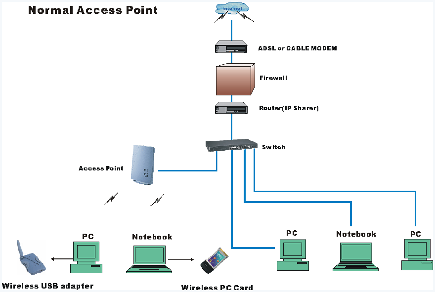
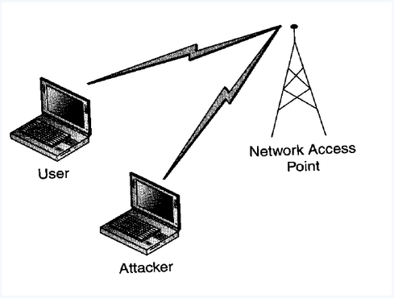
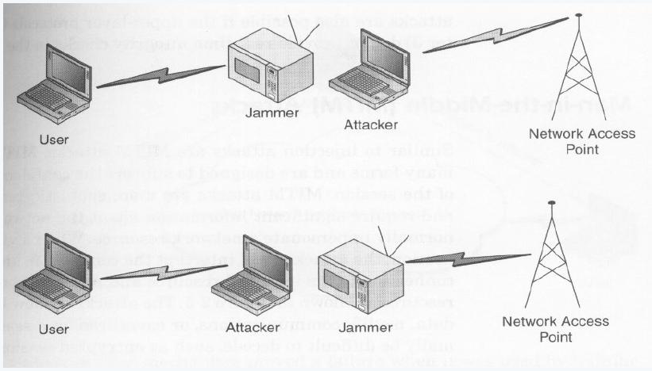
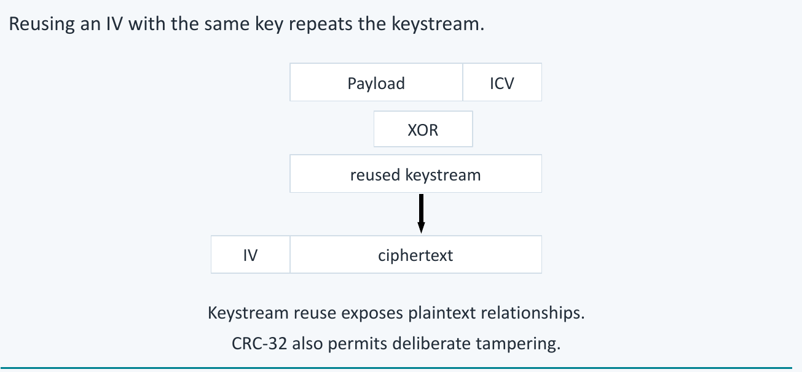
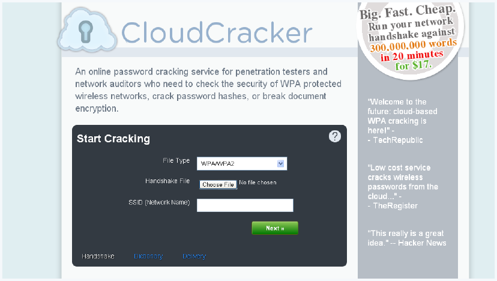
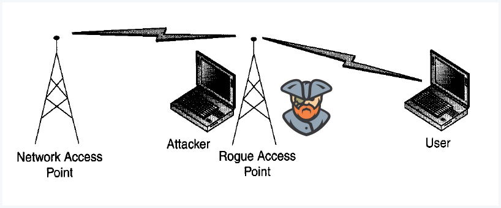

# CSIT953 考试复习 · 第 6 章 无线网络安全

> 🎯 **考纲** — *Wireless Network Security — Secure configuration and protection against impersonated access points.*
>
> 可能的题型：单选题考 SSID 能不能证明网络身份、四次握手做什么、PMF 能防什么、干扰攻击破坏哪个安全属性、WEP 的 IV 重复会泄露什么、WPS 的 PIN 为什么好猜；填空题考术语（beacon frame、probe request、SAE、PMF、802.1X/EAP、evil twin、AES-CCMP、RC4、CRC-32）；简答题考 WPA2-PSK 为什么能被离线猜口令、WPA3-SAE 改变了什么、有了 WPA2 为什么还要 TLS、WEP 的三个设计错误；问答题可能描述一次 evil twin 攻击，问怎样防，或者给出一家咖啡馆、一家小公司的 Wi-Fi 配置，让你找问题、提方案。

> 📚 **来源** — slides：W8 S1–S32；W1 S27–S28（不安全的免费 Wi-Fi、network spoofing）。录音：W8 录音约 40.8k 之后（S1–S11）；W11 录音前约 28.5k（S12–S32）。本章引用前几章的内容：字典攻击与加盐（第 1 章 §6），CRC 不是 MAC、认证加密与防重放（第 1 章 §8），WEP 共享密钥认证（第 3 章 §13.1），客户端怎样检查证书、复制证书为什么没用（第 4 章 §5–§6），Wi-Fi 路由器兼任 DNS 服务器（第 4 章 §10.1）。

第 4 章讲浏览器怎样确认"连上的正是这个网站"。Wi-Fi 要先回答前一个问题：设备怎样确认"连上的正是这个网络"。无线电穿墙而过，攻击者不用进门就能收听、发送，还能架一个同名的接入点，等你连上来。§1–§2 讲 Wi-Fi 怎样组网、设备怎样加入网络；§3–§5 讲无线带来的威胁：窃听、干扰和强制断线；§6 从 WEP 的失败总结设计教训；§7–§8 讲 WPA2、WPA3、企业认证，以及针对口令的离线猜测；§9 讲冒充的接入点怎样攻击、怎样防，这是考纲点名的内容；§10 讲 WPS；§11 把各节的结论整理成一份安全配置清单。

## 1. 无线局域网怎样组成 (W8 S3–S8)

无线网络用无线电链路代替网线连接设备。覆盖一个局部区域的叫**无线局域网**（wireless LAN, WLAN），比如一套房子、一层办公室。设备通常先连上接入点（access point, AP），再经它访问本地资源和互联网。AP 把无线客户端桥接到有线局域网上，另有一台路由器负责通往其他网络，它也可以和 AP 装在同一个盒子里。

图 1 是一个典型的小型网络：上网线路经调制解调器、防火墙和路由器接到交换机；交换机一边接有线电脑，一边接 AP；笔记本和台式机通过无线网卡连上 AP。从无线客户端到互联网要经过好几道边界，每一道都可能需要确认身份、检查权限或者做监控。



WLAN 有三个好处：布线困难或费用高的地方也能联网；覆盖范围和配置可以随需求调整；部署快，适合流动办公的团队和灾难恢复。反过来，正因为部署容易，无线网络常常是匆忙搭起来的，安全配置格外要紧。

Wi-Fi 的标准是 IEEE 802.11 系列，由 IEEE 802.11 工作组制定。它规定了客户端和 AP 之间、以及客户端彼此之间的无线接口。由此有两种组网方式：

- 自组网（ad hoc）：设备直接通信，不经过 AP。例如两部手机不连路由器，直接互传文件。
- 基础设施模式（infrastructure）：客户端都连 AP，由 AP 桥接到本地网络。家庭、办公室和校园用的都是这种。

Wi-Fi 一代代升级，换来的主要是速度和容量：

| Wi-Fi 代际 | IEEE 标准 |
|---|---|
| Wi-Fi 4 | 802.11n |
| Wi-Fi 5 | 802.11ac |
| Wi-Fi 6 | 802.11ax |
| Wi-Fi 6E | 802.11ax，使用 6 GHz 频段 |
| Wi-Fi 7 | 802.11be |

**无线电换了新一代，部署并不因此更安全**，安全取决于配置。物联网设备还常用其他无线技术：低功耗蓝牙（Bluetooth LE）、Zigbee/Thread、LoRaWAN 和蜂窝物联网。它们和 Wi-Fi 是并列的选择，不是升级关系。选哪一种，要看覆盖范围、功耗预算、延迟、网络拓扑，以及设备能不能接收安全更新。

> ✍️ **English answer** — A wireless LAN connects devices by radio links; clients usually join through an access point (AP), which bridges them to the wired LAN, while a router connects to other networks. IEEE 802.11 standards define the wireless interface between a client and an AP (infrastructure mode, common in homes, offices and campuses) or directly between clients (ad hoc mode). WLANs offer installation flexibility, scalability and speed, but they are often deployed in a hurry, so secure configuration matters. A newer radio generation such as Wi-Fi 7 improves performance but does not by itself guarantee a secure deployment.

## 2. 设备怎样加入一个 Wi-Fi 网络 (W8 S9–S10)

### 2.1 发现：SSID 只是一个名字

加入网络之前，设备先要发现它。方式有两种：

- 被动发现（passive discovery）：AP 定期广播**信标帧**（beacon frame），里面带着网络名等信息。
- 主动发现（active discovery）：客户端发出探测请求（probe request），再比较收到的应答。

网络名叫 SSID（Service Set Identifier），就是手机 Wi-Fi 列表里显示的"UOW""TP-Link_5G"。它由管理员随意设置。很多路由器给 2.4 GHz 和 5 GHz 两个频段各起一个名字，也可以两个频段用同一个名字。

**发现发生在建立信任之前，SSID 本身证明不了网络的身份**。谁都可以把自己的 AP 命名为"UOW"，信标帧里没有任何东西能区分真假。攻击者可以模仿一个熟悉的网络名，也可以操纵发现阶段的流量，§9 的 evil twin 就从这里下手。

### 2.2 认证、关联与四次握手

发现之后的步骤取决于网络的安全模式：

| 安全模式 | 发现之后的连接步骤 |
|---|---|
| WPA2-Personal | 开放系统认证 → 关联 → 用 PSK 做四次握手 |
| WPA3-Personal | SAE 认证 → 关联 → 四次握手 |
| 企业模式（802.1X） | 开放系统认证 → 关联 → EAP 认证 → 四次握手 |

各步骤的作用：

- 开放系统认证（open-system authentication）只是协议的一个初始步骤。名字里有"认证"，它却不证明用户或设备的任何身份。
- 关联（association）：客户端加入这个 AP 的网络。
- **四次握手**（four-way handshake）派生并安装会话密钥。它不是通常意义上的用户登录，作用有两个：双方证明自己知道相关的秘密，例如全网共享的口令（pre-shared key, PSK）；再为这次连接派生新鲜的会话密钥，保护之后的流量。
- 真正认证身份的是 SAE 和 EAP 这两步，见 §8.5 和 §7。企业网络里，用户或设备的身份在 EAP 这一步确认。

WPA3 强制要求 PMF（§5）。

> 📎 **拓展（超出 slides）** — 四次握手的过程：AP 发一个随机数 ANonce，客户端回一个随机数 SNonce。双方用 PSK 派生出的主密钥（PMK）、这两个随机数和双方的 MAC 地址，算出这次连接的会话密钥（PTK）。后三条消息各带一个用会话密钥算出的 MIC，也就是 MAC（第 1 章 §7），证明发送方知道 PMK。两个随机数每次都新选，所以每次连接的会话密钥都不同，旧消息也不能重放。§8 会用到这一点：握手里的 MIC 能让攻击者检验口令猜得对不对。

> ✍️ **English answer** — Discovery happens before trust is established: APs advertise beacon frames and clients send probe requests, and an SSID is only a name that anyone can broadcast, so it cannot prove a network's identity. After discovery, WPA2-Personal performs open-system authentication, association and a four-way handshake using the PSK; WPA3-Personal uses SAE authentication instead of open-system authentication; enterprise (802.1X) networks add EAP authentication, where the user or device identity is established. Open-system authentication alone proves nothing about identity. The four-way handshake is not a user login: it confirms knowledge of the relevant secret and derives and installs fresh session keys, and WPA3 requires PMF.

## 3. 无线改变了威胁模型 (W8 S11–S12; W1 S27)

有线网络里，攻击者要接触网线或交换机，通常得先进到楼里。无线电却会穿过墙壁，传到走廊、停车场和隔壁的公寓。在信号范围内，攻击者不用进门就能接收，也能发送（图 2）。



加密能保护载荷（payload），但一部分元数据和发现阶段的流量仍然看得见，例如设备的 MAC 地址、网络名、包的大小和发送时间。开放网络连载荷也不加密。免费 Wi-Fi 通常就是这样，范围内的人能看到所有没有另外加密的流量。

按受影响的安全属性，无线网络的攻击面（attack surface）分成四类：

| 类别 | 攻击 | 见 |
|---|---|---|
| 机密性 | 窃听（eavesdropping）、弱加密、流量分析（traffic analysis） | §4、§6 |
| 完整性与身份 | evil twin、伪造（spoofing）、降级（downgrade）、注入伪造的帧（frame injection） | §6、§8、§9 |
| 可用性 | 干扰（jamming）、滥用断开连接的帧（deauthentication abuse）、耗尽资源 | §5 |
| 运维 | 不安全的默认配置、共享凭据、不打补丁的 AP、无人管理的 IoT 客户端 | §6、§10、§11 |

运维问题不对应某一个属性，它会削弱所有属性：协议再强，共享的口令和不打补丁的 AP 也能让它失效。实际评估时还要考虑隐私、人身安全和可追责性。一把联网的门锁、一个医疗传感器出了问题，后果远不止"上不了网"。

无线网络的防护要几样一起做：强认证、密钥管理、PMF 和监控。

> ✍️ **English answer** — Radio crosses walls and shared spaces, so an attacker within radio range can receive or transmit without entering the premises. Encryption protects payloads, but some metadata and discovery traffic remain visible, and free open Wi-Fi is usually unprotected. The wireless attack surface covers confidentiality (eavesdropping, weak encryption, traffic analysis), integrity and identity (evil twins, spoofing, downgrade attempts, frame injection), availability (jamming, deauthentication abuse, resource exhaustion) and operations (insecure defaults, shared credentials, unpatched APs, unmanaged IoT clients), which weaken every property. A sound design therefore combines strong authentication, key management, PMF and monitoring.

## 4. 窃听：链路加密只保护到 AP (W8 S13)

防窃听要两层加密。第一层保护无线链路：用 WPA2 加 AES-CCMP，或者用 WPA3。

第二层保护应用流量。WPA2 和 WPA3 只保护设备和 AP 之间的那一段无线电（图 3）。AP 解密之后，数据在有线网络和互联网上传输，AP 的管理者和后面的网络都看得到。应用要自己用 TLS（第 4 章），或者用 DTLS（面向 UDP 数据报的 TLS），从设备一直加密到服务器。WhatsApp、网上银行都是这样做的。在不加密的咖啡馆 Wi-Fi 上，它们的通信照样受 TLS 保护。

```svg 图 3 · Wi-Fi 加密只覆盖设备到 AP 的一段，TLS 从应用一直保护到服务器
<svg viewBox="0 0 640 260">
  <rect x="30" y="70" width="120" height="50" rx="8" class="ink fill-muted" stroke-width="2"/>
  <text x="90" y="100" text-anchor="middle">手机或笔记本</text>
  <rect x="260" y="70" width="120" height="50" rx="8" class="ink fill-muted" stroke-width="2"/>
  <text x="320" y="100" text-anchor="middle">接入点 AP</text>
  <rect x="490" y="70" width="120" height="50" rx="8" class="ink fill-muted" stroke-width="2"/>
  <text x="550" y="100" text-anchor="middle">服务器</text>
  <line x1="150" y1="95" x2="260" y2="95" class="ink dashed" stroke-width="2"/>
  <text x="205" y="60" text-anchor="middle" class="muted">无线电</text>
  <line x1="380" y1="95" x2="490" y2="95" class="ink" stroke-width="2"/>
  <text x="435" y="60" text-anchor="middle" class="muted">有线网络、互联网</text>
  <rect x="90" y="145" width="230" height="12" rx="6" class="good fill-good" stroke-width="2"/>
  <text x="205" y="182" text-anchor="middle" class="good">WPA2 / WPA3：只加密到 AP</text>
  <text x="455" y="156" text-anchor="middle" class="warn">AP 之后不再受 Wi-Fi 加密保护</text>
  <rect x="90" y="205" width="460" height="12" rx="6" class="accent fill-soft" stroke-width="2"/>
  <text x="320" y="242" text-anchor="middle" class="accent">TLS / DTLS：从应用一直加密到服务器</text>
</svg>
```

开放 Wi-Fi 一律当作不可信的网络，手机连上开放网络时会给出警告。即使用了 TLS，一部分元数据仍然看得见。

> 📎 **拓展（超出 slides）** — 用口令保护的 WPA2-Personal 网络也不能当作私密的。会话密钥由口令和握手里的公开数值算出，知道口令、又录下了你连接时四次握手的人，能算出你的会话密钥，解密你的流量。咖啡馆把口令贴在墙上时，这个人可能是任何一位顾客。WPA3-SAE 的会话密钥来自一次 DH 交换，没有这个问题（§8.5）。

> ✍️ **English answer** — WPA2 with AES-CCMP or WPA3 protects only the radio link between the device and the AP; after the AP the traffic is decrypted, so the AP operator and the networks beyond it can see it. Application traffic therefore needs end-to-end protection with TLS, or DTLS for datagram traffic, from the device to the server; this also protects users on unencrypted networks. Open Wi-Fi should be treated as untrusted, and some metadata remains visible even when payloads are encrypted.

## 5. 干扰与强制断线：攻击可用性 (W8 S14–S15)

**干扰**（jamming）用无线电噪声淹没正常的信号。它的目标不是读取数据，而是让合法的通信进行不下去，攻击的是可用性。

图 4 画了干扰器的两个位置。上面一排，干扰器靠近用户，受影响的是这一个客户端：反复重传，漫游失败，电池很快耗尽。下面一排，干扰器靠近 AP，连在这个 AP 上的许多客户端同时断线。



信号差不一定是攻击。下结论之前，先排除普通的拥塞和设备故障：检查信道占用、重传次数和信号质量。

协议防不了干扰。能做的是提高韧性（resilience）：部署冗余的 AP，一个被干扰还有另一个；持续监控；规划信道；关键服务保留有线的后备链路。这些措施不能让干扰变得不可能，合在一起能让网络在干扰下尽量保持可用。

攻击者还可以不制造噪声，而是伪造断开连接的帧（deauthentication frame），冒充 AP 让选定的客户端断线。断线本身是可用性问题，但它更常被当作别的攻击的第一步：客户端重连时的四次握手能被录下来（§8），断了线的用户也更容易去点一个同名的假网络（§9）。

**PMF**（Protected Management Frames，受保护的管理帧）减少连接建立之后的伪造断线，WPA3 强制要求它。PMF 的作用范围要记清：它保护已经建立的连接；它挡不住无线电干扰；它也不验证一个 SSID 是否真的属于这个组织。

> 📎 **拓展（超出 slides）** — 断开帧之所以能伪造，是因为 Wi-Fi 的管理帧（负责连接、断开这类控制工作）原先既不加密也不认证，谁都能冒充 AP 发出。PMF 用握手得到的密钥保护这些帧，客户端只接受真 AP 发出的断开帧。连接建立之前还没有密钥，PMF 管不到，也就证明不了你要连的 AP 是真的。

> ✍️ **English answer** — Jamming attacks availability: its goal is to prevent legitimate communication, not to read data. Near a client it causes retries, roaming failures and battery drain; near an AP it makes many clients lose service at once. Before calling it an attack, rule out congestion and faults by checking channel use, retries and signal quality; redundancy, monitoring, channel planning and a wired fallback improve resilience but cannot make interference impossible. Forged deauthentication frames disconnect chosen clients, often to force a reconnection; PMF reduces such forged disconnects on established links, but it neither stops jamming nor verifies an SSID.

## 6. WEP 的教训 (W8 S18–S26)

WEP 是最早的 Wi-Fi 加密方案，早已被攻破，现在的路由器里已经找不到这个选项。仍然要学它，是因为它说明了一件事：RC4、密钥、IV、校验和，每个组件单看都有道理，组合起来却不安全。**分析协议要看密钥、nonce、加密和完整性检查在反复使用和主动攻击下怎样相互作用**，只看用了哪些算法是不够的。

WEP 全网共用一把长期密钥。每个包附一个 24 位的初始向量（initialization vector, IV），IV 和密钥一起作为 RC4 流密码的输入，产生密钥流（keystream）。数据连同 CRC-32 校验值（WEP 里叫 ICV）一起与密钥流异或，得到密文（图 5）。



它犯了三个设计错误。

### 6.1 错误一：共享凭据

一把密钥给所有用户和设备用。密钥泄露一次，整个 WLAN 都暴露；要更换，所有设备得同时改，很难做到。所有人用同一把密钥，也就分不清谁是谁，无法单独撤销某一个人。

现代的教训：尽可能让每个用户、每台设备有自己的身份。用企业认证（§7），或者给成批管理的设备各配一份凭据。

### 6.2 错误二：完整性太弱

加密本身证明不了消息是真的、没被改过。WEP 的 CRC-32 只能发现意外错误，攻击者可以有控制地翻转密文里的位，再相应地改掉校验值。教训是用认证加密（authenticated encryption），让机密性和完整性一起检查。这部分第 1 章 §8 已经讲过。

### 6.3 错误三：nonce 重复

流密码有一条基本要求：同一把密钥下，同一段密钥流不能用两次。WEP 的密钥流只由长期密钥和 IV 决定，长期密钥又从不改变，所以 IV 一重复，密钥流就完全重复。

重复的危害可以直接算出来。设两个包用了同一段密钥流 $K$：

$$C_1 = P_1 \oplus K,\qquad C_2 = P_2 \oplus K \;\Longrightarrow\; C_1 \oplus C_2 = P_1 \oplus P_2$$

攻击者把两段密文异或，密钥流就抵消了，剩下两段明文的异或。单凭它未必能读出每条消息，但网络包的格式大多可以预测，比如协议头部的固定字段。知道一段明文的一部分，就能求出另一段对应的部分，也能求出这段密钥流，再用它解密或伪造同一个 IV 下的其他包。完整性检查又弱，篡改就更容易。WEP 的共享密钥认证正是栽在这一点上：明文挑战和它的密文一异或，就得到密钥流（第 3 章 §13.1）。

24 位的 IV 空间太小，在繁忙的网络上，重复是必然的。

> 📎 **拓展（超出 slides）** — 算一下：24 位 IV 只有 $2^{24}$，约 1678 万个取值。每秒发 1000 个包，不到 5 小时就用完一轮。如果 IV 随机选，按生日悖论，大约 5000 个包之后出现重复的概率就超过一半。

现代的教训：nonce 要足够长，在同一把密钥下唯一，设备重启或断电之后也不能重复。资源受限的 IoT 设备尤其要注意最后一点：计数器如果只存在内存里，断电就丢了，重启后可能从头数起。

### 6.4 设计原则与审查问题 (W8 S23–S24, S26)

- 密钥分离（key separation）：长期密钥和会话密钥分开，长期凭据不直接用来保护每一次会话；限制一把密钥保护的数据量；人员、设备或所有权变化时轮换凭据。
- 管好凭据的整个生命周期：签发、存储、轮换和撤销。IoT 设备群（fleet）可能有成千上万台设备，所有设备出厂时写入同一个秘密，或者共用一个云凭据，一台设备被攻破就成了整个设备群的问题。制造时的身份、入网凭据、运行时的会话密钥和管理凭据要分开，各自有负责人、存放位置、轮换规则和撤销途径。
- 认证加密：应用接受明文之前先验证 tag；用计数器或序号拒绝重放，因为认证加密本身不保证新鲜性；用标准化的构造，条件允许时把密钥放在硬件里（第 1 章 §8）。

审查任何安全设计时，都可以用 WEP 的教训问四个问题：

1. 每台设备有没有自己的身份？
2. 消息能不能被篡改或重放？
3. 重启之后 nonce 会不会重复？
4. 密钥能不能轮换和撤销？

结论只有一句：不要部署 WEP。

> 👨‍🏫 **课堂强调** — 一个协议可以全由熟悉的密码学组件组成，仍然不安全。失败的是整体构造，不是某一个算法。

> ✍️ **English answer** — WEP combined RC4 with a 24-bit IV and a shared long-term key, and it made three design mistakes. First, one shared key served all users and devices, so a leak exposed the whole WLAN and the key was hard to rotate; modern networks give users and devices distinct identities. Second, CRC-32 detects accidental errors but allows controlled bit changes, so authenticated encryption is needed. Third, the small IV space made keystream reuse inevitable, and XORing two ciphertexts under the same keystream cancels it and leaves the XOR of the plaintexts; nonces must be large, unique under a key and safe across reboots. Further lessons are key separation, credential rotation and revocation, verifying tags and rejecting replays, and never deploying WEP.

## 7. WPA2、WPA3 与企业认证 (W8 S28)

现在可选的安全模式有三种：

| 模式 | 认证依据 | 特点 | 要注意的 |
|---|---|---|---|
| WPA2-Personal | 全网共享的口令（PSK） | 四次握手派生会话密钥 | 截获握手后能离线猜弱口令（§8） |
| WPA3-Personal | 口令，经 SAE 认证 | SAE 抵抗被动的离线猜测；强制 PMF | 弱口令、过渡模式、终端被攻破（§8.5） |
| 企业模式（802.1X/EAP） | 每个用户或设备自己的身份 | 可追责，可单独撤销 | 客户端必须验证认证服务器的证书（§9） |

家庭这样的小型网络，用一个长而随机的 WPA2 口令可以算合理的控制措施，能用 WPA3 更好。

组织里，共享口令会带来人员和设备的管理问题。人人用同一个口令，就无从知道是谁接入的；有员工离职，要么改口令、通知所有人，要么任由离职的人继续连网。企业认证（802.1X/EAP）让每个人用自己的账号接入，UOW 的校园网就是这样。IT 部门知道哪个用户、哪台设备在什么时候接入，撤销访问也只针对这一个人。

企业模式里有三方：客户端、AP 和后面的认证服务器。AP 只负责转发，客户端和认证服务器之间运行 EAP 协议，确认用户或设备的身份。客户端必须正确验证认证服务器的证书，否则它不知道自己把口令交给了谁（§9.2）。协议再强，也要靠终端配置正确。

WPA3 改进了协议，却修不好被攻破的终端，也管不住粗心的管理员。

> 📎 **拓展（超出 slides）** — WPA2 逐条改掉了 WEP 的三个错误。会话密钥由四次握手为每次连接新派生，每个客户端各不相同，PSK 不直接加密流量；企业模式更进一步，连长期凭据也是每人一份。AES-CCMP 是一种认证加密，每个包带一个 MIC，篡改会被发现。每个包还有一个 48 位、只增不减的包序号，它保证同一把密钥下 nonce 不重复，也让接收方拒绝重放的旧包。

> ✍️ **English answer** — WPA2-Personal uses a shared key, so a weak passphrase permits offline guessing after authentication material is captured. WPA3-Personal authenticates with SAE, which resists passive offline password guessing, and WPA3 requires Protected Management Frames. Enterprise networks use 802.1X/EAP, which gives each user or device a distinct identity, improving accountability and allowing targeted revocation, but clients must validate the authentication server's certificate. A long random passphrase may be reasonable for a small home network, whereas an organisation needs enterprise authentication; no protocol fixes a compromised endpoint or a careless administrator.

## 8. 截获握手，离线猜口令 (W8 S29–S31)

### 8.1 为什么能离线猜

WPA2-Personal 的会话密钥由口令派生。攻击者截获一次四次握手，就拿到了检验口令的材料：在自己的电脑上逐个试候选口令，每个都按握手的规则算一遍，结果和截获的数值对上，就找到了口令。这正是第 1 章 §6 的离线字典攻击。

"离线"是关键词。截获握手之后，攻击者不用再连 AP，可以用自己的 GPU 一直算下去，AP 也就限制不了猜测的次数。**口令的长度和随机性，比"必须含一个大写字母"这类规则重要得多**。12345678、生日这类口令，字典里一查就中。

SSID 参与从口令派生密钥的计算，起的是盐的作用（第 1 章 §6.3）：同一个口令在不同名字的网络里派生出不同的密钥，一本字典不能通用于所有网络。可很多网络用的是路由器出厂时的默认 SSID。对这些常见的 SSID，攻击者可以预先算好字典，盐不唯一，作用就打了折扣。

> 📎 **拓展（超出 slides）** — 具体的检验方法：主密钥 PMK = PBKDF2(口令, SSID)，PBKDF2 把 HMAC-SHA1 迭代 4096 次，故意算得慢。攻击者对每个候选口令算出 PMK，再用握手里的两个随机数和 MAC 地址算出会话密钥和 MIC（§2.2），与截获的 MIC 比较。整个过程不需要 AP 参与。

### 8.2 怎样截获握手

握手只在客户端连接时发生。攻击者不想干等，就伪造断开帧把客户端踢下线（§5），客户端自动重连，握手就被录下来了。要求启用 PMF，能减少这种伪造的断线。

这些技术只能在获得授权的实验环境里测试。

### 8.3 算力可以花钱买

图 6 是早年的一个在线破解服务：上传截获的握手文件，填上网络的 SSID，服务方在云端用大字典替你跑。广告写着"20 分钟跑 3 亿个词，17 美元"。这个价格和容量早已过时，要点在于攻击者不需要自己买显卡：自己用一块高端 GPU，可能要花上千美元、跑两天；交给这类服务，花十来美元，一两个小时就可能出结果。同类服务也破解加密的压缩包、PDF 和 Office 文件。



注意表单要求填 SSID：它是盐，少了它算不出密钥。这张图的教训是：长而随机生成的口令能大大增加离线猜测的工作量。

### 8.4 防御

- 用一个长而随机、这个网络专用的口令。
- 优先用 WPA3-SAE 或企业认证。
- 把访客和 IoT 设备放进单独的网络。口令即使被猜出来，攻击者也只进了一个隔离的网段，碰不到核心系统。家用路由器上开一个访客网络或者划分 VLAN，就能做到。

### 8.5 WPA3-SAE 改变了什么

SAE（Simultaneous Authentication of Equals）改变了针对口令的攻击模型：它抵抗被动的离线猜测。录下一次 SAE 交换，攻击者手里也没有可以逐个检验口令的东西。

SAE 并没有消除所有风险，三件事仍然要紧：

- 弱口令。离线猜不了，在线一个个试常见口令，仍可能试中。
- 过渡模式（transition mode）。为了兼容只支持 WPA2 的旧设备，很多路由器开 WPA2/WPA3 混合模式，同一个口令两种协议都能用。比如一台家用路由器，5 GHz 网络用纯 WPA3-SAE；2.4 GHz 网络开混合模式，因为家里的旧笔记本和一些智能家电只支持 WPA2。
- 终端被攻破。口令存在设备里，设备中了恶意软件，协议再强也没用。

> 📎 **拓展（超出 slides）** — SAE 是一种基于口令的认证密钥交换，底层是第 2 章的 DH：双方由口令得到交换用的参数，再交换临时的公开值，算出共享秘密。窃听者看到的公开值和口令之间没有能检验的关系；想验证一个猜测，只能真的和 AP 跑一次交换，这就成了在线猜测，AP 可以限制次数。临时密钥还带来前向安全：口令以后泄露，之前录下的会话也解不开。过渡模式之所以危险，是因为攻击者只要截获一次同一口令下的 WPA2 握手，就能照常离线猜；也可以架一个只提供 WPA2 的假网络，诱使支持 WPA3 的设备降级。

> ✍️ **English answer** — A captured WPA2-PSK four-way handshake lets an attacker test candidate passphrases offline: the AP no longer limits the number of guesses, and GPUs or paid cloud services can try millions of words. Attackers often forge deauthentication frames to force a reconnection and capture the handshake, which requiring PMF reduces. The SSID acts as a salt in the key derivation, but common SSIDs help precomputation. Defences are a long, random passphrase unique to the network, WPA3-SAE or enterprise authentication, and separate guest and IoT networks. SAE resists passive offline guessing, but weak passwords, WPA2/WPA3 transition modes (where a WPA2 handshake with the same password can still be captured) and compromised endpoints still matter.

## 9. 冒充的接入点：rogue AP 与 evil twin (W8 S16, S30; W1 S28)

### 9.1 攻击过程

**流氓接入点**（rogue access point）泛指未经授权的 AP。其中一种叫 evil twin：它冒用一个可信网络的名字，吸引客户端连上来（图 7）。



图 7 里，攻击者的流氓 AP 一边连着用户，一边连着真正的 AP。用户的流量经它转发出去，照常能上网，察觉不到异常。攻击者却站在了中间人的位置：所有流量都经过这台 AP，DNS 也由它回答，攻击者可以把银行的域名指向自己的服务器（第 4 章 §10.1）。这类攻击也叫网络欺骗（network spoofing）：架起看上去像普通 Wi-Fi 的假接入点，实际上是陷阱。

设备为什么会上当？§2.1 说过，SSID 只是名字，手机和笔记本通常也不验证 AP 的身份。有人架一个叫"UOW"的 AP，设备分辨不出它不是学校的。

图 8 是一次针对家庭网络的典型攻击。攻击者先冒充用户的路由器，不断发送伪造的断开帧（①），用户的设备一重连就被踢下线（②）。攻击者同时广播一个同名的开放网络（③）。用户见原来的网络总连不上，手动点了这个同名网络（④）。设备随即打开一个仿冒路由器管理页面的网页，说路由器出了故障，请重新输入 Wi-Fi 口令（⑤）。用户照做（⑥），攻击者就用偷到的口令接入真正的网络（⑦）。

```d2 图 8 · 一次 evil twin 攻击：先逼用户断线，再用同名网络和假页面骗出 Wi-Fi 口令
shape: sequence_diagram
R: 真正的 AP
A: 攻击者的 AP {class: warn}
U: 用户的设备
A -> U: "① 冒充真 AP 发断开帧"
U -> R: "② 重连，又被踢下线" {style.stroke-dash: 4}
A -> U: "③ 广播同名的开放网络"
U -> A: "④ 用户手动点了它"
A -> U: "⑤ 假的路由器页面：\n请重新输入 Wi-Fi 口令"
U -> A: "⑥ 输入 Wi-Fi 口令"
A -> R: "⑦ 用偷到的口令接入"
```

这条攻击链有三处可以切断：PMF 让伪造的断开帧失效（①），不过攻击者还能改用干扰；不手动加入陌生的开放网络（④）；记住自家路由器不会通过弹出的网页索要 Wi-Fi 口令（⑤）。

### 9.2 企业网络：证书验证是关键

企业网络的 evil twin 更进一步。攻击者可以在自己的电脑上（例如用 Kali Linux）模拟一个同名的企业网络，连 EAP 认证也一并模拟。唯一的破绽在证书：攻击者出示不了真正认证服务器的证书，只能拿出一张自己造的。设备会提示"是否信任这张证书"。用户大多不看，直接点"信任"，再输入用户名和口令，凭据就到了攻击者手里，和钓鱼一样。

**防 evil twin 最有效的控制是验证认证服务器的证书**。这和第 4 章浏览器检查网站证书是一回事：证书链要通向受信任的根，名字要是预期的认证服务器（第 4 章 §5）；复制一张真证书没有用，攻击者没有对应的私钥（第 4 章 §6）。证书验证通过，才能确认这个 SSID 背后真是本组织的网络。

例如，第一次连 UOW 的 Wi-Fi 时，设备会显示一张证书，问你是否信任。在 Mac 上"忘记此网络"再重新连接，就能再次看到这个提示。

托管的连接配置文件（managed connection profile）把判断从用户手里拿走：IT 部门事先把预期的 CA 和服务器名装进设备，设备自动核对，对不上就拒绝连接，不再弹出"是否信任"。

> 📎 **拓展（超出 slides）** — 企业 Wi-Fi 常用 PEAP 这类 EAP 方法：客户端先和认证服务器建立一条 TLS 隧道，再在隧道里提交用户名和口令。不验证服务器证书，这条隧道就可能通向攻击者的服务器。另外，第一次连接时由用户点"信任"，相当于第 5 章 §4 的首次使用时信任（TOFU）：第一次连上的如果就是 evil twin，信任的就是攻击者的证书。托管的连接配置文件把信任事先装好，补上了这个缺口。改用 EAP-TLS，客户端用自己的证书认证，攻击者连口令都偷不到。

### 9.3 哪些措施有用

| 措施 | 能防 evil twin 吗 | 原因 |
|---|---|---|
| 验证认证服务器证书（企业网络） | 能，最有效 | 攻击者拿不出预期服务器的有效证书和私钥 |
| 托管的连接配置文件 | 能 | 设备按预设的 CA 和服务器名自动核对，不靠用户判断 |
| 不自动连接陌生网络，不接受意外的证书警告 | 减少上当 | 攻击要靠用户连上来、点"信任" |
| 监控 rogue AP | 能发现 | 及时发现冒用本组织网络名的 AP |
| PMF | 只防伪造的断线 | 保护已建立的连接，不验证 SSID 属于谁 |
| 隐藏 SSID | 不能 | 名字能从客户端的行为里得知，隐藏也不认证 AP |
| 换新一代 Wi-Fi 硬件 | 不能 | 代际只改善性能，不认证网络 |

隐藏 SSID 为什么没用：AP 不再在信标帧里广播名字，但保存过这个网络的设备会在探测请求里主动报出名字，攻击者一听就知道。更根本的是，隐藏只是不显示名字，丝毫证明不了 AP 的身份。

> 📎 **拓展（超出 slides）** — 用口令保护的网络（WPA2/WPA3-Personal）情况不同。连接时 AP 也要证明自己知道口令：WPA2 靠四次握手里的 MIC（§2.2），WPA3 靠 SAE 交换。不知道口令的假 AP 完不成握手，所以图 8 的攻击者只能架一个开放的同名网络，等用户手动去点。可是知道口令的人都能架一个真假难辨的 twin：咖啡馆把口令贴在墙上，每位顾客都能冒充这家咖啡馆的网络。共享口令认证的是"知道口令的人"，不是"这个网络"。

对用户的要求简单明确：不接受意外的证书警告，不自动加入陌生的开放网络。在公共 Wi-Fi 上处理敏感事务，依靠应用的 TLS；看到浏览器的证书警告就停下来（第 4 章 §10）。

> 👨‍🏫 **课堂强调** — 手机和笔记本基本不验证 AP 的身份；连企业网络时弹出的证书，多数人看都不看就点"信任"。evil twin 正是利用了这个习惯。

> ✍️ **English answer** — An evil twin is a rogue access point that imitates a trusted network name to attract clients; because an SSID proves nothing and most devices do not authenticate the AP, the victim's traffic and DNS then pass through the attacker. A typical attack forges deauthentication frames to disconnect the victim, broadcasts the same SSID as an open network and shows a fake router page asking for the Wi-Fi password. On an enterprise network the attacker can imitate the SSID and EAP but cannot present a valid certificate for the real authentication server, so clients must validate the server certificate, preferably through managed connection profiles. Users must not accept unexpected certificate warnings or auto-join unknown networks, and organisations should monitor for rogue APs. PMF only reduces forged disconnects and does not verify an SSID, and a hidden SSID can be learned from client probes and authenticates nothing.

## 10. WPS：便利的代价 (W8 S32)

WPS（Wi-Fi Protected Setup）让设备不输长口令也能入网，打印机这类不方便打字的设备常用它。它有两种方式：输入一个 8 位数字的 PIN，或者按一下路由器上的按钮。

PIN 方式制造了一个猜口令的入口。WPS 是 WPA 口令之外的另一扇门，不是在口令上再加一道锁：谁输对 PIN，谁就能入网，路由器不检查来的是打印机还是攻击者的笔记本。验证方式更糟：路由器先单独验证 PIN 的前 4 位，对了再验证后半段。攻击者可以先只猜前半段，再猜后半段，在线猜测的次数大大减少。

> 📎 **拓展（超出 slides）** — PIN 的最后一位是校验位。前半段有 $10^4$ 种可能，后半段只剩 3 位、$10^3$ 种，最多试 11000 次就能猜中，而不是 $10^7$ 次。

防御：

- 不需要时关闭 WPS。
- 用按钮方式时，开放的时间窗口要短，事后核对加入的是哪台设备。
- 成批管理的 IoT 设备要有各自的凭据，能轮换、能撤销，不要共用一个 PIN 或口令。

> ✍️ **English answer** — WPS trades security for convenience. Its PIN method creates a password-guessing surface: the PIN is an alternative way into the network, not an extra layer, and because the router confirms the two halves of the 8-digit PIN separately, an attacker can guess each half independently online. WPS should be disabled when it is not needed; for push-button onboarding, the window should be short and the joining device verified. Managed IoT fleets need unique credentials that support rotation and revocation.

## 11. 一份安全配置清单

考纲写的是 secure configuration。把前面各节的结论按配置项整理如下，问答题可以照这张表组织答案：

| 配置项 | 推荐做法 | 防的是什么 |
|---|---|---|
| 安全模式 | WPA3-SAE 或企业认证；绝不用 WEP | 离线猜口令、WEP 的三个错误（§6、§8） |
| 过渡模式 | 只为确实需要的旧设备开启，口令仍要足够强 | 截获 WPA2 握手、降级（§8.5） |
| 口令 | 长而随机、这个网络专用；改掉默认 SSID | 离线字典攻击、预计算（§8） |
| 身份 | 组织用 802.1X/EAP，每人每设备一个身份；IoT 设备各配凭据 | 共享凭据无法追责、难以撤销（§6.1、§7） |
| 管理帧 | 启用并要求 PMF | 伪造的断线、强制重连（§5） |
| 客户端 | 托管的连接配置文件，验证认证服务器证书；不自动加入陌生网络 | evil twin（§9） |
| 网络分段 | 访客和 IoT 设备单独成网 | 一个口令泄露就触及所有系统（§8.4） |
| WPS | 不需要就关闭 | PIN 猜测（§10） |
| AP 运维 | 改掉默认的管理口令，及时更新固件，维护设备清单 | 不安全的默认配置、不打补丁的 AP（§3） |
| 监控 | 监控 rogue AP、信道质量和异常断线 | evil twin、干扰（§5、§9） |
| 应用层 | 一律用 TLS 或 DTLS | Wi-Fi 加密只到 AP（§4） |

> ✍️ **English answer** — A secure wireless configuration uses WPA3-SAE or enterprise 802.1X/EAP authentication, never WEP, and limits transition mode to devices that really need it. Personal networks need a long, random, network-specific passphrase and a non-default SSID, while organisations give each user and managed device a distinct identity. PMF should be required, client profiles should validate the authentication server certificate, guest and IoT devices should sit on separate networks, WPS should be disabled, and APs should be patched, have their default settings changed and be monitored for rogue APs and interference. Because Wi-Fi encryption protects only the radio link, application traffic still needs TLS or DTLS.

## ⚠️ 易混易错

| 容易混的 | 区别 |
|---|---|
| SSID vs 网络身份 | SSID 是谁都能广播的名字；网络的身份要靠认证证明，企业网络靠认证服务器的证书 |
| 开放系统认证 vs SAE、EAP | 开放系统认证只是协议的初始步骤，不证明身份；SAE 和 EAP 才是认证 |
| 四次握手 vs 用户登录 | 四次握手证明知道共享秘密、派生会话密钥；企业网络里用户身份在 EAP 一步确认 |
| WPA2/WPA3 vs TLS/DTLS | 前者只保护设备到 AP 的无线电；后者从应用一直保护到服务器 |
| 干扰 vs 伪造断开帧 | 干扰是无线电噪声，协议防不了；伪造断开帧是假的管理帧，PMF 能减少 |
| PMF vs 验证网络身份 | PMF 保护已建立连接的管理帧，不验证 SSID 属于谁 |
| rogue AP vs evil twin | rogue AP 泛指未经授权的 AP；evil twin 专门冒用一个可信网络的名字 |
| WPA2-PSK vs WPA3-SAE | 前者截获握手就能离线猜口令；后者抵抗被动离线猜测，每次猜测都要和 AP 交互 |
| WPA3-Personal vs 企业模式 | 前者仍是共享口令；后者每人每设备一个身份，可追责、可单独撤销 |
| Wi-Fi 6/7 vs WPA2/WPA3 | 前者是无线电代际，管速度和容量；后者是安全模式，管认证和加密 |
| WEP 的 IV vs 合格的 nonce | WEP 的 IV 只有 24 位，必然重复；nonce 要足够长、同一密钥下唯一、重启后也不重复 |
| WPS 的 PIN vs 第二道认证 | PIN 是口令之外的另一扇门，猜中就能入网，不是多加的一层保护 |

常见误解：

- "隐藏 SSID 就能防 evil twin"：名字能从探测请求里得知，隐藏也不认证 AP。
- "开了 PMF 就不怕 evil twin"：PMF 只减少伪造的断线，不验证 SSID。
- "Wi-Fi 设了口令，网站用不用 HTTPS 无所谓"：Wi-Fi 加密只到 AP。
- "换一台 Wi-Fi 7 路由器就更安全"：代际只改善性能，安全看配置。
- "WPA3 解决了所有问题"：弱口令、过渡模式、被攻破的终端仍有风险。
- "连企业 Wi-Fi 时弹出证书，点信任就行"：evil twin 正是靠这一下拿到口令。
- "加了密就不会被篡改"：WEP 加了密，CRC-32 却挡不住有意篡改。
- "信号差就是有人干扰"：先排除拥塞和设备故障。

## 📝 Practice

### Part A · Multiple choice

**A1.** A laptop in a café sees a network named "Campus-WiFi". What does this SSID prove?
A. The access point belongs to the campus.
B. Nothing about the network's identity, because anyone can broadcast any SSID.
C. The network uses WPA3.
D. The access point holds a valid certificate.

<details>
<summary>Answer A1</summary>

**B.** Discovery happens before trust is established. The network's identity must be proven by authentication, for example by validating the enterprise authentication server's certificate.

</details>

**A2.** Which statement about the four-way handshake is TRUE?
A. It is the step in which the user logs in with a username and password.
B. It confirms knowledge of the shared secret and derives fresh session keys.
C. It verifies that the SSID belongs to the organisation.
D. Enterprise networks skip it because they use EAP.

<details>
<summary>Answer A2</summary>

**B.** It is not a user login. Enterprise networks still perform the four-way handshake after EAP authentication.

</details>

**A3.** An attacker places a radio jammer next to an office access point. Which property is mainly attacked, and what is the likely impact?
A. Confidentiality; the attacker reads all traffic.
B. Integrity; packets are modified in transit.
C. Availability; many clients lose service at once.
D. Availability; only one client is affected.

<details>
<summary>Answer A3</summary>

**C.** Jamming prevents legitimate communication rather than revealing data. A jammer near the AP makes many of its clients lose service at once; a jammer near one client mainly affects that client.

</details>

**A4.** In WEP, two packets are encrypted under the same key and the same IV. By XORing the two ciphertexts, an attacker obtains
A. the long-term WEP key.
B. the XOR of the two plaintexts.
C. the CRC-32 secret.
D. nothing useful, because RC4 is a secure cipher.

<details>
<summary>Answer A4</summary>

**B.** $C_1 \oplus C_2 = P_1 \oplus P_2$: the repeated keystream cancels out. Predictable packet formats then reveal parts of the plaintexts and of the keystream.

</details>

**A5.** On an 802.1X enterprise network, which measure helps a client avoid connecting to an evil twin?
A. Hiding the SSID
B. Enabling PMF
C. Validating the authentication server's certificate through a managed connection profile
D. Upgrading to Wi-Fi 7 access points

<details>
<summary>Answer A5</summary>

**C.** The attacker cannot present a valid certificate for the expected server. A hidden SSID and PMF do not authenticate the network, and a radio generation is not a security control.

</details>

**A6.** Which statement about Protected Management Frames (PMF) is TRUE?
A. PMF verifies that an SSID belongs to the real organisation.
B. PMF prevents radio jamming.
C. PMF reduces forged disconnects on established links and is required by WPA3.
D. PMF encrypts application traffic end to end.

<details>
<summary>Answer A6</summary>

**C.** PMF protects management frames once keys are established. It cannot stop radio interference and says nothing about who owns an SSID.

</details>

**A7.** Why does the WPS PIN method make guessing easier?
A. The PIN is broadcast in beacon frames.
B. The router confirms the two halves of the PIN separately, so each half can be guessed independently.
C. WPS shortens the WPA2 passphrase to eight digits.
D. Every router uses the same default PIN.

<details>
<summary>Answer A7</summary>

**B.** The PIN is also an alternative way into the network, so guessing it gives access without the passphrase. WPS should be disabled when it is not needed.

</details>

### Part B · Fill in the blank / short answer

**B1.** Access points advertise network information in ______ frames, while clients actively send ______ requests. WPA3-Personal replaces open-system authentication with ______ authentication, and every mode then performs the ______ handshake to derive and install session keys.

<details>
<summary>Answer B1</summary>

beacon; probe; SAE; four-way.

</details>

**B2.** WEP combined the ______ stream cipher with a ______-bit initialization vector and a shared long-term key, and used ______ as its integrity check. To protect the radio link today, use WPA2 with ______ or WPA3.

<details>
<summary>Answer B2</summary>

RC4; 24; CRC-32; AES-CCMP.

</details>

**B3.** State WEP's three design mistakes and the modern lesson drawn from each. (3 sentences)

<details>
<summary>Answer B3</summary>

Shared credentials: one key served all users and devices, so a leak exposed the whole WLAN and the key was hard to rotate; the lesson is distinct identities through enterprise authentication or per-device credentials. Weak integrity: CRC-32 allowed controlled bit changes; the lesson is authenticated encryption, which checks confidentiality and integrity together. Nonce reuse: the small 24-bit IV space made keystream reuse inevitable; the lesson is nonces that are large enough, unique under a key and safe after reboot or power loss.

</details>

**B4.** Your laptop is connected to a café's WPA2-protected Wi-Fi. Why should your online banking still use HTTPS? (2–3 sentences)

<details>
<summary>Answer B4</summary>

WPA2 protects only the radio link between the laptop and the AP; after the AP the traffic is decrypted and visible to whoever operates the AP and the networks beyond it, and with a shared passphrase other customers may also be able to decrypt captured traffic. HTTPS encrypts and authenticates the connection end to end, from the browser to the bank's server, so it stays protected even if the Wi-Fi is open or controlled by an attacker. Wi-Fi encryption is therefore no substitute for TLS.

</details>

**B5.** Explain why a weak WPA2-PSK passphrase can be guessed offline, and how WPA3-SAE changes this. (3–4 sentences)

<details>
<summary>Answer B5</summary>

The four-way handshake contains values derived from the passphrase, with the SSID acting as a salt, so an attacker who captures it, often after forging deauthentication frames to force a reconnection, can test candidate passphrases on their own GPUs or a paid cloud service. The AP is no longer involved, so it cannot limit the number of guesses, and dictionary passwords are found quickly. SAE resists passive offline guessing: a recorded SAE exchange gives the attacker nothing to test guesses against, so each guess requires interacting with the AP. Weak passwords, transition modes and compromised endpoints still matter.

</details>

### Part C · Questions and answers

**C1.** A university's Wi-Fi network "UniNet" uses 802.1X/EAP, and students log in with their university username and password. An attacker sets up a laptop in the library that also broadcasts "UniNet".
(a) Explain how the attacker can obtain students' usernames and passwords.
(b) An IT staff member proposes hiding the SSID and enabling PMF. Evaluate both proposals.
(c) Propose effective defences for the university and for students.

<details>
<summary>Model answer C1</summary>

(a) An SSID is only a name that anyone can broadcast, and devices do not authenticate an access point by its name. The attacker's laptop acts as an evil twin: it advertises "UniNet" and imitates the enterprise EAP authentication, and it may forge deauthentication frames to push students off the real network or simply offer a stronger signal. It cannot present a valid certificate for the university's authentication server, so a student's device shows an unfamiliar certificate and asks whether to trust it. Many users click "trust" without checking and then enter their username and password, which go to the attacker's server. The attacker can then log in to the real network as the student, and while victims stay connected their traffic and DNS pass through the attacker's access point.

(b) Hiding the SSID does not help: devices that have saved the network reveal its name in their probe requests, and hiding a name does not authenticate the access point. PMF protects management frames on established links, so it reduces forged deauthentication, but it does not verify that an SSID belongs to the university; a student who connects to the twin is not protected. Neither proposal addresses the real problem, which is that clients do not verify the network's identity.

(c) The university should make every client validate the authentication server certificate, ideally through managed connection profiles that specify the expected CA and server name, so that a wrong certificate is rejected automatically instead of being left to the user. It should publish the expected certificate details through a trusted channel for unmanaged devices, monitor for rogue access points using the UniNet name, and require PMF (WPA3-Enterprise) to reduce forced disconnections; certificate-based EAP would leave no password to steal. Students should never accept an unexpected certificate warning, should not auto-join unknown networks, and should rely on TLS for sensitive applications.

**Marking points:** an SSID cannot prove identity and devices do not authenticate the AP (1); the twin imitates the SSID and EAP, often with forged deauthentication (1); the user accepts the fake certificate, so the credentials go to the attacker (1); a hidden SSID can be learned and authenticates nothing (1); PMF does not verify the SSID (1); certificate validation through managed profiles, plus user policy and rogue-AP monitoring (1).

</details>

**C2.** A small café runs one WPA2-Personal network for customers, staff laptops, the payment terminal and IP cameras. The passphrase "cafe1234" is printed on the menu, the SSID is the router's default name, WPS is enabled, and the router's firmware and admin password have never been changed.
(a) Identify four weaknesses and explain the risk of each.
(b) Propose a secure configuration.

<details>
<summary>Model answer C2</summary>

(a) Any four of the following. First, the passphrase is weak, public and shared: anyone can join, the café cannot tell who used it or revoke one person, and anyone who knows it can run an evil twin with the same name and password; such a dictionary password can also be recovered almost at once from a captured handshake by someone who never saw the menu. Second, the default SSID weakens its role as a salt, because attackers precompute dictionaries for common SSIDs. Third, there is no segmentation: customers share a network with the payment terminal, the cameras and the staff laptops, so anyone who joins can reach and attack them. Fourth, WPS is enabled: the PIN is checked in two halves and can be guessed online, giving access even if the passphrase is changed. Fifth, the unpatched router with its default admin password can be taken over through known vulnerabilities or default credentials, and with it the café's DNS and traffic. Sixth, WPA2 without PMF lets an attacker forge deauthentication frames to disconnect clients and capture handshakes.

(b) Split the network into a guest network for customers, isolated from internal systems, a staff network, and a separate network for the payment terminal and cameras (for example with VLANs). Use WPA3-SAE, or enterprise 802.1X if the number of staff justifies it, with long, random, network-specific passphrases; change the default SSID and change the guest passphrase regularly. Require PMF and disable WPS. Update the firmware, change the default admin password, give the IoT devices their own credentials that can be rotated, and monitor for rogue APs using the café's network name. Staff applications and the payment terminal should still use TLS, because Wi-Fi encryption protects only the radio link.

**Marking points:** four weaknesses, each with its risk (2); segmentation of guest, staff and IoT or payment devices (1); WPA3-SAE or enterprise authentication with a strong passphrase and non-default SSID (1); PMF required and WPS disabled (1); patching, admin credentials, monitoring and TLS (1).

</details>

## 本章小结

- SSID 只是谁都能广播的名字，发现发生在建立信任之前；开放系统认证不证明身份，四次握手证明知道秘密并派生会话密钥。—— *beacon frame, probe request, SSID, four-way handshake*
- 无线电穿墙，攻击者在信号范围内就能收发；攻击面分机密性、完整性与身份、可用性、运维四类。—— *wireless attack surface*
- WPA2/WPA3 只保护设备到 AP 的无线电，应用还要 TLS 或 DTLS；开放 Wi-Fi 一律当作不可信。—— *AES-CCMP, TLS/DTLS, link vs end-to-end protection*
- 干扰攻击可用性，靠冗余、监控、信道规划和有线后备提高韧性；伪造断开帧常用来逼客户端重连，PMF 能减少它，却不验证 SSID。—— *jamming, deauthentication, PMF*
- WEP 的三个错误：共享凭据、CRC-32 完整性、IV 重复导致密钥流重复；教训是独立身份、认证加密、唯一的 nonce、密钥分离。—— *WEP, keystream reuse, key separation*
- WPA2-PSK 的握手被截获后能离线猜口令，SSID 起盐的作用；防御是长而随机的口令、WPA3-SAE 或企业认证、访客和 IoT 单独成网。SAE 抵抗被动离线猜测，但弱口令和过渡模式仍有风险。—— *offline guessing, SAE, transition mode*
- Evil twin 冒用可信网络的名字；有效的防御是验证认证服务器的证书（最好用托管的连接配置文件）、不自动加入陌生网络、监控 rogue AP；隐藏 SSID 和 PMF 都不认证网络。—— *evil twin, rogue AP, server certificate validation*
- WPS 的 PIN 分两半验证，是绕开口令的另一扇门，不需要就关闭；IoT 设备要有能轮换、能撤销的独立凭据。—— *WPS, unique device credentials*
