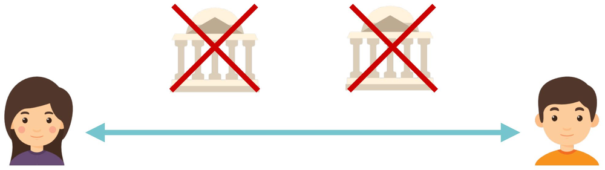
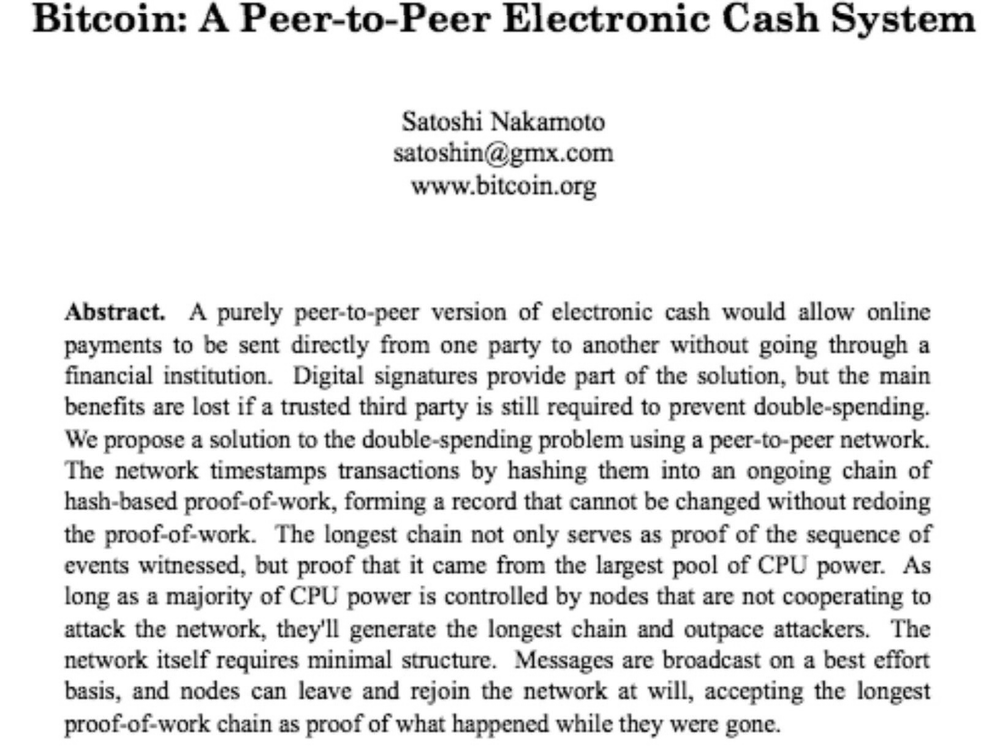
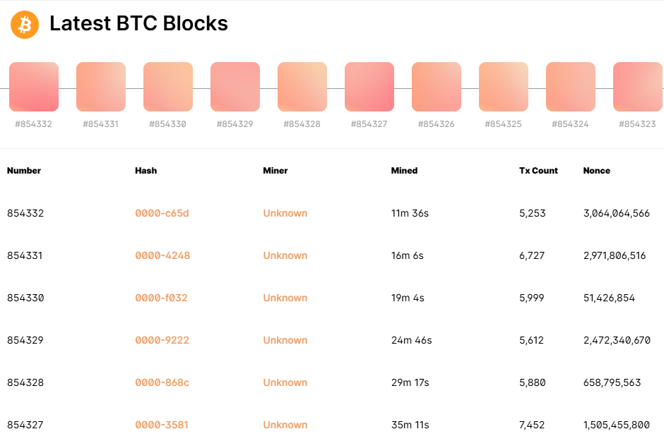
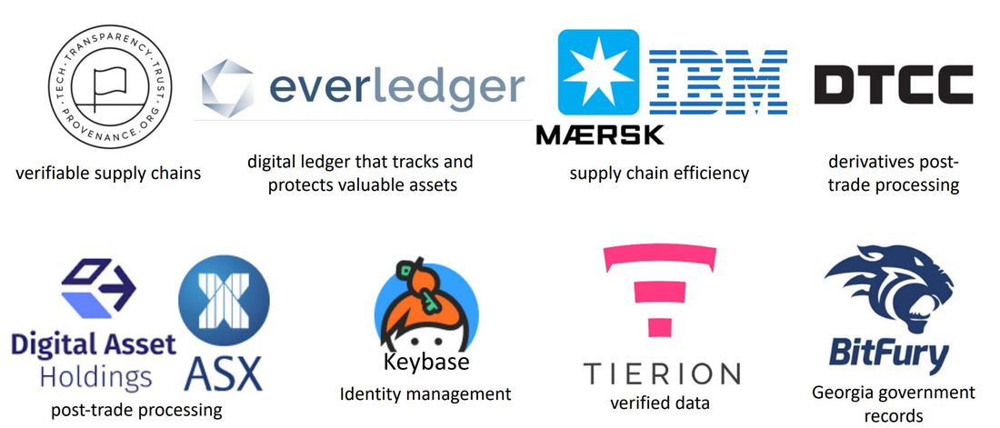

# CSIT953 考试复习 · 第 7 章 区块链与智能合约

> 🎯 **考纲** — *Blockchain and Smart Contracts — Ledgers, consensus mechanisms, Ethereum transactions and oracles.*
>
> 可能的题型：单选题考区块链的定义、双花、三类共识机制的区别、拜占庭将军问题里的 1/3、交易 nonce 和 gas 的作用、EOA 与合约账户、预言机能证明什么；填空题考术语和数字（append-only ledger、double-spending、proof of work、proof of stake、21,000 gas、20 字节地址、oracle）；简答题考共识为什么难、工作量证明带来什么、gas limit 和 max fee per gas 的区别、合约为什么需要预言机；问答题可能给一次跨链桥或预言机事故让你按层分析，或者让你设计一份保险、供应链合约，说明哪些条件来自链外、怎样防操纵。

> 📚 **来源** — slides：W2 S1–S47；W3 S39–S59。录音：W2 录音（S1–S35）；W3 录音开头约 5.9k 字符（W2 S36–S46）；W3 录音结尾（S40–S41）；W4 录音前约 10.3k 字符（W3 S41–S58，其中 S53、S55–S58 只提了一句）。实验：Lab 1（用 web3 构造、签名、发送交易）、Lab 2（ERC-20 代币合约）。本章引用：区块的哈希链接与工作量证明谜题（第 1 章 §3.2、§4），私钥、地址与签名（第 8 章）。

银行的账本由银行一家记，客户信任银行。几家互不信任的公司，或者全世界的陌生人，要共用一份账本，又不想让任何一方说了算，账该谁来记？区块链的回答是：大家各存一份，用同样的规则检查每一笔更新，再用共识机制决定哪一份历史算数。

§1–§3 讲账本和交易怎样上链；§4–§5 讲共识为什么难、三类共识机制怎样做；§6–§8 讲 Ethereum 的账户、交易和智能合约；§9 讲预言机；§10 讨论什么场合值得用区块链；§11–§12 讲安全：五层威胁模型和合约的生命周期。

## 1. 一份没有管理员的共享账本 (W2 S6–S10, S14, S23)

**区块链**（blockchain）是一份共享的、只能追加的账本（append-only ledger），由多个节点按共同的验证规则维护。它有三个特征：

- 多副本（replicated）：许多节点各存一份完整的账本。
- 链接（linked）：每个区块记着前一个区块的哈希，改动旧记录会被发现（第 1 章 §3.2）。
- 共识（agreed）：共识机制决定哪一段历史被接受。

拿它和公司里的多副本数据库比较。公司也会把数据库复制好几份，但只有一个管理员，由管理员决定表结构、谁能访问、哪一份是权威版本。区块链没有这样的管理员：节点彼此独立，各自验证每一个提议的更新，再通过共识决定跟随哪一段历史。

账本要做两件事：记录交易，保护历史。只记录不保护，余额就能被改写；只保护却没有公认的记录，各节点会留下不同版本的"事实"。哈希链接和签名负责保护，共识负责让大家记成同一份。它们保护的是完整性，不保证可用性：用户未必随时能提交交易、读到数据。



传统的付款要经过银行或 PayPal 这样的平台。区块链上的用户把交易直接广播给全网，由节点验证（图 1）。"直接"不是说基础设施消失了，而是没有哪一家机构必须批准每一笔付款。多数用户其实仍然依赖钱包服务商和交易所，攻击者也常常绕开共识，去攻击这些更容易下手的服务（§11）。

公开账本（public ledger）让许多用户共享同一份记录，副本之间不靠中间人也能保持同步，任何人都能验证历史。"公开可验证"指谁都能检查规则有没有被遵守，不是说账本里的每一条都是真的（§9.2）。

**去中心化**（decentralization）把决定权从一个中心机构分散出去。它减少了单点故障，代价是协调成本和更复杂的安全假设：节点可能离线、延迟甚至作恶，交易却仍要处理。去中心化有好几个维度：谁运行节点，谁出块，谁开发软件，谁掌握治理，用户从哪里接入。一个系统可能出块很分散，大家用的却是同一款客户端软件。去中心化计算（decentralized computing）则指把硬件和软件资源分配到各个工作站上，点对点网络和文件共享应用都是例子。

> ✍️ **English answer** — A blockchain is a shared, append-only ledger maintained by multiple nodes under common validation rules. It is replicated (many nodes keep a copy), linked (each block stores the hash of the previous block, so changes to history are detected) and agreed (a consensus mechanism selects the accepted history). Unlike a replicated database with one administrator, no single party decides which version is authoritative, and no single institution must approve every payment. Decentralisation reduces single points of failure but adds coordination costs and more complex security assumptions; hash links and signatures protect integrity but do not guarantee availability.

## 2. Bitcoin：没有银行，怎样防止双花 (W2 S17–S22)

**加密货币**（cryptocurrency）是一种数字资产，用密码学授权使用，由网络维护状态。货币的本义是交换媒介。加密货币是个统称，包括支撑自己网络的原生币（BTC、ETH）、由智能合约发行的代币（token，§8 的 Lab 2）、锚定另一种资产的稳定币（stablecoin，1 USDT 约等于 1 美元），以及带投票权的治理代币。

网上现金有几条要求：防止双花，付款双方匿名，能离线使用，自由浮动并有真实价值，最好去中心化。最核心的是第一条。**双花**（double-spending）指同一笔数字资产被花两次。数字数据可以随意复制，持有者可以把同一笔钱同时付给两个人。银行的办法是把所有交易放进同一个数据库，按先后顺序处理，余额不够的第二笔直接拒绝。没有银行，网络就必须自己商定一个顺序。

数字签名解决不了这个问题。签名只证明持有私钥的人批准了这笔付款（第 8 章），不证明这笔钱还没花过。两笔互相冲突的付款可以都带着有效签名，网络仍需要一条规则决定接受哪一段历史，这就是共识（§4）。

| | 银行 | Bitcoin |
|---|---|---|
| 谁控制 | 中心机构 | 网络的规则 |
| 费用 | 按标准收费 | 通常更低 |
| 课件的评价 | 容易出现欺诈 | 安全性更高 |
| 出了错怎么办 | 可以冻结账户、撤销转账，核实身份后恢复访问 | 交易难以撤销，私钥丢了资金就永久找不回 |

最后一行最值得记住。Bitcoin 减少了对单一机构的依赖，却把更多责任交给了用户：保护私钥，核对交易。银行账户被盗刷还能调查、追回；链上的转账一旦确认，几乎无法撤销。



2008 年，Satoshi Nakamoto 发表了 8 页的 Bitcoin 白皮书（图 2）。摘要指出：签名只解决了一部分问题，如果还要可信的第三方防双花，就失去了意义。方案是让点对点网络把交易哈希进一条不断延长的工作量证明链，相当于给交易盖时间戳；要改记录，就得重做工作量证明。最长的链既证明了事件的顺序，也证明它来自最大的算力池；只要多数算力在诚实节点手里，诚实节点就能跑赢攻击者。白皮书用到的哈希、签名、拜占庭容错和点对点网络早就有了，它的贡献是把这些组件和经济激励组合起来。

Bitcoin 不是实物硬币。这个词指三样东西：资产 BTC，节点组成的网络，节点执行的软件规则。2010 年 5 月 22 日，有人用 10,000 BTC（当时约 40 美元）买了两个比萨，这是 Bitcoin 第一次买到真实的商品：货币光有正确的代码不够，还要有人接受。

> ✍️ **English answer** — Double-spending means spending the same digital asset twice, for example by sending two conflicting payments to two recipients. A bank prevents it by ordering all transactions in one database; Bitcoin has no bank, so the network itself must agree on one order of transactions. Digital signatures prove that the key holder authorised a payment, but not that the funds are still unspent, so two conflicting payments can both be validly signed. The Bitcoin white paper (Satoshi Nakamoto, 2008) solved this with a peer-to-peer network that timestamps transactions into a hash chain of proof of work, where the longest chain is the accepted history. The trade-off is that users carry more responsibility: confirmed transactions are hard to reverse and a lost private key cannot be recovered.

## 3. 一笔交易怎样上链 (W2 S12–S13, S24)

以"从地址 A 转 1 BTC 给地址 B"为例：

1. 钱包构造交易。账本是公开的，谁都看得到 A 的余额，也都能写出这样一条消息，但只有持有 A 的私钥的人能为它签名。没有有效签名的交易，节点一律拒绝。
2. 签好的交易广播到全网。
3. 节点检查签名，也检查花费条件（spending conditions）：A 的余额够不够，这笔钱有没有花过。
4. 矿工把有效的交易打包进候选区块，区块头里记着前一个区块的哈希。
5. 共识决定接受哪个区块。之后接上的区块越多，这笔交易被改写的可能越小。



图 3 是区块浏览器 `blockchain.com` 上的真实数据。每一行是一个区块：Number 是区块高度，即它在链上的位置；Mined 是出块后过了多久；Tx Count 是交易笔数；Nonce 是矿工找到的那个数。所有哈希都以 0000 开头，这是工作量证明的痕迹：只有哈希小于目标值的区块才有效（第 1 章 §4）。

> 📎 **拓展（超出 slides）** — Bitcoin 平均约 10 分钟出一个块，每 2016 个区块（约两周）按实际速度调整一次难度。区块容量有限，交易多时要排队，出价高的先被打包。

只改最新的区块行不行？改自己那份账本可以，但其他节点只跟随累计工作量最大的链，你的版本没人接受。要让全网接受，就得比其余节点加起来算得更快，也就是掌握超过一半的算力（§5.1 的 51% 攻击）。

> ✍️ **English answer** — The sender's wallet constructs a transaction and signs it with the private key of the sending address; anyone can write a transaction, but only the key holder can produce a valid signature. The signed transaction is broadcast to the network, and nodes check the signature and the spending conditions, such as whether the balance is sufficient and the funds are unspent. Valid transactions are grouped into a block that stores the hash of the previous block, and consensus selects the accepted chain. Each later block increases confidence that the transaction will not be reversed.

## 4. 分布式共识为什么难 (W2 S25–S31)

### 4.1 要商定什么

**分布式共识**（distributed consensus）的设定是：有 n 个节点，每个节点有一个输入值，其中一些节点会出故障或作恶。一个共识协议要满足：协议会结束，所有诚实节点对同一个值达成一致；这个值必须是某个诚实节点提出的。归纳成三个性质：一致（agreement）、有效（validity）、终止（termination）。

放到 Bitcoin 里，要商定的是：哪些有效交易被广播过，按什么顺序发生，结果是一段共同的交易历史。顺序很要紧：一个账户有 10 个币，同时广播两笔各付 10 个币的交易，每一笔单看都没问题，但只有先被接受的那笔能成功。所以区块链要协调整段历史，不只是逐笔检查签名。

任何时刻，每个节点都有一条已达成共识的区块链，和一个交易池：听说了、还没进链的交易。消息到达的时间不同，各节点的交易池略有差别。共识决定下一批进链的是哪些交易。

### 4.2 难在哪里

- 节点可能崩溃，也可能作恶。
- 点对点网络并不完美：不是每两个节点之间都有连接，链路会出故障，消息有延迟。
- 没有全局时钟。一个节点迟迟不回应，其他节点分不清它是慢了还是死了，所以有些共识算法无法保证一定能推进。

这里有两个要求互相拉扯：不能出现两段冲突却都被接受的历史（安全性，safety），系统又要能继续推进（活性，liveness）。设想网络断成两半：两边都继续确认新区块，就会出现两段冲突的历史；暂停一边或两边，安全性保住了，推进却停了。

理论上还有不可能性结果：

- **拜占庭将军问题**（Byzantine generals problem）：叛徒达到三分之一或更多，共识就不可能达成。
- **FLP 不可能性**（Fischer–Lynch–Paterson）：在一定条件下，即使只有一个节点出故障，确定性的节点也无法保证达成共识。

> 📎 **拓展（超出 slides）** — 拜占庭将军问题的直观例子：三位将军靠信使传话，其中一位是叛徒。司令下令"进攻"，叛徒副将却转告另一位副将"司令说撤退"。收到矛盾消息的那位分不清是谁在撒谎。三人中一个叛徒，正好是三分之一。FLP 讲的是异步网络：消息延迟没有上限，节点分不清对方是崩溃了还是慢，确定性的协议可能永远等下去。

这些结果并不是说共识永远做不成，而是说没有哪个协议能在任何条件下保证所有性质。实际的协议都加了假设：诚实的一方占多数（算力或押金），网络最终会恢复，攻击者的资源有限。

### 4.3 Bitcoin：理论遇上实践

Bitcoin 用工作量证明让改写历史在经济上不划算。一笔交易后面接上的区块越多，改写它的代价越大，所以确认数越多越放心。它的最终确定性是概率性的，没有一个时刻能宣布"绝对不会再变"。**区块链的安全是概率性的，并且依赖假设**。

> ✍️ **English answer** — Distributed consensus requires all honest nodes to agree on the same value (agreement), the value to be proposed by an honest node and to satisfy the rules (validity), and the protocol to finish (termination). In a blockchain, nodes must agree on which valid transactions occurred and in what order, because the order decides which of two conflicting payments succeeds. Consensus is hard because nodes may crash or be malicious, the peer-to-peer network has faults and latency, and there is no global clock, so a slow node cannot be distinguished from a failed one. The Byzantine generals problem (no consensus with one third or more traitors) and the FLP result show that no protocol guarantees every property under every condition, so practical blockchains rely on assumptions such as an honest majority and offer probabilistic security.

## 5. 三类共识机制 (W2 S32–S35, S39)

谁来提议下一个区块？理想的办法是随机抽一个节点，可开放网络里没有可信的抽签人，节点还能随意伪造身份。所以改按某种谁也垄断不了的资源来抽：按算力是工作量证明，按持有的币是权益证明。参与者已知的许可链可以直接投票。

| | 工作量证明 PoW | 权益证明 PoS | BFT 式投票 |
|---|---|---|---|
| 典型系统 | Bitcoin | Ethereum | 许可链（permissioned network） |
| 怎样决定出块 | 比算力，先解出哈希谜题者出块 | 验证者锁定 ETH 作押金，提议者出块，其他验证者投票证明 | 已知的验证者投票 |
| 特点 | 开放参与 | 经济惩罚 | 很快就最终确定 |

### 5.1 工作量证明与 51% 攻击

**工作量证明**（proof of work, PoW）要求出块者找到一个 nonce，使区块哈希小于目标值（第 1 章 §4）。它带来三点：任何人都能参与竞争；出块的开销很大，别人验证的开销却很小，算一次哈希就够；不需要协调人指定出块者。代价是耗电和专用硬件，今天用普通显卡已经挖不到 Bitcoin。

这些计算本身没有用处，它们的作用是制造一笔公开可验证的成本。耗掉的电可以看成安全预算：攻击者想改写历史，必须拿出相当的算力，还要放弃诚实挖矿能得到的奖励。

```svg 图 4 · 51% 攻击：攻击者改了区块 100 里的一笔交易，必须从这里起重做每个区块的工作量证明，还要追上并超过诚实链
<svg viewBox="0 0 640 260">
  <defs>
    <marker id="g" viewBox="0 0 10 10" refX="9" refY="5" markerWidth="7" markerHeight="7" orient="auto"><path d="M0,0 L10,5 L0,10 z" class="solid-good"/></marker>
    <marker id="w" viewBox="0 0 10 10" refX="9" refY="5" markerWidth="7" markerHeight="7" orient="auto"><path d="M0,0 L10,5 L0,10 z" class="solid-warn"/></marker>
  </defs>
  <text x="20" y="30" class="good">诚实链：全网大部分算力在延长它</text>
  <rect x="20" y="44" width="84" height="44" rx="6" class="good fill-good" stroke-width="1.5"/>
  <text x="62" y="71" text-anchor="middle">区块 99</text>
  <rect x="134" y="44" width="84" height="44" rx="6" class="good fill-good" stroke-width="1.5"/>
  <text x="176" y="71" text-anchor="middle">区块 100</text>
  <rect x="248" y="44" width="84" height="44" rx="6" class="good fill-good" stroke-width="1.5"/>
  <text x="290" y="71" text-anchor="middle">区块 101</text>
  <rect x="362" y="44" width="84" height="44" rx="6" class="good fill-good" stroke-width="1.5"/>
  <text x="404" y="71" text-anchor="middle">区块 102</text>
  <rect x="476" y="44" width="84" height="44" rx="6" class="good fill-good" stroke-width="1.5"/>
  <text x="518" y="71" text-anchor="middle">区块 103</text>
  <text x="574" y="71" class="good">…</text>
  <line x1="133" y1="66" x2="106" y2="66" class="good" stroke-width="1.5" marker-end="url(#g)"/>
  <line x1="247" y1="66" x2="220" y2="66" class="good" stroke-width="1.5" marker-end="url(#g)"/>
  <line x1="361" y1="66" x2="334" y2="66" class="good" stroke-width="1.5" marker-end="url(#g)"/>
  <line x1="475" y1="66" x2="448" y2="66" class="good" stroke-width="1.5" marker-end="url(#g)"/>
  <rect x="134" y="160" width="84" height="44" rx="6" class="warn fill-warn" stroke-width="1.5"/>
  <text x="176" y="187" text-anchor="middle">区块 100′</text>
  <rect x="248" y="160" width="84" height="44" rx="6" class="warn fill-warn" stroke-width="1.5"/>
  <text x="290" y="187" text-anchor="middle">区块 101′</text>
  <rect x="362" y="160" width="84" height="44" rx="6" class="warn fill-warn" stroke-width="1.5"/>
  <text x="404" y="187" text-anchor="middle">区块 102′</text>
  <line x1="150" y1="159" x2="98" y2="91" class="warn" stroke-width="1.5" marker-end="url(#w)"/>
  <line x1="247" y1="182" x2="220" y2="182" class="warn" stroke-width="1.5" marker-end="url(#w)"/>
  <line x1="361" y1="182" x2="334" y2="182" class="warn" stroke-width="1.5" marker-end="url(#w)"/>
  <text x="176" y="228" text-anchor="middle" class="warn">改了一笔交易</text>
  <text x="462" y="178" class="warn">攻击者的分叉</text>
  <text x="462" y="198" class="warn">落后 1 个区块</text>
  <text x="20" y="252" class="muted">箭头：每个区块记着前一个区块的哈希。节点跟随累计工作量最大的链。</text>
</svg>
```

图 4 里，攻击者想撤销自己在区块 100 里的一笔付款，就得造一个新的区块 100′，再接上 101′、102′……每个都要重做工作量证明，同时诚实节点还在延长原来的链。节点只跟随累计工作量最大的链，攻击者必须追上并超过它。算力不到一半，只会越落越远，交易后面的区块越多，追上的可能越小；算力超过一半，迟早能追上。这就是 **51% 攻击**（51% attack）。

> 📎 **拓展（超出 slides）** — 51% 攻击者能做什么、不能做什么：能撤销自己最近的付款，实现双花；能拒绝把别人的交易打包。不能花别人地址上的钱，因为造不出别人的签名；也不能凭空多发币，因为违反规则的区块会被诚实节点直接拒绝。

### 5.2 权益证明

**权益证明**（proof of stake, PoS）按锁定的价值选人。Ethereum 的做法是：验证者（validator）锁定 ETH 作为押金（stake）；一个提议者提出区块，其他验证者为它投票证明（attest）。行为正确有奖励，作恶或长时间离线要受罚。**最终确定性**（finality）让人确信已接受的区块不会再变。PoS 省掉了工作量证明的大量计算，但同样依赖经济和网络假设。

> 📎 **拓展（超出 slides）** — Ethereum 起初也用工作量证明，2022 年改为权益证明。验证者要锁定 32 ETH；为两个冲突区块都投票的验证者，会被罚没一部分押金（slashing）。得到三分之二押金投票的检查点即最终确定。

### 5.3 BFT 式投票

许可链（permissioned network，也叫私有链）只让选定的参与者加入，比如只在一所大学内部使用的链。参与者身份已知，就不必比算力、比押金，已知的验证者直接投票。票数够了，区块立刻最终确定，不用像 Bitcoin 那样等确认数。

> 📎 **拓展（超出 slides）** — 这类协议通常能容忍 3f+1 个验证者里有 f 个作恶，也就是不到三分之一，和拜占庭将军问题的界限一致。

> ✍️ **English answer** — Proof of work (Bitcoin) selects the block proposer in proportion to computing power: miners compete to solve a hash puzzle, which is costly to produce but cheap for everyone to verify, and no coordinator is needed; the trade-off is energy use and specialised hardware. Nodes follow the chain with the most accumulated work, so rewriting a block means redoing its work and that of every later block and overtaking the honest chain, which needs more than half of the computing power (a 51% attack); more confirmations therefore give more confidence. Proof of stake (Ethereum) selects validators who lock ETH as stake: a proposer suggests a block and other validators attest to it, rewards encourage correct participation, penalties punish dishonest or unavailable validators, and finality gives confidence that accepted blocks will not change. Permissioned networks use BFT-style voting among known validators, which gives fast finality.

## 6. Ethereum：可编程的共享状态 (W2 S36–S38, S46)

Bitcoin 和 Ethereum 要解决的问题不同：

| | Bitcoin | Ethereum |
|---|---|---|
| 目标 | 数字货币 | 可编程的共享状态 |
| 记账方式 | UTXO 模型，脚本能力有意受限 | 账户模型，加上智能合约 |
| 共识 | 工作量证明 | 权益证明 |

> 📎 **拓展（超出 slides）** — UTXO 即未花费的交易输出（unspent transaction output）。Bitcoin 不记余额：每笔交易消耗之前的输出，再产生新的输出，一个输出只能被消耗一次，双花就是两笔交易争用同一个输出。账户模型直接记余额，同一笔签好的转账本可以反复执行，所以 Ethereum 的交易要带 nonce（§7.1）。

Ethereum 把区块链从一本付款账本扩展成一台全网共享的状态机。账户提交交易，每笔交易都改变全局状态，比如余额和合约里存的数据。ETH 用来支付计算和存储的费用。以太坊虚拟机（Ethereum Virtual Machine, EVM）保证每个验证节点算出同样的新状态。

执行是确定的，不等于执行是正确的。合约里有逻辑错误，每个节点都会一致地执行这个错误。

Ethereum 有两种账户：

| | 外部账户（externally owned account, EOA） | 合约账户（contract account） |
|---|---|---|
| 由谁控制 | 私钥 | 部署的代码 |
| 能否主动发起交易 | 能，用私钥签名 | 不能，只在被调用时按代码执行 |
| 地址 | 20 字节，由公钥派生（第 8 章） | 20 字节，创建合约时分配 |
| 保存什么 | 余额、nonce | 余额、代码、持久状态 |

一笔交易可以转 ETH，也可以调用合约代码。

> ✍️ **English answer** — Ethereum extends the blockchain from a payment ledger into a programmable shared state machine: accounts submit transactions, smart contracts are programs stored and executed on-chain, and the Ethereum Virtual Machine (EVM) makes every validating node compute the same new state; ETH pays for computation and storage. Externally owned accounts (EOAs) are controlled by private keys and can initiate transactions, while contract accounts are controlled by their deployed code and act only when called; both use 20-byte addresses. Deterministic execution does not mean correct execution: a bug in a contract is executed consistently by every node.

## 7. Ethereum 交易的六个字段 (W3 S40–S45; Lab 1)

一笔 Ethereum 交易把六个决定打包成一个签了名的请求：

| 字段 | 决定什么 |
|---|---|
| nonce | 这个账户接下来执行哪一笔 |
| 费用设置 | 发送方愿意为多少计算付钱 |
| 接收方 to | 一个账户、一个合约，或者留空表示创建合约 |
| 金额 value | 转多少 ETH |
| 数据 data | 给合约的指令和参数 |
| 签名 | 哪一把私钥批准了这份请求，一字不差 |

### 7.1 nonce：账户自己的序号

每个外部账户都有一个计数器，就是交易的 **nonce**。新账户从 0 开始，每发出一笔交易加 1；收到的转账不算。下一笔被确认的交易必须用下一个 nonce，同一账户的交易按 nonce 顺序执行。中间缺了一个号，后面的交易只能等着。

nonce 还防重放。签名覆盖了包括 nonce 在内的所有字段。一笔交易确认后，它的 nonce 就用掉了；有人把这份签好的交易原样再广播一次，节点会拒绝。攻击者也改不了 nonce，一改签名就失效。

> 👨‍🏫 **课堂强调** — 一道和 quiz 类似的题：你有一笔 nonce 为 2 的交易还在等待（pending），又发了一笔 nonce 同样是 2 的交易，第一笔给 0.1 ETH 手续费，第二笔给 0.5 ETH。哪一笔会被接受？准确的答案是"不确定"，但两笔里最多只有一笔能被确认。如果要猜，第二笔可能性更大，因为出块者更愿意打包给钱多的交易。

> 📎 **拓展（超出 slides）** — Lab 1 的交易里还有一个字段 chainId = 11155111，表示 Sepolia 测试网。签名同样覆盖它，所以测试网上签的交易拿到主网上重放是无效的。

### 7.2 gas：为计算付费

每个验证节点都要把每笔交易重新执行一遍。如果不计量，任何人都能提交一个死循环，让全网白白陪着算下去。**gas** 就是计算量的单位：每种操作都有固定的 gas 消耗，一笔普通的 ETH 转账通常用 21,000 gas，执行合约可能多得多。gas 衡量的是工作量，不是货币，也不是转账金额。

费用设置包括三个数，回答的是不同的问题：

- gas limit：这笔交易最多可以消耗多少工作量。
- 每单位 gas 的最高费用（maximum fee per gas）：发送方愿意付的价格上限。
- 优先费（priority fee）：额外给出块者的小费，激励它打包这笔交易。

实际费用 = 实际消耗的 gas × 有效 gas 价格。没用完的 gas 不收费。如果执行到一半 gas 耗尽，所有状态改动都会回滚，但已经做的工作照样要付钱。

> 🔑 **例** — 一笔普通转账，gas limit 设为 30,000，实际消耗 21,000。有效 gas 价格是 20 gwei，费用 = 21,000 × 20 gwei = 420,000 gwei = 0.00042 ETH。剩下的 9,000 gas 不收费。

> 📎 **拓展（超出 slides）** — 1 gwei = $10^{-9}$ ETH。有效 gas 价格 = 基础费 + 优先费，但不超过发送方设的最高费用。基础费由网络的拥堵程度决定，付出去就销毁了。Lab 1 用的是旧式写法：只给一个 gasPrice，用 `estimate_gas` 估出 gas limit。

### 7.3 to、value、data：同一个信封，不同的动作

付款和合约调用用的是同一种交易格式：

| | 付款 | 调用合约 | 创建合约 |
|---|---|---|---|
| to | 一个账户 | 合约地址 | 留空 |
| value | 大于 0 | 可以是 0 | 通常是 0 |
| data | 通常为空 | 选中一个函数，附上参数 | 合约的部署字节码 |

三种交易都要 nonce、费用设置和签名，都要经过验证、排序、执行、记录。**安全上的差别主要在于 data 能触发什么**。调用合约时可以一个 ETH 都不转，状态却照样改变：Lab 2 里转代币，value 是 0，data 是对 `transfer` 函数的调用，改的是合约里记录余额的那张表（§8）。

> 👨‍🏫 **课堂强调** — 能给自己转账吗？能，只是毫无意义，还白付 gas。付款时 value 能设成 0 吗？也能，交易照样有效，同样要付 gas。

### 7.4 在 Lab 1 的代码里看这些字段

Lab 1 用 web3.py 在 Sepolia 测试网上发一笔转账，主体是这几行：

```python
transaction_params = {
    'to': recipient_address,
    'value': w3.to_wei(0.03, 'ether'),            # 以 wei 为单位，1 ETH = 10^18 wei
    'data': b'...',                               # 付款也可以附带任意数据
    'nonce': w3.eth.get_transaction_count(sender.address),
    'chainId': 11155111,                          # Sepolia
}
transaction_params.update({'gas': w3.eth.estimate_gas(transaction_params),
                           'gasPrice': w3.eth.gas_price})
signed = w3.eth.account.sign_transaction(transaction_params, private_key)
tx_hash = w3.eth.send_raw_transaction(signed.raw_transaction)
```

nonce 取自链上，等于该地址已发出的交易数。签名在本地完成，私钥不离开这台电脑，公共节点只收到签好的原始交易。返回的交易哈希可以在区块浏览器上查：先是 pending，打包后显示确认数。Lab 1 把私钥明文存在 `key.json` 里，只适合测试网（第 8 章 §2）。

> ✍️ **English answer** — An Ethereum transaction carries a nonce, fee settings, a recipient, a value, data and a signature over all of them. The nonce is a per-account sequence number: transactions from one account execute in nonce order, a missing nonce makes later ones wait, and a signed transaction cannot be replayed because its nonce has already been used. Gas measures the work a transaction requests (a simple transfer commonly uses 21,000 gas) and prevents unbounded computation on every node; the gas limit caps the work, the maximum fee per gas caps the price, and the priority fee rewards the block producer. Actual fee = gas used × effective gas price; unused gas is not charged, but if execution runs out of gas the state changes are reverted and the sender still pays. Payments, contract calls and contract creation share one envelope; the security difference lies mainly in what the data can trigger.

## 8. 智能合约 (W3 S46–S50; W2 S38; Lab 2)

**智能合约**（smart contract）是存放在某个地址上的代码和持久状态。它通过交易接受调用，读取输入和当前的链上状态，按确定的规则执行，然后更新状态、转移资产或者发出事件（event）。每个验证节点都能重现同样的结果。合约还可以创建别的合约。

| 组成 | 作用 |
|---|---|
| 代码 code | 规定有哪些规则和函数 |
| 状态 state | 记录余额、所有权、投票、配置 |
| 调用者 callers | 提供输入，行使权限 |
| 事件 events | 留下可以检索的执行记录 |
| 升级 upgrades | 如果允许升级，就多了一种权力：谁掌握升级，谁就能换掉规则 |

最简单的合约就是一条 if–then 规则：

- 如果（IF）某个有效条件成立，
- 并且（AND）调用者有相应的权限，
- 那么（THEN）更新状态或转移资产，
- 否则（OTHERWISE）拒绝或等待。

难的是把"有效条件"定义准确。

Lab 2 发行的 ERC-20 代币就是一个合约。它的 `transfer` 函数正好是这条规则：

```solidity
function transfer(address to, uint256 tokens) public override returns (bool) {
    require(to != address(0), "zero address");                      // IF：条件有效
    require(balances[msg.sender] >= tokens, "insufficient balance"); // AND：只能动自己的余额
    balances[msg.sender] -= tokens;                                  // THEN：更新状态
    balances[to] += tokens;
    emit Transfer(msg.sender, to, tokens);                           // 事件
    return true;
}
```

`msg.sender` 是调用者，谁调用就只能转谁的余额。`require` 不满足，整笔交易回滚，这就是 OTHERWISE 那一支。代币从没离开过合约，"转账"只是改了 `balances` 这张表。构造函数在部署时把 1 亿枚代币全记在部署者名下；`approve` 和 `transferFrom` 允许第三方在额度内代你转账。

部署合约就是发一笔创建合约的交易：Remix 把 Solidity 编译成字节码，MetaMask 显示交易并签名，to 留空，data 是字节码。确认后合约得到自己的地址，在 MetaMask 里按这个地址导入代币，就能看到余额。

> ✍️ **English answer** — A smart contract is code and persistent state stored at an address. It is triggered by transactions, reads its inputs and the current blockchain state, applies deterministic rules, and then updates state, transfers assets or emits events, so every validating node can reproduce the result. The simplest contract is an if–then rule: if a valid condition becomes true and the caller has the required authority, then update state or transfer an asset; otherwise reject or wait. Defining the valid condition precisely is the hard part. In the Lab 2 ERC-20 token, `transfer` checks the recipient and the caller's balance with `require`, updates the balances mapping and emits a Transfer event; if upgrades are allowed, whoever controls them can replace the rules.

## 9. 预言机：合约看不到链外的世界 (W3 S49, S51–S52, S56; W2 S16, S42–S43)

### 9.1 为什么需要预言机

每个节点都必须重现同样的结果。假如合约能直接访问天气网站，节点在不同时间访问，可能拿到不同的答案，就没法对新状态达成一致。所以合约不能自己访问网站、查看天气、读取传感器。

**预言机**（oracle）把链外的事实作为交易提交上链。上了链，每个节点读到的就是同一份记录。合约要用的条件因此分两类：

| | 内部条件 | 外部条件 |
|---|---|---|
| 例子 | 余额、所有权、区块数据、合约状态 | 价格、天气、身份声明、交货事件 |
| 怎样进入合约 | 由共识重现 | 经预言机或授权的提交者提交 |
| 风险 | 由共识保证一致 | 每个外部依赖都要考虑失效和被操纵 |

### 9.2 合约能核对什么

```svg 图 5 · 预言机站在链下和链上的边界：合约能核对签名和格式，核对不了事实本身
<svg viewBox="0 0 640 372">
  <defs>
    <marker id="k" viewBox="0 0 10 10" refX="9" refY="5" markerWidth="7" markerHeight="7" orient="auto"><path d="M0,0 L10,5 L0,10 z" class="solid-ink"/></marker>
  </defs>
  <rect x="20" y="40" width="290" height="290" rx="10" class="muted dashed" fill="none" stroke-width="1.5"/>
  <text x="165" y="28" text-anchor="middle" class="muted">链下</text>
  <rect x="390" y="190" width="230" height="172" rx="10" class="muted dashed" fill="none" stroke-width="1.5"/>
  <text x="505" y="178" text-anchor="middle" class="muted">链上</text>
  <rect x="45" y="60" width="240" height="50" rx="6" class="ink" fill="none" stroke-width="1.5"/>
  <text x="165" y="90" text-anchor="middle">真实世界：今天下了多少雨</text>
  <rect x="45" y="140" width="240" height="50" rx="6" class="ink" fill="none" stroke-width="1.5"/>
  <text x="165" y="170" text-anchor="middle">数据源：气象站、网站</text>
  <rect x="45" y="220" width="240" height="50" rx="6" class="warn fill-warn" stroke-width="2"/>
  <text x="165" y="250" text-anchor="middle">预言机：签名后提交上链</text>
  <line x1="165" y1="110" x2="165" y2="138" class="ink" stroke-width="1.5" marker-end="url(#k)"/>
  <text x="177" y="130" class="warn">测量可能出错</text>
  <line x1="165" y1="190" x2="165" y2="218" class="ink" stroke-width="1.5" marker-end="url(#k)"/>
  <text x="165" y="300" text-anchor="middle" class="warn">预言机可能被攻破或被操纵</text>
  <rect x="405" y="220" width="200" height="50" rx="6" class="accent fill-soft" stroke-width="2"/>
  <text x="505" y="250" text-anchor="middle">保险合约：核对签名和格式</text>
  <rect x="405" y="300" width="200" height="50" rx="6" class="good fill-good" stroke-width="2"/>
  <text x="505" y="330" text-anchor="middle">条件成立，自动赔付</text>
  <line x1="285" y1="245" x2="403" y2="245" class="ink" stroke-width="1.5" marker-end="url(#k)"/>
  <text x="350" y="236" text-anchor="middle" class="muted">一笔交易</text>
  <line x1="505" y1="270" x2="505" y2="298" class="ink" stroke-width="1.5" marker-end="url(#k)"/>
</svg>
```

图 5 是一份按降雨量赔付的农业保险。合约能检查的只有两样：数据的格式对不对，是不是由授权的预言机签名提交的。至于今天是否真的少雨、气象站有没有坏、预言机有没有撒谎，合约无从知道。**链上记录的是提交上来的数据，不是物理事实**。区块链会忠实地保存错误的输入，这就是"垃圾进，垃圾出"（garbage in, garbage out）。预言机一旦被攻破，原本正确的合约代码也会做出错误的事。

供应链也一样（图 6）。几家公司共享一段事件历史，签名标明每条更新是谁提交的，规则可以自动放款、付款或报警。但把实物和记录连起来的仍然是传感器和员工：果园 8 月 5 日摘的苹果，有人在链上写成 8 月 10 日，区块链发现不了。


保险自动化同样依赖可信的证据：保单条款变成机器条件，预言机报告投保事件，合约核对保障范围后自动赔付。拖延和管理成本少了，争议却转移到数据质量、例外情况和预言机治理上：用哪个气象站？气象站停机怎么算？谁有权更换预言机？

### 9.3 价格预言机被操纵

智能合约常见的风险之一是价格预言机被操纵。

> 📎 **拓展（超出 slides）** — 一个借贷合约按某个去中心化交易所的币价给抵押品估值。攻击者借入一大笔资金，在这个交易池里大量买入，把币价暂时推高；再把被高估的币存进借贷合约作抵押，借走别的资产，最后还掉第一笔借款。合约每一行都按设计执行，错在相信了一个能被临时操纵的价格。防御：用多个独立的价格来源，取一段时间的平均价，给价格变化设上限，异常时暂停。

### 9.4 跨链桥

**跨链桥**（bridge）在两条链之间控制资产或传递消息。一条链自己无法验证另一条链上发生了什么，只能依靠桥的合约和验证者来证明。

> 📎 **拓展（超出 slides）** — 常见的跨链桥这样工作：用户在链 A 上把资产锁进桥合约，桥的验证者确认后，在链 B 上铸出等量的包装代币（wrapped token）。链 B 上的代币值多少钱，全看链 A 上锁着的资产还在不在。

跨链桥和预言机都集中了信任。它们一旦被攻破，链上本来正确的逻辑就被绕过了：桥被攻破，链 B 上就会出现没有资产支撑的代币。所以要把它们当作有特权的依赖来对待，限制它们出事时能造成的损失范围（blast radius），比如设额度上限、要求多方签名、持续监控。

> ✍️ **English answer** — A smart contract cannot observe the outside world by itself, because every node must reproduce the same result while websites and sensors may return different answers at different times. An oracle submits external facts, such as prices, weather or delivery events, to the chain. The contract can verify the format and authority of the oracle's data, for example that it is signed by the authorised oracle, but not the physical truth: the blockchain faithfully preserves false input (garbage in, garbage out). An oracle or bridge compromise, or a manipulated price source, can therefore defeat otherwise correct contract code, so oracles and bridges should be treated as privileged dependencies, using multiple independent sources, sanity checks and limits on the possible loss.

## 10. 什么时候值得用区块链 (W3 S53; W2 S14–S16)



图 7 列了一些应用。课件给出的判断标准是五条，都满足才值得用：

1. 几方需要一份共同的状态。
2. 不应由任何一方控制所有更新。
3. 规则能被一致地表达和验证。
4. 共享执行带来的价值超过它的成本和复杂度。
5. 外部信任和隐私要求仍在可控范围内。

反过来检验：如果大家已经信任同一个管理员，普通数据库更简单。我们信任银行，把工资存进去，就没有必要把银行改成去中心化的。即使场景合适，链也只保护写入之后的数据，输入是否真实仍要另外保证（§9.2）。

> 📎 **拓展（超出 slides）** — 第 4 条常常决定项目的成败。图 7 里有两个项目后来停了：Maersk 和 IBM 的航运平台 TradeLens 因为参与的行业伙伴不够，2022 年宣布关闭；澳大利亚证券交易所（ASX）用分布式账本替换结算系统 CHESS 的项目，同年宣布放弃，核销了约 2.5 亿澳元。

> ✍️ **English answer** — A blockchain is worth its cost when several parties need a common state, no single party should control every update, the rules can be expressed and verified consistently, the value of shared execution exceeds its cost and complexity, and external trust and privacy requirements remain manageable. If all participants already trust one administrator, a conventional database is simpler. Even in a good use case, the chain only protects data after it is written; the truth of the input must be ensured separately.

## 11. 安全：五层威胁模型 (W2 S2–S4, S40–S45)

### 11.1 为什么仍是新课题

区块链的热度降了，安全风险却没有降。它把密码学、分布式系统、软件和经济激励揉在一起，攻击者可以攻击用户、代码、基础设施或共识；失败会直接搬走真实资产，通常无法撤销；技术、监管和防御手段都还在变。

2024 年美国批准了现货 Bitcoin ETP，稳定币仍是支付和结算的重要试验；同年 FBI 的互联网犯罪投诉中心（IC3）收到 149,686 起与加密货币有关的投诉，报告损失 93 亿美元，比上一年增加 66%。生态越大，目标越值钱；一家交易所、稳定币发行方或跨链桥出事，连没用过它的用户也会受影响。

### 11.2 五层

| 层 | 典型的失败 |
|---|---|
| 用户与密钥 | 钓鱼、恶意软件、密钥丢失、恢复设计差（第 8 章） |
| 应用 | 合约逻辑错误、访问控制缺陷 |
| 协议 | 共识、激励机制、升级治理 |
| 基础设施 | 节点、网络、API、终端 |
| 依赖 | 跨链桥、预言机、托管方、稳定币发行方 |

一次事故常常跨越好几层。

**一笔交易有效，不等于它无害**。例如用户被钓鱼网站骗着签了一条看似无害的消息，实际上授权了转出 1000 USDT。签名有效，共识照常接受，资金经跨链桥转走。每一步密码学都工作正常，结果却是用户损失了钱。

### 11.3 智能合约放大软件风险

合约面对的是熟悉的软件问题，再加上区块链特有的风险：

- 访问控制缺陷。例如给 Lab 2 的代币加一个 `mint` 函数，却忘了限制只有所有者能调用，任何人都能给自己印钱。
- 价格预言机被操纵（§9.3）。
- 逻辑错误和缺少输入校验。Lab 2 的两行 `require` 就是输入校验。
- 重入和未检查的外部调用。

> 📎 **拓展（超出 slides）** — 重入（reentrancy）：合约先把 ETH 转给调用者，再扣减余额。调用者如果是恶意合约，可以在收款时再次调用取款函数，余额还没扣，于是一次次取出。2016 年 The DAO 因此被取走约 360 万 ETH。改法是先更新状态、再做外部调用，加上防重入锁，并检查外部调用的返回值。

合约的错误比普通软件更难补救：代码公开，谁都能找漏洞；部署后很难修改；资产一被转走就追不回来。防御靠最小权限、测试、独立审查、监控和事先准备好的恢复计划。

### 11.4 分层防御

密码学之外，还要靠分层防御：

| 预防 | 发现与响应 |
|---|---|
| 隔离并分散密钥的权限 | 监控管理操作和异常的资金流 |
| 减少特权和外部信任 | 能快速暂停、隔离损失、对外沟通 |
| 测试不变量，独立审查代码 | 出事之前就设计好升级和恢复流程 |

### 11.5 练习：一次跨链桥事故 (W2 S44)

> 攻击者偷到一把管理员私钥，用它升级了一个跨链桥合约，铸出没有资产支撑的代币，在运营方反应过来之前把它们换成了别的资产。哪一层失败了？什么监测数据能发现？什么措施能限制损失，事后又能追回什么？

| 步骤 | 失败的层 | 能发现它的监测 | 能限制损失的措施 |
|---|---|---|---|
| 管理员私钥被盗 | 用户与密钥 | 管理密钥在陌生设备、陌生时间被使用 | 多签或门限签名，硬件隔离私钥 |
| 用它升级桥合约 | 应用（升级权限集中在一把密钥上） | 合约升级事件，字节码发生变化 | 升级需要多方批准，并设一段延迟期 |
| 铸出无支撑的代币 | 依赖（跨链桥） | 铸造量超过另一条链上锁定的资产，不变量被打破 | 检查不变量，给铸造设上限 |
| 抢在反应前换走 | 发现与响应 | 新铸代币的大额兑换，异常资金流 | 自动暂停，单笔和每日限额 |

共识层没有出错：每一笔交易都有有效签名，都被正确地记录了。事后能做的有限。链上的交易无法回滚；运营方可以暂停跨链桥、把合约升级回去，请交易所和稳定币发行方冻结赃款，并及时公告。已经被换走、转出的资产，多半追不回来。

> ✍️ **English answer** — The attack starts at the user-and-key layer: a single stolen admin key carried enough authority to upgrade the bridge. The application layer failed because upgrade authority was concentrated in one key with no approval or delay, and the dependency layer failed because the bridge minted tokens with no backing on the other chain. Consensus worked correctly: every transaction was validly signed and recorded, which shows that a valid transaction can still be harmful. Telemetry that could detect it includes admin-key use, contract upgrade events and bytecode changes, minted supply exceeding locked collateral, and large or unusual swaps. Losses could be limited by multisig or threshold control of admin keys held in isolated hardware, upgrades that need several approvals and a delay, invariant checks and minting caps, and automatic pausing with rate limits. On-chain transactions cannot be reversed, so recovery is mostly limited to pausing the bridge, rolling back the contract, asking exchanges and stablecoin issuers to freeze stolen funds, and communicating quickly.

## 12. 安全地构建合约：六步生命周期 (W3 S54–S59)

构建一份智能合约分六步，安全问题要在每一步就提出来：

1. **定义协议和资产**。合约能控制哪些资产？谁可以调用每个函数？谁可以暂停、升级或恢复系统？哪些不变量必须始终成立？最坏的可信失败是什么？
2. **区分内部条件和外部条件**（§9.1 的表）。每个外部依赖都要处理失效和被操纵的情况。
3. **把人的语言翻译成精确的机器规则**。人的约定容许上下文和解释，程序要求精确的状态、输入和边界。含糊的词会变成攻击面：合同写"延迟交货就赔付"，延迟多久算延迟？按谁的时钟？谁来报告？例外情况要在部署前设计好；测试要覆盖预期行为，也要覆盖攻击者的调用顺序。
4. **测试、审查、部署**。审查字节码、配置，以及谁有部署权限。
5. **通过签名交易执行**。用户签名发交易来执行规则。
6. **记录、监控、响应、改进**。共识记录结果状态和事件；持续监控密钥、升级、预言机、异常和依赖；事先准备好暂停、沟通、恢复和事后复盘的流程。

课件用一句话收尾：**密钥授权，交易请求，合约执行**（Keys authorise; transactions request; contracts execute）。私钥产生授权，也集中了风险；钱包呈现并保护签名的决定；交易写明请求的确切动作；智能合约执行共享的可编程规则；共识给执行排序并记录结果。

> ✍️ **English answer** — Building a smart contract follows six steps: define the agreement and assets; identify internal and external conditions; translate requirements into precise code; test, review and deploy; execute through signed transactions; and record, monitor, respond and improve. The first step asks who may call each function, who may pause, upgrade or recover the system, which invariants must always hold and what the worst credible failure is. Ambiguous human terms become attack surfaces, so exceptional cases must be designed before deployment, and tests must cover adversarial sequences as well as intended behaviour. In short: keys authorise, transactions request and contracts execute, while consensus orders execution and records the resulting state.

## ⚠️ 易混易错

| 容易混的 | 区别 |
|---|---|
| 区块链 vs 多副本数据库 | 后者有一个管理员决定权威版本；前者由独立节点按共同规则验证，用共识选定历史 |
| 签名 vs 共识 | 签名证明谁授权了交易；共识决定交易的顺序。防双花靠共识 |
| PoW vs PoS vs BFT 投票 | 比算力、开放参与；锁押金、有罚没；已知验证者投票、很快最终确定 |
| 概率性确认 vs 最终确定性 | Bitcoin 的确认越多越放心，但没有绝对确定的一刻；PoS 的 finality 和 BFT 投票给出明确的结论 |
| 交易的 nonce vs 工作量证明的 nonce | 前者是账户的交易序号，防重放、定顺序；后者是矿工为了让区块哈希小于目标值反复更换的数 |
| gas vs ETH | gas 是工作量单位；费用 = 实际消耗的 gas × 有效 gas 价格 |
| gas limit vs max fee per gas | 最多做多少工作 vs 每单位工作最多付多少钱 |
| EOA vs 合约账户 | 私钥控制、能主动发交易 vs 代码控制、只在被调用时执行 |
| 确定性 vs 正确性 | 每个节点算出同样的结果，不代表结果是对的 |
| 公开可验证 vs 内容真实 | 任何人都能验证规则被遵守，验证不了写进来的数据是真的 |
| 预言机能核对的 vs 核对不了的 | 格式和提交者的权限 vs 物理事实 |
| 51% 攻击 vs 偷币 | 能撤销自己的付款、屏蔽别人的交易；不能花别人的钱，不能违规多发币 |

常见误解：

- "上了链的数据就是真的"：链只保证写入后不被篡改。
- "交易有有效签名，就是用户想做的事"：钓鱼和恶意软件可以骗用户签名（第 8 章）。
- "gas 耗尽会退款"：状态回滚，已消耗的 gas 照付。
- "转 0 ETH 的交易什么也没做"：合约调用可以不转 ETH，照样改变状态。
- "合约能直接查天气、查价格"：只能读预言机提交上链的数据。
- "去中心化就没有单点"：跨链桥、预言机、管理员密钥、主流客户端都可能成为单点。
- "什么数据库都该换成区块链"：大家信任同一个管理员时，普通数据库更简单。

## 📝 Practice

### Part A · Multiple choice

**A1.** Which description of a blockchain is most accurate?
A. An encrypted database managed by a single trusted administrator
B. A shared, append-only ledger maintained by multiple nodes under common validation rules
C. A peer-to-peer network that guarantees every recorded fact is true
D. A replicated database in which any node may edit past records

<details>
<summary>Answer A1</summary>

**B.** A blockchain has no single administrator, records are linked so history cannot be quietly edited, and the chain preserves whatever is submitted, true or false.

</details>

**A2.** Why can digital signatures alone NOT prevent double-spending?
A. Any node can forge a signature.
B. A signature proves authorisation but not that the funds are still unspent; two conflicting payments can both be validly signed.
C. Signatures hide the transaction amount.
D. Signatures are too slow to verify.

<details>
<summary>Answer A2</summary>

**B.** Preventing double-spending requires an agreed order of transactions, which is the job of consensus.

</details>

**A3.** According to the Byzantine generals problem, consensus is impossible when:
A. any single message is delayed
B. one third or more of the generals are traitors
C. the generals have no shared clock
D. fewer than half of the generals vote

<details>
<summary>Answer A3</summary>

**B.** The slides state that consensus is impossible to achieve if 1/3 or more generals are traitors.

</details>

**A4.** Which statement about proof of work is TRUE?
A. It is cheap to produce a block and expensive to verify one.
B. It is costly to produce a block but cheap for everyone else to verify it.
C. A coordinator chooses the next block proposer.
D. It is the consensus mechanism Ethereum uses today.

<details>
<summary>Answer A4</summary>

**B.** Finding the nonce takes many hash computations, while checking it takes one. Ethereum now uses proof of stake.

</details>

**A5.** Two transactions from the same account are pending with the same nonce, and the second offers a much higher fee. What happens?
A. Both are confirmed, in the order they were sent.
B. At most one of them can be confirmed; the higher-fee one is more likely, but this is not guaranteed.
C. Both are rejected because nonces must be unique.
D. The first one is always confirmed because it was sent first.

<details>
<summary>Answer A5</summary>

**B.** One nonce can be used only once per account. Block producers usually prefer the transaction that pays more, but nobody can be sure which one will be included.

</details>

**A6.** A contract call runs out of gas halfway through. Which outcome is correct?
A. The completed state changes are kept and no fee is charged.
B. All state changes are reverted, but the sender still pays for the gas consumed.
C. The transaction is retried automatically with a higher gas limit.
D. All state changes are reverted and the fee is refunded.

<details>
<summary>Answer A6</summary>

**B.** The nodes have already done the work, so it is paid for even though the result is discarded.

</details>

**A7.** A crop-insurance contract pays farmers when an oracle reports low rainfall. What can the contract itself verify?
A. That the rainfall really was below the threshold
B. That the weather station was not tampered with
C. That the report is correctly formatted and submitted by the authorised oracle
D. That the oracle operator is honest

<details>
<summary>Answer A7</summary>

**C.** A contract can verify format and authority, not physical truth.

</details>

### Part B · Fill in the blank / short answer

**B1.** A simple ether transfer commonly uses ______ gas. The actual fee equals ______ × ______.

<details>
<summary>Answer B1</summary>

21,000; gas used × effective gas price.

</details>

**B2.** Ethereum has two kinds of accounts: ______, controlled by private keys, and ______, controlled by deployed code. Both use ______-byte addresses.

<details>
<summary>Answer B2</summary>

Externally owned accounts (EOAs); contract accounts; 20.

</details>

**B3.** Give two reasons why distributed consensus is hard.

<details>
<summary>Answer B3</summary>

Any two of: nodes may crash or behave maliciously, for example by sending conflicting information; the peer-to-peer network is imperfect, with missing connections, faults and latency; there is no shared global clock, so a slow node cannot be distinguished from a failed one, which limits which algorithms can guarantee progress. Impossibility results such as the Byzantine generals problem and FLP show that no protocol can guarantee every property under every condition.

</details>

**B4.** What is the difference between the gas limit and the maximum fee per gas?

<details>
<summary>Answer B4</summary>

The gas limit is the maximum amount of work the transaction may consume. The maximum fee per gas is the highest price the sender is willing to pay for each unit of gas. The fee actually charged is the gas used multiplied by the effective gas price, and unused gas is not charged.

</details>

**B5.** Why does a smart contract need an oracle, and what new risk does the oracle introduce?

<details>
<summary>Answer B5</summary>

Every node must reproduce the same result, so a contract cannot query websites or sensors directly; an oracle submits external facts to the chain as transactions. The contract can check the format and the oracle's authority, but not whether the fact is true, so a compromised or manipulated oracle can make otherwise correct contract code pay out wrongly.

</details>

### Part C · Questions and answers

**C1.** A lending protocol on Ethereum values collateral using the token price from a single decentralised-exchange pool. An attacker borrows a large amount of funds, buys heavily in that pool to push the token price up, deposits the overvalued tokens as collateral, borrows other assets against them and repays the first loan, all in quick succession. The protocol's code has no arithmetic bug.
(a) Which layers of the blockchain threat model are involved?
(b) Why could the attack succeed if the code had no bug?
(c) Propose prevention and detection measures.

<details>
<summary>Model answer C1</summary>

(a) The main failure is in the dependency layer: the price oracle, a privileged external input, was manipulated. The application layer is also involved, because the contract's design trusted a single price source that could be moved within a short time and had no sanity limits. The protocol layer worked correctly: every transaction was valid and correctly ordered, which shows that valid transactions can still be harmful.

(b) The contract can verify the format and the authority of its price input, but not whether the price reflects the real market. It applied its rules exactly as written to a manipulated input (garbage in, garbage out). Oracle manipulation can therefore defeat otherwise correct contract code.

(c) Prevention: use several independent price sources and an aggregated or time-averaged price instead of one pool's spot price; reject prices that move too far from a reference or too quickly; cap the amount that can be borrowed against one asset; apply least privilege and independent review to the oracle design. Detection and response: monitor price deviations between sources, unusually large trades and borrows, and sudden changes in collateral value; be able to pause borrowing automatically; prepare recovery and communication plans in advance, because confirmed transactions cannot be reversed.

**Marking points:** dependency (oracle) layer identified (1); application design trusting one manipulable source (1); contract checks format and authority, not truth (1); multiple independent sources or time-averaged prices (1); bounds or caps on price changes and borrowing (1); monitoring with a pause mechanism (1).

</details>

**C2.** A food distributor wants a smart contract that automatically pays a supplier when a shipment arrives at its warehouse in good condition.
(a) Identify the internal and external conditions in this contract.
(b) Explain the oracle problem in this design and how an attacker or a dishonest party could exploit it.
(c) Using the smart-contract lifecycle, describe how you would reduce the risks.
(d) Is a blockchain appropriate here? Justify your answer.

<details>
<summary>Model answer C2</summary>

(a) Internal conditions are data the chain itself can reproduce: the escrowed payment balance, the identities (addresses) of buyer and supplier, the contract state (for example "shipped" or "delivered") and block times. External conditions are facts about the physical world: that the shipment arrived, when it arrived, and its condition (for example temperature during transport).

(b) The contract cannot observe the warehouse or the goods. It must rely on an oracle, such as a warehouse scanner, an IoT temperature sensor or a staff member who submits a signed delivery event. The contract can check that the event is correctly formatted and signed by an authorised submitter, but not that it is true. A dishonest supplier who bribes or compromises the submitter, or tampers with a sensor, can trigger payment for goods that never arrived or were spoiled; the blockchain will faithfully preserve this false record.

(c) Step 1: define the assets (the escrowed payment), who may call each function (only authorised oracles may report delivery; only the buyer may raise a dispute), who may pause or upgrade the contract, and the worst credible failure (paying for missing or spoiled goods). Step 2: list every external input and plan for its failure and manipulation, for example by requiring two independent sources (warehouse scan and sensor data) before release. Step 3: translate "good condition" into precise rules, such as a temperature range and a deadline, and design exceptions such as missing sensor data or a disputed delivery before deployment. Step 4: test intended and adversarial sequences, review the code and limit deployment authority. Steps 5 and 6: execute through signed transactions, monitor oracle reports and anomalies, and keep pause, dispute and recovery procedures ready.

(d) It may be appropriate if several organisations that do not fully trust one another need a shared, tamper-evident record and no single party should control updates; the signatures also show who submitted each update. If the distributor and supplier already trust one platform operator, a conventional database with audit logs is simpler. Either way, the blockchain records submitted data, not physical truth, so trustworthy inputs remain the main problem.

**Marking points:** internal vs external conditions correctly classified (1); contract verifies format and authority, not truth (1); concrete exploitation via the oracle (1); lifecycle steps applied with specific controls (2); justified judgement on whether a blockchain fits (1).

</details>

## 本章小结

- 区块链是多个节点按共同规则维护的、只能追加的共享账本：多副本、哈希链接、共识选定历史；没有管理员，但公开可验证不等于内容真实。—— *shared append-only ledger: replicated, linked, agreed*
- 双花是数字资产的核心问题：签名证明授权，不证明钱没花过；Bitcoin 用点对点网络加工作量证明，让全网商定一个交易顺序。—— *double-spending, Bitcoin white paper (2008)*
- 共识要求一致、有效、终止；难在节点会崩溃或作恶、网络不可靠、没有全局时钟；拜占庭将军问题和 FLP 说明必须加假设，安全是概率性的。—— *agreement, validity, termination; Byzantine generals (1/3), FLP*
- PoW 比算力、出块难验证易，改写历史要超过一半算力；PoS 锁押金、奖惩加最终确定；许可链用 BFT 投票，很快最终确定。—— *proof of work, 51% attack, proof of stake, finality, BFT*
- Ethereum 是可编程的共享状态机：EOA 用私钥控制，合约账户由代码控制；确定性执行不等于正确。—— *EVM, EOA vs contract account*
- 交易六个字段：nonce 定顺序、防重放；gas 计量工作，费用 = gas used × 有效价格，耗尽则回滚照付；to、value、data 决定是付款、调用还是创建合约。—— *nonce, gas limit, max fee per gas, priority fee, 21,000 gas*
- 智能合约是地址上的代码加状态，最简单的形式是 if–then 规则；外部事实要靠预言机，合约只能核对格式和权限，核对不了真相；跨链桥和预言机集中了信任。—— *smart contract, oracle, garbage in garbage out, bridge*
- 威胁分五层，有效的交易也可能有害；防御要预防加发现与响应，构建合约按六步生命周期走。密钥授权，交易请求，合约执行。—— *five-layer threat model, layered defence, contract lifecycle*
