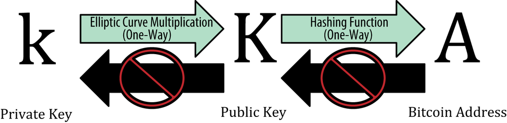
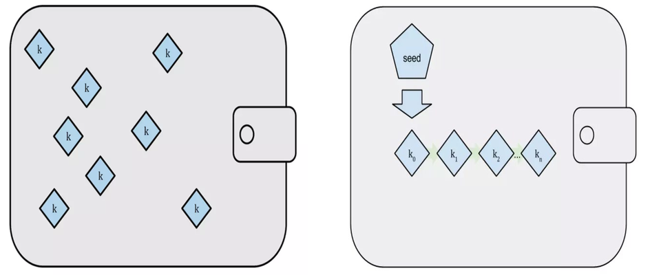
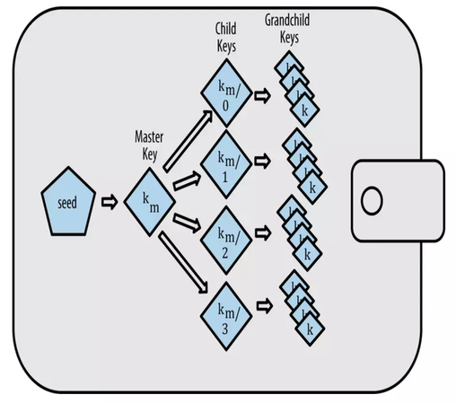
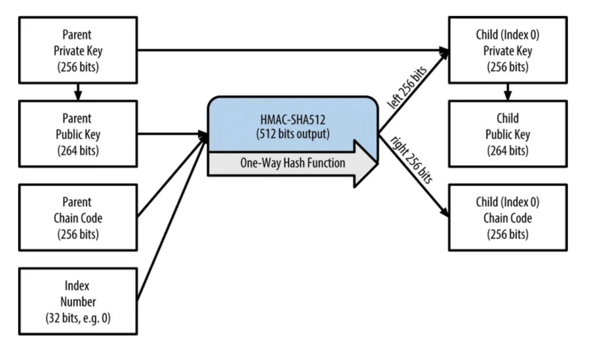
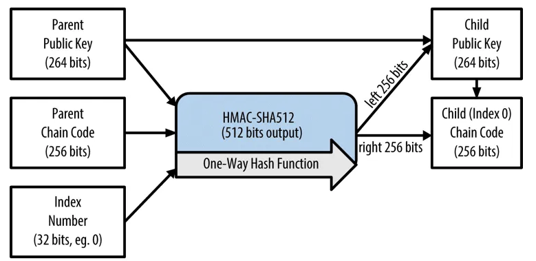
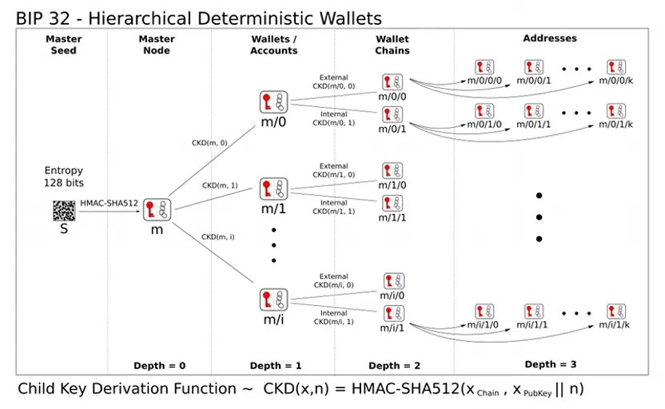
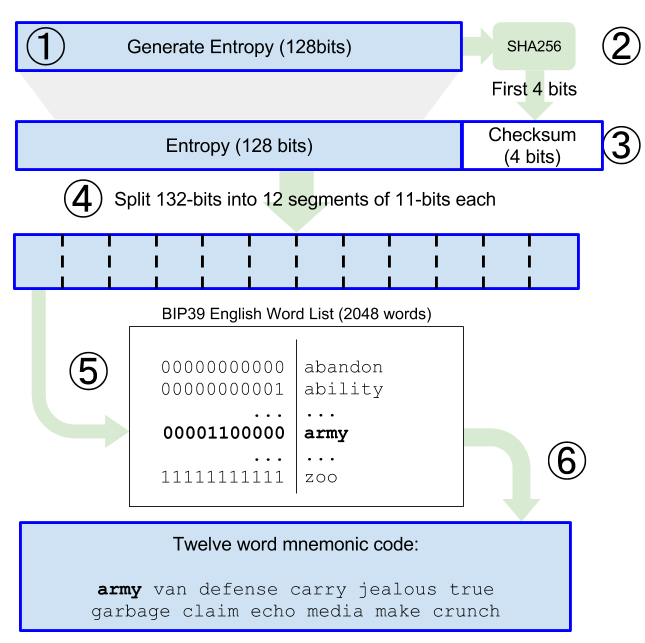
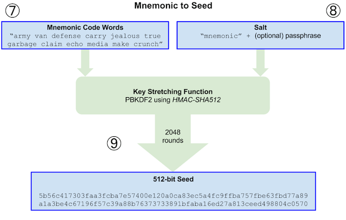

# CSIT953 考试复习 · 第 8 章 加密货币钱包

> 🎯 **考纲** — *Cryptocurrency Wallets — Private keys, deterministic wallets and mnemonic phrases.*
>
> 可能的题型：单选题考钱包里存的是什么、地址怎样从公钥得到、ECDSA 的随机数重复会怎样、随机钱包与确定性钱包的区别、扩展公钥能做什么、BIP44 路径每一层的含义、12 个助记词对应多少位熵；填空题考术语和数字（secp256k1、Keccak-256、20 字节、EIP-55、HMAC-SHA512、chain code、BIP32/39/44、m/44'/60'/0'/0/0、2048 个单词、11 位、PBKDF2、2048 轮）；简答题考为什么需要 chain code、硬化派生防什么、为什么助记词泄露比被暴力猜中更现实；问答题可能给一段有问题的签名代码让你找错，或者给一个用户、一家公司的钱包设置，让你分析风险、提出方案。

> 📚 **来源** — slides：W3 S1–S38；W2 S41。录音：W3 录音约 5.9k 字符之后（S2–S38）；W3 录音开头（W2 S41）。实验：Lab 1（生成账户：私钥、公钥、地址）、Lab 3（ECDSA 签名）、Quiz 2（两人互相签名和验证）。本章引用：点乘的单向性（第 2 章 §2），先哈希再签名、签名不是加密（第 1 章 §5），HMAC（第 1 章 §7），公钥替换问题（第 4 章 §1），random.randint 生成的私钥不安全（第 2 章 §8），WEP 的 IV 重复（第 6 章 §6.3）。

第 7 章说，交易要用私钥签名才有效。这一章讲私钥本身：它从哪里来，怎样变成地址，签名时怎样用，被偷了或丢了会怎样；钱包又怎样从一颗种子管理成千上万把密钥，怎样用 12 个单词把这颗种子备份下来。

§1 讲钱包到底保存什么；§2–§4 讲私钥、地址和签名；§5 讲签名界面和私钥的运营风险；§6–§9 讲确定性钱包和三个 BIP 标准；§10 用一个例子把整条派生链串起来；§11 讲怎样保护助记词。

## 1. 钱包管的是权限，不是币 (W3 S9–S10)

现实中的钱包装着现金和银行卡。区块链钱包里却没有币：**钱包管理的是授权所需的密钥**，资产一直记在链上。钱包做四件事：生成、保存并使用签名密钥；构造交易，请用户确认；把要签的内容展示给用户；设计好恢复方式，决定设备或密钥丢失之后会发生什么。

把地址告诉别人，对方往这个地址转 1 ETH。币去了哪里？哪儿也没去，链上多了一条交易记录。所有节点都有一份账本，在区块浏览器 `etherscan.io` 上输入地址，谁都能看到它的余额和全部交易。钱包里只有能花这笔钱的私钥。

所以钱包的安全不只是把密钥加密存好，还包括界面是否可信（§5）和恢复设计（§6–§11）。硬件钱包把私钥放在专门的安全芯片里，签名在芯片内部完成，私钥导不出来，连主人也看不到；设备丢了，捡到的人也拿不到私钥。

> 📎 **拓展（超出 slides）** — 常把钱包分成热钱包（hot wallet）和冷钱包（cold wallet）。热钱包的私钥在联网的手机、电脑或浏览器插件里，用起来方便，被恶意软件盯上的机会也多。冷钱包的私钥放在离线环境里，比如硬件钱包，签名在设备内完成。

> ✍️ **English answer** — A cryptocurrency wallet manages authority, not coins: the assets remain recorded on the blockchain, and anyone can look up an address's balance. The wallet generates, stores and uses the signing keys, constructs transactions and asks the user to approve them, and its recovery design decides what happens when a device or key is lost. Wallet security therefore covers key storage, the integrity of the signing interface and recovery, not only encrypted key storage. A hardware wallet keeps the private key inside a secure chip and signs there, so the key never leaves the device.

## 2. 私钥 → 公钥 → 地址 (W3 S2–S3, S11; Lab 1)



图 1 是从私钥到地址的单向流水线。Ethereum 的具体步骤是：

1. 随机生成一个 256 位的私钥 $k$，取值范围由 secp256k1 曲线决定。
2. 计算公钥 $K = k \cdot G$。这是椭圆曲线上的点乘（第 2 章 §2）。不带前缀的公钥是 64 字节，即点的坐标 $x \| y$；常见写法前面加一个 0x04 字节，表示未压缩格式。
3. 对这 64 字节做 Keccak-256，得到 32 字节的哈希。
4. 取哈希的最后 20 字节，前面加上 0x，就是地址。

Ethereum 黄皮书把第 3、4 步写成一个式子：地址是公钥 Keccak 哈希最右边的 160 位，

$$A(p_r) = \mathcal{B}_{96..255}\big(\mathrm{KEC}(\mathrm{ECDSAPUBKEY}(p_r))\big)$$

slides 上的例子（中间各值只显示了首尾，这里按同样的步骤算出完整值）：

```text
私钥          f8f8a2f43c8376ccb0871305060d7b27b0554d2cc72bccf41b2705608452f315
公钥 x‖y      6e145ccef1033dea239875dd00dfb4fee6e3348b84985c92f103444683bae07b
              83b5c38e5e2b0c8529d7fa3f64d46daa1ece2d9ac14cab9477d042c84c32ccd0
Keccak-256    2a5bc342ed616b5ba5732269 001d3f1ef827552ae1114027bd3ecf1f086ba0f9
                 （丢掉前 12 字节）       （保留后 20 字节）
地址          0x001d3f1ef827552ae1114027bd3ecf1f086ba0f9
```

每一步正着算都很快，反着算都不可行：从地址求不出公钥，因为哈希是单向的；从公钥求不出私钥，因为椭圆曲线离散对数问题算不动。**看到公钥或地址的人，推不出私钥**，这是整个系统的安全前提。

地址前面的 0x 只是表示"这是十六进制"，与安全无关。EIP-55 规定的大小写混排可以发现抄错的字符，上面的地址写成 0x001d3F1ef827552Ae1114027BD3ECF1f086bA0F9。

> 📎 **拓展（超出 slides）** — EIP-55 的做法：对小写地址再做一次 Keccak-256，地址里的每个字母，如果哈希对应位置的十六进制数不小于 8，就写成大写。抄错一个字符，大小写的模式几乎一定对不上，钱包就会报错。图 1 里的 A 是 Bitcoin 地址，算法不同：Bitcoin 对公钥先做 SHA-256 再做 RIPEMD-160，得到 20 字节，再加上版本号和校验和编码。

Lab 1 用 `w3.eth.account.create()` 生成一个账户，得到私钥、公钥和地址三样东西，再把它们一起明文写进 `key.json`。谁读到这个文件，谁就控制了这个账户。这在测试网上无所谓；真实的钱包会用口令加密私钥再存储，或者干脆把私钥放进硬件。

> ✍️ **English answer** — An Ethereum private key is a random 256-bit number on the secp256k1 curve. The public key is $K = k \cdot G$, computed by elliptic-curve point multiplication; its uncompressed form is 64 bytes (x‖y, without the 0x04 prefix). The address is the last 20 bytes of the Keccak-256 hash of these 64 bytes, written with a 0x prefix. Each step is easy forwards but infeasible to reverse, so publishing the public key or address does not reveal the private key. The 0x prefix is only notation, and EIP-55 mixed-case encoding provides typo detection.

## 3. 签名：不交出私钥也能证明控制权 (W3 S4–S6; Lab 3; Quiz 2)

公钥密码把两件事分开：私钥保密，用来生成签名；公钥可以公开，用来验证签名。验证者从头到尾不需要私钥。

$$\mathrm{Sign}(sk, m) \to \sigma, \qquad \mathrm{Verify}(pk, m, \sigma) \to 1 \text{ 或 } 0$$

验证输出 1，说明这条消息确实由与 $pk$ 配对的私钥签过；消息或签名改动一个字节，就输出 0。正因如此，成千上万个节点不用共享一个中心化的口令库，也不用知道任何人的私钥，就能检查每笔交易是否经过授权。地址是从公钥派生的更短的标识。这一套的妙处是：**证明自己控制着密钥，却不必交出密钥**。

签名不是加密（第 1 章 §5）。交易内容照样人人可读，签名像一个防拆封条，保护的是真实性和完整性。还要注意：有效的签名只证明"某把私钥签了这些字节"，不证明签名的人看懂了自己签的是什么（§5）。

区块链用的签名算法是 ECDSA（Elliptic Curve Digital Signature Algorithm）。Lab 3 在 secp256k1 上实现了它，$G$ 是基点，$N$ 是 $G$ 的阶：

- 生成密钥：在 $[1, N-1]$ 里随机选私钥 $d$，公钥 $Q = d \cdot G$。
- 签名：先算 $z = \text{SHA-256}(M)$。随机选 $k \in [1, N-1]$，计算 $R = k \cdot G$，取 $r = x_R \bmod N$，再算 $s = k^{-1}(z + r d) \bmod N$。签名是 $(r, s)$。
- 验证：检查 $1 \le r, s < N$；算 $w = s^{-1}$，$u_1 = z w$，$u_2 = r w$（都 mod $N$）；再算 $X = u_1 G + u_2 Q$。当且仅当 $r \equiv x_X \pmod N$ 时签名有效。

> 📎 **拓展（超出 slides）** — 为什么验证能通过：$u_1 G + u_2 Q = w(z + r d)G$，而 $w = s^{-1} = k(z + rd)^{-1}$，所以结果正好是 $kG = R$，横坐标就是 $r$。验证者只用到了公钥 $Q$，没有用到 $d$。

Quiz 2 让两个同学轮流当签名者和验证者：签名者生成密钥对，签一份文档，把文档、公钥和签名交给对方；验证者用这把公钥验证。文档改一个字节，或者换一把公钥，验证都会失败。可验证者凭什么相信这把公钥属于签名者？Quiz 2 里两人当面交换，信任来自见面；在网上，这就是第 4 章 §1 的公钥替换问题。

> ✍️ **English answer** — Public-key cryptography separates two jobs: the private key is kept secret and creates signatures, while the public key can be shared and verifies them, so a verifier never needs the private key. Thousands of blockchain nodes can therefore check that a transaction was authorised without a shared password database and without learning anyone's private key. A digital signature is a tamper-evident seal, not encryption: the message stays readable, any change makes verification fail, and anyone with the public key can verify it. A valid signature proves control of a key, not that the signer understood what was signed. In ECDSA, the signer hashes the message to $z$, picks a random $k$, and outputs $(r, s)$ with $r = (kG)_x \bmod N$ and $s = k^{-1}(z + rd) \bmod N$.

## 4. 签名用的随机数 k 不能重复 (W3 S7; Lab 3)

ECDSA 每签一次名，都要一个新鲜、不可预测的随机数 $k$，课件称之为签名 nonce。**同一个 $k$ 用了两次，或者 $k$ 有偏差、能被预测，几个签名合在一起就能算出私钥**。

> 📎 **拓展（超出 slides）** — 用 Lab 3 的公式算一遍。两条消息 $z_1$、$z_2$ 用了同一个 $k$，$R$ 相同，所以两个签名的 $r$ 也相同。两式相减：
>
> $$s_1 - s_2 = k^{-1}(z_1 - z_2) \;\Rightarrow\; k = \frac{z_1 - z_2}{s_1 - s_2}$$
>
> 知道了 $k$，再由 $s_1 = k^{-1}(z_1 + r d)$ 解出私钥 $d = (s_1 k - z_1)\,r^{-1}$（都 mod $N$）。所有数值都在公开的签名和交易里。

这里出错的不是数学。算法完全正确，失败的是给它提供随机数的部件。

> 👨‍🏫 **课堂强调** — 索尼的 PS3 游戏机就栽在这里。工程师觉得每次选随机数太麻烦，把 $k$ 写成了固定值。攻击者拿到两个签名就算出了私钥，从此可以给任何软件签名，游戏机就能运行任意程序。

第 2 章 §8 已经指出，Lab 4 用 `random.randint` 生成私钥不安全。Lab 3 的代码有同样的问题，而且更严重：私钥 $d$ 和每次签名的 $k$ 都来自 `random.randint`。Python 的 `random` 模块不是密码学安全的随机数生成器，看到足够多的输出就能预测之后的值，预测出 $k$ 也就算出了 $d$。Quiz 2 的实现把两处都换成了 `secrets.randbelow`。

课件给出的防御：

- 确定性地生成 nonce，不依赖随机数生成器。
- 使用经过检验的密码学库，不自己实现签名。
- 用受保护的签名硬件。
- 严格隔离密钥。

> 📎 **拓展（超出 slides）** — 确定性 nonce 的标准做法是 RFC 6979：用私钥和消息哈希做 HMAC，算出 $k$。同一条消息总得到同一个 $k$，不同消息得到不同的 $k$，外人无法预测，也就不怕随机数生成器出故障。第 6 章 §6.3 的 WEP 也是 nonce 重复：在那里泄露的是密钥流，在这里泄露的是私钥本身。

> ✍️ **English answer** — Every ECDSA signature needs a fresh, unpredictable nonce k. If the same $k$ is used for two different messages, both signatures share the same $r$, and subtracting the two equations gives $k = (z_1 - z_2)/(s_1 - s_2)$; the private key then follows as $d = (s_1 k - z_1)/r \bmod N$. A biased or predictable k can also reveal the key, as when the PS3 used a fixed k. The mathematics may be correct while the random-number generator fails; Lab 3's use of Python's random module for both d and k is an example. Defences are deterministic nonce generation (RFC 6979), tested libraries, protected signing hardware and strict key isolation.

## 5. 签名界面与私钥的运营风险 (W3 S8; W2 S41)

### 5.1 密码学签的是字节，不是意图

用户以为自己批准的是 A，设备提交的却可能是 B。签名算法只管字节，不管这些字节在用户眼里是什么意思，**所以签名界面也在安全边界之内**。恶意软件可以显示一个操作，提交另一个。盲签（blind signing）只给用户看一串哈希或一句"确认交易"，把关键细节藏了起来。更安全的钱包会清楚显示目标地址、金额、网络和要调用的合约操作。区块链上的操作有效之后可能无法撤销，所以要先核对再批准。

硬件钱包也不例外。私钥在安全芯片里，几乎拿不出来，攻击者就改从消息下手。用户在电脑上发起"转 1 ETH 给 Alice"，被入侵的电脑或固件实际交给设备签名的是"转 2 ETH 给攻击者"。设备的小屏幕是最后一道关口，用户必须在设备屏幕上核对地址和金额，不能只看电脑屏幕。另一种常见的攻击是在网上发布界面漂亮、暗藏恶意代码的"开源钱包"，用户导入私钥，钱就被转走了。

### 5.2 私钥被偷或丢失

私钥的风险首先是运营上的：

- 私钥被偷，攻击者发出的交易和你本人发的一模一样，节点分不出来。
- 私钥丢了，就永远进不了账户，没有银行可以帮你重置。
- 恶意软件和社会工程常常绕开协议本身，直接拿到私钥或骗你签名。

防御有三条：硬件隔离私钥，多重签名，经过验证的备份。签名前永远核对目标地址和交易内容。

> 📎 **拓展（超出 slides）** — 多重签名（multisig）要求 n 把密钥里至少 m 把签名，交易才有效，比如 2-of-3：三把密钥放在三台设备上，或交给三个人。偷到一把不够，丢了一把也不致命。

发现私钥泄露时，第一件事是赶在攻击者之前，把余额全部转到一个新的安全地址。

> ✍️ **English answer** — The cryptography signs bytes, not intentions, so the signing screen is part of the security boundary: malware can display one action and submit another, and blind signing hides important details. Safer wallets show the destination, value, network and contract action, and the user should verify them, on the hardware wallet's own screen, before approving, because valid blockchain actions may be irreversible. Private keys are also an operational risk: a stolen key produces transactions that look exactly like legitimate authorisation, a lost key can mean permanent lockout, and malware and social engineering often bypass the protocol. Defences include hardware isolation, multisignature schemes and verified backups.

## 6. 三种钱包结构 (W3 S12–S17)

钱包里通常不止一把密钥：每个地址对应一把，很多人还希望每次收款都用一个新地址。这么多密钥怎样生成、怎样备份？有两种思路。

**非确定性钱包**（non-deterministic wallet），也叫随机钱包：每把私钥都独立随机生成，彼此毫无关系。早期的 Bitcoin 客户端就是这样，被戏称为 JBOK（just a bunch of keys）。缺点在备份：每把密钥都得单独备份，新生成的密钥不在旧备份里，设备一坏，这些密钥对应的资金就找不回来了。好处是隔离：一把密钥泄露，只损失那一个地址上的钱，其他密钥照样安全。

**确定性钱包**（deterministic wallet），也叫种子钱包：所有密钥都从同一颗种子（seed）派生出来，派生算法是单向的哈希函数。创建钱包时备份一次种子，就能恢复全部密钥。确定性钱包又分顺序和分层两种。



顺序确定性钱包（图 2 右）从种子派生出一串密钥 $k_0, k_1, \dots, k_n$，结构是一条链。它唯一的好处是备份简单。



**分层确定性钱包**（hierarchical deterministic wallet，HD 钱包）把密钥组织成一棵树（图 3）：种子生成主密钥 $k_m$，主密钥派生子密钥 $k_{m/0}, k_{m/1}, \dots$，每个子密钥又能派生孙密钥。路径可以按用途、币种、账户、链和地址序号来组织密钥（§8）；扩展公钥可以支持只读或只收款的系统（§7.3）；硬化派生把敏感的分支隔开（§7.5）。今天的硬件钱包用的都是 HD 钱包。

| | 非确定性（随机） | 顺序确定性 | 分层确定性（HD） |
|---|---|---|---|
| 密钥之间的关系 | 互不相关 | 一颗种子派生出一条链 | 一颗种子派生出一棵树 |
| 备份 | 每把密钥都要备份 | 只备份种子 | 只备份种子 |
| 一把密钥泄露 | 只影响这个地址 | 通常只影响这个地址（派生是单向的） | 通常只影响这个地址（例外见 §7.5） |
| 种子泄露 | 没有种子 | 全部密钥泄露 | 全部密钥泄露 |
| 组织和分享 | 无结构 | 无结构 | 按账户、币种分支；可以只交出一个分支的扩展公钥 |

确定性钱包并不比随机钱包更安全。**一份备份能恢复许多账户，代价是种子成了价值极高的秘密**：种子泄露，所有密钥一起泄露，不管资金分散在多少个地址上。人们普遍接受 HD 钱包，是在安全和方便之间做了取舍。

> ✍️ **English answer** — A non-deterministic (random) wallet generates unrelated random key pairs ("just a bunch of keys"), so every key must be backed up separately and a key missing from the backup means unrecoverable funds; on the other hand, a compromised key does not expose the others. A deterministic (seeded) wallet derives many key pairs from a single seed using a one-way function, so backing up the seed once at creation recovers every key. A sequential deterministic wallet derives one chain of keys, while a hierarchical deterministic (HD) wallet derives a tree, whose paths organise keys by purpose, coin, account, chain and address index, whose extended public keys support watch-only systems, and whose hardened derivation separates sensitive branches. One backup can recover many accounts, but the seed becomes a high-value secret: whoever obtains it controls every derived key.

## 7. BIP32：一颗种子派生一棵密钥树 (W3 S18–S27)

### 7.1 几个 BIP

BIP（Bitcoin Improvement Proposal）是 Bitcoin 社区的设计文档，介绍新功能或新流程，每份有一个编号。一个 BIP 可以被广泛实现，却不属于共识规则：钱包怎样派生密钥，节点并不关心。名字里有 Bitcoin，Ethereum 钱包也照样使用。和 HD 钱包有关的四个：

| 标准 | 规定什么 |
|---|---|
| BIP32 | 分层确定性钱包：怎样从主种子派生出密钥树，以及在树上怎样构建钱包 |
| BIP43 | 路径的第一层用作"用途"（purpose）字段 |
| BIP44 | 多账户的五层标准路径（§8） |
| BIP39 | 把种子变成好记的助记词（§9） |

### 7.2 主扩展密钥 (W3 S26)

先用密码学安全的随机源生成一颗高质量的种子（或者由 §9 的助记词得到）。对种子做 HMAC-SHA512，输出 512 位：左边 256 位是主私钥，右边 256 位是主 chain code。两者合起来叫主扩展私钥（master extended private key）。

> 📎 **拓展（超出 slides）** — 这一步的 HMAC 密钥是固定的字符串 "Bitcoin seed"。

**扩展密钥**（extended key）= 密钥 + chain code。多出来的 chain code 让确定性派生成为可能，所以扩展密钥要按它所带的权力来保护。扩展私钥（常写作 xprv）能派生出下面所有的私钥和公钥；扩展公钥（xpub）只能派生公钥。

512 位的输出不等于 512 位的安全性。**系统的强度取决于熵、派生、存储和恢复，不只是密钥长度**：种子只有 128 位熵，攻击者猜的就是这 128 位；私钥存得不好，再长也没用。

### 7.3 派生子密钥 (W3 S22–S24)

子密钥派生函数（child key derivation, CKD）有三个输入：父扩展密钥（私钥或公钥都可以）、256 位的 chain code、32 位的子序号（index）。HMAC-SHA512 的输出分成两半：左 256 位是密钥材料，右 256 位成为子 chain code。在钱包之外看，派生出的各把密钥毫无关联。



图 4 是从父私钥派生子私钥。父 chain code 充当 HMAC 的密钥，数据是父公钥和序号。左 256 位与父私钥相加（mod $N$），得到子私钥；子公钥再由子私钥点乘得到。图里的公钥是 264 位，即 33 字节的压缩格式；算 Ethereum 地址时用的是 §2 那 64 字节。



图 5 是只用公钥的派生。左 256 位不再加到私钥上，而是对应的点加到父公钥上，直接得到子公钥；右 256 位照样成为子 chain code。两条路得到的子公钥完全相同。

这就是**只读钱包**（watch-only）的原理。把扩展公钥（父公钥 + chain code）交给一台服务器，它能算出所有子公钥和地址，能查看每个地址的余额，却算不出任何私钥，花不了一分钱。网店可以用它给每笔订单生成一个新的收款地址，服务器上不存任何私钥。

### 7.4 为什么需要 chain code (W3 S25)

chain code 给派生过程加入了确定性的随机数据。根上的 chain code 由种子生成，每个子 chain code 由父 chain code 派生。

它的作用是保护隐私。公钥很容易被看到，比如一笔交易的签名里就带着公钥。假如派生只用父公钥，任何人看到父公钥，都能算出所有子公钥和地址，钱包里的地址就全被关联起来了。加入 chain code 之后，还得知道这个额外的值才行。反过来，扩展公钥比普通公钥敏感得多：它一旦公开，整棵子树的地址和余额都暴露了。

### 7.5 硬化派生 (W3 S17, S22)

课件说硬化派生（hardened derivation）"能隔开敏感的分支"，"能限制父密钥暴露带来的一些风险"。

> 📎 **拓展（超出 slides）** — BIP32 有两种派生。普通派生把父公钥放进 HMAC，所以只拿着扩展公钥也能做。硬化派生的序号不小于 $2^{31}$，写作 0'、44' 这样带撇号的形式，它把父私钥放进 HMAC，必须有扩展私钥才能做。为什么需要它？普通派生里，子私钥 = 父私钥 + L（mod $N$），而 L 只用扩展公钥就能算出来。攻击者如果拿到扩展公钥，又拿到任意一把普通派生出的子私钥，减一下就得到父私钥，进而得到所有兄弟密钥。硬化派生切断了这条路：子私钥泄露，推不回父私钥。

### 7.6 整棵树 (W3 S27)



图 6 是 BIP32 原文里的结构图。主节点 m 派生出账户 m/0、m/1……m/i；每个账户下有外部链（external，m/i/0，用来收款）和内部链（internal，m/i/1，用来找零）；链下面是一个个地址 m/i/0/k。底部的式子是普通派生的写法：$\mathrm{CKD}(x, n) = \text{HMAC-SHA512}(x_{\text{Chain}},\; x_{\text{PubKey}} \| n)$。这张图同时说明了两件事：备份一个根就能恢复所有资源；根一旦泄露，波及的范围也最大。

> ✍️ **English answer** — BIP32 defines hierarchical deterministic wallets. A high-quality seed from a cryptographically secure random source is processed with HMAC-SHA512: the left 256 bits become the master private key and the right 256 bits the master chain code, which together form the master extended private key. Child key derivation (CKD) combines a parent extended key, its 256-bit chain code and a 32-bit index in HMAC-SHA512; the left half produces the child key and the right half the child chain code, so derived keys look unrelated outside the wallet. Public derivation lets an extended public key generate child public keys and addresses without any private key, which supports watch-only systems. The chain code adds privacy, because without it anyone who saw a parent public key could derive all child public keys; as a result an extended public key is more sensitive than an ordinary public key. Hardened derivation uses the parent private key, so an extended public key plus one leaked child private key cannot reveal the parent key. Security depends on entropy, derivation, storage and recovery, not on key length alone.

## 8. BIP44：统一的路径 (W3 S28–S30)

BIP32 给实现者的自由太多，树可以无限深，兼容 BIP32 的钱包可以搭出完全不同的结构。同一颗种子导入另一款钱包，可能显示出不同的账户和地址，用户还以为钱丢了。

BIP43 规定路径的第一层是"用途"字段。BIP44 在 BIP32 之上规定了五层标准路径：

```text
m / purpose' / coin_type' / account' / change / address_index
```

前三层用硬化派生。以 Ethereum 的第一个地址 m/44'/60'/0'/0/0 为例：

| 层 | 值 | 含义 |
|---|---|---|
| m | m | 用私钥派生（CKDpriv）；写成 M 表示用公钥派生（CKDpub） |
| purpose | 44' | 硬化；遵循 BIP44 |
| coin_type | 60' | 硬化；60 是 Ethereum 注册的币种号，0 是 Bitcoin |
| account | 0' | 硬化；同一个网络下可以开多个账户 |
| change | 0 | Bitcoin 里 0 是外部链（收款），1 是内部链（找零）；Ethereum 总是 0 |
| address_index | 0 | 第一对公私钥，也就是树的叶子 |

路径只是一份派生配方，链上没有任何"路径"对象。同一颗种子，币种号换成 0，得到 Bitcoin 的密钥和地址；换成 60，得到 Ethereum 的；两者毫无关联。共同的结构让钱包之间可以互通，也让恢复时的账户发现（account discovery）有章可循：钱包按顺序检查各账户、各地址有没有交易记录，把用过的都找回来。前三层硬化，意味着某个账户的扩展公钥和一把地址私钥同时泄露，最多波及这一个账户。

> ✍️ **English answer** — BIP32 alone gives implementers too much freedom, so compatible wallets could build different structures from the same seed. BIP43 defines the purpose field, and BIP44 applies BIP32 through a standard five-level path, m / purpose' / coin_type' / account' / change / address_index, with hardened derivation for purpose, coin type and account. In m/44'/60'/0'/0/0, 44' means BIP44, 60' is Ethereum's coin type, 0' is the first account, change 0 is the external chain (always 0 in Ethereum), and index 0 is the first key pair; m means private derivation and M public derivation. A shared structure improves wallet interoperability and account discovery, and the same seed with a different coin type gives unrelated keys.

## 9. BIP39：用单词备份种子 (W3 S31–S35, S38)

种子是一长串随机数，抄写容易出错，也记不住。**助记词**（mnemonic）把钱包软件生成的熵加上校验和，编码成一串单词，之后再由这些单词派生出 HD 钱包的种子。它是便于携带的恢复秘密，不是口令：必须由钱包软件生成，绝不能自己编一句好记的话。

### 9.1 第一步：熵变成单词



图 7 的六步：

1. 生成 128 位熵。
2. 对熵做 SHA-256，取前 4 位。
3. 把这 4 位作为校验和接在熵后面，共 132 位。
4. 把 132 位切成 12 段，每段 11 位。
5. 每段是一个 0 到 2047 之间的序号，到 BIP39 的 2048 词词表里查对应的单词。词表是固定的，00000000000 是 abandon，00000000001 是 ability，11111111111 是 zoo。
6. 得到 12 个单词。

图里的例子可以完整验证（中间值是按标准算出的）：熵是 0c1e24e5917779d297e14d45f14e1a1a，SHA-256 的前 4 位是 0111。第一段 00001100000 是 96，词表第 96 个词是 army，最后得到 army van defense carry jealous true garbage claim echo media make crunch。

熵可以是 128 到 256 位，每多 32 位熵，多 1 位校验和、多 3 个单词：

| 熵（位） | 校验和（位） | 合计（位） | 单词数 |
|---|---|---|---|
| 128 | 4 | 132 | 12 |
| 160 | 5 | 165 | 15 |
| 192 | 6 | 198 | 18 |
| 224 | 7 | 231 | 21 |
| 256 | 8 | 264 | 24 |

规律是：校验和位数 = 熵位数 / 32，单词数 = 合计位数 / 11。

单词只能来自那 2048 个词，顺序也不能变。换了顺序，比特串就变了，校验和多半对不上，钱包会提示助记词无效。校验和只能发现抄错，助记词一旦泄露，它什么也保护不了（第 1 章 §7.3）。

### 9.2 第二步：单词变成种子



图 8 用 PBKDF2-HMAC-SHA512 把助记词拉伸成 512 位的种子：输入是助记词，盐是字符串 "mnemonic" 加上用户可选的 passphrase，迭代 2048 轮。迭代很多轮，是为了让每一次猜测都变慢。得到的种子交给 BIP32 生成主密钥（§7.2）。图中没有 passphrase 时的种子是 5b56c417…0570。

passphrase 像一个只有你知道的盐。同样 12 个词，passphrase 不同，种子就完全不同：按标准算，passphrase 取 TREZOR 时，种子以 3338a6d2 开头。别人偷到助记词，没有 passphrase 也打不开钱包。代价是 passphrase 忘了，钱也就没了。

熵、助记词、种子、BIP32 主密钥互相关联，但不能互换：助记词是熵的编码，种子是助记词和 passphrase 的拉伸结果，主密钥是种子的 HMAC 结果。

> ✍️ **English answer** — A BIP39 mnemonic is a human-readable recovery encoding of computer-generated entropy plus a checksum; it is a portable recovery secret, not a password, and must be generated by wallet software rather than invented. The wallet generates 128–256 bits of entropy, appends the first ENT/32 bits of its SHA-256 hash as a checksum, splits the result into 11-bit groups and maps each group to one of 2,048 words; 128 bits of entropy plus a 4-bit checksum give 12 words. The words and an optional passphrase are then stretched with PBKDF2-HMAC-SHA512 for 2,048 rounds, with "mnemonic" + passphrase as the salt, into a 512-bit seed used by BIP32. The checksum only detects typing errors, and a different passphrase produces a completely different seed and wallet.

## 10. 从熵到地址：一条完整的派生链 (W3 S30, S34, S38)

把 §2 和 §7–§9 串起来，用 slides 上同一组助记词走一遍（种子以外的数值是按标准算出的）：

| 步骤 | 运算 | 例子 |
|---|---|---|
| 熵 | 钱包用安全随机源生成 128 位 | 0c1e24e5…f14e1a1a |
| 助记词 | 接 4 位 SHA-256 校验和，每 11 位查词表 | army van defense … make crunch |
| 种子 | PBKDF2-HMAC-SHA512，2048 轮，盐 = "mnemonic" + passphrase | 5b56c417…498804c0570 |
| 主密钥 m | HMAC-SHA512：左半是主私钥，右半是主 chain code | 主私钥 b2a0d576…c235ee26 |
| 地址的私钥 | 沿 m/44'/60'/0'/0/0 做五次 CKD | （略） |
| 公钥 | 椭圆曲线点乘 | （略） |
| 地址 | Keccak-256，取后 20 字节 | 0x2161DedC3Be05B7Bb5aa16154BcbD254E9e9eb68 |

最后一位序号换成 1，得到第二个地址 0x9595F373a4eAe74511561A52998cc6fB4F9C2bdD；passphrase 换成 TREZOR，同一路径的地址变成 0x7Db47Ea14e3Ddda33d0e71142A0Ebe23751caD37。从这张表能看清一件事：**12 个单词（加上 passphrase）就是整个钱包**，谁拿到它们，谁就能派生出每一个地址的私钥。

## 11. 保护助记词 (W3 S36–S37)

暴力猜中助记词是不可行的。12 个词的助记词含 128 位熵和 4 位校验和，能通过校验的组合对应 $2^{128}$ 种熵。熵只要是正确生成的，穷举就做不到；两个钱包碰巧生成同一组词的概率不是 0，但小到可以忽略。

> 👨‍🏫 **课堂强调** — 真要担心碰撞，就加一个 passphrase：别人即使生成了同样的 12 个词，没有你的 passphrase 也得不到同一个钱包。想要更强的保护，选 24 个词。反过来，助记词写在笔记本上，笔记本被人拿到，就等于种子丢了。

**助记词泄露远比被暴力猜中更现实**。真正的威胁是：钓鱼网站和假客服骗你输入助记词，恶意软件读取剪贴板或屏幕，截图，笔记和相册同步到云端，备份被偷，以及用户自己编的、容易猜的短语。所以要保护的是恢复渠道，不只是数学。

> 📎 **拓展（超出 slides）** — 用户自己挑一句话做种子，这种"脑钱包"（brain wallet）曾被大规模盗空：攻击者把名言、歌词、常用短语一个个算成地址，链上一查有余额就转走。这和第 1 章 §6 的离线字典攻击是同一个道理。

课件给出的做法：

- 离线保存，不截图，不发邮件、聊天消息，不存进云端笔记。
- 准确抄写，并实际测试一遍恢复流程。
- 备份要防盗、防火、防水，也要防止被当成废纸扔掉。
- 不在任何网站输入助记词，也不告诉任何"客服"。
- 金额大的钱包，考虑硬件签名、多重签名，以及把备份放在不同的地点。

> ✍️ **English answer** — A 12-word BIP39 mnemonic encodes 128 bits of entropy plus a 4-bit checksum, so the valid phrase space corresponds to $2^{128}$ entropy choices, and exhaustive guessing is infeasible when the entropy is generated correctly. Exposure is far more likely than brute force: realistic threats are phishing sites and fake support staff, malware, screenshots, cloud synchronisation of notes and photos, physical theft of the backup and weak user-created phrases. The seed phrase should therefore be kept offline, recorded accurately with the recovery process tested, protected against theft, fire, water and accidental disposal, and never typed into a website or shared with anyone. High-value wallets should add hardware signing, multisignature and geographically separated backups; a passphrase adds a second secret but must not be forgotten.

## ⚠️ 易混易错

| 容易混的 | 区别 |
|---|---|
| 钱包 vs 币 | 钱包保存密钥和签名权限；币一直记在链上 |
| 私钥 → 公钥 → 地址 | 每步都单向：点乘，再 Keccak-256 取后 20 字节；反过来都算不出 |
| 0x vs EIP-55 | 0x 只表示十六进制；EIP-55 的大小写混排才能发现抄错 |
| 签名 vs 加密 | 签名保护真实性和完整性，内容照样可读；加密才保护机密性 |
| 三种 nonce | ECDSA 的 k：每次签名的随机数，重复会泄露私钥；交易 nonce：账户序号，防重放（第 7 章 §7.1）；PoW 的 nonce：让区块哈希小于目标值（第 7 章 §5.1） |
| 随机钱包 vs 确定性钱包 | 前者每把密钥单独备份、互不牵连；后者只备份种子，种子泄露全部泄露 |
| 顺序 vs 分层确定性 | 一条链 vs 一棵树；HD 支持按账户、币种分支和只读的扩展公钥 |
| 熵 vs 助记词 vs 种子 vs 主密钥 | 助记词是熵加校验和的编码；种子是 PBKDF2 拉伸结果；主密钥是种子的 HMAC 结果 |
| xprv vs xpub | 前者能派生所有私钥和公钥；后者只能派生公钥，能看不能花，但会暴露整棵子树的地址 |
| 普通派生 vs 硬化派生 | 前者可用扩展公钥做；后者要父私钥，子私钥泄露推不回父私钥 |
| m vs M | 路径开头的 m 表示用私钥派生，M 表示用公钥派生 |
| 校验和 vs passphrase | 校验和只发现抄错；passphrase 改变种子，是额外的秘密 |
| 助记词 vs 口令 | 助记词是软件生成的恢复秘密，不能自己编，也不该拿去登录任何网站 |

常见误解：

- "手机丢了，币就丢了"：币在链上，用助记词就能在新设备上恢复。
- "公开地址会泄露私钥"：两步都是单向的。
- "确定性钱包比随机钱包安全"：它只是更方便，种子泄露就全部泄露。
- "扩展公钥只是公钥，公开也没关系"：它暴露整棵子树的地址和余额；再泄露一把普通派生的子私钥，还能推出父私钥。
- "助记词有校验和，抄错了也能自动纠正"：校验和只能发现错误，不能纠正，也不保护泄露的助记词。
- "硬件钱包确认过的交易一定没问题"：必须在设备屏幕上核对地址和金额。
- "ECDSA 的数学是安全的，随便用个随机数就行"：$k$ 重复或可预测，私钥就会被算出来。

## 📝 Practice

### Part A · Multiple choice

**A1.** What does a cryptocurrency wallet actually store?
A. The coins themselves
B. A copy of the whole blockchain
C. The keys that authorise spending, while the assets stay recorded on the blockchain
D. The passwords of the exchange accounts

<details>
<summary>Answer A1</summary>

**C.** A wallet manages authority, not coins; balances are recorded on the ledger and anyone can look them up.

</details>

**A2.** How is an Ethereum address derived?
A. The first 20 bytes of the SHA-256 hash of the private key
B. The last 20 bytes of the Keccak-256 hash of the 64-byte public key, prefixed with 0x
C. The public key encrypted with the private key
D. A random number chosen independently of the key pair

<details>
<summary>Answer A2</summary>

**B.** The private key gives the public key by point multiplication; the address is the last 20 bytes of its Keccak-256 hash.

</details>

**A3.** A wallet's ECDSA implementation uses the same nonce k for two different transactions. What can an attacker do?
A. Nothing, because ECDSA is mathematically secure
B. Read the contents of the transactions
C. Compute the private key from the two signatures
D. Only replay the two transactions

<details>
<summary>Answer A3</summary>

**C.** Both signatures share r; subtracting the two s values gives k, and then the private key follows.

</details>

**A4.** An online shop wants its web server to generate a fresh receiving address for every order without being able to spend funds. What should the server hold?
A. The BIP39 mnemonic
B. The master extended private key
C. An account-level extended public key
D. One private key reused for all orders

<details>
<summary>Answer A4</summary>

**C.** An extended public key derives child public keys and addresses but no private keys, which supports watch-only and receive-only systems.

</details>

**A5.** A 12-word BIP39 mnemonic encodes:
A. 128 bits of entropy plus a 4-bit checksum
B. 132 bits of entropy with no checksum
C. 256 bits of entropy plus an 8-bit checksum
D. A 512-bit seed directly

<details>
<summary>Answer A5</summary>

**A.** 132 bits split into 12 groups of 11 bits; the 512-bit seed is derived from the words afterwards by PBKDF2.

</details>

**A6.** In the BIP44 path m/44'/60'/0'/0/0, what does 60' mean?
A. The 60th address of the account
B. The Ethereum coin type, derived with hardened derivation
C. 60 rounds of key stretching
D. The 60th account of the wallet

<details>
<summary>Answer A6</summary>

**B.** 60 is Ethereum's registered coin type, and the apostrophe marks hardened derivation.

</details>

**A7.** Which statement about the optional BIP39 passphrase is TRUE?
A. It is checked by the checksum, so a wrong passphrase is rejected.
B. The same mnemonic with a different passphrase produces a completely different seed and wallet.
C. It only changes the first address of the wallet.
D. It can be recovered from the mnemonic if forgotten.

<details>
<summary>Answer A7</summary>

**B.** The passphrase is part of the PBKDF2 salt. Any passphrase gives a valid but different wallet, so a forgotten passphrase means lost funds.

</details>

### Part B · Fill in the blank / short answer

**B1.** An Ethereum private key is a ______-bit number on the ______ curve. The public key is computed by elliptic-curve ______, and the address is the last ______ bytes of its ______ hash.

<details>
<summary>Answer B1</summary>

256; secp256k1; point multiplication (K = k·G); 20; Keccak-256.

</details>

**B2.** BIP39 maps each ______-bit group to one of ______ words. The seed is derived from the mnemonic with ______ using ______ rounds, and it is ______ bits long.

<details>
<summary>Answer B2</summary>

11; 2,048; PBKDF2-HMAC-SHA512; 2,048; 512.

</details>

**B3.** Why does BIP32 include a chain code in child key derivation?

<details>
<summary>Answer B3</summary>

The chain code adds deterministic random data to the derivation: the root chain code comes from the seed and each child chain code from its parent's. Public keys are easy to find, so without the chain code anyone who saw a parent public key could derive all its child public keys and link every address in the wallet. With it, deriving child keys also requires the chain code, which protects privacy; it also means an extended public key must be treated as sensitive.

</details>

**B4.** Compare a non-deterministic (random) wallet with an HD wallet in terms of backup and the impact of a key compromise.

<details>
<summary>Answer B4</summary>

A random wallet's keys are unrelated, so each key must be backed up separately, and a new key missing from the backup means unrecoverable funds; however, a compromised key exposes only its own address. An HD wallet derives every key from one seed, so a single backup of the seed (or mnemonic) recovers all accounts, but a compromised seed exposes every key at once. The HD wallet trades a single point of compromise for much easier backup and organisation.

</details>

**B5.** Why is mnemonic exposure more likely than brute force?

<details>
<summary>Answer B5</summary>

A correctly generated 12-word mnemonic carries 128 bits of entropy, so there are $2^{128}$ possible valid phrases and exhaustive guessing is infeasible. Attackers therefore target the recovery channel instead: phishing sites and fake support staff ask for the phrase, malware reads it from the screen or clipboard, and screenshots, cloud-synced notes or a stolen paper backup reveal it. Weak user-created phrases are also guessable.

</details>

### Part C · Questions and answers

**C1.** A developer builds a document-signing service based on the Lab 3 code. The private key is generated with Python's `random.randint(1, N-1)` and saved in plain text to `private_key.json`. To "save time", the developer generates the nonce k once at start-up and reuses it for every signature.
(a) Identify three security weaknesses and the consequence of each.
(b) Show how an attacker who collects two signatures can recover the private key.
(c) Propose a corrected design.

<details>
<summary>Model answer C1</summary>

(a) First, `random.randint` uses a generator that is not cryptographically secure; its output can be predicted after observing enough values, so the private key itself may be reconstructed. Second, the private key is stored in plain text, so anyone who can read the file, such as malware, a backup or another user on the server, obtains full signing authority. Third, and most serious, the nonce k is reused: every signature has the same r, and any two signatures reveal the private key, after which the attacker can forge signatures on any document.

(b) The two signatures are $(r, s_1)$ on hash $z_1$ and $(r, s_2)$ on hash $z_2$, with $s_1 = k^{-1}(z_1 + rd)$ and $s_2 = k^{-1}(z_2 + rd) \bmod N$. Subtracting gives $s_1 - s_2 = k^{-1}(z_1 - z_2)$, so $k = (z_1 - z_2)(s_1 - s_2)^{-1} \bmod N$. Then $d = (s_1 k - z_1) r^{-1} \bmod N$. All of $r$, $s_1$, $s_2$, $z_1$ and $z_2$ are public, so the attack needs no secret information.

(c) Generate the private key with a cryptographically secure source such as `secrets` or the operating system's CSPRNG. Generate a fresh, unpredictable k for every signature, or better, use deterministic nonce generation (RFC 6979) through a tested library instead of a hand-written implementation. Keep the private key encrypted at rest or inside protected signing hardware such as an HSM, restrict access to it, and distribute the public key to verifiers through an authenticated channel such as a certificate.

**Marking points:** insecure RNG (1); plaintext key storage (1); nonce reuse reveals the key (1); correct derivation of k and d (2); fixes: CSPRNG or RFC 6979 with a tested library, protected key storage (1).

</details>

**C2.** A small company holds its crypto treasury in one software wallet on the finance manager's laptop. The 12-word mnemonic was photographed and stored in the company's cloud drive, the accounting firm was given the mnemonic "to check balances", and payments are approved by reading the destination address on the laptop screen.
(a) Identify the risks in this setup.
(b) Design a safer wallet setup and explain how each element addresses a risk.

<details>
<summary>Model answer C2</summary>

(a) The mnemonic is the whole wallet: anyone who obtains it can derive every private key, so storing a photo in a cloud drive exposes it to account compromise, synchronisation to other devices and insider access. Giving it to the accounting firm hands an outside party full spending authority, when the firm only needs to see balances. A software wallet on an internet-connected laptop is exposed to malware, which can steal the key or display one destination while submitting another, and the manager only checks the laptop screen. A single key held by one person is also a single point of failure: if it is stolen, the attacker's transactions look exactly like legitimate ones, and if it is lost, the funds may be locked forever.

(b) Generate keys on hardware wallets, so private keys never leave the devices and transactions are verified on each device's own screen (destination, value, network and contract action) before signing. Use a multisignature scheme, for example 2-of-3 keys held by different people on separate devices, so one stolen or lost key is not enough to move or lock funds. Record each mnemonic offline, on paper or metal, never photographed or uploaded, test the recovery process, and store backups in separate, protected locations against theft, fire and water; optionally add a BIP39 passphrase stored separately. Give the accounting firm only an extended public key (watch-only access), which reveals balances and addresses but cannot spend; accept that this still reveals the subtree's addresses. Finally, train staff never to type a mnemonic into a website or share it with anyone claiming to be support.

**Marking points:** mnemonic = full authority, so cloud photo and sharing are critical risks (1); laptop malware and signing-screen risk (1); single point of failure (1); hardware wallets with on-device verification (1); multisig (1); offline, tested, separated backups (1); xpub for watch-only access (1).

</details>

## 本章小结

- 钱包管的是签名权限，不是币；钱包的安全包括密钥存储、签名界面和恢复设计。—— *a wallet manages authority, not coins*
- 私钥 → 公钥 → 地址：256 位随机数，点乘得公钥，Keccak-256 取后 20 字节加 0x 得地址；每步单向，EIP-55 的大小写能查错。—— *secp256k1, K = k·G, Keccak-256, 20-byte address, EIP-55*
- 签名证明控制权而不交出私钥，是防拆封条而不是加密；ECDSA 每次签名的 k 必须新鲜、不可预测，重复或有偏差就会泄露私钥。—— *ECDSA, nonce reuse, RFC 6979, signs bytes not intentions*
- 签名界面在安全边界之内：在设备屏幕上核对目标地址、金额、网络和合约操作；私钥被偷与合法授权无法区分，丢了就永久失去；防御是硬件隔离、多签和验证过的备份。—— *blind signing, hardware isolation, multisig*
- 随机钱包每把密钥单独备份；确定性钱包只备份种子，HD 钱包把密钥组织成树，代价是种子成了价值极高的秘密。—— *non-deterministic, sequential, hierarchical deterministic wallet*
- BIP32：HMAC-SHA512 由种子得到主私钥和主 chain code；CKD 由父密钥、chain code、序号派生子密钥；扩展公钥支持只读钱包；chain code 保护隐私，硬化派生隔开敏感分支。—— *extended key, chain code, xpub, hardened derivation*
- BIP44 的五层路径 m/purpose'/coin_type'/account'/change/address_index，例如 m/44'/60'/0'/0/0。—— *BIP43, BIP44, coin type 60*
- BIP39：熵加 SHA-256 校验和，每 11 位一个词，12 词 = 128 位熵；PBKDF2-HMAC-SHA512 迭代 2048 轮得到 512 位种子，passphrase 改变种子。泄露比暴力猜中现实得多，要保护恢复渠道。—— *mnemonic, checksum, PBKDF2, passphrase, protect the recovery channel*
