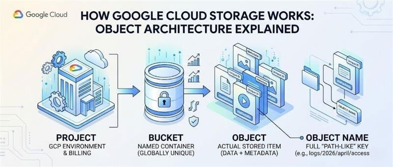
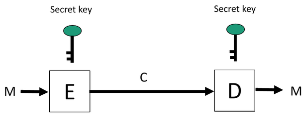
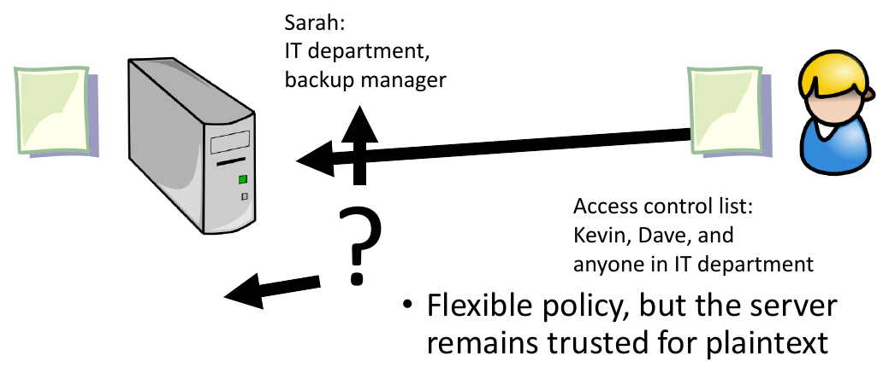
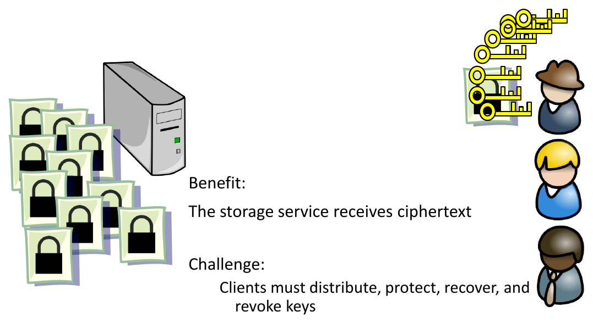
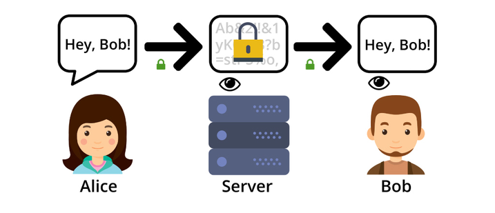

# CSIT953 考试复习 · 第 9 章 安全云存储与共享

> 🎯 **考纲** — *Secure Cloud Storage and Data Sharing — Confidentiality, integrity, access control.*
>
> 可能的题型：单选题考责任共担的边界、数据面与控制面、副本与备份、各种加密范围保护哪一段、DEK 与 KEK 的分工、轮换与重新封装、BYOK 与 HYOK、认证与授权、RBAC 与 ABAC、撤销能做到什么；填空题考术语（shared responsibility、control plane、envelope encryption、DEK、KEK、KMS、least privilege、per-recipient wrapping、CP-ABE）；简答题考为什么只说"已加密"不完整、泄露的 API 凭据怎样变成数据泄露、撤销为什么收不回已拿到的明文、端到端加密不保护什么；问答题多半结合 Assignment 2：给一个云存储或文件共享的场景，要求设计方案，说明怎样做到机密性、完整性和访问控制，怎样分享和撤销，还剩哪些风险，或者反过来找出一个设计里的问题。

> 📚 **来源** — slides：W4 S1–S55（S17 与 S13、S19 与 S18 内容相同）；W12 S8（页脚编号是 9）。录音：W4 录音约 10.3k 字符之后（S1–S35，在 S35 中途结束；S36–S37 不在任何录音里）；W5 录音前约 17.7k 字符（S39–S55）；W13 录音开头（W12 S8）。作业：Assignment 2 的任务说明、报告与设计文档。本章引用：四个安全目标与"按问题选工具"（第 1 章 §1），认证加密（第 1 章 §8），认证 DH 的公开值（第 2 章 §5），ECIES 是"一方临时、一方长期"的 DH（第 2 章 §7），公钥替换问题（第 4 章 §1），智能合约的权限检查（第 7 章 §8），ECDSA 与 RFC 6979（第 8 章 §3–§4），HD 钱包的种子（第 8 章 §6）。

把文件放到云上，就是交给别人的机器保管。这一章回答三个问题：云存储的风险在哪里；用哪些密码学工具、密钥管理和访问控制来管住它；文件要分享给别人时，密钥怎样分发、怎样撤销。云存储这道题和 Assignment 2 直接相关，所以最后一节把全章的概念逐一对到 Assignment 2 的设计上。

§1–§3 讲云存储本身和主要威胁；§4–§7 讲加密与密钥管理；§8 讲访问控制；§9–§11 讲客户端加密、分享和基于属性的加密；§12 用 Assignment 2 把全章串起来。

## 1. 云存储是一项服务，不只是远程硬盘 (W4 S2–S4, S7–S9)

### 1.1 逻辑资源、数据面与控制面 (W4 S7–S8)

应用看到的是逻辑上的对象、文件或卷（volume），提供商在背后把它们映射到物理磁盘和多个副本上。用户不直接控制硬盘，只通过 API 和管理控制台使用存储：创建、读写、版本控制、保留期、删除，都是一次 API 调用。谁能调用这些 API，由身份和策略决定。



所以云存储的安全分两层：

- 数据面（data plane）：读写内容。
- 控制面（control plane）：创建资源，修改权限和加密设置，设定保留期，管理复制。

**读不到文件内容的人，只要能改策略、删密钥、关日志或删备份，照样能造成严重破坏**。安全模型要同时保护数据和这些管理操作。

三类存储的信任模型不同：

| 类型 | 是什么 | 用在哪里 | 要注意 |
|---|---|---|---|
| 对象存储 object | 用 API 寻址的数据加元数据，放在存储桶（bucket）里，规模可以极大 | 备份、媒体、归档、应用数据 | 策略和公开链接可能让整桶数据暴露 |
| 文件存储 file | 共享目录和路径，权限模型大家都熟悉 | 协作、老应用 | 权限、继承的访问和同步带来的失误 |
| 块存储 block | 给操作系统和数据库用的虚拟磁盘 | 虚拟机、数据库 | 文件系统归操作系统管，卷和快照归云平台管 |

三类的 API、分享方式和出错方式各不相同。选控制措施要看工作负载（workload），不能只看"存储"两个字。

### 1.2 方便带来新的依赖 (W4 S2–S3, S9)

云计算已经不新，云安全却仍是新兴课题：服务和身份变化很快，数据在 SaaS、多云和合作方之间流动，法规和数据主权的要求也在变。基础设施成熟，不等于运营安全成熟。云改变了风险的几个维度：

- 位置：工作负载和数据跨出了组织的边界。
- 规模：一个身份或一条策略能影响成千上万个资源。
- 速度：基础设施通过 API 几秒钟就能创建、修改或删除。
- 可见性：资产分散在许多账户、区域和服务里，很难看全。
- 依赖：安全依赖提供商、软件和供应链。

云存储的每个好处都带来一个依赖：

| 好处 | 带来的依赖或风险 |
|---|---|
| 随时随地访问 | 要靠强身份认证和安全的终端 |
| 自动同步 | 也会把误删、损坏或被勒索软件加密的文件同步出去 |
| 弹性扩展 | 一旦暴露，泄露的数据量和费用也跟着放大 |
| 复制 replication | 提高了可用性，也多出了要保护的副本 |
| 托管服务 | 运维简单了，对提供商的依赖却更深 |

### 1.3 责任共担：一张边界图 (W4 S4)

**责任共担模型**（shared responsibility model）把安全工作分给提供商和客户。提供商负责底层的云基础设施：机房、硬件、核心网络和托管服务本身。客户负责数据、身份、配置和使用方式：数据怎样分级，谁能访问，策略和应用配置怎样写。

边界随服务模型移动：

| 模型 | 客户要管的 |
|---|---|
| IaaS 基础设施即服务 | 操作系统、网络配置、应用、数据和身份，管得最多 |
| PaaS 平台即服务 | 应用、数据和身份；操作系统和运行环境的一部分工作移给提供商 |
| SaaS 软件即服务 | 用户、数据分享和许多安全设置；基础设施几乎全归提供商 |

托管服务能减少一些工作，却不能免除责任。课件的说法是：责任共担是一张边界图，不是免责声明。每个设计都要写明每项控制、每种失败归谁负责。

> ✍️ **English answer** — Cloud storage is a service boundary, not just a remote disk: applications address logical objects, files or volumes, the provider maps them to physical storage and replicas, and APIs control creation, access, versioning, retention and deletion. Security must cover both the data plane, which reads and writes content, and the control plane, which changes permissions, encryption settings, retention and replication; a user who cannot read a file can still cause damage by changing its policy or deleting its keys or backups. Under the shared responsibility model, the provider secures the underlying infrastructure and the customer secures data, identities, configuration and permitted use, with the boundary shifting across IaaS, PaaS and SaaS. Managed services reduce tasks but do not remove accountability, so every design should name who owns each control and each failure.

## 2. 先画出数据的一生和信任边界 (W4 S10–S11)

文件的风险随生命周期变化，没有一劳永逸的设置：

| 阶段 | 要做的事 |
|---|---|
| 创建 create | 给数据分级，明确归属，决定谁能读写 |
| 存储 store | 加密、复制、记录日志、设定保留期 |
| 使用 use | 只在获得授权的处理环境里解密；处理时明文总要出现在某处 |
| 分享 share | 分发访问权，同时保留问责（accountability）；分享往往产生新的副本 |
| 归档与删除 archive / delete | 保留证据，并核实确实删除了 |

分享和删除都比看上去难。对方能看，就能复制：网页禁用了右键，对方还能用手机拍屏幕。删除要覆盖每一个版本、副本、缓存和备份：小组报告删掉 V5，V1 到 V4 可能还在。

选控制措施之前先做威胁建模，列出五样东西：

- 资产（assets）：数据，加上密钥、身份、访问策略、日志和备份。后面这些和数据一样有价值。
- 参与者（actors）：普通用户、管理员、应用和自动化服务、提供商的员工、合作方、攻击者。
- 边界（boundaries）：终端、网络、租户、提供商、合作方。
- 动作（actions）：读、写、分享、删除、配置、恢复。
- 失败（failures）：身份被盗、策略写错、恶意软件、服务中断、内部人员滥用。

问答题里"威胁模型"那一段就写这五项，§12.1 用 Assignment 2 示范。

> ✍️ **English answer** — Cloud data needs protection across its whole lifecycle: at creation it is classified and given an owner; in storage it is encrypted, replicated, logged and retained; in use it is decrypted only where authorised processing occurs; when shared, access is distributed without losing accountability, although sharing often creates new copies; and at archive or deletion, evidence is preserved and disposal is verified across versions, replicas, caches and backups. Before choosing controls, a threat model maps the assets (data, keys, identities, policies, logs and backups), the actors (users, administrators, services, provider staff, partners and attackers), the trust boundaries (endpoint, network, tenant, provider and partner), the actions (read, write, share, delete, configure and recover) and the failures (stolen identity, bad policy, malware, outage and insider misuse).

## 3. 主要威胁：配置、身份与恢复 (W4 S12–S21; W12 S8)

当前的云安全问题集中在配置和身份上：配置错误和变更管理薄弱，身份与访问管理（IAM）失败，不安全的 API 和第三方集成，意外泄露和不经认证的分享，资源变化太快、看不全。许多事故用的都是合法的云功能，只是背后的身份或策略权限太大、保护太差，或者配置错了。**问题很少出在加密算法上**：配置一错，用什么算法都挡不住。

### 3.1 一条策略就能暴露整批数据 (W4 S12–S13, S17)

存储权限的威力在于一条策略作用于一大批数据：

- 存储桶、容器或共享目录可能继承过宽的权限。
- 公开访问可能直接打开，也可能通过一个链接打开。
- 跨账户的角色可能造成意想不到的访问路径。
- 配置漂移（configuration drift）：资源开始时符合批准的基线，后来被部署脚本、手工修改、复制的模板或第三方集成改掉。

一条策略单独看合理，和别的权限组合起来就可能危险。预防靠护栏（guardrails）、审查和持续检测，不能只靠一次检查。

### 3.2 泄露的 API 凭据 (W4 S14–S16)

API 凭据代表远程的权力。"API key"可能只是一个标识，也可能是秘密，或者一对凭据中的一半。持有者令牌（bearer token）和访问密钥不需要用户参与就能授权 API 调用，谁拿着谁就能用。凭据能做什么，由它附带的策略决定；它危险，是因为它被授予了有用的权限。长期有效的秘密一旦留在代码、文件或设备里，就很难控制。

泄露的凭据几秒钟就能变成数据泄露：

1. 秘密出现在代码仓库、日志、构建产物或某台终端上。
2. 攻击者复制它，从别处远程调用提供商的 API。
3. 提供商看到的是一个有效的凭据，不是明显的攻击。
4. 凭据的权限可能允许列出、读取、分享或删除数据。
5. 收拾局面要吊销凭据、调查、换上新凭据。

公开仓库里的凭据很快会被自动扫描器发现，攻击者根本不用破解任何加密。

防御的思路是缩短秘密的寿命、缩小它的权力：

- 优先用工作负载身份（workload identity）和短期令牌，不用静态的 API 秘密：虚拟机、容器或函数临时获得权限，代码里不存永久秘密。例如凭据只在 7 天内有效，丢了也只危险 7 天。
- 实在避免不了的秘密，放进托管的秘密管理服务（secrets manager），运行时才注入给获得授权的程序，不写进源代码。
- 限制凭据能做的动作、能访问的资源、生效条件、来源网络和可用的服务。
- 用演练过的流程轮换和吊销凭据。
- 监控异常的调用地点、调用量、错误和权限变化。

### 3.3 勒索软件攻击的是身份和恢复路径 (W4 S18–S20)

云上的勒索软件不一定要在存储服务器上运行恶意程序。攻击者偷到会话、令牌或 API key，就能通过合法的 API 修改或删除数据。同步会把被加密或被删除的文件扩散出去。攻击者还会删掉快照、旧版本，甚至加密密钥。备份如果和生产数据共用同一个身份、同一个控制面，会被一起毁掉。

几种恢复手段应付的事情不同：

- 副本（replica）应付硬件故障，挡不住恶意加密：数据被加密后，副本也跟着变成加密后的样子。
- 版本控制（versioning）能找回被覆盖或删除的内容，前提是攻击者删不掉旧版本。
- 不可变备份（immutable backup）在设定的期限内不能修改，攻击者也改不了。
- 放到别的区域或别的提供商，能应付更大范围的故障，例如整个区域不可用。

**恢复要靠不可变性、隔离和演练过的流程**。恢复目标要有人负责，要测试、要度量。

### 3.4 数据位置与元数据 (W4 S21)

数据在逻辑上是全球的，物理上仍在某个地点。区域影响司法管辖、延迟和可用的服务。副本、备份、日志和支持流程可能遵循与主数据不同的位置规则，所以数据驻留（residency）的承诺要覆盖整个生命周期。加密保护内容，却保护不了全部元数据：文件名、大小、时间戳、身份和访问模式都会透露背景信息。数据分级应当决定驻留、保留和分享的策略。

### 3.5 协作平台上的分享设置 (W12 S8)

云协作让分享变得容易，所以设置更要紧。同一份文档可以只分享给同事，可以分享给访客（guest），也可以分享给"任何拿到链接的人"，对敏感数据来说后果完全不同。**合法用户选错一个分享选项，不需要任何恶意软件就能泄露数据**。

要定期检查三件事：

- 分享：审查公开链接、访客权限和敏感数据的下载。
- 应用：审查第三方应用得到的授权（consent）、服务账户和自动化的权限。第三方应用（包括 AI 助手）可能获准读取文件甚至全部邮件；服务账户在没有人登录时也有访问权。权限应当和它要做的事相符。
- 支持：有人主动提出"技术支持"时，先通过已知的服务台渠道核实身份，再决定是否给远程控制权。聊天本身证明不了对方是谁。

> ✍️ **English answer** — Current cloud threats cluster around configuration and identity rather than broken cryptography: one policy can expose an entire data collection through inherited permissions, public links, cross-account roles or configuration drift, so prevention needs guardrails, review and continuous detection. An API credential represents remote authority: once a key or bearer token leaks from a repository, log, build artifact or endpoint, an attacker can call the provider API from anywhere and the provider sees a valid credential rather than an exploit. Defences are workload identity and short-lived tokens, a managed secrets service, narrowly scoped permissions, rehearsed rotation and revocation, and monitoring. Cloud ransomware uses stolen sessions and legitimate APIs, spreads through synchronisation and deletes snapshots, versions or keys; replicas copy the harmful state, so recovery needs versioning, immutable backups under a separate identity and control plane, and tested procedures. Encryption does not hide metadata such as names, sizes, timestamps and access patterns, and a legitimate user can leak data simply by choosing the wrong sharing option.

## 4. 选对密码学工具 (W4 S23–S27)

四个安全目标，以及哈希、MAC、签名和加密各回答什么问题，见第 1 章 §1。放到云存储里还要记住一点：加密只保护机密性，攻击者照样可以删掉密文，可用性要靠备份和冗余。

### 4.1 对称加密：处理大量数据 (W4 S24)



**对称加密**（symmetric encryption）用同一把密钥加密和解密（图 2），常用 AES。它速度快，适合大文件、数据库记录、备份和大量的网络流量，在线视频就是这样加密传输的。难处在密钥分发：每个要解密的人都必须安全地拿到这把密钥。一把密钥保护的数据太多，泄露时波及的范围（blast radius）就大：1000 个文件共用一把密钥最省事，这把密钥一丢，1000 个文件全部暴露；每个文件一把，又要存储和分发 1000 把密钥。现代系统还要用认证加密，让篡改能被发现，而不是悄悄解出错误的明文（第 1 章 §8）。

### 4.2 公钥密码：解决分发和身份 (W4 S25)

公钥可以公开，私钥自己保管。用接收者公钥加密的内容，只有私钥持有者能打开；用私钥做的签名，谁都能用公钥验证。公钥运算比对称加密慢得多。

公钥密码也没有消除信任：发送者必须确认这把公钥真的属于预期的接收者，否则就是第 4 章 §1 的公钥替换问题。证书、指纹核对和可信的应用，都是用来把公钥和身份绑在一起的。

### 4.3 混合加密 (W4 S26)

实际系统把两者结合起来，叫**混合加密**（hybrid encryption）：

1. 生成一把随机的对称数据密钥。
2. 用它高效地加密文件。
3. 为每个授权的接收者（或者 KMS）保护这把数据密钥，例如用接收者的公钥加密它。
4. 把密文和受保护的密钥材料一起存储或发送。
5. 只在获得授权的环境里恢复数据密钥，再解密文件。

这比用公钥加密整个文件快得多，也天然支持分享：同一份加密文件可以附上几份分别保护的数据密钥，每个接收者一份。设计的重点于是变成：谁能恢复数据密钥，接收者怎样加入和移除，密钥怎样轮换，恢复用的材料放在哪里。

> 👨‍🏫 **课堂强调** — 混合加密今天每天都在用：例如用对方的 RSA 公钥加密一把 AES 密钥，对方用 RSA 私钥解出它，之后的整段会话都用 AES。HTTPS 的思路相同，只是 TLS 1.3 改用临时 DH 建立会话密钥（第 2 章 §6）。

> ✍️ **English answer** — Symmetric encryption such as AES uses the same secret key to encrypt and decrypt; it is fast enough for files, backups and bulk traffic, but every party that decrypts must obtain the key securely, and one key protecting too much data creates a large blast radius. Public-key cryptography lets the public key be shared while the private key stays secret, so anyone can encrypt to the key holder or verify the holder's signatures, but it is slower and still requires the key to be bound to the right identity. Practical systems therefore use hybrid encryption: a fresh random symmetric data key encrypts the file, the data key is protected for each authorised recipient or a KMS, and the ciphertext is stored with the protected key material. The same encrypted file can carry several protected copies of the data key, which supports sharing without re-encrypting the file.

## 5. "已加密"要说清保护到哪一段 (W4 S28)

只说"数据已加密"是不完整的，必须说明加密的范围：

| 范围 | 含义 | 谁还能看到明文 |
|---|---|---|
| 静态加密 at rest | 存储介质和服务内的副本是加密的 | 服务本身：它为获得授权的请求自动解密 |
| 传输加密 in transit | 网络连接保护两个端点之间的数据，例如 TLS | 两个端点，包括云服务器 |
| 使用中 in use | 应用处理数据时，内存里通常是明文 | 处理数据的应用和机器 |
| 客户端加密 client-side | 上传之前在客户端加密 | 只有持有密钥的客户端；提供商只存密文 |
| 端到端加密 end-to-end | 只有通信的两个端点有解密能力 | 只有两端；中间的服务器只经手密文 |

前两种是云服务常说的"已加密"。它们挡得住偷硬盘的人和窃听网络的人，挡不住能以合法身份调用 API 的人：存储桶被设成公开，或者凭据被偷，服务照样把解密后的内容交出去，提供商自己也能读到内容。**不同的范围防不同的威胁**：传输加密再强，数据也可能从被攻破的服务器泄露出去。

处理数据的那一方总要看到明文，这也是第 10 章安全多方计算的出发点。

> ✍️ **English answer** — "Encrypted" is incomplete without the protection scope. Encryption at rest protects storage media and service copies, but the service decrypts automatically for authorised requests, so a public bucket or a stolen credential still exposes plaintext; encryption in transit protects the network path, but each endpoint, including the cloud server, sees plaintext; and an application normally processes plaintext in memory while the data is in use. Client-side encryption encrypts data before upload, so the provider stores only ciphertext, and end-to-end encryption leaves decryption capability only with the communicating endpoints. Each scope defends against different threats, so strong transport encryption does not prevent exposure through a compromised server.

## 6. 信封加密与密钥层级 (W4 S29, S33)

把混合加密用到大规模存储上，就是**信封加密**（envelope encryption）。每个对象（或一小组对象）用一把独立的数据加密密钥（data-encryption key, DEK）加密；DEK 再用一把密钥加密密钥（key-encryption key, KEK）加密，这一步叫封装（wrap）。KEK 通常留在云上的密钥管理服务（KMS）里。封装后的 DEK 可以和密文存在一起，没有上层密钥和解封（unwrap）的权限，它毫无用处。

```svg 图 3 · 信封加密的密钥层级：根密钥保护 KEK，KEK 封装 DEK，DEK 加密对象；按租户分开 KEK，泄露时只影响一部分（W4 S29、S33）
<svg viewBox="0 0 640 340">
  <defs>
    <marker id="k" viewBox="0 0 10 10" refX="9" refY="5" markerWidth="7" markerHeight="7" orient="auto"><path d="M0,0 L10,5 L0,10 z" class="solid-ink"/></marker>
  </defs>
  <text x="20" y="46" class="warn">层级越高，泄露波及越广</text>
  <rect x="220" y="20" width="230" height="44" rx="6" class="accent fill-soft" stroke-width="2"/>
  <text x="335" y="47" text-anchor="middle">根密钥（在 KMS / HSM 里）</text>
  <rect x="100" y="100" width="150" height="40" rx="6" class="ink" fill="none" stroke-width="1.5"/>
  <text x="175" y="125" text-anchor="middle">KEK · 租户 A</text>
  <rect x="420" y="100" width="150" height="40" rx="6" class="ink" fill="none" stroke-width="1.5"/>
  <text x="495" y="125" text-anchor="middle">KEK · 租户 B</text>
  <rect x="40" y="175" width="110" height="36" rx="6" class="ink" fill="none" stroke-width="1.5"/>
  <text x="95" y="198" text-anchor="middle">DEK 1</text>
  <rect x="200" y="175" width="110" height="36" rx="6" class="ink" fill="none" stroke-width="1.5"/>
  <text x="255" y="198" text-anchor="middle">DEK 2</text>
  <rect x="440" y="175" width="110" height="36" rx="6" class="ink" fill="none" stroke-width="1.5"/>
  <text x="495" y="198" text-anchor="middle">DEK 3</text>
  <rect x="20" y="245" width="150" height="52" rx="6" class="good fill-good" stroke-width="1.5"/>
  <text x="95" y="266" text-anchor="middle">对象 1 的密文</text>
  <text x="95" y="287" text-anchor="middle">+ 封装的 DEK 1</text>
  <rect x="180" y="245" width="150" height="52" rx="6" class="good fill-good" stroke-width="1.5"/>
  <text x="255" y="266" text-anchor="middle">对象 2 的密文</text>
  <text x="255" y="287" text-anchor="middle">+ 封装的 DEK 2</text>
  <rect x="420" y="245" width="150" height="52" rx="6" class="good fill-good" stroke-width="1.5"/>
  <text x="495" y="266" text-anchor="middle">对象 3 的密文</text>
  <text x="495" y="287" text-anchor="middle">+ 封装的 DEK 3</text>
  <line x1="300" y1="64" x2="190" y2="98" class="ink" stroke-width="1.5" marker-end="url(#k)"/>
  <line x1="370" y1="64" x2="480" y2="98" class="ink" stroke-width="1.5" marker-end="url(#k)"/>
  <text x="470" y="80" class="muted">封装</text>
  <line x1="150" y1="140" x2="105" y2="173" class="ink" stroke-width="1.5" marker-end="url(#k)"/>
  <line x1="200" y1="140" x2="245" y2="173" class="ink" stroke-width="1.5" marker-end="url(#k)"/>
  <line x1="495" y1="140" x2="495" y2="173" class="ink" stroke-width="1.5" marker-end="url(#k)"/>
  <text x="505" y="162" class="muted">封装</text>
  <line x1="95" y1="211" x2="95" y2="243" class="ink" stroke-width="1.5" marker-end="url(#k)"/>
  <line x1="255" y1="211" x2="255" y2="243" class="ink" stroke-width="1.5" marker-end="url(#k)"/>
  <line x1="495" y1="211" x2="495" y2="243" class="ink" stroke-width="1.5" marker-end="url(#k)"/>
  <text x="505" y="232" class="muted">加密</text>
  <text x="320" y="325" text-anchor="middle" class="muted">封装后的 DEK 和密文放在一起；没有 KEK 和解封权限，它没有用</text>
</svg>
```

这样一来，大文件只加密一次：策略变化时，例如换一把 KEK，只需重新封装几十字节的 DEK。能否解封 DEK 成了一个集中的安全决定，便于统一授权、审计和轮换。

层级越高，权力越大（图 3）。根密钥（root key，也叫 master key）保护下层的 KEK，KEK 保护许多短期的 DEK，DEK 保护单个对象、会话或一小组数据。**泄露发生的层级越高，受影响的部分越大**；这和第 8 章 HD 钱包的种子一样，拿到根就拿到一切。按租户、工作负载、区域或敏感程度分开使用 KEK，能把损失限制在一部分里。

> ✍️ **English answer** — Envelope encryption encrypts each object or small group with a unique data-encryption key (DEK) and wraps the DEKs with a key-encryption key (KEK), usually held in a key management service (KMS). The wrapped DEK can be stored next to the ciphertext, because it is useless without the higher-level key and permission to unwrap it. The large ciphertext does not need to be re-encrypted for every policy change, only the small DEK re-wrapped, and access to unwrap becomes a central, auditable security decision. In the hierarchy, root keys protect KEKs, KEKs protect many short-lived DEKs and DEKs protect individual objects, so compromise at a higher level affects more data, and separating keys by tenant, workload, region or sensitivity contains the damage.

## 7. 密钥管理 (W4 S31–S37)

### 7.1 算法很少是最弱的一环 (W4 S31)

现代加密很少因为密钥被猜中而失败，失败出在管理密钥的方式上：

- 密钥通过代码、配置文件、日志、备份、内存转储或支持工具泄露。
- 权限过宽，一个应用身份成了能解密一切的"解密器"：数据全都加密存放，某个应用却能调用 API 解密任何对象。
- 密钥不可用或被删除，完好的密文也成了废数据。可用性和保密同样重要。
- 长期使用的密钥积累暴露机会，还有被遗忘的依赖。
- 安全取决于人、流程、软件和恢复，不只是算法。

### 7.2 云上的 KMS (W4 S32)

**密钥管理服务**（key management service, KMS）集中管理密钥策略和审计。它生成并保护 KEK；授权加密、解密、封装、解封和管理操作；把每次密钥使用记入集中的审计日志；还可以接入硬件安全模块（HSM），更好地隔离密钥材料。应用不再接触长期密钥，只请求 KMS 做某个操作。

代价是 KMS 成了价值很高的控制面。调用解密的权限，就等于读取受保护数据的权限；修改密钥策略或安排删除密钥的管理权限，可能更大。

### 7.3 密钥的生命周期 (W4 S34)

| 阶段 | 要求 |
|---|---|
| 生成 generate | 用经过认可的随机源，在受保护的服务里生成 |
| 启用 activate | 先明确归属、允许的用途、管理员、审计设置和恢复要求 |
| 使用 use | 只允许受限的操作，只给通过认证的工作负载；监控异常的地点、身份、用量和时间 |
| 轮换或吊销 rotate / revoke | 到期、策略要求或发生事故时更换或停用 |
| 归档或销毁 archive / destroy | 按保留和恢复的需要处理；历史数据可能还要用旧密钥解密 |

### 7.4 轮换不等于重新加密一切 (W4 S35)

三个容易混的操作：

| 操作 | 改变了什么 | 开销 |
|---|---|---|
| 轮换 rotation | 新的密钥版本用于今后的加密；旧密文仍依赖旧版本 | 小 |
| 重新封装 re-wrapping | 换一把 KEK 保护 DEK，文件密文不变 | 小 |
| 完全重新加密 full re-encryption | 用新的 DEK 重新加密数据，密文本身改变 | 大 |

轮换之后，旧版本的密钥材料仍要保护好，历史数据还要靠它解密。DEK 本身暴露时，重新封装没有用：攻击者手里已经有 DEK，文件密文又没变，所以必须完全重新加密。发生事故时，行动可能要比例行轮换快得多。

### 7.5 恢复要分权 (W4 S36)

- 任何一个操作员都不能悄悄导出或销毁关键密钥。
- 恢复用的材料与日常操作分开保护。
- 高影响的操作可以要求法定人数（quorum）批准，例如三个管理员里至少两个同意。第 8 章的多重签名、第 10 章的门限是同一个思路。
- 备份要测试，但不能让不必要的密钥暴露变成常态。
- 紧急访问要记录、限时，事后复核。

### 7.6 谁持有密钥 (W4 S37)

| 模型 | 含义 | 客户的控制 |
|---|---|---|
| 提供商管理 provider-managed | 提供商生成和管理密钥 | 最少，运维最省事 |
| 客户管理 customer-managed | 密钥在提供商的 KMS 里，策略和生命周期由客户定 | 中等 |
| BYOK（bring your own key） | 客户自己产生密钥材料，导入云服务 | 较多 |
| HYOK / 外部密钥（hold your own key） | 密钥留在外部的控制边界里 | 最多 |

控制越多，集成、可用性和恢复的负担越重：外部的密钥服务一旦不可用，云上的数据也就打不开了。

> ✍️ **English answer** — The algorithm is rarely the weakest key-management link: keys leak through code, logs, backups, memory or support tools, over-broad permissions turn an application identity into a decryptor, and unavailable or deleted keys make healthy ciphertext useless. A cloud KMS generates and protects key-encryption keys, authorises encrypt, decrypt, wrap and unwrap operations, records each use in audit logs and can use HSMs, but it is a high-value control plane, because permission to call decrypt is equivalent to permission to read the data. Keys follow a lifecycle of generation, activation, constrained use, rotation or revocation, and archive or destruction. Rotation activates a new key version for future operations while old ciphertext still depends on old versions; re-wrapping changes the protection of a data key without changing the file; full re-encryption changes the data ciphertext, costs more and is needed when the data key itself is exposed. Recovery requires separation of duties such as quorum approval, and the ownership models (provider-managed, customer-managed, BYOK and HYOK) trade more control for more integration, availability and recovery burden.

## 8. 访问控制 (W4 S39–S43)

### 8.1 认证与授权 (W4 S39)

**认证**（authentication）确定发出请求的是谁，或者是哪个工作负载，可以用口令、多因素认证、证书、设备身份或工作负载凭据。

**授权**（authorization）决定这个主体能不能对某个资源执行某个动作。

两者解决不同的问题：身份有效，权限却可能过大；策略写得再好，凭据被偷了也没用。好的系统把请求作为整体来判断：主体、动作、资源、上下文（设备状态、网络、时间、风险评分、资源敏感度）和策略。

### 8.2 最小权限 (W4 S40)

**最小权限**（least privilege）只授予完成当前任务所需的动作。在云上还要限制资源、条件、时长和委托：只需读取某个存储前缀的工作负载，不该拿到删除整个账户的权限。临时凭据比嵌在代码里的长期密钥好，被偷了价值也小。环境变化快，角色会越积越多权限，所以最小权限不是一次性的审查：要定期找出不用的权限，删掉废弃的身份。修改策略本身是特权操作，要审批、监控，还要能回滚。

### 8.3 RBAC 与 ABAC (W4 S41–S42)

**基于角色的访问控制**（role-based access control, RBAC）把权限赋给角色，再把用户或工作负载分到角色里。存储系统可能定义读者（reader）、编辑（editor）、备份操作员（backup operator）和安全审计员（security auditor）。权限跟着工作职能走，不必为每个人单独管理，职责稳定、分工清楚时很好用。问题出在角色太多（role explosion），或者把太多权限塞进一个图方便的大角色；一个人身兼几个角色，权限合起来也可能形成意外的路径。

**基于属性的访问控制**（attribute-based access control, ABAC）按属性和上下文做决定：

| 属性 | 例子 |
|---|---|
| 主体 subject | 部门、安全级别、在职状态 |
| 资源 resource | 所有者、敏感度、项目、区域 |
| 动作 action | 读、写、分享、删除、管理 |
| 上下文 context | 时间、设备、地点、风险、网络 |

例如：用户的部门与研究项目一致、设备受管理、请求来自批准的区域时，才允许读取。策略组合多个属性，能做出比固定角色更细的决定。

### 8.4 服务器把关的访问控制 (W4 S43)



RBAC 和 ABAC 通常由服务器执行（图 4）。客户端先向存储服务认证，再请求文件；服务按用户的身份、角色、属性和资源的元数据评估策略，允许就返回数据。Sarah 属于 IT 部门，符合"IT 部门的任何人"，所以能拿到文件。这种模式很灵活：策略集中修改、立即生效，还能用当前的上下文。代价是**服务器必须被信任**：它握着明文，决定交给谁。服务器被攻破、管理员作恶或者策略写错，访问控制就失效了。

> ✍️ **English answer** — Authentication establishes which identity or workload principal is making a request, while authorisation decides whether that principal may perform a particular action on a particular resource; a valid identity can still have excessive permissions, and a correct policy fails when credentials are stolen. Least privilege grants only the actions needed for the current task and also limits resources, conditions, duration and delegation, preferring short-lived credentials and removing unused permissions. RBAC assigns permissions to roles such as reader, editor or backup operator and works well when job functions are stable, but suffers from role explosion and over-broad roles; ABAC evaluates subject, resource, action and context attributes for finer decisions. Both are usually enforced by a server, which is flexible because policy changes take effect immediately, but the server remains trusted for the plaintext.

## 9. 客户端加密与端到端加密 (W4 S45–S47)

### 9.1 客户端加密：把明文从提供商那里拿走 (W4 S45)



**客户端加密**（client-side encryption）在文件到达云存储之前就加密好（图 5），例如上传到 OneDrive 或 Google Drive 之前，先在自己的电脑上加密。提供商只存储密文，复制和分发副本也不需要接触密钥。存储服务被攻破，或者提供商的管理员想偷看，看到的都是密文。

信任没有消失，只是转移了：客户端程序必须正确，终端必须安全，用户必须拿到正确的密钥。图 5 右边那串钥匙就是代价：客户端要自己分发、保护、恢复和撤销密钥，§4.1 说的取舍（一个文件一把密钥，还是一把密钥管许多文件）也落到了客户端身上。

### 9.2 端到端加密：服务器不在明文的路径上 (W4 S46)



**端到端加密**（end-to-end encryption, E2EE）由发送方为预期的接收端加密内容（图 6），中间的服务器没有解密所需的密钥。服务器可以转发、存储密文、管理投递，却不能在中途解密再加密。它和传输加密的区别在于信任边界：传输加密下，服务器是能看到明文的端点（第 4 章 §13）；E2EE 下只有通信的两端能解密。

协议仍要认证参与者、管理设备和群组成员、分发密钥、支持恢复。服务器在可用性、消息顺序和账户管理上仍然被信任。

### 9.3 E2EE 保护内容，不保护端点和全部元数据 (W4 S47)

- 恶意软件，或者被偷走的已解锁设备，能直接读到明文。
- 接收者可以复制、截屏或导出解密后的内容。
- 服务器仍能看到身份、时间、大小和通信模式。
- 备份可能悄悄削弱端到端的边界，例如聊天记录以明文备份到云上。
- 核对密钥和更换设备需要好用的安全设计：新设备也要获得解密能力，把密钥转移过去本身就是敏感的时刻。

> 👨‍🏫 **课堂强调** — 用端到端加密把文件存到 Google，Google 读不到内容，却仍然知道你是谁（注册时绑定的手机、信用卡、地址），从哪台设备上传，把文件分享给了谁。

> ✍️ **English answer** — Client-side encryption encrypts data before it reaches cloud storage, so the provider stores and replicates only ciphertext, which limits the damage of a storage compromise and what provider administrators can read. Trust does not disappear but moves to the client software, the endpoint and key distribution, since clients must distribute, protect, recover and revoke keys. End-to-end encryption goes further: only the communicating endpoints hold decryption capability, and an intermediate server can store and forward ciphertext but cannot decrypt and re-encrypt it, unlike transport encryption, where the server is an endpoint that sees plaintext. E2EE protects content, not endpoints or all metadata: malware or a stolen unlocked device can read plaintext, recipients can copy or screenshot it, the server still observes identities, timing, size and communication patterns, backups can weaken the boundary, and adding devices or verifying keys needs usable design.

## 10. 分享就是分发密钥 (W4 S48–S50)

### 10.1 要解决什么 (W4 S48)

数据在客户端加密以后，分享就不只是把密文交给对方，而是把解密能力交给对方。安全的分享要做到：

- 发送者确认预期的接收者或群组，取得可信的公钥、属性或安全的投递渠道。
- 接收者得到解密能力，却拿不到长期的主密钥。
- 成员变化时高效地更新今后的访问：加一个人，不应要求重新加密每个大文件；移除一个人，应尽可能有效地阻止此后的访问。
- 有审计、过期、设备恢复，以及密钥泄露后的响应。
- 易用：用户觉得难用，技术上正确的密码学也会被绕开。

### 10.2 五种分享方式 (W4 S49)

| 方式 | 做法 | 优点 | 缺点 |
|---|---|---|---|
| 服务器策略 server policy | 服务器按访问控制列表决定给谁（§8.4） | 灵活、容易 | 服务器始终被信任 |
| 共享秘密 shared secret | 一群人共用一把密钥或一个口令 | 小群组用起来简单 | 分不清是谁做的，难以撤销某一个人 |
| 逐个接收者封装 per-recipient wrapping | 文件用一把 DEK 加密，DEK 用每个接收者的公钥分别封装 | 身份明确，可以单独撤销 | 密钥管理工作更多 |
| 群组密钥 group key | 一把密钥给整个群组 | 高效 | 成员一变就要更新密钥 |
| 公开链接 public link | 拿到链接的人都能访问 | 方便 | 链接往往成了持有者凭据（bearer credential），转给谁谁就能用 |

逐个接收者封装就是 §4.3 混合加密在分享上的应用，Assignment 2 用的正是它（§12）。

### 10.3 撤销收不回已拿到的明文 (W4 S50)

- 删掉服务器上的权限，能阻止今后的授权下载。
- 轮换或重新封装密钥，能保护今后加密的新版本。
- 被移除的人可能还留着密文和旧密钥。把文件分享给 10 个人，第二天移除其中一个，对方从此访问不了云端，可之前合法下载到自己电脑上的文件，你没有办法删掉。
- 水印和审计能提高问责，却不能在密码学上"召回"数据。
- 访问期限和成员变化的处理，要在部署之前设计好。

> ✍️ **English answer** — Once data is encrypted on the client, sharing means distributing decryption capability, so secure sharing is fundamentally a key-distribution problem: the sender must identify the intended recipients and obtain trustworthy public keys or attributes, recipients need decryption capability without exposing a master key, membership changes should update future access efficiently, and the system needs audit, expiry, recovery and compromise response. Server policy is flexible but keeps the server trusted; a shared secret is simple for small groups but weak for accountability and revocation; per-recipient wrapping gives strong identity at the cost of more key management; a group key is efficient but needs updating when membership changes; and a public link often becomes a bearer credential. Revocation cannot erase plaintext already obtained: removing server permission stops future downloads and rotating or re-wrapping keys protects future versions, but a former recipient may keep ciphertext, old keys and downloaded files, and watermarking and audit improve accountability, not cryptographic recall.

## 11. 基于属性的加密 (W4 S51–S54)

### 11.1 把策略写进密文 (W4 S51, S53)

传统的加密分享面向具名的接收者或密钥。群组又大又常变时，逐个接收者管理密钥的开销很大。**基于属性的加密**（attribute-based encryption, ABE）用属性而不是具体的人来描述策略：只有密钥里的属性满足策略，才能解密。存储服务器即使不可信，也读不到内容。

```svg 图 7 · CP-ABE：密文带着策略"IT 部门 OR（经理 AND 市场部）"；Sarah 的属性满足左支，Kevin 两支都不满足（按 W4 S53 重画）
<svg viewBox="0 0 640 330">
  <rect x="110" y="12" width="420" height="36" rx="6" class="accent fill-soft" stroke-width="2"/>
  <text x="320" y="36" text-anchor="middle">密文的策略：IT 部门 OR（经理 AND 市场部）</text>
  <text x="165" y="80" text-anchor="middle">Sarah 的私钥：经理、IT 部门</text>
  <text x="460" y="80" text-anchor="middle">Kevin 的私钥：经理、销售部</text>
  <line x1="153" y1="126" x2="105" y2="152" class="muted" stroke-width="1.5"/>
  <line x1="177" y1="126" x2="220" y2="150" class="muted" stroke-width="1.5"/>
  <line x1="220" y1="182" x2="198" y2="212" class="muted" stroke-width="1.5"/>
  <line x1="242" y1="182" x2="280" y2="212" class="muted" stroke-width="1.5"/>
  <ellipse cx="165" cy="110" rx="30" ry="17" class="good fill-good" stroke-width="2"/>
  <text x="165" y="115" text-anchor="middle">OR</text>
  <rect x="55" y="152" width="90" height="28" rx="6" class="good fill-good" stroke-width="1.5"/>
  <text x="100" y="171" text-anchor="middle">IT 部门 ✓</text>
  <ellipse cx="230" cy="166" rx="34" ry="17" class="warn fill-warn" stroke-width="1.5"/>
  <text x="230" y="171" text-anchor="middle">AND</text>
  <rect x="160" y="212" width="72" height="28" rx="6" class="good fill-good" stroke-width="1.5"/>
  <text x="196" y="231" text-anchor="middle">经理 ✓</text>
  <rect x="245" y="212" width="80" height="28" rx="6" class="warn fill-warn" stroke-width="1.5"/>
  <text x="285" y="231" text-anchor="middle">市场部 ✗</text>
  <line x1="448" y1="126" x2="400" y2="152" class="muted" stroke-width="1.5"/>
  <line x1="472" y1="126" x2="515" y2="150" class="muted" stroke-width="1.5"/>
  <line x1="515" y1="182" x2="493" y2="212" class="muted" stroke-width="1.5"/>
  <line x1="537" y1="182" x2="575" y2="212" class="muted" stroke-width="1.5"/>
  <ellipse cx="460" cy="110" rx="30" ry="17" class="warn fill-warn" stroke-width="2"/>
  <text x="460" y="115" text-anchor="middle">OR</text>
  <rect x="350" y="152" width="90" height="28" rx="6" class="warn fill-warn" stroke-width="1.5"/>
  <text x="395" y="171" text-anchor="middle">IT 部门 ✗</text>
  <ellipse cx="525" cy="166" rx="34" ry="17" class="warn fill-warn" stroke-width="1.5"/>
  <text x="525" y="171" text-anchor="middle">AND</text>
  <rect x="455" y="212" width="72" height="28" rx="6" class="good fill-good" stroke-width="1.5"/>
  <text x="491" y="231" text-anchor="middle">经理 ✓</text>
  <rect x="540" y="212" width="80" height="28" rx="6" class="warn fill-warn" stroke-width="1.5"/>
  <text x="580" y="231" text-anchor="middle">市场部 ✗</text>
  <text x="165" y="278" text-anchor="middle" class="good">满足左支 → 能解密</text>
  <text x="460" y="278" text-anchor="middle" class="warn">两支都不满足 → 解不开</text>
  <text x="320" y="314" text-anchor="middle" class="muted">属性机构用主密钥 MSK 签发私钥；加密者用公开参数 PK 和策略加密</text>
</svg>
```

在密文策略 ABE（ciphertext-policy ABE, CP-ABE）里，属性机构用主密钥（master secret key, MSK）给每个用户签发私钥，私钥里写着这个人的属性；加密者用公开参数（PK）加上一条策略加密文件。解密时，私钥的属性满足策略才能成功（图 7）。Sarah 的属性是"经理"和"IT 部门"，满足左边的"IT 部门"，能解密。Kevin 的属性是"经理"和"销售部"：是经理，却不在市场部，AND 不成立；也不在 IT 部门，所以解不开。加密者用一条策略加密一次，IT 部门的 50 个员工都能解密，不必把解密密钥逐个发给每个人。

### 11.2 RBAC 和 ABE 在不同的边界上执行策略 (W4 S52)

| | RBAC（服务器把关） | ABE（密码学把关） |
|---|---|---|
| 谁执行策略 | 可信的服务先检查角色，再交出数据 | 密文本身：只有属性匹配的密钥能解密 |
| 对存储的信任 | 服务器能看到明文 | 存储可以不可信 |
| 修改策略 | 立即生效，能用丰富的运行时上下文 | 要发新密钥或重新加密 |
| 撤销 | 删掉权限即可 | 复杂 |

两者可以互补，不必二选一。例如服务器先按角色决定谁能下载密文，下载到的密文仍要有匹配的属性才能解开。

### 11.3 ABE 的代价 (W4 S54)

- 属性机构必须核实并签发可信的属性。它握着主密钥，能为任意属性签发私钥，必须被信任。
- 撤销和属性变化可能需要重新发密钥，或者把密钥按时间段划分。
- 策略本身可能泄露组织的敏感信息，例如密文上写着"只有并购小组能看"。
- 计算和密文的开销都比普通加密大。
- 终端被攻破、明文被复制，ABE 同样管不了。

> ✍️ **English answer** — Attribute-based encryption (ABE) places the access policy inside the encrypted data: decryption succeeds only when the attributes in a user's key satisfy the policy, so the storage server can remain untrusted for confidentiality, and a large, changing group does not need per-recipient key management. In CP-ABE, an attribute authority uses a master secret key to issue each user a private key containing their attributes, and the encryptor attaches a policy such as "IT dept. OR (manager AND marketing)": Sarah (manager, IT dept.) can decrypt, while Kevin (manager, sales) cannot. RBAC is enforced by a trusted service that checks roles before releasing data and supports immediate policy changes and rich runtime context, whereas ABE reduces trust in storage but complicates keys and revocation, so the two can complement each other. ABE also needs trustworthy attribute authorities, may require rekeying or time periods for revocation, can reveal sensitive information through its policies, has higher computation and ciphertext overhead, and cannot stop endpoint compromise or plaintext copying.

## 12. 用 Assignment 2 把全章串起来 (W4 S55; Assignment 2)

课件把安全云存储归结为五个控制面对齐：

| 控制面 | 要做到 |
|---|---|
| 存储 storage | 生命周期、韧性、位置和可见性 |
| 密码学 cryptography | 在正确的边界上提供正确的性质 |
| 密钥 keys | 受限使用、审计、轮换、恢复和销毁 |
| 访问 access | 强身份、最小权限、RBAC 或属性 |
| 分享 sharing | 可信的接收者、好用的分发、现实的撤销 |

Assignment 2（Secure File Share）的要求是：文件存储之前加密；所有者签名，让请求者能验证；区块链记录文件登记、访问请求和所有者的批准或拒绝；智能合约执行访问控制，不能只当日志；批准后把文件密钥安全地交给请求者，不能明文传输；还要有 GUI。下面按威胁模型、设计、局限三步，把它和本章对应起来。问答题可以照这个顺序写。

> 👨‍🏫 **课堂强调** — 云存储这道题就是 Assignment 2：认真做过小组作业就一定能答；只让 AI 做、自己没有思考过，就答不出来。

### 12.1 威胁模型

只信任用户自己的电脑和客户端程序。存储被当作不可信的云提供商。区块链在完整性和顺序上被信任，在保密上不被信任，因为链上的一切都是公开的。攻击者有五类：

| 攻击者 | 能做什么 |
|---|---|
| A1 好奇或被攻破的存储提供商 | 读取、修改、删除或回滚任何对象和清单 |
| A2 未授权的注册用户 Mallory | 用任意参数调用合约的任何函数，读取链上全部数据 |
| A3 链和网络的观察者 | 看到每笔交易的输入数据和事件，在公链上还能抢先交易 |
| A4 公钥替换攻击者 | 设法让所有者把文件密钥加密给攻击者的公钥 |
| A5 被撤销的请求者 | 保留撤销之前拿到的一切 |

### 12.2 设计

```d2 图 8 · Assignment 2 的一次完整交换：存储只经手密文，合约只经手哈希和封装后的 DEK
shape: sequence_diagram
A: Alice（所有者）
S: 存储（不可信） {class: warn}
C: 智能合约
B: Bob（请求者）
A -> A: "随机 DEK，AES-GCM 加密\n给清单签名"
A -> S: "① 密文对象 + 签名的清单"
A -> C: "② 登记：两个哈希\n+ 封装给自己的 DEK"
B -> C: "③ 请求访问"
A -> C: "④ 批准：用 Bob 的公钥\n封装的 DEK"
C -> B: "⑤ 封装的 DEK、哈希\nAlice 的签名公钥"
S -> B: "⑥ 密文对象 + 清单"
B -> B: "核对哈希和签名\n解封 DEK，解密"
```

图 8 的流程按五个控制面拆开：

| 控制面 | Assignment 2 的做法 | 对应 |
|---|---|---|
| 存储 storage | 本地文件夹模拟不可信的对象存储；对象以密文的 SHA-256（ctHash）命名，链上记录同一个值 | §1.1、§3.3 |
| 密码学 cryptography | 每个文件一把随机 DEK，用 AES-256-GCM 加密，附加数据（AAD）绑定链、合约、文件 ID 和所有者；所有者用 ECDSA 签名一份清单（manifest），清单里有密文哈希和明文摘要 | §9.1；第 1 章 §8；第 8 章 §3 |
| 密钥 keys | 每个用户三把密钥各管一件事：发交易、签清单、接收封装的 DEK；私钥存在用 scrypt 和 AES-GCM 加密的 keystore 里；签名的随机数按 RFC 6979 生成 | §7；第 8 章 §4 |
| 访问 access | 合约记录每个文件的所有者，批准、拒绝、撤销都检查调用者是不是所有者；请求按状态机流转；每个动作都发事件，形成审计记录 | §8.1；第 7 章 §8 |
| 分享 sharing | 批准时用 ECIES 把 DEK 封装给请求者，存进合约；请求者的公钥由本人的账户登记在链上 | §10.2；第 2 章 §7 |

三个安全目标这样实现：

- 机密性：明文、DEK 和私钥从不离开用户的电脑。存储只有密文；链上的 DEK 只以 ECIES 密文的形式出现，没有 Bob 的私钥就算不出共享秘密，所以放在公开的合约里也安全。派生封装密钥时把文件 ID 和接收者写进 HKDF，封装给 Bob 的 DEK 挪到别的文件或交给别人，都解不开。
- 完整性与真实性：Bob 在解密前后共做六项检查：对象和清单的哈希分别等于链上的 ctHash 和 manifestHash；清单里的链、合约、文件 ID 和所有者与链上一致；用 Alice 登记在链上的签名公钥验证清单签名；GCM 的认证标签通过；解出的内容与签名的明文摘要一致。存储改了一个字节、换回旧版本、伪造清单再用自己的密钥签名，都会被发现。验证公钥只从链上取，所以存储换不掉它。
- 访问控制：只有所有者能批准。Mallory 想批准自己对 Alice 文件的请求，合约发现调用者不是所有者，交易回滚。链上的 private 变量谁都能读，所以合约负责授权，保密只能靠加密：合约决定谁被批准，ECIES 保证只有被批准的人解得开。这正是 §11.2 说的两种边界互补。

公钥替换问题（第 4 章 §1）在这里这样解决：Bob 的加密公钥由 Bob 的账户发交易登记，别人改不了；封装的 DEK 只有所有者能写入。两端的公钥都经过认证，ECIES 里的 DH 就不怕中间人（第 2 章 §5）。地址毕竟不是真实身份，所以 GUI 让双方通过别的渠道核对公钥指纹。

### 12.3 局限：和课件的结论一致

| 局限 | 原因 | 对应 |
|---|---|---|
| 撤销收不回已交付的 DEK | 撤销会删掉合约里封装的 DEK，但 Bob 已经解出的 DEK 照样能用，批准交易的输入数据也永远留在链上；要真正切断，得换一把新 DEK 重新加密文件，只封装给仍被授权的人 | §10.3、§7.4 |
| 元数据公开 | 谁拥有哪个文件、谁在什么时候向谁请求，都在链上 | §3.4、§9.3 |
| 终端被信任 | Bob 电脑上的恶意软件能在解密后读到明文 | §9.3 |
| 没有前向安全 | Bob 的加密私钥日后泄露，发给 Bob 的所有封装 DEK 都能打开 | 第 2 章 §6 |
| 存储能删除数据 | 能发现，不能阻止；要靠副本和备份 | §3.3 |

> ✍️ **English answer** — In our design (Assignment 2), the client encrypts each file before upload with a fresh random DEK using AES-256-GCM, so the untrusted storage holds only ciphertext, and the owner signs a manifest containing the ciphertext hash and a plaintext digest with ECDSA; the hashes are recorded on-chain, so a requester detects modification, rollback or a forged manifest by checking them and verifying the signature with the owner's on-chain key. A smart contract records ownership and lets only the owner approve, reject or revoke a request, emitting events as an audit trail; because everything on-chain is public, the contract enforces authorisation, not confidentiality. On approval, the owner wraps the DEK for the requester with ECIES under the requester's registered public key, with HKDF binding it to the file and the recipient, so only that requester can unwrap it although it is stored publicly. Because each user registers their own keys from their own account, the owner cannot be tricked into encrypting to a substituted key. Revocation deletes the wrapped key but cannot recall a DEK already delivered, so complete revocation requires re-encrypting the file under a new DEK, and public sharing metadata and compromised endpoints remain residual risks.

## ⚠️ 易混易错

| 容易混的 | 区别 |
|---|---|
| 数据面 vs 控制面 | 读写内容 vs 修改权限、加密设置、保留期和复制；读不到内容的人改了策略也能造成破坏 |
| 提供商 vs 客户的责任 | 提供商管底层基础设施；客户管数据、身份、配置和使用方式；托管服务不免除责任 |
| 副本 vs 版本 vs 不可变备份 | 副本应付硬件故障，会复制有害的状态；版本能回到旧状态；不可变备份在期限内谁都改不了 |
| 静态 / 传输 / 客户端 / 端到端加密 | 看谁还能看到明文：服务本身 / 两端包括服务器 / 只有持钥的客户端 / 只有通信两端 |
| DEK vs KEK vs 根密钥 | DEK 加密数据；KEK 封装 DEK；根密钥保护 KEK。层级越高，泄露影响越大 |
| 轮换 vs 重新封装 vs 完全重新加密 | 新版本用于今后，旧密文仍靠旧版本 / 换 KEK 保护 DEK，文件不变 / 用新 DEK 重新加密数据 |
| BYOK vs HYOK | 客户自带密钥材料导入云 vs 密钥留在外部边界，不交给云 |
| 认证 vs 授权 | 你是谁 vs 你能对哪个资源做什么 |
| RBAC vs ABAC | 按角色 vs 按主体、资源、动作和上下文的属性 |
| ABAC vs ABE | 服务器按属性决定是否交出数据，服务器看得到明文 vs 密文本身只让属性匹配的密钥解开 |
| 撤销 vs 召回 | 撤销阻止今后的访问；已经拿到的明文和 DEK 收不回来 |

常见误解：

- "数据加密了就安全"：要看范围。静态加密挡不住配置错误、被偷的凭据和提供商本身。
- "API key 放在私有代码里就没事"：代码、日志、构建产物都会泄露，要用短期凭据和秘密管理服务。
- "KMS 管着密钥，应用就碰不到数据"：有解密权限的应用就能读数据。
- "轮换密钥会自动重新加密旧数据"：旧密文仍依赖旧版本，DEK 暴露时必须完全重新加密。
- "端到端加密后服务器什么都不知道"：身份、时间、大小和通信关系仍然可见。
- "撤销权限就能收回文件"：只能阻止今后的访问。
- "合约里的 private 变量别人读不到"：链上数据人人可读，密钥只能以密文形式上链。

## 📝 Practice

### Part A · Multiple choice

**A1.** Under the shared responsibility model, which task remains the customer's responsibility even when using a managed storage service?
A. Physical security of the data centre
B. Maintaining the provider's storage hardware
C. Classifying data, managing identities and configuring access policies
D. Patching the provider's core infrastructure

<details>
<summary>Answer A1</summary>

**C.** The provider secures the underlying infrastructure; the customer secures data, identities, configuration and permitted use, and managed services do not remove that accountability.

</details>

**A2.** A company enables the provider's default encryption at rest, but a bucket is accidentally made public. What is the result?
A. Visitors can download only ciphertext.
B. The service decrypts objects for every request that the policy allows, so the data is exposed.
C. The provider automatically rotates the key and blocks access.
D. Nothing, because encryption at rest protects against misconfiguration.

<details>
<summary>Answer A2</summary>

**B.** Encryption at rest protects media and service copies, but the service decrypts automatically for authorised requests, and a public policy authorises everyone.

</details>

**A3.** Ransomware encrypts the files in a synchronised cloud folder. Which control is MOST likely to allow recovery?
A. More replicas in the same account
B. Immutable backups held under a separate identity and control plane
C. Encryption in transit
D. A longer password for the synchronisation client

<details>
<summary>Answer A3</summary>

**B.** Replicas copy the harmful state, and backups that share the same identity and control plane can be deleted too; immutable, separated backups resist attacker-controlled changes.

</details>

**A4.** In envelope encryption, what is stored next to each encrypted object?
A. The key-encryption key in plaintext
B. The data-encryption key wrapped by a key-encryption key
C. The root key
D. The user's password hash

<details>
<summary>Answer A4</summary>

**B.** The wrapped DEK is useless without the KEK and permission to unwrap it, so it can be stored with the ciphertext.

</details>

**A5.** An administrator protects an existing data key with a new key-encryption key, without changing the file ciphertext. This operation is:
A. full re-encryption
B. re-wrapping
C. key destruction
D. hashing

<details>
<summary>Answer A5</summary>

**B.** Re-wrapping changes the protection of the data key only. Full re-encryption would change the data ciphertext itself.

</details>

**A6.** Which approach lets a storage server that is NOT trusted for confidentiality enforce a policy such as "IT dept. OR (manager AND marketing)"?
A. RBAC enforced by the storage server
B. ABAC enforced by the storage server
C. Ciphertext-policy attribute-based encryption (CP-ABE)
D. A public link

<details>
<summary>Answer A6</summary>

**C.** In CP-ABE the policy travels with the ciphertext and only keys with matching attributes can decrypt. RBAC and ABAC enforced by the server keep the server trusted for plaintext.

</details>

**A7.** Which statement about end-to-end encryption is FALSE?
A. The intermediate server cannot decrypt the content.
B. It hides who communicates with whom and when.
C. Malware on an endpoint can still read the plaintext.
D. A recipient can still take screenshots of the decrypted content.

<details>
<summary>Answer A7</summary>

**B.** E2EE protects content, not all metadata: the server still observes identities, timing, size and communication patterns.

</details>

**A8.** Alice removes Bob from a shared encrypted folder. What can this revocation NOT achieve?
A. Stop Bob's future downloads from the server
B. Protect future versions encrypted under a new key
C. Erase the files Bob downloaded before the removal
D. Record the change in an audit log

<details>
<summary>Answer A8</summary>

**C.** Revocation cannot erase plaintext already obtained; files downloaded while Bob was authorised stay with Bob.

</details>

### Part B · Fill in the blank / short answer

**B1.** Cloud storage security covers the ______ plane, which reads and writes content, and the ______ plane, which changes permissions, encryption settings, retention and replication. Under the ______ model, the customer remains responsible for data, identities and configuration.

<details>
<summary>Answer B1</summary>

Data; control; shared responsibility.

</details>

**B2.** In envelope encryption, each object is encrypted with a unique ______, which is wrapped by a ______ usually held in a ______. Permission to call decrypt on that service is equivalent to permission to ______.

<details>
<summary>Answer B2</summary>

Data-encryption key (DEK); key-encryption key (KEK); key management service (KMS); read the protected data.

</details>

**B3.** Explain how a leaked API credential can become a data breach in seconds, and give three defences.

<details>
<summary>Answer B3</summary>

The secret appears in a repository, log, build artifact or endpoint, where automated scanners can find it quickly. The attacker copies it and calls the provider API remotely; the provider sees a valid credential rather than an obvious exploit, so the requests are treated as authenticated. Depending on the attached permissions, the attacker can list, read, share or delete data, and containment requires revocation, investigation and replacement. Defences (any three): workload identity and short-lived tokens instead of static secrets; a managed secrets service instead of source code; least-privilege policies that restrict actions, resources, conditions and networks; a rehearsed rotation and revocation process; monitoring of unusual API locations, volumes, errors and privilege changes.

</details>

**B4.** Why is the statement "our cloud data is encrypted, so it is secure" incomplete? Refer to at least three protection scopes.

<details>
<summary>Answer B4</summary>

It does not say where the protection applies. Encryption at rest protects media and service copies, but the service decrypts for any authorised request, so a misconfigured policy or a stolen credential still exposes plaintext, and the provider can read it. Encryption in transit protects only the network path; the server is an endpoint that sees plaintext. Data in use is processed as plaintext in memory. Only client-side or end-to-end encryption keeps plaintext away from the provider, and even then endpoints and metadata remain exposed. The statement also says nothing about integrity, key management or availability.

</details>

**B5.** Distinguish key rotation, re-wrapping and full re-encryption. When is full re-encryption necessary?

<details>
<summary>Answer B5</summary>

Rotation makes a new key version active for future operations, while old ciphertext still depends on previous versions, which must stay protected. Re-wrapping protects an existing data key under a new key-encryption key without changing the file ciphertext. Full re-encryption encrypts the data again under a new data key, so the ciphertext changes and the cost is higher. It is necessary when the data key itself is exposed, because re-wrapping does not help an attacker who already holds the DEK, and when a removed recipient who knows the old DEK must be excluded from future versions.

</details>

### Part C · Questions and answers

**C1.** A research group wants to share confidential datasets through a commercial cloud storage service that it does not trust. Only the owner of a dataset may decide who can read it, and the group wants a tamper-evident record of every request and decision.
(a) Design a system that provides confidentiality, integrity and access control. Explain how the file key reaches an approved requester.
(b) Explain how your design stops an attacker who substitutes their own public key for the requester's.
(c) A requester is later revoked. What does revocation achieve, and what does it not? What residual risks remain?

<details>
<summary>Model answer C1</summary>

(a) The owner's client encrypts each dataset before upload with a fresh random 256-bit data-encryption key (DEK) using authenticated encryption such as AES-256-GCM, so the cloud stores only ciphertext and any modification fails the tag check. The owner signs a manifest containing the ciphertext hash and a plaintext digest with ECDSA, and a smart contract records the hashes and the dataset's owner. A requester asks for access through the contract. The contract lets only the owner's account approve, reject or revoke, and every request and decision is a signed transaction that emits an event, which gives a tamper-evident audit trail. On approval, the owner wraps the DEK for the requester with ECIES: an ephemeral ECDH key combined with the requester's registered public key gives a shared secret, HKDF derives a key-encryption key bound to the dataset and the requester, and AES-GCM encrypts the DEK. The wrapped key can be stored in the public contract, because only the requester's private key can unwrap it. The requester downloads the ciphertext, checks the hashes against the chain and the signature with the owner's on-chain key, unwraps the DEK, decrypts and checks the plaintext digest.

(b) Each user registers their encryption public key in a transaction from their own account, so only the account holder can set or change it, and the owner reads the key from the chain, not from the storage or an unauthenticated message. The client can also display the key's fingerprint for out-of-band comparison. Because the public key is authenticated, a man in the middle cannot make the owner wrap the DEK under the attacker's key; without this binding the design would fail in the same way as unauthenticated Diffie–Hellman.

(c) Revocation deletes the wrapped key and stops future authorised access, but it cannot recall a DEK or plaintext the requester has already obtained, and the approval transaction remains on-chain. Excluding the revoked user from future versions requires re-encrypting the dataset under a new DEK and wrapping it only for the remaining users. Residual risks include public metadata on the chain (who owns which dataset and who requested what, and when), compromised endpoints that can read plaintext after decryption, the lack of forward secrecy if a requester's private key leaks later, and storage that can delete data, which is detected but not prevented without backups.

**Marking points:** client-side authenticated encryption with a per-file DEK (1); signature and on-chain hashes for integrity and authenticity, checked before and after decryption (1); contract enforces owner-only decisions and records events (1); per-recipient ECIES wrapping bound to the file and recipient, safe to store publicly (1); authenticated key registration defeats key substitution (1); revocation stops future access only, re-encryption with a new DEK needed (1); residual risks: metadata, endpoints, no forward secrecy (1).

</details>

**C2.** A start-up runs a photo-sharing app on a cloud object store:
- All photos are kept in one bucket with the provider's default encryption at rest. The company advertises: "Your photos are encrypted, so they are safe."
- Users share an album by creating a public link that never expires.
- The app server uses one API key with full administrator rights. The key is hard-coded in the source code, which is hosted in a public repository.
- Nightly backups are written to another bucket in the same account with the same API key.

(a) Identify the security weaknesses and explain how each could be exploited.
(b) Recommend improvements.

<details>
<summary>Model answer C2</summary>

(a) First, the advertising claim ignores the protection scope. Encryption at rest protects disks and service copies, but the service decrypts for every request that the policy allows, so it does not help against a public link, a stolen credential or a misconfigured policy, and the provider can still read the photos. Second, a public link that never expires is a bearer credential: anyone who receives a forwarded link can view and download the album, nobody can tell who accessed it, and access cannot be withdrawn from one person. Third, the hard-coded administrator key in a public repository will soon be found by automated scanners. The attacker can call the provider API from anywhere, the provider sees a valid credential rather than an attack, and because the key has full rights over one bucket holding everything, it can list, read, share or delete every user's photos. Fourth, the backups share the same account, identity and control plane, so the same stolen key can delete or encrypt both the photos and the backups, as in a cloud ransomware attack, leaving no independent recovery path.

(b) Revoke the leaked key immediately, investigate its use and replace it. Give the app server a workload identity with short-lived tokens, keep any unavoidable secret in a managed secrets service, and grant least privilege: only the actions and prefixes it needs, never administrator rights; monitor unusual API activity. Replace public links with authenticated, per-user sharing that expires and is audited; for sensitive albums, encrypt photos on the client and wrap each album key for each recipient's public key. Keep versioned, immutable backups under a separate account and identity, ideally in another region, and test recovery. Finally, describe the protection accurately: say what is encrypted where, and note that metadata such as sharing relationships remains visible.

**Marking points:** encryption at rest does not protect against misconfiguration, stolen credentials or the provider (1); public link as a bearer credential without expiry, accountability or revocation (1); leaked administrator key used through legitimate APIs, one policy exposes everything (1); backups in the same control plane can be destroyed (1); revoke, short-lived workload identity, secrets manager, least privilege (1); authenticated expiring sharing or per-recipient wrapping (1); immutable, separated backups with tested recovery (1).

</details>

## 本章小结

- 云存储是一项服务：数据面读写内容，控制面管权限、加密、保留和复制；责任共担是一张边界图，随 IaaS、PaaS、SaaS 移动。—— *data plane, control plane, shared responsibility*
- 主要威胁在配置和身份：一条策略暴露整批数据，泄露的 API 凭据被当成合法请求，勒索软件攻击身份和恢复路径；副本不等于备份。—— *misconfiguration, leaked credential, immutable backup*
- "已加密"要说范围：静态、传输、使用中、客户端、端到端，区别在谁还能看到明文。—— *at rest, in transit, in use, client-side, E2EE*
- 混合加密和信封加密：DEK 加密数据，KEK 封装 DEK，根密钥保护 KEK；改策略只需重新封装，层级越高泄露影响越大。—— *hybrid encryption, envelope encryption, DEK, KEK, blast radius*
- 密钥管理比算法更容易出错：KMS 的解密权限等于读数据的权限；分清轮换、重新封装和完全重新加密；恢复要分权；控制越多负担越重。—— *KMS, rotation vs re-wrapping, separation of duties, BYOK, HYOK*
- 访问控制：认证回答是谁，授权回答能做什么；最小权限；RBAC 按角色，ABAC 按属性，都由服务器执行，服务器握着明文。—— *authentication vs authorisation, least privilege, RBAC, ABAC*
- 客户端加密和 E2EE 把明文从提供商那里拿走，信任转到终端和密钥分发；分享就是分发密钥，撤销收不回已拿到的明文；ABE 把策略写进密文。—— *client-side encryption, per-recipient wrapping, revocation, CP-ABE*
- Assignment 2：客户端 AES-GCM 加密，签名清单加链上哈希，合约只许所有者批准，ECIES 逐个接收者封装 DEK；合约管授权，加密管保密；局限是撤销、元数据和终端。—— *client-side encryption + on-chain access control + ECIES key wrapping*
