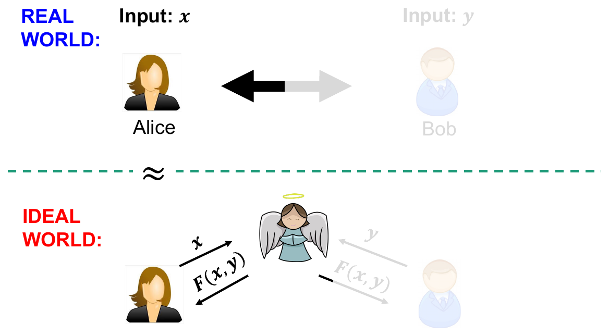

# CSIT953 考试复习 · 第 10 章 安全两方计算

> 🎯 **考纲** — *Secure Two-Party Computation — What each participant may learn.*
>
> 可能的题型：单选题考理想世界里的可信第三方做什么、每一方能学到什么、半诚实与恶意参与者的区别、不经意传输的两条保密性质、秘密分享的门限、MPC 与同态加密和可信执行环境的区别；填空题考术语（ideal world、trusted third party、simulator、view、semi-honest、malicious、oblivious transfer、secret sharing、threshold、private set intersection）；简答题考每一方能学到什么及其理由、为什么输出本身也会泄露、为什么份额必须分开保存；问答题可能给出两家机构联合计算的场景，让你说明各方能学到什么、协议挡不住什么、还要加哪些控制。

> 📚 **来源** — slides：W5 S2（第三条）、S32–S45（S45 只取 MPC 部分；S44 课上跳过）。录音：W6 录音前约 17.3k 字符里讲 MPC 的部分，接在 SSH 转发之后（同态加密和可信执行环境课上跳过）。本章引用：加密的保护范围（第 9 章 §5），恢复要分权（第 9 章 §7.5），认证 DH 的公开值（第 2 章 §5），预言机的"垃圾进，垃圾出"（第 7 章 §9），多重签名（第 8 章 §5.2），"每一方能知道什么"的答题结构（第 0 章 §4.3）。

第 9 章的各种加密有一个共同点：真正处理数据的那一方总要看到明文。几家机构想算出一个共同的结果，却谁也不肯把原始数据交给别人，该怎么办？安全多方计算回答这个问题。考纲只问一件事：每个参与者能学到什么。

§1 讲动机；§2–§3 用理想世界和模拟器给出"能学到什么"的定义；§4–§5 讲定义管不到的输出泄露，以及攻击者模型；§6–§8 讲两块积木和怎样组合；§9–§11 讲用途、局限，以及和同态加密、可信执行环境的比较；§12 给出答题步骤和一份范答。

## 1. 不把数据集中也能计算 (W5 S2, S32)

静态加密和传输加密保护存储和网络，普通的处理过程却要在内存里用明文（第 9 章 §5）。把各方的数据集中到一处计算，又可能违反政策、数据主权、竞争规则或保密约定。例如几家公司想联合找出欺诈账户，几家医院想算出合并的统计数，都不能把客户或病人的记录交给别人。

**安全多方计算**（secure multi-party computation, MPC）让各方得到商定的结果，却不必把全部原始数据交给任何一方。它把信任分散到各个参与者和协议的假设上。好处是数据最小化（data minimisation），代价是复杂度、性能和更难的运维。只有两方时，叫安全两方计算（secure two-party computation, 2PC）。

> ✍️ **English answer** — Encryption at rest and in transit still exposes plaintext during ordinary processing, and centralising raw data from several organisations can violate policy, sovereignty, competition or confidentiality constraints. Secure multi-party computation (MPC) lets several parties compute an agreed result without giving any single party all the raw inputs, and secure two-party computation (2PC) is the two-party case. MPC distributes trust across the participants and the protocol assumptions; its benefit is data minimisation, and its costs are complexity, performance and harder operations.

## 2. 理想世界与真实世界 (W5 S34–S35)

先看一个例子。两个人想知道谁口袋里的钱多，又都不想说出自己有多少。最简单的办法是找一个两人都信任的第三方：两人各自把金额悄悄告诉第三方，第三方只宣布"谁的多"，然后忘掉这两个数。两人得到了结果，却不知道对方的具体金额。可现实中往往找不到这样的第三方。

> 📎 **拓展（超出 slides）** — 这就是姚期智 1982 年提出的"百万富翁问题"（Yao's millionaires' problem），通常被看作安全两方计算的起点。



图 1 下半部分是**理想世界**（ideal world）：有一个完全可信的第三方（trusted third party）。Alice 交出输入 $x$，Bob 交出输入 $y$；第三方计算商定的函数 $F(x, y)$，只把允许的结果交给每一方，然后忘掉一切。在比钱的例子里，$F$ 就是"谁的数大"。

上半部分是真实世界（real world）：没有第三方，Alice 和 Bob 只能互相发送协议消息。安全的定义就是比较这两个世界。

**攻击者在真实协议里看到的一切，如果只用理想世界会透露的信息就能重现出来，真实协议就是安全的**。换句话说，真实协议泄露的不比理想世界多。

MPC 的基本形状是：每一方保留自己的输入，交换的是协议消息而不是原始数据；最后各方得到商定的输出，各方获准看到的输出可以不同（different authorised views），例如只有一方拿到结果。安全总是相对于某个威胁模型而言的（§5）。终端、身份、可用性、实现和治理仍是系统的一部分，协议本身管不到它们。

> ✍️ **English answer** — In the ideal world, a perfectly trusted third party receives Alice's input $x$ and Bob's input $y$, computes the agreed function $F(x, y)$, returns only the authorised output to each party and forgets everything. In the real world there is no trusted party, and Alice and Bob only exchange protocol messages. A real protocol is secure if everything an attacker sees in it can be reproduced using only the information that the ideal world would reveal, so it leaks nothing beyond the ideal functionality. Each party keeps its input, exchanges protocol messages rather than raw data and receives an agreed output, possibly with a different authorised view.

## 3. 每一方能学到什么：模拟器 (W5 S36–S37)

Alice 在真实协议里看到的全部东西，叫作 Alice 的视图（view）：输入 $x$、自己用的随机数、从 Bob 那里收到的每一条消息，以及最后的输出。

安全的要求是：存在一个**模拟器**（simulator），只拿到 Alice 自己的输入和 Alice 获准得到的输出，就能造出一份和真实视图看不出区别的视图（图 2）。模拟器是证明时用的思想实验，不是现实中的服务器。模拟器做得到，说明 Bob 发来的那些消息没有给 Alice 带来任何关于 $y$ 的额外信息：只凭 $x$ 和输出，就能"编"出同样的消息。Bob 那边同理，Bob 的视图只用 $y$ 和 Bob 的输出就能模拟。

```svg 图 2 · 模拟器只拿 Alice 的输入和输出，就能造出一份看不出区别的视图；Bob 那边同理（合并 W5 S36、S37）
<svg viewBox="0 0 640 300">
  <defs>
    <marker id="k" viewBox="0 0 10 10" refX="9" refY="5" markerWidth="7" markerHeight="7" orient="auto"><path d="M0,0 L10,5 L0,10 z" class="solid-ink"/></marker>
  </defs>
  <text x="150" y="30" text-anchor="middle">真实协议里 Alice 的视图</text>
  <rect x="20" y="44" width="260" height="168" rx="8" class="ink" fill="none" stroke-width="1.5"/>
  <text x="40" y="80" class="accent">• 输入 x</text>
  <text x="40" y="114">• 自己的随机数</text>
  <text x="40" y="148">• 收到 Bob 的消息 m1、m2……</text>
  <text x="40" y="182" class="accent">• 输出 F(x, y)</text>
  <text x="330" y="140" text-anchor="middle" style="font-size: 32px">≈</text>
  <text x="330" y="164" text-anchor="middle" class="muted">看不出区别</text>
  <rect x="380" y="44" width="240" height="44" rx="8" class="accent fill-soft" stroke-width="2"/>
  <text x="500" y="71" text-anchor="middle">只给：x 和 F(x, y)</text>
  <rect x="430" y="110" width="140" height="40" rx="8" class="ink" fill="none" stroke-width="1.5"/>
  <text x="500" y="135" text-anchor="middle">模拟器</text>
  <rect x="380" y="172" width="240" height="40" rx="8" class="muted fill-muted" stroke-width="1.5"/>
  <text x="500" y="197" text-anchor="middle">造出的视图（格式相同）</text>
  <line x1="500" y1="88" x2="500" y2="108" class="ink" stroke-width="1.5" marker-end="url(#k)"/>
  <line x1="500" y1="150" x2="500" y2="170" class="ink" stroke-width="1.5" marker-end="url(#k)"/>
  <text x="320" y="252" text-anchor="middle" class="muted">模拟得出来，说明 Bob 的消息没有给 Alice 带来关于 y 的新信息</text>
  <text x="320" y="278" text-anchor="middle" class="muted">Bob 那边同理：模拟器只拿 y 和 Bob 的输出</text>
</svg>
```

所以"每个参与者能学到什么"有一个标准答案：**自己的输入、自己获准得到的输出，以及从这两样能推出的东西，除此之外什么也学不到**。答题时逐个参与者列出这三项，再说明理由（第 0 章 §4.3）。

> ✍️ **English answer** — A party's view is everything it sees in the real protocol: its own input, its random values, the messages received from the other party and its output. Security requires a simulator which, given only that party's own input and authorised output, can produce a view indistinguishable from the real one; the simulator is a thought experiment, not a real server. If Alice's view can be simulated from $x$ and her output alone, Bob's messages give her no extra information about $y$, and the same holds for Bob with $y$ and his output. Therefore each participant learns only its own input, its authorised output and whatever can be inferred from them.

## 4. 输出本身也会泄露 (W5 S34, S41, S43)

模拟器只保证协议过程不多泄露，管不了输出本身透露的东西。**隐私最终取决于算的是什么函数，以及能被查询多少次**。

先看函数。每一方都能从自己的输入和输出推出一些东西：

| 函数 | 输出 | 每一方还能推出什么 |
|---|---|---|
| 比较大小（谁的钱多） | 一位：谁大 | 对方的值在自己的值之上还是之下 |
| 两方求和 | $x + y$ | 对方的输入：和减去自己的输入 |
| 三方以上求和 | 总和 | 其余各方的总和，分不出每一方各是多少 |
| 私有集合求交（§9） | 共同的条目 | 自己的哪些条目也在对方那里；对方其余的条目一个也看不到 |
| 只求交集的大小 | 一个数 | 自己的条目里有几个也在对方那里，但不知道是哪几个 |

两方求和最极端：协议再安全，Alice 用结果减去自己的 $x$，就得到了 $y$，函数本身就把对方的输入交了出去。

再看查询次数。比较大小一次只泄露一位，可 Bob 如果能反复运行比较，每次换一个自己的输入，就能用二分法找出 Alice 的值。设 Alice 的工资是 73（单位：千），已知在 0 到 100 之间。Bob 依次问"大于 50？大于 75？大于 63？大于 69？大于 72？大于 74？大于 73？"，得到"是、否、是、是、是、否、否"，7 次之后就确定是 73。每一次协议都完全安全，合起来却把输入抽取了出来。

所以输出控制、查询次数的限制和审计要和协议一起设计，否则一个完全私密的协议也会变成"数据抽取接口"（data-extraction API）。

协议保证的是计算过程的隐私，不保证输入是真的。参与者可以输入假的、被投毒的，或者无权使用的数据，协议照样算出结果。Bob 报一个假工资，也能"合法地"得到比较结果。这和第 7 章 §9 预言机的"垃圾进，垃圾出"是同一个道理。

> ✍️ **English answer** — The simulation definition only guarantees that the protocol leaks nothing beyond the output; the output itself can still reveal information, so privacy depends on the chosen function and on repeated queries. For example, if two parties compute only the sum $x + y$, Alice learns $y$ exactly by subtracting her own $x$. A comparison reveals only one bit, but if Bob can repeat it with inputs of his choice, he can binary-search Alice's value, so output controls, query limits and audit are needed to stop the result from becoming a data-extraction API. MPC also does not make inputs truthful: inputs can be false, poisoned or legally unauthorised even when protocol privacy holds.

## 5. 攻击者模型：半诚实与恶意 (W5 S34, S43)

| 模型 | 参与者会怎样做 | 协议要做到 |
|---|---|---|
| 半诚实 semi-honest | 按协议执行，但分析看到的一切 | 视图里没有多余的信息 |
| 恶意 malicious | 可能发假消息、中途退出、设法让结果偏向自己 | 还要发现并拒绝不合规的行为 |

多方的情形还有**腐化门限**（corruption threshold）：协议在至多若干个参与者被攻破或串通时仍然安全，超过这个数，隐私承诺就不成立。§7 的秘密分享会用到这个概念。

> 📎 **拓展（超出 slides）** — 即使在理想世界里，参与者也可以随便选一个输入交给第三方。所以恶意安全的含义是：参与者无论怎样偏离协议，效果都不超过在理想世界里换一个输入。它挡得住借协议多套信息、篡改结果，挡不住谎报输入本身。

> ✍️ **English answer** — MPC security is defined relative to a threat model. A semi-honest party follows the protocol but analyses everything it sees, whereas a malicious party may send false messages, stop early or try to bias the result, so malicious security also needs consistency checks that detect invalid behaviour. With more than two parties, security also depends on the corruption threshold: the privacy promise holds only while no more than the tolerated number of parties are corrupted or colluding.

## 6. 积木一：不经意传输 (W5 S38–S39)

**不经意传输**（oblivious transfer, OT）是许多 2PC 系统的基本构件。最简单的形式里，发送者有两个值，标号 0 和 1；接收者私下选一个标号，只得到对应的值（图 3）。它有两条保密性质：

- 发送者不知道接收者选了哪个标号。
- 接收者得不到另一个标号后面的值。

```svg 图 3 · 不经意传输：接收者选 b = 1，只拿到 m1；发送者不知道 b，接收者拿不到 m0（W5 S39）
<svg viewBox="0 0 640 260">
  <defs>
    <marker id="k" viewBox="0 0 10 10" refX="9" refY="5" markerWidth="7" markerHeight="7" orient="auto"><path d="M0,0 L10,5 L0,10 z" class="solid-ink"/></marker>
    <marker id="g" viewBox="0 0 10 10" refX="9" refY="5" markerWidth="7" markerHeight="7" orient="auto"><path d="M0,0 L10,5 L0,10 z" class="solid-good"/></marker>
  </defs>
  <text x="105" y="40" text-anchor="middle">发送者</text>
  <rect x="20" y="54" width="170" height="104" rx="8" class="ink" fill="none" stroke-width="1.5"/>
  <text x="105" y="94" text-anchor="middle">标号 0：m0</text>
  <text x="105" y="130" text-anchor="middle">标号 1：m1</text>
  <rect x="250" y="64" width="140" height="84" rx="8" class="accent fill-soft" stroke-width="2"/>
  <text x="320" y="100" text-anchor="middle">不经意传输</text>
  <text x="320" y="124" text-anchor="middle">OT</text>
  <text x="535" y="40" text-anchor="middle">接收者</text>
  <rect x="450" y="54" width="170" height="104" rx="8" class="ink" fill="none" stroke-width="1.5"/>
  <text x="535" y="94" text-anchor="middle">私下选 b = 1</text>
  <text x="535" y="130" text-anchor="middle" class="good">得到 m1</text>
  <line x1="190" y1="90" x2="248" y2="90" class="ink" stroke-width="1.5" marker-end="url(#k)"/>
  <text x="219" y="82" text-anchor="middle" class="muted">m0, m1</text>
  <line x1="450" y1="90" x2="392" y2="90" class="ink" stroke-width="1.5" marker-end="url(#k)"/>
  <text x="421" y="82" text-anchor="middle" class="muted">b</text>
  <line x1="390" y1="126" x2="448" y2="126" class="good" stroke-width="1.5" marker-end="url(#g)"/>
  <text x="419" y="144" text-anchor="middle" class="good">m1</text>
  <text x="105" y="190" text-anchor="middle" class="good">不知道 b 是 0 还是 1</text>
  <text x="535" y="190" text-anchor="middle" class="good">拿不到另一个值 m0</text>
  <text x="320" y="238" text-anchor="middle" class="muted">许多次 OT 组合起来，能计算任意的两方函数（GMW 1987）</text>
</svg>
```

可以想象一个有两个格子的锁箱：发送者在每格放一个值，接收者只能打开其中一格；打开的是哪一格，发送者看不出来，另一格接收者也打不开。真实的协议用密码学运算代替锁箱，信息的边界是一样的。

单独一次 OT 只是个小技巧，把许多次私密选择组合起来，就能计算大得多的函数。Goldreich、Micali 和 Wigderson 在 1987 年证明：**有了 OT，任何两方计算问题都能解决**（GMW 定理）。

> 📎 **拓展（超出 slides）** — 组合的一种办法是姚氏混淆电路（garbled circuit）：一方把函数做成加密的电路，另一方对自己输入的每一位，用一次 OT 取得对应的密钥，再逐个门地计算，最后只得到输出。

> ✍️ **English answer** — Oblivious transfer (OT) is a building block of many two-party computation systems. In its simplest form, the sender holds two values labelled 0 and 1, and the receiver privately chooses one label and learns only that value; the sender does not learn which label was chosen, and the receiver does not learn the value behind the other label. Protocols combine many such private selections to evaluate larger functions, and the Goldreich–Micali–Wigderson theorem (1987) states that OT can solve any two-party computation problem.

## 7. 积木二：秘密分享 (W5 S40)

**秘密分享**（secret sharing）把一个秘密变成两份或更多份额（share），分给不同的参与者。按选定的方案，单独一份透露不出任何有用的信息；获得授权的一组人把份额合起来，或者直接在份额上计算，才能得到允许的结果。门限（threshold）决定需要多少人一起，也决定能容忍多少人缺席。

> 👨‍🏫 **课堂强调** — 可口可乐的配方只由一个人掌握，太危险。把它分成 4 份交给 4 个人：4-of-4 时，4 人必须到齐才能还原；改成 3-of-4，任意 3 人就够了，一个人留在澳大利亚，另外 3 人到日本照样能生产。门限也决定了要收买几个人：2-of-4 时，攻击者收买 2 个人就拿到配方；3-of-4 时，收买 2 个人不够。

份额真正分开，才算分散了信任：

- 两份份额放在同一个管理员控制的两个账户里，数学上是两方，实际上是一个故障域。
- 删掉或弄丢太多份额，秘密就恢复不了，可用性受损。
- 为了方便，把太多份额复制到同一个备份位置，机密性又被削弱。

所以份额的存放、持有者的身份、备份、删除，以及各份额能否各自独立、不被一起攻破，都很关键。

> 📎 **拓展（超出 slides）** — 最简单的是加法分享（n-of-n）。在模 100 下分享 $s = 42$：随机取 $s_1 = 17$、$s_2 = 88$，令 $s_3 = (42 - 17 - 88) \bmod 100 = 37$。任何一份、甚至任意两份都像随机数，三份相加 $17 + 88 + 37 = 142 \equiv 42$。份额还能直接拿来算：另一个秘密 $t$ 也这样分出去，每人把手里的两个份额相加，三个和再加起来就是 $s + t$，过程中没人看到 $s$ 或 $t$。

> ✍️ **English answer** — Secret sharing transforms a secret into two or more shares held by separate parties; under the chosen scheme one share alone reveals no useful information, and an authorised set can combine the shares, or compute on them, to obtain an allowed result. The threshold determines how many parties are needed and how many failures are tolerated: with 3-of-4 sharing, any three parties can reconstruct the secret, but two corrupted parties cannot. Trust is distributed only if the shares are genuinely separated, so share storage, identity, backup, deletion and compromise independence remain critical: two shares under one administrator form one failure domain, losing too many shares destroys availability, and copying shares into one convenient backup weakens confidentiality.

## 8. 把积木组合起来 (W5 S41)

实用的 MPC 系统组合几种保护：

- 秘密分享让中间值分散在各方之间，谁也看不到完整的值。
- OT 支持私密的选择和一般电路的计算。
- 认证的信道把消息绑定到预期的参与者，并保证消息在传输中没被改动。没有认证，中间人可以分别冒充两方，这和第 2 章 §5 的 DH 一样。
- 一致性检查和针对恶意参与者的技术，找出发送无效值的一方。
- 输出控制、查询限制和审计，防止结果变成数据抽取接口（§4）。

> ✍️ **English answer** — A practical MPC system combines protected and verified steps: secret sharing distributes values and trust across the participants, oblivious transfer supports private selection and general circuit evaluation, authenticated channels bind messages to the intended parties, and consistency checks and malicious-security techniques detect invalid behaviour. Output controls, query limits and audit prevent the result from becoming a data-extraction API.

## 9. 云上的用途 (W5 S42)

没有哪一方可以收集全部输入时，MPC 就有用：

- 几家公司联合检测欺诈或滥用，不把全部客户记录集中起来。
- **私有集合求交**（private set intersection, PSI）：找出两个数据库的共同条目，不公开完整的数据集。
- 跨机构分析健康、金融、广告或供应链数据，例如几家医院联合计算统计数。
- 门限签名（threshold signing）和分布式审批：高价值的云密钥或交易，需要几个组织或服务共同批准。
- 输入属于不同方时，保密地运行模型或计算特征。例如用户想用别人的 AI 模型处理自己的论文，又不想让模型的拥有者读到论文内容。

> 📎 **拓展（超出 slides）** — 门限签名和第 8 章 §5.2 的多重签名目的相同，做法不同。多重签名是几把独立的私钥各签一次；门限签名把一把私钥分成份额，几方合作算出一个普通的签名，完整的私钥从不出现在任何一处。

用例要具体。如果已经有一个可信的服务获准看到明文，普通的加密处理更简单，也更快。

> ✍️ **English answer** — MPC helps when no single party may collect all the inputs: joint fraud or abuse detection across companies without pooling customer records, private set intersection to identify overlaps without revealing complete datasets, cross-organisation analytics in health, finance, advertising or supply chains, threshold signing and distributed approval for high-value cloud keys or transactions, and confidential model evaluation when inputs belong to different parties. If one trusted service is already allowed to see the plaintext, ordinary encrypted processing is simpler and faster.

## 10. MPC 转移了安全假设 (W5 S43, S45)

MPC 没有消除信任，只是把它挪了位置：

- 安全取决于腐化门限，以及参与者是半诚实还是恶意的（§5）。
- 协议的隐私成立，输入仍可能是假的、被投毒的或无权使用的（§4）。
- 输出和重复查询可能泄露敏感的事实（§4）。
- 终端、随机数、实现、软件供应链和参与者的身份都可能出问题。
- 网络延迟、多方协调、拒绝服务、故障恢复和移除参与方，都让运维更复杂。

课件对两周云安全的总结是：**协议安全不等于系统安全**。MPC 能尽量减少共享的原始数据，它的假设、输出、终端和运维仍然要紧。设计任何系统，都先说清楚：信任谁，信任它做什么，信任多久，信任落空时怎样恢复。

> ✍️ **English answer** — MPC shifts security assumptions rather than removing them: privacy depends on the corruption threshold and on whether parties are semi-honest or malicious; inputs can still be false, poisoned or legally unauthorised; outputs and repeated queries may reveal sensitive facts; endpoints, randomness, implementation, supply chain and participant identity can fail; and latency, coordination, denial of service, recovery and party removal complicate operations. Protocol security is not the same as system security, so every design should start by naming who is trusted, for what action, for how long and with what recovery plan.

## 11. MPC、同态加密与可信执行环境 (W5 S44)

| 技术 | 怎样保护数据 | 代价或要信任的东西 |
|---|---|---|
| 安全多方计算 MPC | 把信任分散到多方 | 通信和协调的开销可能很大 |
| 同态加密 homomorphic encryption | 直接在密文上计算 | 密钥归谁所有是核心问题，计算开销大 |
| 可信执行环境 trusted execution environment (TEE) | 用硬件把明文隔离起来 | 侧信道，以及对硬件厂商的信任 |
| 普通的加密处理 | 由一方解密后处理 | 最简单，前提是这一方本来就获准看明文 |

按威胁模型、输出策略、延迟、规模、治理和恢复要求来选。

> ✍️ **English answer** — MPC distributes trust across parties, but communication and coordination can be expensive. Homomorphic encryption computes on ciphertext, where key ownership and computation cost are central. Trusted execution environments isolate plaintext in hardware, where side channels and vendor trust matter, and ordinary encrypted processing is simplest when one processor is already trusted with plaintext. The choice depends on the threat model, output policy, latency, scale, governance and recovery requirements.

## 12. 答题：分析每一方能学到什么

考纲问的就是这一点。问答题给出一个场景时，可以按五步写：

1. 写清各方的输入、商定的函数，以及每一方获准看到哪个输出（可能各不相同）。
2. 用理想世界说明目标：可信第三方收下输入，只交出这些输出，然后忘掉一切。
3. 逐个参与者写出能学到的东西：自己的输入、自己的输出，以及从两者能推出的东西。理由是模拟器只凭这两样就能造出视图。
4. 检查输出本身泄露多少：函数能不能反推出对方的输入，重复查询会不会把输入抽取出来。
5. 写出前提和协议管不到的东西：威胁模型是半诚实还是恶意，信道有没有认证，输入是否真实，终端和实现是否可靠。

用比钱的例子走一遍。Alice 有 $x$，Bob 有 $y$，两人都只获准知道"谁的钱多"。Alice 学到 $x$、比较结果，以及由此推出的"$y$ 比 $x$ 多还是少"，学不到 $y$ 的具体数值，协议消息也不会多透露什么；Bob 那边同理。如果允许 Bob 换着输入反复比较，Bob 就能二分出 $x$，所以要限制次数并审计。协议也挡不住任何一方报一个假数。

> ✍️ **English answer** — Alice's input is x and Bob's input is y, and both are authorised to learn only whether x is greater than y. In the ideal world, a trusted third party would receive x and y, return only this one bit to each party and forget the inputs; a secure two-party protocol, for example one built from oblivious transfer, achieves the same without the third party. Alice therefore learns x, the comparison result and what follows from them, namely whether y is above or below x, but not the value of y, because her view can be simulated from x and the result alone; the same holds for Bob. The output itself still leaks one bit per run, so if Bob may repeat the comparison with chosen inputs he can binary-search x, and the number of runs must be limited and audited. The protocol also assumes authenticated channels and the stated threat model, and it cannot stop either party from entering a false value.

## ⚠️ 易混易错

| 容易混的 | 区别 |
|---|---|
| 理想世界 vs 真实世界 | 理想世界有可信第三方，只交出输出、然后忘掉一切；真实世界只有双方交换的消息 |
| 视图 vs 输出 | 视图是参与者看到的全部：输入、随机数、收到的消息、输出；输出只是最后的结果 |
| 模拟器 vs 可信第三方 | 模拟器是证明用的思想实验；可信第三方是理想世界里的角色。两者都不是要部署的服务器 |
| 协议隐私 vs 输出隐私 | 协议只保证不比输出多泄露；输出本身泄露多少，取决于函数和查询次数 |
| 半诚实 vs 恶意 | 前者照协议执行，但分析看到的一切；后者可能发假消息、中途退出、操纵结果 |
| OT 的两条保密性质 | 发送者不知道接收者选了哪个；接收者拿不到另一个值 |
| 门限 t-of-n | 至少 t 份才能还原：收买不到 t 个人拿不到秘密，丢失超过 n − t 份就恢复不了 |
| MPC vs 同态加密 vs TEE | 分散信任 / 在密文上计算 / 用硬件隔离明文 |
| MPC vs 加密存储 | 加密存储保护静止和传输中的数据；MPC 让计算过程也不必把原始数据交给一方 |

常见误解：

- "MPC 保证对方什么都学不到"：对方学得到输出，以及从自己的输入和输出能推出的一切。
- "协议安全，结果就可信"：输入可能是假的或被投毒的。
- "多问几次没关系"：重复查询能把输入一点点抽取出来。
- "OT 里发送者知道接收者拿走了哪个值"：不知道，这正是"不经意"的含义。
- "有了 MPC 就不需要认证"：消息必须绑定到预期的参与者，否则中间人可以冒充。
- "秘密分成两份就安全了"：两份放在同一个人控制的地方，等于没分。

## 📝 Practice

### Part A · Multiple choice

**A1.** In the ideal-world definition of secure two-party computation, what does the trusted third party do?
A. Stores both inputs permanently for audit
B. Receives both inputs, computes F(x, y), returns only the authorised outputs and forgets the inputs
C. Checks that both inputs are truthful
D. Publishes both inputs after the computation

<details>
<summary>Answer A1</summary>

**B.** The ideal world defines the target: the parties get only the agreed outputs, and the trusted party keeps nothing.

</details>

**A2.** Alice and Bob securely compute x + y, and both receive the result. What does Alice learn about Bob's input y?
A. Nothing, because the protocol is secure
B. Only whether y is larger than x
C. The exact value of y, by subtracting x from the result
D. y only if Bob is malicious

<details>
<summary>Answer A2</summary>

**C.** Each party learns what can be inferred from its own input and output. With two parties, the sum reveals the other input exactly, however secure the protocol is.

</details>

**A3.** Which statement about 1-out-of-2 oblivious transfer is TRUE?
A. The receiver learns both values.
B. The sender learns which value was chosen.
C. The receiver learns only the chosen value, and the sender does not learn the choice.
D. The sender and the receiver exchange their private keys.

<details>
<summary>Answer A3</summary>

**C.** These are the two secrecy properties of OT: the sender's other value stays hidden, and so does the receiver's choice.

</details>

**A4.** A participant follows the protocol exactly but records and analyses every message it receives. This participant is:
A. malicious
B. semi-honest
C. a trusted third party
D. a simulator

<details>
<summary>Answer A4</summary>

**B.** A malicious participant would also deviate from the protocol, for example by sending false messages or stopping early.

</details>

**A5.** A secret is shared with a 3-of-5 threshold scheme. Which statement is TRUE?
A. Each share reveals one fifth of the secret.
B. Any three shareholders can reconstruct the secret, but two colluding shareholders cannot.
C. All five shares are always required.
D. Keeping all five shares in one administrator's account improves security.

<details>
<summary>Answer A5</summary>

**B.** One share alone reveals no useful information, and the threshold sets how many parties are needed. Storing all shares under one administrator turns them into a single failure domain.

</details>

**A6.** Which technique computes directly on ciphertext?
A. Secure multi-party computation
B. Homomorphic encryption
C. A trusted execution environment
D. Oblivious transfer

<details>
<summary>Answer A6</summary>

**B.** MPC distributes trust across parties, and a TEE isolates plaintext in hardware.

</details>

**A7.** Which of the following does a secure MPC protocol NOT guarantee?
A. That protocol messages reveal nothing beyond the authorised outputs
B. That each party's input is truthful
C. That no single party has to collect all the raw inputs
D. That trust is distributed across the participants

<details>
<summary>Answer A7</summary>

**B.** Inputs can be false, poisoned or unauthorised even when protocol privacy holds.

</details>

### Part B · Fill in the blank / short answer

**B1.** In the ______ world, a trusted third party computes F(x, y) and returns only the authorised outputs. A real protocol is secure if a ______ can reproduce each party's view using only that party's own ______ and its authorised ______.

<details>
<summary>Answer B1</summary>

Ideal; simulator; input; output.

</details>

**B2.** In oblivious transfer, the ______ does not learn which value was chosen, and the ______ does not learn the other value. Goldreich, Micali and Wigderson (1987) showed that OT can solve ______ two-party computation problem. Finding the common records of two databases without revealing the rest is called ______.

<details>
<summary>Answer B2</summary>

Sender; receiver; any; private set intersection (PSI).

</details>

**B3.** What may each participant learn in a secure two-party computation? Explain why.

<details>
<summary>Answer B3</summary>

Each participant learns its own input, its authorised output and whatever can be inferred from these two, and nothing else. The reason is the simulation-based definition: a simulator given only the party's own input and authorised output can produce a view (random values, received messages and output) that is indistinguishable from the real one, so the real protocol messages carry no extra information about the other party's input. The guarantee holds under the assumed threat model, semi-honest or malicious.

</details>

**B4.** Explain, with an example, why a perfectly secure MPC protocol can still reveal a party's private input.

<details>
<summary>Answer B4</summary>

The protocol only guarantees that it leaks nothing beyond the output, and the output itself can reveal information. If two parties compute x + y, Alice learns y by subtracting x. Even a one-bit comparison leaks the input if it can be repeated: by choosing different inputs, Bob can binary-search Alice's value, needing about seven queries for a value between 0 and 100. Output controls, query limits and audit are therefore needed.

</details>

**B5.** Why does secret sharing distribute trust only if the shares are genuinely separated?

<details>
<summary>Answer B5</summary>

The threshold assumes that shareholders fail or are corrupted independently. If two shares sit in accounts controlled by the same administrator, one compromise or one dishonest person obtains both, so they form one practical failure domain. Copying many shares into one convenient backup location weakens confidentiality in the same way, while deleting or losing too many shares destroys availability. Share storage, identity, backup, deletion and compromise independence therefore matter as much as the mathematics.

</details>

### Part C · Questions and answers

**C1.** Two hospitals want to know how many patients they have in common, to estimate duplicated treatment, but neither may reveal its patient list to the other.
(a) Describe this as a secure two-party computation using the ideal-world model. What may each hospital learn, and what may it not learn?
(b) Hospital A proposes to run the computation every day, each time with a slightly modified list. Why is this a privacy risk, and what controls would you add?
(c) What does the protocol NOT protect against?

<details>
<summary>Model answer C1</summary>

(a) Hospital A's input is its patient list X, hospital B's input is its list Y, and the agreed function is the number of patients that appear in both. In the ideal world, both hospitals give their lists to a trusted third party, which computes this number, returns only the number to each hospital and forgets the lists. A secure two-party protocol, built from components such as oblivious transfer or secret sharing over authenticated channels, achieves the same result without the third party. Each hospital learns its own list, the number of common patients and whatever follows from these two, for example that at most that many of its own patients also attend the other hospital. It does not learn which patients are shared or anything else about the other list, because its view of the protocol could be simulated from its own list and the count alone.

(b) The output itself leaks. If hospital A reruns the computation with a list that differs by one person, a change in the count reveals whether that person is a patient of hospital B; repeated many times, this extracts information about many individuals, turning the protocol into a data-extraction API. Controls: agree in advance on the function and how often it may be run; limit queries, for example one run per month on a list committed in advance; audit every run; release the result only when the lists or the count exceed a minimum size; and support the agreement with governance rules between the hospitals.

(c) The protocol protects only the computation. It does not stop a hospital from submitting false, poisoned or unauthorised input, such as names it has no right to query. It does not protect compromised endpoints, implementation bugs, weak randomness or supply-chain attacks. If only semi-honest security was assumed, a malicious hospital may send invalid messages, abort early or bias the result, and one party dropping out affects availability. Messages must also travel over authenticated channels; otherwise a man in the middle could impersonate one of the hospitals.

**Marking points:** ideal-world description with inputs, function and a trusted party that returns only the output and forgets (1); each hospital learns its own input, the output and inferences, nothing else, justified by simulation (2); repeated queries with modified inputs reveal membership (1); controls: query limits, committed inputs, audit, governance (1); limits: false inputs, endpoints and implementation, malicious behaviour (1).

</details>

**C2.** A company protects the root key of its cloud KMS with secret sharing. The key is split into three shares, and any two shares can reconstruct it. Share 1 is held by the CTO. Shares 2 and 3 are stored in two different accounts at the same cloud provider, both administered by the IT manager.
(a) Evaluate this arrangement.
(b) Recommend a better design.

<details>
<summary>Model answer C2</summary>

(a) A 2-of-3 threshold means that any two shares reconstruct the root key while one share alone reveals nothing, so the scheme tolerates the loss of one share and should require two independent people to cooperate. Here, however, shares 2 and 3 are not independent: the IT manager alone, or an attacker who compromises the IT manager's credentials or that provider's accounts, holds two shares and can reconstruct the root key without the CTO. The arrangement is therefore no stronger than giving one administrator the key. Both shares also depend on one provider, so an outage or compromise there affects both, and if the CTO's share is lost the company depends entirely on that single domain. Because the root key protects every key-encryption key below it, its compromise exposes the whole key hierarchy.

(b) Give each share to a different person and keep each in an independent failure domain, for example an HSM, an offline safe and a second provider or region, each under a separate administrator and identity. Keep a threshold that stops one person acting alone but tolerates one loss (2-of-3), or use 3-of-5 for more tolerance. Require quorum approval for reconstruction, log it, make emergency access time-limited and review it afterwards, and test recovery without copying several shares into one convenient backup location. Where possible, use threshold techniques or HSM-protected operations so that the complete key never exists in one place.

**Marking points:** meaning of the 2-of-3 threshold (1); shares 2 and 3 form one failure domain, so one administrator can reconstruct the key (2); a single provider affects availability and confidentiality, and the root key exposes the whole hierarchy (1); independent holders and storage (1); quorum approval, logging, tested recovery, no co-located backups (1).

</details>

## 本章小结

- MPC 让各方得到商定的结果而不集中原始数据，把信任分散到参与者和协议假设上；好处是数据最小化，代价是复杂度和性能。—— *data minimisation, distributed trust*
- 理想世界里，可信第三方收下输入，只交出允许的输出，然后忘掉一切；真实协议安全，是指它泄露的不比理想世界多。—— *ideal world vs real world, trusted third party*
- 每一方只学到自己的输入、自己获准的输出，以及由此能推出的东西；判据是模拟器只凭这两样就能造出看不出区别的视图。—— *view, simulator, authorised output*
- 输出本身会泄露：两方求和交出对方的输入，重复比较能二分出输入；要有输出控制、查询限制和审计；协议不保证输入真实。—— *output leakage, repeated queries, query limits*
- 半诚实参与者照协议执行但分析一切；恶意参与者会作假、中途退出、操纵结果；多方还有腐化门限。—— *semi-honest, malicious, corruption threshold*
- OT：接收者只得到选中的值，发送者不知道选了哪个；GMW 1987：OT 能解决任何两方计算问题。—— *oblivious transfer, GMW theorem*
- 秘密分享：单份不泄露信息，达到门限才能还原；份额必须真正分开保存。—— *secret sharing, threshold, compromise independence*
- MPC 转移了假设而没有消除它们，和同态加密、TEE 各有取舍；协议安全不等于系统安全。—— *MPC vs HE vs TEE, protocol security is not system security*
