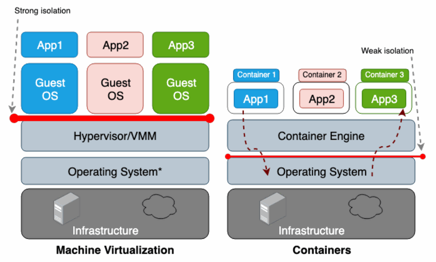
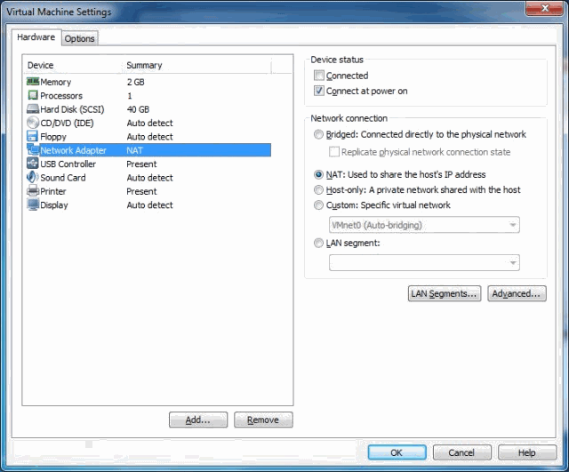

# CSIT953 考试复习 · 第 12 章 虚拟机与容器的隔离

> 🎯 **考纲** — *Virtual Machines and Containers — How their isolation models differ.*
>
> 可能的题型：单选题考 hypervisor 做什么、容器共享什么、快照是不是备份、虚拟机逃逸怎样发生、能控制 Docker 守护进程意味着什么、Pod 安全标准的三个级别、gVisor 和 Kata Containers 的区别、机密容器防的是谁；填空题考术语（guest OS、hypervisor、VM escape、namespace、cgroup、capability、seccomp、Docker daemon、cluster、node、Pod、NetworkPolicy、service account、RBAC、attestation）；简答题考两种隔离模型的区别、为什么特权容器和挂载 Docker 套接字危险、为什么沙箱解决不了网络和 API 路径；问答题可能给出一个运行不可信代码的场景，要求比较两种隔离、选择技术，并找出最弱的边界。

> 📚 **来源** — slides：W11 S1–S45。录音：W11 录音约 38.2k 字符之后（S1–S15），W12 录音前约 38.6k 字符（S16–S45）。补充：W9 S39–S41 和 W9 录音里对应的问答（以 root 运行、特权容器、挂载 Docker 套接字和宿主机目录）。本章引用：复用组件的风险（第 11 章 §2），短期 runner（第 11 章 §6），部署配置的风险（第 11 章 §10.1），责任共担（第 9 章 §1.3），泄露的凭据与工作负载身份（第 9 章 §3.2），RBAC（第 9 章 §8.3），可信执行环境（第 10 章 §11）。

虚拟机和容器都用来把工作负载隔开，区别在于隔离发生在哪一层。虚拟机在 hypervisor 这一层隔开，每台虚拟机有自己的操作系统内核；容器在操作系统这一层隔开，所有容器共用宿主机的内核。考纲问的就是这个区别，以及它带来的不同风险。

§1–§3 讲虚拟机：为什么用、隔离什么、在安全上的用途；§4 讲容器；§5–§6 对比两种隔离模型，讲怎样选；§7–§8 讲边界怎样失守：虚拟机逃逸和 Docker 守护进程；§9–§11 讲 Kubernetes 集群里的隔离和更强的隔离技术；§12 用一个设计案例把全章串起来；§13 给出比较题的答题结构和范答。

## 1. 为什么用虚拟化 (W11 S4, S6–S8)

虚拟化在安全上有四个用处：

- 隔离：把工作负载分开，减少意外的访问。应用出错或被攻破，损害限制在它所在的虚拟机里。
- 测试：在受控的环境里试运行可疑软件、新配置或更新，不直接改动生产机器。虚拟机能复制成多份相同的环境，坏了一份就换一份。
- 资源：管理员给每台虚拟机分配 CPU、内存、存储和网络。这关系到性能，也关系到安全：一个工作负载耗尽了共享资源，别的工作负载就会变慢甚至不可用。
- 恢复：做有风险的操作之前先拍一个快照（snapshot），出了问题就回滚到之前的状态。

> 👨‍🏫 **课堂强调** — 快照不是备份。备份会生成一个能拿到别处用的完整文件；快照不会：它把当前的磁盘状态冻结下来，之后的改动另写进新的差异文件，所以回滚很快。快照离不开原来的虚拟磁盘，拍得太多还会让虚拟机变慢、多占存储。

> ✍️ **English answer** — Virtualization supports security in four ways: isolation separates workloads and reduces unintended access, testing lets suspicious software, configurations or updates run in a controlled environment, resource allocation assigns CPU, memory, storage and network capacity so that one workload cannot starve others, and recovery restores a known state from snapshots and backups. A snapshot is not a full backup: it freezes the disk state and records later changes separately, so it allows fast rollback but still depends on the original virtual disk.

## 2. 虚拟机隔离什么 (W11 S5, S9, S19–S21)

每台虚拟机运行自己的**客户机操作系统**（guest OS），有自己的内核。

**hypervisor**（也叫虚拟机监视器 virtual machine monitor, VMM）位于客户机和硬件之间，居中处理客户机对 CPU、内存、磁盘和网络的访问，并把各个客户机的内存和设备活动分开。

图 1 左边是这种结构：三个应用各自运行在自己的客户机操作系统上，下面是 hypervisor。App1 被攻破，攻击者先控制的是虚拟机 1，并不会自动控制 App2；在客户机里拿到管理员权限，也不等于在宿主机上是管理员。粗红线标出这道较强的边界。图的右边是容器，§4 再讲。



> 📎 **拓展（超出 slides）** — 图 1 左边的 Operating System 带星号，因为这一层可有可无：type 1 hypervisor（如 VMware ESXi）直接装在硬件上，type 2 hypervisor（如 VMware Workstation、VirtualBox）装在宿主操作系统上。

一台虚拟机要分三层来看：

| 层 | 包括 | 安全要点 |
|---|---|---|
| 客户机 guest | 客户机操作系统、应用、虚拟设备 | 边界成立时，客户机里的管理员权限只留在这台虚拟机里 |
| hypervisor | 设备模拟、管理接口 | 要处理来自客户机的输入，漏洞在这里会起作用 |
| 宿主机 host | 宿主操作系统、管理软件、其他客户机 | 共享文件夹、快照和宿主机凭据要单独控制 |

管理配置也是边界的一部分。图 2 是 VMware 的虚拟机设置：内存、处理器、硬盘、网络适配器、USB 控制器都是虚拟设备，由管理员分配。配置不同，客户机里同样的行为就有不同的安全含义：

- 开了共享文件夹或接入 USB 设备，客户机里的程序就能碰到宿主机上的数据。
- 网络适配器接到更敏感的网段，被攻破的客户机就能找到新的目标。图 2 选的是 NAT：客户机共用宿主机的 IP 地址，宿主机充当网关。选桥接（bridged），客户机像一台独立的机器直接接入物理网络；选仅主机（host-only），客户机只和宿主机组成私有网络。
- 分配的资源过多，一个工作负载会干扰同一宿主机上的其他工作负载。



> 👨‍🏫 **课堂强调** — 做实验的虚拟机，想更安全就用 NAT，让客户机藏在宿主机后面。桥接让客户机在网络上和宿主机处于同等的位置。

在云上，管理员可能从来看不到物理服务器，只通过管理 API 创建和修改虚拟机（谁负责加固这些虚拟机，见第 9 章 §1.3 的责任共担）。所以保护一台虚拟机至少要看三层：客户机操作系统、虚拟化平台，以及能操作管理接口的人和自动化程序的权限。不能因为客户机的桌面看起来正常，就认定虚拟机安全；也不能不看客户机里运行什么，就认定管理配置安全。

> ✍️ **English answer** — Each virtual machine runs its own guest operating system with its own kernel, and the hypervisor mediates the guests' access to host hardware and keeps their memory and device activity separate, so a guest compromise, even with administrator rights inside the guest, should remain inside that VM. A VM has three layers to secure: the guest OS, the hypervisor with its device emulation and management interfaces, and the host with its management software, shared folders, snapshots and credentials. Management configuration is part of the boundary: shared folders and USB devices let guest code reach host data, a network adapter attached to a sensitive network gives a compromised guest new targets, and excessive resource allocation lets one workload interfere with others.

## 3. 虚拟机在安全上的用途 (W11 S10–S13)

| 用途 | 做法 | 要守住的边界 |
|---|---|---|
| 安全浏览 | 在一次性的客户机里打开不信任的网站，用完重置或重建 | 浏览器被攻破，攻击者先落在客户机里；客户机里不放有价值的凭据，少开共享文件夹，事先想好怎样重置 |
| 恶意软件分析 | 在受控的客户机里运行可疑程序，观察文件、进程和网络行为：会不会偷信息、连控制服务器、自我扩散；还原后能换个条件重复实验 | 和日常工作环境分开；关掉剪贴板共享和共享文件夹（§7） |
| 入侵检测 | 把监控或分析服务放进单独的客户机，检查网络流量或系统事件，不必把每个工具都装在主机上 | 传感器本身和它的管理入口要单独保护 |
| 蜜罐与蜜网 | 蜜罐（honeypot）模拟一个有漏洞的系统或服务来吸引攻击者，在隔离的环境里记录攻击方式；蜜网（honeynet）把几台这样的系统连起来 | 蜜罐会被攻击者控制，不能让它成为进入其他系统的跳板 |

这些用法都把虚拟机当成一种可控的风险，而不是保证。

> ✍️ **English answer** — Virtual machines support several security practices: secure browsing opens untrusted sites in a disposable guest that is reset after a risky session, malware analysis runs suspicious code in a controlled guest to observe file, process and network behaviour, intrusion detection hosts monitoring services in an isolated guest, and honeypots or honeynets simulate vulnerable systems to record attack patterns. In each case the VM is a controlled risk rather than a guarantee: valuable credentials and unnecessary shared folders should be kept out of the guest, the sensor's management access must be protected separately, and a honeypot must not become a route into other systems.

## 4. 容器隔离什么 (W11 S14–S16)

**容器**（container）把应用和它需要的库、设置打包在一起，在哪里部署结果都一样，几秒钟就能启动。每个容器有自己的进程视图和文件系统视图，和别的容器分开。但容器仍然共用宿主机的操作系统内核（图 1 右边），不能把它想成一台有完整独立操作系统的虚拟机。

开发和测试用容器很方便：团队描述好环境，就能快速、一致地重建它；CI 可以每次在一个全新的容器里做检查，不依赖一台配置早已走样的长期机器（第 11 章 §6 的短期 runner 也是这个思路）。可一致性也是把双刃剑：镜像里有个包过时了，它就被固化在镜像层里，镜像复制到哪里，问题就带到哪里。打包进镜像的库有漏洞，装进容器也不会让漏洞消失。所以镜像和它的依赖也是攻击面（第 11 章 §2），上线前要扫描镜像、检查依赖，确认应用没有拿到不必要的权限。

容器让服务更容易分开，但分开不是自动的。**微分段**（microsegmentation）的意思是：每个服务只能和它需要的服务通信，不能默认和所有服务通信。比如 Web 前端调用 API，API 查询数据库，前端本身不需要直接连数据库；切断这条路径，前端被攻破后，攻击者就更难接近敏感数据。做法是先找出每个服务真正需要的连接，再限制无关应用之间的通信；规则要足够具体，还要由实际承载流量的平台来执行。网络分段只是一层：手握高权限 API 凭据的服务，即使直接的网络路径被挡住，也能通过控制面拿到数据。

> ✍️ **English answer** — A container packages an application with its libraries and settings so that it can be deployed consistently and started in seconds, and it gives the process its own view of processes and the filesystem, separate from peer containers, but it normally shares the host operating system kernel. Packaging does not remove a vulnerability in a library inside the image, and an outdated package baked into an image layer is reproduced everywhere, so images and dependencies are part of the attack surface and must be scanned before deployment. Microsegmentation limits each service to the connections it actually requires, for example a web front end that may call the API but not the database, which reduces an attacker's reach after one service is compromised; the rules must be specific and enforced by the platform, and they do not stop a service that holds powerful API credentials.

## 5. 两种隔离模型的区别 (W11 S17–S18, S21) ★

图 1 把两种结构放在一起。左边，每个应用坐在自己的客户机操作系统上，hypervisor 把客户机和底层机器隔开，粗红线是一道强边界。右边，应用在各自的容器里，但容器引擎下面只有一个操作系统，所有容器共用它的内核，细红线是一道弱边界；虚线箭头表示，攻破 App1 的攻击者可以经由共享的内核，往下再往上影响 App3。

容器靠宿主机内核里的几种机制隔离：namespaces 限制进程能看到什么，cgroups 管住进程能用多少资源，capabilities 和 seccomp 限制进程能做哪些操作。

> 📎 **拓展（超出 slides）** — namespaces 给每个容器一份独立的进程号、文件系统挂载点、网络接口和主机名视图，容器里的进程看不到别的容器；cgroups 给 CPU、内存等资源设上限；capabilities 把 root 的权力拆成几十项，可以逐项去掉；seccomp 按白名单限制进程能发起的系统调用。

| | 虚拟机 | 容器 |
|---|---|---|
| 隔离在哪一层 | hypervisor：硬件虚拟化 | 操作系统：同一个内核里的进程隔离 |
| 内核 | 每个客户机有自己的内核 | 所有容器共用宿主机的内核 |
| 谁来执行隔离 | hypervisor 居中处理对硬件的访问 | 内核机制（namespaces、cgroups、capabilities、seccomp）和容器运行时 |
| 越界要突破什么 | hypervisor 或它暴露的接口：虚拟机逃逸（§7） | 共享的内核（内核漏洞），或者借特权配置、宿主机挂载、管理接口（§8） |
| 削弱边界的配置 | 集成功能：共享文件夹、剪贴板、拖放、网络连接 | 特权容器、挂载宿主机目录或 Docker 套接字、以 root 运行 |
| 检查重点 | hypervisor 和客户机到宿主机的接口 | 内核暴露面、运行时设置、capabilities、挂载、管理权限 |
| 启动和开销 | 要启动整个操作系统，较重 | 秒级启动，开销小 |
| 运维 | 每个客户机的操作系统都要管理和打补丁 | 宿主机内核和运行时配置格外关键 |

**虚拟机的边界通常更强**：攻击者要穿过一个独立的客户机内核和 hypervisor；而一个内核漏洞或不安全的特权设置，会影响同一台宿主机上的所有容器。但这只是一般规律。做得好的容器适合许多可信的工作负载，配错的虚拟机也会暴露宿主机的资源。所以选择不只是在两种产品之间选，也是在配置上选：挂载了什么，进程以哪个用户运行，能连到哪些网络，谁能发出管理命令。回答了这些问题，才看得清真实的边界。

> ✍️ **English answer** — Virtual machines and containers isolate at different layers. A VM has its own guest kernel, and code in the guest reaches physical hardware only through the hypervisor, which creates a strong boundary that still depends on the hypervisor's configuration and integration features. Containers share the host kernel: namespaces restrict what a process can see, cgroups govern its resource use, and capabilities and seccomp limit its actions; this is efficient, but a kernel vulnerability or an unsafe privilege setting matters across every container on the host. For a VM we therefore inspect the hypervisor and the guest-to-host interfaces, and for a container we inspect kernel exposure, runtime settings, capabilities, mounts and management access.

## 6. 怎样选隔离技术 (W11 S22)

不要问"哪个更安全"，要问：预期的攻击者是谁，要保护什么，攻击者需要越过什么。

| 因素 | 要问的问题 |
|---|---|
| 隔离 isolation | 对工作负载有多信任？客户提交的可执行代码和内部 API 的威胁模型不同 |
| 性能 performance | 能接受多长的启动时间和多大开销？短任务偏向轻量的选择，敏感的多租户服务值得更强的边界 |
| 运维 operations | 谁管理客户机操作系统、镜像、hypervisor、宿主机和补丁？没人维护的控制不会一直有效 |
| 可移植性 portability | 工作负载要在哪里运行，用了多少平台特有的功能？ |

没有哪一个因素能单独决定。运行别的客户提交的不可信代码，要加一层虚拟机或沙箱；内部服务、代码受控，标准的容器可能就够了。实际中常常两者都用，例如把容器放在虚拟机里运行，再给最不受信任的作业加一层沙箱（§11）。

> ✍️ **English answer** — The choice should start from the threat model rather than from asking which technology is secure: which attacker do we expect, what are we protecting and what would the attacker need to cross. Four factors matter: isolation (how much we trust the workload, e.g. customer-supplied executable code versus an internal API), performance (acceptable start-up time and overhead), operations (who manages and patches guests, images, hypervisors and hosts) and portability (where the workload must run). Untrusted code from another customer justifies an additional VM or sandbox boundary, while a standard container may be enough for a well-controlled internal service, and in practice the two are often combined, for example containers inside VMs.

## 7. 虚拟机逃逸 (W11 S23–S29)

正常情况下，客户机可以向 hypervisor 申请虚拟的 CPU、内存、磁盘和网络，但不能随意控制宿主机或别的客户机。**虚拟机逃逸**（VM escape）就是这个预期落空：客户机里的代码越过边界，影响到宿主机。它可能经由 hypervisor 本身的缺陷、某个虚拟设备，或者客户机和宿主机之间的便利功能发生。

过程分三步：

1. 客户机里的代码调用 hypervisor 暴露的某个接口，例如虚拟设备，或者客户机与宿主机之间的通信功能。
2. 客户机提供输入，宿主机一侧有特权的组件来解析它。这个组件有漏洞时，精心构造的输入能破坏内存、绕过检查，或者让它执行客户机本来无权请求的操作。
3. 后果取决于漏洞和受影响的宿主机进程：轻的只是让一个宿主机进程崩溃，重的能在管理资源的进程里执行代码。

并不是客户机和 hypervisor 的每次交互都是逃逸，绝大多数交互都被正确处理了。风险来自一个有漏洞的接口接收了不可信的输入。

便利功能最容易被忽视。在客户机和宿主机的桌面之间拖放文件、复制粘贴，用户几乎感觉不到，可数据要跨过边界，总有组件要解析剪贴板格式和各种消息。课件的历史例子里，这个接口是 VMware 的客户机–宿主机通信接口 RPCI。名字不用记，要记住规律：**提高易用性的功能也会扩大攻击面**。用来分析恶意软件的虚拟机还开着剪贴板共享和共享文件夹，就是一个坏选择。

那个历史例子是一个内存破坏漏洞：宿主机一侧的组件处理来自客户机的数据时，写到了它不该写的内存区域。利用它需要三样东西：一个能调用到的接口、能触发漏洞的输入，以及对之后内存状态足够的控制；现代系统的保护机制也让利用更难预测。原演示在客户机里运行代码，宿主机上就弹出了计算器，说明攻击者能在宿主机上运行任意程序。这是旧版本软件的截图，不能证明打过补丁的新版本还有同样的问题。

防御分两头：

- 管理员关掉不需要的集成功能，及时给 hypervisor 和虚拟化软件打补丁，尽量限制管理组件的权限，监控异常的行为。
- 开发者在有特权的处理程序里，把客户机控制的每个值都当成不可信的，特别是长度、指针和对象大小。

> ✍️ **English answer** — VM escape is a failure of the hypervisor boundary in which code running inside a guest affects the host. Guest code reaches an interface exposed by the hypervisor, such as a virtual device or a guest–host communication feature; a privileged host-side component interprets the guest's input, and if that component is vulnerable, carefully chosen input can corrupt memory, bypass a check or trigger an operation the guest was not allowed to request, with an impact ranging from crashing a host process to executing code on the host. Convenience features such as drag and drop, copy/paste and shared folders create guest-to-host pathways and increase the attack surface, so unnecessary integration features should be disabled, the hypervisor patched, management components given limited privileges and unusual behaviour monitored, while developers must treat every guest-controlled value, especially lengths, pointers and object sizes, as untrusted.

## 8. Docker 守护进程与宿主机挂载 (W11 S30–S32; W9 S39–S41)

Docker 守护进程（Docker daemon）负责创建和管理容器：拉取镜像、启动容器、挂载存储、修改网络设置。这对自动化很有用，也意味着它的管理接口很敏感。能向守护进程发出不受限制的命令，就能创建带危险特权的容器，或者把宿主机的文件系统挂进容器。

这和虚拟机逃逸不同：不需要 hypervisor 里的内存破坏漏洞。危险的一步，是让不受信任的一方控制了一个有特权的管理服务：可能是暴露在网络上的远程 API，也可能是本地能访问的 Docker 套接字（docker.sock）。

```bash
docker run -v /:/hostOS -i -t chrisfosterelli/rootplease
```

`-v /:/hostOS` 把宿主机的根文件系统 `/` 挂到容器里的 `/hostOS`，`-i -t` 只是接上一个交互终端。只要调用者能让守护进程创建这样的容器，容器里的进程就能看到远超应用所需的东西：整个宿主机的文件。能不能改这些文件，还取决于用户映射、挂载方式等控制，但这项权限显然很敏感。真正的问题出在更早的地方：谁被允许和守护进程通信，请求挂载宿主机目录？平台被明确要求暴露宿主机文件时，容器边界保护不了它们，就像给虚拟机开了一个范围很大的共享文件夹。

部署配置里有三种类似的错误：

- 以 root 运行：Dockerfile 不指定用户时，默认就是 root。应用被攻破后，攻击者在容器里就是 root。
- 特权容器加 Docker 套接字：`privileged: true` 让容器获得对宿主机的广泛访问；再挂载 `/var/run/docker.sock`，攻击者不必逃出当前的容器，只要通过套接字让守护进程新建一个容器，把宿主机的任意目录挂进去，就能读写宿主机。
- 挂载范围过大：挂载 `/:/host` 或 `~/.ssh:/root/.ssh`，网站的文件上传漏洞一旦变成代码执行，攻击者就能读宿主机的文件和 SSH 私钥。应该只挂载需要的那个目录，尽量只读。

保护守护进程：

- 不需要远程管理时，不开放远程接口，只用本地套接字。
- 把守护进程的访问权当作管理员权限，只给受信任的管理员，审计谁有这项权限，不交给普通的应用容器。
- 确实需要远程管理时，用 SSH 或经过认证的 TLS，并限制网络路径（如只走 VPN）。这些措施保护的是连接，不能代替对人和自动化程序的最小权限。
- 审查守护进程允许创建什么：挂载宿主机根目录或特权容器，只有专门的系统组件才可能需要，不能作为默认设置。

图 3 对比了两条越界路线：

```svg 图 3 · 两条越界路线：虚拟机逃逸要利用 hypervisor 接口的漏洞；能控制 Docker 守护进程的人，只靠合法的管理请求就能读写宿主机（据 W11 S24–S31 绘制）
<svg viewBox="0 0 640 316">
  <defs>
    <marker id="k" viewBox="0 0 10 10" refX="9" refY="5" markerWidth="7" markerHeight="7" orient="auto"><path d="M0,0 L10,5 L0,10 z" class="solid-ink"/></marker>
    <marker id="w" viewBox="0 0 10 10" refX="9" refY="5" markerWidth="7" markerHeight="7" orient="auto"><path d="M0,0 L10,5 L0,10 z" class="solid-warn"/></marker>
  </defs>
  <line x1="320" y1="12" x2="320" y2="304" class="muted dashed" stroke-width="1"/>
  <text x="160" y="28" text-anchor="middle">虚拟机逃逸 VM escape</text>
  <rect x="40" y="44" width="240" height="44" rx="8" class="warn fill-warn" stroke-width="2"/>
  <text x="160" y="71" text-anchor="middle" class="warn">客户机里的攻击代码</text>
  <line x1="160" y1="88" x2="160" y2="126" class="ink" stroke-width="1.5" marker-end="url(#k)"/>
  <text x="172" y="112" class="muted">精心构造的输入</text>
  <rect x="40" y="130" width="240" height="56" rx="8" class="ink fill-muted" stroke-width="1.5"/>
  <text x="160" y="153" text-anchor="middle">hypervisor 暴露的接口</text>
  <text x="160" y="175" text-anchor="middle" class="muted">虚拟设备、复制粘贴、RPCI</text>
  <line x1="160" y1="186" x2="160" y2="224" class="warn" stroke-width="2" marker-end="url(#w)"/>
  <text x="172" y="210" class="warn">漏洞：内存破坏</text>
  <rect x="40" y="228" width="240" height="44" rx="8" class="warn fill-warn" stroke-width="2"/>
  <text x="160" y="255" text-anchor="middle" class="warn">在宿主机进程里执行代码</text>
  <text x="160" y="300" text-anchor="middle" class="muted">前提：找到并利用一个漏洞</text>
  <text x="480" y="28" text-anchor="middle">控制 Docker 守护进程</text>
  <rect x="360" y="44" width="240" height="44" rx="8" class="warn fill-warn" stroke-width="2"/>
  <text x="480" y="71" text-anchor="middle" class="warn">挂载了 docker.sock 的容器</text>
  <line x1="480" y1="88" x2="480" y2="126" class="ink" stroke-width="1.5" marker-end="url(#k)"/>
  <text x="492" y="112" class="muted">合法的 API 请求</text>
  <rect x="360" y="130" width="240" height="56" rx="8" class="ink fill-muted" stroke-width="1.5"/>
  <text x="480" y="153" text-anchor="middle">Docker 守护进程（root）</text>
  <text x="480" y="175" text-anchor="middle" class="muted">按调用者的请求创建容器</text>
  <line x1="480" y1="186" x2="480" y2="224" class="warn" stroke-width="2" marker-end="url(#w)"/>
  <text x="492" y="210" class="warn">run -v /:/host</text>
  <rect x="360" y="228" width="240" height="44" rx="8" class="warn fill-warn" stroke-width="2"/>
  <text x="480" y="255" text-anchor="middle" class="warn">新容器读写宿主机根目录</text>
  <text x="480" y="300" text-anchor="middle" class="muted">前提：拿到管理权限，不需要漏洞</text>
</svg>
```

> ✍️ **English answer** — The Docker daemon creates and manages containers, so access to it is effectively administrative access to the host. Unlike VM escape, abusing it needs no memory-corruption bug: anyone who can reach an exposed remote API or the local Docker socket can start a container with unsafe privileges or mount the host's root filesystem, for example with docker run -v /:/hostOS, and then read or modify host files; a privileged container with /var/run/docker.sock mounted lets an attacker ask the daemon for a new container with any host directory mounted. The daemon should not be exposed remotely unless required, access to it should be limited to trusted administrators and audited, remote administration should use SSH or authenticated TLS, and host-root mounts or privileged containers should never be the default for ordinary application containers.

## 9. Kubernetes：从一台主机到一个集群 (W11 S33–S35)

Docker 管理的是一台机器上的容器。用户多了，一个 Web 服务要运行好几个副本，要更新，还要在机器故障时恢复：谁来决定每个副本放在哪台机器上、坏了谁来重启、流量怎样转给健康的副本？这个协调问题叫**容器编排**（container orchestration）。

Kubernetes 在一组机器上管理容器化的应用。核心是期望状态（desired state）：运维人员声明"要三个运行中的 Web 应用副本"，控制平面（control plane）决定副本在哪里运行，少了就补上；工作机器运行容器，并报告状态。更新时，Kubernetes 也能协调滚动发布，不用人逐个启动容器。

| 术语 | 含义 |
|---|---|
| 集群 cluster | 整个受管系统：控制平面加上所有工作机器 |
| 节点 node | 一台工作机器，提供计算资源、运行工作负载 |
| Pod | 最小的部署单位，相当于应用的一个运行副本，通常只有一个主容器 |

三个术语对应三种影响范围：一个 Pod 可能因为它运行的应用而被攻破；一个节点上还运行着别的 Pod；集群的控制平面能在所有节点上创建和修改工作负载。

自动化也带来了新的安全责任：控制平面的 API 能改动正在运行的工作负载，工作负载自己也可能拿到一个能调用这个 API 的身份。要保护的对象，从一个 Docker 守护进程变成了一整套分布式的管理系统。

> ✍️ **English answer** — When a service needs replicas across several machines, updates and recovery from machine failure, deciding where each replica runs, restarting it and routing traffic to it is container orchestration. Kubernetes manages containerized applications across a cluster: an operator declares a desired state such as three running copies, the control plane decides where they run and replaces missing ones, and worker nodes run the containers and report their status. A cluster is the whole managed system (control plane plus worker machines), a node is one worker machine, and a Pod is the smallest deployable unit, usually one running copy of the application with one main container; these are three different scopes of impact, and the control-plane API becomes a new security-critical management interface.

## 10. 被攻破的 Pod：四条路径和对应的控制 (W11 S36–S40)

假设攻击者利用应用漏洞，能在一个 Web Pod 里执行代码。这一步并不难，也不等于整个集群已经失守。从这里出发有四条路径（图 4）：

1. 宿主机：Pod 有没有挂载节点的文件系统，能不能用特权模式，能不能接触敏感的内核接口？
2. 网络：能不能直接连到数据库，或者别的租户的 Pod？
3. API：Pod 的服务账户能不能创建 Pod、读取 Secrets？
4. 云：能不能访问实例元数据，拿到本来给节点用的云凭据？

```svg 图 4 · 攻击者控制了一个 Pod 之后的四条路径，彼此独立，挡住一条挡不住其他几条（据 W11 S35–S36 绘制）
<svg viewBox="0 0 640 300">
  <defs>
    <marker id="w" viewBox="0 0 10 10" refX="9" refY="5" markerWidth="7" markerHeight="7" orient="auto"><path d="M0,0 L10,5 L0,10 z" class="solid-warn"/></marker>
  </defs>
  <rect x="16" y="20" width="306" height="262" rx="10" class="muted dashed" fill="none" stroke-width="1.5"/>
  <text x="32" y="44" class="muted">节点 node：一台工作机器</text>
  <rect x="44" y="62" width="250" height="62" rx="8" class="warn fill-warn" stroke-width="2"/>
  <text x="169" y="88" text-anchor="middle" class="warn">被攻破的 Web Pod</text>
  <text x="169" y="110" text-anchor="middle" class="muted">攻击者能在里面执行代码</text>
  <rect x="44" y="196" width="250" height="62" rx="8" class="ink fill-muted" stroke-width="1.5"/>
  <text x="169" y="222" text-anchor="middle">① 宿主机 host</text>
  <text x="169" y="244" text-anchor="middle" class="muted">宿主机挂载、特权模式、节点内核</text>
  <line x1="169" y1="124" x2="169" y2="192" class="warn" stroke-width="2" marker-end="url(#w)"/>
  <rect x="372" y="20" width="250" height="62" rx="8" class="ink fill-muted" stroke-width="1.5"/>
  <text x="497" y="46" text-anchor="middle">② 网络 network</text>
  <text x="497" y="68" text-anchor="middle" class="muted">数据库、别的租户的 Pod</text>
  <rect x="372" y="120" width="250" height="62" rx="8" class="ink fill-muted" stroke-width="1.5"/>
  <text x="497" y="146" text-anchor="middle">③ API</text>
  <text x="497" y="168" text-anchor="middle" class="muted">用服务账户建 Pod、读 Secrets</text>
  <rect x="372" y="220" width="250" height="62" rx="8" class="ink fill-muted" stroke-width="1.5"/>
  <text x="497" y="246" text-anchor="middle">④ 云 cloud</text>
  <text x="497" y="268" text-anchor="middle" class="muted">实例元数据里的云凭据</text>
  <line x1="294" y1="80" x2="368" y2="56" class="warn" stroke-width="2" marker-end="url(#w)"/>
  <line x1="294" y1="94" x2="368" y2="150" class="warn" stroke-width="2" marker-end="url(#w)"/>
  <line x1="294" y1="108" x2="368" y2="244" class="warn" stroke-width="2" marker-end="url(#w)"/>
</svg>
```

**这四条路径彼此独立，挡住一条挡不住其他几条**。沙箱运行时能让宿主机路径更难走，却收不回过大的 API 权限；网络策略能挡住数据库连接，却修不好一个宿主机挂载。所以每条路径要有自己的控制：

| 路径 | 控制 |
|---|---|
| 宿主机 | Pod 安全准入拒绝不安全的 Pod；安全上下文：非 root、seccomp、去掉 capabilities、禁止提权 |
| 网络 | NetworkPolicy：默认拒绝，只放行需要的服务和端口 |
| API | 每个应用一个专用的服务账户，RBAC 只给需要的动作和资源；用不到 API 就不挂载令牌 |
| 云 | 课件只提出了问题，常见的控制见本节末尾的 📎 |

### 10.1 宿主机路径：Pod 安全准入和安全上下文

**Pod 安全准入**（Pod Security Admission）在 Pod 运行之前，按命名空间（namespace）上设置的策略检查它请求的配置，拒绝不安全的 Pod。Kubernetes 定义了三级 Pod 安全标准：

| 级别 | 作用 |
|---|---|
| Privileged | 最宽松，留给确实需要广泛系统访问的可信系统组件 |
| Baseline | 阻止常见的提权设置 |
| Restricted | 更严格，适合普通的应用 Pod；有的应用要先修改才能通过 |

不能指望每个开发者都记得 Pod 配置里哪些字段危险，由准入检查统一把关。可以先用警告或审计模式试行，看清哪些工作负载会被拒绝，改好之后再强制执行。它也不是万能的。

对一般的 Linux Web 工作负载，安全上下文（security context）设四项：以非 root 用户运行；seccomp 配置用 RuntimeDefault，限制能发起的系统调用；去掉全部 capabilities，只加回确实需要的；把 allowPrivilegeEscalation 设为 false，让进程不能再提权（比如借 setuid 程序）。写成 YAML：

```yaml
securityContext:
  runAsNonRoot: true                # 不以 root 运行
  allowPrivilegeEscalation: false   # 进程不能再提权
  seccompProfile:
    type: RuntimeDefault            # 限制能发起的系统调用
  capabilities:
    drop: ["ALL"]                   # 去掉全部 capabilities，需要的再单独加回
```

这些设置有意义，正是因为容器共用宿主机内核：要尽量减少被攻破的进程能请求内核做的事。拿别人的配置来复用之前，也要先审查。

### 10.2 网络路径：NetworkPolicy

Web Pod 可能需要调用 API 服务，却不需要连到集群里的每个 Pod。敏感的命名空间常见的做法是：先选中 Pod，默认拒绝所有入站（ingress）和出站（egress）流量，再写明确的规则，只放行需要的服务和端口。注意两点：

- 策略只有在集群的网络插件真正执行它时才有效，要验证，不能想当然。
- DNS 这类依赖可能要单独放行，应用也可能连向意想不到的地址，所以先观察流量，再测试策略。

NetworkPolicy 只管网络这一层：它挡不住有权限的 Pod 通过 API 读取 Secrets，也不管宿主机内核。

### 10.3 API 路径：服务账户与 RBAC

Pod 可以带着一个 Kubernetes 服务账户（service account）运行，账户的令牌让工作负载能调用集群 API。真正需要查看或修改 Kubernetes 资源的应用才需要它，普通的 Web 应用大多用不到。先问进程为什么要调用 API：不调用，就不给它挂载令牌；要调用，就给应用建一个专用的服务账户，用 RBAC（第 9 章 §8.3）只授予需要的动作（verbs）和资源类型。读取一类配置对象，和创建任意 Pod 或读取所有 Secrets，是差别很大的权限。攻击者在 Pod 里执行代码，又碰上权限很大的服务账户，不用打破容器就能越出 Pod。**身份本身就是一个隔离维度**。

> 📎 **拓展（超出 slides）** — 云路径的常见控制：用 NetworkPolicy 的出站规则挡住 Pod 访问实例元数据的地址（169.254.169.254）；用云服务商的工作负载身份给每个应用单独的、最小权限的云凭据，不让 Pod 借用节点的凭据（第 9 章 §3.2）。

> ✍️ **English answer** — Once an attacker can execute code inside a Pod, there are four independent paths: the host (host mounts, privileged mode, the node kernel), the network (databases and other tenants' Pods), the Kubernetes API (a service account that can create Pods or read Secrets) and the cloud (instance metadata and cloud credentials). Blocking one path does not block the others, so each needs its own control: Pod Security Admission with the Baseline or Restricted standard and a security context that runs as non-root, uses the RuntimeDefault seccomp profile, drops all capabilities and sets allowPrivilegeEscalation to false; a NetworkPolicy with default deny for ingress and egress plus explicit allow rules, verified to be enforced by the network plugin; and a dedicated service account per application with least-privilege RBAC, with no API token mounted when the process never calls the API.

## 11. 更强的隔离：沙箱与机密容器 (W11 S41–S42)

运行互不信任的客户提交的代码时，标准的容器边界可能不够，要在工作负载和宿主机内核之间再加一层：

| 技术 | 做法 |
|---|---|
| gVisor | 在用户态实现一个应用内核，替工作负载处理大部分系统接口，减少它对宿主机内核的直接接触 |
| Kata Containers | 把容器工作负载放进轻量级虚拟机里运行，多一道客户机内核的边界，同时保留容器的使用方式 |

它们都有代价，也不是处处适用：可能有兼容性问题，GPU 之类的特殊设备不一定支持，对性能敏感的工作负载要权衡。要用实际的应用测试过再选。

机密容器（confidential containers）回答的是另一个信任问题。前面担心的都是工作负载伤害宿主机，这里担心的方向相反：基础设施的宿主机，或者能接触它的人，能不能在工作负载运行时偷看它？

- 机密虚拟机（confidential VM）用硬件支持的保护执行环境，保护客户机的运行。
- 证明（attestation）让另一方在交出秘密之前，检查这个环境的某些属性。
- 按证明释放秘密（secret release）：证据满足策略，才把秘密交出去。比如密钥服务先要证据，证明运行的是预期的工作负载、处在批准的保护环境里，再交出解密密钥。

这种保证要靠固件、软件度量值、策略和密钥管理一起起作用。它也不代替普通的控制，网络策略和 API 权限照样需要。可信执行环境与 MPC、同态加密的比较见第 10 章 §11。

> ✍️ **English answer** — When standard container boundaries are not enough, for example for code submitted by mutually distrusting customers, a sandbox runtime adds a layer between the workload and the host kernel: gVisor provides a userspace application kernel that handles many system interfaces on the workload's behalf, reducing direct exposure of the host kernel, while Kata Containers runs container workloads inside lightweight VMs with a guest-kernel boundary; both have compatibility, device and performance costs and must be tested with the real application. Confidential containers address the opposite trust question, whether the infrastructure host can inspect the workload: a confidential VM protects the guest execution environment with hardware support, attestation lets another party check evidence about that environment, and secrets are released only when the evidence satisfies policy. Neither replaces ordinary network and API controls.

## 12. 设计案例：运行客户提交的作业 (W11 S43–S45)

一个云服务接收不同客户的文件，在共享的基础设施上运行分析作业。这些文件都要当作可能有恶意的东西对待。按四个问题设计：

| 问题 | 设计 |
|---|---|
| 计算：作业在哪里运行，它的代码要多费劲才能影响节点或别的客户的作业？ | 用沙箱运行时；需要更强的信任边界时，用专用节点 |
| Pod 策略 | 拒绝特权 Pod 和宿主机挂载，不能为了方便放行 |
| 网络 | 默认拒绝对等访问；作业可能需要有限的连接来取输入、送回结果，但不能随意扫描网络 |
| 身份 | 默认不给集群 API 权限 |

设计完还要测试这些控制是不是真的各自起作用。比如作业的 Pod 用了 gVisor，也通过了 Restricted 准入检查，却仍然能连到内部数据库，还能通过 API 列出 Secrets。先改哪两项控制？沙箱为什么解决不了这两条路径？

> ✍️ **English answer（model answer）** — The two controls to change first are network access and identity. The direct database path calls for a NetworkPolicy that denies traffic by default and allows only the destinations the job actually needs, such as fetching its input and returning results, and the policy must be enforced by the network plugin. The ability to list Secrets calls for removing the job's RBAC permissions, ideally zero API rights and no mounted service-account token, because the job never needs to call the Kubernetes API. The gVisor sandbox does not solve these paths because it only mediates the system interfaces between the workload and the host kernel: it makes the host path harder, but it does not decide whether a network connection to the database is allowed or whether the service account may list Secrets, and Restricted admission likewise checks only the Pod's security settings. A single technology label is therefore not a complete security design: compute, Pod policy, network and identity must each be controlled and tested.

课件的总结有四句：虚拟机要弄清客户机、hypervisor 和管理这几道边界；容器共用内核、守护进程权力很大，风险也就不同；云原生环境要加上 Pod 策略、网络隔离和最小权限的身份；威胁模型更严格时，用沙箱或机密容器。

## 13. 答题：比较虚拟机和容器的隔离

考纲问的就是两种隔离模型有什么不同。比较题可以按五点写：

1. 边界在哪一层：hypervisor 和客户机内核，还是共享的宿主机内核。
2. 共享了什么：虚拟机共享硬件，由 hypervisor 居中处理；容器共享内核。
3. 边界怎样失守：虚拟机逃逸要利用 hypervisor 接口的漏洞；容器可能因内核漏洞失守，更常见的是特权配置、宿主机挂载和守护进程的管理权限。
4. 什么会削弱边界：虚拟机的集成功能；容器的特权模式、宿主机挂载、root 用户和 Docker 套接字。
5. 怎样选、怎样补：按威胁模型选；不可信代码加虚拟机或沙箱；网络和身份路径另外控制。

> ✍️ **English answer（model answer）** — Virtual machines and containers both isolate workloads, but at different layers. Each VM runs its own guest operating system and kernel on virtual hardware, and the hypervisor mediates every access to the physical machine, so a compromised guest, even with administrator rights, should stay inside its VM. That boundary fails only through a VM escape, in which guest input exploits a vulnerability in a hypervisor interface such as a virtual device or copy/paste, and it is weakened by integration features such as shared folders and clipboard sharing. Containers are processes on one shared host kernel: namespaces limit what each process can see, cgroups limit its resources, and capabilities and seccomp limit its actions. They are lighter and start in seconds, but the boundary is weaker, because a kernel vulnerability affects every container on the host, and configuration can remove the separation without any bug: a privileged container, a host root mount, running as root or access to the Docker daemon socket lets an attacker control the host. A VM therefore suits untrusted or multi-tenant code, while a well-configured container suits trusted internal services; in practice they are combined, for example containers inside VMs, or sandbox runtimes such as gVisor and Kata Containers for the least trusted jobs. In both cases network paths and identities such as API tokens must be controlled separately, because neither boundary limits what the workload may reach over the network or through a management API.

## ⚠️ 易混易错

| 容易混的 | 区别 |
|---|---|
| 虚拟机 vs 容器 | 每个客户机有自己的内核 / 所有容器共用宿主机内核 |
| hypervisor vs 容器引擎 | 居中处理客户机对硬件的访问 / 借宿主机内核的机制管理容器 |
| 快照 vs 备份 | 冻结磁盘状态、依赖原磁盘、回滚快 / 能拿走的完整副本 |
| 虚拟机逃逸 vs 控制 Docker 守护进程 | 要利用 hypervisor 接口的漏洞 / 只要有管理权限，不需要漏洞 |
| namespaces vs cgroups vs capabilities vs seccomp | 能看到什么 / 能用多少资源 / 能做哪些特权操作 / 能发起哪些系统调用 |
| NAT vs 桥接 vs 仅主机 | 共用宿主机 IP、宿主机当网关 / 像独立机器直接接入物理网络 / 只和宿主机组成私有网络 |
| 集群 vs 节点 vs Pod | 整个受管系统 / 一台工作机器 / 一个运行副本 |
| Pod 安全准入 vs NetworkPolicy vs RBAC | 管宿主机路径 / 管网络路径 / 管 API 路径 |
| Privileged vs Baseline vs Restricted | 最宽松 / 挡住常见提权 / 最严格，给普通应用 |
| gVisor vs Kata Containers | 用户态应用内核 / 轻量级虚拟机 |
| 沙箱 vs 机密容器 | 保护宿主机不受工作负载伤害 / 保护工作负载不被宿主机偷看 |

常见误解：

- "容器就是轻量级的虚拟机"：容器没有自己的内核。
- "虚拟机的隔离是绝对的"：集成功能、hypervisor 的漏洞和管理配置都能削弱它。
- "快照就是备份"：快照离不开原来的虚拟磁盘。
- "能连 Docker 守护进程只是普通权限"：它等同于宿主机的管理员权限。
- "用了 gVisor、通过了 Restricted 就安全了"：网络路径和 API 路径还开着。
- "写了 NetworkPolicy 就生效"：要网络插件执行它，还要验证。
- "机密容器能挡住容器里的恶意代码"：它保护的是工作负载不被基础设施偷看，方向相反。

## 📝 Practice

### Part A · Multiple choice

**A1.** What is the main role of a hypervisor?
A. It shares one kernel among all workloads
B. It mediates the guests' access to host hardware and keeps the guests separate
C. It schedules Pods across the nodes of a cluster
D. It encrypts the memory of every process

<details>
<summary>Answer A1</summary>

**B.** Option A describes the host kernel under containers, and option C describes the Kubernetes control plane.

</details>

**A2.** Which statement about containers is TRUE?
A. Each container runs its own guest kernel
B. Containers on the same host share the host operating system kernel
C. A vulnerable library becomes safe once it is packaged in a container
D. Containers cannot be started in less than a minute

<details>
<summary>Answer A2</summary>

**B.** Containers are isolated processes on one shared kernel, which is why a kernel vulnerability or an unsafe privilege setting affects every container on the host.

</details>

**A3.** An analyst takes a snapshot of a VM before running a malware sample. Which statement is TRUE?
A. The snapshot is a full backup that can be copied to another machine
B. The snapshot allows a fast rollback, but it depends on the original virtual disk and is not a full backup
C. The snapshot prevents the malware from reaching the network
D. The snapshot makes clipboard sharing safe

<details>
<summary>Answer A3</summary>

**B.** A snapshot freezes the disk state and records later changes separately, so it is a recovery point rather than an independent backup.

</details>

**A4.** An application container runs with /var/run/docker.sock mounted. An attacker gains code execution inside it. What is the main risk?
A. The attacker can only read files inside this container
B. The attacker can ask the Docker daemon to start a new container that mounts the host's root filesystem
C. The attacker needs a hypervisor vulnerability to reach the host
D. The attacker can only cause a denial of service

<details>
<summary>Answer A4</summary>

**B.** Access to the daemon's socket is effectively administrative access to the host, and no memory-corruption bug is needed.

</details>

**A5.** Which Pod Security Standard is intended for ordinary application Pods?
A. Privileged
B. Baseline
C. Restricted
D. Unconfined

<details>
<summary>Answer A5</summary>

**C.** Privileged is for trusted system workloads, and Baseline blocks only common privilege-escalation settings.

</details>

**A6.** Which statement correctly distinguishes gVisor from Kata Containers?
A. gVisor runs each container inside a lightweight VM; Kata Containers uses a userspace kernel
B. gVisor provides a userspace application kernel; Kata Containers runs container workloads inside lightweight VMs
C. Both remove the need for NetworkPolicy
D. Both encrypt the workload's memory against the host

<details>
<summary>Answer A6</summary>

**B.** Both are sandbox runtimes that add a layer before the host kernel; neither controls network or API access.

</details>

**A7.** Confidential containers mainly protect against which threat?
A. A malicious workload attacking the host kernel
B. The infrastructure host, or someone with access to it, inspecting the workload while it runs
C. Typosquatted packages in the image
D. Lateral movement between Pods

<details>
<summary>Answer A7</summary>

**B.** They use a confidential VM, attestation and policy-based secret release to protect the workload from the infrastructure.

</details>

**A8.** A job Pod runs under gVisor and passes Restricted admission, but its service account can list Secrets through the Kubernetes API. Which control addresses this path?
A. A stricter seccomp profile
B. Removing the RBAC permissions and not mounting the API token
C. Switching to Kata Containers
D. Running the Pod as non-root

<details>
<summary>Answer A8</summary>

**B.** The API path is an identity problem; sandbox runtimes, seccomp and non-root settings only harden the host path.

</details>

### Part B · Fill in the blank / short answer

**B1.** Each VM runs its own ______ OS, and the ______ mediates access to the host hardware. Containers share the host ______. Linux ______ restrict what a process can see, and ______ govern its resource use. A failure in which guest code affects the host is called a VM ______.

<details>
<summary>Answer B1</summary>

Guest; hypervisor; kernel; namespaces; cgroups; escape.

</details>

**B2.** In Kubernetes, the smallest deployable unit is a ______, one worker machine is a ______, and the whole managed system is a ______. The three Pod Security Standards are Privileged, ______ and ______. A NetworkPolicy usually starts with default ______ and then adds explicit allow rules.

<details>
<summary>Answer B2</summary>

Pod; node; cluster; Baseline; Restricted; deny.

</details>

**B3.** Explain how a VM escape can happen and how to reduce the risk.

<details>
<summary>Answer B3</summary>

Code inside the guest reaches an interface that the hypervisor exposes, such as a virtual device or a guest–host feature like copy/paste or drag and drop. A privileged host-side component interprets the guest's input; if it has a vulnerability, carefully chosen input can corrupt memory, bypass a check or trigger an operation the guest was not allowed to request, possibly executing code on the host. To reduce the risk, disable unnecessary integration features, patch the hypervisor, limit the privileges of management components and monitor unusual behaviour; developers of privileged handlers must treat every guest-controlled length, pointer and object size as untrusted.

</details>

**B4.** Why can a user who controls the Docker daemon gain broad access to the host without exploiting any kernel or hypervisor vulnerability?

<details>
<summary>Answer B4</summary>

The daemon creates and manages containers with high privileges and follows the caller's requests. A user who can reach its remote API or local socket can start a privileged container or mount the host's root filesystem, for example with docker run -v /:/hostOS, and then read or modify host files from inside that container. The container boundary cannot protect host files that the platform has been explicitly instructed to expose, so daemon access must be treated as administrative privilege, limited to trusted administrators, audited and protected with SSH or authenticated TLS when remote.

</details>

**B5.** Why should a VM used for malware analysis have clipboard sharing and shared folders disabled?

<details>
<summary>Answer B5</summary>

Integration features create pathways across the guest–host boundary: data must cross from the guest to the host, and a host-side component must parse clipboard formats and other messages from untrusted guest code. Malware in the guest could use these pathways to place files on the host or exploit a vulnerable handler, so convenience features increase the attack surface and weaken the isolation the analysis relies on.

</details>

### Part C · Questions and answers

**C1.** A security company needs to (i) run malware samples submitted by customers for analysis and (ii) host its own internal web services, which run well-reviewed code.
(a) For each workload, would you use virtual machines or standard containers? Justify your choice by comparing the two isolation models.
(b) For each choice, name configuration settings that would undermine the boundary.

<details>
<summary>Model answer C1</summary>

(a) For the malware samples I would use virtual machines. The code is hostile by design, so the strongest practical boundary is needed: each VM has its own guest kernel, and the malware would have to exploit the hypervisor or one of its interfaces (a VM escape) to reach the host, whereas a container shares the host kernel, so a kernel exploit by the malware could compromise every workload on the host. VMs also give snapshots for fast rollback between samples and allow the analysis network to be isolated. For the internal web services, standard containers are reasonable: the code is trusted and reviewed, containers start in seconds with low overhead and give reproducible deployments, and the shared-kernel risk is acceptable for this threat model. Where extra assurance is wanted, the containers can run inside VMs.

(b) For the malware VMs, the boundary is undermined by integration features: clipboard sharing, drag and drop and shared folders create guest-to-host pathways and should be disabled; a bridged network adapter or a connection to the corporate network would let a compromised guest reach other systems, so the analysis network should be isolated; an unpatched hypervisor and powerful management credentials reachable from the guest are also risks. For the containers, the boundary is undermined by privileged mode, mounting the host's root filesystem or broad directories such as the SSH key directory, mounting the Docker socket, running as root, keeping unnecessary capabilities and allowing privilege escalation, and by giving ordinary services access to the Docker daemon or broad API credentials. Images and dependencies must also be scanned, because packaging does not remove vulnerabilities.

**Marking points:** VM chosen for hostile code because of the separate guest kernel and hypervisor boundary (1); container weakness explained as the shared kernel (1); containers justified for trusted services by efficiency and threat model (1); VM weakening settings: integration features, network attachment, patching (1); container weakening settings: privileged, host mounts, Docker socket, root, capabilities (2).

</details>

**C2.** An online code-execution platform runs each user submission as a Kubernetes Pod. For convenience, the Pods run as root, are privileged, mount the node's /var/run/docker.sock, use a service account that can list Secrets, and can connect to every service in the cluster, including the internal database.
(a) Identify the paths an attacker who submits malicious code could use.
(b) Recommend controls for each path.
(c) A colleague proposes switching to gVisor as the only change. Evaluate this proposal.

<details>
<summary>Model answer C2</summary>

(a) The attacker already executes code inside a Pod, so all four paths are open. Host path: the Pod is privileged and runs as root, and through the mounted Docker socket it can ask the daemon for a new container that mounts the node's root filesystem, gaining control of the node and the other users' Pods on it without any exploit. Network path: it can connect directly to the internal database and to other Pods. API path: its service account can list Secrets, exposing credentials for other services. Cloud path: if the node can reach the instance metadata service, the Pod may obtain the node's cloud credentials.

(b) Host path: enforce the Restricted Pod Security Standard through Pod Security Admission so that privileged Pods and host mounts are rejected, never mount the Docker socket, and set a security context that runs as non-root, uses the RuntimeDefault seccomp profile, drops all capabilities and sets allowPrivilegeEscalation to false; for hostile code, add a sandbox runtime such as gVisor or Kata Containers and consider dedicated nodes. Network path: apply a NetworkPolicy with default deny for ingress and egress, allowing only the destinations a job needs, such as returning its result, and verify that the network plugin enforces it. API path: give submissions a dedicated service account with no RBAC permissions and do not mount an API token. Cloud path: block access to the instance metadata endpoint and use least-privilege workload identities.

(c) gVisor alone is insufficient. It mediates system interfaces between the workload and the host kernel, so it makes the host path harder, but it does not decide whether a network connection to the database is allowed or whether the service account may list Secrets, so those paths stay open. Mounting the Docker socket also remains a direct management path, because the attacker can still send legitimate requests to the daemon to create a host-mounting container. The paths are independent, so each needs its own control.

**Marking points:** four paths identified, including the Docker socket on the host path (2); host controls: admission, security context, no socket (1); network and API controls (1); cloud path or sandbox mentioned (1); gVisor evaluated as covering only the host path (1).

</details>

## 本章小结

- 虚拟机在 hypervisor 这一层隔离：每个客户机有自己的内核，客户机里的管理员不等于宿主机的管理员；管理配置（共享文件夹、USB、网络适配器、资源）也是边界的一部分。—— *guest OS, hypervisor, management boundary*
- 虚拟化在安全上用于隔离、测试、资源分配和恢复，支持安全浏览、恶意软件分析、入侵检测和蜜罐；快照不是备份。—— *snapshot, sandboxed analysis, honeypot*
- 容器把应用和依赖打包，秒级启动，但共用宿主机内核；靠 namespaces、cgroups、capabilities 和 seccomp 隔离；镜像里的漏洞照样存在。—— *shared kernel, namespaces, cgroups*
- 两种模型的区别：虚拟机边界更强、开销更大，失守要靠虚拟机逃逸；容器更轻，内核漏洞或特权配置会影响整台宿主机；按威胁模型选，常常两者结合。—— *isolation models, threat model*
- 虚拟机逃逸利用 hypervisor 接口处理客户机输入时的漏洞，集成功能会扩大攻击面；控制 Docker 守护进程不需要漏洞，等同于宿主机的管理员权限。—— *VM escape, Docker socket, host mount*
- Kubernetes 里被攻破的 Pod 有四条独立的路径：宿主机、网络、API、云；分别用 Pod 安全准入和安全上下文、NetworkPolicy、专用服务账户加最小 RBAC 来控制。—— *Pod Security Admission, NetworkPolicy, RBAC*
- gVisor 和 Kata Containers 在工作负载和宿主机内核之间再加一层；机密容器反过来保护工作负载不被宿主机偷看，靠证明和按策略释放秘密。—— *sandbox runtime, confidential containers, attestation*
- 单一的技术标签不是完整的安全设计：计算、Pod 策略、网络和身份都要各自控制、各自测试。—— *defence in depth*
