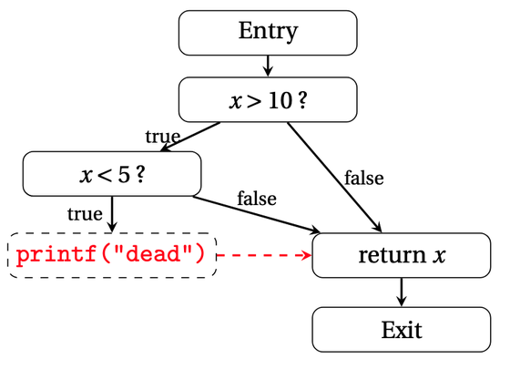
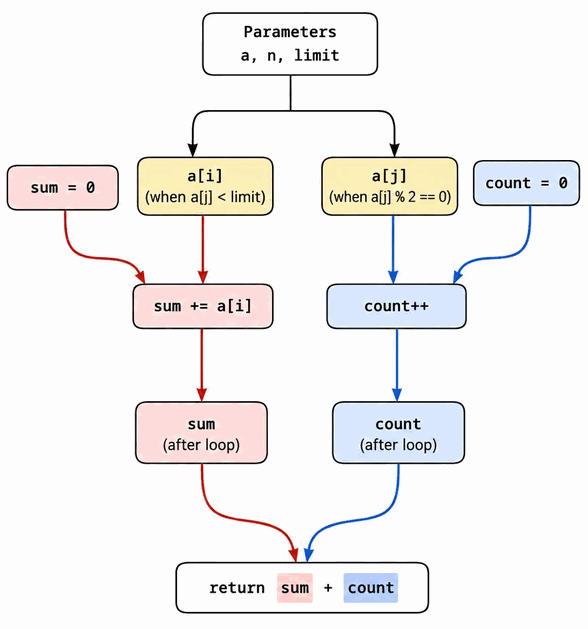
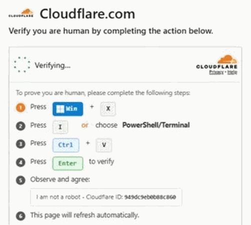
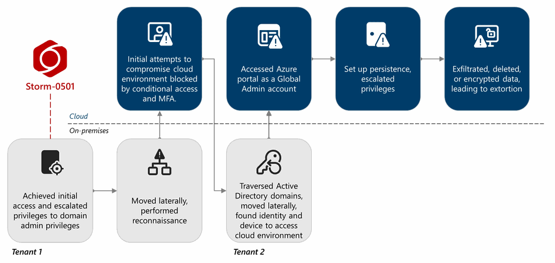

# CSIT953 考试复习 · 第 13 章 附录：考纲外速览与模拟卷

> 🎯 **这一章怎么用** — 第一部分速览考纲没有列出的四块内容：第 1 周导论、第 8 周后半的物联网安全、第 10 周的静态与动态分析、第 12 周的远程办公与勒索软件。第 0 章 §3 说过，考题基本出自 Key Topics 三页，所以这里只求应付可能出现的单选题，和前面各章重叠的地方写一句并指回。第二部分是一套按真题结构出的模拟卷：15 道单选、21 分填空与简答、14 分问答，全部用英文，每题的答案里标出对应的章节。同一套题还做成了互动测验页面 `exam13-mock-exam-review.html`，另附全书的复习卡片和 Anki 文件 `exam13-mock-exam-review-anki.csv`。

> 📚 **来源** — slides：W1 S1–S32；W8 S33–S46；W10 S1–S54；W12 S1–S23（按 PDF 页码，W12 的页脚从第 2 页起比 PDF 页码大 1）。录音：W1 没有录音；W11 录音约 28.5k–38.2k 字符（W8 的 IoT 部分）；W10 录音（整份）；W12 录音约 38.6k 字符之后（W12 S1–S7）；W13 录音前约 15.2k 字符（W12 S8–S23）；W13 录音的复习部分（题型和协议题的说法）。

# 第一部分 考纲外速览

## 1. 第 1 周：课程导论 (W1 S1–S32)

第 1 周介绍课程：从密码学讲到网络、系统和网络安全，分区块链、云、移动和物联网四个方向。考核方式和期末规则见第 0 章 §1。下面只整理可能出单选题的事实。

讨论"区块链真的有必要吗"时，课件列了区块链的四个特性：可追溯（traceability）、透明（transparency）、安全（security）和去中心化（decentralization）。什么时候值得用区块链，见第 7 章 §10。

课件举的数据泄露事件：

| 事件 | 时间 | 要点 |
|---|---|---|
| Facebook | 2019 年 8 月之前被入侵，2021 年 4 月才通知用户 | 5.3 亿多用户的电话、姓名、位置等资料被盗，随后被公开 |
| 淘宝（阿里巴巴） | 2019 年 11 月 | 超过 11 亿条用户数据受影响 |
| LinkedIn | 2021 年 | 数据抓取（scraping），7 亿个资料页，大多是公开信息 |
| Optus、Medibank | 2022 年 | API 安全差、凭据控制弱，泄露护照号码和私人医疗记录 |
| Origin Energy | 2026 年 7 月 | 近 480 万客户的姓名、地址和电话 |

Optus 和 Medibank 的教训和第 9 章 §3.2 一致：API 和凭据是云上数据的入口。

移动安全有五类常见威胁：

- 数据泄露（data leakage）：应用无意中泄露数据，恶意的企业签名应用也会造成泄露。
- 不安全的 Wi-Fi：免费 Wi-Fi 通常不加密（第 6 章 §4）。
- 网络欺骗（network spoofing）：架设看起来像正常 Wi-Fi 的假接入点（第 6 章 §9）。
- 钓鱼：移动设备一直开着，是钓鱼攻击的第一线。
- 密码学用错（broken cryptography）：开发者用了弱算法，或者没有正确实现强算法。

物联网部分有两样东西：家用路由器的五条建议（改管理员账户和口令、定期更新口令、改掉默认的网络名、开防火墙、关闭远程管理），以及四类事件：Mirai 僵尸网络（2016 年，利用防护差的 IoT 设备发起大规模的分布式拒绝服务攻击 DDoS）、智能家居入侵（摄像头、温控器、门锁）、医疗 IoT（胰岛素泵、心脏起搏器）、汽车（信息娱乐系统和驾驶辅助系统的漏洞让攻击者能干扰车辆）。

> ✍️ **English answer** — Mobile devices face data leakage, unsecured free Wi-Fi, network spoofing with fake access points, phishing and broken cryptography caused by weak algorithms or poor implementations. The Mirai botnet (2016) exploited poorly secured IoT devices to launch massive DDoS attacks, and the 2022 Optus and Medibank breaches resulted from poor API security and weak credential controls.

## 2. 物联网安全 (W8 S33–S46)

### 2.1 为什么不一样 (W8 S33–S35)

物联网（IoT）系统不只是一台设备，还包括无线链路、手机应用、网关、云服务，常常还连着物理过程，安全和隐私都可能受影响。

| 产品由什么组成 | 运行中的限制 |
|---|---|
| 设备固件 | CPU 和内存很小 |
| 手机应用或网页门户 | 部署多年 |
| 网关和无线链路 | 联网时断时续 |
| 云 API 和数据存储 | 难以打补丁 |
| 第三方集成 | 攻击者能接触到实物 |

**安全设计要覆盖整个产品**，不能只看设备本身。攻击面分四层：

| 层 | 常见问题 |
|---|---|
| 设备 | 调试端口、硬编码的秘密、不安全的启动、过时的库 |
| 网络 | 入网（onboarding）过程弱、暴露的服务、重放、欺骗、分段差 |
| 云和应用 | 授权有缺陷、不安全的 API、令牌泄露、数据保留过多 |
| 运维 | 不清楚有哪些设备、缺日志、停止维护的产品、退役时没有清除数据 |

### 2.2 两种典型漏洞 (W8 S36–S37)

默认凭据：攻击者扫描暴露的服务，试出厂口令或泄露的口令，装上恶意软件，再拿设备去扫描别人或发起拒绝服务攻击，Mirai 就是这样组建僵尸网络的。防御：每台设备一个独立的凭据，使用前强制完成安全设置，限制并监控登录尝试，去掉不必要的公网服务。

不安全的更新：

| 会出什么错 | 安全的更新设计 |
|---|---|
| 没有更新的途径 | 给发布的固件签名 |
| 接受未签名的固件 | 安装之前验证签名 |
| 下载过程没有保护 | 防回滚（anti-rollback） |
| 能回滚到有漏洞的旧版本 | 断电之后能安全恢复 |
| 支持期悄悄结束 | 公布支持期限和漏洞披露政策 |

> 👨‍🏫 **课堂强调** — 有些路由器能刷 OpenWrt 之类的第三方系统，原因就是它们不检查固件的签名。

### 2.3 无线、身份与访问控制 (W8 S38–S41)

无线链路各有自己的保护：Wi-Fi 用 WPA2 加 AES-CCMP 或 WPA3，低功耗蓝牙（BLE）用安全配对和绑定的密钥，Zigbee/Thread 要保护网络密钥和设备密钥，LoRaWAN 把网络密钥和应用密钥分开。在链路之上还要端到端的保护：尽量用 TLS 或 DTLS，认证云服务或网关，防止命令被重放（第 6 章 §4）。**不要把私有的无线协议当成加密**，少有人用不等于安全。

> 👨‍🏫 **课堂强调** — 公开的设计更值得信任。RSA 的算法人人都知道，安全靠的是密钥。别人送你一个不公开源代码的加密方案，你没法审计，也无从知道里面有没有后门。如今密码学部分的代码绝大多数是开源的。

> 📎 **拓展（超出 slides）** — 这就是 Kerckhoffs 原则：系统的安全应当只依赖密钥保密，而不依赖算法保密。

| 协议 | 对 IoT 的长处 | 要问的安全问题 |
|---|---|---|
| Wi-Fi | 现成的 IP 网络，吞吐量高 | 用哪种 WPA 模式，网络怎样分段 |
| Bluetooth LE | 功耗低，方便和手机交互 | 用哪种配对方式，密钥存在哪里 |
| Zigbee / Thread | 网状组网 | 网络密钥和设备身份怎样管理 |
| LoRaWAN | 距离远，消息小 | 入网密钥、计数器和防重放 |

哪种协议都还需要安全的身份、更新和监控。身份要覆盖每一个参与者：管理员尽量用防钓鱼的多因素认证，应用拿短期令牌，云服务对每次 API 调用做授权，角色限制谁能改配置；每台设备有自己的密钥或证书，最好锚定在安全硬件里，入网时双向认证，凭据能轮换、能撤销。

访问控制分设备和网络两侧。设备上关掉不用的接口，把正常运行和维护模式分开，敏感命令要授权，保护本地的调试和恢复模式。网络上把 IoT 设备放进专门的网段，只放行需要的目的地和端口，默认禁止设备之间互相通信，监控偏离预期的行为。

> 👨‍🏫 **课堂强调** — 为什么默认禁止设备之间的流量？一台设备被攻破后，就不能直接去攻击别的设备。确实需要 A 和 B 通信，再单独放行。

### 2.4 入网、生命周期与轻量级密码 (W8 S42–S46)

可信的入网（trusted onboarding）是一连串决定，不只是交换一个口令：

1. 设备出示制造时写入的身份或引导身份（bootstrap identity）。
2. 设备和网络在加密信道上互相认证。
3. 网络检查设备的类型、归属和安全状态。
4. 系统签发唯一的运行凭据，配上受限的策略。
5. 运行期间轮换凭据、更新安全状态，设备退役时撤销访问。

这和第 6 章 §6.4 的原则一致：制造身份、入网凭据、会话密钥和管理凭据分开管理。生命周期也分前后两段：部署前登记所有者、型号和固件，改掉不安全的默认设置，装好最新的更新，规定允许的通信，写好恢复和更换的流程；使用中监控安全状态和流量，按风险定的期限打补丁，轮换或撤销凭据，保留需要的证据，退役时擦除秘密和数据。

资源受限的设备装不下常规的算法时，可以用轻量级密码。NIST 在 2025 年 8 月发布 SP 800-232，规定了基于 Ascon 的认证加密、哈希和可扩展输出函数（XOF）。换成轻量级算法，nonce 的安全处理、密钥保护和侧信道防护一样都不能少。

课件最后的讨论案例是一个智能楼宇传感器：接入共享的 Wi-Fi，所有设备用同一个口令，固件从 HTTP 地址下载，云 API 直接接受请求里的设备 ID，配置改动没有日志。分析时要注意：单凭"请求里带设备 ID"或"用 HTTP 地址"还不能断定有漏洞，要去核实 API 有没有做授权、固件有没有验证签名。收尾的清单是五条：登记每台设备的所有者、固件版本和支持期限；每台设备独立的身份，去掉默认和共享的凭据；安全入网、加密链路、能防重放的消息；分段加最小权限的通信策略；验证签名的更新、监控安全状态、规划退役。

> ✍️ **English answer** — IoT security must cover the whole product, including firmware, mobile apps, gateways, wireless links, cloud APIs and third-party integrations, under constraints such as small CPU and memory budgets, long deployment lives, intermittent connectivity, difficult patching and physical access by attackers. Default credentials should be replaced by a unique credential per device, and secure updates must be signed, verified before installation, protected against rollback and recoverable after power loss. Link-level protection such as WPA2/WPA3 or secure BLE pairing must be complemented by end-to-end TLS or DTLS with replay protection, and a private radio protocol should never be treated as encryption. Trusted onboarding issues unique operational credentials under a restricted policy, and the network should segment IoT devices and block device-to-device traffic by default.

## 3. 静态分析与动态分析 (W10 S1–S54)

开源软件的源代码公开，攻击者能得到比闭源软件多的信息；开源软件面临的四类问题、补丁和补丁缺口见第 11 章 §9。Linux 有 3000 多万行代码、约 8 万个文件，靠人工审查找漏洞不现实，要用自动化的工具。工具分两类：静态分析不运行程序，动态分析运行程序、观察它的行为。

### 3.1 静态分析像编译器一样读程序 (W10 S5–S17)

静态分析模仿编译器理解程序的过程：源代码先切成词法单元（tokens），再转成中间表示（intermediate representation, IR），最后在 IR 上做程序推理。要回答的问题是：哪些语句会执行，条件的哪些分支可能走到，哪些循环会重复，哪些值会流进后面的计算。静态分析不运行程序，近似地推出所有可能的执行。

课件用的例子是下面这个函数：

```c
int analyze(int *a, int n, int limit) {
    int sum = 0;
    int count = 0;

    for (int i = 0; i < n; i++) {
        if (a[i] < limit) {
            sum += a[i];
        }
    }

    int j = 0;
    while (j < n) {
        if (a[j] % 2 == 0) {
            count++;
        }
        j++;
    }

    return sum + count;
}
```

第一步是**抽象语法树**（abstract syntax tree, AST）：按语法结构把程序表示成一棵树，每个节点是一种语法成分，如函数声明（FunctionDecl）、变量声明（VarDecl）、for 语句、if 语句。按课件的图重写如下：

```text
FunctionDecl: analyze
├── Parameters
│   ├── int *a
│   ├── int n
│   └── int limit
├── VarDecl: sum
├── VarDecl: count
├── ForStmt
│   ├── Init: int i
│   ├── Cond: i < n
│   ├── Inc: i++
│   └── Body
│       └── IfStmt
│           ├── Cond: a[i] < limit
│           └── Then: sum += a[i]
├── VarDecl: j
├── WhileStmt
│   ├── Cond: j < n
│   └── Body
│       ├── IfStmt
│       │   ├── Cond: a[j] % 2 == 0
│       │   └── Then: count++
│       └── j++
└── ReturnStmt: sum + count
```

### 3.2 控制流、可达性与数据流 (W10 S18–S23)

AST 说明程序由什么组成，**控制流图**（control flow graph, CFG）说明执行可能怎样走：节点是语句或基本块，边是可能的执行顺序。if 语句分出 true 和 false 两条边；while 循环在循环体末尾有一条回到条件判断的边。

有了 CFG，就能问可达性（reachability）：从入口出发，这一行能不能被执行到？CFG 只说明存在一条路径，还要把路径上的条件合起来推理。

```c
int f(int x) {
    if (x > 10) {
        if (x < 5) {
            printf("dead\n");
        }
    }
    return x;
}
```



图 1 里，走到 printf 要同时满足 x > 10 和 x < 5，这条路径实际上不可能，这样的代码叫**死代码**（dead code）。

数据流分析（data flow analysis）再进一步，问"什么值能到达这条语句"。图 2 画出了 analyze 里的值怎样流动：红色是流进 sum 的值，从 sum = 0 和满足 a[i] < limit 的元素 a[i] 来；蓝色是流进 count 的值，由满足 a[j] % 2 == 0 的元素决定；黄色是来自输入数组 a 的值。两条线最后汇合到返回值 sum + count。



三者一层叠一层：控制流回答执行可能去哪里，可达性回答这一行能不能执行，数据流回答到达这里的是什么值。

### 3.3 污点分析与 CodeQL (W10 S24–S33)

**污点分析**（taint analysis）建立在数据流分析之上，给不可信的值打上标签，追踪它们流到哪里。三个概念：

- source：不可信数据的来源，通常是用户能控制的输入。
- propagation：污点沿数据流传播的规则。
- sink：要保护的地方，敏感的操作或输出。

传播规则可以写成：

```text
x = source()   → x 被污染
y = x          → x 被污染，y 也被污染
z = x + y      → x 或 y 被污染，z 就被污染
sink(z)        → z 被污染，报告
```

在 analyze 里，把参数 a 当作 source、返回值当作 sink：a[i] 和 a[j] 被污染；sum 加上了 a[i]，被污染；count 的值受被污染的条件 a[j] % 2 == 0 控制，也受到影响；返回值 sum + count 被污染，报告。

第 11 章 §10.2 说过可以顺着 HTTP 请求找秘密，这正是一个污点分析的问题：source 是硬编码的令牌字符串，sink 是 HTTP 请求的 Authorization 头。即使令牌由前缀和后缀拼成，分散在几个文件里，污点分析也能把它追出来。课件的例子分三个文件（原图字太小，这里写成代码）：

```js
// config.js：source，硬编码的令牌
const prefix = "ghp_";
const body = "ExampleSecretToken123";
export const API_TOKEN = prefix + body;

// auth.js：propagation
import { API_TOKEN } from "./config.js";
export function makeAuthHeader() {
  return "Bearer " + API_TOKEN;
}

// github.js：sink，令牌进了 Authorization 头
import { makeAuthHeader } from "./auth.js";
export async function getUser() {
  const header = makeAuthHeader();
  return fetch("https://api.github.com/user", {
    headers: { Authorization: header }
  });
}
```

GitHub 开发的 **CodeQL** 把代码当作可以查询的数据。用它写规则时，定义什么是 source、什么是 sink，再让污点追踪找出两者之间的路径：

```text
import javascript

module SecretConfig implements DataFlow::ConfigSig {
  predicate isSource(DataFlow::Node source) {
    source.getStringValue().matches("ghp_%")       // 以 ghp_ 开头的字符串
  }
  predicate isSink(DataFlow::Node sink) {
    exists(Property p |
      p.getName() = "Authorization" and sink.asExpr() = p.getInit())
  }
}
module SecretFlow = TaintTracking::Global<SecretConfig>;

from SecretFlow::PathNode source, SecretFlow::PathNode sink
where SecretFlow::flowPath(source, sink)
select sink.getNode(), source, sink,
  "Hard-coded secret flows from $@ to an Authorization header.",
  source.getNode(), "this source"
```

常见的污点分析工具：

| 工具 | 主要用途 | 典型语言 |
|---|---|---|
| CodeQL | 基于查询的安全分析 | C/C++、Java、JS、Python、Go |
| Semgrep | 轻量级的污点规则 | JS、Python、Java、Go、PHP |
| Joern | 代码属性图分析 | C/C++、Java、JS |
| FlowDroid | Android 污点分析 | Android / Java |
| Soot | 程序分析框架 | Java / Android |
| Infer | 静态 bug 检测 | Java、C/C++、Objective-C |
| Coverity | 工业级静态分析 | C/C++、Java、C# |
| Fortify SCA | 企业级安全扫描 | 多种语言 |

静态分析告诉你可能有哪些路径、可能有哪些漏洞；运行时到底会发生什么，要靠动态分析拿到具体的证据。

### 3.4 动态分析与插桩 (W10 S35–S42)

动态分析运行程序，看不同的输入引起什么行为：

```c
void process(char *input) {
    char buffer[8];
    if (input[0] == 'A') {
        strcpy(buffer, input + 1);
        printf("Input: %s\n", buffer);
    }
}
```

输入 "Alice" 时，复制的是 "lice"，放得进 8 字节的 buffer，程序正常运行。输入 16 个 A 时，复制的长字符串超出 buffer，造成缓冲区溢出（buffer overflow）。运行时的证据有程序输出、崩溃、错误报告和栈回溯（stack trace）。

**插桩**（instrumentation）在程序里加入观察点，追踪运行过程。最直接的办法是改源代码，在分支和调用前后打印信息。不改源代码，也可以在运行时挂钩（hook）。课件用的是 Frida：

```js
const strcpyPtr = Module.getExportByName(null, "strcpy");
Interceptor.attach(strcpyPtr, {
  onEnter(args) {                  // 调用 strcpy 之前：看 dst 和 src
    console.log("[+] strcpy called");
    console.log("src = " + args[1].readUtf8String());
  },
  onLeave(retval) {                // strcpy 返回之后
    console.log("[+] strcpy returned");
  }
});
```

Frida 附加到正在运行的进程上，找到已加载的模块 libc.so 和它在运行时的基址，查出导出符号 strcpy 的运行时地址，再改写 strcpy 的开头，让它先跳到 hook。之后每次调用的顺序是：Frida 的 onEnter（看到 dst 和 src）→ 原来的 strcpy → Frida 的 onLeave → 程序继续运行。

### 3.5 模糊测试 (W10 S43–S49)

hook 能告诉我们 strcpy 有没有被调用、什么输入到达了它、参数是什么、程序有没有崩溃。剩下的问题是该测试哪些输入。插桩提供运行时的反馈，反馈又指导下一批输入，这就是**模糊测试**（fuzzing）：

1. 从种子输入（seed input）开始，变异或生成新的输入。
2. 运行程序，观察运行时的反馈。
3. 输入"有意思"就保存下来，继续在它的基础上变异；没意思就丢掉。

"有意思"的标准可以有很多，最常用的是覆盖了新的代码。输入 A 走过代码块 1、2、3，输入 B 走过 1、2、4、5，B 走到了新的代码，就保留 B、继续变异它。

生成输入有三种策略：

- 随机生成（random generation）：随便造输入，比如一长串 A。
- 基于变异（mutation-based）：拿一个有效的输入，修改其中一部分。
- 语法感知（grammar-aware）：JSON、HTML、PDF、协议消息这类有结构的输入，变异后要保持格式有效，否则一进门就被程序拒绝。

| 对象 | 怎样变异 | 可能发现什么 |
|---|---|---|
| PDF 阅读器 | 把有效 PDF 里的 /Length 100 改成 /Length 999999999 | 解析器相信了错误的长度，崩溃或卡死 |
| 图片处理（PNG） | 改元数据，把宽、高改成巨大的数 | 分配巨量内存，整数溢出或缓冲区溢出 |
| Web API | 依次请求 /api/orders/1001、1002、1003…… | 1003 属于别的用户却返回 200 OK：服务器只检查是否登录，没检查订单的所有者是不是当前用户，正确的做法是返回 403 Forbidden；换成 DELETE 请求，还能删别人的订单 |
| 数据库 | 同一个查询交给不同的数据库系统执行，或者比较"条件 A""条件 B"和"A 且 B"三个查询的结果 | 结果不一致，或者"A 且 B"返回了 A、B 交集以外的行，说明数据库有 bug |

编译器也能这样测试。模糊测试找到的是一个能触发异常行为的具体输入，并不直接说明漏洞在哪里：开发者要用这个输入重现问题，再去分析代码。

两种方法的比较（静态分析有误报、动态分析有漏报）、漏洞披露和补丁管理，见第 11 章 §9。

> ✍️ **English answer** — Static analysis examines a program without running it: like a compiler, it turns source code into tokens and an intermediate representation, builds an abstract syntax tree and a control flow graph, and uses reachability and data flow analysis to reason about possible executions; path reasoning can show that code such as a branch requiring x > 10 and x < 5 is dead code. Taint analysis labels untrusted values at a source, propagates the label through data flow and reports when it reaches a sink; CodeQL can, for example, track a hard-coded "ghp_" token through several files to an Authorization header. Dynamic analysis runs the program: instrumentation, such as a Frida hook on strcpy, observes runtime behaviour, and fuzzing mutates or generates inputs, keeping those that reach new code. Random, mutation-based and grammar-aware fuzzing of PDF files, images, web APIs and databases can reveal crashes, buffer overflows and broken access control, such as an API that returns another user's order because it checks only that the user is logged in.

## 4. 远程办公安全与勒索软件 (W12 S1–S23)

### 4.1 远程办公的威胁模型 (W12 S2–S5)

| 要素 | 远程办公时 |
|---|---|
| 资产 | 公司账户、业务数据，以及继续工作的能力 |
| 入口 | 家里的设备、暴露的网关、协作工具、SaaS 会话 |
| 信任决定 | 谁在请求访问，用哪台设备，访问哪个资源 |

攻击不一定从办公室开始。从熟悉的地点登录是有用的背景信息，但单凭地点证明不了来者合法。远程办公让暴露面变大，原因有三个：设备五花八门，个人设备更新慢，保护参差不齐；业务系统能从公司网络外访问，偷到账户就能从任何地方试；员工靠聊天和远程协助解决问题，攻击者可以冒充技术支持。

Verizon 2026 年的 DBIR 报告里，31% 的入侵从利用漏洞开始，48% 的已确认数据泄露涉及勒索软件。这些数字描述的是报告收集到的样本，不代表每个组织；报告的统计区间（2024 年 11 月到 2025 年 10 月）也和发布年份不同。

| 方式 | 做法 | 风险 |
|---|---|---|
| VPN | 把流量加密到公司的网关 | 往往给出范围很大的网络访问，被攻破的账户或设备有横向移动的空间 |
| 零信任网络访问 ZTNA | 按身份和设备策略，只开放选定的应用 | 也可能配置错误或有漏洞 |

两种方式都依赖安全的终端、身份和管理（第 5 章 §7 的云上接入方式也是同样的权衡）。核心是按用户、设备和资源做决定，只授予需要的访问。

### 4.2 身份、会话与设备 (W12 S6–S8)

- 认证：用防钓鱼的多因素认证（phishing-resistant MFA），例如 FIDO2 安全密钥或 passkey。它们的认证和真实的网站绑定，假的登录页面拿不到能用的东西（第 3 章 §13.4）。短信验证码、身份验证器 App 也属于多因素认证，但没有这种绑定。
- 授权：按角色限制访问，特权操作要更强的检查（第 9 章 §8）。
- 会话：登录成功后，服务用令牌（比如 cookie）代表这个会话。攻击者从被攻破的设备上偷走令牌，就能直接冒充用户，不用再登录。要调查令牌被盗，及时撤销可疑的会话。

> 📎 **拓展（超出 slides）** — 没有和网站绑定的验证码挡不住实时的钓鱼：用户在假页面上输入的验证码，攻击者可以马上转交给真网站登录。

受管设备的基线是自动更新、磁盘加密和终端检测与响应（endpoint detection and response, EDR）；权限上用标准用户账户，控制软件安装；家用和自带设备（BYOD）要更新路由器、工作和私人用途分开，未受管的设备只给受限的访问。家里和公共场所的 Wi-Fi 只保护到 AP，见第 6 章 §4。

> 👨‍🏫 **课堂强调** — 磁盘加密在笔记本丢失或被偷时最有用：拿到电脑的人读不出盘里的文件。它挡不住用户登录期间已经在运行的恶意软件。受管的笔记本必须安装更新，默认开启 BitLocker 这样的磁盘加密。

云协作的分享设置、第三方应用授权和"冒充技术支持"见第 9 章 §3.5。

### 4.3 两个案例 (W12 S9–S10)

Teams 冒充技术支持（Microsoft 2026 年 3 月报告，调查的是 2025 年 11 月的一次事件）：攻击者在 Teams 上冒充 IT 支持联系员工，前两次没成功，第三位员工被说服，通过 Quick Assist 交出了远程控制。之后员工被引到假的登录页面，凭据被截获，恶意载荷也跟着装上。Teams 和远程协助工具本身没有问题，问题在于没有独立核实对方是谁就信任了他。应对：通过已知的服务台渠道核实意外的协助请求，再决定是否交出远程控制。

TerminalFix（Microsoft 2026 年 8 月报告）：页面伪装成"验证你是真人"的 CAPTCHA，却要求访问者按步骤运行一条命令（图 3）：按 Win + X，选 PowerShell 或终端，按 Ctrl + V 粘贴（页面已经把恶意命令放进剪贴板），再按 Enter。用户等于亲手执行了入侵的第一步。Microsoft 的分析里，这一步带来了恶意软件、持久化和一条反向隧道，攻击者能借它从被攻破的电脑深入网络；这条攻击链里没有观察到后续的勒索软件。真正的人机验证从来不会要求运行命令。



### 4.4 勒索软件的演变 (W12 S11–S17)

勒索软件（ransomware）的问题是业务中断，不只是"文件被加密"：

| 伤害 | 说明 |
|---|---|
| 加密 | 文件或系统不可用，直到恢复或解密，损害的是可用性 |
| 数据勒索 | 威胁公开或出售偷到的数据，损害的是机密性 |
| 运营影响 | 身份系统宕机、服务中断，正常工作停摆 |

| 阶段 | 做法 |
|---|---|
| 早期模式 | 恶意软件加密能访问到的文件，然后索要赎金 |
| 企业化运作 | 操作者先潜入，扩大权限，再同时攻击许多系统 |
| 现在 | 数据窃取和云上的管理操作提供了新的施压手段 |

这几种做法不是一个取代一个，一次事件可以组合多种手段。**勒索软件即服务**（ransomware as a service, RaaS）把犯罪分工：

| 角色 | 做什么 |
|---|---|
| 运营者 operators | 开发恶意软件，维护犯罪服务 |
| 附属者 affiliates | 实施入侵，把服务用在受害者身上 |
| 访问经纪人 access brokers | 出售已经拿到的访问权，供别的犯罪者使用 |

这些是角色，不是固定的公司架构，实际中会重叠。典型的企业入侵分三个阶段：

1. 初始访问（initial access）：盗用账户、利用暴露的服务，或者骗员工运行有害的东西。
2. 扩展（expansion）：摸清环境里有什么，提升权限，在系统之间移动。
3. 勒索（extortion）：偷数据，破坏恢复手段，中断服务。

单重勒索（single extortion）要求付钱恢复访问；双重勒索（double extortion）还威胁公开偷到的数据。**从备份恢复文件，撤销不了数据的泄露**，付了钱也证明不了对方删掉了所有副本。所以可用性和数据泄露是相关但不同的两个问题，事件响应要分别查清哪些系统受影响、哪些数据可能被拿走。

Storm-0501（Microsoft 2025 年 8 月报告）展示了勒索怎样从本地系统越到云上（图 4）。攻击者先在本地拿到初始访问，提升到域管理员权限，横向移动、侦察；第一次尝试进入云环境，被条件访问（conditional access）和多因素认证挡住；再穿过另一个 Active Directory 域，找到能访问云的身份和设备，以全局管理员（Global Admin）身份登录 Azure 门户；随后建立持久化、提升权限，最后窃取、删除或加密数据，实施勒索。到了云上，伤害不必像传统的恶意软件那样加密笔记本，强大的管理操作就能复制、删除或加密云资源。所以混合身份（hybrid identity）要特别保护，见第 9 章 §3.3。



AI 方面，Microsoft 2026 年 10 月的报告说，攻击者用 AI 辅助已有的攻击任务，例如钓鱼和社会工程，让老方法更快；这不等于每次勒索都由 AI 自主完成。AI 代理（agent）也给企业带来了新的身份、工具权限和连向业务数据的连接，要限制代理的权限，让它的访问可追溯、可撤销。

### 4.5 防御 (W12 S18–S23)

| 阶段 | 控制 |
|---|---|
| 入口 | 给暴露的服务打补丁，要求强认证 |
| 扩展 | 限制管理访问，隔离敏感系统 |
| 影响 | 监控数据流动，保护独立的恢复副本 |

这些控制互相补充：备份挡不住数据被偷，强认证修不好暴露的漏洞，管理员能随意拆掉分段的话，分段也没用。目标是让攻击的每一步都更难、更容易被发现。

**零信任**（zero trust）以一位远程员工打开工资系统为例：先确认这个人的身份，以及设备符合组织的要求；再判断这个人能不能访问工资系统，只开放这一个应用，不因为一次请求通过就开放整个内网；风险变化时，比如账户行为异常或设备不再合规，就要求重新检查或撤销访问。零信任不是某个产品，也不是不信任员工，而是不再仅凭地点、网络连接或设备归属就自动信任。

勒索软件在加密之前往往已经露出迹象：

| 信号 | 例子 |
|---|---|
| 身份 | 意外的管理员、异常的登录、可疑的应用授权 |
| 终端 | 未经批准的远程工具、脚本执行、篡改安全软件 |
| 数据和云 | 大量下载、破坏性的 API 调用、备份策略被改 |

单个信号说明不了问题，管理员也会做正常的维护。要按账户、设备和时间把事件串起来，和正常的工作对比：装了一个陌生的远程工具，紧接着出现一个新的管理员账户，就比单独哪一件都可疑。

能扛住入侵的恢复（第 9 章 §3.3）：恢复副本和日常的生产管理分开，同一个高权限账户不能同时管生产系统和所有备份；用离线或不可变的副本，删除要受保护；定期演练恢复关键服务，量出实际的恢复时间。

分散办公的事件响应分三步：遏制（隔离受影响的终端，禁用或撤销被盗的访问）、调查（保全证据，查清扩散范围、持久化手段和被偷的数据）、恢复（清除攻击者的访问，安全地重建，按业务优先级恢复）。只改一个口令可能不够，别的会话可能还活着。

课件最后给了一个 90 天的计划：第 1–30 天，盘点远程访问的途径，关掉不必要的暴露，保护管理员账户；第 31–60 天，扩大设备覆盖，细化访问限制，把身份、终端和云的告警关联起来；第 61–90 天，做一次勒索软件演练，验证一项关键服务真的能恢复。

> ✍️ **English answer** — Remote work increases exposure through device variety, access to business services from anywhere and remote support that attackers can impersonate, so access decisions should consider the user, the device and the resource rather than location. A VPN encrypts traffic to a gateway but may grant broad network access, whereas ZTNA grants access only to selected applications under identity and device policy; both depend on secure endpoints, phishing-resistant MFA such as FIDO2 keys or passkeys, least-privilege authorisation and the ability to revoke stolen session tokens. Modern ransomware is a business-disruption problem run as a service by operators, affiliates and access brokers, moving through initial access, expansion and extortion; double extortion adds the threat of publishing stolen data, which restoring backups cannot undo. Defences combine patching and strong authentication at entry, restricted administration and isolation during expansion, monitoring of data movement, detection of identity, endpoint and cloud signals before encryption, and recovery copies that are isolated, immutable and regularly tested.

## ⚠️ 易混易错（第一部分）

| 容易混的 | 区别 |
|---|---|
| AST vs CFG | 程序由什么语法成分组成 / 执行可能按什么顺序走 |
| 可达性 vs 数据流 | 这一行能不能执行 / 到达这里的是什么值 |
| source vs sink | 不可信数据的来源 / 要保护的敏感操作 |
| 改源码插桩 vs Frida hook | 在代码里加打印 / 不改代码，运行时挂钩到函数上 |
| 随机 vs 变异 vs 语法感知 | 随便造输入 / 改有效的输入 / 改完仍保持格式有效 |
| VPN vs ZTNA | 加密到网关，常开放整个网络 / 按身份和设备只开放选定的应用 |
| 单重勒索 vs 双重勒索 | 付钱恢复访问 / 还威胁公开偷到的数据 |
| 运营者 vs 附属者 vs 访问经纪人 | 开发和维护服务 / 实施入侵 / 出售已有的访问 |
| 磁盘加密 vs EDR | 防设备丢失后被读盘 / 发现正在运行的可疑行为 |
| 链路保护 vs 端到端保护（IoT） | WPA2/WPA3、BLE 配对只保护无线电那一段 / TLS、DTLS 一直保护到云 |

常见误解：

- "模糊测试找到崩溃，就知道漏洞在哪里"：它只给出一个能触发异常的输入，开发者还要重现、分析。
- "付了赎金，对方就会删掉数据"：无法验证，恢复文件也撤销不了泄露。
- "零信任就是不信任员工"：它指的是不凭地点、网络或设备归属自动信任，每次访问都按身份、设备和资源判断。
- "连上 VPN 就安全了"：VPN 只加密到网关，终端、身份和访问范围仍然要管。
- "私有的无线协议没人知道，所以安全"：不公开的设计没法审计，安全只能靠密钥。
- "换成轻量级密码就够了"：nonce、密钥保护和侧信道防护一样都不能少。

# 第二部分 模拟卷

这套卷子按第 0 章 §1 的结构出题：Section A 15 道单选，每题 1 分；Section B 21 分，6 道填空每题 1 分、5 道简答每题 3 分；Section C 14 分，三道问答。题目全部用英文，答案折叠在每题下面，折叠行里标出对应的章节；卷末有一张题目与章节的对照表。场景都换成了前面各章练习没用过的：协议题取第 6 周的协议 3（第 0 章 §3：问答部分一定有一道第 6 周的识别协议），云存储题换成律师事务所分享案卷，HTTP 样题换成智能家居设备。

建议先完整地做一遍，再对答案。时间可以这样分：Section A 约 30 分钟，Section B 约 70 分钟，Section C 约 60 分钟，留 20 分钟检查。

> **Instructions** — Time allowed: 3 hours. Closed book; no calculators. Total: 50 marks. Answer all questions in English on the answer sheet, in question order. Where a question asks for an explanation, keywords alone may not earn full marks.

## Section A · Multiple choice (15 marks)

Each question has exactly one correct answer. 1 mark each.

**A1.** Why is it hard to rewrite a block that is already deep in the Bitcoin blockchain?
A. Every block is signed by the miner who created it, so a changed block fails that miner's signature check
B. A central authority signs every block and rejects changes
C. The attacker would have to redo the proof of work for that block and every later block, and outpace the honest network, which needs more than half of the total hash power
D. Nodes delete old blocks once they are confirmed

<details>
<summary>Answer A1 · 第 7 章 §5.1（第 1 章 §3.2）</summary>

**C.** Each block contains the hash of the previous block, so changing an old block changes every later hash and invalidates their proof of work. The network follows the chain with the most accumulated work, which is why rewriting history is a 51% attack.

</details>

**A2.** A flight-delay insurance contract on Ethereum automatically pays travellers when an oracle reports a delay of more than three hours. Which statement is TRUE?
A. If the oracle reports a false delay, the contract still pays, because it can check only the report's format and the oracle's authorisation
B. The contract can verify that the flight was really delayed
C. Deterministic execution guarantees that every payout is correct
D. Once the flight data is stored on-chain, it is guaranteed to be true

<details>
<summary>Answer A2 · 第 7 章 §9.1–§9.2</summary>

**A.** A contract cannot see the outside world. It can check who submitted the report and whether it is well formed, but not whether it is true: garbage in, garbage out. The oracle therefore becomes a concentrated point of trust.

</details>

**A3.** Which practice gives the strongest protection for a wallet's private key against malware on the user's computer?
A. Storing the private key in a JSON file in the user's home directory
B. Photographing the mnemonic and keeping the photo in a cloud drive
C. Using a hardware wallet that keeps the key inside the device and shows the transaction details on its own screen for confirmation
D. Encrypting the key with the same password the user uses for email

<details>
<summary>Answer A3 · 第 8 章 §5</summary>

**C.** The private key never leaves the hardware device, so malware on the computer cannot copy it, and checking the recipient and amount on the device's screen defends against a compromised host that alters what is signed. The other options store the key or mnemonic where malware or a cloud compromise can reach it.

</details>

**A4.** Which property of a cryptographic hash function means that it is computationally infeasible to find two different inputs with the same digest?
A. Preimage resistance (one-wayness)
B. Collision resistance
C. The avalanche effect
D. Determinism

<details>
<summary>Answer A4 · 第 1 章 §2</summary>

**B.** Preimage resistance concerns finding an input for a given digest; the avalanche effect means a small change in the input produces a completely different digest; determinism means the same input always gives the same digest.

</details>

**A5.** A smart sensor and its gateway agree on a key with unauthenticated ECDH over Wi-Fi. An attacker controls the access point between them. What can the attacker do?
A. Nothing, because the shared secret cannot be computed from the public values
B. Only read the public values, which reveal nothing useful
C. Recover the gateway's long-term private key from the recorded public values, and then decrypt all past sessions
D. Run one key exchange with the sensor and another with the gateway, then decrypt, read and re-encrypt every message

<details>
<summary>Answer A5 · 第 2 章 §4.2</summary>

**D.** A passive eavesdropper cannot compute the secret, but an active man in the middle can replace both public values with its own and share one key with each side. Authentication of the public values, for example a signature with a certified key, is required.

</details>

**A6.** A browser receives a server certificate signed by an intermediate CA, together with the intermediate CA's certificate. How does the browser decide whether to trust the server certificate?
A. It verifies each signature along the chain up to a root certificate already in its trust store, and checks the hostname, validity period and revocation status
B. It trusts any certificate signed by any CA
C. It asks the server whether the certificate is valid
D. It trusts the intermediate certificate because the server sent it in the same handshake, and checks only that the server certificate was signed by it

<details>
<summary>Answer A6 · 第 4 章 §4–§5</summary>

**A.** Trust comes from a root certificate pre-installed in the trust store (the trust anchor); the chain must lead to it, and the server certificate must match the hostname, be within its validity period and not be revoked.

</details>

**A7.** While connected to an airport's free Wi-Fi, a traveller clicks through a browser warning saying that the bank's certificate is not trusted. What is the main risk?
A. None, because the connection is still encrypted with TLS and the bank's server will detect any modification
B. The bank's private key is leaked
C. The certificate will be revoked automatically
D. A man in the middle who presented a forged certificate can now read and modify the traffic, including the traveller's login

<details>
<summary>Answer A7 · 第 4 章 §10；第 2 章 §9</summary>

**D.** Encryption to the wrong party protects nothing. The warning was the only sign of the attack, and accepting it lets the attacker terminate TLS on both sides.

</details>

**A8.** On a company laptop, a contractor runs `ssh -R 8443:intranet.local:443 contractor@vps.example`. Why is this a security concern?
A. It only encrypts traffic between the laptop and the VPS, so there is no concern
B. Connections to port 8443 on the external VPS are forwarded through the tunnel to the internal intranet site, bypassing the company's firewall and segmentation
C. It turns the laptop into a SOCKS proxy, so the VPS can browse the Internet through the company network
D. It disables host key verification

<details>
<summary>Answer A8 · 第 5 章 §10.2、§11</summary>

**B.** With remote forwarding, the listening port is on the SSH server (the VPS), and the client side (the laptop) connects onward to intranet.local:443. An internal service is thereby published on an outside machine, and the firewall sees only an SSH connection.

</details>

**A9.** A hotel protects its guest Wi-Fi with WPA2. Why should guests still use HTTPS for online banking?
A. WPA2 encrypts only the hotel's management traffic, not the guests' web traffic
B. HTTPS makes the Wi-Fi connection faster
C. WPA2 protects only the radio link between the device and the access point; beyond the access point the traffic is decrypted and visible to whoever runs the network
D. WPA2 works only when HTTPS is also used

<details>
<summary>Answer A9 · 第 6 章 §4</summary>

**C.** Link encryption ends at the access point. End-to-end protection from the browser to the bank's server requires TLS.

</details>

**A10.** In an identification protocol, Bob sends a random value r and Alice replies with H(r, K). Why must r be chosen by Bob, fresh and unpredictable, for every login?
A. So that a recorded response cannot be replayed, and an attacker cannot collect responses to future challenges in advance
B. So that r works as a salt, which is all a challenge needs to achieve in a challenge-response protocol
C. To hide Alice's identity from eavesdroppers
D. So that Bob needs to store only H(K)

<details>
<summary>Answer A10 · 第 3 章 §6、§14</summary>

**A.** If Alice chose r, or if r repeated, an old response could be replayed; if r were predictable (for example a counter), an attacker posing as Bob could obtain the answer to a future challenge from Alice beforehand.

</details>

**A11.** An employee logs in to the company's cloud storage with a valid password and MFA, then downloads a folder belonging to another department because the folder's policy grants access to all employees. Which control failed?
A. Authentication
B. Authorisation (the access policy did not follow least privilege)
C. Encryption at rest
D. Key rotation

<details>
<summary>Answer A11 · 第 9 章 §8.1–§8.2</summary>

**B.** Authentication correctly established who the user was; the policy that decides what that identity may access was too broad.

</details>

**A12.** A hospital shares imaging files with external specialists through a cloud storage provider and wants the provider to be unable to read the files. Which design achieves this?
A. Rely on the provider's default encryption at rest
B. Use HTTPS for every upload and download, so that the files are encrypted end to end between the hospital and the specialists
C. Protect the shared link with a strong password
D. Encrypt each file on the hospital's devices before upload and wrap the file key separately for each specialist's public key

<details>
<summary>Answer A12 · 第 9 章 §5、§9.1、§10.2</summary>

**D.** With encryption at rest and HTTPS, the provider still handles plaintext or holds the keys. Client-side encryption with per-recipient key wrapping keeps both the plaintext and the file keys away from the provider.

</details>

**A13.** Two companies use secure two-party computation to learn only whether their average salaries differ by more than 10%. The result is "yes". What does company A learn?
A. Company B's exact average salary, because a "yes" result can only be computed from both averages
B. Nothing at all, not even the result
C. Its own input, the one-bit result and whatever follows from them, but nothing else about company B's salaries
D. Company B's full salary list

<details>
<summary>Answer A13 · 第 10 章 §3–§4</summary>

**C.** A secure protocol leaks nothing beyond the authorised output, because company A's view can be simulated from its own input and the result. The one-bit output itself still says something: B's average lies more than 10% away from A's.

</details>

**A14.** A mobile app's release-signing key is stored as a CI secret that every job can read, including builds of pull requests. What is the main risk?
A. Code from a malicious pull request or a compromised dependency could read the key and sign malicious releases that users' devices will trust
B. The key will expire sooner
C. The app store will reject the app
D. Pull-request builds will fail, because jobs triggered by pull requests are never allowed to read secrets

<details>
<summary>Answer A14 · 第 11 章 §5–§6</summary>

**A.** Secrets are injected into the runner at run time, so any code that runs in the job can use them. Signing keys should be available only to a protected release job after approval, ideally kept in an HSM or managed signing service.

</details>

**A15.** A university's automated marking system runs untrusted code submitted by students. Which choice gives the strongest isolation between student jobs and the host?
A. Standard containers on one host, because each container has its own kernel
B. One shared container in which all jobs run as root, to simplify monitoring
C. Mounting the Docker socket into each job so that it can manage its own containers
D. A separate VM for each job, or a VM-based sandbox such as Kata Containers, so that each job has its own guest kernel behind a hypervisor

<details>
<summary>Answer A15 · 第 12 章 §5–§6、§11</summary>

**D.** Standard containers share the host kernel, so one kernel exploit affects every job, and mounting the Docker socket would hand each job administrative control of the host.

</details>

## Section B · Fill in the blank and short answer (21 marks)

B1–B6 are worth 1 mark each; B7–B11 are worth 3 marks each.

**B1.** If an Ethereum transaction runs out of gas before it finishes, its state changes are ______, but the fee for the gas used is still paid.

<details>
<summary>Answer B1 · 第 7 章 §7.2</summary>

Reverted (rolled back).

</details>

**B2.** A 12-word BIP39 mnemonic encodes ______ bits of entropy, plus a checksum.

<details>
<summary>Answer B2 · 第 8 章 §9.1</summary>

128 (each word carries 11 bits; 12 × 11 = 132 = 128 bits of entropy + a 4-bit checksum).

</details>

**B3.** Using ephemeral Diffie–Hellman keys in TLS 1.3 provides ______ secrecy: sessions recorded today stay secure even if the server's long-term private key is stolen later.

<details>
<summary>Answer B3 · 第 2 章 §6</summary>

Forward.

</details>

**B4.** Public, append-only logs that record the certificates issued by CAs, so that misissued certificates can be detected, are called Certificate ______.

<details>
<summary>Answer B4 · 第 4 章 §8.3</summary>

Transparency (CT).

</details>

**B5.** A signed record stating which source commit, build process and build platform produced a software artifact is called ______.

<details>
<summary>Answer B5 · 第 11 章 §7</summary>

Provenance (provenance attestation).

</details>

**B6.** Linux ______ limit how much CPU and memory a container may use, while namespaces limit what its processes can see.

<details>
<summary>Answer B6 · 第 12 章 §5</summary>

Cgroups (control groups).

</details>

**B7.** A software company needs to (a) let users detect whether a downloaded installer has been corrupted or replaced, when the expected value is published through a separate trusted channel; (b) let its update server check that configuration commands come from the company's management console, which shares a secret key with the server; and (c) let any customer verify that a release was published by the company. For each requirement, name the most suitable primitive and give one reason.

<details>
<summary>Answer B7 · 第 1 章 §1、§3、§7</summary>

(a) A cryptographic hash such as SHA-256: any change to the file gives a different digest, and because the expected value comes from a trusted channel, the attacker cannot replace it as well. (b) A MAC such as HMAC with the shared key: only holders of the key can compute a valid tag, so the server knows the command came from the console and was not modified; adding a counter or timestamp prevents replay. (c) A digital signature: the company signs with its private key and anyone can verify with the public key, which also gives non-repudiation; a MAC would not work because customers do not share the secret key, and a bare hash could be replaced together with the file.

</details>

**B8.** Give three measures to harden SSH access to a fleet of cloud servers, and explain what risk each one reduces.

<details>
<summary>Answer B8 · 第 5 章 §4–§7、§11</summary>

Any three, each with its reason: disable password login and use public-key or short-lived certificate authentication, so there is no password to guess, phish or reuse, and the server stores only public keys; disable direct root login and use named accounts with controlled sudo, which gives accountability and limits damage; do not expose port 22 to the Internet, and reach servers through a bastion host, an identity-aware proxy or just-in-time access, which reduces exposure to scanning and centralises policy and logging; disable or restrict forwarding (DisableForwarding, PermitOpen), so tunnels cannot bypass network segmentation; verify host key fingerprints or use host certificates, which prevents a man in the middle on the first connection.

</details>

**B9.** A hospital's staff Wi-Fi uses WPA2-Enterprise (802.1X/EAP), and staff log in with their hospital username and password. An attacker sets up an access point with the same SSID near the entrance. Explain how this evil twin can capture staff credentials, and give two measures that prevent it.

<details>
<summary>Answer B9 · 第 6 章 §9</summary>

The rogue access point broadcasts the trusted SSID, possibly with a stronger signal or after forging deauthentication frames to push clients off the real network, and devices that auto-join connect to it. The attacker also runs a fake authentication server; if a device does not validate the server's certificate, or the user accepts the unknown certificate when prompted, the device sends the user's credentials (or authentication material that can be cracked) to the attacker. Measures: install a managed connection profile so that devices validate the authentication server's certificate against the hospital's CA and expected server name and never ask users to trust an unknown certificate; switch to certificate-based EAP-TLS so that no password is sent; disable automatic joining of unknown networks and monitor for rogue access points. Hiding the SSID does not help, because it does not authenticate the network.

</details>

**B10.** Two advertisers use private set intersection (PSI) to learn which customers they have in common, without revealing the rest of their customer lists. What does each advertiser learn, and why? Give one risk that remains even if the protocol is secure.

<details>
<summary>Answer B10 · 第 10 章 §3–§4、§9</summary>

Each advertiser learns its own list, the intersection, that is, which of its own customers also appear in the other list, and whatever follows from these two, but nothing about the other advertiser's remaining customers. This is because a simulator given only the advertiser's own list and the intersection can produce a view indistinguishable from the real protocol messages. A remaining risk is output leakage through repeated queries: by running PSI many times with chosen lists, for example a single candidate customer each time, an advertiser can test whether any person is the other's customer. Query limits, committed inputs and audit are needed; the protocol also cannot stop either party from entering false data.

</details>

**B11.** Describe one way in which the isolation of a virtual machine can fail and one way in which the isolation of a container can fail. Explain why container isolation is generally considered weaker.

<details>
<summary>Answer B11 · 第 12 章 §5、§7–§8</summary>

A VM can fail through a VM escape: code in the guest sends crafted input to a vulnerable hypervisor interface, such as a virtual device or a copy-and-paste feature, corrupts memory in a privileged host-side component and executes code on the host. A container can fail through a kernel vulnerability exploited from inside the container, or through configuration with no bug at all: a privileged container, a mount of the host's root filesystem or access to the Docker socket gives control of the host. Container isolation is weaker because all containers share one host kernel, so one kernel flaw or unsafe privilege setting affects every container on the host, whereas a VM attacker must cross a separate guest kernel and the hypervisor.

</details>

## Section C · Questions and answers (14 marks)

**C1.** (5 marks) Bob stores (Alice, pw). To identify herself, Alice chooses a random number r, computes H = H(r, pw) and sends (Alice, r, H) to Bob. Bob accepts Alice if H = H(r, pw).
(a) Is this protocol secure against an adversary who can eavesdrop on and replay messages? Explain why. [3 marks]
(b) What does the random number r achieve? [1 mark]
(c) Propose a modification that fixes the weakness identified in (a). [1 mark]

<details>
<summary>Model answer C1 · 第 3 章 §2、§5、§6</summary>

(a) No, it is not secure against impersonation. The random value r is chosen by Alice, not by Bob, and Bob accepts any r as long as the hash matches. An adversary who eavesdrops on one login records (Alice, r, H(r, pw)) and later sends exactly the same message to Bob; Bob recomputes H(r, pw) with the stored pw, finds that it matches, and accepts the adversary as Alice. The adversary never learns pw yet impersonates Alice, so for identification the protocol is as insecure as sending H(pw) (Protocol 2). Two further weaknesses remain: Bob stores pw in plaintext, so a database leak exposes every password, and an eavesdropper who sees r and H(r, pw) can still guess a weak password by trying candidates for that r.

(b) r acts as a salt. Identical passwords give different hash values in different logins, and a precomputed dictionary of (pw, H(pw)) values becomes useless, so the adversary must recompute candidate hashes for each captured r. It does not provide freshness.

(c) Let Bob choose a fresh, unpredictable random challenge r for every login and send it to Alice; Alice replies with (Alice, H(r, pw)), and Bob accepts only a response to the challenge he has just sent, so a recorded response is useless for a new challenge (Protocol 4). Better still, replace pw with a long random key K and reply with H(r, K) (Protocol 6), or let Alice sign r with her private key (Protocol 9) so that Bob stores only her public key.

**Marking points:** not secure, impersonation by replay (1); because Alice chooses r and Bob checks only the hash, with the replay described step by step (1); a further weakness, such as plaintext storage or guessing a weak password for the captured r (1); r only works as a salt against precomputed dictionaries (1); the fix: a fresh random challenge chosen by Bob (1).

</details>

**C2.** (5 marks) A law firm wants to share case files with external experts through a commercial cloud storage service. The provider must not be able to read the files. Only lawyers assigned to a case may give an expert access to that case's files, files must not be modified undetected, and access must be withdrawn when an expert's engagement ends.
(a) Design a solution, and explain how it provides confidentiality, integrity and access control. [4 marks]
(b) State one limitation of your design. [1 mark]

<details>
<summary>Model answer C2 · 第 9 章 §5–§12</summary>

(a) Confidentiality: every file is encrypted on the law firm's devices before upload (client-side encryption), using a fresh random data-encryption key (DEK) and authenticated encryption such as AES-256-GCM, so the provider stores only ciphertext. Sharing is key distribution: the DEK is wrapped separately for each authorised recipient with that recipient's public key, for example with ECIES, and the wrapped keys are stored alongside the file (envelope encryption with per-recipient wrapping). Recipients' public keys must be authenticated, for example through certificates or a key registry controlled by the firm, so that a substituted key cannot redirect the DEK to an attacker.

Integrity: the GCM authentication tag detects any modification of the ciphertext, and the uploading lawyer signs a manifest containing the file identifier, version and ciphertext hash, so experts can verify who published the file and detect a swapped or rolled-back version.

Access control: an authorisation service controlled by the firm, or a smart contract, records which lawyers are assigned to each case and accepts a grant only from them, using roles or attributes such as case number and role (RBAC or ABAC), and it logs every grant. Alternatively, ciphertext-policy ABE can encrypt each file under a policy such as "case = 2041 AND (role = lawyer OR role = expert)". When an engagement ends, the firm deletes the expert's wrapped keys, revokes the expert's account, and re-encrypts future versions under a new DEK wrapped only for the remaining members.

(b) Revocation cannot recall plaintext that the expert has already downloaded or decrypted. In addition, metadata such as file sizes, access times and sharing relationships remains visible to the provider, and security depends on the endpoints and on each user protecting their private key.

**Marking points:** client-side encryption with a per-file DEK and authenticated encryption (1); per-recipient key wrapping with authenticated public keys (1); integrity through the authentication tag and a signed manifest or hash (1); access control by case and role with logging, or ABE, plus revocation by re-keying (1); a valid limitation (1).

</details>

**C3.** (4 marks) A smart home hub sends commands such as "unlock front door" to the manufacturer's cloud service over plain HTTP. Describe how you would secure this communication, and analyse whether your method resists a man-in-the-middle (MITM) attack.

<details>
<summary>Model answer C3 · 第 4 章 §5–§7、§13；第 2 章 §5</summary>

Plain HTTP gives no confidentiality, integrity or server authentication, so anyone on the path, for example a malicious Wi-Fi access point, can read commands, change them or replay an earlier "unlock". I would use HTTPS, i.e. TLS 1.3, between the hub and the cloud service. The service presents a certificate for its domain issued by a trusted CA, or by a private CA whose root certificate is built into the hub's firmware. The hub verifies the chain to its trust anchor, the hostname, the validity period and the revocation status, and never disables verification. In the handshake both sides contribute ephemeral ECDH key shares, and the server signs the handshake transcript (CertificateVerify) with its private key, so the hub knows that it agreed the key with the genuine service; the derived session keys then protect every command with authenticated encryption such as AES-GCM. For the cloud service to authenticate the hub, I would use mutual TLS with a unique device certificate whose private key is kept in secure hardware, and each command would carry a sequence number or nonce so that an old command cannot be replayed at the application level.

MITM analysis: an attacker who intercepts the connection can start its own key exchange with the hub, but it cannot present a valid certificate for the service's domain or produce the CertificateVerify signature without the server's private key, so the hub aborts the handshake; it cannot impersonate the hub either, because it lacks the device's private key. Unauthenticated Diffie–Hellman alone would not resist MITM, because the attacker could run one exchange with each side. The protection assumes that the hub validates certificates correctly, that no malicious root certificate is in its trust store, that the server's and the device's private keys stay secret, and that firmware updates are signed so the trust store cannot be replaced.

**Marking points:** TLS 1.3 with certificate validation against a trust anchor (1); ephemeral ECDH, CertificateVerify and authenticated encryption explained (1); MITM analysis: no valid certificate or signature, so the handshake aborts, unlike unauthenticated DH (1); device authentication with mutual TLS or replay protection, and the stated assumptions (1).

</details>

## 题目与章节对照

| 考纲条目 | 章 | 题目 |
|---|---|---|
| Blockchain and Smart Contracts | 第 7 章 | A1、A2、B1 |
| Cryptocurrency Wallets | 第 8 章 | A3、B2 |
| Cryptographic Hashes and MACs | 第 1 章 | A4、B7 |
| Diffie–Hellman Key Exchange | 第 2 章 | A5、B3（C3 也用到） |
| HTTPS, TLS and Digital Certificates | 第 4 章 | A6、A7、B4、C3 |
| SSH Security | 第 5 章 | A8、B8 |
| Wireless Network Security | 第 6 章 | A9、B9 |
| Authentication Protocols | 第 3 章 | A10、C1 |
| Secure Cloud Storage and Data Sharing | 第 9 章 | A11、A12、C2 |
| Secure Two-Party Computation | 第 10 章 | A13、B10 |
| Software Supply Chain Security | 第 11 章 | A14、B5 |
| Virtual Machines and Containers | 第 12 章 | A15、B6、B11 |

## 本章小结（第一部分）

- 第 1 周：课程分区块链、云、移动、物联网四个方向；移动威胁有数据泄露、不安全的 Wi-Fi、网络欺骗、钓鱼、密码学用错；Mirai 用防护差的 IoT 设备发起 DDoS。—— *data leakage, network spoofing, Mirai*
- 物联网安全要覆盖整个产品：每台设备独立凭据，签名并验证的更新加防回滚，链路保护之上加 TLS/DTLS，不把私有协议当加密，分段并默认禁止设备之间通信。—— *unique device credentials, signed updates, anti-rollback, trusted onboarding*
- 静态分析不运行程序：AST、CFG、可达性与死代码、数据流；污点分析追踪 source → propagation → sink，CodeQL 能把硬编码令牌追到 Authorization 头。—— *AST, CFG, dead code, taint analysis, CodeQL*
- 动态分析运行程序：插桩（Frida hook）观察行为，模糊测试变异或生成输入、保留走到新代码的输入；随机、变异、语法感知三种策略。—— *instrumentation, fuzzing, seed, mutation, grammar-aware*
- 远程办公：按用户、设备、资源做访问决定；VPN 加密到网关但范围大，ZTNA 只开放选定应用；防钓鱼的 MFA、可撤销的会话、受管设备。—— *ZTNA, phishing-resistant MFA, session token theft*
- 勒索软件是业务中断问题：RaaS 分工、三阶段入侵、双重勒索；恢复文件撤销不了泄露；防御靠分阶段的控制、加密前的检测和独立、不可变、演练过的恢复。—— *RaaS, double extortion, zero trust, immutable recovery*
