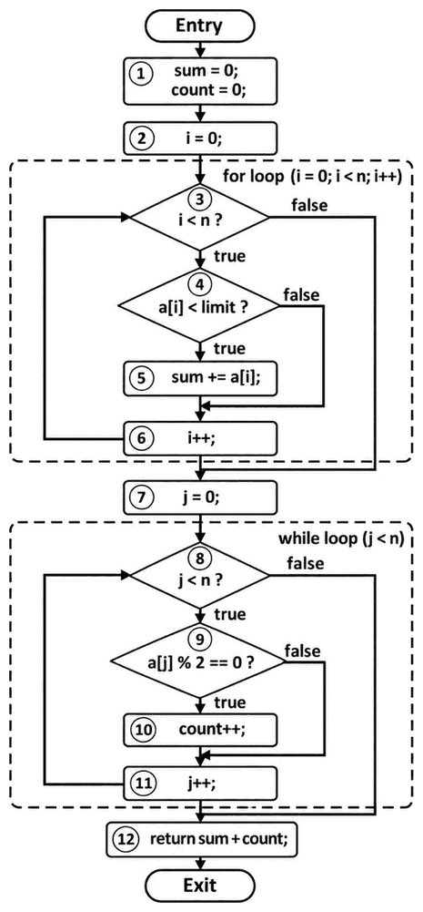

# CSIT953 第 10 周 · 开源软件安全：用静态分析和动态分析找漏洞

> **学习目标 (Learning objectives)** — 读完本章你应该能够：
> - 说出开源软件漏洞的四类来源（已知漏洞、未知漏洞、供应链、执行时的不安全输入），解释为什么面对 Linux 这样几千万行的代码只能靠自动化工具，并用"运不运行程序"区分**静态分析**和**动态分析**；
> - 说明静态分析器怎样像编译器一样读程序（源代码 → token → IR → 推理），解释只靠 grep 搜索为什么不够；把一段 C 函数画成**抽象语法树**（AST），认出 FunctionDecl、VarDecl、ForStmt、IfStmt、BinaryOperator 等节点；
> - 从 AST 画出**控制流图**（CFG），用它判断一行代码可不可达；解释 CFG 上连得通的路径为什么可能根本走不通（死代码），以及这和静态分析的误报有什么关系；
> - 分析一段代码的**数据流**，区分值直接流入（显式流）和只通过条件施加影响（隐式流）；用 source、propagation、sink 和 S25 的传播规则做**污点分析**，为"找硬编码的秘密""找 SQL 注入"这样的具体目标选出合适的 source 和 sink，并逐句读懂 S29–S32 的 CodeQL 查询；
> - 解释动态分析怎样用具体输入换来运行时证据，区分源代码**插桩**和运行时 **hook**，说清 Frida 怎样找到并拦截 `strcpy`；
> - 描述 **fuzzing** 的循环和"有趣的输入"的含义，比较随机生成、基于变异、语法感知三种策略，用 PDF 阅读器、订单 API、图片、编译器、数据库的例子说明 fuzzing 能找到什么；
> - 用误报和漏报对比两类分析的长处与局限；说出漏洞披露的五个步骤，解释补丁发布之后风险为什么还在（patch gap）。

> 📚 **材料说明** — 本笔记依据 Week 10 slides（S1–S54，"Open-Source Software Security: Static and Dynamic Analysis"）和 Week 10 课程录音。这是客座讲师 **Liuhuo Wan** 的第二讲，接着第 9 周的开源软件安全往下讲。录音完整覆盖了这份 slides，没有上一周的内容；开头几分钟是课前闲聊（假期、期末考试），与课程内容无关。第 11 周的录音开头讲的是第 8 周剩下的 slides，也没有本周的内容。S3 沿用了第 9 周 S51 的例子。**几组页要注意**：S7–S16 是同一段代码的 AST 逐步展开，S17 是完整的树，这几页上的编号（"5. ForStmt""12. WhileStmt"）指的是**代码行号**，不是步骤编号；S35、S36 是同一段代码配两种输入；S1 是封面，S54 是致谢页。下面几样内容 slides 上没有，是讲师在课上讲的，笔记按录音写进了正文：AST 能告诉分析器什么（§2.4）、count 和 j 的关系（§3.2）、SQL 注入的污点分析（§4.7）、运行时能观察的信号（§5.3）、对图片、编译器和数据库做 fuzzing（§7.6），以及 Better Auth 和 Google 的漏洞报告渠道（§9.1）。图 1 直接用了 S20 的原图；S17 改写成文本树，S27、S34、S48、S50 改成了表格；S21、S23、S28、S40、S44、S49、S53 的配图重画或改画成了图 2、3、4、6、7、10、13；图 5、8、9、11、12 是笔记新加的示意图。录音是自动转写，术语错得很多：taint 成了 tint、tinted、Tintin，static 成了 strategic、graphic、Sertic，AST 成了 EST，abstract syntax tree 成了 abstract synthetic tree，while 成了 well、whale、real，for 成了 full、false，sink 成了 sync、think，source 成了 sauce，CodeQL 成了 code QL、code QLL，Semgrep 成了 semirip，Joern 成了 drone，FlowDroid 成了 flow joint，Soot 成了 scoot，Frida 成了 Freedom、Frieda，onEnter 成了 uninter、on inter，onLeave 成了 on leaf，strcpy 成了 STR CPY、strong copy，libc.so 成了 lab C.ss，fuzzing 成了 fasting、passing、pricing、fizzing，mutate 成了 mute，PDF parser 成了 PDF puzzle、PDF pather，integer overflow 成了 integral overflow，SQL 成了 circle、cycle，MySQL 成了 MyCircle，Clang 成了 color，Amazon 成了 Emerson，bug bounty 成了 bug bumping，Google Bug Hunters 成了 Google duck hunter，Better Auth 成了 Better Awesome，advisory 成了 adversary，fork 成了 folk，files 成了 fields。引用时已按 slides 校正。录音里有两处说法按事实修正：讲师说公开的 CVE "大约 3,300,000 条"，实际规模是三十多万条，多半是 330,000 转写错了（§1.1）；讲师说 C 程序发生缓冲区溢出时"运行时会告诉你出错了"，实际上 C 不检查越界，要靠 ASan 这类工具才能可靠地报告（§5.2）。

> 🎯 **考试提示** — 第 13 周 slides 的考试范围（Exam Scope / Key Topics）没有单列"静态分析""动态分析"。本周内容归在 Applied Security Topics 的 **Software Supply Chain Security — Risks from third-party components in CI/CD pipelines** 下面：第 9 周讲第三方组件带来什么风险，本周讲怎样在这些组件里找出漏洞（§2–§8），以及找到之后补丁怎样传到下游、为什么传不到（§9）。复习时优先保证这几处：§1.3 和 §8 静态与动态分析的对比（S34、S50 两张表，尤其是**静态分析会误报、动态分析会漏报**，以及各自的原因）；§4.1–§4.3 污点分析的 source、propagation、sink 和传播规则；§7.2–§7.3 fuzzing 的循环和三种策略；§9.3 的 patch gap。§7.5 的订单 API 还连着 **Secure Cloud Storage and Data Sharing** 里的访问控制（access control）。考试是 3 小时闭卷，单选 15 分、填空和简答 21 分、问答 14 分；slides 提醒，**要求解释的题，只写关键词可能拿不到满分**。比如问"静态分析为什么会误报"，只写"false positive"不够，要写出原因：它不运行程序，只在 CFG 上推理"可能"走的路径，其中有些路径实际上走不通（§3.3 的死代码）。

第 9 周的最后一页（S82）留下了一个问题：开源组件被广泛使用，其中很多含有已知漏洞，**怎样在它们酿成事故之前就把漏洞找出来？** 第 9 周 §5.7 还留了一个具体的例子：两个普通的字符串拼成一个 token，再放进 HTTP 请求的 Authorization 头里。单看哪个字符串都不像秘密，只有顺着数据在程序里的流向追下去，才认得出它。

本周客座讲师回答这两个问题。答案分两大类。一类是**静态分析**（*static analysis*）：不运行程序，像编译器一样把代码读懂，推理它**可能**做什么。另一类是**动态分析**（*dynamic analysis*）：真的把程序跑起来，喂给它各种输入，观察它**实际**做了什么。两类方法各有盲区，正好互补。全章的主线是 S34 表格里的一组对比：静态分析问"**可能**发生什么"（*What may happen?*），动态分析问"**实际**发生了什么"（*What actually happens?*）。

本章依次回答这些问题：

1. 开源软件的漏洞从哪里来？为什么只能靠自动化工具找？（§1）
2. 静态分析器怎样读懂一段程序？（§2）
3. 怎样推理程序可能走哪些路、某个值从哪里来？（§3）
4. 怎样追踪"不可信的数据流到了危险的地方"？真实的工具怎样写这种规则？（§4）
5. 静态分析的结论只是"可能"，怎样拿到"确实如此"的证据？（§5）
6. 不改源代码，怎样看清程序运行时在做什么？（§6）
7. 该喂给程序哪些输入，才最可能触发漏洞？（§7）
8. 两类方法各自擅长什么、会漏掉什么？（§8）
9. 找到漏洞之后，补丁怎样到达用户，又为什么常常到不了？（§9）

## 1. 问题：开源代码里的漏洞，人工找不完

### 1.1 开源让攻击者知道得更多：四类漏洞 (S2)

S2 的第一句话是：与闭源软件相比，**攻击者能从开源软件得到更多信息**。代码公开，审查者能读，攻击者也能读。第 8 周的老师说开源"总体上更安全"，因为问题会被更多人看到，这两句话并不矛盾：公开代码让找漏洞变容易了，对防守方和攻击方都一样。谁先找到、找到后谁先行动，决定了公开代码最后帮了谁。本周讲的自动化工具，就是让防守方找得更快、更全。

S2 把开源软件的漏洞分成四类：

| 类别 | slides 的说明 | 讲师的解释 |
|---|---|---|
| **已知漏洞**（*known vulnerabilities*） | CVE | 已经公开、有编号的漏洞。用户还在用受影响的旧版本，攻击者就能照着公开的信息攻击 |
| **未知漏洞**（*unknown vulnerabilities*） | ??? | 存在、但还没被公开的漏洞，数量比已知的更多 |
| **供应链**（*supply chain*） | 恶意包（*malicious packages*） | 不仔细审查就引入的恶意依赖；或者依赖里有漏洞，上游没有及时修补 |
| **执行**（*execution*） | 不安全的输入处理（*unsafe input handling*） | 即使开发者、供应链都没问题，用户传进来的参数也可能触发漏洞 |

**CVE**（*Common Vulnerabilities and Exposures*）是给公开漏洞分配的统一编号，形如 `CVE-2021-44228`（第 9 周的 Log4Shell）。讲师说，公开的 CVE 到现在已经有三十多万条（录音转写成"3,300,000"，按 CVE 的实际规模，多半是 330,000）。

前三类在第 9 周都见过：Log4Shell 是已知漏洞，typosquatting 和 event-stream 属于供应链。本周新出现的是第四类，**执行漏洞**：触发漏洞的是**输入**。程序来自可信的开发者，经过可信的流水线，可它没有检查用户传进来的数据，一个过长的字符串、一个拼进 SQL 语句的用户名，就能让它做出危险的事。本周大部分例子都属于这一类：§5 的缓冲区溢出、§4.7 的 SQL 注入、§7 用各种畸形输入去"撞"程序。

### 1.2 上一讲留下的问题：被拆开的秘密 (S3)

S3 把第 9 周 S51 的例子又拿了出来（"Question from previous lecture"）：

```javascript
const prefix = "password";
const suffix = "user-admin";
const token = `${prefix}${suffix}`;

fetch("https://api.github.com/user", {
  headers: {
    "Authorization": `Bearer ${token}` // Value in the Authorization header is likely a secret.
  }
});
```

两个普通的字符串拼成 `token`，`token` 进了 Authorization 请求头。这个例子只有 9 行，人眼一看就明白。讲师请大家想一个更真实的情形：前缀定义在一个文件里，后缀在另一个文件里，中间经过好几层函数的处理，真正发 HTTP 请求的代码又在第三个文件里。S3 下方的图就是这个意思：左边一个文件写着"Prefix"，右边一个文件写着"Send http request"，中间是一长串省略号。这时还能靠人一行行地看吗？

### 1.3 人工找不完：两类自动化工具 (S4)

S4 给出了规模：**Linux 有 3000 多万行代码**，讲师补充说大约有 8 万个源文件。靠人工检查这样的项目，根本不可能。出路是**自动化工具**（*automatic tools*），分成两类：

- **静态分析**（*static analysis*）：**不执行**代码，直接分析源代码（或编译出来的二进制），推理程序可能的行为。
- **动态分析**（*dynamic analysis*）：**执行**程序，给它输入，观察它运行时的行为。

区分两者只看一点：分析时程序跑没跑起来。名字已经说明了这一点，"static"是静止的，"dynamic"是运动的。后面所有的差别，误报还是漏报、要不要准备输入、覆盖多少路径，都从这一点推出来（§8）。

<details>
<summary>自测：下面三种情况各属于 S2 的哪一类漏洞？(a) 公司还在用 2021 年的 log4j 2.14；(b) 一个 PDF 阅读器打开长度字段被改成 999999999 的文件时崩溃；(c) 项目依赖了一个名字和 requests 只差一个字母的包。</summary>

(a) 已知漏洞：Log4Shell 有 CVE 编号（CVE-2021-44228），修复版本早已发布，风险来自没有升级。(b) 执行漏洞：程序本身来源可信，问题出在它没有检查输入里的长度字段（§7.4 会再遇到这个例子）；在被人发现、公开之前，它同时也是一个未知漏洞。(c) 供应链：typosquatting 的恶意包（第 9 周 §7.8）。

</details>

## 2. 静态分析的地基：像编译器一样读程序

### 2.1 编译器要回答的问题 (S5)

静态分析不运行程序，那它凭什么知道程序会做什么？S5 的提示是：**想一想编译器怎样理解你的程序**。你写完代码（自己写的也好，AI 写的也好），点一下编译，编译器就能把它变成机器指令。为此编译器必须先搞清楚几件事，讲师列了四个问题：

1. 哪些语句会被执行？
2. `if`、`while`、`for` 的哪些分支是可能的？
3. 哪些循环可能重复执行？
4. 哪些值会流进后面的计算？

静态分析器做的事情和编译器一样：在**不运行程序**的前提下，**近似地**推出程序可能怎样执行。"近似"两个字很重要，§3.3 和 §8 会解释它带来的代价。

本章大部分静态分析的例子，都用 S5 上的这个 C 函数（左边是行号，后面会一直引用）：

```c
 1  int analyze(int *a, int n, int limit) {
 2      int sum = 0;
 3      int count = 0;
 4
 5      for (int i = 0; i < n; i++) {
 6          if (a[i] < limit) {
 7              sum += a[i];
 8          }
 9      }
10
11      int j = 0;
12      while (j < n) {
13          if (a[j] % 2 == 0) {
14              count++;
15          }
16          j++;
17      }
18
19      return sum + count;
20  }
```

它做两件事：第 5–9 行，把数组 `a` 前 `n` 个元素里**小于 `limit`** 的加起来，存进 `sum`；第 11–17 行，数一数前 `n` 个元素里有几个**偶数**，存进 `count`。最后返回 `sum + count`。三个参数都由调用者传进来。

> **🔑 例：手算一遍** — 设 `a = {3, 8, 5, 2}`，`n = 4`，`limit = 6`。for 循环：3 < 6，`sum` = 3；8 不小于 6，跳过；5 < 6，`sum` = 8；2 < 6，`sum` = 10。while 循环：3 是奇数，跳过；8 是偶数，`count` = 1；5 跳过；2 是偶数，`count` = 2。函数返回 10 + 2 = **12**。后面讲 CFG 和数据流时，会一直拿这组输入当例子。

### 2.2 源代码 → token → IR → 推理 (S6)

S6 画出了编译器理解程序的流水线：

**源代码**（*source code*）→ **token** → **IR** → **程序推理**（*program reasoning*）

- 第一步把源代码切成 **token**（词法单元）：关键字 `int`、标识符 `analyze`、运算符 `<`、数字 `0`、括号和分号等等。讲师的说法是"按空格和换行切开"；更准确地说，词法分析器按语言的规则切，`i<n` 中间没有空格，照样切成 `i`、`<`、`n` 三个 token。
- 第二步把 token 组织成 **IR**（*Intermediate Representation*，中间表示）：一种比源代码文本更有结构、更便于分析的表示。
- 第三步在 IR 上做**程序推理**：分析控制流（§3.1）和数据流（§3.4）。

编译器和静态分析器用的是同一套 IR。

为什么不直接分析源代码文本？讲师举了一个例子。假设我们关心程序有没有调用 C 标准库的 `strcpy`（把一个字符串复制进一块缓冲区，不检查长度，§5.2 会看到它有多危险）。最直接的办法是用 grep 在源文件里搜 `strcpy`。搜到了，然后呢？讲师列出了 grep 回答不了的五个问题：

1. 搜到的 `strcpy` 真的是一次**函数调用**，还是出现在一个字符串或注释里？
2. 它的**参数**是什么？`strcpy(buffer, input)` 换个参数名写成 `strcpy(dst, data)`，靠文本匹配还认得出来吗？
3. 就算认出了参数 `input`，它是**从哪里来的**？来自用户、来自另一个进程，还是程序里写死的常量？
4. 这次调用在**什么条件下**才会执行？
5. 它执行完之后，**下一条**执行的是哪条语句？

判断"这次调用危不危险"，需要的正是这五个问题的答案，它们也是后面数据流分析的原料。文本搜索看到的只是一串字符，IR 看到的是程序的结构。问题 1、2 由下一节的 AST 回答，问题 4、5 由控制流图回答，问题 3 由数据流分析回答。

> 📎 **拓展(超出 slides)：IR 不止一种** — AST 是最贴近源代码的一种 IR。编译器在后面的阶段还会把 AST 转成更低层的 IR，例如 LLVM IR 或"三地址码"，每条指令只做一件小事，更便于优化和分析。本讲只用 AST。

### 2.3 抽象语法树 (S7–S17)

讲师重点讲的 IR 是**抽象语法树**（*Abstract Syntax Tree*，**AST**）：把程序的语法结构表示成一棵树，每个节点是一个语法成分（一个声明、一条语句、一个表达式），子节点是它的组成部分。"抽象"指的是它丢掉了分号、括号、空格这些只为书写服务的细节，只保留结构。

S7–S16 逐行把 `analyze` 翻译成 AST 节点。下表按代码行号汇总（slides 上"5. ForStmt"里的 5 就是行号）：

| 行 | 代码 | AST 节点 | 节点记录了什么 |
|---|---|---|---|
| 1 | `int analyze(int *a, int n, int limit)` | **FunctionDecl**（函数声明） | 名字 `analyze`、返回类型 `int`、参数列表（三个参数） |
| 2、3 | `int sum = 0;` `int count = 0;` | **VarDecl**（变量声明） | 变量名、类型、初始值（*initializer*）0 |
| 5 | `for (int i = 0; i < n; i++)` | **ForStmt**（for 语句） | 四个部分：初始化（*init*）、条件（*condition*）、增量（*increment*）、循环体（*body*） |
| 5 | `int i = 0` / `i < n` / `i++` | VarDecl / **BinaryOperator** / **UnaryOperator** | for 的前三个部分各自又是一个节点 |
| 6 | `if (a[i] < limit)` | **IfStmt**（if 语句），条件里有 **ArraySubscriptExpr** `a[i]` | 条件和 if 的主体 |
| 7 | `sum += a[i];` | **CompoundAssignOperator**（复合赋值） | 把 `a[i]` 加到 `sum` 原来的值上 |
| 12 | `while (j < n)` | **WhileStmt**（while 语句） | 条件 `j < n` 和循环体 |
| 13 | `a[j] % 2 == 0` | BinaryOperator：取模和相等比较 | 见下文 |
| 14 | `count++` | UnaryOperator | 只有一个操作数 `count` |
| 19 | `return sum + count;` | **ReturnStmt**（return 语句） | 返回的表达式 `sum + count` |

几个名字解释一下。**BinaryOperator**（二元运算符）有两个操作数，`i < n` 的两个操作数是 `i` 和 `n`，运算是"小于"；**UnaryOperator**（一元运算符）只有一个操作数，`i++` 只作用在 `i` 上。**ArraySubscriptExpr**（数组下标表达式）就是 `a[i]` 这种按下标取数组元素的写法。第 11 行的 `int j = 0;` 和第 2、3 行一样是 VarDecl，第 16 行的 `j++` 和第 14 行一样是 UnaryOperator，slides 没有单独标出来。

第 13 行值得多看一眼。slides 写的是"BinaryOperator：取模和相等比较"，其实这里有**两个** BinaryOperator，一个套在另一个里面：最外层是 `==`，它的左操作数是 `a[j] % 2`，这本身又是一个 BinaryOperator（`%`），两个操作数是 `a[j]` 和 `2`；`==` 的右操作数是 `0`。表达式里的运算顺序，在 AST 里变成了树的嵌套。

把这些节点按包含关系组装起来，就是 S17 的完整 AST。下面按 S17 重写成文本树，右边括号里是节点类型：

```text
FunctionDecl: analyze                     返回 int
├── Parameters: int *a, int n, int limit
├── VarDecl: sum = 0
├── VarDecl: count = 0
├── ForStmt                               第 5–9 行
│   ├── Init: int i = 0                   (VarDecl)
│   ├── Cond: i < n                       (BinaryOperator)
│   ├── Inc:  i++                         (UnaryOperator)
│   └── Body: IfStmt
│       ├── Cond: a[i] < limit            (BinaryOperator，左边是 ArraySubscriptExpr)
│       └── Then: sum += a[i]             (CompoundAssignOperator)
├── VarDecl: j = 0
├── WhileStmt                             第 12–17 行
│   ├── Cond: j < n                       (BinaryOperator)
│   └── Body
│       ├── IfStmt
│       │   ├── Cond: a[j] % 2 == 0       (BinaryOperator ==，左边是 BinaryOperator %)
│       │   └── Then: count++             (UnaryOperator)
│       └── j++                           (UnaryOperator)
└── ReturnStmt: sum + count               (BinaryOperator)
```

读这棵树时注意，它的层次和源代码的缩进一一对应：函数体里的七个成分是 FunctionDecl 的七个孩子；for 循环的四个部分是 ForStmt 的孩子；if 语句嵌在 for 的循环体里，在树上就是 ForStmt 的孙子。讲师说，这棵树可以一直长下去：在 for 循环里再套一个 while 循环，树就再多几层。

> 📎 **拓展(超出 slides)：亲眼看一棵真的 AST** — slides 用的节点名（FunctionDecl、ForStmt、CompoundAssignOperator 等）正是 C/C++ 编译器 Clang 的 AST 节点名。把 `analyze` 存成 `analyze.c`，运行 `clang -Xclang -ast-dump -fsyntax-only analyze.c`，就能打印出这棵树。真实的树比上面的更细：每次引用变量是一个 `DeclRefExpr` 节点，每个常数是一个 `IntegerLiteral` 节点，还有编译器自动插入的类型转换节点 `ImplicitCastExpr`。

### 2.4 AST 能告诉分析器什么

为什么要费力气建这棵树？讲师课上列了 AST 能直接回答的几类问题（这一段 slides 上没有）：

- **函数的入口**：每个 FunctionDecl 都是一个可以被调用的入口，分析器由此知道程序有哪些函数、从哪里开始分析。
- **变量**：每个 VarDecl 记录了一个变量和它的初始值，分析器可以从声明出发，追踪它后来被怎样修改、传到哪里（§3.4 的数据流）。
- **分支和循环**：每个 IfStmt、ForStmt、WhileStmt 都是一个岔路口或者一个可能重复的地方，§3.1 的控制流图就由它们建出来。
- **数组访问**：每个 ArraySubscriptExpr 都是一个可能**越界**的地方。
- **函数调用**：调用节点记录了调用的是谁、参数是什么，分析器可以找出程序有没有调用敏感的 API，比如发 HTTP 请求的 `fetch`、复制字符串的 `strcpy`、执行 SQL 的 `execute`。这回答了 §2.2 的问题 1 和 2：调用节点里的 `strcpy` 一定是一次调用，不会是字符串；参数叫什么名字也不要紧，第一个参数就是第一个孩子。
- **赋值**：每个赋值节点记录了哪个变量在哪里被改了。

数组越界值得展开。`analyze` 的循环条件是 `i < n`，`n` 是调用者传进来的。讲师问：如果数组 `a` 只有 4 个元素，调用者却传了 `n = 10`，会怎样？循环会去读 `a[4]` 到 `a[9]`，这些位置已经在数组之外，这就是**越界访问**（*out-of-bounds access*）。后果取决于语言。C 和 C++ 不检查下标，程序会读到数组后面恰好存着的任意数据，结果不可预测，可能算出一个错误的值，也可能崩溃；Java 在运行时检查下标，越界时抛出 `ArrayIndexOutOfBoundsException`，讲师说在这一点上 Java "足够安全"。分析器在 AST 上看到 `a[i]`，又看到 `i` 的上限来自参数 `n`，就能提示"这里可能越界"。

<details>
<summary>自测：表达式 x = y * (z + 1) 的 AST 长什么样？根节点是什么？</summary>

根节点是赋值运算符 =（在 Clang 里它也是一个 BinaryOperator），左孩子是 x，右孩子是乘法 *。乘法的左孩子是 y，右孩子是加法 +；加法的两个孩子是 z 和 1。括号本身不出现在树上，它的作用已经体现为"加法是乘法的孩子"，也就是先算加法。

</details>

<details>
<summary>自测：同事说"我们用 grep 搜 strcpy，结果为零，所以代码里没有不安全的字符串复制"。这个结论有什么问题？</summary>

grep 只匹配文本，会漏报：代码可以通过宏或函数指针调用 strcpy，文本里根本不出现这个词；同样不安全的还有 strcat、sprintf、gets，以及自己手写的复制循环。grep 也会误报：搜到的 strcpy 也许只在注释或字符串里。就算真搜到了调用，grep 也说不出参数从哪里来、在什么条件下执行（§2.2 的五个问题）。要回答这些，得在 AST、控制流和数据流上分析。

</details>

## 3. 从结构到推理：控制流、可达性、数据流

讲师用一句话点出了这一节的出发点：**AST 给出了结构，可静态分析需要的是推理**。AST 告诉我们 `if` 里面有一条 `sum += a[i]`，却不直接告诉我们"执行到这条语句之前，程序可能经过了哪些地方""执行到这里时，`sum` 可能是什么值"。这一节在 AST 之上建起三层推理：控制流（执行可能走到哪里）、可达性（这一行能不能执行到）、数据流（到达这里的是什么值）。

### 3.1 控制流图：程序可能走的路 (S18–S20)

**控制流图**（*Control Flow Graph*，**CFG**）把程序画成一张有向图：**节点**是语句（或者一段一定会连着执行完的语句），**边**表示"执行完这里，下一步可能到那里"。普通语句只有一条出边；条件判断有两条出边，分别标 true 和 false；循环表现为一条**回到前面的边**。CFG 表示的是程序执行时**可能**走的所有路径。

S18 从最小的结构讲起，就是第 6–7 行的 if 语句。程序每次执行到这里，都要计算条件 `a[i] < limit`，结果只有 true 和 false 两种：

- true：执行 `sum += a[i]`，`sum` 被更新，然后往下走；
- false：直接跳过，`sum` 不变，往下走。

两条路在 if 之后汇合到"下一条语句"（*next*）。S18 把同一个 if 画了两遍：右上角是它的 AST（IfStmt 下面挂着 Condition 和 Body），中间是它的 CFG（一个条件分成两路，再汇合）。对比一下就能看出两者的分工：AST 说"Body 是 IfStmt 的一部分"，CFG 说"Body 可能执行，也可能被跳过"。

循环的 CFG 多了一条回边。S19 用了一个最简单的 while 循环：

```c
while (j < n) {
    count++;
    j++;
}
```

它的 CFG 是：入口 → 条件 `j < n`？true → `count++` → `j++` → **回到条件**；false → 出口。只要条件还是 true，执行就在这个圈里绕。

S20 把整个 `analyze` 画成了 CFG，就是图 1，节点按 slides 编了号 ①–⑫。图 1 的上半部分是 for 循环（虚线框），下半部分是 while 循环。



对着图 1，跟着讲师的思路走一遍。从 Entry 出发，经过 ① 初始化 `sum` 和 `count`、② `i = 0`，到达 ③ `i < n ?`：

- 如果 ③ 为 false（比如 `n = 0`，一次都不循环），for 的循环体一次也不执行，直接到 ⑦ `j = 0`。
- 如果 ③ 为 true，进入循环体，遇到 ④ `a[i] < limit ?`。④ 为 true，执行 ⑤ `sum += a[i]`，再到 ⑥ `i++`；④ 为 false，跳过 ⑤，直接到 ⑥。⑥ 之后**回到 ③** 再判断一次，只要 ③ 还是 true，就一直绕这个圈。
- ③ 终于为 false 时，离开 for 循环到 ⑦，进入 while 循环 ⑧–⑪。它的结构和 for 循环一样，只是初始化 ⑦ 和增量 ⑪ 写成了单独的语句。⑧ 为 false 时到 ⑫ `return sum + count`，然后到 Exit。

> **🔑 例：§2.1 那组输入走的路径** — `a = {3, 8, 5, 2}`，`n = 4`，`limit = 6`。for 循环部分是 ①②，然后 ③④⑤⑥、③④⑥、③④⑤⑥、③④⑤⑥，最后 ③ 为 false（3、5、2 走了 ⑤，8 跳过了 ⑤）；while 部分是 ⑦，然后 ⑧⑨⑪、⑧⑨⑩⑪、⑧⑨⑪、⑧⑨⑩⑪，最后 ⑧ 为 false（8 和 2 是偶数，走了 ⑩）；最后是 ⑫。换一组输入，路径就不同。CFG 不针对哪一组输入，它把**所有**可能的路径都画在一张图里。

### 3.2 CFG 能推出变量之间的关系 (S19, S20)

讲师用 CFG 推了一个有意思的结论。回到 S19 那个简单的循环：执行完之后，`count` 和 `j` 有什么关系？

假设进入循环前 `count` 和 `j` 都是 0。沿着 CFG 看：如果条件一开始就是 false，两者都不变，仍然相等；每绕一圈，`count++` 和 `j++` **都**执行一次，两者各加 1，仍然相等。不管绕多少圈，`count == j` 永远成立。这种在循环的每一圈都保持成立的性质，叫**循环不变量**（*loop invariant*）。分析器不用知道 `n` 是多少，单靠 CFG 的结构就能证明它。讲师说，这就是 CFG 的一个好处：**它能帮你分析出程序里的约束**。

再看完整的 `analyze`（图 1 的 ⑧–⑪）。这里 `count++` 套在 ⑨ `if (a[j] % 2 == 0)` 里，`j++` 却每圈都执行。⑨ 为 true 时两者都加 1，为 false 时只有 `j` 加 1，`count == j` 不再成立了。`count` 加了几次，取决于数组里有几个偶数，也就是取决于**具体的输入数据**。讲师的结论是，这时两者"没有关系"，分析器单看 CFG 推不出 `count` 的确切值。在上面的例子里，循环结束时 `j = 4`、`count = 2`。

> 📎 **拓展(超出 slides)：关系变弱了，但没有完全消失** — 准确地说，完整的 `analyze` 里仍然有一个弱一些的不变量：`0 ≤ count ≤ j`。每圈 `j` 一定加 1，`count` 最多加 1，所以 `count` 永远不会超过 `j`。真实的静态分析器常常这样工作：算不出确切的值，就退一步，算出一个范围。

### 3.3 可达性与死代码 (S20, S21)

有了 CFG，就能问一个问题：**某一行代码能不能被执行到？** 这叫**可达性**（*reachability*）：从入口出发，沿着 CFG 的边，能不能走到这个节点。讲师问全班：`analyze` 里有没有哪个分支永远到不了？图 1 里每个节点都有路径从 Entry 走过去，第 6、7、14 行都可达。具体某一次走不走，取决于输入，可**总有**输入能走到。

S21 换了一个函数：

```c
1  int f(int x) {
2      if (x > 10) {
3          if (x < 5) {
4              printf("dead\n");
5          }
6      }
7
8      return x;
9  }
```

讲师问：第 4 行的 `printf` 会执行吗？一位同学答对了：不会。能走进外层 if 的 `x` 一定大于 10，内层 if 却要求 `x` 小于 5，两个条件不可能同时满足。这种**永远不会被执行的代码**，叫**死代码**（*dead code*）。

关键在于，**单看 CFG，看不出它是死代码**。CFG 只记录结构：外层 if 有 true 和 false 两条边，内层 if 也有两条边，从 Entry 沿着两次 true，确实"连"得到 `printf` 节点。S21 的 CFG 把这个节点画了出来，只是用红色虚线框着：画得出来，走不过去。要发现它走不到，得做**路径推理**（*path reasoning*）：把这条路径上所有的条件收集起来，得到"`x > 10` 并且 `x < 5`"，再判断有没有一个 `x` 能同时满足。图 2 把这两个条件画在数轴上：两段完全不重叠，满足条件的 `x` 不存在，这条路径是**不可行的**（*infeasible*）。讲师说，已经有现成的工具能检测死代码。

```svg 图 2 · 第 4 行为什么走不到：外层 if 要求 x 落在蓝色那段，内层 if 要求 x 落在橙色那段，两段没有交集。CFG 上有一条路通到 printf，可没有任何一个 x 能走完这条路
<svg viewBox="0 0 640 190">
  <line x1="30" y1="90" x2="610" y2="90" class="ink" stroke-width="1.5"/>
  <line x1="40" y1="84" x2="40" y2="96" class="ink"/>
  <line x1="215" y1="84" x2="215" y2="96" class="ink"/>
  <line x1="390" y1="84" x2="390" y2="96" class="ink"/>
  <line x1="565" y1="84" x2="565" y2="96" class="ink"/>
  <text x="40" y="114" text-anchor="middle" class="muted">0</text>
  <text x="215" y="114" text-anchor="middle" class="muted">5</text>
  <text x="390" y="114" text-anchor="middle" class="muted">10</text>
  <text x="565" y="114" text-anchor="middle" class="muted">15</text>
  <rect x="390" y="52" width="220" height="14" rx="4" class="good fill-good" stroke-width="1.5"/>
  <circle cx="390" cy="59" r="6" class="good" fill="white" stroke-width="2"/>
  <text x="500" y="40" text-anchor="middle" class="good">外层 if 要求 x &gt; 10</text>
  <rect x="30" y="128" width="185" height="14" rx="4" class="warn fill-warn" stroke-width="1.5"/>
  <circle cx="215" cy="135" r="6" class="warn" fill="white" stroke-width="2"/>
  <text x="122" y="166" text-anchor="middle" class="warn">内层 if 要求 x &lt; 5</text>
  <text x="332" y="146" text-anchor="middle" class="accent">5 到 10 之间两段都不覆盖：</text>
  <text x="332" y="166" text-anchor="middle" class="accent">两个条件不可能同时成立</text>
</svg>
```

这一节有两个要点要带到后面。第一，CFG 是一种**过近似**（*over-approximation*）：它画出的路径比程序实际能走的多，包括这种不可行的路径。第二，要排除不可行的路径，就得在每条路径上收集条件、判断能不能同时满足；路径越多、条件越复杂，代价越大，分析器常常只能放弃精确。§8 会看到，这正是静态分析**误报**（*false positive*）的一个主要来源：如果把 `printf` 换成一个危险操作，只看 CFG 的分析器会报告"这里有漏洞"，可这一行永远执行不到。

> 📎 **拓展(超出 slides)：死代码也会是安全漏洞的症状** — 2014 年苹果的"goto fail"漏洞（CVE-2014-1266）就是一行多出来的 `goto fail;`：
>
> ```c
> if ((err = SSLHashSHA1.update(&hashCtx, &signedParams)) != 0)
>     goto fail;
>     goto fail;   /* 多复制了一行：无论如何都会跳走 */
> if ((err = SSLHashSHA1.final(&hashCtx, &hashOut)) != 0)
>     goto fail;
> /* ……后面是验证服务器签名的代码…… */
> ```
>
> 第二个 `goto fail;` 不在 if 里，每次都执行，而此时 `err` 是 0，表示"成功"。于是后面验证 TLS 服务器签名的代码全部成了死代码，函数直接带着"成功"返回，中间人就能冒充服务器。编译器的"不可达代码"警告（例如 Clang 的 `-Wunreachable-code`）本来能发现它。

### 3.4 数据流：到达这里的是什么值 (S22, S23)

S22 把三层推理排成一条链：

**控制流**（执行可能去哪里？）→ **可达性**（这一行能不能执行到？）→ **数据流**（到达这里的是什么值？）

前两层回答"执行到没执行到"，第三层回答"带着什么值执行到"。S22 的标题问的就是数据流分析的核心问题：**哪些值能到达这条语句？**（*What values can reach this statement?*）

以 ⑫ `return sum + count` 为例。到达这里的 `sum` 可能来自两个地方：第 2 行的 `sum = 0`（如果 for 循环一次也没有执行 ⑤，比如 `n = 0`，或者所有元素都不小于 `limit`），或者第 7 行的 `sum += a[i]`。`count` 也一样，可能来自第 3 行的 0，也可能来自第 14 行的 `count++`。哪些赋值"可能到达"，要靠控制流才能确定：⑤ 只在 ④ 为 true 的分支上，所以 `sum` 只在那条分支上被更新；④ 为 false 时，`sum` 的值原样流到 ⑥。讲师强调：**数据流建立在控制流之上**。先知道执行可能怎样走，才知道值可能怎样流。

S23 把 `analyze` 的数据流画成了图，图 3 按它重画。

```d2 图 3 · analyze() 的数据流（按 S23 重画）：左边一列是 sum，a[i] 的值直接流进去；右边一列是 count，a[j] 只决定 count 加不加（虚线）。两列最后汇合到返回值
direction: down
p: "参数 a, n, limit"
aj: "a[j]\n决定 a[j] % 2 == 0"
ai: "a[i]\n仅当 a[i] < limit"
c0: "count = 0"
s0: "sum = 0"
c1: "count++"
s1: "sum += a[i]"
c2: "循环后的 count"
s2: "循环后的 sum"
r: "return sum + count" {class: key}
p -> aj
p -> ai
c0 -> c1
s0 -> s1
aj -> c1: "只决定加不加" {style.stroke-dash: 4}
ai -> s1: 值流进去
c1 -> c2
s1 -> s2
c2 -> r
s2 -> r
```

图 3 里，左边一列是 `sum`：初值 0 和 `a[i]` 一起流进 `sum += a[i]`，成为循环结束后的 `sum`，最后进入返回值。右边一列是 `count`。两列的区别讲师专门讲了：

- `a[i]` 的**值本身**加进了 `sum`。`a` 里的数一变，`sum` 跟着变。这是**直接**的影响，叫**显式流**（*explicit flow*）。
- `a[j]` 的值**并没有**加进 `count`，`count` 每次只加 1。`a[j]` 的作用是决定 `count++` **执不执行**。可它照样影响了 `count`：数组里偶数越多，`count` 越大。这是**间接**的影响，叫**隐式流**（*implicit flow*），图 3 用虚线表示。

两种影响都传到了返回值上，所以 `a` 的内容最终决定了 `analyze` 返回什么。下一节的污点分析，就是在这张数据流图上追踪"不可信的数据流到了哪里"。

> **🔑 例：还是那组输入** — `a = {3, 8, 5, 2}`，`limit = 6`。流进 `sum` 的值是 3、5、2，它们通过显式流到达返回值，`sum` = 10。没有任何一个数组元素的值流进 `count`，可 8 和 2 让 ⑨ 两次为 true，通过隐式流让 `count` = 2。如果攻击者能控制 `a`，就同时控制了 `sum` 和 `count`，只是控制的方式不同。

<details>
<summary>自测：把 S21 的内层条件改成 x > 20，printf 还是死代码吗？只靠 CFG 能回答这个问题吗？</summary>

不再是死代码：比如 x = 25，同时满足 x > 10 和 x > 20，printf 会执行。只靠 CFG 回答不了：改条件前后，CFG 的形状一模一样，都是两个嵌套的 if，都有一条路连到 printf。区别只在条件的内容，要做路径推理（把 x > 10 和 x > 20 合起来，看有没有 x 同时满足）才分得出来。

</details>

<details>
<summary>自测：在 analyze 里，limit 的值会影响返回值吗？是显式流还是隐式流？</summary>

会，而且是隐式流。limit 的值从来没有被加进 sum，它只出现在条件 a[i] < limit 里，决定 sum += a[i] 执不执行。limit 越大，满足条件的元素越多，sum 通常越大。这和 a[j] 影响 count 的方式一样。

</details>

## 4. 污点分析：source → propagation → sink

AST、控制流、数据流是静态分析的基础设施。在它们之上，讲师介绍了工业界用得最多的一种技术：**污点分析**（*taint analysis*）。

### 4.1 三个概念 (S24)

思路很直接：给不可信的数据贴上一个"污点"标签，然后看这个标签在程序里传到了哪里。S24 列出了三个概念：

- **source**（源）：不可信数据进入程序的地方，通常是**用户能控制的输入**。在 `analyze` 里，三个参数 `a`、`n`、`limit` 都由调用者传入，都可以当 source；S24 圈出的是 `int *a`。
- **sink**（汇）：你想**保护**的地方，不可信的数据一旦到达这里就可能出事。讲师问全班 `analyze` 的 sink 是什么，一位同学答"输出"，讲师同意：把**返回值**定为 sink。
- **taint propagation**（污点传播）：污点标签随着数据流，从 source 一路传给别的变量。

讲师打了个比方：给参数 `a` 贴上一个特殊的标签，看它在程序里会影响到哪些东西。S24 右边列出了结果：

- `a[i]`、`a[j]` 被污染（*tainted*），它们就是 `a` 的元素；
- `sum` 被污染：`a[i]` 通过显式流加进了 `sum`（第 7 行）；
- `count` **受被污染的输入影响**（*influenced by tainted input*）：`a[j]` 通过隐式流控制了 `count++`（第 13–14 行）；
- 返回值 `sum + count` 被污染，而返回值就是 sink，所以报告：**不可信的输入流到了 sink**。

注意 slides 对 `sum` 和 `count` 用了不同的措辞：`sum` 是"tainted"，`count` 只是"influenced by tainted input"。这正对应 §3.4 的显式流和隐式流。

三层技术之间的关系，讲师这样总结：**CFG 告诉分析器哪些执行是可能的；数据流分析追踪值怎样在程序里传播；污点分析出于安全目的，给这些值贴上"可信"或"不可信"的标签**。污点分析建在数据流之上，数据流建在控制流之上。

### 4.2 传播规则 (S25)

S25 用四条规则说明污点怎样传播：

| 语句 | 规则 |
|---|---|
| `x = source()` | x 被污染 |
| `y = x` | 如果 x 被污染，y 被污染 |
| `z = x + y` | 如果 x **或** y 被污染，z 被污染 |
| `sink(z)` | 如果 z 被污染，**报告** |

规则不多，意思也朴素：从 source 来的值被污染；把被污染的值复制给别的变量，那个变量也被污染；用被污染的值算出来的新值同样被污染，哪怕另一个操作数是可信的（"或"字很关键）；被污染的值到了 sink，就报告。分析器从每个 source 出发，沿着数据流反复套用这些规则，直到再也没有新的变量被污染，然后检查有没有被污染的值到达 sink。

> 📎 **拓展(超出 slides)：清洗函数与隐式流** — 真实的工具还有两个概念。一是**清洗函数**（*sanitizer*）：数据经过某些处理（比如转义、严格的格式校验）以后被认为是安全的，污点在这里被清除，不再往下传。二是隐式流：S25 的规则只描述了显式流（值直接参与运算），像 `count` 那样只通过条件施加的影响，很多实用的工具默认**不追踪**，因为几乎每个变量都受某个条件影响，全部追踪会产生大量误报。S24 把 `count` 也标出来，是为了说明这种影响确实存在。

### 4.3 定义 source 和 sink 是一门手艺 (S26)

规则是机械的，难的是**定义 source 和 sink**。S26 把第 9 周的秘密拼接例子放了回来，只写了两个问号："Source: ???""Sink: ???"。课上讲师和同学们来回讨论了好几轮，这段讨论很能说明问题。目标是：**在所有开源项目里，找出写死在代码里、又被当作凭据使用的秘密**。

**source 怎么定义？**

- 同学的第一个想法是变量 `prefix` 和 `suffix`。讲师反问：如果把变量名改成 `p` 和 `s`，还找得到吗？变量名是开发者随便起的，靠不住。
- 第二个想法是字符串 `"password"` 和 `"user-admin"` 本身。讲师又问：别的项目用的口令换了一个字符串呢？这样只能找到这一个秘密。
- 第三个想法是拼出来的 token 的值，问题一样。
- 讲师给的答案是：**把源代码里的字符串值（字符串字面量）定为 source**。任何一个写死在代码里的字符串，不管叫什么、内容是什么，都可能是秘密的一部分；AST 本来就记录了每一个字符串字面量（§2.4），找它们很容易。

**sink 怎么定义？**

- 一位同学提议把拼接出来的字符串（token）当 sink。讲师指出这会**误报**：正常程序里，字符串拼接到处都是。比如把楼号 `"20"` 和房间号 `"2"` 拼成一个地点编号，同样是两个字符串字面量拼在一起，按这个定义也要报告"秘密泄露"。
- 更好的定义是：**`Authorization` 这个属性的值**，或者发 HTTP 请求的 API **`fetch`**。一个写死的字符串最后被放进了 HTTP 请求的认证头，它才很可能是凭据（第 9 周 §5.7 的推理）。

讨论里有一条重要的规律：**source 可以定义得很宽，精确度靠 sink 来保证**。"所有字符串字面量"几乎把整个程序都算了进来，可只有流到 Authorization 头的那些才会被报告。sink 定义得太宽（任何拼接），结果就会被误报淹没；定义得太窄（只认某个变量名），换了名字就漏掉了。

讲师还把同样的思路搬到了 Android 上：在 Android 应用里找泄露的秘密，source 仍然是字符串值，sink 定义成**任何发往网络的请求**。

| 目标 | source | sink |
|---|---|---|
| `analyze` 的输入影响了什么 | 参数 `a`（以及 `n`、`limit`） | 返回值 |
| 硬编码的秘密（JavaScript） | 所有字符串字面量，可按前缀收窄，如 `ghp_` | `Authorization` 属性的值，或 `fetch` 调用 |
| 硬编码的秘密（Android） | 所有字符串字面量 | 任何网络请求 |
| SQL 注入（§4.7） | 用户输入 | 执行 SQL 的调用里的**查询字符串参数** |

### 4.4 污点分析工具 (S27)

S27 列出了常见的工具，它们共用一个模型：**source → propagation → sink**。

| 工具 | 主要用途 | 典型语言 |
|---|---|---|
| **CodeQL** | 基于查询的安全分析（*query-based*） | C/C++、Java、JS、Python、Go |
| **Semgrep** | 轻量的污点规则 | JS、Python、Java、Go、PHP |
| **Joern** | 基于代码属性图（*code property graph*）的分析 | C/C++、Java、JS |
| **FlowDroid** | Android 污点分析 | Android / Java |
| **Soot** | 程序分析框架 | Java / Android |
| **Infer** | 静态 bug 检测 | Java、C/C++、Objective-C |
| **Coverity** | 工业级静态分析 | C/C++、Java、C# |
| **Fortify SCA** | 企业级安全扫描 | 多种语言 |

讲师补充了几句。CodeQL 由 GitHub 开发，规则用一种查询语言来写，**写分析就像写代码**；讲师自己主要用它分析 JS 应用。Semgrep 和 Joern 由社区开发，讲师也用 Joern 分析 JS。FlowDroid 专为 Android 设计，正好用来找 Android 应用里泄露的秘密，上一讲见过这类泄露。Soot 面向 Java 和 Android。本讲用 CodeQL 做示范。

> 📎 **拓展(超出 slides)：CodeQL 在 CI 里** — CodeQL 先从源代码提取出一个"代码数据库"，里面存着 AST、控制流和数据流，再用查询去问这个数据库。GitHub 的 code scanning 功能可以在每次提交、每个 PR 时，在 CI 里自动运行 CodeQL 查询，把结果显示在 PR 上。这就把本周的工具和第 9 周的 CI/CD 流水线连了起来：静态分析最适合放在流水线的早期，每次改动都扫一遍（§8）。

### 4.5 一个跨文件的例子 (S28)

S28 把秘密拼接的例子写成了一个更真实的小项目，共四个文件：

```text
demo/
  config.js
  auth.js
  github.js
  main.js
```

秘密在 `config.js` 里定义，在 `auth.js` 里拼进认证头，在 `github.js` 里随请求发出去：

```javascript
// config.js —— source
const prefix = "ghp_";
const body = "ExampleSecretToken123";

export const API_TOKEN = prefix + body;
```

```javascript
// auth.js —— propagation
import { API_TOKEN } from "./config.js";

export function makeAuthHeader() {
    return "Bearer " + API_TOKEN;
}
```

```javascript
// github.js —— propagation，然后到达 sink
import { makeAuthHeader } from "./auth.js";

export async function getUser() {
    const header = makeAuthHeader();

    return fetch("https://api.github.com/user", {
        headers: {
            Authorization: header
        }
    });
}
```

`ghp_` 是 GitHub 个人访问令牌（*personal access token*）的固定前缀，第 9 周 §5.6 的"基于模式"检测就靠它。图 4 画出了污点一路传播的过程。

```d2 图 4 · S28 的污点传播：秘密在 config.js 里诞生（source，橙色），经过 import 和字符串拼接进入 auth.js，再经过函数返回值进入 github.js，最后成为 Authorization 属性的值（sink，绿色）
direction: down
src: "config.js · source\nAPI_TOKEN = 'ghp_' + 'ExampleSecretToken123'" {class: warn}
mk: "auth.js · propagation\nreturn 'Bearer ' + API_TOKEN"
h: "github.js · propagation\nconst header = makeAuthHeader()"
f: "github.js · sink\nfetch(…, headers: Authorization: header)" {class: key}
src -> mk: "export / import API_TOKEN，再拼接"
mk -> h: 函数返回值
h -> f: 对象属性 Authorization 的值
```

逐步看一遍：

1. **source**：`config.js` 里的字符串字面量 `"ghp_"` 和 `"ExampleSecretToken123"` 被标上污点。
2. **传播**：两者拼接成 `API_TOKEN`，按 S25 的 `z = x + y` 规则，`API_TOKEN` 被污染。`API_TOKEN` 被 export，又被 `auth.js` import，污点**跨文件**传了过去。
3. **传播**：`makeAuthHeader()` 把 `"Bearer "` 和 `API_TOKEN` 拼起来返回，返回值被污染。
4. **传播**：`github.js` import 了 `makeAuthHeader`，调用它，把返回值存进 `header`，`header` 被污染。这一次污点是经过函数返回值**跨函数**传过来的。
5. **sink**：`header` 成了 `Authorization` 属性的值，到达 sink，报告。

这个例子正是 §1.2 担心的情形：秘密在一个文件里，请求在另一个文件里，中间隔着一层函数。人去看，要在三个文件之间来回跳；污点分析沿着 import 和函数调用自动追过去。

### 4.6 写 CodeQL 规则 (S29–S32)

S29–S32 一步步写出了找这个秘密的 CodeQL 查询。CodeQL 的查询语言叫 **QL**，讲师说它"就像 SQL"：SQL 查的是数据库里的表，QL 查的是代码数据库里的 AST 节点和数据流节点。

**第一步：列出所有字符串字面量（S29）。**

```ql
import javascript

from StringLiteral s
select s, s.getValue()
```

`import javascript` 载入 JavaScript 的分析库。后两行读起来和 SQL 一样：**从**（*from*）所有 `StringLiteral`（字符串字面量）中取出 `s`，**选出**（*select*）`s` 和它的值。对 S28 的项目运行，会列出 `"ghp_"`、`"ExampleSecretToken123"`、`"Bearer "`、`"./config.js"`、`"https://api.github.com/user"` 等所有字符串。这就是 §4.3 说的"把所有字符串值当 source"，范围很宽。

**第二步：把 source 收窄成"看起来像 GitHub token 的字符串"（S29）。**

```ql
predicate isSecretSource(DataFlow::Node node) {
  node.getStringValue().matches("ghp_%")
}
```

**谓词**（*predicate*）是 QL 里一个有名字的条件，可以把它理解成一个返回真假的函数：对某个数据流节点 `node`，条件成立时 `isSecretSource(node)` 为真。这里的条件是：节点的字符串值匹配 `ghp_%`，`%` 是通配符，表示"后面跟任意内容"。

> 📎 **拓展(超出 slides)：QL 里的下划线也是通配符** — `matches` 沿用 SQL 里 `LIKE` 的规则：`%` 匹配任意一串字符，`_` 匹配**任意一个**字符。所以严格说，`"ghp_%"` 匹配的是"`ghp` 加任意一个字符"开头的所有字符串；要只匹配字面上的下划线，得用反斜杠转义，写成 `"ghp\\_%"`。对找 GitHub token 来说，两者几乎没有区别。

**第三步：定义 sink（S30）。**

```ql
predicate isAuthorizationSink(DataFlow::Node node) {
  exists(Property p |
    p.getName() = "Authorization" and
    node.asExpr() = p.getInit()
  )
}
```

`exists(Property p | 条件)` 是 QL 的**存在量词**，读作"存在一个属性 `p`，使得条件成立"。条件有两半：`p` 的名字是 `"Authorization"`；并且这个节点就是 `p` 的初始值（`getInit()`，也就是 `Authorization: header` 冒号右边的那个表达式）。合起来：**一个节点是 sink，当且仅当它是某个名为 Authorization 的属性的值**。在 S28 里，满足条件的正是 `github.js` 里的 `header`。

**第四步：把 source 和 sink 组成一个配置，交给污点追踪库（S31）。**

```ql
import javascript

module SecretConfig implements DataFlow::ConfigSig {
  predicate isSource(DataFlow::Node source) {
    source.getStringValue().matches("ghp_%")
  }

  predicate isSink(DataFlow::Node sink) {
    exists(Property p |
      p.getName() = "Authorization" and
      sink.asExpr() = p.getInit()
    )
  }
}

module SecretFlow = TaintTracking::Global<SecretConfig>;
```

`SecretConfig` 是一个**配置模块**。`implements DataFlow::ConfigSig` 表示它满足数据流库要求的"接口"：必须提供 `isSource` 和 `isSink` 两个谓词，内容就是前两步写好的条件。最后一行把这个配置交给 `TaintTracking::Global`，得到一个新模块 `SecretFlow`，它知道怎样从这些 source 追踪到这些 sink。`Global` 表示**全局**分析，跨函数、跨文件地追踪，§4.5 的例子正需要这一点。

这里为什么用 `TaintTracking`（污点追踪），不用单纯的数据流？单纯的数据流只跟踪**原样传递**的值（`y = x`），而 S28 里的秘密经过了两次**拼接**，拼出来的是一个新字符串。污点追踪在数据流之外，还会穿过拼接这类"由旧值算出新值"的操作，也就是 S25 的 `z = x + y` 那条规则。

**第五步：查询（S32）。**

```ql
module SecretFlow = TaintTracking::Global<SecretConfig>;

from SecretFlow::PathNode source, SecretFlow::PathNode sink
where SecretFlow::flowPath(source, sink)
select sink.getNode(), source, sink,
  "Hard-coded secret flows from $@ to an Authorization header.",
  source.getNode(), "this source"
```

又是 SQL 的样子，多了一个 `where`：**从**所有 source 路径节点和 sink 路径节点中，挑出**存在一条从 source 流到 sink 的路径**（`flowPath(source, sink)`）的组合，**输出**问题所在的位置（`sink.getNode()`）、路径的起点和终点，以及一条消息。消息里的 `$@` 是占位符，会被替换成一个指向 `source.getNode()` 的链接，链接文字是 "this source"。对 S28 的项目运行，结果大致是：在 `github.js` 的 `header` 处报告 "Hard-coded secret flows from this source to an Authorization header."，点 "this source" 就跳到 `config.js` 里的 `"ghp_"`。

讲师的评价是"很简单，对吧？"：二十来行查询，就能在开源项目里找出所有流进 Authorization 头的硬编码秘密。

> 📎 **拓展(超出 slides)：让 CodeQL 显示路径** — 要让结果显示完整的传播路径，查询文件开头还需要一段元数据注释 `@kind path-problem`，并且 `import SecretFlow::PathGraph`。slides 省略了这些细节。

### 4.7 第二个例子：SQL 注入

讲师课上又用污点分析找了另一类漏洞：**SQL 注入**（*SQL injection*）。这个例子 slides 上没有，下面的代码按录音的描述重写，函数名是示意：

```python
def search_user(request):
    name = request.args["name"]          # 用户在页面上输入的用户名
    name = normalize(name)               # 规范化：比如去掉首尾空格、转成小写
    condition = build_condition(name)    # 返回 "username = '" + name + "'"
    query = "SELECT * FROM users WHERE " + condition
    return db.execute(query)             # 执行 SQL，取回这个用户的记录
```

程序的本意是：用户输入一个用户名，程序把它拼进 SQL 语句，查出这个用户的记录。讲师先问 source 和 sink 是什么，又提醒大家：分析总要有个目的，这次的目的是**检查程序是否安全，用户的输入能不能信任**。source 显然是**用户输入**。sink 是**敏感的操作**，讲师的说法是：用户的输入被交到了一个会执行命令的地方，这里就是 **`db.execute(query)`**。只要存在一条从用户输入到 `db.execute` 的路径，分析器就报告"这里可能有危险"。

为什么危险？用户名被原样拼进了 SQL 语句。正常输入 `alice`，得到：

```sql
SELECT * FROM users WHERE username = 'alice'
```

如果输入的是 `' OR '1'='1`，拼出来的是：

```sql
SELECT * FROM users WHERE username = '' OR '1'='1'
```

`'1'='1'` 永远为真，`WHERE` 条件对每一行都成立，本来只该返回一个用户，现在**返回了整张表**。讲师还举了更危险的输入：用户名写成 `alice'; DROP TABLE users; --`，拼起来就是"查 alice，然后删掉 users 表"。如果数据库驱动允许一次执行多条语句，这张表就没了。问题的根源是：**用户的输入被当成了命令的一部分来执行**。

怎么修？讲师的原则是：**把命令和参数分开，用户的输入只能当参数，不能当命令**。具体做法是**参数化查询**（*parameterized query*）：

```python
query = "SELECT * FROM users WHERE username = ?"
return db.execute(query, (name,))    # name 只作为参数传进去
```

SQL 语句的结构在执行前就固定了，`?` 的位置只能填一个**值**。讲师问：这时再输入 `alice'; DROP TABLE users; --` 会怎样？一位同学答：什么也不会发生，数据库只会去找一个名字就叫 `alice'; DROP TABLE users; --` 的用户，当然找不到。

修好之后，污点分析该怎么调整？这是讲师留的最后一个问题。用户输入**仍然**流进了 `db.execute`，只是从第一个参数换到了第二个参数。如果把 sink 定义成"`db.execute` 的任何参数"，修好的代码照样被报告，又是一次误报。正确的定义是：**sink 是 `db.execute` 的第一个参数，也就是查询字符串本身**。讲师说，CodeQL 支持把某个函数的第 1 个、第 2 个、第 3 个参数单独定义为 sink。流进参数位置的输入不必理会，流进查询字符串的输入才报告。这和 §4.3 的规律一致：**sink 定义得越准，误报越少**。

讲完静态分析，讲师强调：静态分析找到的是**潜在的**漏洞和**可能的**路径，它不能确定这些是不是真的漏洞，**仍然需要开发者人工检查**。这句话引出了本章的下半部分。

<details>
<summary>自测：一个 Web 应用把用户上传的文件名拼进 shell 命令：os.system("convert " + filename + " out.png")。用污点分析找这类漏洞，source 和 sink 各定义成什么？修复之后，sink 的定义要不要调整？</summary>

source 是用户可控的输入，这里是上传的文件名。sink 是执行 shell 命令的调用，比如 os.system 的命令字符串参数。修复的思路和 SQL 注入一样：不经过 shell，用参数列表调用程序，例如 subprocess.run(["convert", filename, "out.png"])，文件名只作为一个参数传进去，不会被当成命令解释。修复后用户输入仍然流进 subprocess.run，所以 sink 要定义得更准：只把"交给 shell 解释的命令字符串"当 sink，参数列表里的单个元素不算。

</details>

<details>
<summary>自测：S32 的查询在一个项目里报告了 50 处"Hard-coded secret flows to an Authorization header"。这能说明项目里有 50 个泄露的秘密吗？</summary>

不能。静态分析给出的是潜在问题。有的结果可能是测试代码里故意写的假 token，有的路径可能实际走不到（比如在一个永远不会执行的分支里，§3.3），有的字符串只是碰巧以 ghp 开头。讲师说过，这些结果仍然需要开发者人工检查。下一步可以用第 9 周 §5.6 的"基于验证"的方法确认 token 是否有效，或者用动态分析看程序运行时是否真的发出了带这个 token 的请求。

</details>

## 5. 从"可能"到"确实"：动态分析

### 5.1 静态分析的结论只是"可能" (S33, S34)

S33 用一个箭头点明了转折：静态分析给出的是**潜在的路径、可能的漏洞**（*potential paths / possible vulnerabilities*），我们还需要**运行时的行为、具体的证据**（*runtime behavior / concrete evidence*）。

S34 把两类分析放在一张表里对比：

| | 静态分析 | 动态分析 |
|---|---|---|
| 是否执行程序 | 否 | 是 |
| 分析对象 | 源代码 / 二进制 | 运行中的程序 |
| 核心问题 | **可能**发生什么？（*What may happen?*） | **实际**发生了什么？（*What actually happens?*） |
| 是否需要输入 | 通常不需要 | 需要 |
| 覆盖面 | 很多可能的路径 | 只有执行到的路径 |
| 证据 | 潜在的问题 | 运行时的行为 |
| 例子 | CodeQL、Semgrep | ASan、Fuzzing |

补充几点。"分析对象"一栏写的是"源代码 / 二进制"：讲师说，静态分析不一定需要源代码，比如 Android 应用，没有源代码也能直接分析它的二进制。"核心问题"一栏是全章最值得记住的一行：静态分析在所有**可能**的路径上推理，所以会报告一些实际上不会发生的问题；动态分析只看**实际**跑了什么，跑到的都是真的，没跑到的就看不见。这两个特点分别叫**误报**和**漏报**，§8 详细讨论。

表里的 **ASan**（*AddressSanitizer*）在 §5.2 会用到：它是编译器提供的工具，编译时在程序里插入检查代码，运行时一旦发生越界读写，就立刻报告出错的位置和调用栈。

### 5.2 同一段代码，不同的输入，不同的行为 (S35, S36)

动态分析的核心想法，S35 和 S36 的标题已经说了：**不同的输入，不同的行为**（*Different Inputs, Different Behaviors*）。例子是一个很短的 C 函数：

```c
void process(char *input) {
    char buffer[8];

    if (input[0] == 'A') {
        strcpy(buffer, input + 1);
        printf("Input: %s\n", buffer);
    }
}
```

`buffer` 是一块 8 字节的缓冲区。如果输入的第一个字符是 `'A'`，就把从第二个字符开始的内容（`input + 1`）复制进 `buffer`，再打印出来。`strcpy` 会一直复制，直到遇到字符串末尾的 `'\0'`（C 字符串的结束标志，也占一个字节）；它**不检查**目标缓冲区够不够大。

**S35：输入 `"Alice"`。** 第一个字符是 `'A'`，条件成立；`strcpy` 复制 `"lice"`，连同末尾的 `'\0'` 共 5 字节，8 字节的 `buffer` 装得下；程序正常打印 `Input: lice`。

**S36：输入 `"AAAAAAAAAAAAAAAA"`（16 个 A）。** 第一个字符还是 `'A'`，条件同样成立；`strcpy` 要复制后面 15 个 A 和一个 `'\0'`，共 16 字节，可 `buffer` 只有 8 字节。S36 在这里打了一个"???"，答案是**缓冲区溢出**（*buffer overflow*）：多出来的 8 字节被写进了 `buffer` 后面的内存。图 5 画出了两种输入下内存里发生的事。

```svg 图 5 · 两种输入下 buffer 里发生的事。① "Alice"：复制的 5 个字节都在 buffer 里；② 16 个 A：前 8 个字节填满 buffer，后 8 个字节（橙色）写进了 buffer 后面原本存着别的数据的内存
<svg viewBox="0 0 640 250">
  <text x="168" y="30" text-anchor="middle" class="accent">buffer[8]</text>
  <text x="424" y="30" text-anchor="middle" class="muted">buffer 后面的栈内存</text>
  <text x="20" y="72" class="ink">①</text>
  <rect x="40" y="50" width="32" height="34" class="accent fill-soft"/>
  <rect x="72" y="50" width="32" height="34" class="accent fill-soft"/>
  <rect x="104" y="50" width="32" height="34" class="accent fill-soft"/>
  <rect x="136" y="50" width="32" height="34" class="accent fill-soft"/>
  <rect x="168" y="50" width="32" height="34" class="accent fill-soft"/>
  <rect x="200" y="50" width="32" height="34" class="accent" fill="none"/>
  <rect x="232" y="50" width="32" height="34" class="accent" fill="none"/>
  <rect x="264" y="50" width="32" height="34" class="accent" fill="none"/>
  <rect x="296" y="50" width="256" height="34" class="muted fill-muted"/>
  <text x="56" y="73" text-anchor="middle">l</text>
  <text x="88" y="73" text-anchor="middle">i</text>
  <text x="120" y="73" text-anchor="middle">c</text>
  <text x="152" y="73" text-anchor="middle">e</text>
  <text x="184" y="73" text-anchor="middle">\0</text>
  <text x="424" y="73" text-anchor="middle" class="muted">原样未动</text>
  <text x="40" y="106" class="good">输入 "Alice"：复制 "lice" 和 \0 共 5 字节，装得下</text>
  <text x="20" y="162" class="ink">②</text>
  <rect x="40" y="140" width="256" height="34" class="accent fill-soft"/>
  <rect x="296" y="140" width="256" height="34" class="warn fill-warn" stroke-width="2"/>
  <text x="168" y="163" text-anchor="middle">A A A A A A A A</text>
  <text x="424" y="163" text-anchor="middle" class="warn">A A A A A A A \0</text>
  <text x="40" y="198" class="warn">输入 16 个 A：复制 15 个 A 和 \0 共 16 字节，</text>
  <text x="40" y="220" class="warn">多出的 8 字节写进了 buffer 后面的内存</text>
</svg>
```

两次执行走的是**同一条代码路径**（都进了 if，都调用了 `strcpy`），区别只在输入的内容。这正是动态分析的立足点。讲师的说法是：**漏洞作为代码存在，动态分析观察的是：能不能找到一个具体的输入，让执行真的走到它、触发它**。"Alice"走到了 `strcpy`，却没有触发漏洞；16 个 A 才触发了。

溢出之后会怎样？这一点要说准确。讲师说程序运行时"会告诉你出错了，发生了缓冲区溢出"，但 C 语言本身**不检查**越界写，结果取决于被覆盖的内存里原来存着什么：

- 什么也看不出来，程序照常运行，只是悄悄改坏了旁边的数据；
- 程序在函数返回时崩溃（*crash*），常见的报错是段错误（*segmentation fault*）；
- 编译器加了栈保护，程序在返回前发现栈被改过，主动终止，打印 `*** stack smashing detected ***`；
- 用 ASan 编译的程序立刻报告 `stack-buffer-overflow`，并指出是哪一行的哪次 `strcpy`。

第一种情况最麻烦：程序没有任何异常表现，单看输出，动态分析会认为一切正常。这也是 S34 把 ASan 列为动态分析例子的原因：它让原本悄无声息的内存错误变得**可观察**。

> 📎 **拓展(超出 slides)：为什么栈溢出这么危险** — 在常见的 x86-64 程序里，局部变量 `buffer` 后面不远就存着这个函数的**返回地址**，也就是函数执行完要跳回哪里。溢出的字节如果正好覆盖了返回地址，函数返回时就会跳到输入里写好的地址去。精心构造输入的攻击者，可以借此让程序执行自己选定的代码。这就是经典的栈缓冲区溢出攻击。

### 5.3 运行时证据 (S37)

S37 把动态分析的流程画成一条链：

**输入** → **运行中的程序** → **运行时观察** → **程序输出 / 崩溃 / 错误报告 / 调用栈** → 有漏洞吗？

讲师问大家：漏洞被触发时，能观察到哪些"症状"？崩溃是最明显的一种。讲师又补充了一长串：

| 可观察的信号 | 可能说明什么 |
|---|---|
| 崩溃（*crash*） | 内存错误，如 §5.2 的缓冲区溢出 |
| 输出异常 | 本该只返回一条记录，却返回了整张表（§4.7 的 SQL 注入） |
| 错误报告、调用栈（*stack trace*） | 程序走进了出错处理的路径，调用栈指出出错的位置 |
| 函数调用 | 某个危险函数（如 `strcpy`）有没有被调用 |
| 分支 | 某个分支有没有被执行 |
| 内存行为 | 处理正常大小的输入时内存突然暴涨，可能被耗尽 |
| 文件访问 | 程序读写了它本不该碰的文件 |
| 网络请求 | 程序向不该连的地址发起了连接 |
| 系统调用 | 程序在用户的 shell 里执行了命令 |
| 性能 | 延迟异常地高，或者干脆卡住不动（*hang*） |

这张表的后半部分（函数调用、分支、文件、网络、系统调用），光看程序的输出是看不到的，得深入程序内部去看，这就需要插桩。

<details>
<summary>自测：对 process 函数，输入 "Bob" 会发生什么？输入 "A" 呢？输入 8 个 A 呢？</summary>

"Bob"：第一个字符不是 A，条件不成立，什么都不复制，什么都不打印，程序正常结束。"A"：条件成立，input + 1 是空字符串，strcpy 只复制一个 '\0'，打印 "Input: "，正常。8 个 A：复制 7 个 A 和 '\0'，正好 8 字节，刚好装满，不溢出；9 个 A 才会溢出 1 字节。这说明漏洞只在一部分输入下才被触发，而 "Bob" 这样的输入连 strcpy 都走不到，这正是 §7 的 fuzzing 要解决的问题。

</details>

## 6. 插桩与 hook：看清程序运行时在做什么

### 6.1 插桩：在代码里加探针 (S38)

要知道程序运行时到底走了哪条分支、复制了什么值，最朴素的办法是在代码里加打印语句。S38 就这样改写了 `process`：

```c
void process(char *input) {
    char buffer[8];

    printf("[TRACE] input = %s\n", input);

    if (input[0] == 'A') {
        printf("[TRACE] branch taken\n");

        strcpy(buffer, input + 1);

        printf("[TRACE] copied value = %s\n", buffer);
    } else {
        printf("[TRACE] branch not taken\n");
    }
}
```

讲师说，大家调试程序时多半已经这样做过。这就叫**插桩**（*instrumentation*）：**在程序里加入额外的监控逻辑，用来观察它实际的运行时行为**。插进去的打印语句像一根根"探针"，程序运行到哪里、带着什么值，都会留下记录。

源代码插桩有一个前提：**能改源代码，还能重新编译**。开源软件可以这样做，可大多数软件我们改不了：闭源的商业软件、只拿得到二进制的程序、系统里已经在运行的进程。讲师说，即使这样也有办法，这就是 hook。

> 📎 **拓展(超出 slides)：插桩不一定靠手写** — §5.2 的 ASan 就是**编译器自动插桩**：编译时在每一次内存读写之前插入一段检查代码。§7 的 fuzzer 也靠编译器插桩统计覆盖率，每个分支执行时记一笔。手写的 `printf` 是最简单的一种插桩，道理是一样的。

### 6.2 hook：不改源代码，拦截函数调用 (S39, S40)

讲师的思路是：程序要完成工作，总得调用库函数。`process` 复制字符串时，调用的是 C 标准库 **libc** 里的 `strcpy`：程序 → `strcpy(dst, src)` → libc 里的 `strcpy`。如果我们关心 `strcpy`，就在这条调用路径上**截住它**：每次程序调用 `strcpy`，先运行我们自己的一段代码，记录参数；然后让原来的 `strcpy` 照常执行；它返回之后，再运行我们的另一段代码。这就是 **hook**（钩子）。

S39 用 **Frida** 写了这样一个 hook。Frida 是一个开源的**动态插桩**框架：被分析的程序不用改、不用重新编译，hook 用 JavaScript 来写：

```javascript
const strcpyPtr = Module.getExportByName(null, "strcpy");

Interceptor.attach(strcpyPtr, {
    onEnter(args) {
        console.log("[+] strcpy called");

        // strcpy(dst, src)
        this.dst = args[0];
        this.src = args[1];

        console.log("src = " +
            this.src.readUtf8String());
    },

    onLeave(retval) {
        console.log("[+] strcpy returned");
    }
});
```

逐段解释：

- `Module.getExportByName(null, "strcpy")`：在已加载的模块里找名为 `strcpy` 的**导出函数**，返回它在内存里的地址。第一个参数 `null` 表示不限定在哪个模块里找。这个地址是怎样找到的，§6.4 解释。
- `Interceptor.attach(地址, {...})`：在这个地址上挂钩，以后每次有代码调用这个函数，都会先经过我们的回调。
- `onEnter(args)`：**进入**原函数**之前**调用。`args` 是参数列表，`strcpy(dst, src)` 的第一个参数是目标缓冲区 `dst`，第二个是源字符串 `src`，所以 `args[0]` 是 `dst`、`args[1]` 是 `src`。把它们存在 `this` 上，是为了在后面的 `onLeave` 里还能用到。`readUtf8String()` 把 `src` 指向的那串字节当成字符串读出来，于是我们能看到**到底复制了什么**。
- `onLeave(retval)`：原函数**返回之后**调用，`retval` 是返回值（`strcpy` 返回 `dst`）。

运行方法写在 S41 里：`frida -f ./demo -l hook.js`。`-f` 表示由 Frida 启动程序 `./demo`，`-l` 表示加载 hook 脚本 `hook.js`。

S40 画出了挂上 hook 之后，一次 `strcpy` 调用经过的路线，图 6 把它画成了时序图：程序调用 `strcpy`，先进入 Frida 的处理代码，由它调用你的 `onEnter()`（可以查看 `dst` 和 `src`）；然后原来的 `strcpy()` 照常执行；接着调用你的 `onLeave()`；最后回到程序，程序继续往下走。对程序来说，`strcpy` 的行为没有变，它完全不知道自己被观察了。

```d2 图 6 · 挂上 hook 之后的一次 strcpy 调用（按 S40、S41 画成时序图）。程序以为自己调用的是 strcpy，其实先进了 Frida 的处理代码；你的两个回调在原函数执行前后各运行一次，然后程序照常继续
shape: sequence_diagram
app: 程序
h: Frida 处理代码
js: hook.js 回调
s: "原来的 strcpy\n（经 trampoline）"
app -> h: "call strcpy\n（开头已改成 jmp）"
h -> js: "onEnter(args)"
js -> h: "记下 dst、src"
h -> s: 调用原函数
s -> h: 返回 dst
h -> js: "onLeave(retval)"
h -> app: 返回调用点，程序照常继续
```

如果用 §5.2 的两个输入分别运行，hook 会打印：

```text
[+] strcpy called
src = lice
[+] strcpy returned
```

和

```text
[+] strcpy called
src = AAAAAAAAAAAAAAA
[+] strcpy returned
```

第二次，hook 看到一个 15 个字符的字符串正被复制进 `dst`。至于 `dst` 有多大、装不装得下，hook 看不出来，还得结合别的信息判断，比如 ASan 记录的缓冲区边界。

### 6.3 Frida 怎样做到：改写函数开头的指令 (S41)

对 JavaScript 这样的动态语言，在运行时替换一个函数很容易。可 `process` 是编译好的 C 程序，`strcpy` 是一串机器指令，Frida 怎样在它执行前后插进自己的代码？讲师说细节很复杂，只讲大意。S41 分六步：

1. **程序已经编译**：`process` 被编译成二进制，它调用 C 标准库（libc）里的 `strcpy()`。
2. **程序正在运行**：程序作为一个进程运行，libc 被加载进内存，`strcpy()` 在内存里有一个确定的地址，那里存着它的机器指令（`push rbp`、`mov rbp, rsp`、……、`ret`）。
3. **Frida 附加到进程上**：Frida 连接到正在运行的目标进程，找到 `strcpy()` 的地址，准备拦截它。
4. **Frida 在运行时修改函数**：Frida 把 `strcpy()` **开头的几条指令改写成一条跳转**（`jmp`），跳到 Frida 自己的 hook 处理代码（注入进程的一小段代码）。被覆盖掉的那几条原始指令，被挪到一个叫 **trampoline**（跳板）的地方。
5. **函数调用被拦截**：程序调用 `strcpy(dst, src)` 时，一进门就被跳转带到 Frida 的 hook：先运行你的 `onEnter` 回调（读参数，记录、分析，甚至修改参数、改变函数的行为）；再**经过 trampoline 调用原来的 `strcpy()`**；最后运行你的 `onLeave` 回调，它能看到返回值，做进一步分析。
6. **执行照常继续**：hook 运行完，原函数也执行了，程序继续往下走，就像什么都没发生过。

第 4 步的改写可以这样对照：

```text
hook 之前                              hook 之后
strcpy:  push rbp                      strcpy:  jmp <Frida 的 hook 代码>
         mov  rbp, rsp                          (其余指令不变)
         ...                                    ...
         ret                                    ret

                                       trampoline:  push rbp
                                                    mov  rbp, rsp
                                                    jmp  <strcpy 里被覆盖部分之后>
```

为什么需要 trampoline？`jmp` 指令占掉了 `strcpy` 开头的几个字节，把原来的指令盖住了。可这几条指令仍然必须执行，否则 `strcpy` 就不完整了。Frida 把它们原样搬到 trampoline 里，后面接一条跳回 `strcpy` 剩余部分的指令。所谓"调用原来的 `strcpy`"，其实是先执行 trampoline 里搬过来的那几条，再跳回去执行剩下的部分。讲师用一句话概括了这个机制：**Frida 先找到 `strcpy` 的内存地址，再把那里换成 Frida 自己的逻辑**。

### 6.4 函数的地址从哪里来 (S42)

还剩一个问题，讲师也拿来问了全班：Frida 怎么知道 `strcpy` 在内存里的确切地址？S42 给出了步骤：

1. 在运行中的进程里，**找到已加载的模块** `libc.so`（C 标准库的共享库文件）；
2. **取得 `libc.so` 这次运行时的基地址**，也就是它被加载到了内存的哪个位置；
3. 在 `libc.so` 的导出表里**查找导出符号** `strcpy`；
4. **算出（或直接得到）`strcpy` 在运行时的地址**。

S42 右边列出了 `libc.so` 导出的部分函数：`malloc`、`free`、`memcpy`、`strcpy` 等等，其中 `strcpy` 就是一个**符号**（*symbol*）：函数名和它的位置之间的对应关系。讲师的解释是：即使是编译好的程序，`malloc`、`free`、`memcpy`、`strcpy` 这些函数名仍然记录在库文件里，Frida 按名字搜索，就能找到对应的地址。

> 📎 **拓展(超出 slides)：为什么要在运行时算，名字又为什么还在** — 现代操作系统有**地址空间布局随机化**（*ASLR*）：每次运行，`libc.so` 被加载到的基地址都不一样，所以 `strcpy` 的地址没法事先写死，只能在运行时用"基地址 + `strcpy` 在库文件里的偏移"算出来。至于名字为什么还在：共享库必须保留导出函数的名字，程序启动时，**动态链接器**正是按名字把程序里对 `strcpy` 的调用连到库里的 `strcpy` 上的。开发者可以把程序内部函数的名字去掉（*strip*），却去不掉共享库导出的名字。这也是 hook 库函数比 hook 程序内部函数容易的原因。

<details>
<summary>自测：源代码插桩（S38）和 Frida hook（S39–S41）各有什么前提？如果你只有一个闭源程序的二进制文件，想知道它每次调用 memcpy 时复制了多少字节，该用哪一种？怎么写？</summary>

源代码插桩要能改源代码、能重新编译；hook 不需要源代码，只需要能运行程序，并且能在内存里找到目标函数（共享库导出的函数可以按名字找到）。闭源的二进制只能用 hook。memcpy 的原型是 memcpy(dst, src, n)，第三个参数是字节数，所以在 onEnter 里读 args[2] 并转成整数打印出来就行，也可以把 args[0]、args[1] 一起记下。

</details>

## 7. Fuzzing：自动找出能触发漏洞的输入

### 7.1 该测哪些输入 (S43)

有了 hook，我们能看清程序运行时的很多细节。S43 列出了 hook 能告诉我们的四件事：

- `strcpy()` 有没有被调用；
- 什么样的输入到达了这个函数；
- 调用时用了哪些参数；
- 程序有没有崩溃。

可这些都是**给定一个输入之后**的观察。S43 接着问出了动态分析真正的难题：**该测试哪些输入？**（*Which inputs should we test?*）§5.2 已经看到，"Alice"走到了 `strcpy` 却没有溢出，"Bob"连 `strcpy` 都走不到，只有特定的输入才会触发漏洞。靠人去想这样的输入，又回到了"人工找不完"的老问题。

S43 的最后一行给出了思路：

**插桩**（*instrumentation*）→ **运行时反馈**（*runtime feedback*）→ **fuzzing**

插桩让程序在运行时报告自己的情况；这些报告成为反馈，告诉我们哪个输入更有希望；fuzzing 根据反馈，自动生成下一批输入。

**Fuzzing**（模糊测试，*fuzz testing*）就是：**自动生成大量输入（常常是畸形的、出乎意料的），喂给程序，观察它会不会崩溃、卡死或出现别的异常**。讲师的说法是：程序的用户会输入各种参数，fuzzing 就是自动地生成参数、喂给运行中的程序，同时观察运行时的反馈。

> 📎 **拓展(超出 slides)：fuzzing 的由来** — 这个词来自威斯康星大学的 Barton Miller。1988 年的一个雷雨夜，Miller 通过拨号线路远程登录，线路噪声把乱码混进了命令，结果好几个 Unix 程序直接崩溃。由此产生了一个想法：故意往程序里灌随机数据，能不能系统地发现 bug？团队 1990 年发表的研究，用随机输入弄崩了被测 Unix 工具中的四分之一到三分之一。

### 7.2 Fuzzing 的循环与"有趣"的输入 (S44)

S44 把 fuzzing 画成了一个循环，图 7 按它重画：

1. **种子输入**（*seed input*）：从一个或几个已有的输入出发；
2. **变异 / 生成输入**（*mutate / generate inputs*）：在种子的基础上改出新的输入，或者直接生成新的；
3. **运行程序**（*run program*）：用新输入运行插过桩的程序；
4. **观察运行时反馈**（*observe runtime feedback*）：这个输入让程序走了哪些代码？崩溃了吗？
5. **有趣吗？**（*Interesting?*）不有趣，丢掉，回到第 2 步再来；有趣，**保存这个输入**，以后在它的基础上继续变异。

```d2 图 7 · fuzzing 的循环（按 S44 重画）：语料库（绿色）从几个合法的种子开始，带来新覆盖的输入不断存进去，成为下一轮变异的起点；触发崩溃或卡死的输入单独保存（橙色），交给开发者复现
direction: down
corpus: "语料库 corpus\n种子 + 保存下来的有趣输入" {shape: cylinder; class: key}
mut: "挑一个输入，变异出新输入"
run: "运行插过桩的程序"
obs: "观察运行时反馈\n覆盖了哪些块？崩溃了吗？"
q: "有趣吗？" {shape: diamond}
crash: "保存触发崩溃的输入\n交给开发者复现" {class: warn}
corpus -> mut -> run -> obs -> q
q -> corpus: "是：到达了新代码"
q -> mut: "否：丢掉，接着变异"
q -> crash: "崩溃 / 卡死"
```

整个循环的关键在第 5 步：什么叫"有趣"？S44 在"Interesting???"下面给了一个例子：

- 输入 A 覆盖了基本块 1、2、3；
- 输入 B 覆盖了基本块 1、2、4、5。

**基本块**（*basic block*）是一段一定会从头执行到尾、中间没有分支的代码，可以把它理解成 CFG 里的一个节点。B 到达了**新的代码**（块 4 和 5，此前没有输入走到过），所以**保留 B，再拿它来变异**。讲师补充说，"有趣"的标准有很多种，所以 slides 特意用了"interesting"这个笼统的词，具体怎么衡量由你决定。常见的有两种：

- **覆盖得更多、走得更深**：输入走到了以前没走过的分支。在这样的输入上继续变异，更有可能走进程序更深的地方。
- **已经触发了一个漏洞**：讲师说，一个输入触发了漏洞，它附近很可能还有别的漏洞。比如改了一张图片的宽和高引发了问题，那就在这个输入周围接着试，宽高加一、减一，看看还有没有别的问题。

这里有一个容易想错的地方：保留 B，**不是因为它覆盖的块比 A 多**（4 个比 3 个），而是因为它覆盖了**新**的块。如果再来一个输入 C，覆盖了 1、2、3、4、5 共五个块，块数最多，可这些块早就有输入走过了，C 照样不算有趣。

> 📎 **拓展(超出 slides)：为什么"保留有趣的输入"这么有效** — 图 8 用一个模拟说明这一点（笔记自己做的模拟，不是 slides 的数据）。假设一个 PDF 解析器先检查文件开头是不是 `%PDF`，一个字节一个字节地比，四个字节全对，才会进到后面有 bug 的代码。**纯随机生成**每次随便造 4 个字节，要一次全猜对，平均要试 $256^4 \approx 43$ 亿次。**覆盖率引导的变异**每次只改一个字节，一旦某个输入多通过了一层检查（到达了新代码），就把它存下来，以后在它的基础上继续改。这样每一层只需要猜对 1 个字节，平均一两千到四千次就能前进一层，四层全部通过大约只要 1 万次。

```plot 图 8 · 模拟：一个程序逐字节检查输入开头是不是 %PDF。蓝线是覆盖率引导的变异，每多通过一层就保存输入、在它上面继续改，约 9000 次执行就通过了全部 4 层；灰线是纯随机生成，12000 次只通过了第一层
MAGIC = b"%PDF"
def depth(buf):
    d = 0
    for k in range(4):
        if buf[k] != MAGIC[k]:
            break
        d += 1
    return d
N = 12000
rng = np.random.default_rng(103)
best, rand_curve = 0, []
for t in range(N):
    best = max(best, depth(rng.integers(0, 256, 4)))
    rand_curve.append(best)
rng = np.random.default_rng(8)
corpus, seen, best, cov_curve = [np.array([65, 65, 65, 65])], {0}, 0, []
for t in range(N):
    child = corpus[rng.integers(len(corpus))].copy()
    child[rng.integers(4)] = rng.integers(256)
    d = depth(child)
    if d not in seen:
        seen.add(d)
        corpus.append(child)
    best = max(best, d)
    cov_curve.append(best)
x = np.arange(1, N + 1)
plt.step(x, cov_curve, where="post", color="C1", lw=2.2)
plt.step(x, rand_curve, where="post", color="C3", lw=2)
plt.text(5200, 3.55, "覆盖率引导的变异 coverage-guided", color="C1", ha="center")
plt.text(8500, 1.25, "纯随机生成 random", color="C3", ha="center")
plt.yticks([0, 1, 2, 3, 4], ["0", "1：%", "2：%P", "3：%PD", "4：%PDF\n触发 bug"])
plt.ylim(-0.2, 4.5)
plt.xlabel("执行次数 executions")
plt.ylabel("通过的检查层数")
```

图 8 里，蓝线一级一级往上走，大约 9000 次执行就通过了全部 4 层；灰线 12000 次里只通过了第一层，之后就停在那里，要再前进一层，平均还得再试 65536 次。现实中的覆盖率引导 fuzzer，例如 AFL 和 libFuzzer，就是按这个思路工作的：用插桩统计每个输入覆盖了哪些分支，把带来新覆盖的输入存进**语料库**（*corpus*），以后优先拿它们来变异。

### 7.3 三种生成输入的策略 (S45)

S44 第 2 步的"变异 / 生成"有不同的做法。S45 列了三种策略，slides 只写了名字，内容是讲师在课上讲的：

- **随机生成**（*random generation*）：从零开始随机造输入，比如随机长度、随机内容的字符串。§5.2 的"Alice"和 16 个 A，都可以看作随机造出来的输入。它不需要任何关于输入格式的知识，做起来最简单。
- **基于变异**（*mutation-based*）：先拿到一个**合法的**输入，再在它上面修改：翻转几个比特、改掉几个字节、把某个数字改成极端值、插入或删除一段内容，看会不会让程序出错或崩溃。
- **语法感知**（*grammar-aware*）：有些程序要求输入的**结构必须合法**，比如 JSON、XML、PDF，或者网络协议的消息。讲师说，fuzzing 之前得先保证输入的结构有效，**否则它会被程序直接拒绝**。语法感知的 fuzzer 知道输入的格式（文法），生成或变异时始终遵守这个格式，只在格式允许的范围里制造出乎意料的内容。

三种策略的取舍可以这样比较：

| 策略 | 需要事先知道什么 | 长处 | 短处 |
|---|---|---|---|
| 随机生成 | 什么都不用 | 最简单，什么程序都能试 | 大部分输入在最开始的格式检查就被拒绝，走不深（图 8 的灰线） |
| 基于变异 | 几个合法的种子输入 | 保留了种子的大部分结构，容易通过前面的检查 | 改动是盲目的，可能破坏校验和、长度字段，导致被拒绝 |
| 语法感知 | 输入格式的文法 | 生成的输入总能通过语法检查，能到达处理逻辑的深处 | 要先写好文法，准备工作量最大 |

### 7.4 例子：给 PDF 阅读器做 fuzzing (S46, S47)

讲师用 PDF 演示了基于变异的 fuzzing。PDF 文件里有很多"有意思"的字段，S46 画出了一个 PDF 文件的结构：

```text
PDF File
├── Header
│   └── %PDF-1.7
├── Object
│   ├── Dictionary
│   │   └── /Length 100
│   └── Stream
├── xref
└── Trailer
```

- **Header**（文件头）：`%PDF-1.7`，声明这是一个 PDF 文件、版本是 1.7；
- **Object**（对象）：PDF 的内容由一个个对象组成。对象可以带一个**字典**（*dictionary*），存着描述这个对象的键值对，比如 `/Length 100` 表示后面的**流**（*stream*，一段数据，比如压缩过的页面内容或图片）有 100 字节；
- **xref**（交叉引用表）：记录每个对象在文件里的字节位置，阅读器靠它直接跳到某个对象；
- **Trailer**（文件尾）：告诉阅读器从哪里开始读（`/Root`）、一共有多少个对象（`/Size`）等信息。

S46 左边是 fuzzing 的流程：合法的 PDF → fuzzer 修改这个 PDF → 生成一个新的 PDF → 用 PDF 解析器或阅读器打开它 → 观察运行时行为 → 崩溃？卡死？覆盖了新代码？→ 保留有趣的输入。

右边的红色箭头指向被修改的字段：把 `/Length 100` 改成 **`/Length 999999999`**。S47 把这个例子画成了一条完整的线索：合法的 `seed.pdf` → 改动 PDF 字段 → 运行 PDF 解析器 → 观察行为；具体到这次改动，`/Length 100` 变成 `/Length 999999999` → **解析器相信了错误的长度**（*parser trusts wrong length*）→ 崩溃或卡死，**保存这个输入** → **潜在的漏洞**。

"解析器相信了错误的长度"是这个例子的核心。流的实际长度还是 100 字节，字典里声明的长度却变成了约 10 亿。一个不核对长度的解析器，会照着声明去读、去分配内存（图 9）。

```svg 图 9 · 解析器相信了错误的长度（S47）。上：声明 100 字节，实际也是 100 字节，读到 stream 末尾正好停下。下：只改了字典里的一个数字，stream 还是 100 字节，可解析器照着声明往后读，越过了文件末尾
<svg viewBox="0 0 640 230">
  <defs>
    <marker id="g" viewBox="0 0 10 10" refX="9" refY="5" markerWidth="7" markerHeight="7" orient="auto"><path d="M0,0 L10,5 L0,10 z" class="solid-good"/></marker>
    <marker id="w" viewBox="0 0 10 10" refX="9" refY="5" markerWidth="7" markerHeight="7" orient="auto"><path d="M0,0 L10,5 L0,10 z" class="solid-warn"/></marker>
  </defs>
  <text x="20" y="30" class="accent">/Length 100（原始文件）</text>
  <rect x="20" y="42" width="60" height="32" class="ink fill-muted"/>
  <rect x="80" y="42" width="110" height="32" class="ink fill-muted"/>
  <rect x="190" y="42" width="140" height="32" class="accent fill-soft"/>
  <rect x="330" y="42" width="150" height="32" class="ink fill-muted"/>
  <text x="50" y="63" text-anchor="middle">头部</text>
  <text x="135" y="63" text-anchor="middle">字典</text>
  <text x="260" y="63" text-anchor="middle">stream 100 字节</text>
  <text x="405" y="63" text-anchor="middle">xref · trailer</text>
  <line x1="190" y1="92" x2="326" y2="92" class="good" stroke-width="2" marker-end="url(#g)"/>
  <text x="340" y="97" class="good">读 100 字节，正好读完</text>
  <text x="20" y="135" class="warn">/Length 999999999（变异后）</text>
  <rect x="20" y="147" width="60" height="32" class="ink fill-muted"/>
  <rect x="80" y="147" width="110" height="32" class="warn fill-warn"/>
  <rect x="190" y="147" width="140" height="32" class="accent fill-soft"/>
  <rect x="330" y="147" width="150" height="32" class="ink fill-muted"/>
  <text x="50" y="168" text-anchor="middle">头部</text>
  <text x="135" y="168" text-anchor="middle" class="warn">字典（已改）</text>
  <text x="260" y="168" text-anchor="middle">stream 100 字节</text>
  <text x="405" y="168" text-anchor="middle">xref · trailer</text>
  <line x1="190" y1="197" x2="614" y2="197" class="warn dashed" stroke-width="2" marker-end="url(#w)"/>
  <text x="490" y="166" class="warn">文件到这里</text>
  <text x="490" y="184" class="warn">就结束了</text>
  <text x="200" y="220" class="warn">照声明去读、去分配约 1 GB：越过文件末尾</text>
</svg>
```

可能的后果有几种：照声明分配约 1 GB 内存，内存耗尽或程序卡住；照声明往后读，越过文件和缓冲区的末尾，读到不该读的内存，崩溃；拿这个长度做算术时（比如加上一个偏移量，或者乘上每个元素的大小），结果超出了整数类型能表示的范围，发生**整数溢出**（*integer overflow*），算出一个很小甚至为负的数，后面的读写全乱了。讲师强调的正是最后一种：**非常大的整数，程序如果没有妥善处理，就会崩溃**。

> 📎 **拓展(超出 slides)：fuzzer 偏爱的极端值** — 改数字时，fuzzer 不只随机改，还常常优先试一组"有趣的值"：0、1、-1、127、128、255、32767、65535、2147483647（32 位有符号整数的最大值）、4294967295（32 位无符号整数的最大值）等等。它们都在边界附近，最容易暴露没有检查范围的代码。999999999 本身还没有超过 32 位有符号整数的上限，可它只要再乘以 3，就超出了。

课上讲师现场做了演示：用 **QPDF**（一个处理 PDF 的开源命令行工具）打开一个合法的 PDF，显示它的 xref 表，以及 trailer 里的 `/Root`、`/Size`、`/ID` 等字段，然后提议几种改法：把长度改得极大；给一个数组再加一个元素；把看起来定长的 `/ID` 改成别的长度。改完生成新的 PDF，再用阅读器打开，看它是拒绝、正常显示，还是崩溃。

最后讲师强调了一句话，S47 的箭头指向"潜在的漏洞"而不是"漏洞"，也是这个原因：**fuzzing 不能证明这个 PDF 解析器不安全，它找到的是一个能触发异常运行时行为的具体输入**。这个输入的价值在于**可以复现**：开发者拿着它，就能重现崩溃，分析程序到底错在哪里。崩溃是症状，它背后是不是一个能被利用的漏洞，还需要进一步分析。

> 📎 **拓展(超出 slides)：自己动手改 PDF** — PDF 里的流通常是压缩过的，xref 又记录着精确的字节位置，直接用文本编辑器改，很容易把文件整个改坏，在最开始的解析阶段就被拒绝。QPDF 有一个专为手工编辑设计的 QDF 模式：`qpdf --qdf --object-streams=disable seed.pdf seed-qdf.pdf` 把文件转成解压过、便于阅读的形式；改完之后，QPDF 附带的 `fix-qdf` 可以重新计算 xref 里的位置。

### 7.5 例子：给 Web API 做 fuzzing (S48, S49)

fuzzing 不只能找崩溃。S48 换了一个完全不同的目标：一个网店的订单 API。用户 A 登录后请求自己的订单：

```text
GET /api/orders/1001  ->  200 OK
```

`1001` 是订单号，`200 OK` 表示请求成功。fuzzing 的思路是：**变异订单号**，看看会发生什么。

| 请求 | 订单的属主 | 响应 |
|---|---|---|
| `/orders/1001` | 用户 A | 200 OK |
| `/orders/1002` | 用户 A | 200 OK |
| `/orders/1003` | **用户 B** | **200 OK** |
| `/orders/1004` | **用户 C** | **200 OK** |

前两行没问题，订单是 A 自己的。后两行被 S48 用红框圈了出来：订单属于 B 和 C，服务器照样返回 200 OK，把别人的订单详情给了 A。讲师打了个比方：你在网上商店买了东西，想查自己的订单，结果把订单号挨个试一遍，能看到所有人的订单。更糟的是，如果把请求方法从 `GET` 换成 `DELETE`，同一个漏洞就能让 A **删掉**别人的订单。

讲师问：这次 fuzzing 变异的是哪个输入？答案是 **URL 路径里的订单号**。讲师补充说，很多公司的订单号可以**枚举**：要么是连续的数字，要么按时间戳之类的规则生成，知道了生成规则，就能把可能的订单号挨个试一遍。

S49 把有漏洞的处理逻辑和修好的逻辑并排放在一起，图 10 把两者合成了一张流程图：

- **有漏洞的版本**：收到 `/orders/1003` → 找到订单 1003 → 用户登录了吗？是 → 返回订单。它只检查了"你是谁"，没检查"这个订单是不是你的"。
- **修好的版本**：收到 `/orders/1003` → 找到订单 1003 → 用户登录了吗？是 → **订单的属主是不是当前用户**（`order.owner == current_user`）？否 → **403 Forbidden**（拒绝访问）。

```d2 图 10 · 订单 API 的两种处理逻辑（按 S49 重画）：有漏洞的版本在"已登录"之后就直接返回订单（虚线，橙色）；修好的版本多问一句"订单是不是你的"（绿色），不是就返回 403（蓝色）
direction: down
req: "用户 A 请求 GET /api/orders/1003"
find: "查到订单 1003，属主是用户 B"
login: "已登录吗？" {shape: diamond}
r401: "401\n请先登录"
own: "order.owner == current_user ？" {shape: diamond; class: key}
leak: "200 OK\nB 的订单给了 A" {class: warn}
deny: "403 Forbidden" {class: good}
ok: "200 OK\n订单是自己的"
req -> find -> login
login -> r401: 否
login -> leak: "是（有漏洞的版本）" {style.stroke-dash: 4}
login -> own: "是（修好的版本）"
own -> deny: 否
own -> ok: 是
```

这里要分清两个概念。**认证**（*authentication*）回答"你是谁"：用户 A 登录了，服务器知道请求来自 A。**授权**（*authorization*）回答"你能做什么"：A 有没有权限看订单 1003。有漏洞的版本只做了认证，没有做授权。

这个例子和 PDF 的例子有一个重要区别：**没有任何崩溃**。服务器一切正常，每个请求都"成功"了。fuzzer 要发现问题，就得知道什么样的响应**不该出现**：用 A 的身份请求，却拿到了属于 B 的数据。判断"结果对不对"的标准，叫**测试预言**（*test oracle*）。PDF 的例子里，预言是"程序不应该崩溃"；订单的例子里，预言是"一个用户不应该看到别人的订单"。§7.6 还会遇到另外两种预言。

> 📎 **拓展(超出 slides)：IDOR / BOLA** — 这类漏洞叫**不安全的直接对象引用**（*Insecure Direct Object Reference*，IDOR），在 API 安全里又叫 **BOLA**（*Broken Object Level Authorization*，对象级授权失效），在 OWASP API Security Top 10 里排第一。两个常见的误区：把订单号换成很长的随机字符串（UUID）只能让枚举变难，并不能修复漏洞，修复靠的是服务器端的属主检查；状态码 401 表示"没有认证"（没登录），403 表示"认证了，但没有权限"，S49 修好的版本返回 403，正是因为 A 已经登录了。这和第 4 周讲云存储时的访问控制是同一个问题：系统必须对每一次访问检查"这个人能不能碰这个对象"。

### 7.6 还能 fuzz 什么：图片、编译器、数据库

讲师最后请大家自己想：还有什么能 fuzz？讲师的回答是：**只要一个程序接受输入，就能对它做 fuzzing**。课上讨论了三个例子，slides 上没有。

**图片。** 很多软件都要读 PNG 图片。怎样 fuzz 一个图片解析器？一位同学说可以改图片附带的**元数据**；另一位说可以把图片本身声明得**特别大**。讲师接着解释改尺寸为什么有效：程序要为图片分配内存，分配多少，通常就按图片头里声明的宽和高来算。把宽高改成极大的数，程序会试图分配巨大的内存，或者在计算大小时发生整数溢出，进而导致缓冲区溢出。讲师说，颜色相关的字段有时也会带来意想不到的问题。

> **🔑 例：宽高怎样变成堆溢出** — 设解析器用 32 位无符号整数计算像素缓冲区的大小：宽 × 高 × 4（每个像素 4 字节）。图片头声明宽 = 65536、高 = 65536。真实的大小是 $65536 \times 65536 \times 4 = 2^{34}$ 字节（16 GB），可 32 位无符号整数只能表示到 $2^{32}-1$，$2^{34}$ 除以 $2^{32}$ 的余数正好是 **0**。程序于是分配了一块 0 字节（或者极小）的内存，接着却按 65536 × 65536 个像素往里写，写到了界外，这就是堆上的缓冲区溢出。fuzzer 只要改图片头里的两个数字，就能撞上这条路。

**编译器。** 编译器的输入是源代码。一位同学说可以试一些边界情况。讲师介绍了一种更进阶的做法：**把同一个程序交给不同的编译器**（比如 GCC 和 Clang）编译、运行。程序是同一个，按语言标准，运行结果应该相同；**如果结果不同，至少有一个编译器有 bug**。可以同时拿十个编译器来比。有同学问：那怎么知道哪个是对的？其实不用事先知道，结果不一致本身就是信号，再去查是谁错了。这种用"几个实现应当给出相同结果"当预言的方法，叫**差分测试**（*differential testing*）。

> 📎 **拓展(超出 slides)：差分测试的前提** — 被比较的程序必须**行为确定**：C 里的未定义行为（比如有符号整数溢出、读未初始化的变量）本来就允许不同编译器给出不同的结果，这种差异不算 bug。著名的 Csmith 工具专门生成没有未定义行为的随机 C 程序，靠差分测试在 GCC 和 LLVM 里找出了几百个 bug。

**数据库。** 数据库的输入是 SQL 查询。同学们先想到了 SQL 注入（§4.7），以及越权读取别人的数据（§7.5）。讲师补充了两种思路。第一种还是差分测试：同一张表，同一个查询，分别交给 MySQL、SQLite、Microsoft SQL Server 执行，结果应该相同；如果不同，而查询本身没有问题，那就是某个数据库有 bug。第二种更巧妙：

- 查询 Q1 用条件 A，得到结果集 A；
- 查询 Q2 用条件 B，得到结果集 B；
- 查询 Q3 用条件 A AND B。

Q3 的结果和前两个是什么关系？应该是 A 和 B 的**交集**：Q3 返回的每一行，都必须同时出现在 Q1 和 Q2 的结果里。如果 Q3 多出了一行不在交集里的数据（图 11 的橙点），一定是数据库出了错。这种用"几个相关输入的结果之间应当满足的关系"当预言的方法，叫**蜕变测试**（*metamorphic testing*）。它的好处是不用知道任何一个查询的正确答案，只要知道答案之间应当满足什么关系。

```svg 图 11 · 用"交集"关系测试数据库：Q3 的条件是 A AND B，它返回的每一行都必须落在 Q1 和 Q2 结果的交集里（蓝色）。不需要知道正确答案，只要看到一行落在交集外面（橙点），就说明数据库有 bug
<svg viewBox="0 0 640 260">
  <circle cx="250" cy="115" r="95" class="ink fill-muted" stroke-width="2"/>
  <circle cx="390" cy="115" r="95" class="ink fill-muted" stroke-width="2"/>
  <path d="M320,51 A95,95 0 0 1 320,179 A95,95 0 0 1 320,51 z" class="good fill-good" stroke-width="2"/>
  <text x="215" y="80" text-anchor="middle">Q1 的结果</text>
  <text x="215" y="98" text-anchor="middle" class="muted">满足 A 的行</text>
  <text x="425" y="80" text-anchor="middle">Q2 的结果</text>
  <text x="425" y="98" text-anchor="middle" class="muted">满足 B 的行</text>
  <text x="320" y="120" text-anchor="middle" class="good">Q3</text>
  <circle cx="215" cy="128" r="6" class="solid-warn"/>
  <text x="222" y="156" text-anchor="middle" class="warn">Q3 返回的这一行</text>
  <text x="222" y="174" text-anchor="middle" class="warn">不满足 B → bug</text>
  <text x="320" y="236" text-anchor="middle" class="good">Q3（条件 A AND B）的每一行都必须落在蓝色的交集里</text>
</svg>
```

讲师这样总结 fuzzing 的思想：**只要你能控制输入，就可以对输入做各种组合和变异，观察程序的行为；一旦发现不一致或异常的结果，就说明程序有问题**。把本节的例子放在一起看，一次 fuzzing 需要两样东西：一个生成输入的办法（§7.3 的三种策略），和一个判断结果出了问题的预言：

| 目标 | 变异什么 | 预言：什么算出了问题 |
|---|---|---|
| `process`（§5.2） | 字符串的内容和长度 | 崩溃，或者 ASan 报告越界 |
| PDF 阅读器（§7.4） | `/Length` 等字段 | 崩溃、卡死 |
| 订单 API（§7.5） | URL 里的订单号 | 用户 A 拿到了别人的订单 |
| 图片解析器 | 宽、高、元数据、颜色 | 崩溃、内存暴涨 |
| 编译器 | 源代码 | 不同编译器的结果不一致（差分） |
| 数据库 | SQL 查询 | 不同数据库的结果不一致（差分）；Q3 的结果不在 Q1 和 Q2 的交集里（蜕变） |

<details>
<summary>自测：你在 fuzz 一个 JSON 解析库，种子是一个合法的 JSON 文件。纯随机地翻转字节，为什么效果可能不好？换成哪种策略更合适？</summary>

随机翻转字节很容易破坏 JSON 的语法（少一个引号、多一个逗号），解析器在最开始的语法检查就报错返回，变异后的输入大多到不了真正处理数据的深层代码。更合适的是语法感知的 fuzzing：按 JSON 的文法生成或变异，保证输入始终是合法的 JSON，只在合法的范围内制造极端情况，比如嵌套极深的数组、极长的字符串、极大或极小的数字、重复的键。覆盖率引导也能帮忙：只保留走到新代码的输入，逐步把输入推向更深的分支。

</details>

<details>
<summary>自测：S44 的输入 A 覆盖基本块 1、2、3，输入 B 覆盖 1、2、4、5。现在又来了输入 C，覆盖 1、2、3、4。C 有趣吗？如果 C 覆盖的是 1、2、6 呢？</summary>

覆盖 1、2、3、4 的 C 不有趣：这四个块都已经有输入走到过（1、2、3 来自 A，4 来自 B），C 没有带来新的覆盖，即使它覆盖的块数和 B 一样多。覆盖 1、2、6 的 C 有趣：块 6 是新的，应当保存下来，以后在它的基础上继续变异。判断标准是有没有新覆盖，不是覆盖的块数。

</details>

## 8. 两类分析，各有盲区 (S50)

讲师用 S50 的表总结了两类分析的局限：

| | 静态分析 | 动态分析 |
|---|---|---|
| 核心局限 | **误报**（*false positives*） | **漏报**（*false negatives*） |
| 输入 | 不需要具体的输入 | 需要测试输入 |
| 覆盖面 | 能在很多可能的路径上推理 | 漏掉输入没有触发的路径 |
| 证据 | 潜在的漏洞 | 具体的运行时行为 |
| 最适合 | 尽早发现问题、大范围扫描 | 确认 bug、观察真实的行为 |

先把两个术语定义准确：

- **误报**（*false positive*，FP）：工具报告了一个问题，可它**其实不是问题**。
- **漏报**（*false negative*，FN）：程序里**确实有**问题，工具却没有报告。

为什么静态分析的典型问题是误报？讲师的说法是：静态分析会报告很多问题，其中一些并不是漏洞。原因在前面几节都出现过：静态分析不运行程序，它在 CFG 上推理所有**可能**的路径，而 CFG 包含实际走不通的路径（§3.3 的死代码）；它不知道变量的具体值，只能近似（§3.2 算不出 `count` 的确切值）；source 和 sink 稍微定义宽一点，就会把正常的代码也报出来（§4.3 的楼号加房间号，§4.7 的参数化查询）。为了不漏掉真正的问题，它宁可多报。

为什么动态分析的典型问题是漏报？讲师的说法是：动态分析一旦检测到问题，那就一定有问题；可它没检测到的地方，并不等于没有问题，因为输入**不可能走遍程序的每一个分支**。很多漏洞藏在输入走不到的分支里。§5.2 的"Bob"根本走不到 `strcpy`，如果测试只用了"Bob"，溢出就漏掉了。

图 12 把这两种局限画在一张图里。中间的绿色区域是程序**真正可能**发生的所有执行。静态分析看到的范围（外面的虚线框）比它大，包含了不可行的路径，报在那些路径上的问题就是误报；动态分析看到的范围（里面的蓝色区域）比它小，只有这批输入实际跑到的执行，落在蓝色之外的真漏洞就被漏报了。

```svg 图 12 · 静态分析"看多了"，动态分析"看少了"。虚线框是静态分析认为可能的执行，比真实的（绿色）多出不可行的路径，报在那里就是误报；蓝色是动态分析这批输入实际跑到的执行，比真实的少，没跑到的真漏洞就被漏报
<svg viewBox="0 0 640 320">
  <rect x="20" y="20" width="600" height="280" rx="30" class="muted dashed" fill="none" stroke-width="2"/>
  <text x="320" y="50" text-anchor="middle" class="muted">静态分析看到的：CFG 上所有"可能"的路径（含不可行的）</text>
  <ellipse cx="270" cy="180" rx="215" ry="100" class="accent fill-soft" stroke-width="2"/>
  <text x="270" y="108" text-anchor="middle" class="accent">程序真正可能发生的执行</text>
  <ellipse cx="190" cy="195" rx="95" ry="52" class="good fill-good" stroke-width="2"/>
  <text x="190" y="185" text-anchor="middle" class="good">动态分析看到的：</text>
  <text x="190" y="205" text-anchor="middle" class="good">这批输入跑到的</text>
  <circle cx="190" cy="226" r="6" class="solid-good"/>
  <circle cx="375" cy="160" r="6" class="solid-warn"/>
  <text x="375" y="188" text-anchor="middle" class="warn">真漏洞，输入没跑到</text>
  <text x="375" y="208" text-anchor="middle" class="warn">动态分析漏报（FN）</text>
  <circle cx="548" cy="150" r="6" class="solid-warn"/>
  <text x="548" y="178" text-anchor="middle" class="warn">报在不可行</text>
  <text x="548" y="196" text-anchor="middle" class="warn">路径上</text>
  <text x="548" y="216" text-anchor="middle" class="warn">静态分析</text>
  <text x="548" y="234" text-anchor="middle" class="warn">误报（FP）</text>
</svg>
```

其余几行可以从"运不运行程序"直接推出来。静态分析只看代码，**不需要准备输入**；动态分析要跑程序，**必须有输入**，§7 的 fuzzing 就是为了解决"输入从哪里来"。静态分析能推理**很多路径**，甚至包括死代码；动态分析只能覆盖**输入触发的路径**，大部分输入触发不了的路径都会错过。证据方面，静态分析给出的只是**潜在的漏洞**，要人工确认；动态分析一旦观察到异常，就有**具体的运行时行为**作证。讲师说，这时即使还不知道错在哪里，也已经确定有东西错了，可以报告给开发者。

讲师还补充了使用范围上的一个差别：**静态分析用于开源软件**，因为它要读代码；**动态分析既能用于开源软件，也能用于闭源软件**，比如数据库、PDF 解析器，只要你能控制输入。

两类方法的长处正好互补，S50 的最后一行给出了分工：静态分析适合**早期发现、大范围扫描**，每次提交代码都把整个项目扫一遍，在问题进入生产环境之前标出可疑的地方；动态分析适合**确认 bug、观察真实行为**，对静态分析标出的可疑点，或者对拿不到源代码的软件，用具体的输入去验证。

> 📎 **拓展(超出 slides)："不误报"和"不漏报"都只是倾向** — S50 写的是两类方法**最典型**的局限，不是绝对的规律。真实的静态分析工具也会漏报：代码里用了反射、`eval`、动态加载，或者调用了工具不认识的库函数，数据流就断了；很多工具为了控制误报，还会有意放弃一部分路径。动态分析也会"误报"：一次崩溃不一定是能被利用的安全漏洞，比如空指针解引用导致的崩溃，往往只能让程序退出。所以两类工具的结果都需要人来复核。

<details>
<summary>自测：一个团队只用 fuzzing 测了自家的 Web 服务三个月，没发现任何问题，于是宣布"没有漏洞"。另一个团队的 CodeQL 报了 200 条警告，于是宣布"漏洞太多，没法上线"。两个结论各错在哪里？</summary>

第一个团队忽略了动态分析的漏报：没发现问题，只说明 fuzzer 生成的输入走到的路径上没有触发问题，没走到的分支（比如需要特定格式、特定权限才能进入的代码）完全没有被检验。第二个团队忽略了静态分析的误报：200 条警告是潜在问题，其中可能有不少走不通的路径、测试代码或者定义得太宽的 sink，需要逐条人工确认，或者用动态分析验证。合理的做法是两者结合：静态分析大范围找出可疑点，动态分析或人工审查确认真假。

</details>

## 9. 找到漏洞之后：披露与修补 (S51–S53)

### 9.1 负责任地披露 (S51)

讲师问：找到一个漏洞之后，你能做什么？可以和朋友讨论，可以利用它牟利，也可以**披露**（*disclose*）给开发者或平台。S51 给出了披露的标准流程：

1. **发现漏洞**（*discover vulnerability*）；
2. **私下报告**（*report privately*）：报告给项目的维护者，而不是公开发 issue；
3. **验证影响**（*validate impact*）：维护者复现问题，评估它有多严重；
4. **准备补丁**（*prepare patch*）；
5. **发布通告**（*publish advisory*）：公开说明漏洞、受影响的版本和修复的版本。

第 2 步的"私下"是整个流程的关键。如果补丁出来之前就公开，攻击者和维护者会同时知道这个漏洞，而所有用户都还没有办法防护。私下报告给维护者留出了修补的时间；到第 5 步发布通告时，修复版本已经可以下载，用户看到通告就能立刻升级。

讲师在课上演示了一个真实的例子：**Better Auth**，一个做身份认证的开源项目。它的 GitHub 仓库里有一个"Report a vulnerability"（报告漏洞）按钮，安全研究者通过它私下提交报告；仓库里还能看到已经公开的安全通告。一位同学问这些通告是不是私密的。讲师说它们是公开的，人人都能看到，**所以描述写得很简略**：不说是哪个函数出了问题，只告诉你"有漏洞，请升级到某个版本"。一般的流程是：你提交报告，开发者联系你，进一步沟通细节。

**漏洞赏金**（*bug bounty*）：报告的漏洞如果很严重，项目或公司会给报告者发奖金。讲师还提到大公司有自己的计划，比如 Google 的 Bug Hunters，在 Google 的产品里发现漏洞可以报告给它。讲师也半开玩笑地提到了暗网：把漏洞卖给能用它牟利的人，也许能卖更多的钱。这当然是违法、不道德的做法，考试里也不会是被认可的答案。

> 📎 **拓展(超出 slides)：协调披露与 CVE** — 第 2–5 步常被称为**协调披露**（*coordinated disclosure*）：报告者和维护者约定一个公开的时间。有的机构会设一个期限，比如 Google Project Zero 默认 90 天，期限一到，修没修好都公开，免得维护者无限期拖延。发布通告时，通常还会为漏洞申请一个 CVE 编号（§1.1）；GitHub 本身就是可以分配 CVE 编号的机构（CNA），在仓库里发布安全通告时可以直接申请。

### 9.2 补丁怎样到达用户 (S52)

维护者修好之后，补丁要经过 S52 的四步才能保护用户：

1. **维护者创建补丁**（*maintainer creates patch*）；
2. **发布新版本**（*new version released*），新版本里没有这个漏洞；
3. **更新包仓库**（*package registry updated*）：新版本出现在 PyPI、npm 这样的仓库里；
4. **下游用户升级**（*downstream users upgrade*）：依赖这个包的项目换用新版本。

前三步由维护者一方完成，只需要一个人（或一个团队）行动；第 4 步要**每一个**下游用户各自行动。补丁到达用户的速度，取决于最慢的那一步，而那一步通常就是第 4 步。

### 9.3 补丁发布了，风险还在：patch gap (S53)

S53 画出了第 4 步为什么常常卡住。修复版本发布之后，分成三种情况：

- **直接依赖更新了**（*direct dependency updated*）：你的项目直接依赖这个包，在依赖清单里改一下版本号就升级了。讲师说，如果你的包依赖了一个有漏洞的版本，就应该升级。
- **传递依赖仍然有漏洞**（*transitive dependency still vulnerable*）：你依赖的是另一个包，**那个包**依赖了有漏洞的版本。有漏洞的包根本不在你的依赖清单里，讲师说这种情况**很难发现**；就算发现了，也常常要等中间那个包的维护者先更新它的依赖。
- **复制出来的副本没有修补**（*forked copy not patched*）：有人 fork 了这个项目，或者直接把源代码复制粘贴进了自己的项目。讲师说，复制的那个版本如果有漏洞，**很难修补**：复制进来的代码不再经过包管理器，上游发布新版本时，没有任何机制会通知你，扫描依赖清单的工具也认不出它。

三种情况里，后两种最后都指向同一个结果：**patch gap**（补丁缺口），也就是**剩余的风险**（*remaining risk*）：补丁已经存在，受影响的代码却还在运行。图 13 从下游项目的角度画出了这三种情况。

```d2 图 13 · 从下游项目看 S53 的三种情况：直接依赖改一行版本号就能升级（蓝色）；藏在中间库下面的传递依赖，和复制进来的源码（橙色），都收不到上游的补丁，这就是 patch gap
direction: down
app: "你的应用" {class: key}
d: "直接依赖 vuln-lib 1.2.3\n改一行版本号就升到 1.2.4" {class: good}
mid: "中间库 some-lib\n写死了 vuln-lib 1.2.3"
f: "复制进来的 vuln-lib 源码\n包管理器认不出它" {class: warn}
t: "传递依赖 vuln-lib 1.2.3\n要等 some-lib 发新版" {class: warn}
app -> d
app -> mid
app -> f
mid -> t
```

讲师的结论是：**即使漏洞已经存在了很多年、补丁也早就发布了，很多有漏洞的软件仍然在使用**，原因就是上面这几种情况；攻击者正是利用这个缺口发动攻击。

这和第 9 周讲的供应链风险是同一件事。第 9 周 S61 说，64% 的开源组件是传递依赖，正是图 13 中间那条路；Log4Shell 爆发时，很多组织最头疼的不是怎样升级，而是**根本不知道**自己哪里用了 log4j，因为它藏在好几层依赖下面。

> 📎 **拓展(超出 slides)：缩小 patch gap 的工具** — **软件成分分析**（*Software Composition Analysis*，SCA）工具会解析整棵依赖树，把每个组件的版本和已知漏洞库比对，例如 `npm audit`、`pip-audit`、GitHub 的 Dependabot。Dependabot 发现依赖有已知漏洞时，还会自动开一个升级版本的 PR，正好接上第 9 周的 CI 流水线。**SBOM**（*Software Bill of Materials*，软件物料清单）把软件里包含的所有组件列成一张清单，出了新漏洞，查清单就知道受不受影响。对传递依赖，npm 的 `overrides`、pip 的约束文件等机制可以强制把深层的依赖升到修复版本。复制粘贴的代码最难管，只能尽量不复制，或者复制时记下来源和版本。一个经典的反面例子是 2017 年的 Equifax 数据泄露：Apache Struts 的漏洞（CVE-2017-5638）3 月就发布了补丁，Equifax 没有及时打上，5 月起攻击者通过这个漏洞进入系统，泄露了约 1.47 亿人的个人信息。

<details>
<summary>自测：你的 Python 项目依赖 requests，requests 依赖 urllib3。urllib3 发布了一个安全修复版本，你需要做什么？如果项目里还有一个 utils 目录，里面是几年前从别的项目复制过来的一段 urllib3 代码呢？</summary>

urllib3 是传递依赖。先查清当前装的是哪个版本（例如用 pip-audit 扫描）。如果 requests 允许的版本范围包含修复版本，直接把 urllib3 升上去（或重新解析依赖）即可；如果 requests 限定了旧版本，就要等 requests 发布新版本，或者用约束文件强制使用修复版本，并测试兼容性。复制进 utils 的代码不受包管理器管理，升级任何包都不会改变它，扫描依赖的工具也看不到它。只能人工对照上游的修复补丁，自己把改动合进来，或者删掉这段复制的代码，改为正式依赖 urllib3。这就是 S53 说的"复制出来的副本没有修补"。

</details>

## 10. 结语

把本章串起来，就是一条从"代码"到"修好"的链条：

1. **静态分析读懂代码**：AST 给出结构，CFG 给出可能的执行路径，数据流给出值的来龙去脉，污点分析在它们之上追踪"不可信的数据有没有流到危险的地方"（§2–§4）。它覆盖面广、不需要输入，适合在 CI 里每次提交都扫一遍，代价是误报。
2. **动态分析让程序跑起来**：插桩和 hook 让我们看见程序内部（§6），fuzzing 自动寻找能触发问题的输入（§7）。它给出确凿的证据，代价是漏报。
3. **找到漏洞之后**：私下报告、验证、修补、发布通告（§9.1），补丁再经过包仓库流向下游（§9.2）；可传递依赖和复制的代码会让补丁停在半路（§9.3）。

第 9 周的主线是"信任应该被持续验证，而不是被默认"。本周给出了验证的工具：不默认第三方代码没有漏洞，就用静态分析去读它、用动态分析去试它；不默认补丁已经到位，就去检查整棵依赖树。

讲师在课程最后以为这是本学期的最后一周，同学们提醒说后面还有第 11、12 周，以及第 13 周的复习课。第 11 周回到主讲老师，讲**虚拟机和容器**：漏洞总有没被及时找到、修好的时候，隔离是另一道防线，即使一个程序被攻破，也要把损害限制在它自己的那一块里。

## 本章小结 (Key takeaways)

- **开源让攻击者也看得见代码**（S2）。开源软件的漏洞有四个来源：已知漏洞（CVE）、未知漏洞、供应链（恶意包、上游不修）、执行（不安全的输入处理）。Linux 有 3000 多万行代码，只能靠自动化工具：**静态分析不运行程序，动态分析运行程序**（S4）。
- **静态分析像编译器一样读程序**：源代码 → token → IR → 推理（S6）。只搜文本，回答不了"是不是调用、参数是什么、从哪里来、什么条件下执行、下一步去哪里"。**AST** 把程序表示成一棵语法树，FunctionDecl、VarDecl、ForStmt、IfStmt、WhileStmt、BinaryOperator（两个操作数）、UnaryOperator（一个操作数）、ReturnStmt 等节点的层次和代码的嵌套一一对应（S7–S17）。
- **CFG 表示所有可能的执行路径**（S18–S20）：条件有 true、false 两条出边，循环有一条回边。它能推出变量之间的约束（S19 的 `count == j`），能判断可达性；但它是过近似，先要求 `x > 10`、再要求 `x < 5` 的路径在图上连得通，实际走不到，这是**死代码**，要靠路径推理才能发现（S21）。
- **数据流建立在控制流之上**，回答"到达这里的是什么值"（S22、S23）。值直接参与运算是显式流（`a[i]` 流进 `sum`），只通过条件决定执不执行是隐式流（`a[j]` 影响 `count`）。
- **污点分析 = source → propagation → sink**（S24–S27）：source 是不可信的输入，sink 是要保护的操作，污点按 S25 的规则传播（复制和运算都会传播），到达 sink 就报告。难点在定义：source 可以宽（所有字符串字面量），**精确度靠 sink 保证**（Authorization 属性的值，而不是任何拼接；`db.execute` 的查询字符串参数，而不是任何参数）。CodeQL 用类似 SQL 的 QL 写规则：谓词定义 source 和 sink，`TaintTracking::Global` 做跨函数、跨文件的污点追踪，`from … where flowPath … select` 输出路径（S28–S32）。
- **动态分析用具体输入换取运行时证据**（S33–S37）：同一段代码，"Alice"正常，16 个 A 让 8 字节的缓冲区溢出 8 字节。C 不检查越界，要靠 ASan 这类工具让问题可观察。**插桩**在代码里加探针，需要源代码；**hook** 在运行时拦截函数：Frida 找到 `libc.so` 里 `strcpy` 的导出地址，把函数开头改成跳转，依次运行 `onEnter`、trampoline 里的原指令和函数剩下的部分、`onLeave`，再回到程序（S38–S42）。
- **Fuzzing 自动生成输入**（S43–S49）：种子 → 变异 → 运行 → 观察反馈 → 保留**带来新覆盖**的输入。策略有随机生成、基于变异、语法感知三种。它能让 PDF 阅读器因为 `/Length 999999999` 而崩溃，也能发现订单 API 只做认证、不做授权（缺了 `order.owner == current_user` 的检查，应当返回 403）。fuzzing 找到的是可以复现的异常输入，不是漏洞的证明。
- **静态分析的核心局限是误报，动态分析是漏报**（S50）：前者不需要输入、覆盖很多路径、证据只是潜在的，适合早期的大范围扫描；后者需要输入、只覆盖跑到的路径、证据具体，适合确认 bug，还能用于闭源软件。
- **找到漏洞之后**：发现 → 私下报告 → 验证影响 → 准备补丁 → 发布通告，严重的漏洞有赏金（S51）。补丁经过新版本、包仓库到达下游（S52），可传递依赖和复制粘贴的代码会让它到不了，形成 **patch gap**，攻击者利用的正是这段缺口（S53）。
