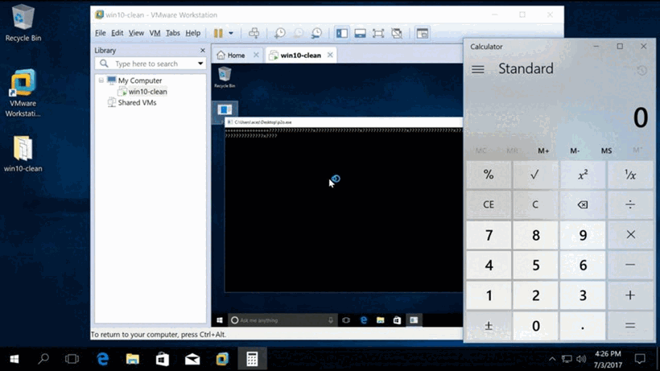

# CSIT953 第 11 周 · 虚拟机与容器安全：隔离边界在哪里，又怎样失守

> **学习目标 (Learning objectives)** — 读完本章你应该能够：
> - 说出虚拟化在安全工作中的四个用处（隔离、测试、资源分配、恢复），画出 硬件 → host OS → hypervisor → guest OS → 应用 的分层结构，解释一个 guest 被攻破之后为什么不会自动波及其他 guest；说清快照怎样工作，为什么它不是备份；
> - 区分 guest、hypervisor、宿主机三层各要保护什么，说明共享文件夹、剪贴板、USB、网卡模式（NAT 与桥接）和管理层的权限怎样改变一台虚拟机的实际边界；
> - 描述虚拟机的四种安全用途（隔离浏览、恶意软件分析、入侵检测、蜜罐与蜜网），并说出每一种的局限；
> - 解释**虚拟机逃逸**的一般过程：guest 里的代码怎样通过 hypervisor 暴露的接口，把精心构造的输入送进宿主机上有特权的处理代码；说明拖放、复制粘贴这类便利功能为什么会扩大攻击面，防守方和开发者各该怎么做；
> - 说明容器怎样用 namespaces、cgroups、capabilities 和 seccomp 隔离进程，为什么"共享宿主机内核"是它和虚拟机最根本的区别；从隔离、性能、运维、可移植性四个方面，为一个工作负载选择虚拟机、容器或二者的组合；
> - 解释为什么能控制 Docker 守护进程就几乎等于拥有宿主机，读懂 `docker run -v /:/hostOS` 这条命令的危险，说出保护守护进程的三条做法；
> - 用 Cluster、Node、Pod 描述 Kubernetes；从一个被攻破的 Pod 出发，列出通往宿主机、网络、Kubernetes API 和云凭据的四条路径，为每条路径配上控制措施（Pod Security Admission 与安全上下文、NetworkPolicy、service account 与 RBAC、封住元数据）；说明 gVisor、Kata Containers 和机密容器各自加强了哪一道边界，并用这些分析 S43–S44 的设计案例。

> 📚 **材料说明** — 本笔记依据 Week 11 slides（S1–S45，"Virtual Machines and Containers Security"，主讲 Dr. Yudi Zhang）和两段课程录音。Week 11 录音的前 38k 字符讲完了 Week 8 slides 的 S12–S44，已经写进第 8 周笔记；老师说"这就是第 8 周的内容"、"现在进入虚拟机和容器"之后才是本周内容，从 S3 讲到 S15（开发测试用的容器）时下课。S16–S45 由 **Week 12 录音的开头**接着讲完（前 38.6k 字符）：老师开场说"上周讲了虚拟机和容器，现在讲微分段"，一直讲到"进入这一讲的最后一个主题"为止，之后是第 12 周的远程办公安全与勒索软件。两段录音合起来覆盖了全部 slides，S45（总结）只念了标题。S1 是封面，S2 是分节页，S3 是路线图。**页序要注意**：slides 把 S19、S20（虚拟机的界面和设置）放在比较虚拟机和容器的几页中间，笔记把它们挪到了 §2，和 S9 一起讲"一台虚拟机隔开了什么"。S5、S17 的配图和 S41 的内容重画成了图 1、图 7、图 10；图 2、3、5、6、8、9、11 是笔记新加的示意图；S23 的截图直接放进了正文（图 4）；S6–S8、S19、S20、S26、S29 的截图在正文里用文字说明，S25 的代码抄进了正文；S4、S9、S18、S21、S22、S33–S40、S43 的对比和要点改写成了表格。Pod 安全上下文、NetworkPolicy、RBAC 和 Namespace 标签的几段 YAML 是笔记补的，slides 上只有设置的名字，正文里已标注。录音是自动转写，术语错得很多：virtual machine 成了 washing machine、worship，VirtualBox 成了 what's your books、worship books、Russia of Books，guest 成了 gas、cast、guys、desk，snapshot 成了 sub shop、perception、exception、step sure，malware 成了 my well、more well，honeynet 成了 haughty light，executable 成了 acceptable，command-and-control server 成了 common server，container 成了 continent，Docker 成了 blocker、doctor、dog，docker compose 成了 do compost，daemon 成了 demon、demand，socket 成了 circuit，host mount 成了 Hosmont、host months，/hostOS 成了 forced OS，root file system 成了 root fascism，shared folder 成了 short photo，clipboard 成了 clickboard，NAT 成了 MAT，RPCI 成了 RPCR，cmd 成了 common7D，namespaces 成了 lamb species、limb space，cgroups 成了 "and groups"，kernel 成了 Colonel、counsel，Kubernetes 成了 Cuban needs、Cuba、Cubist、cubinates，还有一处成了 Taiwanese，control plane 成了 counter plane、control plan，replicas 成了 car pieces，node 成了 load、Lord，Pod 成了 port、pot、pulse、pope、podcast，seccomp 成了 second，default deny 成了 default delay，ingress 成了 grass，network 成了 blood work、life work，RBAC 成了 IBAC，gVisor 成了 G visa，Kata Containers 成了 cattle containers，sandboxing 成了 some boxing，portability 成了 probability、possibility，overhead 成了 over high。引用时已按 slides 校正。录音里有两处按事实澄清：讲桥接网卡时，转写成了"桥接模式下 guest 不能直接和外面通信"，按上下文应为"能"（§2.3）；同学问快照是不是存在内存里，老师先顺口答了"是"，随后更正为"每拍一次快照都要多占存储"，笔记按后者讲，并补充了快照的实际机制（§1.5）。正文里的 S 编号就是 PDF 页码，和 slide 右下角印的页码一致。

> 🎯 **考试提示** — 第 13 周 slides 的考试范围（Exam Scope / Key Topics）在 Applied Security Topics 下面列了一条：**Virtual Machines and Containers — How their isolation models differ**，也就是"虚拟机和容器的隔离模型有什么不同"。复习时优先保证 §1.2、§5.2 和 §6（尤其是 §6.2 最后那张对比表）：虚拟机的边界在 hypervisor，每个 guest 有自己的内核；容器的边界在同一个宿主机内核里面，靠 namespaces、cgroups、capabilities 和 seccomp。§4 和 §7 分别讲两种边界怎样失守：虚拟机逃逸要靠 hypervisor 的漏洞，滥用 Docker 守护进程只要拿到访问权。§9 的四条路径和 §11 的 S44 是典型的问答题形式，适合拿来练习"指出弱边界、说明原因"。考试是 3 小时闭卷，单选 15 分、填空和简答 21 分、问答 14 分；slides 提醒，**要求解释的题，只写关键词可能拿不到满分**。比如问"容器的隔离为什么比虚拟机弱"，只写"共享内核"不够，要写出后果：所有容器的系统调用都进同一个内核，内核有一个漏洞，或者某个容器带着特权设置，受影响的是整台主机上的所有容器；虚拟机里的攻击者即使拿下了 guest 的内核，也还要越过 hypervisor 那个窄得多的接口。本章还连着另外几条考试主题：§9.5 的 RBAC 和 §9.6 的云凭据属于 **Secure Cloud Storage and Data Sharing** 的访问控制（第 4 周 §2.7、§5.3）；§5.3 的镜像和 CI 容器属于 **Software Supply Chain Security**（第 9 周 §4.5–§4.7）；§7.3 远程管理守护进程用的 SSH 和 TLS，分别是第 5 周和第 7 周的内容。

前几周的笔记里，"虚拟机"和"容器"出现过很多次，却一直没有展开。第 4 周说 IaaS 就是"租虚拟机"，操作系统归客户自己管；第 9 周讲 CI/CD 时，runner 在容器里跑测试，§4.5–§4.7 又专门讲了以 root 运行的容器、特权容器和 Docker socket 的危险，留下一句"容器的隔离靠什么、和虚拟机有什么不同，是第 11 周的内容"。本周就来回答这个问题。

问题本身很朴素：**两个互不信任的程序跑在同一台物理机器上，是什么把它们隔开的？** 云服务商把不同客户的工作负载放在同一批硬件上，安全研究员要在自己的电脑上运行一个来历不明的病毒样本，在线评测网站要执行陌生人提交的代码，都绕不开这个问题。本周讲三类答案。**虚拟机**（*virtual machine*, VM）给每个工作负载一整个独立的操作系统；**容器**（*container*）让工作负载共享同一个操作系统内核，只隔开它们看得到的资源；**沙箱运行时**和**机密容器**在容器之上再加一层，或者把保护的方向反过来。

三类答案里，没有哪一种"本身就是安全的"。老师比较虚拟机和容器时说了一句贯穿全章的话：选隔离技术，**不能只问哪个更安全**，要问我们预计面对哪种攻击者、要保护什么、攻击者需要越过什么。全章就沿着这条思路走：先看清每种隔离的边界在哪一层，再看边界怎样失守，最后看在 Kubernetes 这样的大规模平台上，怎样把好几道边界组合起来。S3 的路线图把这条路分成四段：虚拟机在安全实践中的用途（§1–§3），虚拟机逃逸与隔离的极限（§4），容器与 Docker 的管理权限（§5–§7），云原生工作负载的隔离（§8–§11）。

本章依次回答这些问题：

1. 安全工作为什么离不开虚拟机？快照是什么？（§1）
2. 一台虚拟机到底隔开了什么？哪些设置会在边界上开口子？（§2）
3. 安全团队拿虚拟机做什么？每种用法的局限在哪里？（§3）
4. guest 里的代码能不能突破边界，影响宿主机？（§4）
5. 容器怎样隔离进程？它和虚拟机的根本区别是什么？（§5）
6. 虚拟机和容器该怎样比较、怎样选？（§6）
7. 不需要任何漏洞，怎样从容器拿到宿主机？怎样防？（§7）
8. 工作负载多到一台主机放不下时，Kubernetes 怎样管理它们？（§8）
9. 一个 Pod 被攻破之后，攻击者能往哪里走？每条路怎样堵？（§9）
10. 标准的容器边界不够用时，还有什么选择？（§10）
11. 把这些放在一起：怎样设计一个运行客户代码的服务？（§11）

## 1. 虚拟化为什么是一件安全工具 (S4–S8)

老师开场问大家用不用虚拟机。很多同学已经在用 VMware 或者 VirtualBox；老师两种都试过，后来觉得 VMware 更好，就不再用 VirtualBox 了。不过本章关心的不是哪个产品更好用，而是虚拟机为什么在安全工作里这么常见。

### 1.1 四个理由 (S4)

S4 列出了虚拟化在安全上的四个用处：

| 理由 | S4 的说法 | 老师的解释 |
|---|---|---|
| **隔离**（*Isolation*） | 分开不同的工作负载，减少意外的访问 | 把应用放进虚拟机，它就有了自己的 guest 操作系统，guest 和宿主机之间有一道强制执行的边界。应用出了故障，或者变成恶意的，损失被限制在虚拟机里。老师举的例子是开发 Windows 驱动程序，最好放到虚拟机里做：驱动运行在内核里，一个 bug 就能让整个系统蓝屏，在虚拟机里，蓝屏的只是 guest |
| **测试**（*Testing*） | 在受控的环境里运行可疑的软件 | 新配置、可疑文件、软件更新都先在虚拟机里试，不必马上改动生产环境的机器 |
| **资源**（*Resources*） | 分配 CPU、内存、存储和网络容量 | 管理员决定给每个 guest 多少 CPU、内存和磁盘，并观察它实际用了多少 |
| **恢复**（*Recovery*） | 用快照和备份回到一个已知的状态 | 实验之前先拍一个快照，出了问题，很快就能回到原来的状态 |

先说清两个贯穿全章的词。装着虚拟化软件的那台物理机器叫**宿主机**（*host*），它上面的操作系统是 host OS。每台虚拟机里装的操作系统叫 **guest OS**，整台虚拟机也常常直接叫 guest。在 guest 里看，自己像是独占了一台电脑；在宿主机看，它只是一个由虚拟化软件管理的工作负载。

### 1.2 分层结构：hypervisor 站在中间 (S5)

S5 的图（重画成图 1）从下往上有四层。最下面是**硬件**：CPU、内存、磁盘、网卡。上面是 host OS。再上面是 **hypervisor**，老师称它为虚拟机的"管理者"：它创建和运行虚拟机，给每台虚拟机分配资源，并且**居中协调每一次对真实硬件的访问**（S5 第 2 条：*The hypervisor mediates access to host hardware*）。最上面是三台虚拟机，每台都有**自己的 guest OS**（S5 第 1 条）和自己的应用。S17 的图把 hypervisor 写成 "Hypervisor/VMM"，VMM 是 *virtual machine monitor*（虚拟机监视器）的缩写，指的是同一个东西。

```svg 图 1 · 虚拟机的分层结构（按 S5 重画）。hypervisor 站在宿主机和各个 guest 之间。App 1 被攻破，攻击者控制了虚拟机 1（橙色）；想碰虚拟机 2、3 或者宿主机，他得先越过 hypervisor
<svg viewBox="0 0 640 316">
  <rect x="50" y="20" width="150" height="160" rx="8" class="warn" fill="none" stroke-width="2"/>
  <text x="125" y="42" text-anchor="middle" class="warn">虚拟机 1（被攻破）</text>
  <rect x="65" y="56" width="120" height="40" rx="4" class="warn fill-warn" stroke-width="1.5"/>
  <text x="125" y="81" text-anchor="middle">App 1</text>
  <rect x="65" y="106" width="120" height="60" rx="4" class="warn fill-warn" stroke-width="1.5"/>
  <text x="125" y="141" text-anchor="middle">Guest OS</text>
  <rect x="245" y="20" width="150" height="160" rx="8" class="ink" fill="none" stroke-width="1.5"/>
  <text x="320" y="42" text-anchor="middle">虚拟机 2</text>
  <rect x="260" y="56" width="120" height="40" rx="4" class="good fill-good" stroke-width="1.5"/>
  <text x="320" y="81" text-anchor="middle">App 2</text>
  <rect x="260" y="106" width="120" height="60" rx="4" class="muted fill-muted" stroke-width="1.5"/>
  <text x="320" y="141" text-anchor="middle">Guest OS</text>
  <rect x="440" y="20" width="150" height="160" rx="8" class="ink" fill="none" stroke-width="1.5"/>
  <text x="515" y="42" text-anchor="middle">虚拟机 3</text>
  <rect x="455" y="56" width="120" height="40" rx="4" class="good fill-good" stroke-width="1.5"/>
  <text x="515" y="81" text-anchor="middle">App 3</text>
  <rect x="455" y="106" width="120" height="60" rx="4" class="muted fill-muted" stroke-width="1.5"/>
  <text x="515" y="141" text-anchor="middle">Guest OS</text>
  <line x1="213" y1="92" x2="232" y2="111" class="warn" stroke-width="3"/>
  <line x1="232" y1="92" x2="213" y2="111" class="warn" stroke-width="3"/>
  <rect x="50" y="192" width="540" height="36" rx="4" class="accent fill-soft" stroke-width="2"/>
  <text x="320" y="215" text-anchor="middle" class="accent">Hypervisor：给每个 guest 分配资源，隔开它们的内存和设备</text>
  <rect x="50" y="234" width="540" height="32" rx="4" class="muted fill-muted" stroke-width="1"/>
  <text x="320" y="255" text-anchor="middle">Host OS（宿主机操作系统）</text>
  <rect x="50" y="272" width="540" height="32" rx="4" class="muted fill-muted" stroke-width="1"/>
  <text x="320" y="293" text-anchor="middle">硬件 Hardware：CPU、内存、磁盘、网卡</text>
</svg>
```

老师说，这就是虚拟机和"一个操作系统上跑三个普通进程"在结构上的主要区别。三个普通进程共用一个操作系统，其中一个拿到了管理员权限，另外两个也就保不住了。三台虚拟机各有各的操作系统：假如 App 1 被攻破，攻击者首先控制的是虚拟机 1，**但他不会因此自动控制 App 2**（S5 第 3 条：*A guest compromise should remain inside its boundary*）。要做到这一点，hypervisor 必须把各个 guest 的内存和设备活动彼此隔开。

"隔开内存"具体是什么意思？guest OS 以为自己管着一台机器的全部物理内存，其实它看到的"物理内存"只是 hypervisor 从真实内存里划给它的一块，guest 的内核怎么寻址，都只能落在这一块里面。guest 以为自己在操作一块网卡、一个磁盘控制器，其实那是 hypervisor 用软件**模拟**出来的**虚拟设备**（*virtual devices*）：guest 发给"网卡"的每一个请求，都先到 hypervisor 手里，由它决定怎样转给真实的硬件。

老师说，这就是虚拟机对安全研究员和云服务商都那么有用的原因：研究员要在里面检查恶意软件，云服务商要在同一批硬件上运行不同客户的工作负载。他紧接着加了一句：**看起来很好，可后来还是能找到安全问题**。这句话留到 §4 回答。

> 📎 **拓展(超出 slides)：两类 hypervisor** — S5 的图里，hypervisor 装在 host OS 上面，这叫**寄居型**（hosted，也叫 Type 2）hypervisor，VMware Workstation 和 VirtualBox 都属于这一类，适合装在自己的电脑上用。另一类直接装在硬件上，下面没有 host OS，叫**裸机型**（bare-metal，也叫 Type 1）hypervisor，比如 VMware ESXi（S7、S8 的截图就来自它的管理界面）、Xen、Microsoft Hyper-V；Linux 内核里的 KVM 让 Linux 本身就能当 hypervisor。云服务商用的都是裸机型。S17 左边那一层写成 "Operating System*"，星号多半就是这个意思：这一层可有可无。两类 hypervisor 隔离 guest 的道理一样，现代 CPU 还专门为此提供了硬件支持（Intel VT-x、AMD-V），由硬件强制 guest 只能访问分给它的那块内存。

### 1.3 测试：一个可以反复重建的环境 (S6)

S6 的截图里，一台电脑上同时开着三个虚拟机窗口：Ubuntu、Windows 7，后面还有一个 Windows 8。说明是：**一次性的 guest 让分析人员可以测试不同的操作系统和配置**（*Disposable guests let analysts test different operating systems and configurations*）。

老师说，对安全团队来说，虚拟机的价值不只是"能同时显示好几个桌面"，而是能造出一个**可重复的环境**（*repeatable environment*）：同一台虚拟机可以复制到好几台机器上，每个人拿到的都是完全一样的环境；一台被弄坏了，删掉，换一台接着测。

> **🔑 例** — 安全团队收到通知：某个文档阅读器的旧版本有漏洞，打开一个特制的文件就会执行攻击者的代码。他们想确认两件事：公司里还在用的 Windows 10 和 Windows 11 是不是都受影响，新版本是不是真的修好了。做法是准备两台装着旧版阅读器的虚拟机，各拍一个快照（§1.5）；在每台上打开测试文件，记录结果；恢复快照，升级阅读器，再打开一次。四次测试都从完全相同的起点开始，结果才能互相比较；测试文件真的执行了代码，损失也只留在 guest 里。

### 1.4 资源分配也是安全问题 (S7)

S7 是 VMware ESXi 新建虚拟机时的"自定义设置"页面：CPU 1 个，内存 1024 MB，硬盘 16 GB，还有 SCSI 控制器、USB 控制器、网卡（连到 "VM Network"）、光驱（连到 "Host device"，也就是宿主机的光驱）和显卡。说明是：**hypervisor 给每台虚拟机分配 CPU、内存、存储和网络资源**。老师说它和 VirtualBox 的设置大同小异：管理员在这里决定 CPU 核数、内存、磁盘和网卡。

这些数字首先关系到性能，但老师强调，它们**同样关系到安全**：宿主机的资源是所有 guest 共享的，一个工作负载把它们耗光了，其他工作负载就会变慢，甚至无法提供服务。所以分配和监控资源，本身就在限制工作负载之间的相互干扰。用第 4 周的安全目标来说，它保护的是**可用性**（availability）。比如一台 guest 被攻破后，攻击者在里面挖矿，把 CPU 拉满；分给它的 CPU 配额，决定了它能从邻居那里抢走多少。

这张设置页还透露了另一件事：列表里不只有数量，还有**连接**。网卡连着哪个网络，光驱连着宿主机的哪个设备，有没有 USB 控制器，每一项都是 guest 通向外面的一条路，§2.3 会专门讲。

### 1.5 快照：一键回到已知状态 (S8)

S8 是 ESXi 管理界面里虚拟机的右键菜单：电源、Guest OS、**Snapshots**（快照）、控制台、导出（Export）、编辑设置、权限……说明是：**快照帮助 guest 在实验或事故之后回到一个已知的状态**（*Snapshots help return a guest to a known state after experiments or incidents*）。

老师描述了实验课上的用法：装一个可疑程序之前，先拍一个快照；然后安装、运行，结果怎样都无所谓，因为随时可以**回滚**（*roll back*）到之前的状态。

快照到底是什么？课上一位同学问：是不是像截图（screenshot）那样？老师说不是。它像一种备份，但你找不到"备份文件"。真正的备份会给你一个文件，比如 20 GB，你可以把它搬到另一台机器上，或者拷给别人用；快照不产生这样一个独立的文件。它的做法是**把磁盘上现有的文件锁住**，之后的每一处修改都记进新的文件里，所以回滚很容易。同学说：那就像版本控制？老师说对，像版本控制，只是没有一个能拷给别人的单独文件。他还提醒了两件事：**哪怕你在 guest 里删了一个文件，它其实也没被删掉**，还在下面那一层里；快照也**不要拍太多次**，否则虚拟机会变得很慢，而且每拍一次，都要多占一些存储。

图 2 把老师说的机制画了出来。

```svg 图 2 · 快照怎样工作（按老师的讲解画的示意图，细节见下面的拓展）：每拍一次快照，当前的磁盘文件就被锁定为只读，之后的写入都落进一个新的增量文件。恢复到某个快照，就是丢掉它上面的各层。各层都在同一块存储上，而且一层依赖一层，所以快照不是备份
<svg viewBox="0 0 640 240">
  <rect x="40" y="24" width="330" height="46" rx="6" class="warn fill-warn" stroke-width="2"/>
  <text x="205" y="52" text-anchor="middle">增量文件 2：快照 2 之后的改动</text>
  <rect x="40" y="92" width="330" height="46" rx="6" class="ink fill-good" stroke-width="1.5"/>
  <text x="205" y="120" text-anchor="middle">增量文件 1：快照 1 到快照 2 的改动</text>
  <rect x="40" y="160" width="330" height="46" rx="6" class="muted fill-muted" stroke-width="1.5"/>
  <text x="205" y="188" text-anchor="middle">基础磁盘：快照 1 之前的全部内容</text>
  <text x="384" y="52" class="warn">← 新的写入都落在最上层</text>
  <text x="384" y="86" class="accent">← 快照 2：锁定下面两层</text>
  <text x="384" y="120" class="muted">读数据：从上往下逐层找</text>
  <text x="384" y="154" class="accent">← 快照 1：锁定基础磁盘</text>
  <text x="40" y="230" class="muted">恢复到快照 2 = 丢掉增量文件 2；恢复到快照 1 = 丢掉增量文件 1 和 2</text>
</svg>
```

> 📎 **拓展(超出 slides)：快照的具体机制** — 主流的 hypervisor 用的都是这种"写时复制"（copy-on-write）的思路。拍快照的那一刻，当前的虚拟磁盘文件变成只读，hypervisor 新建一个**增量文件**（delta disk，VMware 叫它 redo log）；之后 guest 写的每一个数据块都落进增量文件，读的时候先找增量文件，找不到再往下层找。这正好解释了老师的三句话："删除"只是在上层记了一笔，下层的数据原封不动；快照一多，一次读可能要翻好几层文件，虚拟机就慢了；每一层都在增长，存储越占越多。如果拍快照时虚拟机开着，还可以选择把**内存状态**一起存下来，恢复时直接回到那一刻的运行状态。同学猜快照"存在内存里"，大概就是因为这个；不过内存状态同样被写进了磁盘上的文件。

快照为什么不是备份？老师给的理由是：没有可以搬走的独立文件。从图 2 还能看出更根本的两个原因：

- 每一层都**依赖下面的层**。基础磁盘坏了，上面所有快照一起作废。
- 所有层都和虚拟机**放在同一块存储上**，归同一批管理员管。磁盘故障、误删，或者勒索软件加密了整个存储，快照和虚拟机一起没了。第 4 周 §2.8 讲过，云上的勒索软件专门攻击恢复路径，有管理权限的攻击者删快照和删虚拟机一样容易。

所以快照适合实验和短期回滚，**灾难恢复要靠真正的备份**：一份独立的副本，放在别处，用另一套凭据保护，能在另一台机器上恢复。

S9 还提醒了一个容易被忽视的问题（§2.1）：**快照本身需要单独保护**。一个带内存状态的快照，存着那一刻 guest 内存里的一切，包括已经解密的数据、登录会话、内存里的密钥。能读到快照文件的人，不用登录 guest，就能拿到这些东西。

<details>
<summary>自测：同学在虚拟机里装一个可疑程序，装之前拍了快照。程序运行后加密了 guest 里的文件，他恢复了快照。(a) guest 里的文件回来了吗？(b) 如果这台虚拟机开着共享文件夹，映射了宿主机的"文档"目录，那个目录里的文件也回来了吗？(c) 他能不能把这个快照当成这台虚拟机的备份？</summary>

(a) 回来了。恢复快照就是丢掉快照之后的增量文件，加密只发生在增量文件里。(b) 回不来。共享文件夹里的文件放在宿主机上，不在虚拟磁盘里，快照管不到它们；程序是通过 hypervisor 开着的那条通道，直接改了宿主机上的文件（§2.3）。(c) 不能。快照依赖基础磁盘，和虚拟机放在同一块存储上，存储坏了或者被加密，快照一起没了；它也没有能搬到别处的独立文件。

</details>

## 2. 一台虚拟机隔开了什么 (S9, S19, S20)

§1 说 hypervisor 把 guest 隔开了。这句话还不够精确：边界上其实开着好几扇门，有的是 guest 正常工作离不开的，有的是为了方便才开的。这一节先看边界两边各有什么，再看哪些设置会改变边界。

### 2.1 里面、边界和外面 (S9)

S9 的开头一句是：**虚拟机里有 guest OS、应用和虚拟设备；hypervisor 留在宿主机这一边**（*A VM has a guest OS, applications and virtual devices. The host retains the hypervisor*）。它把整个系统分成三层：

| 层 | S9 的说法 | 老师的解释 |
|---|---|---|
| **Guest** | guest 里的管理员权限只留在这台虚拟机里，**前提是边界守得住** | guest 里有自己的操作系统、管理员、进程和文件。一个用户可以是 guest 的管理员，却不会因此自动成为宿主机的管理员 |
| **Hypervisor** | 设备模拟和管理接口居中协调对宿主机的访问 | hypervisor 站在边界上，向 guest 呈现虚拟设备，居中协调对 CPU、内存、磁盘的访问。它**还得处理从 guest 发来的输入**，这正是漏洞可能起作用的地方（§4） |
| **Host** | 共享文件夹、快照和宿主机凭据需要**单独的控制** | 边界外面是 host OS、管理软件和其他 guest |

有两处值得多想一下。

第一，Guest 那一行的"前提是边界守得住"（*if the boundary holds*）。在云上，你租到一台虚拟机，你就是它的 root；你的邻居也是他那台虚拟机的 root。所以 hypervisor 的隔离要扛得住的，不是 guest 里的某个普通用户，而是**一个对 guest 拥有完全控制权的管理员**。他可以装任何驱动，可以向虚拟设备发任何请求，可以随意构造发给 hypervisor 的数据。

第二，Hypervisor 那一行的"设备模拟"（*device emulation*）。guest 以为自己在操作一块真实的网卡，或者 S7 里那个 "LSI Logic Parallel" SCSI 控制器。其实这些设备是 hypervisor 用软件模拟出来的：guest 每向"网卡"写一次寄存器，都会被 hypervisor 截住，交给宿主机上的一段代码，由它按照真实网卡的规矩解释这次操作。换句话说，**每个虚拟设备背后，都是宿主机上一段要解析 guest 数据的代码**。guest 不可信，这段代码却运行在宿主机上，权限比 guest 高。这个结构就是 §4 虚拟机逃逸的根源。

图 3 把三层和边界上的通道画在一起。

```svg 图 3 · S9 的三层（笔记的示意图）：guest 和宿主机之间隔着 hypervisor，边界上却开着几条通道。每条通道背后都是宿主机上的一段代码，要处理 guest 送来的数据。通道开不开、开多大，由最下面的管理层决定
<svg viewBox="0 0 640 330">
  <defs>
    <marker id="a" viewBox="0 0 10 10" refX="9" refY="5" markerWidth="7" markerHeight="7" orient="auto-start-reverse"><path d="M0,0 L10,5 L0,10 z" class="solid-ink"/></marker>
    <marker id="w" viewBox="0 0 10 10" refX="9" refY="5" markerWidth="7" markerHeight="7" orient="auto"><path d="M0,0 L10,5 L0,10 z" class="solid-warn"/></marker>
  </defs>
  <line x1="204" y1="96" x2="436" y2="96" class="ink" stroke-width="1.5" marker-start="url(#a)" marker-end="url(#a)"/>
  <line x1="204" y1="136" x2="436" y2="136" class="ink" stroke-width="1.5" marker-start="url(#a)" marker-end="url(#a)"/>
  <line x1="204" y1="176" x2="436" y2="176" class="ink" stroke-width="1.5" marker-start="url(#a)" marker-end="url(#a)"/>
  <line x1="204" y1="216" x2="436" y2="216" class="ink" stroke-width="1.5" marker-start="url(#a)" marker-end="url(#a)"/>
  <rect x="20" y="40" width="180" height="200" rx="8" class="ink" fill="none" stroke-width="2"/>
  <text x="110" y="66" text-anchor="middle">Guest</text>
  <text x="110" y="140" text-anchor="middle" class="muted">guest OS、应用</text>
  <text x="110" y="164" text-anchor="middle" class="muted">guest 里的管理员</text>
  <rect x="250" y="40" width="140" height="200" rx="8" class="accent fill-soft" stroke-width="2"/>
  <text x="320" y="66" text-anchor="middle" class="accent">Hypervisor</text>
  <text x="320" y="101" text-anchor="middle">虚拟网卡、磁盘</text>
  <text x="320" y="141" text-anchor="middle">共享文件夹</text>
  <text x="320" y="181" text-anchor="middle">剪贴板、拖放</text>
  <text x="320" y="221" text-anchor="middle">USB 设备</text>
  <rect x="440" y="40" width="180" height="200" rx="8" class="ink" fill="none" stroke-width="2"/>
  <text x="530" y="66" text-anchor="middle">Host（宿主机）</text>
  <text x="530" y="140" text-anchor="middle" class="muted">宿主机的文件</text>
  <text x="530" y="164" text-anchor="middle" class="muted">其他 guest、凭据</text>
  <line x1="320" y1="276" x2="320" y2="246" class="warn" stroke-width="1.5" marker-end="url(#w)"/>
  <rect x="140" y="278" width="360" height="40" rx="8" class="warn fill-warn" stroke-width="1.5"/>
  <text x="320" y="303" text-anchor="middle">管理层：控制台、管理 API、宿主机管理员</text>
</svg>
```

中间那一列是 hypervisor 必须提供、或者可以选择打开的几条通道。虚拟网卡和磁盘是 guest 正常运行离不开的；共享文件夹、剪贴板、拖放、USB 是为了方便。最下面的管理层决定每条通道开不开、开多大。§2.2、§2.3 分别讲管理层和这些设置。

### 2.2 屏幕上看到的只是 guest (S19)

S19 是 VMware Workstation 里正在运行的一台 Windows 10 预览版虚拟机，左边的库里还列着 Windows 8.1、Windows 7、Vista、XP 等好几台虚拟机。说明是：**guest 作为一个被管理的系统，运行在虚拟化软件里面**（*The guest runs as a managed system inside virtualization software*）。

老师说，guest 的桌面看起来就是一台普通电脑，因为对里面的软件来说，它基本上就是一台普通电脑。这种熟悉感对教学和运维都有用：装系统、建用户、装应用、跑测试、拍快照，都和真机一样。可 guest 只是**一个大系统的一部分**，外面还有宿主机和管理软件。如果只守住 guest 的登录界面，就漏掉了另一个账号：**能修改这台虚拟机的虚拟磁盘、外接设备和网络设置的那个账号**。

在云上，这一点尤其要紧。管理员可能从来没见过物理服务器，他们打交道的是一个**管理 API**，用它创建和修改虚拟机。所以老师说，谈"保护一台虚拟机"，至少要想到三层：

1. **guest 操作系统**；
2. **虚拟化平台**：hypervisor 和它的管理软件；
3. **管理层里人和自动化程序的权限**：哪些人、哪些脚本能创建、修改、快照、删除这台虚拟机。

截图让 guest 看得见，管理层却不显眼，可它同样重要。

> **🔑 例：不碰 guest，照样拿走 guest 里的数据** — 攻击者偷到了公司云控制台的一个管理员凭据（第 4 周 §2.7：API 凭据就是远程权力）。他不需要知道数据库虚拟机的 root 口令，也不需要它的任何漏洞：给这台虚拟机的磁盘拍一个快照，用快照创建一块新磁盘，挂到自己开的另一台虚拟机上，数据库文件就全在眼前了。guest 里的登录界面、防火墙、杀毒软件，没有一样能察觉。这就是第 3 层的分量：管理层的权限，往往比 guest 里的 root 还大。

> 📎 **拓展(超出 slides)：直接攻击 hypervisor 的勒索软件** — 2023 年初的 ESXiArgs 攻击，利用 VMware ESXi 上一个没打补丁的服务漏洞，直接在 hypervisor 这一层加密了虚拟机的磁盘文件。一台 ESXi 主机失守，上面的所有虚拟机同时瘫痪，guest 里装了什么防护都没用。第 12 周还会讲勒索软件怎样攻击恢复路径。

### 2.3 设置也是边界的一部分 (S20)

S20 把两个画面并排放：左边是 VMware 的"虚拟机设置"窗口，右边是 guest 里的命令行。说明是：**配置和 guest 里的活动，都是运维安全边界的一部分**（*Configuration and guest activity are both part of the operational security boundary*）。

左边的设备列表是：内存 2 GB，1 个处理器，40 GB 硬盘，光驱、软驱、**网卡（NAT）**、USB 控制器、声卡、打印机、显示器。老师说，管理界面里的设置，会改变 guest 里同一个动作的安全含义：

- 管理员加了一个**共享文件夹**，guest 里写一个文件，就可能写到宿主机上。这就像在虚拟机里挂上你的 U 盘，能读也能写。
- 把网卡接到一个**更敏感的网络**上，被攻破的 guest 就能找到新的系统去连。
- **资源**给得太多，一个工作负载就可能干扰宿主机上的其他工作负载（§1.4）。

反过来，guest 也有自己的操作系统、设置和日志。所以安全审查要两边都看：不能因为桌面看起来很普通，就断定虚拟机是安全的；也不能不知道 guest 里跑着什么，就断定管理配置是安全的。

老师特别讲了**网卡模式**。课上实验用的是 **NAT**：你的物理电脑成为 guest 的网关。也可以改成**桥接**（*bridged*）：guest 在网络层上和你的电脑平起平坐，能直接和外面通信。老师的建议是：**想更安全，就用 NAT**。设置窗口里一共有五个选项，前三个最常用：

| 模式 | 设置窗口里的说明 | guest 的地址 | 外面能不能主动连进 guest | guest 能连到哪里 |
|---|---|---|---|---|
| **桥接** Bridged | 直接连到物理网络 | 从你的局域网直接拿一个地址，和宿主机平级 | 能，局域网里的设备都看得到它 | 局域网里的一切，以及互联网 |
| **NAT** | 共用宿主机的 IP 地址 | 一个虚拟私有网段里的地址，宿主机当网关 | 默认不能 | 互联网，**也包括宿主机所在的局域网** |
| **仅主机** Host-only（📎） | 与宿主机共用的私有网络 | 一个只有宿主机和 guest 的私有网段 | 只有宿主机能连 | 只有宿主机，以及同一网段的其他 guest |

S20 右边的命令行正好演示了 NAT 模式。`ipconfig` 显示 guest 的地址是 `192.168.13.129`，默认网关是 `192.168.13.2`。`tracert 8.8.8.8` 的第一跳就是 `192.168.13.2`，耗时不到 1 毫秒：这是 VMware 在宿主机上虚拟出来的 NAT 网关。第二跳 `192.168.2.1` 才是宿主机所在的那个真实局域网的路由器，再往后是运营商和 Google 的网络。

> **🔑 例：从 tracert 读出网卡模式** — 同一台 guest 改成桥接模式，它会从局域网的路由器直接拿到一个 `192.168.2.x` 的地址，`tracert` 的第一跳就变成 `192.168.2.1`，中间那个虚拟网关不见了。这也说明了 NAT 为什么"更安全"：局域网里的机器只看得到宿主机，看不到藏在 `192.168.13.x` 后面的 guest，没法主动连它。

> 📎 **拓展(超出 slides)：NAT 只挡进来的连接** — 再看一眼上面 tracert 的第二跳：NAT 模式下的 guest 照样能连到 `192.168.2.1`，也就能连到这个局域网里的其他设备：家里的 NAS、打印机、别人的电脑。NAT 挡住的是从外面主动连进来的连接，挡不住 guest 主动往外连。所以分析恶意软件时（§3.2），NAT 并不够，一个会横向扩散的样本，照样能从 guest 出发扫描你的局域网。这时应该用**仅主机**模式，或者一个和真实网络完全断开的虚拟网络。S20 的窗口里还有一个容易被忽略的设备：**软驱**。早就没人用软驱了，可它的模拟代码照样在运行，§4.6 会讲一个就出在虚拟软驱上的真实漏洞。

<details>
<summary>自测：一台用来上网的虚拟机配置如下：桥接网卡；共享文件夹映射了宿主机的整个用户目录；开着剪贴板共享。guest 里的浏览器被一个恶意网页攻破了。逐项说明攻击者能借这三项设置做什么，以及该怎么改。</summary>

桥接网卡：guest 直接站在局域网上，攻击者可以从这里扫描、攻击局域网里的其他设备。改成 NAT，或者一个只能访问互联网的隔离网络。共享文件夹：攻击者能读写宿主机用户目录里的所有文件，包括 SSH 密钥和浏览器数据，勒索软件也能加密它们。关掉；确实需要时，只共享一个专用的空目录，最好只读。剪贴板共享：你在宿主机上复制的口令、验证码，guest 里都读得到。关掉。这三项都不需要任何漏洞，hypervisor 只是在忠实地执行管理员打开的通道。

</details>

## 3. 虚拟机的四种安全用途 (S10–S13)

§1、§2 讲的是虚拟机本身。S10–S13 讲安全团队拿它做什么。四种用途有一个共同点：**都靠虚拟机的边界把危险的东西关在里面**，也都有边界管不到的地方。

### 3.1 隔离浏览 (S10)

S10 的三条是：**在一次性的 guest 里打开不可信的网站；虚拟机的边界可以把浏览器被攻破的后果挡在主机之外；高风险的浏览结束后，重置或重建这台 guest**。

老师的场景：你需要打开一个不完全信任的网站。与其用平时收邮件、登录学校系统的那个浏览器打开它，不如用一台**一次性**（*disposable*）的 guest，里面只有一个浏览器，没有任何个人文件。浏览器有漏洞时，光是打开一个恶意网页，就可能让对方在你的机器上执行代码；在虚拟机里，攻击者首先落在 guest 里，虚拟机的边界让他更难碰到你的主系统和其他网络。

老师马上补充：这只是**一种受控的风险，不是保证**（*a controlled risk, not a guarantee*）。guest 可能有网络访问；里面的浏览器可能登录着某些账号；宿主机的集成功能可能把文件或剪贴板里的内容暴露出去。所以用之前要做到三点：

1. **不把有价值的凭据放进去**；
2. **不开不必要的共享文件夹**；
3. **想好怎样重置它**，比如用 §1.5 的快照，每次用完恢复到初始状态。

> 📎 **拓展(超出 slides)：现成的"一次性虚拟机"** — 这个思路已经做进了产品。Qubes OS 是一个以安全为目标的操作系统，把工作、上网、网上银行等活动分别放进不同的虚拟机，还提供用完即毁的 disposable VM。Windows 专业版自带的 Windows Sandbox，每次打开都是一个全新的 Windows 环境，关掉之后，里面的一切都被删除。

### 3.2 恶意软件分析 (S11)

S11 的三条是：**在受控的 guest 里运行可疑代码；观察它的文件、进程和网络行为；把分析环境和日常工作分开**。

老师的场景：研究员收到一个来历不明的可执行文件，想知道它会做什么。直接在自己的工作电脑上运行它，是个糟糕的主意。通常的做法是放进虚拟机里运行，观察它创建了哪些新进程，改了哪些文件和系统设置，发出了哪些网络流量。这些观察回答几个实际的问题：

- 它启动之后会不会**窃取信息**？
- 会不会连接一台**命令与控制服务器**（*command-and-control server*，简称 C2，攻击者用来远程指挥被感染机器的服务器）？
- 会不会**尝试扩散**到别的机器？

虚拟机还让分析**可以重复**：恢复快照，换一种条件，比如改一下系统时间、断开网络，再运行同一个样本。这就是第 10 周讲的**动态分析**（第 10 周 §5）：不去读代码，而是让它真的跑起来，用具体的运行时证据回答"它实际做了什么"。

S11 第 3 条和 §2.3 连在一起：分析用的虚拟机要关掉共享文件夹、剪贴板和拖放（§4.4 老师会再强调一次），网络用仅主机模式，或者一个和真实网络断开的模拟网络。

> 📎 **拓展(超出 slides)：恶意软件也会检查自己是不是在虚拟机里** — 很多恶意软件一启动就先检查环境：有没有 VMware Tools 的进程，网卡的 MAC 地址是不是虚拟化厂商的前缀，能不能通过 VMware 的"后门"端口（§4.3 的那个通信机制）和 hypervisor 说上话。一旦发现自己在虚拟机里，它就装成一个无害的程序，什么坏事也不做，分析人员也就什么都看不到。这类检测手法有个绰号叫 **red pill**（红药丸，出自电影《黑客帝国》：吃下红药丸，就知道自己活在虚拟世界里）。所以"在虚拟机里什么也没发生"，不能证明样本无害。

### 3.3 入侵检测 (S12)

S12 的三条是：**把监控服务放在一台隔离的 guest 里；不必把每个工具都装到主机上，也能检查网络或系统的活动；传感器和它的管理入口要单独保护**。

**入侵检测系统**（*intrusion detection system*, IDS）监视网络流量或系统事件，发现可疑行为就报警；**入侵防御系统**（*intrusion prevention system*, IPS）更进一步，可以直接拦截（📎：Snort、Suricata、Zeek 是常见的开源网络 IDS）。老师说，安全团队可以把这样一个传感器或分析服务放进一台单独的 guest：好管理，也不容易干扰生产环境的应用。传感器检查网络流量或系统事件，对可疑行为发出警报。

这样做的好处是**运维上的分离**：可以单独给传感器分配资源（§1.4），单独更新它的工具、收集它的日志，不必把每一个安全组件都直接装到主应用的主机上。

S12 第 3 条值得展开。传感器看得到所有经过的流量，里面常常有敏感数据；它的管理入口能改检测规则、关掉报警。攻击者拿下传感器，就能一边偷看流量，一边让防守方"失明"。所以传感器的管理入口应该放在单独的管理网络上，只给少数人访问权，这和 §2.2 的管理层是同一个道理。

### 3.4 蜜罐与蜜网 (S13)

S13 的三条是：**模拟一个有漏洞的系统或服务，吸引攻击者；在隔离的环境里记录攻击手法；防止蜜罐变成通往其他系统的跳板**。

**蜜罐**（*honeypot*）是一个专门设计得对攻击者有吸引力的系统，防守方借它观察攻击者想做什么。**蜜网**（*honeynet*）把这个想法扩展到几台互相连接的系统。老师说虚拟机很适合做这件事：可以造出一个逼真、但受控的环境，监视它，实验结束后重置。

假如我们故意暴露一个漏洞，就可能观察到：攻击者扫描了哪些**端口**，猜了哪些**口令**，进来之后敲了哪些**命令**。可蜜罐同时也成了一台**攻击者可能控制的机器**。老师说，这带来一份责任：**不能让它去伤害别的任何东西**。攻击者可能拿它攻击第三方、发垃圾邮件、存放恶意软件，或者顺着它进入你的真实网络。所以蜜罐的出站流量要严格限制，它的网络要和生产网络彻底分开。

> 📎 **拓展(超出 slides)：低交互和高交互** — 蜜罐分两类。**低交互蜜罐**只模拟服务的表面，比如开源的 Cowrie 假装成一台 SSH 服务器，记录攻击者猜的用户名、口令和输入的命令，攻击者其实从来没拿到真正的系统，风险很小。**高交互蜜罐**是一台真实的、故意留了漏洞的系统，看得到攻击者的完整手法，S13 第 3 条的风险也最大。虚拟机让高交互蜜罐变得可行：被玩坏了，恢复快照就行。

四种用途放在一起看：

| 用途 | 虚拟机提供了什么 | 边界管不到、要另外管好的 |
|---|---|---|
| 隔离浏览（S10） | 浏览器被攻破后，攻击者先落在一次性的 guest 里 | guest 的网络访问、里面登录的账号、剪贴板和共享文件夹 |
| 恶意软件分析（S11） | 受控的环境，加上快照带来的可重复性 | 样本可能识别出虚拟机而装作无害；共享功能和网络必须关好 |
| 入侵检测（S12） | 传感器独立运行，好管理，不干扰生产 | 传感器本身和它的管理入口是高价值目标 |
| 蜜罐与蜜网（S13） | 逼真、可重置的诱饵 | 被攻击者控制之后，不能成为攻击别人的跳板 |

四种用途都假设了同一件事：**边界守得住**。§4 就来看边界守不住的时候。

<details>
<summary>自测：朋友说"我在虚拟机里打开钓鱼邮件的附件，所以绝对安全"。指出他可能忽略的至少三件事。</summary>

一是集成功能：开着共享文件夹和剪贴板，附件里的恶意代码不需要任何漏洞，就能读写宿主机的文件、读到剪贴板里的口令（§2.3）。二是网络：NAT 模式下，guest 照样能连局域网里的其他设备，也能把数据发出去（§2.3 的拓展）。三是 guest 里的东西本身：如果虚拟机里登录着他的邮箱、存着凭据，这些照样会被偷走（S10）。四是 hypervisor 本身可能有漏洞，没打补丁的虚拟化软件可能被逃逸（§4）。所以 S10 说这是受控的风险，不是保证。

</details>


## 4. 边界失守：虚拟机逃逸 (S23–S29)

### 4.1 guest 能不能影响宿主机 (S23)

S23 只问了一个问题：**guest 能不能逃出来**（*Can a guest break out?*）？说明是：**安全问题在于 guest 里的活动能不能越过边界，进入宿主机**。

老师先让大家想一想：所有的代码、所有的应用都跑在虚拟机里，跑在 guest OS 上，它们有没有可能影响宿主机？正常情况下，答案应该是"不能"，有 hypervisor 的边界挡着。guest 可以向 hypervisor 申请虚拟 CPU、内存、磁盘和网络操作，**但不应该能控制宿主机或者其他 guest**。

**虚拟机逃逸**（*VM escape*）就是这个预期落空了：guest 里的代码越过了 hypervisor 的边界，在宿主机上产生了影响。老师说，它可能出在 hypervisor 本身的缺陷上，出在某个虚拟设备上，也可能出在 guest 与宿主机之间的某个便利功能上。根源在于：guest 看起来被关在里面，**宿主机却还得处理它的一部分请求**，这些请求的入口就是**接口**（*interface*）。图 3 里横穿 hypervisor 的那几条通道，每一条都是这样一个接口。

S23 的截图就是一次成功的逃逸（图 4）。



### 4.2 逃逸怎样发生 (S24)

S24 把逃逸分成三步：

1. **guest 里的代码够到了 hypervisor 暴露的某个接口**（*Guest code reaches an interface exposed by the hypervisor*）；
2. **一个漏洞让数据或控制越过了这道边界**（*A vulnerability allows data or control to cross that boundary*）；
3. **后果取决于漏洞本身，以及受影响的是宿主机上的哪个进程**（*Impact depends on the flaw and the affected host process*）。

老师逐步解释。起点是 guest 里的代码。它使用 hypervisor 暴露出来的某个虚拟设备，或者 guest 与宿主机之间的某个通信功能，送出一份输入。在宿主机这边，某个**有特权的组件**必须解释这份输入。如果这个组件有漏洞，一份精心选择的输入就可能**破坏内存、绕过某项检查，或者触发一个 guest 本来无权请求的操作**。到了这一步，攻击者就从一个信任级别跨到了另一个信任级别。图 5 把这个过程画了出来。

```d2 图 5 · 虚拟机逃逸的一般过程（按 S24 画）：guest 里的代码通过 hypervisor 暴露的接口，送出一份精心构造的输入；宿主机上有特权的处理代码绝大多数时候都能正确处理，一旦检查有漏洞，攻击者就从低信任的 guest 跨进了高信任的宿主机进程
direction: down
guest: "Guest：低信任" {
  code: "① 攻击者在 guest 里构造输入\n长度、指针、对象大小"
}
host: "宿主机：高信任" {
  handler: "② 宿主机上的处理代码\n设备模拟、拖放、RPCI" {class: key}
  ok: "检查到位\n照常处理请求" {class: good}
  bad: "③ 有漏洞：内存被破坏\n攻击者代码在宿主机上运行" {class: warn}
  handler -> ok: "绝大多数情况"
  handler -> bad: "漏洞 + 可靠的利用"
}
guest.code -> host.handler: "经 hypervisor 暴露的接口"
```

第 3 步说后果各不相同。老师说：一个漏洞也许只能让宿主机上的那个进程崩溃；更严重的漏洞能让攻击者执行代码，或者操纵宿主机管理的资源。崩溃也不是小事：负责运行虚拟机的那个宿主机进程一崩溃，它带着的虚拟机就跟着停了。

老师还提醒了一个容易说过头的地方：**不能说 guest 和 hypervisor 的每一次交互都是逃逸**。绝大多数交互是例行公事，都被正确处理了。风险来自**一个有漏洞的接口收到了不可信的输入**。防守的经验也是通用的：

- **减少不必要暴露的功能**；
- **给虚拟化软件打补丁**；
- 尽可能**限制管理组件的权限**；
- **监控异常行为**。

这个结构你在第 10 周已经见过。用污点分析的话说（第 10 周 §4.1），guest 送来的数据就是 **source**，宿主机处理代码里拿这个数据去复制内存、算地址的地方就是 **sink**；一条没经过检查的路径从 source 通到 sink，就是一个潜在的逃逸漏洞。研究者找 hypervisor 的漏洞，用的也正是第 10 周的那套办法（📎）：读代码、做静态分析，或者对虚拟设备做 fuzzing，往里面灌大量畸形的请求。

### 4.3 guest 怎样和 hypervisor 说话 (S25, S26)

S25 的标题是"虚拟机逃逸：漏洞研究"。三条说明是：**原始例子包含底层的利用代码；教学的重点是 guest 到宿主机的接口；打补丁，减少不必要的集成功能**。右边是原始例子里的一段底层代码（S25 里还有一小段只在 macOS 上编译的代码，这里略去）：

```c
void
Backdoor_InOut(Backdoor_proto *myBp) // IN/OUT
{
   uint64 dummy;

   __asm__ __volatile__(
        "pushq %%rax"           "\n\t"
        "movq 40(%%rax), %%rdi" "\n\t"
        "movq 32(%%rax), %%rsi" "\n\t"
        "movq 24(%%rax), %%rdx" "\n\t"
        "movq 16(%%rax), %%rcx" "\n\t"
        "movq  8(%%rax), %%rbx" "\n\t"
        "movq   (%%rax), %%rax" "\n\t"
        "inl %%dx, %%eax"       "\n\t"  /* NB: There is no inq instruction */
        "xchgq %%rax, (%%rsp)"  "\n\t"
        "movq %%rdi, 40(%%rax)" "\n\t"
        "movq %%rsi, 32(%%rax)" "\n\t"
        "movq %%rdx, 24(%%rax)" "\n\t"
        "movq %%rcx, 16(%%rax)" "\n\t"
        "movq %%rbx,  8(%%rax)" "\n\t"
        "popq          (%%rax)" "\n\t"
```

老师说，不需要逐行读懂，看不懂也没关系，那本来就是问题的一部分。要抓住的只有一点：**guest 有一套刻意设计的机制，用来和虚拟化层通信**。这样的机制有正当的理由存在，比如设备支持和各种便利功能。

> 📎 **拓展(超出 slides)：这段代码做了什么** — 这个函数来自 VMware 开源的 guest 工具 open-vm-tools，它是 guest 和 VMware hypervisor 之间那条"后门"（backdoor）通道的入口，分三步：
>
> 1. **装填**。`%rax` 里放着结构体 `myBp` 的地址。函数先把这个地址压栈保存，再把结构体里的 6 个 8 字节字段（偏移 0、8、16、24、32、40）依次装进 rax、rbx、rcx、rdx、rsi、rdi 六个寄存器。按 VMware 的约定，rax 里是一个固定的暗号 0x564D5868（四个字节正好是 ASCII 的 "VMXh"），rcx 里是命令号，rdx 里是后门端口号 0x5658（"VX"），其余是参数。
> 2. **"读端口"**。`inl %dx, %eax` 是一条 x86 的 I/O 指令：从 dx 指定的端口读 4 个字节到 eax。在真机上，它读的是某个硬件设备；在 VMware 的 guest 里，这个端口没有对应的硬件，hypervisor 截住这条指令，读出六个寄存器，把它们当成一个请求来处理，再把结果写回寄存器。注释说没有 64 位的 inq 指令，所以只能用 32 位的 inl。
> 3. **取回结果**。`xchgq` 从栈上取回结构体的地址，同时把 rax 的新值暂存到栈上；接下来几行把寄存器的新值写回结构体，`popq (%rax)` 把暂存的 rax 放进结构体的第一个字段。函数返回后，调用者从 `myBp` 里读出 hypervisor 的回答。
>
> VMware Tools（装在 guest 里的增强工具）的时间同步、鼠标无缝切换、复制粘贴和拖放，都靠这条通道和宿主机交换消息。§3.2 那些检查"自己是不是在虚拟机里"的恶意软件，探测的也正是这个端口。

S26 是一段反汇编代码：研究者没有源代码时，就这样直接读机器指令。高亮的那一行 `call Backdoor`，就是调用后门通信函数的地方，前面几行 `mov`、`lea` 在准备要交给它的参数。S26 的说明是：**研究者检查底层的行为，以理解一次边界失守**。

老师用一个"说话和倾听"的模型概括这件事：**guest 在说话，一个权限更高的组件在听；只有当倾听者错误地处理了它听到的话，边界才会被越过**。安全问题出现在宿主机一侧的代码**假定 guest 只会发来格式正确、友好的输入**的时候：控制着 guest 代码的攻击者，可以专门发送设计者没想到的输入。屏幕上一条看起来不起眼的指令，如果把一个**没检查过的长度或指针**交给了有特权的处理代码，后果就可能很严重。

老师总结了三个要点，不需要逆向每一个寄存器也能理解：

1. 攻击者从一个**低信任的 guest** 出发；
2. 有一条**够得着的路径**，通向权限更高的代码；
3. 那段特权代码里的**一个缺陷**，能把一次普通的服务请求，变成一次边界失守。

老师还提醒：一张来自旧版本产品的代码截图，**不能证明打过补丁的当前版本还有同样的漏洞**。

### 4.4 便利功能就是攻击面 (S27)

S27 的三条是：**拖放和复制粘贴在 guest 和宿主机之间开出了通道；在这个例子里，RPCI 是一个 guest 与宿主机的通信接口；便利功能增加了需要保护的接口**。

老师问大家有没有试过：在宿主机（Windows 或 macOS）上复制一段东西，粘贴到虚拟机的系统里；或者把文件从宿主机直接拖进虚拟机。一位同学问：反过来，从 guest 复制文件到宿主机也行吗？老师说也行，两个方向都可以，很方便。可便利常常有代价。

老师说，这些便利功能造成了一些**最容易被忽视的边界穿越**。从用户的角度看，它们几乎是透明的：拖过去，放下，就完了。从安全的角度看，**数据必须从一边跨到另一边**，而且某个组件必须**解析**这次请求：拖的是哪些文件、多大、什么格式，剪贴板里是文本还是图片。原始例子里提到的 **RPCI**（📎：Remote Procedure Call Interface，guest 向宿主机发起远程过程调用的接口）就是这样一条通信通道，拖放和复制粘贴的消息都从它走，底下用的正是 §4.3 的后门端口。老师说名字不用背，记住一条通用的规律：

> **提高易用性的功能，也可能扩大攻击面**。

**攻击面**（*attack surface*）是攻击者能向系统输入数据的所有地方的总和。每打开一个功能，宿主机上就多一段要解析 guest 数据的代码，也就多一处可能出错的地方。

老师给了两条具体的建议。如果一台虚拟机用来**分析恶意软件**，再打开剪贴板共享和共享文件夹，就是一个糟糕的选择，边界会越来越弱（§3.2）。如果业务应用**确实需要**这些功能，管理员要清楚其中的风险，限制访问，并且让虚拟化组件保持最新。他把这比作普通的网络安全：**放行一个连接，是因为它有用；放行之后，就得保护好两端，以及在两端之间流动的数据**。

> 📎 **拓展(超出 slides)：一个真实的拖放漏洞** — slides 没有给出漏洞编号。和 S27 的描述完全对得上的一个例子是 **CVE-2017-4901**：VMware Workstation 12.5.4 之前（以及 Fusion 8.5.5 之前）的拖放功能存在**内存越界访问**漏洞，可能让 guest 在运行 Workstation 的宿主机上执行代码。2017 年前后，VMware 的拖放、复制粘贴和虚拟显卡里接连被找出好几个 guest-to-host 漏洞；那一年的 Pwn2Own 黑客大赛上，也有队伍演示了从 VMware Workstation 的虚拟机里打到宿主机。

### 4.5 内存破坏 (S28)

S28 的三条是：**这个历史例子涉及一个虚拟机管理接口；它需要一个够得着的接口，加上一个可靠的内存破坏利用；减少暴露的集成功能，给 hypervisor 打补丁**。

老师解释了这类漏洞：宿主机一侧的组件处理来自 guest 的数据，却把数据**写到了它本该使用的那块内存之外**。这和第 10 周 §5.2 的缓冲区溢出是同一类错误：16 个 A 写进 8 字节的缓冲区，多出来的 8 个字节覆盖了旁边别的数据。区别只在于，这一次缓冲区在宿主机的虚拟化进程里，那 16 个 A 由 guest 送来。

一次成功的利用，需要的远不止一条可疑的指令。老师列了三样：

1. 一个**够得着的接口**；
2. 能**触发这个缺陷的输入**；
3. 对出错之后的内存状态有**足够的控制**，能让结果变得"有用"，比如让宿主机进程转去执行攻击者准备好的代码。

现代系统还有各种保护，让利用变得更难预测（📎：比如地址空间布局随机化 ASLR、不可执行内存 DEP；攻击者通常要先用一个漏洞泄露出内存地址，再用另一个漏洞改写内存）。老师说，旧例子里具体的步骤没那么重要，**可以迁移的教训**是：来自低信任 guest 的数据，在没有足够安全检查的情况下，到达了一段高权限的处理代码。

两个角度各有一句话要记住：

- **防守方**：关掉不必要的集成功能，给 hypervisor 打补丁，减少暴露。
- **开发者**：有特权的处理代码必须**把 guest 控制的每一个值都当作不可信的**，尤其是**长度、指针和对象大小**。

> **🔑 例：长度字段该怎么检查** — 下面是宿主机一侧处理一条剪贴板消息的示意代码（笔记编写的示意，不是 VMware 的真实代码）。消息的前 4 个字节是 guest 声称的数据长度，后面跟着数据，`received` 是实际收到的字节数：
>
> ```c
> struct clip_msg { uint32_t len; uint8_t data[]; };
>
> void handle_clip(const struct clip_msg *m, size_t received) {
>     uint8_t buf[4096];
>     memcpy(buf, m->data, m->len);      /* 错误：完全相信 guest 写的 len */
> }
> ```
>
> guest 把 `len` 写成 100000，`memcpy` 就会在 4096 字节的 `buf` 后面多写将近 96 KB，宿主机进程的栈被覆盖。正确的写法要检查三件事：
>
> ```c
> void handle_clip(const struct clip_msg *m, size_t received) {
>     uint8_t buf[4096];
>     if (received < sizeof *m) return;              /* 连消息头都不完整 */
>     if (m->len > sizeof buf) return;               /* 比缓冲区大 */
>     if (m->len > received - sizeof *m) return;     /* 比实际收到的数据多 */
>     memcpy(buf, m->data, m->len);
> }
> ```
>
> 第三项检查最容易漏掉。`len` 没有超过缓冲区，却比 guest 实际发来的数据多，`memcpy` 就会读到消息后面的内存；`buf` 的内容之后如果又送回 guest（剪贴板本来就要来回传），宿主机内存里的别的数据就泄露给了 guest。这种**信息泄露**正好能帮攻击者绕过 ASLR。

### 4.6 演示：宿主机上弹出了计算器 (S29)

S29 是原始演示的另一张历史截图：VMware Workstation 里运行着一台 Windows 7 的 guest。

老师描述了演示的过程：在虚拟机里运行一个程序，点一下 exe，计算器就弹了出来。**这个计算器不在虚拟机里，它是宿主机的计算器**（图 4 右边的那个窗口）。我们在虚拟机里运行了一点东西，它却影响了宿主机的操作系统。老师说：它能弹出你的计算器，就意味着**它能弹出你的命令行**（cmd），也就能在宿主机上做别的事。这是一个老版本，你可以找到这个版本，用同样的代码自己做这个实验。

弹计算器是安全研究里展示"任意代码执行"的惯例（📎）：计算器无害、显眼，一看就知道它是被谁启动的；能启动计算器，就能启动任何程序，换成勒索软件或者远程控制工具也一样。不过 S24 第 3 条提醒我们，计算器以**宿主机上那个 VMware 进程的身份**运行。VMware Workstation 以当前登录的用户身份运行，攻击者拿到的就是这个用户的权限；要拿到宿主机的管理员权限，往往还得再利用一个本地提权漏洞。

> 📎 **拓展(超出 slides)：没人用的虚拟设备也是攻击面** — 2015 年公开的 **VENOM** 漏洞（CVE-2015-3456）出在 QEMU 模拟的**虚拟软驱控制器**里，影响 KVM、Xen 等一大批用 QEMU 做设备模拟的 hypervisor。几乎没有人还在虚拟机里用软驱，可很多配置默认带着这个虚拟设备；guest 里的管理员向它的 I/O 端口发送精心构造的命令，就能让宿主机上的 QEMU 进程发生缓冲区溢出。S20 的设置窗口里那个 "Floppy: Auto detect"，就是同一种设备。这正是"减少不必要暴露的功能"的分量：一个不用的设备，就是一段白白暴露在 guest 面前的代码。

<details>
<summary>自测：一家云服务商的 hypervisor 里，虚拟网卡的模拟代码有一个越界写漏洞。(a) 谁能触发它？(b) 后果可能有多严重？(c) 客户和服务商各能做什么？</summary>

(a) 任何一台使用这种虚拟网卡的 guest 里的管理员。在云上，攻击者只要租一台虚拟机，就是它的 root，可以随意向虚拟网卡发请求，不需要先攻破别人（§2.1）。(b) 取决于漏洞和宿主机上受影响的进程（S24 第 3 条）：轻则让负责模拟的进程崩溃，它带着的虚拟机跟着停掉；重则让攻击者在宿主机上执行代码，进而碰到同一台物理机上其他客户的虚拟机。(c) 服务商：尽快打补丁，去掉不必要的虚拟设备，限制设备模拟进程的权限，监控异常。客户能做的有限，主要是为高敏感的工作负载选用专用的物理主机，不和别的客户共享硬件。

</details>

<details>
<summary>自测：有人看了 S23 的截图后说："这证明 VMware 不安全，以后都别用了。"这个结论哪里不对？</summary>

老师特别提醒过：一张来自旧版本的截图，不能证明打过补丁的当前版本还有同样的漏洞。任何 hypervisor 都可能有漏洞，VENOM 就出在 QEMU 里，别的虚拟化产品也都修过逃逸漏洞。可以迁移的教训不是"别用某个产品"，而是：guest 到宿主机的每个接口都要把输入当作不可信的；防守方要打补丁、关掉不需要的集成功能，并且按威胁模型判断一层边界够不够（§6.3）。

</details>

## 5. 容器：共享内核的隔离 (S14–S16)

虚拟机给每个工作负载一整个操作系统，隔离强，开销也大：每台 guest 都要引导一个完整的系统，占用不少内存。很多时候我们要隔开的只是几个互相信任的服务，用不着这么重的边界。S14–S16 讲的**容器**是另一种思路：不复制操作系统，只隔开进程看得到、用得着的资源。

### 5.1 容器是什么 (S14)

S14 的三条是：**把应用和它的依赖打包在一起；让它的进程视图和文件系统视图与其他容器分开；记住，容器仍然共享宿主机的内核**。

老师问有没有人用过 Docker，没人举手。他说以后可以试试，非常强大，要装 Docker，可能还要装 docker compose。

容器把一个应用和它需要的许多库、设置打包在一起，所以能**用一致的方式部署**：它需要的一切，都已经在容器里了。它还给进程一份**自己的资源视图**，比如自己的文件系统和网络。**但它通常共享宿主机操作系统的内核**。老师把这一点和虚拟机对比：虚拟机里我们不共享操作系统，每台都有自己的，这就是区别。也正因为如此，容器效率高、启动快，老师说**大概 2 秒**就能起来一个。

这里有两个词要分清。**镜像**（*image*）是一个只读的模板，装着应用运行需要的全部文件：一个精简的 Linux 发行版的文件、各种库、应用代码和配置。**容器**是镜像运行起来之后的样子：宿主机上的一个（或一组）进程，带着一份隔离过的视图。镜像和容器的关系，就像程序文件和进程，或者菜谱和做出来的菜。

"共享内核"是理解容器的关键，值得停下来想一想。**内核**（*kernel*）是操作系统最核心的部分：管理 CPU、内存和设备，调度进程，并通过**系统调用**（*system call*）为程序提供服务。程序要打开文件、发网络包、创建进程，都得发一个系统调用，请内核去做。一个容器镜像里装着某个发行版的**用户空间**部分（比如 Ubuntu 的文件、`libc`、`bash`），却**没有内核**；所有容器里的所有进程，系统调用都发给宿主机上的同一个内核。这也解释了一个常见的现象（📎）：你能在一台 Fedora 宿主机上运行"Ubuntu 容器"，因为二者用的都是 Linux 内核；却不能在 Linux 内核上直接运行一个 Windows 容器，因为 Windows 程序要的是 Windows 内核。

打个比方：虚拟机像一排独立的房子，每栋都有自己的地基和水电；容器像同一栋楼里的公寓，单元之间有墙，地基和水电管道却是共用的。墙可以砌得很结实，可地基出了裂缝，每一户都受影响。

老师接着说，正因为共享内核，**不要把容器想象成一台有完整独立操作系统的虚拟机**。他点出了两个具体的误区：

- 镜像里的某个库有漏洞，**把它装进容器并不能消除这个漏洞**。攻击者照样能利用它，在容器里执行代码。
- 容器如果带着宽泛的权限或者**宿主机挂载**运行，它能访问的就可能远多于应用的需要，甚至可能访问你的**整块磁盘**（§7.2）。

老师总结：隔离部署的好处，是应用和依赖更容易分开、更容易复现；安全工作则是**选对权限、保持镜像更新、理解共享的宿主机边界**。

### 5.2 隔离靠什么：namespaces、cgroups、capabilities、seccomp (S18)

S18 右栏说：**namespaces 和内核的控制机制隔离进程，宿主机内核仍然共享**（*Namespaces and kernel controls isolate processes while the host kernel remains shared*）。老师讲 S18 时点了四种机制的名字：namespaces 限制进程**看得到**什么，cgroups 管它**用多少**资源，capabilities 和 seccomp 这类控制限制它**能做**某些操作。四样都是 Linux 内核自带的功能，Docker 这样的容器运行时只是把它们组合起来用。下表的具体例子超出了 slides（📎）：

| 机制 | 限制什么 | 回答的问题 | 例子 |
|---|---|---|---|
| **namespaces**（命名空间） | 看得到什么 | 这个进程能看到哪些进程、文件、网卡、主机名？ | PID namespace 让容器的主进程以为自己是 1 号进程，看不到宿主机上的其他进程；mount namespace 让它只看到镜像里的文件系统；network namespace 给它一套自己的网卡和 IP |
| **cgroups**（控制组） | 用得了多少 | 它最多能用多少 CPU、内存、磁盘 I/O、进程数？ | 容器内存泄漏，也超不过 512 MB 的上限，拖垮不了整台主机，这是 §1.4 资源分配的容器版 |
| **capabilities** | 能做哪些特权操作 | 就算它是 root，能不能改网络配置、挂载文件系统、加载内核模块？ | Linux 把 root 的权力拆成四十来项 capability，Docker 默认只给容器其中的 14 项；没有 CAP_NET_ADMIN，容器里的 root 也改不了网络配置 |
| **seccomp** | 能发哪些系统调用 | 它能不能请内核加载模块、重启系统？ | Docker 默认的 seccomp 配置，在三百多个系统调用里拦掉了大约 44 个，比如 `reboot`、`init_module` |

四样东西合起来，才是容器的"墙"。关键在于：**它们全都由同一个内核执行，内核在给自己设限**。容器和虚拟机最根本的区别就在这里：

- 容器里的进程直接对宿主机内核发系统调用。seccomp 拦掉一部分之后，还剩两百多个，每一个背后都是内核里的一大段代码。**内核里任何一个够得着的漏洞，都可能让容器里的进程拿下整台宿主机**，这叫**容器逃逸**（*container escape*）。
- 虚拟机里的攻击者就算拿下了 guest 的内核，拿下的也只是"自己那一份"内核，还得越过 hypervisor 的接口（§4）。那个接口窄得多：几种虚拟设备，加上开着的几项集成功能。

S21 右栏把后果说得更直白：**共享的内核和运行时执行进程隔离；特权设置会削弱它**（*The shared kernel and runtime enforce process isolation. Privileged settings can weaken it*）。比如 Docker 的 `--privileged` 选项（📎），会给容器全部 capabilities、关掉 seccomp、让它能访问宿主机的设备，四道墙几乎全拆了。

> 📎 **拓展(超出 slides)：真实的容器逃逸** — 容器运行时本身也会出漏洞。2019 年的 **CVE-2019-5736** 出在 runc 里（Docker 等运行时在底层用 runc 创建容器）：容器里的 root 进程可以覆盖宿主机上的 runc 程序文件，管理员下一次执行 `docker exec` 时，攻击者的代码就以宿主机 root 的身份运行了。内核漏洞也一样：2016 年的 Dirty COW（CVE-2016-5195）是 Linux 内核里的一个竞态漏洞，能让普通进程改写只读文件，在容器里同样能用来逃逸。两个例子说明，容器的边界和虚拟机一样会失守，只是它要守的那个接口（整个内核，加上运行时）大得多。

### 5.3 开发与测试：一致性是双刃剑 (S15)

S15 的三条是：**为开发和测试提供可复现的环境；部署到生产环境之前检查安全配置；把容器镜像和它的依赖当作攻击面的一部分**。

老师说，容器在开发和测试里特别有用，因为一个团队可以把一个环境**描述出来**，再快速重建。开发者可以用测试时完全相同的那套库来运行应用。CI 系统可以在一个**全新的容器**里跑检查，不必依赖一台长期运行、配置早已慢慢变了样的机器（第 9 周 §2：每次提交，CI 都在 runner 上自动构建和测试）。这种一致性帮我们在部署之前发现问题。

安全上，团队可以**扫描镜像**、检查依赖、确认应用没有要不必要的权限。可老师说，**一致性是双刃剑**：如果镜像里有一个过时的软件包，被固化在镜像的某一层里，那么复现这个镜像，就是**在每个地方复现这个问题**。第 9 周 §7.5 的 Log4Shell 就是这样：漏洞被打包进了成千上万个镜像，修复它意味着重新构建、重新部署每一个镜像。

镜像之外，容器还需要**安全的运行时配置**。老师举了 CI 里的例子：一个测试容器如果能访问 Docker socket，或者挂载了宿主机的文件系统，它就可能影响运行测试的那台机器。第 9 周 §4.6 讲过这条路径：能访问 Docker socket，就能请宿主机新建一个挂载了根目录的容器。放到 CI 里，后果更严重：被攻破的测试容器，能拿到同一台 runner 上其他流水线的秘密（第 9 周 §3.5）。

> 📎 **拓展(超出 slides)：镜像扫描** — Trivy、Grype 这类工具读出镜像每一层里装了哪些软件包、什么版本，再和已知漏洞库比对，原理和第 9 周 §7.2 的 SBOM 一样：先回答"镜像里有什么"，才能回答"它受不受某个漏洞影响"。在 CI 里扫描，就能在有漏洞的镜像发布之前把它拦下来。

### 5.4 微分段：只让该说话的服务说话 (S16)

S16 的三条是：**弄清每个服务实际需要哪些连接；限制互不相关的应用之间的通信；一个服务被攻破之后，缩小攻击者能触及的范围**。

**微分段**（*microsegmentation*）这个词听起来复杂，老师说意思很简单：**一个服务应该能和它需要的服务通信，而不是自动能和所有东西通信**。

他举了一个例子。一个应用有三部分：Web 前端、应用 API、数据库。前端要调用 API，API 要查数据库，前端**大概不需要直接访问数据库**。如果攻击者攻破了前端，限制住这条直连的路，就能拖慢甚至阻止他向更敏感的数据移动（图 6）。攻击者拿到第一个立足点之后，从一台机器、一个服务移到下一个，逐步接近目标，这叫**横向移动**（*lateral movement*）。

```d2 图 6 · S16 的例子（按老师的讲解画）：前端只需要调用 API，API 才需要查数据库。把前端到数据库的直连封掉（虚线），攻击者拿下前端后，就少了一条直达数据的路。但网络分段只管网络：前端要是握着一把权力过大的 API 凭据，照样能经过控制平面（橙色）绕过去
direction: down
atk: "攻击者\n拿下了前端" {
  shape: person
  class: warn
}
web: "Web 前端"
api: "应用 API"
db: "数据库" {
  shape: cylinder
  class: key
}
cp: "云 API / 控制平面" {class: warn}
atk -> web
web -> api: "允许"
api -> db: "允许"
web -> db: "封掉：前端不需要直连" {style.stroke-dash: 4}
web -> cp: "权力过大的 API 凭据"
cp -> db: "照样读到数据"
```

老师接着说了三点。

第一，**容器让服务更容易分开，但分开不是自动的**。默认情况下，同一台主机或者同一个集群里的容器往往能互相访问（📎：Kubernetes 默认允许所有 Pod 互相通信，§9.4）。要有和预期的通信关系一一对应的网络规则。

第二，规则要**具体到真能起作用**，并且必须由**真正承载流量的那个平台**来执行。写了规则，平台却不执行，等于没写；§9.4 会看到 Kubernetes 里正有这样的坑。

第三，**网络分段只是一层**。一个服务如果握着权力很大的 API 凭据，就算直连的网络路径封掉了，照样能**通过控制平面**拿到数据，比如直接调用云服务商的 API，去读数据库的备份。这一点就是 §9 那几条"彼此独立的路径"的预告。

这个思路你在前几周也见过：第 8 周 §5.2 在家用路由器上划 VLAN，访客连上了 Wi-Fi，也碰不到家里的 NAS；第 8 周 §9.2 把 IoT 设备放进单独的网段。微分段把同样的思路细化到了每一个服务。第 5 周 §6.7 还提醒过它的反面：SSH 端口转发能在分好段的网络上打通一条隧道。

<details>
<summary>自测：开发者说"我们的服务都跑在容器里，容器是隔离的，所以镜像里那个有漏洞的 log4j 不要紧"。他错在哪里？</summary>

S14 说得很直接：把有漏洞的库装进容器，并不能消除这个漏洞。攻击者照样能利用 log4j 在容器里执行代码，容器的隔离只是限制他接下来能走多远。他能碰到容器能碰到的一切：挂载进来的数据、环境变量里的秘密、容器能连到的网络（§5.4）、容器里的 API 凭据（§9.5）；内核又是共享的，再加一个内核漏洞，他还可能逃出容器（§5.2）。正确的做法是升级 log4j、重新构建镜像，再用最小权限限制容器的权力。

</details>

<details>
<summary>自测：容器里的进程想做下面四件事，分别由 §5.2 的哪种机制拦住？(a) 列出宿主机上其他用户的进程；(b) 申请 64 GB 内存，把整台机器的内存用光；(c) 修改宿主机的网卡配置；(d) 调用 reboot 重启宿主机。</summary>

(a) PID namespace：容器只看得到自己的进程树。(b) cgroups：到了内存上限，内核会拒绝分配，或者杀掉容器里的进程。(c) network namespace 加 capabilities：容器只看得到自己的那套网卡，就算是 root，没有 CAP_NET_ADMIN 也改不了网络配置。(d) seccomp：Docker 默认的配置直接拦掉 reboot 这个系统调用，容器也没有 CAP_SYS_BOOT 这项 capability。很多操作同时被两道机制拦着，这是有意的纵深防御。

</details>

## 6. 虚拟机还是容器 (S17, S18, S21, S22)

两种隔离都见过了，现在把它们放在一起比较。这一节和考试范围对应得最直接：**两种隔离模型有什么不同**。

### 6.1 两张架构图 (S17)

S17 把两种架构并排画了出来（重画成图 7）。左边是**虚拟化**：每个应用坐在自己的 guest OS 上，下面是 hypervisor，由它居中协调这些 guest 和底层物理机器之间的访问。右边是**容器**：应用各在各的容器里，**但宿主机的操作系统内核是共享的**。老师说，容器用操作系统的机制给每个进程一份有限的资源视图，所以常常能很快启动，不需要引导一个全新的操作系统。

```svg 图 7 · 两种隔离模型（按 S17 重画）。左：每个 guest 有自己的内核（绿色），边界画在 hypervisor 上方。右：容器里的应用发出的系统调用穿过容器引擎，直接进入共享的宿主机内核（橙色虚线），边界只能画在这个共享的内核里
<svg viewBox="0 0 640 320">
  <defs>
    <marker id="d" viewBox="0 0 10 10" refX="9" refY="5" markerWidth="6" markerHeight="6" orient="auto"><path d="M0,0 L10,5 L0,10 z" class="solid-warn"/></marker>
  </defs>
  <text x="160" y="22" text-anchor="middle">虚拟机 Machine virtualization</text>
  <text x="480" y="22" text-anchor="middle">容器 Containers</text>
  <rect x="25" y="36" width="80" height="30" rx="4" class="ink fill-muted" stroke-width="1"/>
  <text x="65" y="56" text-anchor="middle">App 1</text>
  <rect x="115" y="36" width="80" height="30" rx="4" class="ink fill-muted" stroke-width="1"/>
  <text x="155" y="56" text-anchor="middle">App 2</text>
  <rect x="205" y="36" width="80" height="30" rx="4" class="ink fill-muted" stroke-width="1"/>
  <text x="245" y="56" text-anchor="middle">App 3</text>
  <rect x="25" y="72" width="80" height="50" rx="4" class="accent fill-soft" stroke-width="1.5"/>
  <text x="65" y="93" text-anchor="middle">Guest OS</text>
  <text x="65" y="113" text-anchor="middle" class="accent">内核 1</text>
  <rect x="115" y="72" width="80" height="50" rx="4" class="accent fill-soft" stroke-width="1.5"/>
  <text x="155" y="93" text-anchor="middle">Guest OS</text>
  <text x="155" y="113" text-anchor="middle" class="accent">内核 2</text>
  <rect x="205" y="72" width="80" height="50" rx="4" class="accent fill-soft" stroke-width="1.5"/>
  <text x="245" y="93" text-anchor="middle">Guest OS</text>
  <text x="245" y="113" text-anchor="middle" class="accent">内核 3</text>
  <line x1="20" y1="129" x2="300" y2="129" class="accent" stroke-width="4"/>
  <rect x="20" y="136" width="280" height="30" rx="4" class="ink fill-muted" stroke-width="1.5"/>
  <text x="160" y="156" text-anchor="middle">Hypervisor / VMM</text>
  <rect x="20" y="172" width="280" height="50" rx="4" class="muted fill-muted" stroke-width="1"/>
  <text x="160" y="193" text-anchor="middle">Host OS</text>
  <text x="160" y="213" text-anchor="middle" class="muted">（裸机型 hypervisor 没有这一层）</text>
  <rect x="20" y="228" width="280" height="30" rx="4" class="muted fill-muted" stroke-width="1"/>
  <text x="160" y="248" text-anchor="middle">硬件 Infrastructure</text>
  <rect x="345" y="36" width="80" height="86" rx="6" class="ink dashed" fill="none" stroke-width="1.5"/>
  <text x="385" y="54" text-anchor="middle" class="muted">容器 1</text>
  <rect x="355" y="62" width="60" height="30" rx="4" class="ink fill-muted" stroke-width="1"/>
  <text x="385" y="82" text-anchor="middle">App 1</text>
  <rect x="435" y="36" width="80" height="86" rx="6" class="ink dashed" fill="none" stroke-width="1.5"/>
  <text x="475" y="54" text-anchor="middle" class="muted">容器 2</text>
  <rect x="445" y="62" width="60" height="30" rx="4" class="ink fill-muted" stroke-width="1"/>
  <text x="475" y="82" text-anchor="middle">App 2</text>
  <rect x="525" y="36" width="80" height="86" rx="6" class="ink dashed" fill="none" stroke-width="1.5"/>
  <text x="565" y="54" text-anchor="middle" class="muted">容器 3</text>
  <rect x="535" y="62" width="60" height="30" rx="4" class="ink fill-muted" stroke-width="1"/>
  <text x="565" y="82" text-anchor="middle">App 3</text>
  <rect x="340" y="136" width="280" height="30" rx="4" class="ink fill-muted" stroke-width="1.5"/>
  <text x="430" y="156" text-anchor="middle">容器引擎</text>
  <text x="520" y="156" text-anchor="middle" class="muted">Docker 等</text>
  <rect x="340" y="172" width="280" height="50" rx="4" class="warn fill-warn" stroke-width="1.5"/>
  <text x="480" y="193" text-anchor="middle">共享的宿主机内核</text>
  <text x="480" y="213" text-anchor="middle" class="warn">namespaces、cgroups、seccomp…</text>
  <line x1="340" y1="169" x2="620" y2="169" class="warn" stroke-width="4"/>
  <line x1="385" y1="94" x2="385" y2="164" class="warn dashed" stroke-width="1.5" marker-end="url(#d)"/>
  <line x1="475" y1="94" x2="475" y2="164" class="warn dashed" stroke-width="1.5" marker-end="url(#d)"/>
  <line x1="565" y1="94" x2="565" y2="164" class="warn dashed" stroke-width="1.5" marker-end="url(#d)"/>
  <rect x="340" y="228" width="280" height="30" rx="4" class="muted fill-muted" stroke-width="1"/>
  <text x="480" y="248" text-anchor="middle">硬件 Infrastructure</text>
  <text x="160" y="286" text-anchor="middle" class="accent">绿线：边界在 hypervisor</text>
  <text x="160" y="308" text-anchor="middle">每个 guest 有自己的内核</text>
  <text x="480" y="286" text-anchor="middle" class="warn">橙线：边界在共享的内核里</text>
  <text x="480" y="308" text-anchor="middle">所有容器的系统调用进同一个内核</text>
</svg>
```

S17 原图在 hypervisor 上方画了一条红线，标着 *Strong isolation*（强隔离）；在容器那边，红线画在操作系统那一层，标着 *Weak isolation*（弱隔离），几条虚线箭头从容器里的应用直接穿过容器引擎，指向共享的操作系统。老师提醒，这张图**不是一份完整的安全排名**：一个配置得好的容器，适合很多可信的工作负载；一台配置得很差的虚拟机，也会把宿主机的资源暴露出去。这张图真正告诉我们的，是**该往哪里看**：

- 看虚拟机，检查 **hypervisor 和 guest 到宿主机的接口**（§4）；
- 看容器，检查**内核暴露了多少、运行时怎样设置、给了哪些 capabilities、挂载了什么、谁有管理权限**（§5.2、§7）。

一句话：**虚拟机和容器在不同的层上做隔离**。

### 6.2 安全边界与信任边界 (S18, S21)

S18 和 S21 都是左右两栏的对比，把四段话放在一起：

| | 虚拟机 | 容器 |
|---|---|---|
| S18 安全边界 | **独立的 guest 内核和 hypervisor 的边界**，保护宿主机和其他 guest | **namespaces 和内核控制**隔离进程，宿主机内核仍然共享 |
| S21 信任边界 | hypervisor 居中协调对宿主机硬件的访问；**guest 集成功能增加了需要保护的接口** | 共享的内核和运行时执行进程隔离；**特权设置会削弱它** |

老师讲 S18 时，把图翻译成了几句安全陈述。虚拟机有独立的 guest 内核，guest 里的代码要影响物理硬件，必须经过虚拟化层，这能形成一道很强的边界，**尽管它仍然取决于 hypervisor 的配置和集成功能**。容器共享宿主机内核：namespaces 限制进程看得到什么，cgroups 管理资源用量，capabilities 和 seccomp 限制某些操作。这种安排效率很高，但**内核的漏洞或者不安全的特权设置，影响的是整台宿主机**。

接着他说了贯穿全章的那句话：在两者之间选择时，**不能简单地问哪个更安全**。要问的是：我们预计面对哪种攻击者？我们在保护什么？攻击者需要越过什么？如果工作负载是**另一个客户提交的不可信代码**，就要加一道虚拟机或沙箱的边界；如果是一个代码管控良好的**内部服务**，一个标准的容器可能就够了，它也是分层设计中合理的一层。

讲 S21 时，老师强调这**不只是在虚拟机和容器两个产品之间做选择，而是一个配置上的选择**：

- **挂载了什么**？一个文件夹，还是一块外接的 U 盘？
- **哪个用户在运行进程**？是不是 root？
- **网络能到哪里**？（老师又提了一次：想更安全，用 NAT。）
- **谁能发管理命令**？

能回答这些问题，对真实边界的了解，就比只看技术的名字准确得多。

把全章的内容收进一张表，这是复习"两种隔离模型有什么不同"最有用的一张：

| | 虚拟机 VM | 容器 Container |
|---|---|---|
| **内核** | 每个 guest 有自己的内核 | 所有容器共用宿主机的内核 |
| **谁执行隔离** | hypervisor，加上 CPU 的硬件虚拟化支持 | 宿主机内核自己：namespaces、cgroups、capabilities、seccomp，加上容器运行时 |
| **攻击者要越过什么** | hypervisor 暴露的接口：虚拟设备、集成功能、管理接口 | 内核的系统调用接口、容器运行时 |
| **典型的失守方式** | 虚拟机逃逸：hypervisor 或虚拟设备的漏洞（§4） | 内核或运行时的漏洞；特权容器、宿主机挂载、守护进程的访问权（§7） |
| **配置上的口子** | 共享文件夹、剪贴板、拖放、USB、桥接网卡 | `--privileged`、挂载宿主机目录、以 root 运行、多余的 capabilities |
| **启动和开销** | 要引导整个操作系统，较慢，每台占的内存多 | 只是启动进程，老师说大概 2 秒 |
| **运维** | 每个 guest OS 都要打补丁，还有 hypervisor | 镜像要更新，宿主机内核和运行时要打补丁 |
| **适合** | 互不信任的工作负载，需要不同操作系统的工作负载 | 可信的内部服务、开发测试、微服务 |

### 6.3 怎样选：四个问题 (S22)

S22 把选择归结成四个问题：

| 维度 | S22 的问题 | 老师的解释 |
|---|---|---|
| **隔离** Isolation | 你对这个工作负载有多信任？ | 内部 API 和客户提交的可执行代码，威胁模型完全不同 |
| **性能** Performance | 能接受多长的启动时间、多大的开销？ | 生命周期很短的任务，倾向于更轻的方案；敏感的多租户服务，值得用更强的边界 |
| **运维** Operations | 谁来管理镜像、guest、宿主机和补丁？ | 没人维护的安全控制，不会一直有效 |
| **可移植性** Portability | 工作负载必须在哪里运行？ | 还要看它依赖多少平台特有的行为 |

老师说，**没有哪一个因素能单独给出答案**。虚拟机提供独立的 guest 内核，代价是更多的操作系统管理工作，而且更重。容器高效、便于移植，却让宿主机内核和运行时的配置变得格外重要。实践中常常**两者都用**：比如把容器跑在虚拟机里，对最不可信的任务再加一层沙箱（§10）。

> **🔑 例：三个工作负载，三种选择**
>
> 1. **公司内部的报表服务**。代码由自己的团队编写，经过代码审查，只处理公司内部的数据，威胁主要来自外部攻击者利用应用的漏洞。→ 标准容器，按 §9.3 收紧权限，配合网络策略。启动快，好维护。
> 2. **在线编程评测网站**，运行任何人提交的代码。这些代码就是"攻击者"写的，每一份都要假定是恶意的；任务又多又短。→ 需要比共享内核更强的边界：每份提交一台轻量虚拟机，或者用 gVisor、Kata 这样的沙箱运行时（§10.1），不给网络。任务短，要求能快速启停，这正是轻量虚拟机的设计目标。
> 3. **一个只能在 Windows 上运行的老应用**，要放到一个 Linux 服务器集群里。→ 可移植性决定了答案：容器没有自己的内核，Windows 程序需要 Windows 内核，只能用虚拟机。

> 📎 **拓展(超出 slides)：容器跑在虚拟机里，是云上的常态** — 在 AWS、Google Cloud、Azure 的托管 Kubernetes 服务里，每个节点（§8.3 的 Node）本身就是一台虚拟机。一个容器逃逸成功，攻击者落在的是这台节点虚拟机上，离别的云客户还隔着一层 hypervisor。AWS Lambda 走得更远：每个函数跑在一台 **Firecracker** 微虚拟机（microVM）里，启动只要一百多毫秒；用户写函数的体验像用容器，边界却是虚拟机级别的。

<details>
<summary>自测：老师说选隔离技术"是一个配置上的选择"。举一个例子，说明一台配置很差的虚拟机，隔离效果可能还不如一个配置得好的容器。</summary>

虚拟机：桥接到公司内网，共享文件夹映射了宿主机的整个用户目录，开着剪贴板和拖放，hypervisor 两年没打补丁。guest 被攻破后，攻击者不需要任何漏洞就能读写宿主机的文件、扫描内网，还可能利用已知的逃逸漏洞。容器：以非 root 运行，去掉全部 capabilities，seccomp 用默认配置，没有任何宿主机挂载，网络策略只允许它连一个 API。攻击者攻破应用后几乎哪里也去不了。边界的强弱，取决于挂载了什么、谁在运行进程、网络能到哪里、谁能发管理命令，不只取决于技术的名字。

</details>

<details>
<summary>自测：用几句话回答考试题"虚拟机和容器的隔离模型有什么不同"。不要只写关键词。</summary>

虚拟机在 hypervisor 这一层隔离：每个 guest 有自己的内核，guest 只能通过 hypervisor 暴露的虚拟设备和集成功能接触宿主机，攻击者要逃出来，必须利用这个相对窄的接口上的漏洞（虚拟机逃逸）。容器在同一个宿主机内核里隔离：所有容器共用一个内核，靠 namespaces（看得到什么）、cgroups（用多少）、capabilities 和 seccomp（能做什么）把进程分开，所以内核的一个漏洞，或者一个特权设置，影响的是整台宿主机上的所有容器。容器启动快、开销小，适合可信的工作负载；不可信的代码需要虚拟机或沙箱这样更强的边界。两者都要看配置：集成功能和挂载都会削弱边界。

</details>


## 7. Docker 守护进程：管理入口就是特权 (S30–S32)

§4 看的是虚拟机的边界怎样被打破：要找到 hypervisor 的漏洞，还要写出可靠的利用，门槛很高。容器这边有一条门槛低得多的路，它根本不需要漏洞。

### 7.1 守护进程能做什么 (S30)

S30 的三条是：**Docker 守护进程能创建和管理容器；远程管理权限的特权非常高；保护它的 socket，并对任何远程连接做认证**。

Docker 有一个**守护进程**（*daemon*，名叫 `dockerd`，是一直在后台运行的服务程序）。老师说，用户或工具可以请它拉取一个镜像、启动一个容器、挂载存储、修改网络设置。这种能力对自动化非常有用，但也意味着**管理接口是敏感的**：攻击者如果能向守护进程发送不受限制的命令，就可能创建一个带着不安全特权的容器，或者把宿主机的文件系统挂进容器。

平时敲的 `docker` 命令只是一个客户端（📎）：它把命令通过一个 Unix socket 文件 `/var/run/docker.sock` 发给守护进程，真正干活的是守护进程，而守护进程**以 root 身份运行在宿主机上**。所以，谁能和这个 socket 通信，谁就能指挥一个 root 进程。

老师特别强调：**这个例子和虚拟机逃逸不同**。这里不需要 hypervisor 里的内存破坏漏洞。危险的一步，是**让一个不可信的人控制了一个有特权的管理服务**。暴露在外的远程 API 是一种途径，本地对 Docker socket 的访问是另一种。

| | 虚拟机逃逸（§4） | 滥用 Docker 守护进程（§7） |
|---|---|---|
| 起点 | guest 里的代码 | 任何能和守护进程通信的人或容器 |
| 需要什么 | hypervisor 的漏洞，加上可靠的利用 | 只需要访问权：本地 socket 或远程 API |
| 怎样越过边界 | 破坏宿主机进程的内存 | 正常地请守护进程创建一个挂载了宿主机目录的容器 |
| 怎样防 | 打补丁，关掉多余的集成功能 | 管住谁能访问守护进程，限制它能创建什么 |

这和 §2.2 是同一条规律：在虚拟机的世界里，管理层的权限比 guest 里的 root 还大；在容器的世界里，守护进程就是那个管理层。

### 7.2 一条命令拿到宿主机的根目录 (S31)

S31 给了一条历史上有名的命令：

```bash
docker run -v /:/hostOS -i -t chrisfosterelli/rootplease
```

两条说明是：**`-v` 选项把宿主机的根文件系统挂载到容器里；能控制守护进程的用户，可能获得对宿主机的广泛访问**。

| 部分 | 含义 |
|---|---|
| `docker run` | 请守护进程用一个镜像创建并启动一个容器 |
| `-v /:/hostOS` | 卷挂载（volume mount）：冒号左边是宿主机上的路径 `/`，也就是**宿主机的根目录**；右边是它在容器里出现的位置 `/hostOS` |
| `-i -t` | 交互模式，并分配一个终端，让你直接拿到一个 shell |
| `chrisfosterelli/rootplease` | 镜像名，来自 Docker Hub 上的一个历史演示 |

老师说，最重要的是那个**宿主机挂载**：开头的斜杠 `/` 代表宿主机的根文件系统，这条命令让它在容器里的 `/hostOS` 下面可见。如果调用者能请一个强大的 Docker 守护进程创建带这种挂载的容器，这个容器拿到的访问权，就可能远远超出它本该运行的那个应用：**它能从根目录开始读你的整个系统**。能不能改这些文件，还取决于用户映射、挂载方式和其他控制，但这个权限显然是敏感的。镜像名只是历史例子的一部分，不需要下载或运行它，也能理解其中的风险。

> 📎 **拓展(超出 slides)：rootplease 做了什么** — 这个镜像是 Chris Foster 在 2015 年发布的演示，配合一篇题为 "Privilege Escalation via Docker" 的文章。容器启动后执行 `chroot /hostOS`，把容器里的根目录换成宿主机的根目录，再给你一个 shell。Docker 默认不做用户映射，容器里的 root 读写挂载进来的文件时，就是宿主机上的 uid 0：能读 `/etc/shadow` 里的口令哈希，能往 `/root/.ssh/authorized_keys` 里加自己的公钥，能改 `/etc/sudoers`，整台宿主机就到手了。老师说的"取决于用户映射、挂载方式"，指的正是挡得住它的几样东西：开启 user namespace 重映射（userns-remap）或者以 rootless 模式运行 Docker，容器里的 root 在宿主机上就只是一个普通用户；挂载时加上 `:ro`，挂进来的目录就是只读的。

老师说，真正的安全问题出在**链条更早的地方：谁被允许和守护进程对话，并请求一个宿主机挂载**？平台被明确指示暴露宿主机的文件时，容器的边界保护不了它们。他把这比作给虚拟机开了一个很宽的共享文件夹，然后在 guest 里的活动碰到那些数据时感到吃惊：权限是你自己给的。所以，**平台必须在工作负载启动之前就执行合理的权限**。

第 9 周 §4.6 讲过这条路的完整版：Docker socket 被挂载进一个应用容器，攻击者攻破应用之后，就用这个 socket 请守护进程新建一个容器，把宿主机的根目录挂进去，相当于借宿主机的手执行了 S31 这条命令。结论只有一句：**能访问 Docker 守护进程，就等于拥有宿主机的 root 权限**。

### 7.3 保护守护进程 (S32)

S32 给了三条做法：

1. **除非确有需要，不要把它暴露到远程**（*Avoid remote exposure unless it is required*）。老师解释：如果一个服务不需要远程管理端点，就让守护进程只监听本地 socket，这样就少了一条攻击者能走的网络路径。
2. **只让可信的管理员访问守护进程**（*Limit daemon access to trusted administrators*）。访问权**不是一项无害的便利**，在很多配置下，它意味着对容器和宿主机资源的广泛控制。要把它当作**管理员特权**对待，审计谁拥有它，**不要把它交给普通的应用容器**。
3. **远程连接用 SSH 或 TLS 做认证**（*Use SSH or TLS for authenticated remote connections*）。如果确实需要远程管理，就要用受保护的传输，比如 SSH，或者经过认证的 TLS，还可以再把网络路径限制在 VPN 里。

老师紧接着补了两句，第 3 条最容易被误解。**这些措施保护的是连接，替代不了对使用它的人和自动化程序的最小权限**：SSH 和 TLS 证明了"连过来的是谁"，可一旦认证通过，对方照样拥有守护进程的全部能力。所以还要**审查守护进程被允许创建什么**：宿主机根目录挂载、特权容器，对某些专门的系统组件也许是合理的，但对普通的应用服务，**不应该是默认选项**。

> 📎 **拓展(超出 slides)：2375 端口与两种认证方式** — `dockerd` 默认只监听本地的 Unix socket，这个文件归 root 和 `docker` 组所有。它也能配置成监听 TCP 端口：惯例上 2375 是**不加密、不认证**的，2376 用 TLS。把 2375 暴露到公网，等于把宿主机的 root 权限挂在了网上，互联网上一直有攻击者在扫描这个端口，扫到就部署挖矿程序。S32 的两种认证方式都是前几周的内容。用 TLS 时，守护进程要用 `--tlsverify` 检查**客户端证书**，这就是第 7 周 §8.1 的 mTLS，只有持有你签发的证书的客户端才连得上。用 SSH 时，客户端写成 `docker -H ssh://admin@server ps`，认证完全交给 SSH，用第 5 周的密钥登录。还有一点：**把用户加进 `docker` 组，也等于给了他 root**，Docker 的官方文档对此有明确的警告。

> **🔑 例：为了让 CI 部署方便** — 一个团队在云主机上让 `dockerd` 监听 `tcp://0.0.0.0:2375`，好让 CI 远程部署。结果互联网上任何人都能执行 `docker -H tcp://这台主机:2375 run -v /:/hostOS -it alpine chroot /hostOS`，拿到这台主机的 root shell，再顺着云主机的元数据服务拿走它的云凭据（§9.6）。按 S32 改：去掉 TCP 监听（第 1 条）；CI 改用 SSH，配一把专用的密钥，或者改用 TLS 客户端证书（第 3 条）；网络上只允许 VPN 里的地址连过来；更根本的是，部署工具应该只能部署指定的镜像，不该拿到守护进程的全部能力（第 2 条，以及"审查它能创建什么"）。

<details>
<summary>自测：下面哪几种做法，让一个普通用户事实上拥有了宿主机的 root？(a) 把他加进 docker 组；(b) 给他一个能 SSH 登录、但不在 docker 组里的普通账号；(c) 在他的应用容器里挂载 /var/run/docker.sock；(d) 让 dockerd 用 TLS 监听 2376 端口，并给他签发一张客户端证书。</summary>

(a)、(c)、(d)。(a) docker 组的成员能直接访问 socket；(c) 应用容器里的任何代码都能通过 socket 指挥守护进程；(d) TLS 证明了他是谁，可认证通过之后，他拥有守护进程的全部能力，照样能执行 S31 那条命令，这正是老师说的"受保护的连接替代不了最小权限"。(b) 本身不会，除非这个账号还有别的特权，比如 sudo。

</details>

<details>
<summary>自测：老师为什么说 S31 的攻击"和虚拟机逃逸不同"？对防守方来说，这个区别意味着什么？</summary>

虚拟机逃逸要利用 hypervisor 里的漏洞，比如内存破坏，还需要可靠的利用。S31 不利用任何漏洞，守护进程完全按设计工作，只是忠实地执行了一个它不该接受的请求。所以防守的重点不同：虚拟机逃逸主要靠打补丁、减少暴露的功能；滥用守护进程要靠访问控制，管住谁能访问 socket 或远程 API，以及他们能请守护进程创建什么样的容器。补丁打得再勤，也挡不住一条合法的 docker run。

</details>

## 8. 从一台主机到一个集群：Kubernetes (S33–S35)

到目前为止，我们看的都是一台机器：一台宿主机上的几台虚拟机，或者一个 Docker 守护进程管着的几个容器。真实的服务往往要跑在很多台机器上，S33 开始讲这个规模上的隔离。

### 8.1 为什么一台 Docker 主机不够 (S33)

S33 让我们想象一个必须运行在好几台机器上的 Web 服务：

| | S33 |
|---|---|
| **一台主机** | Docker 在一台机器上启动和管理容器 |
| **增长** | 用户多了，就需要副本（replicas）、更新，还要能从机器故障中恢复 |
| **新问题** | 谁来放置每个副本、在它挂掉时重启它、把流量路由给它？ |

老师把这个过程讲了一遍。服务刚开始只在一台机器上，Docker 在那里启动容器，管理员在本地检查它们。服务长大了，我们也许想要 **3 个副本**，这样一个副本出故障，不会让整个服务停掉；这几个副本也许要分到不同的机器上。还要能**在不中断全部流量的情况下更新它们**，在某个副本出故障时**替换掉它**，并且**只把请求发给健康的副本**。这就产生了一个协调问题：必须有某个东西决定每个副本在哪台机器上运行，发现故障并启动替代者，并让服务的访问入口始终指向当前的副本。S33 的最后一句给了它名字：**这个协调问题叫容器编排**（*container orchestration*）。

第 9 周 §2.7 讲过几种部署策略，比如 rolling：一批一批地用新版本替换旧版本，始终有一部分副本在提供服务。在一台机器上手工做这件事已经很麻烦，几十台机器、几百个副本，就只能交给编排系统了。

### 8.2 期望状态与控制平面 (S34)

S34 的第一句是：**Kubernetes 在一组机器上管理容器化的应用**。

| | S34 |
|---|---|
| **期望状态** Desired state | 操作员要求运行一个 Web 应用的三个副本 |
| **控制平面** Control plane | Kubernetes 决定副本在哪里运行，并替换缺失的副本 |
| **工作机器** Worker machines | 节点运行应用的容器，并报告它们的状态 |

老师说，Kubernetes 是一个开源平台，帮助在一组机器上运行和管理容器化的应用；不需要记住它所有组件的名字也能理解它。核心的想法是**期望状态**（*desired state*）：操作员说"我要这个 Web 应用一直有 3 个副本在运行"，Kubernetes 记下这个意图，然后**不断努力，让实际的系统和它一致**。**控制平面**（*control plane*）负责做决定：工作负载该放在哪里，某个缺失的副本要不要补上。**工作机器**运行应用的容器，并报告正在发生的事。一个副本消失了，系统会再创建一个；管理员更新应用时，Kubernetes 可以协调整个发布过程，不需要人手工启动每一个容器。

"声明你要什么，而不是一步步说怎么做"，写出来是这样（📎，slides 没有给配置文件）：

```yaml
apiVersion: apps/v1
kind: Deployment
metadata:
  name: web
spec:
  replicas: 3                  # 期望状态：始终有 3 个副本在运行
  selector:
    matchLabels: {app: web}
  template:                    # 每个副本长什么样
    metadata:
      labels: {app: web}
    spec:
      containers:
      - name: web
        image: example/web:1.4.2
        ports:
        - containerPort: 8080
```

操作员把这个文件提交给控制平面，之后就不用管了。控制平面不停地对比"期望 3 个"和"实际几个"：一台机器宕机，实际变成 2 个，它就在别的机器上补一个；有人手工多启动了一个，实际变成 4 个，它就删掉一个。

老师接着指出了这种自动化的另一面：**它很有用，也带来了新的安全责任**。控制平面的 API 能改动正在运行的工作负载；工作负载自己也可能拿到一个身份，能调用这个 API。所以**我们要保护的，从一个 Docker 守护进程，变成了一个分布式的管理系统**。§7 说守护进程是一台主机的管理层；在 Kubernetes 里，控制平面的 API 就是整个集群的管理层，能通过它创建 Pod 的人，就能在整个集群的范围内做 S31 那件事（📎，§9.5）。

### 8.3 Cluster、Node、Pod (S35)

S35 用同一个例子（Web 应用要求运行 3 个副本）定义了三个词：

| 术语 | S35 的定义 |
|---|---|
| **Cluster**（集群） | 整个被管理的系统：控制平面加上所有工作机器 |
| **Node**（节点） | 一台工作机器，能承载应用的工作负载 |
| **Pod** | Web 应用的一个运行中的副本，通常只有一个主容器 |

老师补充：**Pod 是 Kubernetes 管理的最小部署单元**。对一个简单的 Web 服务，可以把一个 Pod 想成应用的一个运行中的副本。要 3 个副本，控制平面就把 3 个 Pod 分到可用的节点上（图 8）。这是一个有用的入门图景，实际上一个 Pod 里也可以有几个相互配合的容器。

```svg 图 8 · S35 的例子：一个 Cluster 由控制平面和若干 Node 组成。期望 3 个 web 副本（蓝色），控制平面就把 3 个 Pod 分到不同的 Node 上；同一台 Node 上还可能跑着别的应用。三个词对应三种影响范围：一个 Pod，一台 Node 和它上面的所有 Pod，整个集群
<svg viewBox="0 0 640 306">
  <defs>
    <marker id="k" viewBox="0 0 10 10" refX="9" refY="5" markerWidth="7" markerHeight="7" orient="auto"><path d="M0,0 L10,5 L0,10 z" class="solid-ink"/></marker>
  </defs>
  <rect x="10" y="10" width="620" height="260" rx="10" class="ink" fill="none" stroke-width="2"/>
  <text x="26" y="34">Cluster（集群）</text>
  <rect x="30" y="46" width="580" height="44" rx="6" class="accent fill-soft" stroke-width="2"/>
  <text x="320" y="73" text-anchor="middle">控制平面 Control plane：记录期望状态（3 个 web 副本），决定 Pod 放在哪里</text>
  <line x1="120" y1="92" x2="120" y2="116" class="ink" stroke-width="1.5" marker-end="url(#k)"/>
  <line x1="320" y1="92" x2="320" y2="116" class="ink" stroke-width="1.5" marker-end="url(#k)"/>
  <line x1="520" y1="92" x2="520" y2="116" class="ink" stroke-width="1.5" marker-end="url(#k)"/>
  <rect x="30" y="118" width="180" height="136" rx="8" class="ink" fill="none" stroke-width="1.5"/>
  <text x="120" y="142" text-anchor="middle">Node 1</text>
  <rect x="45" y="156" width="150" height="36" rx="4" class="good fill-good" stroke-width="1.5"/>
  <text x="120" y="179" text-anchor="middle">Pod：web 副本 1</text>
  <rect x="45" y="202" width="150" height="36" rx="4" class="muted fill-muted" stroke-width="1"/>
  <text x="120" y="225" text-anchor="middle">Pod：别的应用</text>
  <rect x="230" y="118" width="180" height="136" rx="8" class="ink" fill="none" stroke-width="1.5"/>
  <text x="320" y="142" text-anchor="middle">Node 2</text>
  <rect x="245" y="156" width="150" height="36" rx="4" class="good fill-good" stroke-width="1.5"/>
  <text x="320" y="179" text-anchor="middle">Pod：web 副本 2</text>
  <rect x="430" y="118" width="180" height="136" rx="8" class="ink" fill="none" stroke-width="1.5"/>
  <text x="520" y="142" text-anchor="middle">Node 3</text>
  <rect x="445" y="156" width="150" height="36" rx="4" class="good fill-good" stroke-width="1.5"/>
  <text x="520" y="179" text-anchor="middle">Pod：web 副本 3</text>
  <rect x="445" y="202" width="150" height="36" rx="4" class="muted fill-muted" stroke-width="1"/>
  <text x="520" y="225" text-anchor="middle">Pod：数据库</text>
  <text x="320" y="296" text-anchor="middle" class="muted">影响范围：一个 Pod → 一台 Node（连带它上面的所有 Pod）→ 整个 Cluster</text>
</svg>
```

老师特别提醒：这三个词描述的是**不同的层级**，不要说"Pod 就是机器"，它更像一个实例。三个层级对应**三种不同的影响范围**：

- 一个 **Pod** 可能通过它运行的应用被攻破；
- 一台 **Node** 上还运行着别的 Pod，拿下 Node，就连带拿下了它上面的所有 Pod；
- 集群的**控制平面**能在所有 Node 上创建或改动工作负载，拿下它，就拿下了整个集群。

<details>
<summary>自测：期望 3 个 web 副本，正好每个 Node 上一个。Node 2 突然断电了。接下来会发生什么？是谁让它发生的？操作员需要做什么？</summary>

Node 2 不再报告状态，控制平面发现实际运行的副本只剩 2 个，少于期望的 3 个，于是在 Node 1、Node 3 或者新加入的节点上新建一个 web Pod，也不再把流量发给 Node 2 上的那个副本。这是控制平面按期望状态自动完成的，操作员什么都不用做。这就是 S33 那个"谁来重启、谁来路由"的问题的答案。

</details>

## 9. 一个被攻破的 Pod：四条路径 (S36–S40)

§8 讲了 Kubernetes 怎样运转。S36 换成攻击者的视角，这一页是本章后半部分的主线：后面的每一项控制，都在堵其中的某一条路。

### 9.1 从哪里出发，往哪里走 (S36)

S36 先给出一个假设：**攻击者能在一个 Web Pod 里执行代码**。

老师解释了为什么从这里开始：假设攻击者在我们的 Web 应用里发现了一个漏洞，能在一个 Pod 里执行代码，这就是起点。我们**不假设整个集群已经失守**；但攻击者控制一个 Pod、一个应用是完全可能的，只要应用里有漏洞，这并不难。从这个起点出发，S36 列出了四条可能的路径：

| 路径 | S36 的问题 | 老师的解释 |
|---|---|---|
| **Host** | 能不能碰到宿主机挂载、特权模式，或者 Node 的内核？ | 这个 Pod 有没有挂载 Node 的文件系统？是不是特权模式？能不能接触到敏感的内核接口？ |
| **Network** | 能不能连到数据库，或者其他租户的 Pod？ | 它能不能直接连数据库，或者直接连其他租户的 Pod？ |
| **API** | 它的 service account 能不能创建 Pod、读取 Secret？ | Pod 可能带着一个 service account 的 token，这个身份也许能读 Secret，或者创建资源 |
| **Cloud** | 能不能碰到实例元数据和云凭据？ | 在某些平台上，Pod 能访问实例元数据，拿到本来给 Node 用的凭据 |

图 9 把四条路径画在一起，每条边上写着后面几节里堵住它的控制措施。

```d2 图 9 · S36 的四条路径：攻击者从一个被攻破的 web Pod 出发（橙色），可以分别走向 Node、网络、Kubernetes API 和云。边上写着 §9.2–§9.6 里堵住它的控制措施。四条路彼此独立，堵住一条，其他三条照样通
direction: right
pod: "被攻破的 web Pod\n攻击者能执行代码" {class: warn}
host: "Host\nNode 的内核和文件"
net: "Network\n数据库、其他租户的 Pod"
api: "API\n读 Secret、建 Pod"
cloud: "Cloud\n实例元数据、云凭据"
pod -> host: "PSA、安全上下文（§9.2–§9.3）"
pod -> net: "NetworkPolicy（§9.4）"
pod -> api: "RBAC、不挂 token（§9.5）"
pod -> cloud: "封住元数据（§9.6）"
```

这里有两个新词。**Secret** 是 Kubernetes 里专门存放敏感数据的对象，比如数据库口令、API 密钥、TLS 私钥。**实例元数据**（*instance metadata*）是云服务商给每台云主机提供的一个特殊地址（📎：通常是 `169.254.169.254`），主机可以从这里查到自己的配置，还能取到一份**临时凭据**，它属于绑定在这台主机上的云身份。Node 本身就是一台云主机，Pod 和 Node 共用网络，默认往往也能访问这个地址。第 4 周 §2.7 的 Capital One 事件就是这样发生的：攻击者让服务器去请求元数据服务，拿到了一份临时凭据，而它背后的角色权限过大。

老师强调了 S36 最重要的一点：**这几条路径彼此相当独立，堵住一条，挡不住其他几条**。比如，沙箱运行时也许能让 Host 这条路更难走，却不能自动收回过宽的 API 权限；网络层面的策略也许能拦住对数据库的连接，却修补不了一个宿主机挂载。

### 9.2 Pod Security Admission：在 Pod 运行之前拦下来 (S37)

S37 的第一句是：**集群可以在不安全的 Pod 运行之前就拒绝它**。

老师说，我们要看的第一项控制，在 Pod 启动**之前**就起作用。**Pod Security Admission**（Pod 安全准入）检查一个 Pod 请求的设置，是否符合它所在 namespace 的策略。在 Kubernetes 里，创建 Pod 的每一个请求都要先交给控制平面的 API；**准入**（*admission*）就是这个请求被接受、存下来之前的检查关口，Pod Security Admission 是 Kubernetes 自带的一项准入检查。

注意，这里的 **namespace** 是 Kubernetes 的概念：一个集群按团队或应用划分成的逻辑分区，比如 `shop`、`payments`。它和 §5.2 的 Linux namespaces 同名，却是两回事。

Kubernetes 定义了三个级别的 **Pod 安全标准**（*Pod Security Standards*）：

| 级别 | S37 | 老师的解释 | 典型限制（📎） |
|---|---|---|---|
| **Privileged** | 允许可信的系统工作负载所需的设置 | 限制最少，给确实需要广泛系统访问权的工作负载 | 不做限制，用于网络插件、存储驱动、监控代理这类系统组件 |
| **Baseline** | 拦下常见的提权设置 | 拦下一组和常见提权手法相关的设置 | 禁止 `privileged: true`、挂载 Node 目录的 hostPath 卷、共用 Node 的网络和进程空间（hostNetwork、hostPID、hostIPC）、hostPort，禁止添加默认集合之外的 capabilities |
| **Restricted** | 给普通应用 Pod 加上更严的控制 | 适合很多普通的应用 Pod；有些应用要先改一改才能在它下面运行 | 在 Baseline 之上，要求以非 root 运行、`allowPrivilegeEscalation: false`、seccomp 设为 `RuntimeDefault`（或者自定义的 `Localhost` 配置）、去掉全部 capabilities（最多加回 `NET_BIND_SERVICE`），只允许几种安全的卷类型 |

老师说，关键在于：**一个团队不能指望每个开发者都记得 Pod 配置里所有危险的字段**，准入能拒绝不安全的配置。它也可以**逐步引入**：先用警告（warn）或审计（audit）模式，团队能看到哪些工作负载会被拒绝，修好之后再强制执行（enforce）。具体做法是给 namespace 打标签（📎）：

```yaml
apiVersion: v1
kind: Namespace
metadata:
  name: shop
  labels:
    pod-security.kubernetes.io/enforce: baseline   # 违反 baseline 的 Pod 直接拒绝
    pod-security.kubernetes.io/warn: restricted    # 违反 restricted 的给出警告
    pod-security.kubernetes.io/audit: restricted   # 同时记进审计日志
```

老师最后提醒：**不要把策略的名字当成一面魔法盾牌**。"通过了 Restricted"只说明 Pod 的这些设置是安全的，它管的是图 9 里通往 Host 的那条路，对网络和 API 那两条路什么也没说。§11 的 S44 正好掉进了这个陷阱。

### 9.3 一个具体的安全上下文 (S38)

S38 给出了"一个典型的 Linux Web 工作负载"应该有的四项设置。老师说，它们不只适合 Web 应用，很多 Linux 应用都适用：

| 设置 | S38 | 老师的解释 | 对应 §5.2 的机制 |
|---|---|---|---|
| **Non-root** | 进程不以 Node 的 root 权限运行 | 应用允许的话，就以非 root 用户运行，减少进程在 Node 上能用的权限；确切的效果还取决于 user namespace 和运行时的配置 | 用户身份 |
| **Seccomp** | 把配置设为 `RuntimeDefault` | 限制进程能请内核执行哪些系统调用 | seccomp |
| **Capabilities** | 去掉全部（drop ALL），只加回需要的 | 去掉应用不需要的 capabilities：全部去掉，再只加回某一项确实需要的，这比留着一大套默认集合更容易推理 | capabilities |
| **Escalation** | 把 `allowPrivilegeEscalation` 设为 false | 进程不能通过 setuid 程序这样的机制获得额外的权限 | 禁止提权 |

老师说，这些设置之所以有意义，是因为**容器共享宿主机内核**：我们要减少一个被攻破的进程能请内核做的事。这四项也正好是 S37 里 Restricted 级别要求的设置（📎），所以 S38 就是"怎样让一个 Pod 通过 Restricted"的答案。写进 Pod 的配置是这样（📎）：

```yaml
apiVersion: v1
kind: Pod
metadata:
  name: web
  namespace: shop
spec:
  securityContext:
    runAsNonRoot: true             # ① 不以 root 运行
    runAsUser: 10001
    seccompProfile:
      type: RuntimeDefault         # ② 运行时默认的 seccomp 配置
  containers:
  - name: web
    image: example/web:1.4.2
    securityContext:
      capabilities:
        drop: ["ALL"]              # ③ 去掉全部 capabilities
      allowPrivilegeEscalation: false   # ④ 禁止提权
```

第 4 项需要解释一下 **setuid**（📎）。Linux 上有些程序文件带着 setuid 标记，比如修改口令的 `passwd`：谁运行它，它都以文件所有者（root）的身份执行，这样普通用户才改得了自己的口令。镜像里有这样的程序，攻击者就可能借它提权。`allowPrivilegeEscalation: false` 让内核给进程打上一个 `no_new_privs` 标记，之后再运行 setuid 程序，也拿不到额外的权限。

老师还提醒：**不要原样照抄配置**，每次复用一份配置，都要审查，必要时修改。比如某个应用确实要监听 80 端口，就加回 `NET_BIND_SERVICE` 这一项，而不是干脆不去掉 capabilities。

> **🔑 例：同一个漏洞，两种结果** — 攻击者利用 web 应用的一个远程代码执行漏洞，在 Pod 里拿到了一个 shell。**没有 S38 的设置**：他是容器里的 root，带着 Docker 默认的 14 项 capabilities，可以安装工具，可以用原始套接字（CAP_NET_RAW）伪造网络包去欺骗同一网络里的其他 Pod，镜像里的 setuid 程序也都能用。**有了 S38 的设置**：他只是 uid 10001，没有任何 capability，setuid 程序失效，很多内核漏洞利用要用到的系统调用和 capability 都不在手里。漏洞还是同一个，Host 这条路却难走多了。剩下的路是网络、API 和云，接下来三节分别堵它们。

### 9.4 NetworkPolicy：限制横向移动 (S39)

S39 的第一句是：**一个 Web Pod 也许需要 API 服务，但不需要集群里的每一个 Pod**。

| | S39 |
|---|---|
| **默认拒绝** Default deny | 选中一组 Pod，拒绝未经批准的入站（ingress）和出站（egress）流量 |
| **放行规则** Allow rules | 只允许必需的服务和端口 |
| **执行** Enforcement | 确认网络插件真的执行了策略 |

老师回到图 9 的网络那条路。设想一个 web Pod 需要调用核心的应用 API，却没有理由直接连数据库，也没有理由连集群里的其他所有服务。**NetworkPolicy** 让我们为选中的 Pod 描述允许的网络连接。对敏感的 namespace，常见的模式是先**默认拒绝**（*default deny*），再为工作负载真正需要的流量**逐条添加放行规则**。这就是 §5.4 微分段在 Kubernetes 里的写法。两个方向都要考虑：**ingress** 是进来的流量，**egress** 是出去的流量。

slides 只列了三条原则，下面是它们的配置写法（📎）。先默认拒绝，再给 web 放行两样东西：连 api 的 8080 端口，以及 DNS 查询（老师提到 DNS 往往需要单独放行）：

```yaml
# ① 默认拒绝：选中 shop 里的所有 Pod，进出的流量都拒绝
apiVersion: networking.k8s.io/v1
kind: NetworkPolicy
metadata:
  name: default-deny
  namespace: shop
spec:
  podSelector: {}
  policyTypes: ["Ingress", "Egress"]
---
# ② 放行：web 只能连 api 的 8080 端口，以及集群的 DNS
apiVersion: networking.k8s.io/v1
kind: NetworkPolicy
metadata:
  name: web-egress
  namespace: shop
spec:
  podSelector:
    matchLabels: {app: web}
  policyTypes: ["Egress"]
  egress:
  - to:
    - podSelector:
        matchLabels: {app: api}
    ports:
    - {protocol: TCP, port: 8080}
  - to:
    - namespaceSelector:
        matchLabels: {kubernetes.io/metadata.name: kube-system}
      podSelector:
        matchLabels: {k8s-app: kube-dns}
    ports:
    - {protocol: UDP, port: 53}
    - {protocol: TCP, port: 53}
```

默认拒绝对两个方向都生效，所以 api 那边还需要一条 ingress 规则，允许来自 web 的连接；数据库那边只允许来自 api 的连接。这样，图 6 里那条"前端直连数据库"的虚线，才真的被封住了。

S39 的第三条最容易被忽视，老师专门强调：**只有集群的网络实现真的执行了策略，它才有用**，运维人员要去**验证**，不能想当然。原因在于（📎）：Kubernetes 本身只负责保存 NetworkPolicy 对象，真正拦截流量的是集群用的**网络插件**（CNI 插件，比如 Calico、Cilium）。有的网络插件根本不支持 NetworkPolicy，这时 API 照样接受你提交的策略，不报任何错，流量却一条也没被拦住。这就是 §5.4 老师说的"必须由真正承载流量的平台执行"。

老师还提到两个实际的细节：DNS 可能需要放行；应用有时会依赖一些意想不到的目的地。所以要**观察真实的流量，测试策略**，比如部署之后，从 web Pod 里试着连一下数据库，确认确实连不上。

最后，NetworkPolicy 是**网络层面的控制**：它拦不住一个有权限通过 Kubernetes API 读取 Secret 的 Pod（API 请求走的是一条被允许的连接），也约束不了宿主机内核。

### 9.5 Service account 与 RBAC：身份也是一道边界 (S40)

S40 的第一句是：**一个 Pod 可以通过 Kubernetes API 越过边界**。

| | S40 |
|---|---|
| **账号** Account | 给每个应用一个自己的 service account |
| **权限** Permission | 只授予它需要的 API 动词和资源 |
| **Token** | 进程从来不调用 API 时，就不要挂载 API token |

老师讲的是身份这一部分。一个 Pod 可以以某个 Kubernetes **service account**（服务账号：给程序用的身份，不是给人用的）的身份运行，这个账号可能带着一个 **token**，让工作负载能调用集群的 API。应用确实需要查看或修改 Kubernetes 资源时，这很有用，比如一个监控工具要列出所有 Pod。但很多普通的 Web 应用**根本不需要**这种能力：你只是一个 Web 服务，要它干什么？

所以老师说，先问：**这个进程为什么要调用 API？** 如果不调用，就别给它挂 token。如果确实要调用，就创建一个合适的 service account，只授予它需要的动词和资源类型，可以用 **RBAC** 来做。读取一种配置对象，和创建任意 Pod、读取所有 Secret，是**截然不同的权限**。

RBAC 就是第 4 周 §5.3 讲的基于角色的访问控制。在 Kubernetes 里（📎），**Role** 列出一组规则，每条规则说明对哪类**资源**（pods、secrets、configmaps……）可以执行哪些**动词**（get、list、watch、create、update、delete……）；**RoleBinding** 把一个 Role 绑定给某个用户或 service account。API 服务器收到请求时，先认证（这个 token 是谁的），再授权（这个身份有没有这条权限）。

默认情况下（📎），每个 namespace 都有一个叫 `default` 的 service account，Pod 没指定就用它，它的 token 会被自动挂载到容器里的 `/var/run/secrets/kubernetes.io/serviceaccount/token`。攻击者在 Pod 里拿到 shell 之后，读出这个文件，放进 HTTP 请求的 `Authorization: Bearer` 头里（第 9 周和第 10 周反复出现的那个 Authorization 头），就能以这个 service account 的身份调用 API。

按 S40 的三条写出来是这样（📎）：

```yaml
# web 从来不调用 API：单独的账号，不挂 token
apiVersion: v1
kind: ServiceAccount
metadata:
  name: web
  namespace: shop
automountServiceAccountToken: false
---
# report 确实要读一份配置：只给 get 这一个对象的权限
apiVersion: rbac.authorization.k8s.io/v1
kind: Role
metadata:
  name: read-report-config
  namespace: shop
rules:
- apiGroups: [""]
  resources: ["configmaps"]
  resourceNames: ["report-config"]
  verbs: ["get"]
---
apiVersion: rbac.authorization.k8s.io/v1
kind: RoleBinding
metadata:
  name: report-reads-config
  namespace: shop
subjects:
- kind: ServiceAccount
  name: report
  namespace: shop
roleRef:
  kind: Role
  name: read-report-config
  apiGroup: rbac.authorization.k8s.io
```

老师说的"截然不同的权限"，可以用攻击者拿到之后能做什么来衡量：

| 权限 | 攻击者能做什么 |
|---|---|
| get 一个指定的 ConfigMap | 读到一份配置 |
| list Secrets | 读到这个 namespace 里**所有 Secret 的内容**（📎：list 返回的是完整内容，不只是一份名字清单） |
| create Pods | 新建一个 Pod，在里面挂载这个 namespace 的任意 Secret，以任意 service account 运行；准入如果不拦，还能建一个特权 Pod、挂载 Node 的根目录（📎），相当于集群版的 S31 |

老师用一句话收尾：在我们的例子里，攻击者的起点只是在一个 Pod 里执行代码；如果这个 Pod 有一个权限宽泛的 service account，**攻击者不用打破容器，就能走到 Pod 之外**。**身份本身就是一个独立的隔离维度**。

### 9.6 第四条路：云凭据

S36 的第四条路（Cloud）在 S37–S40 里没有对应的控制，这里补上（📎，本节内容超出 slides）。目标是让 Pod 拿不到本来给 Node 用的云凭据：

- **在网络上封住元数据地址**。§9.4 的默认拒绝 egress 已经顺带做到了：web 只被允许连 api 和 DNS，`169.254.169.254` 不在其中。没有默认拒绝的 namespace，可以专门写一条规则拒绝这个地址。
- **在云平台上限制元数据服务**。比如 AWS 的 IMDSv2 要求先用一个 PUT 请求换取会话令牌；再把令牌的"跳数限制"设为 1，从 Node 自己发出的请求拿得到令牌，从 Pod 里发出、要多经过一跳的请求就拿不到。
- **给 Pod 自己的云身份**。AWS EKS 的 Pod Identity、Google GKE 的 Workload Identity 能给每个 service account 映射一个最小权限的云身份，Pod 用自己的短期凭据，不必借用 Node 的。这就是第 4 周 §2.7 推荐的工作负载身份。
- **把 Node 自己的云权限压到最小**，万一被拿到，损失也有限。

<details>
<summary>自测：下面每项措施，各堵住 S36 四条路径里的哪一条？(a) namespace 强制执行 Restricted；(b) 默认拒绝 ingress 和 egress 的 NetworkPolicy；(c) automountServiceAccountToken 设为 false；(d) 改用 gVisor 运行时；(e) 云主机的 IMDSv2 跳数限制设为 1。</summary>

(a) Host：拒绝特权模式、宿主机挂载等设置，并要求 S38 的四项设置。(b) Network；egress 的放行列表里如果没有元数据地址，也顺带堵住了 Cloud。(c) API：没有 token，就没法以 service account 的身份调用 API。(d) Host：系统调用先经过用户态内核，攻击者更难碰到宿主机内核（§10.1），它对另外三条路没有作用。(e) Cloud。没有哪一项能同时堵住四条路，这正是 S36 说的"彼此独立"。

</details>

<details>
<summary>自测：一个 Pod 通过了 Restricted，以非 root 运行，去掉了全部 capabilities。攻击者攻破它之后，还能不能读到 namespace 里的 Secret？要看什么？</summary>

可能能。Restricted 和 S38 的设置管的是 Host 那条路，不看 RBAC。要看两样东西：这个 Pod 有没有挂载 service account 的 token；这个 service account 被 RoleBinding 授予了哪些权限，是否包括对 secrets 的 get 或 list。如果有，攻击者读出 token，直接调用 API 就能拿到 Secret，完全不需要打破容器（S40）。

</details>


## 10. 更强的隔离：沙箱运行时与机密容器 (S41, S42)

§9 的四项控制都建立在标准容器的边界之上：Host 那条路，最终还是靠共享内核里的那几道机制（§5.2）把守。有些威胁模型下，这还不够。

### 10.1 gVisor 与 Kata Containers (S41)

S41 的标题是**容器什么时候需要更强的隔离**。老师给了一个场景：一个服务要运行彼此互不信任的客户提交的代码。这时我们也许想在每个工作负载和宿主机内核之间**再加一层**。S41 给了两个例子：

| | S41 | 老师的解释 |
|---|---|---|
| **gVisor** | 一个用户态的应用内核，在系统调用到达宿主机内核之前，先居中处理工作负载的大部分系统接口 | gVisor 提供一个**用户态的应用内核**，代替工作负载处理很多系统接口，减少对宿主机内核的直接暴露 |
| **Kata Containers** | 容器工作负载运行在轻量虚拟机里，有一道 guest 内核的边界 | Kata 走另一条路：把容器工作负载放进**轻量虚拟机**里运行，在保留容器工作流的同时，加上一道虚拟机级别的边界 |

图 10 比较了三种情况下，应用的系统调用怎样到达宿主机内核。

```svg 图 10 · 应用的系统调用怎样到达宿主机内核（按 S41 画）。普通容器：直接面对整个系统调用接口（橙色）。gVisor：先进用户态内核 Sentry，它只用少量系统调用和宿主机内核打交道。Kata：先进轻量虚拟机里的 guest 内核，再隔着一道 hypervisor
<svg viewBox="0 0 640 280">
  <defs>
    <marker id="w" viewBox="0 0 10 10" refX="9" refY="5" markerWidth="7" markerHeight="7" orient="auto"><path d="M0,0 L10,5 L0,10 z" class="solid-warn"/></marker>
    <marker id="g" viewBox="0 0 10 10" refX="9" refY="5" markerWidth="7" markerHeight="7" orient="auto"><path d="M0,0 L10,5 L0,10 z" class="solid-good"/></marker>
    <marker id="k" viewBox="0 0 10 10" refX="9" refY="5" markerWidth="7" markerHeight="7" orient="auto"><path d="M0,0 L10,5 L0,10 z" class="solid-ink"/></marker>
  </defs>
  <text x="110" y="24" text-anchor="middle">普通容器</text>
  <text x="320" y="24" text-anchor="middle">gVisor</text>
  <text x="530" y="24" text-anchor="middle">Kata Containers</text>
  <rect x="50" y="38" width="120" height="36" rx="4" class="ink fill-muted" stroke-width="1"/>
  <text x="110" y="61" text-anchor="middle">应用 App</text>
  <rect x="260" y="38" width="120" height="36" rx="4" class="ink fill-muted" stroke-width="1"/>
  <text x="320" y="61" text-anchor="middle">应用 App</text>
  <rect x="470" y="38" width="120" height="36" rx="4" class="ink fill-muted" stroke-width="1"/>
  <text x="530" y="61" text-anchor="middle">应用 App</text>
  <line x1="110" y1="76" x2="110" y2="222" class="warn" stroke-width="2" marker-end="url(#w)"/>
  <text x="120" y="150" class="warn">整个系统调用接口</text>
  <line x1="320" y1="76" x2="320" y2="102" class="ink" stroke-width="1.5" marker-end="url(#k)"/>
  <rect x="240" y="104" width="160" height="44" rx="6" class="good fill-good" stroke-width="2"/>
  <text x="320" y="131" text-anchor="middle">用户态内核 Sentry</text>
  <line x1="320" y1="150" x2="320" y2="222" class="good" stroke-width="2" marker-end="url(#g)"/>
  <text x="330" y="192" class="good">少量系统调用</text>
  <rect x="450" y="88" width="160" height="104" rx="8" class="good dashed" fill="none" stroke-width="2"/>
  <text x="530" y="182" text-anchor="middle" class="good">轻量虚拟机</text>
  <line x1="530" y1="76" x2="530" y2="112" class="ink" stroke-width="1.5" marker-end="url(#k)"/>
  <rect x="470" y="114" width="120" height="44" rx="6" class="good fill-good" stroke-width="2"/>
  <text x="530" y="141" text-anchor="middle">guest 内核</text>
  <line x1="530" y1="194" x2="530" y2="222" class="good" stroke-width="2" marker-end="url(#g)"/>
  <text x="540" y="213" class="good">hypervisor</text>
  <rect x="20" y="226" width="600" height="40" rx="6" class="ink fill-muted" stroke-width="1.5"/>
  <text x="320" y="251" text-anchor="middle">宿主机内核 Host kernel（所有工作负载共用）</text>
</svg>
```

- **普通容器**：应用的系统调用直接进宿主机内核，内核暴露的整个接口都在攻击者面前（§5.2）。
- **gVisor**（📎：Google 2018 年开源）：它的内核叫 Sentry，用 Go 语言写成，作为一个普通的用户态进程运行。应用发出的系统调用被截住，交给 Sentry，由它自己实现文件、网络、进程这些功能；Sentry 自己只用一小组经过过滤的系统调用和宿主机内核打交道。宿主机内核的某个系统调用里有漏洞，应用也够不着它。Google Kubernetes Engine 的 GKE Sandbox 用的就是 gVisor。
- **Kata Containers**（📎）：每个 Pod 跑在一台轻量虚拟机里，有自己的 guest 内核，虚拟机由 QEMU、Cloud Hypervisor 或 Firecracker 这样的 hypervisor 提供。攻击者就算逃出了容器，落在的也只是这台小虚拟机的 guest 内核里，还得再来一次 §4 的虚拟机逃逸。

在 Kubernetes 里，换运行时只要在 Pod 的配置里写一行 `runtimeClassName: gvisor`（或者 `kata`），前提是集群装好了对应的运行时（📎）。

老师说，这些选项有用，但**既不是免费的，也不是万能的**。工作负载可能有兼容性要求（gVisor 没有实现全部系统调用，有的程序跑不起来）；可能要用 GPU 这样的特殊设备（虚拟机里用 GPU 要额外配置）；可能对性能很敏感（系统调用和 I/O 多的程序，多一层就慢一些）。所以**正确的选择要用真实的应用测出来**。

### 10.2 机密容器 (S42)

S42 问了一个方向相反的问题：**基础设施的宿主机，能不能在工作负载运行的时候查看它**？

| | S42 |
|---|---|
| **机密虚拟机** Confidential VM | 用硬件支持保护 guest 的执行环境 |
| **证明** Attestation | 检查这个环境的某些属性 |
| **放行秘密** Secret release | 只有证据满足策略时，才提供秘密 |

老师说，机密容器回答的是**另一种信任问题**。前面我们一直担心工作负载够到宿主机；现在要问的是，**基础设施的宿主机，或者能访问它的人，能不能窥探工作负载**。想想 §2.2 的例子：有管理权限的人能给虚拟机的内存和磁盘拍快照，guest 里的任何防护都察觉不到。在公有云上，这个"有管理权限的人"可能是云服务商的运维人员，也可能是攻破了云服务商的攻击者。

**机密计算**（*confidential computing*）用硬件支持的受保护执行环境来减少这种暴露。在容器的工作流里，一台**机密虚拟机**为工作负载提供受保护的环境（📎：比如 AMD SEV-SNP、Intel TDX，CPU 用只有它自己知道的密钥加密这台虚拟机的内存，hypervisor 读到的只是密文）；**证明**（*attestation*）让另一方在交出敏感的秘密之前，先检查关于这个环境的证据。

老师举了一个例子：一个服务需要一把解密密钥。与其把密钥交给任何一台来要的机器，不如让一个**密钥服务**先要求证据，证明确实是预期的工作负载在运行，而且运行在一个经过批准的受保护环境里（图 11）。

```d2 图 11 · 机密容器的"证明之后才放行"（按 S42 和老师的讲解画）：工作负载在机密虚拟机里启动，先拿到一份由硬件签名的证据；密钥服务按策略核对，通过了才交出解密密钥。宿主机始终看不到虚拟机里的明文
shape: sequence_diagram
w: "工作负载\n（在机密虚拟机里）"
cpu: "CPU 硬件"
kbs: "密钥服务"
w -> cpu: "请求一份证明报告"
cpu -> w: "硬件签名的度量值\n固件、内核、镜像"
w -> kbs: "出示证据，申请解密密钥"
kbs -> kbs: "按策略核对：签名对不对\n度量值是否批准过"
kbs -> w: "通过才交出密钥"
```

这就是第 5 周 §8.9 讲的 TEE（可信执行环境）和远程证明，用在了容器上。第 5 周也指出了它依赖什么：要信任芯片厂商的硬件和证明密钥，还要提防侧信道攻击。老师在这里说得更全面：这是一个更高级的设计，**它提供的保证，取决于固件和软件、度量值、策略和密钥管理能不能全都配合好**。他最后提醒，机密容器**不能替代普通的控制**，工作负载仍然需要合适的 Pod 策略、网络策略和 API 权限：机密虚拟机保护工作负载不被宿主机窥探，却管不了工作负载自己能连到哪里、能调用什么 API。

<details>
<summary>自测：gVisor 和机密容器都被称为"更强的隔离"。它们防的是同一个方向的攻击吗？各举一个适合它们的场景。</summary>

方向相反。gVisor（和 Kata）保护宿主机不受工作负载伤害，前提是工作负载不可信，比如在线评测网站上陌生人提交的代码。机密容器保护工作负载不被宿主机窥探，前提是基础设施不可信，比如一家医院把病历分析放到公有云上，要求云服务商的管理员也看不到明文（第 5 周 §8.9 的例子）。两种需求可以同时存在，两种技术也可以叠加使用。

</details>

## 11. 综合：运行客户提交的任务 (S43, S44)

最后两页把全章用在一个设计问题上。

### 11.1 设计 (S43)

S43 的场景是：**一个服务在共享的基础设施上运行客户提交的文件**。老师描述得更具体：一个云服务接收来自不同客户的文件，并对这些文件运行分析任务；有些文件要当作**可能有敌意的**来对待，不能信任客户发来的一切。S43 从四个方面给出了设计，正好对应 S36 的四条路径：

| 方面 | S43 | 老师的解释 | 对应的控制 |
|---|---|---|---|
| **计算** Compute | 用沙箱运行时，考虑专用节点 | 任务在哪里运行？任务里的代码要影响节点或者另一个客户的任务，有多难？要更强的信任边界，专用节点可能是合适的 | gVisor / Kata（§10.1）；专用节点 |
| **Pod 策略** | 拒绝特权 Pod 和宿主机挂载 | 任务不应该仅仅为了方便，就要求特权模式或者挂载宿主机的文件系统：方便，但危险 | Pod Security Admission，Restricted（§9.2–§9.3） |
| **网络** Network | 默认禁止访问其他服务，除非任务需要 | 任务也许需要一条很窄的连接去取输入、送回结果，但不应该能随意扫描同一网络里的其他服务 | NetworkPolicy，默认拒绝（§9.4） |
| **身份** Identity | 默认不给任务任何集群 API 权限 | 除非任务真的要管理 Kubernetes，否则默认不该有集群 API 权限 | 单独的 service account，不挂 token（§9.5） |

"专用节点"指的是让客户的任务只在一组专门的 Node 上运行（📎：Kubernetes 用 taints、tolerations 和节点亲和性来实现），不和内部服务混在同一台 Node 上。这样，即使有任务逃出了沙箱，落在的也只是一台只跑客户任务的机器；更严格的做法是每个客户一组节点。

### 11.2 弱边界在哪里 (S44)

S44 给出了一个检查的结果：**任务 Pod 用了 gVisor，也通过了 Restricted 准入；可它仍然能连到一个内部数据库，还能通过 API 列出 Secret**。然后问了两个问题：**最先应该改哪两项控制？为什么沙箱解决不了这两条路径？**

先自己想一想，再展开下面的答案。

<details>
<summary>S44 的问题：最先应该改哪两项控制？为什么沙箱解决不了这两条路径？</summary>

老师的答案：直连数据库的路，用 **NetworkPolicy** 堵住，只放行任务真正需要的目的地；能读 Secret，就把这个 service account 的 **RBAC 权限清零**，如果应用从来不调用 Kubernetes，干脆**不挂 API token**。沙箱解决不了它们，因为沙箱管的是工作负载和宿主机内核之间的系统接口，它不决定一个网络连接该不该被允许，也不决定一个 service account 该不该读 Secret。

</details>

gVisor 和 Restricted 为什么都"看不见"这两个问题？把攻击者的两个动作拆开看就清楚了（📎）：

- 任务连数据库时，程序发出一个 `connect` 系统调用。gVisor 截住它，交给 Sentry，Sentry 照样替它把连接建立起来，因为**连一个网络地址是程序再正常不过的行为**。gVisor 管的是程序**怎样**使用内核，不管它**连到哪里**。
- 任务列出 Secret 时，它读出挂载的 token，向 API 服务器发一个 HTTPS 请求。在 gVisor 看来，这只是又一次网络通信；API 服务器认证了 token，按 RBAC 授了权，就把 Secret 交了出去。整个过程里，没有任何东西试图突破容器。
- Restricted 准入只在 Pod **创建的那一刻**检查它的安全设置：特权、挂载、用户、capabilities、seccomp。NetworkPolicy 和 RoleBinding 是另外的对象，它根本不看。

每一项控制只回答图 9 里的一个维度。老师用这个例子收尾：**工作负载隔离是多维的，一个技术标签不等于一个完整的安全设计**，要把几样东西组合起来。

<details>
<summary>自测：按 S44 的答案修好网络和 RBAC 之后，用 S36 的四条路径再检查一遍这个任务 Pod，还有没有没覆盖到的地方？</summary>

还有 Cloud 这一条：S43 和 S44 都没提实例元数据。如果 Node 是云主机，任务 Pod 可能访问元数据服务，拿到 Node 的云凭据，进而读取存放所有客户文件的存储桶。要按 §9.6 补上：egress 的放行列表里不包含元数据地址，云平台上限制元数据访问，Node 的云权限压到最小。另外还值得检查：任务能不能访问互联网，被攻破后会不会把别的客户的文件传出去；不同客户的任务是否共用存储卷或者 Node（S43 的专用节点）；任务的输出和日志有没有按客户隔开。

</details>

## 12. 结语

S45 用四行概括了全章：

| S45 | 要点 | 对应章节 |
|---|---|---|
| **VM foundation** | 弄清 guest、hypervisor 和管理层这几道边界 | §1–§4 |
| **Container bridge** | 共享的内核和权力很大的守护进程，改变了风险 | §5–§7 |
| **Cloud-native** | 加上 Pod 策略、网络隔离和最小权限的身份 | §8–§9 |
| **Emerging** | 威胁模型更强时，用沙箱或机密容器 | §10–§11 |

本章从一台电脑上的虚拟机讲到一个集群里的 Pod，每一步用的都是同一个分析方法：先找出边界在哪一层，再数一数边界上开着哪些门，最后看每扇门由谁看守。虚拟机的门是虚拟设备和集成功能，看门的是 hypervisor；容器的门是内核的系统调用，看门的是那个共享的内核；Docker 守护进程和 Kubernetes 控制平面是管理层的大门，看门的是访问控制；Pod 的四条出路，各有各的看门人。

第 12 周讲远程办公和勒索软件，这个方法还会用到。VPN 一连上，就给了对整个网络的广泛访问；ZTNA 只按身份和设备策略放行选定的应用，这和 §5.4 的微分段、§9.5 的身份维度是同一个想法。勒索软件攻击的是恢复路径，第 12 周 S22 要求恢复副本和日常的生产管理分开，用离线或不可变的副本，这也正是 §1.5 说快照不能当备份的原因。

## 本章小结 (Key takeaways)

- **虚拟化给安全工作提供四样东西**：隔离、测试、资源控制、恢复（S4）。hypervisor 站在硬件和各个 guest 之间，居中协调每一次对硬件的访问；每个 guest 有自己的操作系统，一个 guest 被攻破，不会自动波及其他 guest（S5）。**快照**把当前的磁盘锁成只读，之后的写入记进增量文件，适合实验后回滚；它依赖基础磁盘，又和虚拟机放在同一块存储上，**不是备份**（S8）。
- **一台虚拟机的边界有三层**：guest、hypervisor、宿主机和管理层（S9、S19）。每个虚拟设备、每项集成功能背后，都是宿主机上一段要解析 guest 数据的代码。共享文件夹、剪贴板、USB 和网卡模式都会改变实际的边界：NAT 挡住从外面进来的连接，桥接让 guest 直接站在局域网上（S20）。管理层的权限往往比 guest 里的 root 还大。
- **虚拟机的四种安全用途**，隔离浏览、恶意软件分析、入侵检测、蜜罐与蜜网，都靠边界把危险关在里面，也各有边界管不到的地方：guest 里的凭据和集成功能、样本对虚拟机的检测、传感器的管理入口、蜜罐变成跳板（S10–S13）。
- **虚拟机逃逸**：guest 里的代码通过 hypervisor 暴露的接口送出精心构造的输入，宿主机上有特权的处理代码没检查好长度、指针和对象大小，内存被破坏，攻击者就跨进了宿主机的进程（S24–S28）。拖放、复制粘贴（RPCI）这类便利功能扩大了攻击面。防守方要关掉不需要的功能、打补丁；开发者要把 guest 控制的每一个值都当作不可信的。
- **容器共享宿主机内核**（S14、S18）：namespaces 管看得到什么，cgroups 管用多少，capabilities 和 seccomp 管能做什么，四样都由同一个内核执行，所以内核的一个漏洞、一个特权设置，影响的是整台主机。把有漏洞的库装进容器并不能消除漏洞，镜像里固化的旧软件包会复现到每一个地方（S15）。
- **虚拟机和容器在不同的层上隔离**（S17、S18、S21）：看虚拟机，检查 hypervisor 和 guest 到宿主机的接口；看容器，检查内核暴露面、运行时设置、capabilities、挂载和管理权限。选哪一个，**不问哪个更安全，要问攻击者是谁、保护什么、他要越过什么**，再按隔离、性能、运维、可移植性权衡；实践中常常是容器跑在虚拟机里（S22）。
- **能控制 Docker 守护进程，就几乎拥有了宿主机**（S30–S32）：`docker run -v /:/hostOS` 不需要任何漏洞，就把宿主机的根目录交给了容器。守护进程只监听本地 socket，只给可信的管理员访问，远程管理用 SSH 或 TLS 认证；连接受到保护之后，仍然要限制守护进程能创建什么。
- **Kubernetes 用期望状态管理一个集群**（S33–S35）：控制平面把 Pod 安排到 Node 上，Pod、Node、Cluster 是三种影响范围。**一个被攻破的 Pod 有四条彼此独立的出路**（S36）：Host 靠 Pod Security Admission 和 S38 的四项设置（非 root、RuntimeDefault seccomp、drop ALL、禁止提权）；Network 靠默认拒绝的 NetworkPolicy，并且要验证网络插件真的执行了它；API 靠每个应用单独的 service account、最小的 RBAC 权限，不需要就不挂 token；Cloud 要封住实例元数据（S37–S40）。
- **更强的威胁模型需要更强的边界**（S41、S42）：gVisor 用用户态内核挡在宿主机内核前面，Kata 把容器放进轻量虚拟机，二者保护宿主机不受工作负载伤害；机密容器反过来，保护工作负载不被宿主机窥探，靠的是硬件保护的机密虚拟机和"证明之后才放行秘密"。S44 的教训是：用了 gVisor、通过了 Restricted，照样能连数据库、读 Secret，因为**工作负载隔离是多维的，一个技术标签不等于一个完整的安全设计**。

