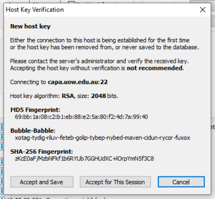
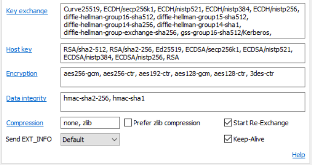

# CSIT953 第 5 周 · 云安全（二）：安全的管理访问与隐私保护计算

> **学习目标 (Learning objectives)** — 读完本章你应该能够：
> - 说明 SSH 在云管理中的位置，区分它保护的东西（一条通道）和不保护的东西（两端的设备、不走通道的流量）；按顺序描述一次 SSH 连接怎样建立，说出 SSH-2 三层各自负责什么；
> - 解释主机密钥指纹和"首次使用即信任"(TOFU) 防的是什么、防不住什么，第一次连接时正确核对服务器身份，认出不该再启用的旧算法；
> - 比较 SSH 的几种用户认证方式，解释公钥认证为什么"证明持有、不负责加密"，说明口令短语、SSH agent 和 agent 转发各自的风险；
> - 用 S15–S20 的措施加固一台云服务器的 SSH 访问：收紧暴露面和 root 登录、约束会话、管理凭据的生命周期、保护管理终端，比较四种访问模式和云服务商的托管访问；
> - 写出并解读本地 (-L)、远程 (-R)、动态 (-D) 端口转发命令，指出监听端、目的地和真正受保护的那一段，说明转发为什么会绕过网络分段、应该怎样单独授权；
> - 解释安全多方计算 (MPC) 的目标和"真实世界 ≈ 理想世界"的安全定义，说明不经意传输和秘密共享各提供什么，分析 MPC 依然依赖的假设，并在 MPC、同态加密、TEE 和普通加密处理之间做选择。

> 📚 **材料说明** — 本笔记依据 Week 5 slides（S1–S45）和两段课程录音。Week 5 录音的前三分之一在讲完 Week 4 slides 的 S39–S55（访问控制、客户端加密与共享），那部分已经写进第 4 周笔记；老师说"接下来是云安全的第二部分"之后才进入本周内容，一路讲到 S30，录音在 S30 中途结束。S30–S45 由 **Week 6 录音的开头**接着讲完：老师开场说"从 SSH applications 开始"，讲完 MPC 之后转入 Diffie–Hellman 密钥交换，那部分属于第 6 周。S44（MPC、同态加密、TEE 的比较）老师说"这里跳过"；S5 的 rsh/telnet、S18 的 ProxyJump、S29 的动态转发和 S43 的最后一条课上没有展开。这几处由笔记按 slides 展开，已标注。S4 和 S33 是分节标题页。录音是自动转写，术语错得很多（command 成了 comment，shell 成了 share，channel 成了 China，MPC 成了 NPC，secret sharing 成了 self sharing，shares 成了 shells），引用时已按 slides 校正。正文里的 S 编号是 slide 页码。

上一周我们跟着数据走了一遍：存储、加密、密钥、访问控制、共享。这一周换两个角度看云安全。老师开场说，这一部分讲两件事：一是 **SSH**，"这不是新技术，但对安全非常重要"；二是 **MPC**，安全多方计算。他顺手打开自己每天用的 SSH 客户端 XShell，说相信很多同学已经在用类似的软件连 Linux 服务器。

S2 把这两件事概括成两道**信任边界 (trust boundaries)**：

1. **管理访问 (administrative access)**：谁能接触到一个工作负载、带着什么权限。它又分三个方面：
   - **SSH 身份**：主机密钥、用户密钥、证书，以及云 IAM；
   - **网络路径**：公网端口、堡垒机、私有代理和隧道；
   - **运维证据**：日志、会话控制和事件响应。
2. **隐私保护计算 (privacy-preserving computation)**：不把各方的原始输入集中到一处，也能得到有用的结果。

前者问"谁能进来、进来能做什么"，后者问"能不能连数据都不让任何一方看全"。本章依次回答这些问题：

1. SSH 为什么仍是云管理的核心路径，它保护什么、不保护什么？（§1）
2. 一次 SSH 连接是怎样建立起来的，第一次连接时你在信任谁？（§2）
3. 用户怎样向服务器证明身份，SSH 密钥到底做什么？（§3）
4. 登录成功以后，能做的事、凭据的寿命、管理员的电脑，各该怎样管？（§4）
5. 云上有哪几种访问服务器的方式，各自把风险放在哪里？（§5）
6. 端口转发怎样把别的流量装进 SSH，又怎样绕过网络分段？（§6）
7. 为什么有时连"解密后再处理"都不能接受？（§7）
8. 安全多方计算怎样做到"算出结果，却谁也看不全数据"，它依赖哪些假设？（§8）

## 1. SSH：云管理绕不开的那条路

### 1.1 一次登录，不止一台机器 (S3)

先看 SSH 在云上有多普遍（S3 前两条）。Linux 虚拟机和各种网络设备普遍开放 SSH 供管理；自动化工具也离不开它，用它执行命令、下发配置、传文件、建隧道。老师举了三个角色：开发者用 SSH 登录服务器拿到一个 shell；部署系统用 SSH 在服务器上跑命令；管理员用 SSH 建一条隧道，连到没有公网地址的私有数据库。

云的规模让 SSH 的风险放大了（S3 第 3、4 条）。**云的规模把一份凭据变成了通向许多短生命周期工作负载的入口** (*Cloud scale turns one credential into access to many short-lived workloads*)。云上的虚拟机按需创建、用完即删，自动扩容时一分钟可能新开几十台。如果一把公钥被写进了镜像，从这个镜像启动的每一台机器都认这把钥匙。更进一步，**一次登录可能暴露这台机器绑定的工作负载身份和附近的私有服务**。老师的原话是：**一次成功的登录，可能通向远不止一台机器**。登录进去的这台机器也许能直接连内网数据库，也许绑着一个云身份，能以它的名义调用云 API。

> 📎 **拓展(超出 slides)：工作负载身份** — 云上的虚拟机可以绑定一个身份，AWS 叫实例角色 (instance role)，Google Cloud 叫服务账号 (service account)。机器上的任何进程都可以向一个本机才能访问的**元数据服务 (metadata service)** 要这个身份的临时凭据，再用它调用对象存储、密钥服务等云 API。第 4 周 §2.7 说过"API 凭据就是远程权力"：谁登录了这台机器，谁就顺带拿到了这份权力。

图 1 把"一次登录能走多远"画了出来。起点只是一把 SSH 私钥，橙色的每一样都是它连带能碰到的东西。

```d2 图 1 · 一把 SSH 私钥能走多远：登录一台虚拟机，就连带拿到它能碰到的一切（橙色）
direction: down
key: "管理员的 SSH 私钥" {class: key}
vm: "虚拟机 VM-1"
fleet: "同一镜像启动的\nVM-2 … VM-50" {class: warn}
db: "内网数据库\n（没有公网地址）" {class: warn}
role: "VM-1 绑定的云身份\n（实例角色）" {class: warn}
api: "对象存储、密钥服务\n等云 API" {class: warn}
key -> vm: "SSH 登录"
key -> fleet: "公钥被写进了镜像"
vm -> db: "内网可达"
vm -> role: "向元数据服务取临时凭据"
role -> api: "以 VM 的权限调用"
```

所以 S3 最后一条说，**安全目标是受控的管理，而不只是加密流量** (*controlled administration, not merely encrypted traffic*)。老师说，我们的目标不只是把连接加密，还要管住四样东西：**身份** (identity)、**权限** (privilege)、**凭据的寿命** (credential lifetime) 和**证据** (evidence)。这四个词是 §3 到 §5 的主线。

### 1.2 SSH 是什么：一条受保护的通道 (S5)

**SSH** 是 **Secure Shell**（安全外壳）的缩写。S5 交代了它的来历：它最初是为了**取代不安全的 rsh、telnet 这类工具**，用来安全地远程管理（主要是 Unix）系统；后来发展成网络应用通用的**安全通道 (secure channel)**。

> 📎 **拓展(超出 slides)：SSH 之前的世界** — telnet 和 rsh 是 1970–80 年代的远程登录工具，它们把一切都用明文传输，**包括登录口令**。同一网络上的任何人，只要抓包就能看到你输入的口令和命令。1995 年，芬兰赫尔辛基理工大学的 Tatu Ylönen 在校园网遭遇口令嗅探攻击后写出了第一版 SSH。今天用的是 **SSH-2**，2006 年由 IETF 标准化（RFC 4251–4254）；SSH-1 有设计缺陷，早已淘汰。

老师说，SSH 最出名的身份是远程登录协议，但它其实是一个**承载多种受保护活动的平台**：交互式 shell、远程执行一条命令、传文件、承载另一条网络连接，都可以在 SSH 里做。在最简单的层面上，SSH 在客户端和服务器之间建立一条**受保护的通道**：通道里的流量**被加密**，也**被检查是否遭到篡改**。

接下来是本节最重要的一句：**SSH 不会让两端的设备变得可信**。老师给了两个例子：

- **笔记本中了木马**：恶意软件可以偷你输入的命令，或者直接借用一把已经用口令解开的私钥去登录；
- **服务器被攻破**：攻击者可以在数据**解密之后**读到它。

S5 第 4 条从另一个方向划了边界：**SSH 只保护明确经过它的流量** (*Only covers traffic explicitly protected*)。你用 SSH 登录了服务器，不代表这台电脑上的其他程序都受到了保护。比如在另一个窗口里用浏览器以 `http://` 打开服务器上的管理后台，这部分流量根本不经过 SSH，仍然是明文。S5 最后一条说，应用要获得 SSH 的保护本来需要改造，但**端口转发 (port forwarding)** 能省去一部分改造：它把普通应用的流量装进 SSH 通道里送过去，§6 专门讲。

图 2 把这几条边界画在一起：绿色的通道受到保护，橙色的部分不受保护。

```svg 图 2 · SSH 只保护中间那条通道（绿色）；两端的设备和不走通道的流量（橙色）都不在它的保护范围内
<svg viewBox="0 0 640 250">
  <defs>
    <marker id="w" viewBox="0 0 10 10" refX="9" refY="5" markerWidth="7" markerHeight="7" orient="auto"><path d="M0,0 L10,5 L0,10 z" class="solid-warn"/></marker>
  </defs>
  <rect x="20" y="40" width="150" height="80" rx="8" class="warn fill-warn" stroke-width="2"/>
  <text x="95" y="75" text-anchor="middle">你的笔记本</text>
  <text x="95" y="98" text-anchor="middle" class="warn">明文在这里</text>
  <rect x="470" y="40" width="150" height="80" rx="8" class="warn fill-warn" stroke-width="2"/>
  <text x="545" y="75" text-anchor="middle">服务器</text>
  <text x="545" y="98" text-anchor="middle" class="warn">明文在这里</text>
  <rect x="170" y="62" width="300" height="36" class="accent fill-soft" stroke-width="2"/>
  <text x="320" y="85" text-anchor="middle" class="accent">SSH 通道：加密 + 防篡改</text>
  <text x="95" y="145" text-anchor="middle" class="warn">中木马：偷命令、</text>
  <text x="95" y="165" text-anchor="middle" class="warn">借用已解开的私钥</text>
  <text x="545" y="145" text-anchor="middle" class="warn">被攻破：读到</text>
  <text x="545" y="165" text-anchor="middle" class="warn">解密后的数据</text>
  <line x1="40" y1="200" x2="596" y2="200" class="warn dashed" stroke-width="2" marker-end="url(#w)"/>
  <text x="320" y="230" text-anchor="middle" class="warn">浏览器用 http:// 直接访问后台：不走 SSH，不受保护</text>
</svg>
```

所以老师的结论是：**把 SSH 看成一个大系统里的一项安全控制，而不是一套完整的安全方案**。S30 会从"用途"的角度再说一遍这个结论（§6.6）。

<details>
<summary>自测：管理员用 SSH 登录服务器，同时在浏览器里用 http://服务器地址:8080 打开服务器上的监控后台。哪部分流量受 SSH 保护？如果管理员的笔记本装了键盘记录木马，SSH 能不能防住？</summary>

只有 SSH 会话本身（命令和输出）受保护；浏览器到 8080 端口的流量不经过 SSH，是明文。键盘记录木马在加密**之前**就拿到了按键，SSH 防不住：它保护的是通道，不是端点。要让后台流量也受保护，可以给后台配 HTTPS，或者用 §6.3 的本地转发把它装进 SSH 通道。

</details>

## 2. SSH 协议：一次连接是怎样建立的

知道了 SSH 是什么，再看它怎样工作。本节先按时间顺序走一遍连接的建立（§2.1），再看协议的三层分工（§2.2）和它要达到的安全目标（§2.3），然后细看第一次连接时最容易出问题的一步：核对服务器的身份（§2.4），最后看今天该用哪些算法（§2.5）。

### 2.1 连接的四步，顺序不能乱 (S6)

S6 用一张图概括了一次 SSH 连接的四步，图 3 是它的重画版：

1. **客户端联系服务器，发起连接**；
2. **服务器发来自己的公钥**，用来证明自己是谁，这把公钥叫**主机密钥 (host key)**；
3. **双方协商参数，打开加密通道**：选定算法，算出这次会话的密钥；
4. **用户登录**服务器的操作系统，证明自己是谁。

```d2 图 3 · S6 的四步：服务器的身份在第 ② 步到达并被核对，用户的凭据到第 ④ 步才发出
shape: sequence_diagram
c: 客户端 Client
s: 服务器 Server
c -> s: "① 发起连接"
s -> c: "② 发来服务器的公钥（主机密钥）"
c.check: "核对：是不是要连的那台服务器？" {class: key}
c -> s: "③ 协商参数"
s -> c: "③ 加密通道建立"
c -> s: "④ 用户登录（口令或签名）"
```

老师特别强调：**这个顺序很重要**。服务器的身份应该在客户端发出任何敏感的认证数据**之前**被核对；只有加密通道就绪、用户也证明了身份之后，才能打开 shell、执行命令、传文件或建隧道。如果第 ② 步不核对服务器，第 ④ 步就可能把口令、甚至整个会话交给一台由攻击者控制的机器。§2.4 会细看这种攻击。

> 🔑 **例：一次真实连接的日志 (S12)** — S12 的截图里有 Bitvise SSH 客户端连接学校服务器 `capa.uow.edu.au` 时的日志。按 S6 的四步标注如下：
>
> ```text
> # ① 发起连接
> 10:57:54.108  Connecting to SSH server capa.uow.edu.au:22.
> 10:57:54.119  Connection established.
> 10:57:54.143  Server version: SSH-2.0-OpenSSH_7.6p1
>               Ubuntu-4ubuntu0.5
> # ② 收到主机密钥 + ③ 协商、建立加密通道
> 10:57:54.144  First key exchange started. …
> 10:57:54.179  Received host key from the server.
>               Algorithm: RSA/sha2-512, size: 2048 bits,
>               SHA-256 fingerprint:
>               zKcE0aF/MzbNFkf1b6RYUb7GGHUdXC+lOrpYmN5f3C8.
> 10:57:55.368  First key exchange completed using Curve25519.
>               Session encryption and integrity: aes256-gcm,
>               compression: none.
> # ④ 用户认证
> 10:57:55.375  Attempting none authentication.
> 10:57:55.397  Remaining authentication methods:
>               'publickey,password,keyboard-interactive,hostbased'.
> 10:58:15.729  Attempting password authentication.
> 10:58:17.318  Authentication completed.
> ```
>
> 从日志里能读出几件事：
>
> - **`SSH-2.0`**：服务器说的是 SSH 第 2 版协议，后面是它的软件版本 OpenSSH 7.6p1。
> - **第 ② 步和第 ③ 步交织在一起**：主机密钥是在密钥交换 (key exchange) 的过程中送来的，S6 为了好懂把它们画成了两步。密钥交换用的是 **Curve25519**，§2.3 和第 6 周会讲它在做什么。
> - **`encryption and integrity: aes256-gcm`**：一个算法同时负责加密和完整性。回忆第 4 周 §3.2，AES-GCM 是**认证加密**，自带防篡改的标签，不需要另配一个 MAC。
> - **10:57:55 到 10:58:15 之间隔了 20 秒**，那是用户在输入口令。口令认证发生在加密通道建好**之后**，所以口令在网络上是加密传输的。
> - **`Attempting none authentication`** 是一次试探：客户端先用"不认证"去问，服务器回答它接受哪几种认证方式（publickey、password、keyboard-interactive、hostbased）。§3.1 会逐一介绍这四种方式。

### 2.2 SSH-2 的三层架构 (S7)

S7 说，SSH-2 采用三层架构：

- **传输层协议 (SSH Transport Layer Protocol)**：建立最初的连接，**认证服务器**，通过密钥交换等步骤在客户端和服务器之间建立安全通道。老师补充：这一层负责加密连接、**为每次会话生成新的会话密钥**，并认证服务器。
- **认证协议 (SSH Authentication Protocol)**：在传输层建好的安全通道上**认证客户端**，也就是证明连接者是哪个用户或哪个工作负载。
- **连接协议 (SSH Connection Protocol)**：在**一条**传输层安全通道上同时承载**多条连接**，这些连接叫**信道 (channel)**；好处是**效率**，会话可以复用 (*session re-use*)。老师举的例子是：一条信道跑 shell，一条执行命令，一条承载被转发的 TCP 连接。

可以用打电话给银行来类比。先确认拨通的确实是银行，并且线路是加密的（传输层）；然后银行核对你的身份（认证层）；身份核对通过后，一通电话里你可以连着办好几笔业务：查余额、转账、改地址（连接层）。三层自下而上叠在一条 TCP 连接上，图 4 画出了这个结构。

```svg 图 4 · SSH-2 的三层叠在一条 TCP 连接上：传输层认证服务器并加密，认证层认证用户，连接层在同一条通道里开多条信道
<svg viewBox="0 0 640 320">
  <rect x="20" y="16" width="600" height="104" rx="6" class="good fill-good" stroke-width="2"/>
  <text x="36" y="40">连接层 Connection Protocol</text>
  <text x="604" y="40" text-anchor="end" class="muted">一条通道，多条信道</text>
  <rect x="36" y="54" width="134" height="52" rx="4" class="ink" fill="none" stroke-width="1.5"/>
  <text x="103" y="76" text-anchor="middle">session</text>
  <text x="103" y="96" text-anchor="middle" class="muted">shell·命令·SFTP</text>
  <rect x="180" y="54" width="134" height="52" rx="4" class="ink" fill="none" stroke-width="1.5"/>
  <text x="247" y="76" text-anchor="middle">x11</text>
  <text x="247" y="96" text-anchor="middle" class="muted">图形界面</text>
  <rect x="324" y="54" width="134" height="52" rx="4" class="ink" fill="none" stroke-width="1.5"/>
  <text x="391" y="76" text-anchor="middle">direct-tcpip</text>
  <text x="391" y="96" text-anchor="middle" class="muted">本地转发 -L</text>
  <rect x="468" y="54" width="136" height="52" rx="4" class="ink" fill="none" stroke-width="1.5"/>
  <text x="536" y="76" text-anchor="middle">forwarded-tcpip</text>
  <text x="536" y="96" text-anchor="middle" class="muted">远程转发 -R</text>
  <rect x="20" y="132" width="600" height="52" rx="6" class="ink fill-muted" stroke-width="1.5"/>
  <text x="36" y="164">认证层 Authentication Protocol</text>
  <text x="604" y="164" text-anchor="end" class="muted">认证用户：公钥·口令·键盘交互·基于主机</text>
  <rect x="20" y="196" width="600" height="52" rx="6" class="accent fill-soft" stroke-width="2"/>
  <text x="36" y="228" class="accent">传输层 Transport Layer Protocol</text>
  <text x="604" y="228" text-anchor="end" class="muted">认证服务器·密钥交换·加密·完整性</text>
  <rect x="20" y="260" width="600" height="44" rx="6" class="muted dashed" fill="none" stroke-width="1.5"/>
  <text x="320" y="288" text-anchor="middle" class="muted">TCP 连接（服务器默认监听 22 端口）</text>
</svg>
```

> 📎 **拓展(超出 slides)** — 三层分别对应 RFC 4253（传输层）、RFC 4252（认证）和 RFC 4254（连接）。注意两个容易混的地方：第一，三层**不是三条连接**，它们叠在同一条 TCP 连接里；第二，这里的"层"和网络课上 OSI 模型的"层"不是一回事，三层都运行在 TCP 之上，都属于应用层协议。

老师指出，这种分层正是 SSH **如此灵活**的原因之一：**一条加密连接可以承载好几种不同的活动**。灵活也带来了一个**策略上的难题**：允许一个用户登录，可能也就**悄悄允许了他传文件、做端口转发**。很多人以为"给他开个 SSH 账号"只是让他能敲命令，实际上连接层还能开别的信道。§4.2 讲怎样把这些能力一项项分开授权，§6.1 再细看信道。

<details>
<summary>自测：用户 SSH 登录服务器后，在同一条连接里又用 SFTP 传了一个文件，并开了一条端口转发去访问内网数据库。这三件事分别由哪一层的什么东西承载？为什么说这给访问控制出了难题？</summary>

三件事都由**连接层**的信道承载：shell 和 SFTP 用 session 信道（SFTP 是 session 信道里的一个子系统），端口转发用 direct-tcpip 信道。它们共用传输层建立的同一条加密通道，也共用认证层做过的那一次认证。难题在于：认证只回答了"你是谁"，一旦登录成功，连接层能开的信道远不止 shell；如果不单独限制，"能登录"就等于"能传文件、能转发流量"。

</details>

### 2.3 SSH-2 的安全目标 (S8)

S8 列出了 SSH-2 要达到的安全目标：

- **服务器在传输层协议里被认证**；
- **客户端在认证协议里被认证**：通过公钥（S8 写的是 DSS、RSA），或者简单的口令；
- **建立一个新鲜的共享秘密 (fresh, shared secret)**：用它派生出后续的各种密钥（加密密钥、MAC 密钥、IV），这一点和 SSL/TLS 类似；它们为传输层提供**机密性**和**真实性**；
- **安全的密码套件协商 (secure ciphersuite negotiation)**：协商加密、MAC 和压缩算法。

老师把这些目标翻译成了五个性质：**双向认证**，客户端要确认服务器是真的，服务器也要知道客户端是谁；**新鲜的会话密钥**，不拿一把长期密钥直接加密每一次连接；**机密性**，外人读不到流量；**完整性**，外人没法悄悄改动流量；**安全协商**，双方从都支持的算法里选，但**不能退回到弱算法**。

"新鲜的共享秘密"这一条值得展开，它回答了一个自然的问题：会话密钥是怎么来的？

> 📎 **拓展(超出 slides)：会话密钥从哪里来** — 每次连接，双方都运行一次**密钥交换**（日志里的 Curve25519 就是一种**椭圆曲线 Diffie–Hellman**，第 6 周会讲它的数学）。双方各自临时生成一对密钥，交换公开的那一半，就能各自算出同一个**共享秘密 K**，而 K 本身从不在网络上出现。双方再把 K 和这次交换的摘要 H 一起做哈希，按方向各派生一套密钥。RFC 4253 规定了六个：客户端→服务器、服务器→客户端两个方向，各有一个初始向量 (IV)、一把加密密钥、一把 MAC 密钥。S8 说的"Enc Keys, MAC keys, IVs"就是这六个。
>
> "新鲜"带来两个好处。第一，**每次会话一套新密钥**：某次会话的密钥泄露了，只影响这一次。第二，**前向保密 (forward secrecy)**：服务器的长期主机私钥只用来**签名**，证明"这次交换是我做的"，从不用来加密流量；临时密钥用完即删。就算主机私钥多年后被偷，攻击者也解不开当年录下来的会话。第 4 周 §3.4 的拓展里提过 TLS 1.3 用临时 Diffie–Hellman 达到同样的效果，这就是 S8 说"和 SSL/TLS 类似"的地方。

"安全协商"也有一个容易被忽略的细节：**协商本身也要防篡改**。

> 📎 **拓展(超出 slides)：为什么协商是"安全"的** — 连接一开始，双方各发一份自己支持的算法清单，每一类（密钥交换、主机密钥、加密、MAC、压缩）取**客户端清单里第一个、服务器也支持的**算法。如果中间人能改这两份清单，比如把强算法都删掉，就能逼双方退回到弱算法，这叫**降级攻击 (downgrade attack)**。SSH 的对策是把两份清单都写进交换摘要 H，由服务器用主机私钥签名；清单被改过，签名就验证不过。这个保护有个前提：客户端认得出服务器的真主机密钥。§2.4 讲的指纹核对，保护的不只是登录，还有整个协商。

S8 的"客户端认证"一条写着 DSS 和 RSA，这反映的是 2006 年标准刚发布时的情况。今天 DSS 已经被列为不该再启用的旧算法（§2.5），老师的话是"**不要碰 DSS**"。考试时注意分清：S8 讲的是 SSH-2 设计时的安全目标，S11 讲的是今天的算法选择。

| 安全目标（S8） | 靠什么实现 | 对应日志（§2.1） |
|---|---|---|
| 服务器认证 | 主机密钥对交换摘要的签名，客户端核对指纹 | `Received host key … fingerprint` |
| 新鲜的共享秘密 → 派生密钥 | 每次连接一次临时密钥交换 | `key exchange completed using Curve25519` |
| 机密性 + 真实性 | 派生出的会话密钥 + 认证加密（或加密 + MAC） | `encryption and integrity: aes256-gcm` |
| 安全的算法协商 | 两份清单写进交换摘要，由服务器签名 | （协商结果写在上一行） |
| 客户端认证 | 认证层：公钥签名或口令 | `Attempting password authentication` |

<details>
<summary>自测：攻击者录下了某次 SSH 会话的全部密文。一年后，他偷到了这台服务器的主机私钥。他能解开那次会话吗？为什么？</summary>

不能。主机私钥只用来对交换摘要**签名**、证明服务器的身份，不参与加密流量。会话密钥来自那次连接的临时密钥交换，临时私钥用完就删了，录下的密文里也不包含共享秘密 K。这就是前向保密。主机私钥被偷的危害在**以后**：攻击者可以冒充这台服务器（§2.4），所以要尽快换掉主机密钥。

</details>

### 2.4 主机密钥指纹：第一次连接时你在信任谁 (S9, S10)

§2.1 说第 ② 步要核对服务器的身份。可是怎么核对？S9 先点明了这一步有多关键：**连接的安全依赖于服务器向客户端证明自己的身份**。第一次连接一台远程主机时，主机把它的公钥发给你的电脑；为了帮你核对，客户端会显示这把公钥的**指纹 (fingerprint)**，请你确认。

**指纹**就是公钥的哈希值。回忆第 2 周 §1.4，哈希函数被比作"数字指纹"：任意长的数据压成一小段摘要，数据变一点，摘要就完全不同。一把 RSA-2048 公钥有 256 字节，人眼没法逐字节核对；SHA-256 指纹只有 32 字节，用 Base64 写出来是 43 个字符，核对起来容易得多。

S10 的截图（图 5）就是这样一个核对框。它显示了同一把主机密钥的三种指纹写法：**MD5 指纹**（老格式，冒号分隔的十六进制）、**Bubble-Babble**（一种可以念出来的编码，方便在电话里核对）和 **SHA-256 指纹**（今天的默认格式）。三者描述的是同一把公钥。对照 §2.1 的日志：日志里记下的 SHA-256 指纹 `zKcE0aF/…f3C8` 和这里的一模一样，它们是同一台服务器。



S9 接着说了两句实话：**很多用户直接点了接受** (*Many users just blindly accept*)；**SSH 对普通大众并不友好**。老师也坦白，"包括我在内，大多数人第一次连服务器时都直接点接受，有时就是懒得核对"，他通常点的是 *Accept and Save*，但他马上说，**这样做不安全**。核对框自己也写着：不经核对就接受主机密钥是**不推荐的** (*not recommended*)。

不核对，具体会出什么事？图 6 是中间人攻击。

```svg 图 6 · 中间人攻击：你第一次连接时，Mallory 把自己的主机密钥冒充成服务器的；你没核对就接受了，两条加密通道都在她那里解密
<svg viewBox="0 0 640 240">
  <defs>
    <marker id="a" viewBox="0 0 10 10" refX="9" refY="5" markerWidth="7" markerHeight="7" orient="auto-start-reverse"><path d="M0,0 L10,5 L0,10 z" class="solid-ink"/></marker>
  </defs>
  <rect x="20" y="50" width="120" height="60" rx="8" class="ink fill-muted" stroke-width="1.5"/>
  <text x="80" y="85" text-anchor="middle">你的客户端</text>
  <rect x="260" y="50" width="120" height="60" rx="8" class="warn fill-warn" stroke-width="2"/>
  <text x="320" y="85" text-anchor="middle" class="warn">攻击者 Mallory</text>
  <rect x="500" y="50" width="120" height="60" rx="8" class="ink fill-muted" stroke-width="1.5"/>
  <text x="560" y="85" text-anchor="middle">真服务器</text>
  <line x1="144" y1="80" x2="256" y2="80" class="ink" stroke-width="1.5" marker-start="url(#a)" marker-end="url(#a)"/>
  <text x="200" y="70" text-anchor="middle" class="muted">加密通道 ①</text>
  <line x1="384" y1="80" x2="496" y2="80" class="ink" stroke-width="1.5" marker-start="url(#a)" marker-end="url(#a)"/>
  <text x="440" y="70" text-anchor="middle" class="muted">加密通道 ②</text>
  <text x="80" y="140" text-anchor="middle">指纹对不上，</text>
  <text x="80" y="160" text-anchor="middle">你却点了接受</text>
  <text x="320" y="140" text-anchor="middle" class="warn">两条通道都在她这里解密：</text>
  <text x="320" y="160" text-anchor="middle" class="warn">口令、命令、数据全看得到</text>
  <text x="560" y="140" text-anchor="middle" class="muted">以为 Mallory</text>
  <text x="560" y="160" text-anchor="middle" class="muted">就是你</text>
  <text x="320" y="215" text-anchor="middle" class="accent">核对指纹就能识破：Mallory 没有真服务器的私钥，造不出它的指纹</text>
</svg>
```

Mallory 夹在中间，和你建一条加密通道，再和真服务器建一条。两条通道各自都是"加密的"，可明文在她手里转了一道。你在第 ④ 步输入的口令，她原样拿去登录真服务器；之后你敲的每条命令、看到的每行输出，她都能读、能改。加密本身没有失效，失效的是"跟谁加密"。这就是 §2.1 那句"顺序很重要"的分量。

**首次使用即信任 (trust on first use, TOFU)**。老师解释，如果第一次不核对就接受，你用的就是 TOFU：客户端把这把主机密钥**记下来**（OpenSSH 记在 `~/.ssh/known_hosts` 文件里），以后每次连接都比对；如果主机密钥变了，就**发出警告**。这**比完全不检查要好**，因为只要第一次连接没出事，以后的中间人都会被发现；但它**证明不了第一次连接是安全的**。如果 Mallory 恰好守在你的第一次连接上，TOFU 就会把她的密钥当成真的记下来。

怎样把第一次也做对？老师给了两个层次的办法：

- **小规模的环境**：把指纹和一个**可信的来源**比对，比如云服务商的控制台、部署记录。关键是这个来源不能和 SSH 连接本身走同一条可能被篡改的路。
- **大规模的环境**：用**主机证书 (host certificates)**、**集中管理的 known_hosts 文件**，或者**托管的访问代理**（§5.2），让核对不再依赖每个人的自觉。

> 🔑 **例：第一次连接一台新开的云服务器** — 假设你在云上新开了一台 Ubuntu 虚拟机，公网地址是 `203.0.113.10`。
>
> 1. **从可信的渠道拿到指纹**。在云控制台的串行控制台或系统日志里，很多云镜像会在首次启动时打印主机密钥的指纹；也可以在服务器上运行 `ssh-keygen -lf /etc/ssh/ssh_host_ed25519_key.pub`，输出形如 `256 SHA256:Xq3…pL8 root@vm (ED25519)`。
> 2. **连接并比对**。运行 `ssh alice@203.0.113.10`，OpenSSH 会提示 `ED25519 key fingerprint is SHA256:Xq3…pL8. Are you sure you want to continue connecting (yes/no/[fingerprint])?`。逐字比对，一致才输入 `yes`。
> 3. **之后交给 known_hosts**。主机密钥被写进 `~/.ssh/known_hosts`，以后连接不再提示；如果哪天它变了，你会看到一大段警告：`WARNING: REMOTE HOST IDENTIFICATION HAS CHANGED!`
>
> 一个常见的坑：同一台服务器通常有好几把主机密钥（ED25519、ECDSA、RSA），**指纹因密钥类型而异**。提示框说的是 ED25519，就要拿 ED25519 的指纹来比。

> 📎 **拓展(超出 slides)：为什么大家对警告麻木了** — 主机密钥变了不一定是攻击：服务器重装了系统、密钥轮换了，或者云上**同一个 IP 被分配给了一台新虚拟机**，都会触发警告。云上 IP 回收复用很常见，警告一多，不少人养成了"删掉 known_hosts 那一行再连"的习惯，等于每次都退回到不核对。主机证书从根上解决这个问题：组织自己的**证书机构 (CA)** 给每台服务器的主机密钥签名，客户端只需信任这个 CA 一次（known_hosts 里写一行 `@cert-authority *.example.com ssh-ed25519 AAAA…`），以后新开的服务器都不会再弹框，换了密钥也能自动认出来。这正是 S9 说的"对普通大众不友好"的反面：把核对交给系统，而不是交给每个用户的自觉。

<details>
<summary>自测：① 你第一次连一台新开的云服务器，提示框里的 ED25519 指纹和云控制台系统日志里打印的不一样，应该怎么办？② 一台你连过上百次的服务器突然弹出 REMOTE HOST IDENTIFICATION HAS CHANGED，同事说"肯定是重装了，删掉 known_hosts 那行就好"。你怎么看？</summary>

① 先确认比对的是同一种密钥类型、同一台机器（IP 是否被复用、控制台里看的是不是这台）。如果确实对不上，就**不要连接**，按中间人攻击处理：换一个网络重试，并通知管理员。② 重装确实是可能的原因，但"可能是重装"不等于"就是重装"。要先通过独立的渠道（问运维、看云控制台的新指纹或变更记录）确认密钥确实合法地换了，核对新指纹之后再更新 known_hosts。直接删掉那一行，等于把 TOFU 的唯一保护也扔掉了。

</details>

### 2.5 现代 SSH 用现行的算法 (S11, S12)

§2.3 说双方要从都支持的算法里选。今天该选哪些？S11 给出了答案：

| 用途 | 现行的选择（S11） | 不该随手再启用的旧算法（S11） |
|---|---|---|
| **密钥交换** (key exchange) | Curve25519、现代的 Diffie–Hellman 组、**混合 (hybrid)** 方案 | SHA-1 时代的 DH 组，如 `diffie-hellman-group1-sha1` |
| **签名**（主机密钥和用户密钥） | Ed25519、ECDSA、**安全密钥 (security keys)**、RSA-SHA-2 | **DSS**、用 SHA-1 的 RSA 签名 |
| **流量保护** (traffic protection) | ChaCha20-Poly1305、AES-GCM；AES-CTR 也还可以留着 | **RC4**、**3DES**、只有 **CBC** 模式的算法、SHA-1 时代的 MAC |

S11 的最后一条是实践要求：**保持实现打上补丁，检查实际生效的配置，而不是照抄别人的示例** (*inspect effective configuration, not copied examples*)。老师补充：遇到老设备只支持旧算法的兼容问题时，把例外**限制在那一台主机上**，并且**计划好什么时候去掉它**。

**考试提示**。课上有同学问："算法名字要全部记住吗？"老师的回答是**不用**，这些名字不考；第 13 周他会给出考试范围的说明。但他接着说，**要记住那几个旧的**：DSS、RC4、3DES、CBC、SHA-1，"尤其是 DSS，不要碰 DSS"。所以上表右栏要认得出来，左栏知道"有现代的选择、默认就好"即可。

> 📎 **拓展(超出 slides)：几个术语和淘汰的原因** — 下面这些不必背，帮助理解即可。
>
> - **AES-CTR 为什么"还可以留着"**：CTR 模式本身只加密、不防篡改，必须另配一个 MAC（如 `hmac-sha2-256`）。配对得当时它是安全的，只是不如 GCM、ChaCha20-Poly1305 这类自带认证的**认证加密 (AEAD)** 省事。
> - **混合方案**：把传统的椭圆曲线密钥交换和一种**抗量子 (post-quantum)** 的算法组合起来，只要两者有一个没被攻破，会话就是安全的。OpenSSH 9.0（2022）起默认用 `sntrup761x25519-sha512`，10.0（2025）起默认改为 `mlkem768x25519-sha256`。动机是"先录下、以后再解"：今天录下的流量，将来量子计算机也许能解开。
> - **安全密钥**：指 FIDO/U2F 硬件密钥（OpenSSH 里的 `ed25519-sk` 类型），私钥在硬件里，每次签名要手指触碰。§4.4 还会提到。
> - **为什么淘汰旧算法**：RC4 的密钥流有统计偏差；3DES 的分组只有 64 位，长会话里会遭到生日攻击 (Sweet32)；SSH 里的 CBC 模式在 2008 年被发现可以恢复部分明文；SHA-1 已经能被构造碰撞；SSH 里的 DSS 只能用 1024 位密钥，签名时随机数稍有偏差就会泄露私钥。OpenSSH 早在 7.0 就默认禁用了 DSA，10.0 把它彻底移除了。

S12 的截图（图 7）展示了客户端的算法设置页：密钥交换一栏列了十几种，加密一栏从 `aes256-gcm` 一直排到 `3des-ctr`，完整性一栏里还有 `hmac-sha1`。老师说，**这个窗口说明了算法配置为什么让人困惑**：软件**支持**很多选择，但**支持不等于每一个都应该优先使用**。连接建立时，双方要选定四样东西：一种密钥交换方法、一种主机密钥签名算法、一种加密算法和一种完整性机制。对照 §2.1 的日志，排在清单最前面的 Curve25519 和 aes256-gcm 被选中了，这正是"取客户端清单里第一个、服务器也支持的"规则在起作用。老师的建议是：**大多数用户应该让维护良好的实现按安全的策略自己选**。



为什么"照抄示例"危险？看一个例子。

> 🔑 **例：一段从老教程里复制的配置** — 同事从一篇 2012 年的教程里复制了这几行，加进服务器的 `/etc/ssh/sshd_config`，说是"为了兼容"：
>
> ```text
> Ciphers aes128-cbc,3des-cbc
> MACs hmac-md5,hmac-sha1
> ```
>
> 问题有两层。第一，它重新启用了 S11 点名的 CBC、3DES 和 SHA-1 时代的 MAC。第二，更隐蔽的是：`Ciphers` 这样写会**整个替换**默认清单，现代的 AES-GCM 和 ChaCha20-Poly1305 反而被关掉了，整台服务器只剩旧算法可用。如果这段配置被复制进了几百台服务器的模板，影响就是整个机群。
>
> 正确的做法：删掉这两行，回到默认值；用 `sshd -T` 打印**实际生效的**配置（包括所有默认值）核对一遍。真有一台老交换机只会旧算法，就只在**客户端**为它单独开例外，并写明什么时候去掉：
>
> ```text
> # ~/.ssh/config：只对这一台老设备放宽，其他主机不受影响
> Host old-switch.lab
>     KexAlgorithms +diffie-hellman-group14-sha1
>     HostKeyAlgorithms +ssh-rsa
> ```
>
> 开头的 `+` 表示在默认清单后面**追加**，而不是替换。

<details>
<summary>自测：下面哪些算法出现在一台服务器的生效配置里时，应该引起注意？ssh-ed25519、ssh-dss、chacha20-poly1305@openssh.com、arcfour、aes256-gcm@openssh.com、3des-cbc、curve25519-sha256、hmac-sha1</summary>

应该注意的是 **ssh-dss**（DSS 签名）、**arcfour**（就是 RC4）、**3des-cbc**（3DES，而且是 CBC 模式）和 **hmac-sha1**（SHA-1 时代的 MAC）。其余四个都是 S11 列出的现行选择。老师说算法名不考，但这几个旧的要认得出来，尤其是 DSS。

</details>

## 3. 用户认证：证明你是谁

§2 解决了"服务器是不是真的"和"通道是不是安全的"。通道建好以后，轮到服务器问：**你是谁**？这是认证层的工作。本节先比较几种认证方式（§3.1），再细看最常用也最推荐的公钥认证（§3.2），最后看老师课上演示的两台真实服务器（§3.3）。

### 3.1 认证方式：四种选择 (S13)

S13 说，**SSH 用户认证协议 (SSH User Authentication Protocol)** 负责向服务器认证客户端，列了三种方法：**公钥（数字签名）**、**口令**、**基于主机**。老师课上还讲了第四种**键盘交互**，§2.1 日志里服务器报出的正是这四种。

| 方式 | 怎样证明身份 | 优点 | 弱点 |
|---|---|---|---|
| **公钥** publickey | 客户端用私钥对本次会话的数据签名，服务器用登记过的公钥验证 | 私钥不出客户端；没法靠猜 | 私钥文件被拷走、agent 被借用（§3.2、§4.4） |
| **口令** password | 在加密通道里把口令发给服务器 | 好懂，不用额外准备 | 会被猜、被重复使用、被钓鱼 |
| **键盘交互** keyboard-interactive | 服务器提出一串问题，用户逐个回答 | 能接上**第二因素**或别的身份系统（比如口令 + 一次性验证码） | 安全性取决于背后接的是什么 |
| **基于主机** hostbased | 服务器信任某台客户端**机器**的主机密钥："从那台机器上来的 alice 就是 alice" | 机器之间批量互信时省事 | 信任落在机器上而不是人身上；普通的云管理里少见 |

老师说，实践中最常用的是**公钥**和**口令**两种。口令的问题他列了三个：**容易被猜**（暴力破解），**被重复使用**（一处泄露，处处失守），**被钓鱼**。

> 📎 **拓展(超出 slides)：口令认证还有一个隐患** — 口令是在加密通道里发出去的，路上的人看不到；可是**服务器本身**收到的是明文口令。如果你连的是一台被攻破的服务器，或者是 §2.4 里没被识破的 Mallory，口令就直接交到了对方手里，而且你在别处用的同一个口令也一起泄露了。公钥认证没有这个问题：服务器收到的只是一个签名，拿去别的会话、别的服务器都没用（§3.2）。

不管用哪种方式，老师强调：**认证只回答"是谁在连接"。授权是另一个决定**。这正是第 4 周 §5.1 的结论：认证确认"是谁"，授权决定"能做什么"。S14 的最后一条把这一点说得更具体：**只有身份、密钥策略、账户状态和各项限制都允许时，认证才会成功** (*Authentication succeeds only if identity, key policy, account state, and restrictions allow it*)。签名验证通过还不够：账户可能已被锁定或过期，这把密钥可能已被撤销或类型不被允许，连接的来源地址可能不在允许范围内（§4.2）。

### 3.2 SSH 密钥证明持有，不负责加密 (S14)

S14 的标题纠正了一个很常见的误解。很多人以为"我配了 SSH 密钥，所以我的连接是用这把密钥加密的"。不是。§2.3 讲过，流量由每次连接临时派生的**会话密钥**加密；你的用户密钥对只做一件事：**证明你持有那把私钥**（*prove possession*）。它是签名用的，不是加密用的。

S14 把公钥认证拆成三点：

**私钥留在客户端，要防止被导出或被偷**。服务器那边存的是用来验证的东西，S14 列了三种：**一把公钥**（最常见，写在用户主目录的 `~/.ssh/authorized_keys` 里）、**一个受信任的证书机构**（服务器不认具体的公钥，只认"这个 CA 签过名的公钥"，§4.3 会讲），或者**一条外部查询规则**（登录时去查目录服务或云 IAM，问"这个用户现在有哪些公钥"，§5.2 的 OS Login 就是这样）。

**客户端对与会话相关的数据签名，以此证明它持有私钥**。签名的内容包括 §2.3 的会话标识（第一次密钥交换的摘要 H）。这意味着一个签名只对这一次会话有效：就算有人截获了它，也没法拿到别的会话、别的服务器上重放。图 8 是整个过程。

```d2 图 8 · 公钥认证：私钥从不离开客户端；服务器只验证一个和本次会话绑定的签名
shape: sequence_diagram
c: "客户端（持有私钥）"
s: "服务器（authorized_keys 里有公钥 P）"
c -> s: "我是 alice，想用公钥 P 登录"
s -> c: "P 在名单上，请证明你持有私钥"
c.sign: "本地：用口令短语解开私钥文件\n对「会话标识 + 请求」签名" {class: key}
c -> s: "签名 Sig（私钥本身不发送）"
s.verify: "用 P 验证签名\n检查账户状态和各项限制"
s -> c: "认证成功"
```

**口令短语 (passphrase) 保护的是存在磁盘上的私钥文件，它不会被发给服务器**。生成密钥时可以设一个口令短语，私钥文件就用它加密保存；每次使用时在**本地**解开。它和**账户口令**是两回事：账户口令会经过网络发给服务器，口令短语从不离开你的电脑。老师说，口令短语可以不设，但这样一来，**谁拷走了这个文件，谁就能冒充你**。他还提醒了第二种风险：即使私钥文件拿不走（比如存在硬件里），攻击者也可能借用一个**已经解开的 SSH agent** 去签名。§4.4 会细讲 agent。

> 🔑 **例：配置一次公钥登录** — 在自己的电脑（客户端）上：
>
> ```text
> ssh-keygen -t ed25519 -C "alice@laptop"
>   → ~/.ssh/id_ed25519       私钥：留在本机，设一个口令短语加密保存
>   → ~/.ssh/id_ed25519.pub   公钥：可以交给任何人
> ssh-copy-id alice@203.0.113.10
>   → 把公钥追加到服务器上 alice 的 ~/.ssh/authorized_keys
> ssh alice@203.0.113.10
>   → 本机用口令短语解开私钥并签名，服务器用公钥验证
> ```
>
> 对照图 8：口令短语只在第三步的本地出现；网络上传的只有公钥（第二步，以及登录时告诉服务器"我用哪把"）和签名。

> 📎 **拓展(超出 slides)：换了电脑怎么办** — 老师演示时说，换一台电脑登录，就要把私钥拷到新电脑上。这样做能用，但更好的做法是**在新电脑上另生成一对密钥**，把新公钥加进 authorized_keys。每台设备一把钥匙，哪台丢了就只删哪一把（S17 第 4 条"设备丢失时撤销"），而且私钥从来不用在设备之间传来传去。

本节的边界要说清楚：**持有私钥不等于就是本人**。服务器能确认的只是"对方持有这把私钥"。私钥被偷了，在服务器看来，小偷就是你。这就是为什么认证之后还需要 §4 的那些控制：限制这把钥匙能做什么（§4.2）、能用多久（§4.3），以及保护存放它的那台电脑（§4.4）。

<details>
<summary>自测：一次公钥登录中，下面哪些东西会经过网络发给服务器？① 私钥 ② 公钥 ③ 口令短语 ④ 对会话数据的签名。如果改用口令认证，又会发出什么？</summary>

公钥登录只发出 ② 和 ④：客户端告诉服务器用哪把公钥，再发出签名。① 私钥和 ③ 口令短语都只在本地使用。改用口令认证时，**账户口令**本身会在加密通道里发给服务器，这正是口令认证怕钓鱼和怕服务器被冒充的原因。

</details>

### 3.3 课堂演示：老师的两台服务器

讲到这里，老师打开了自己的两台服务器，给大家看真实的 SSH 服务端配置文件 `/etc/ssh/sshd_config`。他先说，多数同学大概不会去碰这个文件：租一台云服务器，服务商通常直接给你 root 用户的口令，你就这么用下去了。

**第一台是租在 Oracle 云上的服务器，有公网地址**。配置里和本章相关的几行是：

```text
Port 22
PermitRootLogin yes
PubkeyAuthentication yes
PasswordAuthentication no
```

逐行看老师的解释：

- **`Port 22`**：他没有改默认端口。这意味着攻击者可以扫描这个 IP 和端口，发现"这是一台新服务器"，然后尝试登录。
- **`PermitRootLogin yes`**：因为他自己就用 root 用户，所以开着。但他提醒，如果你用的是自己的 VPS，**把它设成 `no`**，"这样做有点危险"。§4.1 会解释为什么。
- **`PubkeyAuthentication yes`**：允许公钥登录。他打开 `authorized_keys` 给大家看，里面有**两把公钥**，也就是说有两个用户（或两台设备）能登录这台服务器。
- **`PasswordAuthentication no`**：**关掉口令登录**。老师说："你的账户可以有口令，但不能用口令登录。现在假设你是攻击者，你知道我的 IP、我的端口，想用 root 登录。可只要你输入口令，服务器就**直接拒绝**你。"所以虽然端口没改、root 也开着，这台服务器仍比允许口令登录的服务器安全得多：没有对应的私钥，猜多少口令都没用。

> 📎 **拓展(超出 slides)** — OpenSSH 专门为"root 只许用密钥登录"准备了一个取值：`PermitRootLogin prohibit-password`，从 7.0 版起它就是默认值。老师这台机器的 `yes` 加上 `PasswordAuthentication no`，效果相近；但前者只管 root，后者管所有用户。

**第二台服务器在学校的实验室里，没有公网地址**。它用的是**私有 IP 地址 (private IP address)**，端口同样是 22，配置文件里不少行前面带着 `#`，也就是被注释掉了（被注释的行不生效，生效的是默认值），口令登录也没有关。老师说，这台看上去"不太安全"，但因为它在校园内网里，攻击者只有先进入 UOW 的网络，才能用脚本之类的工具去试着登录；**从 UOW 网络外面，根本访问不到这台电脑**，所以还算可以接受。

> 📎 **拓展(超出 slides)** — 被注释掉的配置行用的是默认值，而默认值因 OpenSSH 版本和 Linux 发行版而不同。比如上游 OpenSSH 默认允许口令登录，而不少云镜像会另外放一个配置片段把它关掉。想知道一台服务器**实际**用的是什么，不要猜，运行 `sshd -T` 看生效的配置（§2.5 的建议）。

课上同学追问了两个问题，老师的回答补上了网络方面的预备知识。

"**在家怎么连这台服务器？**"先用 **VPN** 连进 UOW 的网络，再连服务器。

"**网络是怎么保护它的？**"老师先问大家知不知道公网地址和私有地址的区别。**公网地址 (public IP)** 在整个互联网上都能找到；**私有地址 (private IP)** 只在家里或校园这样的局部网络里使用。连着 UOW 的网络时，你能 ping 通这个 10 开头的地址；换成手机的 4G/5G 再 ping，就找不到这台设备了，因为这个地址只在这里有效。

他接着在白板上画了一张图（图 9 是重画版）。服务器的地址是 10.x，老师的笔记本也是 10.x，同在校园网里，它们可以直接互相访问。要访问 Google 这样的外部网站，就得经过**路由器 (router)**：路由器有一个公网地址，比如 200.1.1.1。攻击者可以扫描这个公网地址，"没问题"，但他**进不来**。校园网里的服务器、台式机、笔记本甚至手机，都躲在路由器后面受到保护。攻击者想攻击里面的设备，得先攻破路由器，这非常难。家里也一样：Wi-Fi 路由器的地址是公网的，别人可以试着 ping 它、攻击它，但碰不到你家里的设备，除非先攻破路由器。同学总结说，这就是"又多了一层保护"，老师说："对，又多了一层。"

```svg 图 9 · 私有地址：攻击者只能扫到路由器的公网地址，进不了内网；在家的你要先通过 VPN 进入校园网
<svg viewBox="0 0 640 300">
  <defs>
    <marker id="w" viewBox="0 0 10 10" refX="9" refY="5" markerWidth="7" markerHeight="7" orient="auto"><path d="M0,0 L10,5 L0,10 z" class="solid-warn"/></marker>
    <marker id="g" viewBox="0 0 10 10" refX="9" refY="5" markerWidth="7" markerHeight="7" orient="auto-start-reverse"><path d="M0,0 L10,5 L0,10 z" class="solid-good"/></marker>
  </defs>
  <text x="85" y="40" text-anchor="middle" class="muted">互联网</text>
  <rect x="20" y="120" width="130" height="50" rx="8" class="warn fill-warn" stroke-width="2"/>
  <text x="85" y="150" text-anchor="middle" class="warn">攻击者</text>
  <rect x="20" y="220" width="130" height="50" rx="8" class="ink fill-muted" stroke-width="1.5"/>
  <text x="85" y="242" text-anchor="middle">你在家</text>
  <text x="85" y="261" text-anchor="middle" class="muted">（连着 VPN）</text>
  <rect x="245" y="110" width="140" height="70" rx="8" class="ink fill-muted" stroke-width="1.5"/>
  <text x="315" y="140" text-anchor="middle">路由器</text>
  <text x="315" y="162" text-anchor="middle" class="muted">公网 200.1.1.1</text>
  <line x1="150" y1="145" x2="241" y2="145" class="warn" stroke-width="2" marker-end="url(#w)"/>
  <text x="195" y="135" text-anchor="middle" class="warn">扫描</text>
  <text x="407" y="151" text-anchor="middle" class="warn">✕</text>
  <text x="315" y="202" text-anchor="middle" class="warn">攻击者只能到这里</text>
  <rect x="430" y="20" width="190" height="270" rx="10" class="good dashed" fill="none" stroke-width="1.5"/>
  <text x="525" y="44" text-anchor="middle" class="good">校园网（私有地址）</text>
  <rect x="450" y="60" width="150" height="56" rx="8" class="ink fill-good" stroke-width="1.5"/>
  <text x="525" y="84" text-anchor="middle">实验室服务器</text>
  <text x="525" y="104" text-anchor="middle" class="muted">10.x.x.x</text>
  <rect x="450" y="170" width="150" height="56" rx="8" class="ink fill-good" stroke-width="1.5"/>
  <text x="525" y="194" text-anchor="middle">校内的笔记本</text>
  <text x="525" y="214" text-anchor="middle" class="muted">10.x.x.x</text>
  <line x1="525" y1="120" x2="525" y2="166" class="good" stroke-width="1.5" marker-start="url(#g)" marker-end="url(#g)"/>
  <text x="533" y="148" class="good">直接互通</text>
  <line x1="150" y1="250" x2="446" y2="250" class="good" stroke-width="2" marker-end="url(#g)"/>
  <text x="290" y="240" text-anchor="middle" class="good">VPN 隧道：先进入校园网</text>
</svg>
```

> 📎 **拓展(超出 slides)：私有地址和 NAT** — 私有地址是专门留给局部网络用的三段地址：`10.0.0.0/8`、`172.16.0.0/12` 和 `192.168.0.0/16`（RFC 1918），互联网上的路由器不会转发发往这些地址的数据包。内网设备上网时，路由器用**网络地址转换 (NAT)** 把它们的私有地址换成自己的公网地址；外面主动发来的连接，路由器不知道该转给谁，就丢掉了。这就是老师说的"进不来"。

这一层保护的边界也要看清：**私有地址挡住的是外面的人，挡不住已经在里面的人**。老师自己的话就是：攻击者只要能进入 UOW 网络，就能对那台服务器试口令。校园里一台中毒的电脑、一个连着 VPN 的账号被盗，都会让"在内网里"这个前提失效。§5.1 会看到，VPN 这种访问方式的主要风险正是"进来就能到达整个网段"；§6.4 还会看到，一条 `ssh -R` 命令就能从里面给外面开一扇门。

<details>
<summary>自测：老师的第一台服务器配置是 Port 22、PermitRootLogin yes、PubkeyAuthentication yes、PasswordAuthentication no。攻击者知道它的 IP 和用户名 root，用字典暴力猜口令，会怎样？在什么情况下他仍然能登录？</summary>

猜口令没有用：口令登录被关掉了，服务器对任何口令都直接拒绝。他仍然能登录的情况是拿到了与 authorized_keys 里那两把公钥之一配对的**私钥**：比如从老师的电脑上偷走没设口令短语的私钥文件，或者借用一个已解开的 SSH agent（§4.4）。所以下一步的防线在私钥的保管和终端的安全上。

</details>

## 4. 管住 SSH：暴露面、会话、凭据和终端

§1.1 说，SSH 的目标不只是加密，还要管住**身份、权限、凭据的寿命和证据**。§3 讲了身份怎样被认证。本节沿着 S15 到 S18 往下走：先缩小谁能碰到 SSH（§4.1），再限制登录后能做什么（§4.2），再管住凭据能用多久（§4.3），最后看最容易被忽视的一环：管理员自己的电脑（§4.4）。

### 4.1 先管暴露面和身份，再管细节 (S15)

S15 的标题是一句排序建议：**先加固暴露面和身份，再管小细节** (*Harden exposure and identity before small details*)。老师说，要从大的架构选择开始。

**能不暴露公网管理端口，就不暴露**（S15 第 1 条）。如果一台机器不需要公网管理端口，就不要开一个。改用私有网络（§3.3 那台实验室服务器）、受限的**堡垒机 (bastion)**，或者基于身份的访问服务（§5）。

**限制网络来源和目的地；改掉 22 端口主要只是减少扫描噪声**（S15 第 2 条）。限制来源，比如防火墙或云上的**安全组 (security group)** 只允许公司 VPN 的地址段或堡垒机的地址访问 22 端口。至于改端口，老师说得很清楚：把 22 换成 2222，可以**减少扫描噪声 (scanning noise)**，日志里少了很多自动化脚本的登录尝试；但它**不改变谁被信任，也不改变一个认证通过的用户能做什么**。专门针对你的攻击者做一次全端口扫描就能找到新端口。

**禁止 root 直接登录，用具名身份加受控的提权**（S15 第 3 条）。老师解释了第一台服务器上那个"有点危险"的设置危险在哪里：root 直接登录让**问责 (accountability)** 变难，好几个人可能都以同一个权力最大的账户出现。日志里只看得到"root 从 10.0.0.5 登录"，看不出是谁。更好的做法是每人一个**具名账户 (named account)**，需要更高权限时通过 `sudo` 这类**受控的提权 (controlled privilege elevation)** 临时获得，每一次提权都留下记录：

```text
# root 直接登录：分不清是谁
sshd: Accepted publickey for root from 10.0.0.5 port 51234 ssh2
# 具名账户 + sudo：谁、在什么时候、以 root 身份做了什么，一清二楚
sshd: Accepted publickey for alice from 10.0.0.5 port 51234 ssh2
sudo: alice : TTY=pts/0 ; USER=root ; COMMAND=/usr/bin/systemctl restart nginx
```

**优先使用公钥、证书、硬件支持的密钥或云身份认证；运维恢复不依赖口令时，关掉口令登录**（S15 第 4、5 条）。四种方式都比口令强（§3.1），其中证书和云身份还解决了凭据的寿命问题（§4.3、§5.2）。第 5 条的前半句是个条件：关掉口令之前，要先确认密钥全丢了的时候还有别的路能进去，比如云控制台的串行控制台，否则可能把自己锁在门外。老师的说法是，更强的认证很有价值，但要和**有限的网络可达范围、有限的权限、测试过的恢复路径**配合使用。

| S15 的措施 | 防住了什么 | 防不住什么 |
|---|---|---|
| 不暴露公网管理端口 | 互联网上的批量扫描和暴力破解 | 已经进入内网或拿到访问权的人 |
| 限制来源地址 | 允许范围之外的攻击者 | 允许范围之内的攻击者 |
| 改掉 22 端口 | 日志里的自动化扫描噪声 | 有针对性的全端口扫描 |
| 禁止 root 直接登录，具名账户 + sudo | 共用账户带来的无法问责；部分误操作 | 一个具名账户本身被盗 |
| 公钥 / 证书 / 硬件密钥 / 云身份 | 猜口令、口令复用、钓鱼 | 私钥被拷走、agent 被借用 |
| 关掉口令登录 | 一切针对口令的攻击 | （需要另备恢复路径） |

<details>
<summary>自测：一位同学说："我把 SSH 端口从 22 改成了 49222，现在日志里没有任何失败的登录尝试了，所以服务器安全多了。"按 S15 评价这句话。</summary>

日志变安静了是真的，但安全性几乎没变：改端口只减少了扫描噪声，没有改变谁被信任、认证通过后能做什么（S15 第 2 条）。真正提高安全性的是 S15 的另外几条：不暴露公网端口或限制来源地址、禁止 root 直接登录、用密钥代替口令并关掉口令登录。改端口的一个实际好处是，日志安静了，真正可疑的尝试更容易被看见。

</details>

### 4.2 约束会话：登录成功不等于什么都能做 (S16)

§2.2 留下了一个难题：允许登录，可能就悄悄允许了传文件和端口转发。S16 的回答是**约束 SSH 会话 (Constrain SSH sessions)**。老师说，**一次成功的登录不应该自动放开 SSH 的每一项功能**。不同的账户需要的东西不同：一个账户需要完整的 shell，另一个只需要传文件，一个自动化账户可能只需要执行**一条固定的命令**。

S16 列出了 OpenSSH 提供的工具：

- **最小权限，`AllowUsers` 或组**：只有名单上的用户或组能登录；**受限命令 (restricted commands)**：一登录就只能执行指定的那条命令；**限定范围的 sudo 规则 (scoped sudo rules)**：只允许以 root 身份执行几条具体的命令。
- **不需要时，禁用或约束四种转发**：**TCP 转发**（即端口转发，§6）、**agent 转发**（§4.4）、**X11 转发**（把服务器上的图形界面窗口送到你的屏幕上显示）和 **socket 转发**（转发本机的 Unix 套接字，比如 Docker 的管理接口）。
- **`PermitOpen`**（只允许转发到指定的目的地）、**`DisableForwarding`**（一次关掉所有转发）、**`Match` 块**（对特定的用户、组或来源地址套用不同的规则）和**证书限制**（把限制写进 SSH 证书，§4.3）。
- **空闲超时和绝对时长限制**：会话空闲太久就断开，或者无论如何不能超过一定时长，具体多长要看工作负载。
- **给 SSH 实现打补丁，把配置当成需要审查的代码来管理**。

老师说，关键思想是**把每一项能力分开对待**。他举了一个例子：**一把能执行任意命令的部署密钥，比一把只能执行部署动作的密钥危险得多。**

> 🔑 **例：把一把部署密钥的能力收窄** — CI 系统每次发布都要 SSH 到生产服务器执行 `/opt/deploy.sh`。不加限制时，`deploy` 账户的 authorized_keys 里只有一行公钥：
>
> ```text
> ssh-ed25519 AAAAC3Nza…Qx ci
> ```
>
> CI 系统哪天被攻破，这把私钥就意味着：生产服务器上一个完整的 shell，加上能经由这台服务器转发到内网任何地方。按 S16 收窄以后：
>
> ```text
> restrict,command="/opt/deploy.sh",from="10.0.5.0/24" ssh-ed25519 AAAAC3Nza…Qx ci
> ```
>
> - `restrict`：关掉这把钥匙的所有转发（TCP、agent、X11）和交互式终端；
> - `command="…"`：无论对方要求执行什么，都只执行部署脚本（受限命令）；
> - `from="10.0.5.0/24"`：只接受来自 CI 网段的连接（限制网络来源）。
>
> 同一把私钥被偷，攻击者现在只能从 CI 网段里触发一次部署。如果部署脚本需要 root 权限，sudo 也只放开这一件事：`deploy ALL=(root) NOPASSWD: /usr/bin/systemctl restart myapp`。

> 📎 **拓展(超出 slides)：S16 的术语在配置文件里长什么样** — 下面是一段 `sshd_config` 示例，把 S16 的几个名词落到实处。注意 sshd_config 的注释必须单独占一行。
>
> ```text
> # 只有这两个组能登录（AllowUsers / AllowGroups）
> AllowGroups ssh-admins deployers
> PermitRootLogin no
> PasswordAuthentication no
> # 默认关掉四种转发
> AllowTcpForwarding no
> AllowAgentForwarding no
> X11Forwarding no
> AllowStreamLocalForwarding no
> # 空闲 30 分钟的 shell 信道自动关闭（OpenSSH 9.2 起）
> ChannelTimeout session=30m
>
> # 管理员例外：允许本地转发，但只能去两个指定的目的地
> Match Group ssh-admins
>     AllowTcpForwarding local
>     PermitOpen db.internal:5432 grafana.internal:3000
>
> # 部署账号：一切转发都不行，只能执行一条命令
> Match User deploy
>     DisableForwarding yes
>     ForceCommand /opt/deploy.sh
> ```
>
> 绝对时长 OpenSSH 自身没有现成的开关，通常交给证书的有效期（§4.3）、访问代理的"最长会话时长"设置（§5.2）或堡垒机的策略来实现。

S16 最后一条值得多说一句：**把配置当成需要审查的代码来管理**。老师说，这些规则要作为经过审查的配置来管理，**在推送到整个机群之前先测试**。sshd_config 里一个拼写错误，推送到一千台服务器上，就可能让所有人同时被锁在门外；一行被悄悄改松的 `AllowTcpForwarding yes`，也可能没人发现。放进版本库、改动走代码审查、推送前用 `sshd -t` 检查语法，这些都是软件工程的老办法，用在这里同样有效。

<details>
<summary>自测：一位外包工程师只需要往 Web 服务器上传网站文件（SFTP），不需要 shell，也不需要访问内网。按 S16，你会为他的账号设置哪些限制？</summary>

至少：① 用 `Match User` 为他单独设规则；② 用 `ForceCommand internal-sftp`（或在 authorized_keys 里用 `command=`）让他只能用 SFTP，拿不到 shell；③ `DisableForwarding yes`，关掉 TCP、agent、X11、socket 转发，否则他能借这台服务器访问内网（§6.7）；④ 必要时把他限制在网站目录里（OpenSSH 的 `ChrootDirectory`）；⑤ 给账号设到期时间，合同结束就失效（§4.3）。

</details>

### 4.3 SSH 凭据需要被管理的生命周期 (S17)

§4.2 限制了一把钥匙**能做什么**，S17 管的是它**能用多久、在哪里被信任**。老师说，SSH 密钥管理其实是一整套**访问管理流程**，要回答五个问题：**谁**申请了访问？**为什么**？他的公钥在**哪里**被信任？它应该有效**多久**？到时候**怎样**撤掉？

S17 的五条正好对应这些问题：

1. **把访问发给一个具名的人或工作负载，写明用途和期限**（谁、为什么、多久）。
2. **在云的规模上，优先用短期证书、临时密钥或基于身份的登录**（多久、怎样撤）。
3. **盘点信任被授予在了哪些地方：本地文件、镜像、元数据、项目和访问代理**（在哪里）。
4. **角色变动、设备丢失、自动化任务退役时，撤销访问**（怎样撤）。
5. **密钥暴露后要轮换，并且验证旧的信任确实已经失效**（撤得彻不彻底）。

问题出在 SSH 公钥默认**没有到期时间**：一行公钥写进 authorized_keys，只要没人删，它就永远有效。老师说，**被复制进许多 authorized_keys 文件的永久密钥很难盘点**，它们还会跑到各种意想不到的地方：**虚拟机镜像**（从镜像启动的每台机器都带着它）、**启动脚本**、云上的**元数据**（比如 Google Cloud 允许把 SSH 公钥写进整个项目的元数据，项目里所有虚拟机都认），甚至**代码仓库**。第 3 条要你盘点的就是这些地方。

**短期证书**把"多久"变成了一个写在凭据里的数字。图 10 比较了两种做法：同样在某个时刻被偷，永久密钥一直能用到有人把每一份副本都找到并删掉为止，短期证书最多再用几个小时。

```svg 图 10 · 同样在某一刻被偷：永久密钥（橙色）一直能用，直到有人删掉每一份副本；短期证书（蓝色）到期就作废，被偷后只剩几小时可用（深色部分）
<svg viewBox="0 0 640 230">
  <line x1="360" y1="38" x2="360" y2="168" class="warn dashed" stroke-width="2"/>
  <text x="360" y="28" text-anchor="middle" class="warn">私钥被偷</text>
  <text x="20" y="74">永久密钥</text>
  <rect x="120" y="56" width="500" height="28" class="warn fill-warn" stroke-width="1.5"/>
  <rect x="360" y="56" width="260" height="28" class="solid-warn" opacity="0.45"/>
  <text x="240" y="75" text-anchor="middle">没有到期时间</text>
  <text x="368" y="104" class="warn">被偷后一直能用</text>
  <text x="20" y="139">短期证书</text>
  <rect x="150" y="122" width="80" height="26" class="good fill-good" stroke-width="1.5"/>
  <rect x="320" y="122" width="80" height="26" class="good fill-good" stroke-width="1.5"/>
  <rect x="360" y="122" width="40" height="26" class="solid-good" opacity="0.45"/>
  <rect x="490" y="122" width="80" height="26" class="good fill-good" stroke-width="1.5"/>
  <text x="190" y="140" text-anchor="middle">8 小时</text>
  <text x="530" y="140" text-anchor="middle">8 小时</text>
  <text x="408" y="168" class="good">被偷后最多再用几小时</text>
  <line x1="120" y1="190" x2="620" y2="190" class="muted" stroke-width="1.5"/>
  <text x="120" y="212" text-anchor="middle" class="muted">第 1 天</text>
  <text x="287" y="212" text-anchor="middle" class="muted">第 2 天</text>
  <text x="453" y="212" text-anchor="middle" class="muted">第 3 天</text>
  <text x="620" y="212" text-anchor="middle" class="muted">第 4 天</text>
</svg>
```

> 📎 **拓展(超出 slides)：SSH 证书怎么用** — 组织自己维护一个**用户证书机构 (user CA)**。员工每天早上通过公司的身份系统（比如单点登录）认证一次，CA 就给他的公钥签一张短期证书：
>
> ```text
> # CA 给 alice 的公钥签一张 8 小时有效、只能以 alice 身份登录的证书
> ssh-keygen -s ca_user_key -I alice@corp -n alice -V +8h id_ed25519.pub
>   → 生成 id_ed25519-cert.pub
> # 每台服务器只需要信任这个 CA，sshd_config 里一行即可
> TrustedUserCAKeys /etc/ssh/ca_user_key.pub
> ```
>
> 服务器上不再需要逐台维护 authorized_keys。证书里还可以写进 §4.2 的限制（比如 `-O no-port-forwarding`、`-O source-address=…`），这就是 S16 说的"证书限制"。急需立刻作废某张证书时，可以把它加进服务器的**吊销清单**（`RevokedKeys`）。

> 🔑 **例：Bob 离职了** — 团队用的是永久密钥：Bob 的公钥在 200 台服务器的 authorized_keys 里，在两个镜像里，在项目元数据里，可能还在某个部署脚本里。撤销他的访问，要把这些地方全部找到、删掉，再挨个确认他的旧钥匙确实登录不了（S17 第 5 条）。漏掉一处，Bob（或者捡到他旧笔记本的人）就还能进来。
>
> 如果团队用的是 8 小时证书：在身份系统里停用 Bob 的账号，CA 不再给他签新证书；他手里最后一张证书最迟 8 小时后自动作废。需要立即生效，就把那张证书加进吊销清单。"撤销"从一次大海捞针变成了一个开关。

S17 第 5 条的"验证"二字容易被跳过。轮换时常见的失败是**加了新钥匙，旧钥匙却没删彻底**：新密钥一切正常，于是大家以为轮换完成了，旧密钥却还在某个镜像或某台被遗忘的服务器上有效。唯一可靠的检查是**拿旧钥匙去试**，确认它被拒绝。老师在本章结尾也提到了这个思路：有些秘密用了一个月，就该撤掉换新的。

<details>
<summary>自测：团队用 Packer 构建虚拟机镜像，构建脚本把三位管理员的公钥写进镜像的 authorized_keys。其中一位离职了，运维删掉了所有**正在运行的**服务器上他的公钥。这够了吗？还要检查哪些地方？</summary>

不够。镜像里仍然有他的公钥，自动扩容新开的每一台机器都会重新信任他。还要：从构建脚本里删掉他的公钥并**重新构建镜像**；更新启动模板，让新机器用新镜像；检查项目或实例元数据、启动脚本、代码仓库、CI 的密钥存放处；最后用他的旧钥匙**实际试一次**，确认被拒绝（S17 第 3、5 条）。长远看，应该改用短期证书或基于身份的登录，不再把公钥写进镜像。

</details>

### 4.4 管理终端也是可信系统 (S18)

最后一环是最容易被忽视的。老师说，**管理员的笔记本是云安全边界的一部分**，尽管云架构图里通常不画它。这台电脑上有私钥，有各种令牌和 API 密钥，有 known_hosts 里记下的信任决定（§2.4），有配置文件，还有开着的终端会话。S18 第 1 条说，**恶意软件可以利用已解开的密钥、终端会话、复制的命令和本地配置**。比如它可以等你登录生产服务器后，往那个已经认证过的终端会话里塞命令，根本不需要偷私钥。

S18 接下来讲的是 **agent 转发 (agent forwarding)**，先补一个预备知识。

> 📎 **拓展(超出 slides)：SSH agent 是什么** — **SSH agent**（`ssh-agent`）是一个在后台运行的小程序：你输入一次口令短语，它就把解开的私钥保存在内存里，之后每次 SSH 需要签名，都去请 agent 代签。agent 从不把私钥交出去，只返回签名。这省去了反复输入口令短语的麻烦，代价是：在 agent 开着的这段时间里，**谁能和 agent 对话，谁就能让它签名**。

**agent 转发让远程主机可以通过转发过去的 agent 请求签名**（S18 第 2 条）。你用 `ssh -A` 登录一台跳板机，再从跳板机登录生产服务器，跳板机上就有一个通往你笔记本 agent 的接口，第二跳的签名由你笔记本上的 agent 完成。老师强调，**私钥并没有被复制过去**，可是**一台被攻破的中间主机，在你的会话开着的这段时间里，仍然可以滥用这个能力**（第 3 条）：跳板机上的 root（或者攻击者）可以用这个接口，以你的身份登录任何你的钥匙能登录的服务器。

S18 给了两类对策。一类是加固终端和钥匙（第 4 条）：**专用的管理设备**（只用来做管理，不收邮件、不随便上网）、**硬件支持的密钥**（私钥在硬件里，拷不走）、**确认提示**（每次签名都要你点确认或碰一下硬件密钥）和**短的 agent 有效期**（比如 `ssh-add -t 1h`，一小时后 agent 自动忘掉私钥）。另一类是从根上避免转发 agent（第 5 条）：**能用 ProxyJump 或托管的访问代理，就不要转发 agent。**

> 📎 **拓展(超出 slides)：ProxyJump 为什么更安全** — `ssh -J bastion user@target` 的做法是：客户端先登录跳板机，请它转发一条到 `target:22` 的 TCP 连接（这正是 §6.1 的 direct-tcpip 信道），再**通过这条连接直接和生产服务器建一个端到端的 SSH 会话**。跳板机只是在中间搬运加密后的字节：它看不到会话内容，也接触不到你的 agent。第二跳的认证由你笔记本上的 SSH 客户端直接完成。

图 11 把两种做法上下对比。

```svg 图 11 · 上：agent 转发让被攻破的跳板机能借你的 agent 签名（橙色）；下：ProxyJump 下的跳板机只转发加密的字节，agent 留在笔记本上
<svg viewBox="0 0 640 300">
  <defs>
    <marker id="a" viewBox="0 0 10 10" refX="9" refY="5" markerWidth="7" markerHeight="7" orient="auto"><path d="M0,0 L10,5 L0,10 z" class="solid-ink"/></marker>
    <marker id="w" viewBox="0 0 10 10" refX="9" refY="5" markerWidth="7" markerHeight="7" orient="auto"><path d="M0,0 L10,5 L0,10 z" class="solid-warn"/></marker>
  </defs>
  <text x="20" y="22">① agent 转发 ssh -A</text>
  <rect x="20" y="36" width="140" height="56" rx="8" class="ink fill-muted" stroke-width="1.5"/>
  <text x="90" y="60" text-anchor="middle">你的笔记本</text>
  <text x="90" y="80" text-anchor="middle" class="accent">agent（私钥）</text>
  <rect x="250" y="36" width="140" height="56" rx="8" class="warn fill-warn" stroke-width="2"/>
  <text x="320" y="60" text-anchor="middle" class="warn">跳板机</text>
  <text x="320" y="80" text-anchor="middle" class="warn">（被攻破）</text>
  <rect x="480" y="36" width="140" height="56" rx="8" class="ink fill-muted" stroke-width="1.5"/>
  <text x="550" y="68" text-anchor="middle">生产服务器</text>
  <line x1="160" y1="64" x2="246" y2="64" class="ink" stroke-width="1.5" marker-end="url(#a)"/>
  <line x1="390" y1="64" x2="476" y2="64" class="ink" stroke-width="1.5" marker-end="url(#a)"/>
  <path d="M320,94 C300,130 120,130 92,96" class="warn dashed" fill="none" stroke-width="2" marker-end="url(#w)"/>
  <text x="320" y="146" text-anchor="middle" class="warn">借你的 agent 签名，登录任何你能登录的机器</text>
  <text x="20" y="186">② ProxyJump ssh -J</text>
  <rect x="20" y="200" width="140" height="56" rx="8" class="ink fill-muted" stroke-width="1.5"/>
  <text x="90" y="224" text-anchor="middle">你的笔记本</text>
  <text x="90" y="244" text-anchor="middle" class="accent">agent（私钥）</text>
  <rect x="250" y="194" width="140" height="68" rx="8" class="ink" fill="none" stroke-width="1.5"/>
  <text x="320" y="210" text-anchor="middle">跳板机</text>
  <rect x="160" y="219" width="320" height="18" class="accent fill-soft" stroke-width="1.5"/>
  <text x="320" y="256" text-anchor="middle" class="muted">只搬运字节</text>
  <rect x="480" y="200" width="140" height="56" rx="8" class="ink fill-muted" stroke-width="1.5"/>
  <text x="550" y="232" text-anchor="middle">生产服务器</text>
  <text x="320" y="288" text-anchor="middle" class="accent">端到端的 SSH 会话直通生产服务器；agent 不出笔记本</text>
</svg>
```

<details>
<summary>自测：你用 ssh -A 登录跳板机，再从跳板机登录生产数据库服务器，会话开了两个小时。跳板机上另一个有 root 权限的人在这两个小时里能做什么？会话结束后呢？换成 ssh -J 又如何？</summary>

两个小时里，他可以通过转发过来的 agent 接口请求签名，以你的身份登录任何接受你这把钥匙的服务器，不只是那台数据库服务器。他拿不到私钥本身，所以**会话一结束**，这个能力就没了（但他已经登录的会话、可能留下的后门不会消失）。换成 `ssh -J`，跳板机只转发加密字节，接触不到 agent，也看不到会话内容，这个攻击路径就不存在了（S18 第 5 条）。

</details>

## 5. 云上的 SSH 访问模式

§4 讲的是一台服务器怎样加固。云上通常有成百上千台服务器，问题就变成了：**管理员从哪条路进到这些机器**？本节先比较四种基本模式（§5.1），再看各大云服务商提供的托管访问（§5.2）。

### 5.1 直连、私有网络、堡垒机、身份感知代理 (S19)

S19 的标题是：**云上的 SSH 走直连、堡垒机或代理访问** (*Cloud SSH uses direct, bastion, or brokered access*)。它比较了四种模式，老师逐一解释：

- **直连公网 SSH**：简单，但**每一台工作负载都暴露在外，控制措施也分散在各处**。老师说，每台机器都是一条公网路径，各有各的防火墙、凭据、补丁和监控，任何一台疏忽了，就是一个入口。§3.3 老师的第一台服务器就属于这种（只是关了口令登录）。
- **私有网络或 VPN**：**去掉了公网可达性**，但**可能授予过宽的网络访问**。连上 VPN 的人往往能到达整个网段，远多于他要管理的那一两台机器。§3.3 的实验室服务器就属于这种。
- **堡垒机 (bastion)**：把入口、策略、补丁和观察都**集中**到一处，所有人先登录堡垒机，再从它跳到内网机器。代价是堡垒机**成了高价值目标**：攻破它，就站到了通往所有机器的路口。
- **身份感知代理 (identity-aware broker)**：在创建一条临时的管理通路之前，**先用云 IAM 做评估**。服务器不开放任何入站端口，每一次访问都要先过身份和策略这一关，通路用完即关。

| 模式 | 公网暴露 | 控制集中在哪里 | 主要风险 |
|---|---|---|---|
| 直连公网 SSH | 每台机器都开着 22 | 分散在每台机器上 | 每台都要各自打补丁、管凭据、看日志；一台疏漏就是一个入口 |
| 私有网络 / VPN | 机器不暴露，VPN 网关暴露 | VPN 网关 | 连上 VPN 就能到达整个网段，远超管理所需 |
| 堡垒机 | 只有堡垒机暴露 | 堡垒机：统一入口、策略、补丁、审计 | 堡垒机成为高价值目标；配合 agent 转发时风险更大（§4.4） |
| 身份感知代理 | 不开放入站端口 | 云 IAM | 依赖 IAM 配置和服务商；IAM 权限给得过宽，同样危险 |

S19 最后一条是本节的结论：**没有哪种模式自动就是安全的：权限、终端的可信程度、日志和恢复仍然重要**。老师补充说，不管选哪种，还是要考虑终端是否可信、操作系统上的权限、日志，以及紧急情况下怎样进去（第 4 周 §4.6 讲过的"破窗"访问）。堡垒机加固得再好，如果每个人登录进去都是 root、日志没人看，集中起来的只是风险。

<details>
<summary>自测：一家公司有 300 台虚拟机，目前每台都开着公网 22 端口，用各自的 authorized_keys 管理访问。按 S19 给出两种改进方案，并各说一个新引入的风险。</summary>

方案一：关掉所有虚拟机的公网 22 端口，只保留一台**堡垒机**作为入口，在它上面集中做认证、审计和补丁。新风险：堡垒机成为高价值目标，必须重点加固，并用 ProxyJump 而不是 agent 转发（§4.4）。方案二：改用**身份感知代理**（如 §5.2 的 Session Manager、IAP），虚拟机不开放入站端口，每次访问先过云 IAM。新风险：依赖服务商的 API、代理程序和区域可用性，IAM 配错同样会放进不该进的人，还要确认日志记录了你需要的内容（§5.2）。

</details>

### 5.2 云服务商的托管访问 (S20)

S20 的标题是：**托管访问减少了暴露** (*Managed access reduces exposure*)。老师说，各大云服务商都提供了托管的方式，用来减少**永久性的** SSH 暴露：既不需要长期开着的公网端口，也不需要长期有效的钥匙。S20 点了五个服务：

| 服务 | 服务商 | 怎么工作（S20） | 对应前面哪个思路 |
|---|---|---|---|
| **EC2 Instance Connect** | AWS | 往虚拟机里**注入一把临时公钥** | 临时密钥（S17） |
| **Session Manager** | AWS | 用 **IAM** 授权，经由虚拟机上的一个**代理程序 (agent)** 建立会话；虚拟机不用开 22 端口 | 身份感知代理（S19） |
| **OS Login** | Google Cloud | 把 Linux 账户的访问**和云身份关联**起来 | 基于身份的登录（S17） |
| **IAP**（Identity-Aware Proxy） | Google Cloud | 可以**建隧道到私有地址**：虚拟机不需要公网 IP | 身份感知代理（S19） |
| **Azure Bastion** | Azure | 提供**托管的 SSH 或 RDP 通路** | 托管的堡垒机（S19） |
| **JIT 访问**（just-in-time） | Azure | **临时**打开管理端口的规则，用完自动关上 | 缩短暴露时间（S15） |

> 📎 **拓展(超出 slides)：几个细节** — EC2 Instance Connect 推送的公钥只在实例的元数据里**保留 60 秒**，必须在这段时间里用它登录，谁能推送公钥由 IAM 决定。OS Login 用 IAM 角色区分"能登录"（`roles/compute.osLogin`）和"能登录且能 sudo"（`roles/compute.osAdminLogin`），员工离职、在身份系统里停用账号，Linux 登录权限随之消失，正好解决 §4.3 里 Bob 的问题。Azure 的 JIT 访问属于 Microsoft Defender for Cloud：管理端口平时被网络规则封住，有人申请时，只对他的来源地址开放一段规定的时间。RDP 是 Windows 的远程桌面协议，地位相当于 Windows 世界的 SSH。

托管服务的好处是**把策略和撤销集中起来**：权限在一个地方给、在一个地方收。S20 第 4 条马上给出了代价：它们**依赖服务商的 API、代理程序和区域**。老师说，这引入了对 IAM、服务商 API、代理程序、区域和服务可用性的新依赖。服务商的 API 出故障时，你可能恰好在处理一起事故却进不去服务器，所以仍然需要一条独立的紧急通路。

S20 最后一条最容易被忽视：**核实到底记录了什么。隧道的建立可能看得见，加密的会话内容却看不见**。老师说，一项服务可能记下了**谁打开了一条隧道**，却没有记下加密的 SSH 会话**里面执行了哪些命令**。

> 🔑 **例："所有会话都有日志"** — 一家公司关掉了所有服务器的 22 端口，改用 AWS Session Manager，审计员在报告里写："所有管理会话均有完整日志。"工程师们为了继续用熟悉的工具，普遍通过 Session Manager 跑 SSH 隧道（`ssh` 经由 Session Manager 连到服务器）。
>
> 这句话哪里不准确？Session Manager 自己开的 shell 会话，命令和输出可以记录到 S3 或 CloudWatch；可是当它只作为隧道承载一条 SSH 连接时，里面的内容被 SSH **端到端加密**了，Session Manager 看不到，只能记下"某人在某时打开了一条到某台服务器的会话"。AWS 的文档也写明，经由端口转发或 SSH 的会话不提供会话内容日志。审计报告该写的是："会话的建立都有记录；经由 SSH 隧道的会话，内容没有记录。"要补上这块，就得在服务器那一端记录（比如 sudo 日志、系统审计日志）。

这个例子和 §1.2 是同一个道理：SSH 的加密保护的是通道，它对偷听者隐藏内容，对你自己的监控工具也一样隐藏。§6.7 会再遇到它。

<details>
<summary>自测：OS Login、EC2 Instance Connect、Session Manager、IAP 各自主要解决了 S17 和 S19 里的哪个问题？</summary>

**OS Login**：把 Linux 访问和云身份绑定，解决"撤销要满世界找公钥"的问题（S17 第 2、4 条）。**EC2 Instance Connect**：公钥只临时注入、很快失效，解决永久密钥的问题（S17 第 2 条）。**Session Manager**：用 IAM + 代理程序建会话，服务器不开入站端口，属于身份感知代理（S19 第 4 条）。**IAP**：先过 IAM，再建隧道到私有地址，服务器不需要公网 IP（S19 第 4 条）。四者都要核实日志记录了什么（S20 第 5 条）。

</details>

## 6. 连接协议与端口转发

§2.2 说，连接层能在一条加密通道里开多条信道。本节先看信道是怎样开、怎样关的（§6.1），然后用最多的篇幅讲 SSH 最强大、也最容易出事的一种用法：端口转发（§6.2–§6.5），最后回到 SSH 的用途和边界（§6.6），以及转发怎样绕过网络分段（§6.7）。

### 6.1 一条连接，多条信道 (S21, S22)

S21 介绍了 **SSH 连接协议 (SSH Connection Protocol)**：它**运行在传输层协议之上**，**默认认证已经安全完成**，用来承载**多条逻辑信道 (logical channels)**。

- 不同的 SSH 通信用不同的信道；**任何一方都可以打开信道**，每条信道有一个**唯一的编号**。
- 每条信道都经历三个阶段：**打开信道、传输数据、关闭信道**。
- 信道有四种类型：**session**（在远程执行一个程序，shell、单条命令、SFTP 都属于这一种）、**x11**（X Window 系统，即图形界面转发）、**forwarded-tcpip**（**远程**端口转发）、**direct-tcpip**（**本地**端口转发）。

> 📎 **拓展(超出 slides)：名字为什么这么起** — direct-tcpip 是客户端请服务器"**直接**替我连到某个地址"，对应本地转发：监听在客户端这边，每接到一个连接，就开一条 direct-tcpip 信道。forwarded-tcpip 是服务器把它那边监听端口上来的连接"**转发**回来"，对应远程转发。§4.4 的 ProxyJump 用的也是 direct-tcpip：客户端请跳板机直接连到目标服务器的 22 端口。

S22 画出了一条信道的生命周期：客户端发 `SSH_MSG_CHANNEL_OPEN` 请求开一条信道，服务器回 `SSH_MSG_CHANNEL_OPEN_CONFIRMATION`（也可以拒绝）；之后双方来回发 `SSH_MSG_CHANNEL_DATA`；最后一方发 `SSH_MSG_CHANNEL_CLOSE` 关掉它。老师特别指出：**一条信道关闭了，底层的 SSH 连接可能还开着，其他信道照常运行。**

图 12 用 S22 的消息名画了一个更真实的场景：同一条连接里开了两条信道，一条是 shell，一条是转发到内网数据库的连接。

```d2 图 12 · 一条 SSH 连接里的两条信道：用户退出了 shell（信道 0），转发到数据库的信道 1 还在传数据
shape: sequence_diagram
c: 客户端
s: 服务器
c -> s: "CHANNEL_OPEN session #0（shell）"
s -> c: "OPEN_CONFIRMATION #0"
c -> s: "CHANNEL_OPEN direct-tcpip #1（→ db:5432）"
s -> c: "OPEN_CONFIRMATION #1"
c -> s: "DATA #0：输入命令"
s -> c: "DATA #1：数据库返回的数据"
c -> s: "CHANNEL_CLOSE #0：退出 shell"
s -> c: "DATA #1：转发仍在继续"
s.note: "连接还在，信道 1 还开着" {class: warn}
```

老师说，几条信道共享一条加密的传输通道，这样**很高效**，但这也意味着**一条网络连接可能代表许多不同的活动**。监控工具看到的可能只是"一个 SSH 会话"，而用户在这个会话里执行着命令、传着文件、访问着内网数据库。这就是为什么**认证之后的授权很重要**（§4.2）。

S22 的细节在运维上有实际意义。老师说，**关掉一个 shell，并不总会关掉一个端口转发或其他信道**。排查故障或响应安全事件时，要**同时看连接和连接里面的信道**。一条持续了很久的连接，承载的可能不只是交互式的打字，还可能有自动化任务、文件传输，或者通往一个原客户端本来无法直接到达的服务。

> 📎 **拓展(超出 slides)** — 用 OpenSSH 客户端时，如果退出 shell 时还有转发的连接没断，客户端会提示正在等待转发的连接结束，连接并不会马上断开。用 `ssh -N -L …` 开的转发甚至根本没有 shell，只有转发信道。服务器端可以用 `ss -tnp` 一类的命令看到 sshd 进程替用户建立的出站连接，这是事件响应时发现"隐藏"转发的线索之一。

### 6.2 端口转发：把别的流量装进 SSH (S23–S26)

§1.2 说，应用要获得 SSH 的保护本来需要改造，**端口转发 (port forwarding)** 能省去一部分改造（S5）。要理解它，先补一个网络概念。

> 📎 **拓展(超出 slides)：端口是什么** — 如果 IP 地址是一栋楼的地址，**端口 (port)** 就是楼里的门牌号。一台服务器上可以同时运行好几个网络服务，每个服务在一个端口上**监听 (listen)**：SSH 默认是 22，HTTP 是 80，HTTPS 是 443，PostgreSQL 数据库是 5432。客户端连接时既要指定地址，也要指定端口。防火墙可以按端口放行或拦截，比如只放行 22、拦截其他所有端口。

课上有同学问："22 端口和 80 端口是同一台服务器吗？"老师答：是，**同一台服务器，不同的服务**。又有同学问是不是"不同的目录"，老师说不是，目录是文件系统层面的事，端口是**网络层面**的事。你在自己的服务器上开了网站服务，至少就有两个端口能访问：22 用来 SSH 登录、上传文件，80 用来看网页。

**没有 SSH 的时候（S23）**，用户的电脑直接连登录服务器、邮件服务器、Web 服务器。老师说，每个服务都有自己的网络路径、端口、认证方式和防火墙，形成了好几个**各自独立、各要管理的暴露面**；而且这三台服务器都得有公网地址、连着互联网，你才能从家里访问它们。

**有了 SSH 和端口转发（S24）**，只有登录服务器连着互联网，开着 SSH；邮件服务器和 Web 服务器待在私有地址上（比如 10.x）。用户先和登录服务器建一条 SSH 连接，其他流量都装在这条受保护的通道里过去。老师说，这样**减少了公网暴露**，也让流量在不可信的网络上受到保护。图 13 上下对比了两种情形。

```svg 图 13 · 上：每个服务各自暴露在公网（橙色）；下：只暴露一个 SSH 入口，其余服务退到私有地址（蓝色），流量走 SSH 隧道
<svg viewBox="0 0 640 330">
  <defs>
    <marker id="a" viewBox="0 0 10 10" refX="9" refY="5" markerWidth="7" markerHeight="7" orient="auto"><path d="M0,0 L10,5 L0,10 z" class="solid-ink"/></marker>
    <marker id="g" viewBox="0 0 10 10" refX="9" refY="5" markerWidth="7" markerHeight="7" orient="auto"><path d="M0,0 L10,5 L0,10 z" class="solid-good"/></marker>
  </defs>
  <text x="20" y="22">① 没有 SSH（S23）：每个服务各自暴露</text>
  <rect x="20" y="62" width="130" height="50" rx="8" class="ink fill-muted" stroke-width="1.5"/>
  <text x="85" y="92" text-anchor="middle">你的电脑</text>
  <rect x="470" y="36" width="150" height="34" rx="6" class="warn fill-warn" stroke-width="1.5"/>
  <text x="545" y="58" text-anchor="middle">登录服务器</text>
  <rect x="470" y="78" width="150" height="34" rx="6" class="warn fill-warn" stroke-width="1.5"/>
  <text x="545" y="100" text-anchor="middle">邮件服务器</text>
  <rect x="470" y="120" width="150" height="34" rx="6" class="warn fill-warn" stroke-width="1.5"/>
  <text x="545" y="142" text-anchor="middle">Web 服务器</text>
  <line x1="150" y1="87" x2="466" y2="53" class="ink" stroke-width="1.5" marker-end="url(#a)"/>
  <line x1="150" y1="87" x2="466" y2="95" class="ink" stroke-width="1.5" marker-end="url(#a)"/>
  <line x1="150" y1="87" x2="466" y2="137" class="ink" stroke-width="1.5" marker-end="url(#a)"/>
  <text x="300" y="156" text-anchor="middle" class="muted">三条公网路径，三套认证和防火墙</text>
  <text x="20" y="196">② 有 SSH 隧道（S24）：只暴露一个 SSH 入口</text>
  <rect x="20" y="240" width="130" height="50" rx="8" class="ink fill-muted" stroke-width="1.5"/>
  <text x="85" y="270" text-anchor="middle">你的电脑</text>
  <rect x="150" y="252" width="150" height="26" class="accent fill-soft" stroke-width="1.5"/>
  <text x="225" y="270" text-anchor="middle" class="accent">SSH 隧道</text>
  <rect x="300" y="236" width="130" height="58" rx="8" class="ink fill-muted" stroke-width="1.5"/>
  <text x="365" y="260" text-anchor="middle">登录服务器</text>
  <text x="365" y="282" text-anchor="middle" class="muted">唯一的入口</text>
  <rect x="450" y="208" width="180" height="114" rx="10" class="good dashed" fill="none" stroke-width="1.5"/>
  <text x="540" y="228" text-anchor="middle" class="good">私有地址 10.x</text>
  <rect x="465" y="238" width="150" height="30" rx="6" class="good fill-good" stroke-width="1.5"/>
  <text x="540" y="258" text-anchor="middle">邮件服务器</text>
  <rect x="465" y="280" width="150" height="30" rx="6" class="good fill-good" stroke-width="1.5"/>
  <text x="540" y="300" text-anchor="middle">Web 服务器</text>
  <line x1="430" y1="265" x2="461" y2="254" class="good" stroke-width="1.5" marker-end="url(#g)"/>
  <line x1="430" y1="265" x2="461" y2="293" class="good" stroke-width="1.5" marker-end="url(#g)"/>
</svg>
```

好处不是白来的。老师接着说，**代价是 SSH 服务器成了一道网关 (gateway)**：它能到达哪些网络、转发策略怎么定，决定了用户能访问什么。他的原话是：**隧道没有消除信任，它把信任转移到了 SSH 的端点上** (*tunneling does not remove trust; it moves trust to the SSH endpoints*)。图 13 下半部分里的登录服务器处在一个**很有权力的位置**：如果每个通过认证的用户都能把流量转发到**任何**内部目的地，这台服务器就成了一座**万能的桥 (general bridge)**，绕过了网络分段。所以要决定：**谁**可以转发？本地转发和远程转发是不是**都**需要？允许哪些**主机和端口的组合**？邮件服务器和 Web 服务器都依赖这台登录服务器，它本身也需要严格的补丁、监控和隔离。

**S25 把端口转发描述成网络路径的一次改变**。老师这样拆解：应用程序连接一个正在监听的端口（S25 图里的 Port A）；SSH 接下这些连接，把它们装进加密的连接里送过去；再**从另一端**向目的地发起连接。**所有发到 Port A 的数据，都经由 SSH 通道送到另一台设备上**（S25）。应用程序甚至不知道 SSH 参与了进来。这很适合访问一个私有的网页后台或数据库，而不必把它直接暴露出去。

但老师提醒了一个后果：**目的地看到的连接，来自 SSH 那一端**，这可能改变日志和访问控制的前提。

> 📎 **拓展(超出 slides)：一个具体的后果** — 不少数据库的配置会信任来自本机的连接，比如 PostgreSQL 的 `pg_hba.conf` 里可能有一行"来自 127.0.0.1 的连接免口令"。管理员用 `ssh -L` 转发到数据库服务器的 `127.0.0.1:5432` 时，sshd 是在服务器**本机**发起的连接，于是这条连接就继承了"本机连接"的信任。数据库日志里记下的来源地址也是 127.0.0.1，看不出真正的用户是谁。

所以老师说，**每建一条隧道，都要讲清楚五件事：监听端在哪里、目的地是哪里、谁在用、能用多久、为什么要建它**。§6.5 的 S29 会把这几项变成策略要求。

**S26 提出了一个场景**：两台电脑之间的防火墙**拦截了除 SSH 以外的所有端口**，怎样才能照常运行其他应用？答案就是端口转发：SSH 可以在自己的受保护通道里承载被拦截的应用流量。老师说，这可能**正是管理员需要的**，但它也可能**绕开防火墙策略的本意**。他总结了一句很值得记住的话：**一条写着"允许 SSH"的规则，在转发不受限制时，等于间接允许了许多别的协议。**

### 6.3 本地转发 -L：在客户端开一个监听口 (S27)

S27 的标题是：**本地转发在客户端一侧创建监听端口** (*Local forwarding creates a client-side listener*)。它的意思是：ssh 在**本地**额外开一个端口，把发到这个端口的连接转发到**远程系统**上的某个端口。S27 的例子：

```text
ssh -L 8080:127.0.0.1:80 user@webserver
```

逐段拆开：

| 片段 | 含义 |
|---|---|
| `-L` | 本地转发 (local) |
| `8080` | **你自己电脑上**新开的监听端口 |
| `127.0.0.1:80` | 目的地，**从远程服务器的角度**解析：服务器自己的 80 端口 |
| `user@webserver` | 以 user 的身份 SSH 登录 webserver |

命令运行之后，在你自己电脑的浏览器里打开 `http://localhost:8080/`：请求先到本机的 8080 端口，ssh 把它经由加密连接送到远程的 sshd，sshd 再向 `127.0.0.1:80` 发起请求，也就是服务器上的网站服务。S27 和老师都特别强调：**这里的 127.0.0.1 是远程服务器自己的 localhost，不是你的电脑**。地址是从服务器的视角来解读的。S27 还补了一句：它也可以是**远程机器所在网络里能访问到的任何主机或地址**，不一定是服务器自己。

老师用一个场景反复讲了几遍。服务器上跑着两个服务：22 端口的 SSH，80 端口的网站。可防火墙**只允许你通过 22 端口**连接这台服务器，直接访问 80 会被拦下。你是管理员，需要看看那个网站后台，怎么办？运行上面的命令。之后**所有数据都走 22 端口**，防火墙一概放行；到了服务器那一端，sshd 再把数据交给 80 端口。"实际上你访问的是服务器的 80 端口，但你没有直接连 80，一切都经过 22。"图 14 画出了这条路径。

```svg 图 14 · 本地转发 -L：监听开在你的笔记本上（绿色）。数据沿 22 端口的加密通道过去，由服务器连自己的 80 端口；直连 80 被防火墙挡住
<svg viewBox="0 0 640 240">
  <defs>
    <marker id="a" viewBox="0 0 10 10" refX="9" refY="5" markerWidth="7" markerHeight="7" orient="auto"><path d="M0,0 L10,5 L0,10 z" class="solid-ink"/></marker>
    <marker id="k" viewBox="0 0 10 10" refX="9" refY="5" markerWidth="7" markerHeight="7" orient="auto"><path d="M0,0 L10,5 L0,10 z" class="solid-accent"/></marker>
    <marker id="w" viewBox="0 0 10 10" refX="9" refY="5" markerWidth="7" markerHeight="7" orient="auto"><path d="M0,0 L10,5 L0,10 z" class="solid-warn"/></marker>
  </defs>
  <text x="125" y="20" text-anchor="middle">你的笔记本</text>
  <rect x="20" y="28" width="190" height="168" rx="10" class="muted" fill="none" stroke-width="1.5"/>
  <rect x="36" y="44" width="158" height="34" rx="6" class="ink fill-muted" stroke-width="1.5"/>
  <text x="115" y="66" text-anchor="middle">浏览器</text>
  <rect x="36" y="124" width="158" height="48" rx="6" class="accent fill-soft" stroke-width="2"/>
  <text x="115" y="144" text-anchor="middle">ssh 客户端</text>
  <text x="115" y="164" text-anchor="middle" class="accent">监听 :8080</text>
  <line x1="115" y1="78" x2="115" y2="120" class="ink" stroke-width="1.5" marker-end="url(#a)"/>
  <text x="123" y="104" class="muted">访问 :8080</text>
  <text x="520" y="20" text-anchor="middle">服务器 webserver</text>
  <rect x="430" y="28" width="190" height="168" rx="10" class="muted" fill="none" stroke-width="1.5"/>
  <rect x="446" y="44" width="158" height="34" rx="6" class="ink fill-muted" stroke-width="1.5"/>
  <text x="525" y="66" text-anchor="middle">网站服务 :80</text>
  <rect x="446" y="124" width="158" height="48" rx="6" class="ink fill-muted" stroke-width="1.5"/>
  <text x="525" y="144" text-anchor="middle">sshd :22</text>
  <text x="525" y="164" text-anchor="middle" class="muted">连 127.0.0.1:80</text>
  <line x1="525" y1="124" x2="525" y2="82" class="ink" stroke-width="1.5" marker-end="url(#a)"/>
  <line x1="320" y1="8" x2="320" y2="210" class="warn" stroke-width="4"/>
  <rect x="194" y="138" width="252" height="20" class="accent fill-soft" stroke-width="1.5"/>
  <line x1="200" y1="148" x2="438" y2="148" class="accent" stroke-width="1.5" marker-end="url(#k)"/>
  <text x="262" y="186" text-anchor="middle" class="accent">加密通道 :22</text>
  <line x1="194" y1="61" x2="288" y2="61" class="warn dashed" stroke-width="2" marker-end="url(#w)"/>
  <text x="250" y="52" text-anchor="middle" class="warn">直连 :80</text>
  <text x="305" y="67" text-anchor="middle" class="warn">✕</text>
  <text x="320" y="230" text-anchor="middle" class="warn">防火墙：只放行 22 端口</text>
</svg>
```

关于本地端口，同学问："8080 能换成别的数吗？"老师说可以，**本地端口可以选任何一个空闲的端口**；22 是服务器上的端口，和你本地选什么无关。只是 Windows 和 Mac 上有些端口已经被系统服务占用了，那些不能用。

> 🔑 **例：经由堡垒机访问内网数据库** — 数据库 `db.internal` 只有私有地址，只有堡垒机 `bastion.example.com` 能连到它。管理员在自己的电脑上运行：
>
> ```text
> ssh -N -L 15432:db.internal:5432 alice@bastion.example.com
> psql -h localhost -p 15432 -U report
> ```
>
> `-N` 表示不开 shell，只做转发。这次目的地写的是 `db.internal`：它由**堡垒机**来解析和连接（S27 的"远程机器所在网络里能访问到的主机"）。路径是：`psql` → 本机 15432 → SSH 加密通道 → 堡垒机 → `db.internal:5432`。
>
> 注意最后一段：从堡垒机到数据库这一段**不在 SSH 通道里**。如果数据库连接本身没有启用 TLS，这一段在内网上就是明文。§6.5 的 S29 第 4 条说的正是这件事。

> 📎 **拓展(超出 slides)：监听在哪个地址上** — `-L 8080:…` 默认只监听本机的回环地址 127.0.0.1，只有你自己电脑上的程序能用这条隧道。如果写成 `-L 0.0.0.0:8080:…`，同一个 Wi-Fi 上的任何人都能连你的 8080，借你的隧道和你的身份进到服务器那边。这就是 S29 说策略要约束**绑定地址 (bind addresses)** 的原因。

### 6.4 远程转发 -R：在服务器开一个监听口 (S28)

S28 的标题和 S27 对称：**远程转发在服务器一侧创建监听端口** (*Remote forwarding creates a server-side listener*)。它让 ssh 在**远程机器**上开一个监听端口，把那里来的连接**反向 (reverse)** 送回本地的 ssh，再由本地转发出去。S28 的例子：

```text
ssh -R 10123:127.0.0.1:123 user@webserver
```

ssh 连上 webserver 之后，**远程的 sshd** 在 webserver 上开始监听 10123 端口。webserver 上有程序连接 10123 时，ssh 把这个连接沿通道送回你本地的 ssh，本地 ssh 再把它交给 `127.0.0.1:123`。这一次，**127.0.0.1 指的是你自己的电脑**：目的地永远在监听端的**另一侧**解析。（S28 原文写成了 `127.0.01:123`，是笔误。）S28 最后用两句话概括了双方的角色：**服务器把数据发到 10123，而不是通常的端口；客户端在 123 上接收，而不是通常的端口。**

老师的说法是：远程那边只要从 10123 收到数据，消息就会沿 SSH 隧道走到你电脑的 123 端口。图 15 和图 14 用了同样的布局，对比着看：监听端从笔记本搬到了服务器，连接的方向也反了过来。

```svg 图 15 · 远程转发 -R：监听开在服务器上（绿色）。服务器上的程序连 :10123，连接沿通道回到笔记本，交给本机的 :123
<svg viewBox="0 0 640 240">
  <defs>
    <marker id="a" viewBox="0 0 10 10" refX="9" refY="5" markerWidth="7" markerHeight="7" orient="auto"><path d="M0,0 L10,5 L0,10 z" class="solid-ink"/></marker>
    <marker id="k" viewBox="0 0 10 10" refX="9" refY="5" markerWidth="7" markerHeight="7" orient="auto"><path d="M0,0 L10,5 L0,10 z" class="solid-accent"/></marker>
  </defs>
  <text x="125" y="20" text-anchor="middle">你的笔记本</text>
  <rect x="20" y="28" width="190" height="168" rx="10" class="muted" fill="none" stroke-width="1.5"/>
  <rect x="36" y="44" width="158" height="34" rx="6" class="ink fill-muted" stroke-width="1.5"/>
  <text x="115" y="66" text-anchor="middle">本机服务 :123</text>
  <rect x="36" y="124" width="158" height="48" rx="6" class="ink fill-muted" stroke-width="1.5"/>
  <text x="115" y="144" text-anchor="middle">ssh 客户端</text>
  <text x="115" y="164" text-anchor="middle" class="muted">连 127.0.0.1:123</text>
  <line x1="115" y1="124" x2="115" y2="82" class="ink" stroke-width="1.5" marker-end="url(#a)"/>
  <text x="520" y="20" text-anchor="middle">服务器 webserver</text>
  <rect x="430" y="28" width="190" height="168" rx="10" class="muted" fill="none" stroke-width="1.5"/>
  <rect x="446" y="44" width="158" height="34" rx="6" class="ink fill-muted" stroke-width="1.5"/>
  <text x="525" y="66" text-anchor="middle">服务器上的程序</text>
  <rect x="446" y="124" width="158" height="48" rx="6" class="accent fill-soft" stroke-width="2"/>
  <text x="525" y="144" text-anchor="middle">sshd</text>
  <text x="525" y="164" text-anchor="middle" class="accent">监听 :10123</text>
  <line x1="525" y1="78" x2="525" y2="120" class="ink" stroke-width="1.5" marker-end="url(#a)"/>
  <text x="533" y="104" class="muted">连 :10123</text>
  <rect x="194" y="138" width="252" height="20" class="accent fill-soft" stroke-width="1.5"/>
  <line x1="440" y1="148" x2="202" y2="148" class="accent" stroke-width="1.5" marker-end="url(#k)"/>
  <text x="320" y="186" text-anchor="middle" class="accent">加密通道（由笔记本发起）</text>
  <text x="320" y="226" text-anchor="middle" class="muted">连接从服务器一侧发起，沿通道反向回到笔记本</text>
</svg>
```

记住两种转发的区别，只需要问一个问题：**监听端在哪一边**？本地转发 (-L) 的监听端在**客户端**（Local），连接从你这边发起，目的地在服务器那边解析；远程转发 (-R) 的监听端在**服务器**（Remote），连接从服务器那边发起，目的地在你这边解析。

> 🔑 **例：一条命令打穿"私有地址"那层保护** — 回到 §3.3 老师的实验室服务器：它只有私有地址，校外的人连不进来，这是图 9 里路由器提供的"又一层保护"。现在设想实验室里有人（或者一个恶意程序）在这台服务器上运行：
>
> ```text
> ssh -N -R 2222:localhost:22 someone@public-server.example.com
> ```
>
> 这条连接是**从里往外**发起的，路由器和 NAT 照常放行。连上以后，校外那台公网服务器上开始监听 2222 端口；任何能登录那台公网服务器的人，连它的 2222，就能经由这条隧道到达实验室服务器的 22 端口。校园网"外面的人进不来"的保护，被一条出站的 SSH 连接绕过去了。这就是 S31 第 3 条说的：**远程转发可以把一个内部的、或者笔记本本地的服务，发布到另一个网络上去。**

> 📎 **拓展(超出 slides)** — 远程转发的监听默认只绑定在服务器的回环地址上（服务器的 `GatewayPorts` 默认是 `no`），只有那台服务器上的程序能用它；改成 `yes`，监听就对外开放，互联网上的任何人都可能经由它到达你的笔记本。服务器管理员可以用 `AllowTcpForwarding local` 只允许本地转发、禁止远程转发，或者用 `PermitListen` 限定允许监听的端口。另外，SSH 转发的是 **TCP** 连接，不转发 UDP。S28 例子里的 123 端口通常是 NTP 时间服务用的，而 NTP 走 UDP，所以这个端口号只当作例子看即可。

### 6.5 三种转发模式，只保护中间那一段 (S29)

S29 的标题是：**三种转发模式创建了不同的路径** (*Three forwarding modes create different paths*)。前两种已经讲过，第三种课上只点了个名：

| 模式 | 监听端（S29） | 目的地 | 典型用途 | 主要风险 |
|---|---|---|---|---|
| **本地 Local (-L)** | 客户端 | 从服务器那一侧到达一个**选定的**目的地 | 访问一个内网服务 | 绕过防火墙访问内网服务 |
| **远程 Remote (-R)** | 服务器 | 从客户端那一侧到达一个**选定的**目的地 | 把本地服务临时给对方看；从内网向外开"反向隧道" | 把内网或笔记本上的服务发布到别的网络 |
| **动态 Dynamic (-D)** | 客户端，形式是一个 **SOCKS 代理** | **多个**目的地，每次连接时临时指定 | 用浏览器"站在服务器那边"访问整个内网 | 一次登录变成通往整个内网的代理 |

> 📎 **拓展(超出 slides)：动态转发和 SOCKS** — **SOCKS** 是一种通用的代理协议：程序连上代理时，先告诉代理"我要去哪个地址的哪个端口"，代理再替它去连。`ssh -D 1080 alice@bastion` 在你本机的 1080 端口开一个 SOCKS 代理；把浏览器的代理设成 `localhost:1080`，浏览器的每一个连接就都会经由 SSH 送到堡垒机，**由堡垒机去连浏览器指定的目的地**。和 -L 每条命令只通一个固定目的地不同，-D 一次打开了堡垒机能到达的**所有**目的地。

S29 的后两条是本节的要点。

**转发只保护 SSH 这一段，不保护它之前和之后的路段** (*Forwarding protects the SSH segment, not every segment before or after it*)。一条转发路径其实由三段组成，图 16 把它们画了出来：① 应用到 ssh 客户端，通常在你自己电脑的回环地址上；② ssh 客户端到 sshd，这一段才是 SSH 加密保护的；③ sshd 到最终的目的地，走的是服务器那一侧的网络。§6.3 的数据库例子里，第 ③ 段就是堡垒机到数据库的明文连接。

```svg 图 16 · 一条转发路径的三段：SSH 只保护第 ② 段（绿色）；第 ③ 段走在内网上，除非应用自己用了 TLS，否则是明文（橙色）
<svg viewBox="0 0 640 200">
  <rect x="10" y="34" width="276" height="96" rx="10" class="muted dashed" fill="none" stroke-width="1.5"/>
  <text x="148" y="26" text-anchor="middle" class="muted">你的笔记本</text>
  <rect x="354" y="34" width="276" height="96" rx="10" class="muted dashed" fill="none" stroke-width="1.5"/>
  <text x="492" y="26" text-anchor="middle" class="muted">服务器那一侧的网络</text>
  <rect x="24" y="58" width="96" height="50" rx="6" class="ink fill-muted" stroke-width="1.5"/>
  <text x="72" y="88" text-anchor="middle">应用</text>
  <rect x="176" y="58" width="96" height="50" rx="6" class="ink fill-muted" stroke-width="1.5"/>
  <text x="224" y="88" text-anchor="middle">ssh</text>
  <rect x="368" y="58" width="96" height="50" rx="6" class="ink fill-muted" stroke-width="1.5"/>
  <text x="416" y="88" text-anchor="middle">sshd</text>
  <rect x="520" y="58" width="96" height="50" rx="6" class="ink fill-muted" stroke-width="1.5"/>
  <text x="568" y="88" text-anchor="middle">目的服务</text>
  <line x1="120" y1="83" x2="176" y2="83" class="ink" stroke-width="2"/>
  <rect x="272" y="73" width="96" height="20" class="accent fill-soft" stroke-width="2"/>
  <line x1="464" y1="83" x2="520" y2="83" class="warn dashed" stroke-width="3"/>
  <text x="148" y="156" text-anchor="middle">① 本机回环</text>
  <text x="320" y="156" text-anchor="middle" class="accent">② SSH 加密</text>
  <text x="492" y="156" text-anchor="middle" class="warn">③ 明文（除非有 TLS）</text>
  <text x="320" y="188" text-anchor="middle" class="muted">① 若监听在 0.0.0.0，这一段也会延伸到局域网上</text>
</svg>
```

**策略必须约束用户、绑定地址、目的地、端口和时长**（S29 最后一条）。这五项正好对应前面讲过的控制：

| 要约束什么 | 怎样约束（📎 OpenSSH 的做法） | 见 |
|---|---|---|
| **用户**：谁可以转发 | `AllowTcpForwarding` 配合 `Match User / Group` | §4.2 |
| **绑定地址**：监听开在哪个地址上 | 客户端默认只绑定回环地址；服务器端 `GatewayPorts no` | §6.3、§6.4 |
| **目的地**：能连到哪些主机 | `PermitOpen`（限制 -L、-D 的目的地）、`PermitListen`（限制 -R 的监听） | §4.2 |
| **端口**：哪些端口组合 | 同上，写成 `主机:端口` | §4.2 |
| **时长**：转发能存在多久 | 信道超时、证书有效期、访问代理的会话时长 | §4.2、§4.3、§5.2 |

<details>
<summary>自测：判断下面三条命令的监听端在哪一边、目的地由哪一边解析、谁能发起连接。① ssh -L 9000:intranet.corp:443 alice@gw.corp ② ssh -R 8000:localhost:3000 alice@demo.example.com ③ ssh -D 1080 alice@gw.corp</summary>

① 本地转发：监听在**客户端**（你电脑的 9000）；目的地 `intranet.corp:443` 由 **gw.corp** 解析和连接；连接由你电脑上的程序发起。② 远程转发：监听在**服务器** demo.example.com 的 8000；目的地 `localhost:3000` 是**你自己电脑**的 3000 端口（比如本地开发中的网站）；连接由 demo 服务器上的程序发起（如果服务器开了 GatewayPorts，互联网上的人也能发起）。③ 动态转发：监听在**客户端**的 1080，是一个 SOCKS 代理；目的地每次连接时由程序临时指定，由 **gw.corp** 去连；连接由你电脑上配置了这个代理的程序发起。

</details>

### 6.6 SSH 的用途和边界 (S30)

S30 的标题是 **SSH 的用途和局限** (*SSH applications and limits*)。老师说，SSH 支持许多有用的任务，**但每一种任务的风险都不一样**。

| 用途（S30） | 价值 | SSH 保证不了的事 |
|---|---|---|
| 交互式 shell 和远程命令 | 日常管理和**事件响应 (incident response)** | 命令本身对不对、该不该执行 |
| SFTP 和 SCP 传文件 | 文件在传输中不被偷看、不被篡改 | 文件的**来源 (provenance)** 是否可信、接收方是否**有权**收到它，这些需要另外的控制 |
| 自动化部署 | 发布软件不用人手登录 | 带来**非人类凭据 (non-human credentials)** 和权限的风险 |
| 端口转发 | 访问私有服务 | **可能削弱网络分段**（§6.7） |

SFTP 那一行老师说得很直接：**加密并不证明文件是安全的，或是经过授权的**。一个带着恶意代码的安装包经 SFTP 传过去，到达时完好无损，SSH 把它保护得好好的。要知道文件来自谁、有没有被改过，得靠第 4 周 §3.5 讲的签名和哈希。自动化那一行他说：**非人类凭据往往权力太大、寿命太长**，这正是 §4.2 部署密钥那个例子和 §4.3 生命周期要解决的。

S30 最后一条划出了 SSH 的边界：**SSH 不是一个完整的 VPN，不是终端安全系统，也不是应用层的授权模型**。拆开来说：

- **不是完整的 VPN**：它按端口、按规则转发一条条 TCP 连接，而不是把你的电脑整个接进对方的网络（UDP 之类的流量就不走它）。
- **不是终端安全系统**：§1.2 说过，SSH 不让两端变得可信。
- **不是应用层的授权模型**：SSH 决定你能不能进来、能开哪些信道；进来之后，你在数据库里能读哪些表、在应用里能改哪些记录，要由应用自己的授权来管。

### 6.7 端口转发会绕过网络分段 (S31)

先补一个预备概念。

> 📎 **拓展(超出 slides)：网络分段** — **网络分段 (network segmentation)** 是把一个网络划分成几个区域，比如对外的 Web 区、数据库区、办公区、管理区，区域之间用防火墙规定"谁能跟谁说话"。它的目的是限制**横向移动 (lateral movement)**：攻击者攻破了一台 Web 服务器，也到不了数据库区。

Week 6 的录音从 S30 重新讲起，很快转到这一页。老师回顾说，端口转发之所以强大，是因为 **SSH 服务器往往拥有原客户端没有的访问能力**。S31 的五条：

1. **一个合法的 SSH 用户，可能到达原客户端无法直接访问的目的地**。
2. **动态转发可以把一次登录变成通往许多内部服务的代理**。
3. **远程转发可以把一个内部的、或者笔记本本地的服务，发布到另一个网络上**（§6.4 那个实验室服务器的例子）。
4. **加密的载荷降低了网络检查和托管隧道服务的可见性**。老师解释：载荷在 SSH 里是加密的，所以防火墙可能看到了一条 SSH 连接，却**不理解里面跑的是什么应用的流量**。这和 §5.2 的 Session Manager 日志是同一个现象。
5. **对受限账户，默认禁用转发；只允许有记录的例外**。

老师强调，**这并不说明转发是恶意的，但说明转发需要它自己的授权**。对受限的账户，可以禁用转发："你可以连上 SSH 服务器，可以执行一些命令，但不能做转发。"S45 把这句话写成了全章的结论之一：**转发强大，是因为它创造了网络路径；要把它当作一项单独的能力来授权。**

> 🔑 **例：外包工程师的跳板机账号** — 一家公司给外包工程师开了一个跳板机账号，让他修一台 Web 服务器 `web01`。跳板机能到达整个内网：HR 系统、财务数据库、内部 wiki。sshd 用的是默认配置，`AllowTcpForwarding yes`。
>
> 外包工程师只需要一条命令：`ssh -D 1080 contractor@jump.corp`，再把浏览器的代理设成 `localhost:1080`，HR 系统、财务数据库、内部 wiki 就都在浏览器里打得开了。防火墙的日志里只有一行"contractor → jump.corp:22，允许"。网络分段的设计一条都没被违反，可它已经形同虚设。
>
> 按 S31 第 5 条修正：
>
> ```text
> Match User contractor
>     AllowTcpForwarding local
>     PermitOpen web01.internal:443
> ```
>
> 他现在只能本地转发，而且只能到 `web01` 的 443 端口；SOCKS 代理能开，但连向其他任何地方都会被拒绝。这个例外也要**记录下来**：为什么开、开给谁、什么时候收回。

<details>
<summary>自测：安全团队说"我们的防火墙只允许 22 端口进入内网区，所以内网服务都是安全的"。用本节的内容反驳这句话，并给出两条改进。</summary>

只放行 22 不等于只允许 SSH 登录：转发不受限时，**一条允许 SSH 的规则间接允许了许多协议**（S26）。合法用户可以用 -L 访问某个内网服务，用 -D 把一次登录变成通往整个内网的代理（S31 第 1、2 条），用 -R 把内网服务发布到外面（第 3 条）；而这些流量在防火墙看来都只是一条加密的 SSH 连接（第 4 条）。改进：① 对受限账户默认禁用转发，只为有记录的例外开放，并用 `PermitOpen` 限定目的地（第 5 条、S29）；② 在 SSH 服务器那一端记录转发了什么（目的地、时长），并定期复查；③ 能用身份感知代理的，就按单台机器、单个端口授权，而不是授权整个网段（§5.1）。

</details>

## 7. 隐私保护计算：不把原始数据集中起来也能算 (S32)

§1 到 §6 讲的都是 S2 的第一道信任边界：谁能进到一个工作负载。老师在 Week 6 的录音里说："现在我们转向一个**不同的**云安全问题。"

第 4 周 §3.6 说过，"已加密"三个字不完整，要说清保护的范围。S32 第 1 条指出了加密的一个盲区：**静态加密和传输加密，在普通的处理过程中仍然会暴露明文** (*Encryption at rest and in transit still exposes plaintext during ordinary processing*)。老师解释：静态加密保护存着的数据，传输加密保护在网络上走的数据，可是一个普通的应用在**处理**数据时通常要先解密。这就意味着，**负责计算的那一个服务，仍然看得到每个人的原始输入**。

| 数据的状态 | 常见的保护 | 处理时谁看得到明文 |
|---|---|---|
| 静态 (at rest) | 磁盘加密、信封加密（第 4 周 §3.7） | — |
| 传输中 (in transit) | TLS、SSH | — |
| 使用中 (in use) | 普通的应用：无 | **做计算的那台服务器** |

> 📎 **拓展(超出 slides)** — 业界常把数据分成这三种状态。前两种的加密早已普及，第三种"使用中"的数据是本章后半部分的主题：MPC、同态加密和 TEE 都是在给这一格找办法（§8.9）。

有时候，让一个服务看到所有人的原始数据是不可接受的。S32 第 2 条列了原因：**把数据集中起来，可能违反政策、数据主权、竞争或保密方面的约束**。老师举了三个场景：

- **互相竞争的公司**想共享欺诈信号，可谁也不愿把自己的客户数据交给对手，法律可能也不允许；
- **几家医院**想算一个合并的统计数字，可病历不能离开各自的医院；
- **几个团队**想共同控制一把签名密钥，谁也不能单独拿着它。

这就是 S32 第 3 条：**多个组织可能想要一个共同的结果，却不想暴露各自完整的数据集**。S32 的后两条引出了本章的第二个主角：**安全多方计算 (secure multi-party computation, MPC)** 把信任**分散到各个参与方和协议假设上**。老师说，MPC 力求得到约定的结果，同时**不把全部原始数据交给任何一方**。它的好处是**数据最小化 (data minimisation)**；代价是**复杂性、性能和更难的运维**。

课上有同学问：MPC 在现实生活中有什么用？老师举了用 AI 的例子：你请 ChatGPT 或 Gemini 帮你写一份研究计划，给它看你以前发表和未发表的论文；如果能让 AI 服务**读不到这些内容，却照样给出结果**，那就是 MPC 想做到的事。

> 📎 **拓展(超出 slides)** — 这类"私密推理 (private inference)"是活跃的研究方向，但在大语言模型这样的规模上，MPC 的开销目前还很大，离日常可用有距离。MPC 已经真正落地的例子多是规模较小、函数明确的计算：2008 年丹麦用 MPC 运行了甜菜收购的拍卖，农户的出价对谁都保密；波士顿的一个组织用 MPC 汇总了多家公司的工资数据来计算性别薪酬差距，各公司不必交出员工的工资明细。§8.7 会看到更多场景。

## 8. 安全多方计算 (MPC)

老师先打了预防针：MPC 背后的数学可以非常深，但本课的重点是**安全思想**，不要求推导公式。他说，如果真要用，GitHub 上已经有现成的开源实现可以直接调用；作为一门安全课，重要的是知道这些工具**保护什么、依赖什么**。本节先讲 MPC 想达到什么（§8.1）和怎样定义"安全"（§8.2–§8.3），再讲两块基本的积木：不经意传输（§8.4）和秘密共享（§8.5），然后看实用系统怎样把它们组合起来（§8.6）、用在哪里（§8.7）、依赖哪些假设（§8.8），最后和其他几种技术比较（§8.9）。

### 8.1 MPC 限制每一方能知道什么 (S34)

老师用一个例子引入。他口袋里有 5 块钱，你口袋里可能有 10 块，也可能只有 1 块。我们想比一比**谁的钱多**，可我不想告诉你我有多少，你也不想告诉我你有多少。

最直接的办法是找一个**可信的第三方**：我悄悄告诉他"我有 5 块"，你悄悄告诉他"我有 1 块"，他宣布结果："老师的钱比你多。"结果公布了，具体数字谁也不知道。可是，**如果找不到这样一个人人都信任的第三方呢**？这就是 MPC 要解决的问题。

> 📎 **拓展(超出 slides)** — 这个例子在密码学里叫**百万富翁问题 (Yao's Millionaires' Problem)**，由姚期智 (Andrew Yao) 在 1982 年提出：两个百万富翁想知道谁更有钱，又都不想透露自己的财产。它被视为安全多方计算这个领域的起点。

老师给出了 MPC 的一般描述：几个参与方各自持有**私有的输入**，想计算一个**约定的函数**。一个好的协议透露的东西，**不多于约定的输出，以及从输出本身能逻辑推出的东西**。S34 把它拆成五条：

**每一方保留自己的输入，交换的是协议消息，不是原始数据**（第 1 条）。Alice 有一个输入，Bob 有一个输入，结果取决于两者。他们不把原始输入发给一个中心服务，而是交换**精心设计的协议消息**。

**各方得到约定的输出，不同的参与方可能有不同的授权视图**（第 2 条）。在比钱的例子里，两人得到同一个结果；但也可以不同。比如用 MPC 做一场密封投标的拍卖，赢家知道自己赢了、成交价是多少，输家只知道自己没中标。

**安全性是相对于一个威胁模型来定义的，比如半诚实或恶意**（第 3 条）。老师解释了这两种对手：

| | **半诚实 semi-honest** | **恶意 malicious** |
|---|---|---|
| 行为 | **照协议执行**，但记下并分析自己看到的一切 | 可能**发送虚假消息、中途退出、试图让结果偏向自己** |
| 别名 | "诚实但好奇" (honest-but-curious) | 主动攻击者 (active adversary) |
| 例子 | 一家医院按规定运行 MPC 软件，事后翻看日志，想推断别家的数据 | 一家银行改了 MPC 软件，发出构造过的消息，想套出别家的客户名单 |
| 防御的开销 | 较小 | 更大：要加入一致性检查等额外手段（§8.6） |

一个只在半诚实模型下安全的协议，碰上恶意的对手就可能失效。所以说某个 MPC 系统"安全"时，一定要问：**对哪种对手、在多少方被攻破以内安全？**（§8.8）

**输出仍然可能透露信息；隐私取决于选了什么函数，以及会不会被反复查询**（第 4 条）。这一点很容易被误解，看两个例子。比钱：老师有 5 块，结果是"老师的钱多"，他就知道了你的钱**少于 5 块**。这不是协议泄露的，是**结果本身**说的，任何正确的协议都避免不了。再看求和：如果**只有两个人**用 MPC 计算两人工资的总和，每个人拿总和减去自己的工资，就得到了对方的工资。协议再完美，这个**函数**也选错了。反复查询的问题留到 §8.6。

**终端、身份、可用性、实现和治理，仍然是系统的一部分**（第 5 条）。老师说，**MPC 保护的是计算过程中的消息记录 (computation transcript)**，它**修不好糟糕的输入数据、不安全的终端，或者透露太多的输出**。这和 §1.2 对 SSH 的评价如出一辙：协议保护一部分，系统还有很多别的部分。

<details>
<summary>自测：三家医院用 MPC 计算"三家医院某种病的病例总数"。① 结果公布后，每家医院能推断出什么？② 如果只有两家医院参与，会有什么问题？这是协议的问题还是函数的问题？</summary>

① 每家医院知道总数，减去自己的病例数，就得到另外两家的**合计**，但分不出各自是多少。② 两家参与时，总数减去自己的，就是对方的准确病例数，等于完全公开了对方的输入。这是**函数**（以及参与方数目）的问题，不是协议的问题：S34 第 4 条说的"输出仍然可能透露信息，隐私取决于选了什么函数"。

</details>

### 8.2 真实世界与理想世界 (S35)

"安全"该怎样定义？逐条列举"不能泄露这个、不能泄露那个"是列不完的。S35 用一张图给出了密码学家的做法：**拿一个理想的世界作为标准，要求真实的协议和它一样好**。图 17 是这张图的重画版。

```svg 图 17 · S35：上面是真实世界，Alice 和 Bob 只能互相发消息；下面是理想世界，一个完全可信的第三方替他们计算。真实协议安全，意思是它和理想世界"一样好"（≈）
<svg viewBox="0 0 640 336">
  <defs>
    <marker id="a" viewBox="0 0 10 10" refX="9" refY="5" markerWidth="7" markerHeight="7" orient="auto"><path d="M0,0 L10,5 L0,10 z" class="solid-ink"/></marker>
  </defs>
  <text x="20" y="24">真实世界 real world</text>
  <rect x="110" y="40" width="130" height="56" rx="8" class="ink fill-muted" stroke-width="1.5"/>
  <text x="175" y="64" text-anchor="middle">Alice</text>
  <text x="175" y="84" text-anchor="middle" class="muted">输入 x</text>
  <rect x="400" y="40" width="130" height="56" rx="8" class="ink fill-muted" stroke-width="1.5"/>
  <text x="465" y="64" text-anchor="middle">Bob</text>
  <text x="465" y="84" text-anchor="middle" class="muted">输入 y</text>
  <line x1="240" y1="60" x2="396" y2="60" class="ink" stroke-width="1.5" marker-end="url(#a)"/>
  <line x1="400" y1="78" x2="244" y2="78" class="ink" stroke-width="1.5" marker-end="url(#a)"/>
  <text x="320" y="116" text-anchor="middle" class="muted">只交换协议消息</text>
  <text x="175" y="132" text-anchor="middle" class="good">得到 F(x,y)</text>
  <text x="465" y="132" text-anchor="middle" class="good">得到 F(x,y)</text>
  <line x1="20" y1="158" x2="296" y2="158" class="muted dashed" stroke-width="1.5"/>
  <line x1="344" y1="158" x2="620" y2="158" class="muted dashed" stroke-width="1.5"/>
  <text x="320" y="167" text-anchor="middle" class="accent" font-size="26">≈</text>
  <text x="20" y="194">理想世界 ideal world</text>
  <rect x="40" y="228" width="120" height="56" rx="8" class="ink fill-muted" stroke-width="1.5"/>
  <text x="100" y="252" text-anchor="middle">Alice</text>
  <text x="100" y="272" text-anchor="middle" class="muted">输入 x</text>
  <rect x="480" y="228" width="120" height="56" rx="8" class="ink fill-muted" stroke-width="1.5"/>
  <text x="540" y="252" text-anchor="middle">Bob</text>
  <text x="540" y="272" text-anchor="middle" class="muted">输入 y</text>
  <rect x="250" y="208" width="140" height="96" rx="10" class="accent fill-soft" stroke-width="2"/>
  <text x="320" y="236" text-anchor="middle" class="accent">可信第三方</text>
  <text x="320" y="260" text-anchor="middle">计算 F(x,y)</text>
  <text x="320" y="284" text-anchor="middle" class="muted">然后忘掉一切</text>
  <line x1="160" y1="244" x2="246" y2="236" class="ink" stroke-width="1.5" marker-end="url(#a)"/>
  <text x="200" y="230" text-anchor="middle">x</text>
  <line x1="246" y1="276" x2="164" y2="270" class="ink" stroke-width="1.5" marker-end="url(#a)"/>
  <text x="205" y="292" text-anchor="middle" class="good">F(x,y)</text>
  <line x1="480" y1="244" x2="394" y2="236" class="ink" stroke-width="1.5" marker-end="url(#a)"/>
  <text x="440" y="230" text-anchor="middle">y</text>
  <line x1="394" y1="276" x2="476" y2="270" class="ink" stroke-width="1.5" marker-end="url(#a)"/>
  <text x="435" y="292" text-anchor="middle" class="good">F(x,y)</text>
  <text x="320" y="328" text-anchor="middle" class="muted">真实协议里任何一方看到的，都能只用理想世界里的东西还原出来</text>
</svg>
```

老师先讲下半部分。**理想世界**里有一个**完全可信的第三方**（S35 图里那个带光环的天使）：Alice 把 x 交给它，Bob 把 y 交给它，它计算 F(x, y)，比如"两个数谁大"，只把**允许公开的结果**还给他们，**然后忘掉一切**。这正是比钱例子里那个可信的人。

**真实世界**里没有这样的第三方（上半部分）。Alice 和 Bob 只能**互相交换消息**，就这些，最后两人都得到结果。

两个世界之间那个 **≈** 就是安全的定义。老师说，**如果攻击者在真实协议中看到的一切，都能只用理想世界会透露的信息再现出来，这个真实协议就是安全的**。换句话说：真实协议里你能学到的，不比在理想世界里多。理想世界里你只能学到自己的输入和那个结果，所以真实协议也一样。

这个定义有两个值得注意的边界。

**第一，"和理想世界一样好"不等于"什么都不泄露"**。理想世界里，结果 F(x, y) 本身就会泄露信息（§8.1 的比钱和两人求和）。MPC 保证的是**不比理想世界更糟**，至于理想世界本身泄露多少，取决于你选的函数。

**第二，理想世界也拦不住撒谎**。理想世界里，一个不老实的参与方可以把一个假的输入交给可信第三方，或者干脆不参加。既然连理想世界都防不住，真实的协议当然也防不住。这就是 S43 说"即使协议的隐私成立，输入也可能是假的"的根源（§8.8）。

### 8.3 模拟器：只用自己的输入和输出，就能"演"出整个过程 (S36, S37)

"真实世界里看到的一切，都能用理想世界的信息再现"，这句话怎样变成一个可以检验的标准？S36 和 S37 给出了答案，它们分别站在 Alice 和 Bob 的角度：

- **Alice 应该只了解她被授权的视图**：存在一个**模拟器 (simulator)**，只用 **Alice 自己的输入和她被授权的输出**，就能再现 Alice 的视图。（S36）
- **Bob 也一样**：只用 **Bob 自己的输入和他被授权的输出**。（S37）

先说什么是**视图 (view)**。老师说，Alice 本来就知道自己的输入，也被允许得到输出；在真实协议进行时，她还会**收到 Bob 发来的消息**，自己也会用到一些**随机数**。这几样加起来就是她的视图：她在整个协议里经手的全部东西。

安全的说法是：**我们能够只用 Alice 的输入和她被授权的输出，造出一份"足以乱真"的 Alice 视图**。如果做得到，就说明真实的消息**没有透露关于 Bob 私有输入的任何有意义的额外信息**。老师特别说明，**这里的模拟器是证明里用的一个思想工具，不是真实世界里某台云服务器**。图 18 画出了这个比较。

```svg 图 18 · S36：模拟器只拿到 x 和 F(x,y)，却能造出一份和真实视图分辨不出的视图；那么真实的消息就没有告诉 Alice 任何多余的东西
<svg viewBox="0 0 640 260">
  <text x="150" y="22" text-anchor="middle" class="muted">真的和 Bob（输入 y）交互</text>
  <rect x="20" y="36" width="260" height="160" rx="10" class="ink fill-muted" stroke-width="1.5"/>
  <text x="150" y="62" text-anchor="middle">真实执行中 Alice 的视图</text>
  <text x="40" y="94">她的输入 x</text>
  <text x="40" y="120">她用的随机数 r</text>
  <text x="40" y="146">收到的消息 m<tspan baseline-shift="sub" font-size="11">1</tspan>, m<tspan baseline-shift="sub" font-size="11">2</tspan>, …</text>
  <text x="40" y="172">输出 F(x,y)</text>
  <text x="490" y="22" text-anchor="middle" class="accent">只给它：x 和 F(x,y)，没有 y</text>
  <rect x="360" y="36" width="260" height="160" rx="10" class="accent fill-soft" stroke-width="2"/>
  <text x="490" y="62" text-anchor="middle" class="accent">模拟器造出的视图</text>
  <text x="380" y="94">x</text>
  <text x="380" y="120">自己挑的随机数 r′</text>
  <text x="380" y="146">伪造的消息 m<tspan baseline-shift="sub" font-size="11">1</tspan>′, m<tspan baseline-shift="sub" font-size="11">2</tspan>′, …</text>
  <text x="380" y="172">F(x,y)</text>
  <text x="320" y="122" text-anchor="middle" class="accent" font-size="26">≈</text>
  <text x="320" y="144" text-anchor="middle" class="muted">分辨不出</text>
  <text x="320" y="234" text-anchor="middle" class="good">造得出来 ⇒ 真实的消息没有透露 x 和 F(x,y) 以外的东西</text>
</svg>
```

为什么"能造出来"就等于"没学到东西"？一个日常的说法是：**如果一段对话，你一个人关起门来也能编得一模一样、别人分辨不出真假，那这段对话就没有告诉你任何新东西**。你从中得到的一切，本来就在你手里（你的输入和那个结果）。

老师用比钱的例子落到实处：Alice 和 Bob 比谁的钱多，Alice 和 Bob 交互了，但她**学不到** Bob 的余额。Bob 那边也一样（S37）：他能看到的只有自己的输入、被授权的输出和 Alice 发来的消息，"这就是 Bob 能得到的全部"。最后两人得到同一个输出。

> 🔑 **例：用模拟器检验一个明显不安全的协议** — 设想一个偷懒的"协议"：Bob 直接把 y 用明文发给 Alice，Alice 算出"x > y 吗"，再把结果告诉 Bob。
>
> Alice 的视图里有 x、结果，以及**收到的消息 y**。模拟器只拿到 x 和一个比特的结果（比如"是，x 更大"），它能造出一个和真实视图分辨不出的 y 吗？不能：它只知道 y 比 x 小，可真实的 y 是一个具体的数，模拟器猜不出来，造出来的视图一眼就能和真的分开。**模拟不出来，说明协议泄露了**：Alice 学到了远多于"谁大"的东西。
>
> 反过来，如果一个协议里 Alice 收到的所有消息都像均匀分布的随机数，模拟器只要自己掷骰子生成一些随机数就行了，造出来的视图和真的分辨不出。§8.5 的秘密共享正是这样的协议。

<details>
<summary>自测：Alice 和 Bob 用某个 MPC 协议计算 F(x, y) = x + y，两人都得到结果。协议结束后，Alice 知道了 y 的准确值。这个协议违反了 S36 的安全定义吗？</summary>

没有违反。模拟器拿到 x 和 F = x + y，算一下 F − x 就得到 y，所以"知道 y"本来就在 Alice 被授权的信息之内，模拟器完全造得出来。问题不在协议，而在**函数**：两方求和的输出本身就透露了对方的输入（§8.1，S34 第 4 条）。安全定义保证的是"不比理想世界多"，不保证理想世界本身不泄露。

</details>

### 8.4 不经意传输：私密地二选一 (S38, S39)

有了安全的定义，接下来看用什么搭出这样的协议。S38 给出了一个惊人的结论：

> **定理 [Goldreich–Micali–Wigderson '87]：OT 可以解决任何两方计算问题** (*OT can solve any two-party computation problem*)。

这里的 **OT** 是**不经意传输 (oblivious transfer)**。S38 的配图是一个"脑袋炸开"的表情：这么简单的一个东西，竟然够用来计算**任何**函数。老师说，OT 是许多两方安全计算系统里的一块**积木 (building block)**。

S39 描述了最简单的 OT（"二选一 OT"，1-out-of-2 OT）：

- **发送方持有两个值，标记为 0 和 1**；
- **接收方私下选一个标记，只得到那一个值**；
- **发送方不应该知道接收方选了哪个标记**；
- **接收方不应该知道另一个标记背后的值**；
- **协议把许多这样的私密选择组合起来，就能计算更大的函数**。

老师的类比是**一个带两个格子的储物柜**。发送方在每个格子里各放一个值；接收方只能打开其中**一个**格子；发送方看不出哪扇门被打开了；接收方打不开另一个格子。他在课上又换了个说法：发送方准备两个盒子，盒子里分别是消息 A 和消息 B；接收方过来，只能拿走其中一个；拿了 A 就能读 A，读不了 B；而发送方完全不知道接收方拿的是哪一个。真实的协议用的是密码学运算而不是实物，但**信息的边界是一样的**。图 19 画出了这两条边界。

```svg 图 19 · 二选一 OT：接收方私下选 b = 1，只拿到标记为 1 的那个值。两条隐私边界：发送方不知道 b，接收方看不到另一个值
<svg viewBox="0 0 640 250">
  <defs>
    <marker id="a" viewBox="0 0 10 10" refX="9" refY="5" markerWidth="7" markerHeight="7" orient="auto"><path d="M0,0 L10,5 L0,10 z" class="solid-ink"/></marker>
    <marker id="g" viewBox="0 0 10 10" refX="9" refY="5" markerWidth="7" markerHeight="7" orient="auto"><path d="M0,0 L10,5 L0,10 z" class="solid-good"/></marker>
  </defs>
  <rect x="20" y="30" width="200" height="150" rx="10" class="ink fill-muted" stroke-width="1.5"/>
  <text x="120" y="54" text-anchor="middle">发送方 Sender</text>
  <rect x="40" y="80" width="70" height="50" rx="6" class="ink" fill="none" stroke-width="1.5"/>
  <text x="75" y="111" text-anchor="middle" font-size="18">m<tspan baseline-shift="sub" font-size="11">0</tspan></text>
  <rect x="130" y="80" width="70" height="50" rx="6" class="ink" fill="none" stroke-width="1.5"/>
  <text x="165" y="111" text-anchor="middle" font-size="18">m<tspan baseline-shift="sub" font-size="11">1</tspan></text>
  <text x="120" y="160" text-anchor="middle" class="muted">两个值</text>
  <rect x="265" y="70" width="110" height="70" rx="8" class="accent fill-soft" stroke-width="2"/>
  <text x="320" y="110" text-anchor="middle" class="accent">OT 协议</text>
  <rect x="420" y="30" width="200" height="150" rx="10" class="ink fill-muted" stroke-width="1.5"/>
  <text x="520" y="54" text-anchor="middle">接收方 Receiver</text>
  <text x="520" y="96" text-anchor="middle" class="accent">私下选 b = 1</text>
  <text x="520" y="150" text-anchor="middle" class="good">得到 m<tspan baseline-shift="sub" font-size="11">1</tspan></text>
  <line x1="220" y1="105" x2="261" y2="105" class="ink" stroke-width="1.5" marker-end="url(#a)"/>
  <line x1="420" y1="92" x2="379" y2="92" class="ink" stroke-width="1.5" marker-end="url(#a)"/>
  <line x1="375" y1="122" x2="456" y2="140" class="good" stroke-width="1.5" marker-end="url(#g)"/>
  <text x="120" y="212" text-anchor="middle" class="accent">不知道 b 是 0 还是 1</text>
  <text x="520" y="212" text-anchor="middle" class="accent">看不到 m<tspan baseline-shift="sub" font-size="11">0</tspan></text>
  <text x="320" y="240" text-anchor="middle" class="muted">隐私边界：发送方不知道选择，接收方只拿到一个值</text>
</svg>
```

老师说，这听起来像个小把戏，可是**许多私密选择组合起来，就能计算大得多的函数**。下面这个小例子展示了"OT 怎样变成计算"。

> 📎 **拓展(超出 slides)：用一次 OT 计算 AND** — Alice 有一个比特 a，Bob 有一个比特 b，他们想让 Bob 得到 a AND b（两者都为 1 时才是 1），又不想多透露任何东西。做法：Alice 当发送方，在两个格子里放 $m_0 = 0$、$m_1 = a$；Bob 当接收方，用他的 b 作为选择。Bob 拿到的 $m_b$ 恰好就是 a AND b：
>
> | a | b | Alice 放入的 $(m_0, m_1)$ | Bob 拿到 $m_b$ | a AND b |
> |---|---|---|---|---|
> | 0 | 0 | (0, 0) | 0 | 0 |
> | 0 | 1 | (0, 0) | 0 | 0 |
> | 1 | 0 | (0, 1) | 0 | 0 |
> | 1 | 1 | (0, 1) | 1 | 1 |
>
> 检查一下谁学到了什么。Alice：OT 保证她不知道 b。Bob：b = 0 时，他总是拿到 0，看不出 a 是什么（输出 a AND 0 本来就是 0）；b = 1 时，他拿到的是 a，而输出 a AND 1 本来就等于 a。他学到的**恰好是输出**，一点不多。这正是 §8.3 的标准。
>
> 从 AND 到"任何函数"只差一步直觉：计算机里的任何计算，最终都可以写成由 AND 和 XOR（异或）门组成的电路。异或可以在秘密共享的份额上各自本地算（§8.5），每个 AND 门借助 OT 完成。真实的协议不会像上面这样把每个门的结果直接交给某一方，而是让中间结果一直以**份额**的形式存在，只在最后公开输出。这就是 S41 说的"OT 支持私密选择和通用电路计算"。

<details>
<summary>自测：在上面的 AND 例子里，如果 OT 有缺陷，Bob 能同时打开两个格子，会发生什么？如果 Alice 能看出 Bob 打开了哪个格子呢？</summary>

Bob 能同时打开两个格子，就会在 b = 0 时也看到 $m_1 = a$，学到了输出之外的 a，违反了"接收方不应该知道另一个标记背后的值"。Alice 能看出 Bob 打开了哪个格子，就知道了 b，违反了"发送方不应该知道接收方选了哪个标记"。OT 的两条隐私边界缺一不可（S39）。

</details>

### 8.5 秘密共享：把信任分散开 (S40)

第二块积木是**秘密共享 (secret sharing)**。S40 的标题是：**秘密共享把信任分散开** (*Secret sharing distributes trust*)。老师说，它把一个秘密变成**好几份 (shares)**，分给不同的参与方；每一份单独看都**像随机数**，透露不出任何有用的信息；**合适的一组**份额凑在一起，就能恢复秘密。

他讲了可口可乐的例子。可口可乐的配方是一个秘密，公司绝不会告诉你。可如果这个秘密只掌握在一个人手里，比如老师自己，那不太安全。于是他把秘密拆成 4 份，分给课堂上的 4 个人，每人一份。今天在澳大利亚生产可乐，4 个人凑在一起就能还原配方；明天要搬到日本去生产，**4 个人都得到场**。如果另外 3 个人去了日本而老师留在澳大利亚，他们做不出可乐，因为缺了老师手里那一份。这叫 **4-of-4**（4 份里要 4 份）。

也可以设成 **3-of-4**：4 份里**任意 3 份**就能还原。那么明天只要 3 个人去日本，就能生产。同学问，门限是不是必须过半数？老师说不是，**门限在拆分时就由拆分的人设定**，设成 2 也可以。

S40 的五条把这些说法变得精确：

1. **一个秘密被变换成两份或更多的份额，分给不同的参与方。**
2. **在所选的方案下，单独一份份额透露不出任何有用的信息。**
3. **一个获得授权的组合可以把份额拼起来，或者直接在份额上计算，得到一个允许的结果**。老师说，在很多 MPC 系统里，各方**直接在份额上计算，不必还原每一个中间值**。
4. **门限 (threshold) 决定了需要多少方参与，以及能容忍多少方失效。**
5. **份额的存放、身份、备份、删除，以及各份额被攻破时相互独立，仍然至关重要。**

第 4 条里藏着一个取舍。在一个 **t-of-n** 方案里，任意 t 份可以还原秘密，少于 t 份什么也得不到，所以：要还原，需要 t 方合作；要偷，需要 t 方串通；要让秘密丢失，需要丢掉 n − t + 1 份。以 n = 4 为例：

| 门限 | 还原要几方 | 几方串通仍然什么都得不到 | 丢几份仍能还原 |
|---|---|---|---|
| 2-of-4 | 2 | 1 | 2 |
| 3-of-4 | 3 | 2 | 1 |
| 4-of-4 | 4 | 3 | 0 |

门限越高，越不怕串通，但越怕丢失；门限越低，越不怕丢失，但越容易被少数人串通拿走。老师在本章结尾讲了一个收买的故事：有人出 10 亿要买可乐配方。如果门限是 2-of-4，只要 4 个人里有 2 个点头，秘密就卖出去了；如果是 3-of-4，就算有 2 个人说"好"，第三个人还在说"不"，交易就做不成。

为什么"单独一份透露不出任何信息"？下面用最简单的一种方案算一遍，顺便看看"在份额上计算"是什么意思。

> 📎 **拓展(超出 slides)：加法秘密共享，算三个人的平均工资** — Alice、Bob、Carol 想知道三人的平均工资（单位：千元），可谁也不想透露自己的工资：Alice 82，Bob 95，Carol 70。约定所有数都只保留**除以 1000 的余数**（"模 1000"，相当于只看最后三位）。
>
> **第一步，拆分**。每人把自己的工资拆成三份：前两份是 0–999 之间随机挑的数，第三份凑出差额，使三份之和（模 1000）等于工资。自己留一份，另两份分别交给另外两人：
>
> | | 交给 Alice | 交给 Bob | 交给 Carol | 三份之和 (模 1000) |
> |---|---|---|---|---|
> | Alice 的工资 82 | 512 | 301 | 269 | 1082 → **82** |
> | Bob 的工资 95 | 734 | 650 | 711 | 2095 → **95** |
> | Carol 的工资 70 | 128 | 977 | 965 | 2070 → **70** |
> | **每人手里的份额之和** | 1374 → **374** | 1928 → **928** | 1945 → **945** | 2247 → **247** |
>
> **第二步，在份额上计算**。每人把**自己手里的三个数**（表中的一列）加起来，只公布这个和：Alice 公布 374，Bob 公布 928，Carol 公布 945。
>
> **第三步，合并**。374 + 928 + 945 = 2247，模 1000 得 247，正好等于 82 + 95 + 70。平均工资是 247 ÷ 3 ≈ 82.3。
>
> 看看每个人学到了什么。Bob 从 Alice 那里收到的 301 是一个随机挑的数：不管 Alice 的工资是多少，301 出现的可能性都一样，所以它透露不出任何东西（S40 第 2 条）。就算 Bob 再拿到 Carol 手里的 269，两份仍然只是两个随机数；只有三份**全部**凑齐才能还原 82，所以这是一个 3-of-3 方案。各人公布的部分和也只透露出总数，而总数正是约定的输出。整个过程中，**没有任何人的工资被还原出来过**，这就是 S40 第 3 条说的"直接在份额上计算"。这也呼应了 §8.3：每个人收到的消息都像随机数，模拟器自己掷骰子就能造出来。
>
> 加法共享必须所有份额都在场。要做到"任意 t 份"，需要更巧妙的方案，最有名的是 **Shamir 秘密共享**（Adi Shamir，1979），第 4 周 §4.6 的拓展里提到过它。它的思路见图 20：以 2-of-n 为例，随机画一条直线，让它在 x = 0 处的高度等于秘密，每个参与方拿直线上的一个点作为份额。一个点上可以穿过无数条直线，秘密可以是任何值；两个点就确定了唯一的一条直线，秘密随之确定。t-of-n 就把直线换成 t − 1 次的多项式曲线，t 个点才能确定它。真实的 Shamir 方案在有限域上计算，这样单独一份连秘密的大致范围都透露不出。

```plot 图 20 · Shamir 秘密共享的直观图（2-of-n）。秘密是直线在 x = 0 处的高度。左：只有一份 (1, 10)，过它的直线有无数条，秘密可以是任何值；右：有两份，直线唯一确定，秘密 = 7
x = np.linspace(0, 3.5, 100)
fig, (L, R) = plt.subplots(1, 2, figsize=(8, 3.6), sharey=True)
for alt in (1, 4, 7, 10, 13):
    L.plot(x, alt + (10 - alt) * x, color="C3", ls="--", lw=1)
    L.scatter([0], [alt], color="C3", s=18, zorder=3)
L.scatter([1], [10], color="C0", s=70, zorder=4)
L.annotate("唯一的一份 (1, 10)", xy=(1, 10), xytext=(0.0, 21.5), arrowprops=dict(arrowstyle="->"))
L.text(0.05, -3.5, "秘密可能是 1、4、7、10、13…", color="C3")
L.set_title("只有 1 份：秘密可以是任何值")
R.plot(x, 7 + 3 * x, color="C0", lw=2)
R.scatter([1, 2], [10, 13], color="C0", s=70, zorder=4)
R.scatter([3], [16], color="C3", s=40, zorder=4)
R.scatter([0], [7], color="C1", s=160, marker="*", zorder=5)
R.annotate("秘密 s = 7", xy=(0, 7), xytext=(0.5, 1.5), arrowprops=dict(arrowstyle="->"), color="C1")
R.annotate("第 3 份用不上", xy=(3, 16), xytext=(2.0, 21.5), arrowprops=dict(arrowstyle="->"), color="C3")
R.set_title("有 2 份：直线确定，秘密确定")
for ax in (L, R):
    ax.set_xlabel("参与者编号 x")
    ax.set_xlim(-0.2, 3.5)
    ax.set_ylim(-5, 25)
L.set_ylabel("f(x)")
```

S40 第 5 条和老师最后的提醒，把注意力从数学拉回到运维上。**份额只有真正分开保管，才是在分散信任**。老师说，两份份额存在**同一个管理员控制的账户里**，数学上算两方，实际上只是**一个失效域 (failure domain)**：这个管理员（或者偷了他账号的人）一次就拿到两份。**份额还需要备份**：丢的份额太多，秘密就再也还原不了，可用性就毁了；可是为了方便，把太多份额复制到同一个备份位置，机密性又被削弱了。

> 🔑 **例：一个"分散"在一处的 3-of-5** — 公司把一把根密钥拆成 3-of-5 的份额，交给 5 位保管人。为了"方便恢复"，运维把 5 份都存进了同一个云账户的密钥管理服务里，由一个管理员角色统一管理。表面上要 3 个人同意才能还原；实际上，拿到那个管理员角色的任何人，一次就能取走全部 5 份。门限的保护被一个共同的失效域抵消了。正确的做法是：5 份分别由 5 个独立的身份保管，放在不同的账户甚至不同的地方，备份也按同样的方式分开（S40 第 5 条"被攻破时相互独立"）。

<details>
<summary>自测：一个团队要用秘密共享保护数据库的主密钥，有 5 位管理员。有人提议 5-of-5（"最安全"），有人提议 2-of-5（"最方便"）。分别说说两种方案各怕什么，再给出一个折中。</summary>

5-of-5 最不怕串通（要 5 人全部同意），但**任何一份丢失**（有人离职、设备损坏），密钥就永远还原不了，可用性最差。2-of-5 能容忍丢 3 份，但**任意 2 人串通或被收买**就能拿到密钥。折中如 3-of-5：能容忍丢 2 份，2 人串通也拿不到。同时要保证 5 份由相互独立的身份、在不同的地方保管（S40 第 5 条）。

</details>

### 8.6 实用的 MPC 是几种保护措施的组合 (S41)

有了 OT 和秘密共享，是不是就够了？S41 的标题回答：**MPC 把受保护的步骤和经过验证的步骤组合在一起** (*MPC combines protected and verified steps*)。老师说，实用的 MPC 系统通常把好几种保护措施结合起来：

| 组成部分（S41） | 负责什么 | 防住了什么 |
|---|---|---|
| **秘密共享** | 把值和信任分散到各参与方；让中间值一直以份额的形式存在 | 任何一方（门限以内的串通）看到中间结果 |
| **不经意传输** | 私密的选择、通用的电路计算 | 计算需要某一方"挑选"时泄露它的选择 |
| **认证的信道 (authenticated channels)** | 把每条消息和预期的参与方绑定：来自对的人，路上没被改 | 冒充参与方、篡改协议消息 |
| **一致性检查和恶意安全技术** | 发现参与方发送了无效的值 | 恶意参与方中途作弊（§8.1 的恶意模型） |
| **输出控制、查询限制、审计** | 限制结果透露的东西 | 结果变成一个**数据提取 API** |

第三行值得和本章前半部分连起来看：MPC 的参与方之间同样需要**认证过的加密通道**，这正是 SSH（以及 TLS）提供的东西。一个 MPC 协议在数学上再完美，如果你不确定消息来自谁，§2.4 的中间人就能冒充参与方。

最后一行是老师着重讲的：**输出也要保护**。他说：**即使是一个完全私密的协议，如果某个参与方可以不受限制地查询，它也会变成一个数据提取服务**。看下面这个例子。

> 🔑 **例：用"比大小"一次次套出对方的余额** — 一家公司上线了一个 MPC 服务：你输入一个金额，对方（比如某个合作方账户）输入它的余额，服务只告诉你一件事："**对方的钱比你多吗？**"每一次计算都完全符合 §8.3 的安全定义：你只学到一个"是"或"否"。
>
> 可是没人规定你每次都要输入**真实的**金额（S43 第 2 条：输入可以是假的）。对方的余额是 637 元，范围在 0 到 1000 之间，攻击者每次都输入当前范围的中间值：
>
> | 第几次 | 输入 | "对方更多吗？" | 剩下的范围 |
> |---|---|---|---|
> | 1 | 500 | 是 | 501–1000 |
> | 2 | 750 | 否 | 501–750 |
> | 3 | 625 | 是 | 626–750 |
> | 4 | 688 | 否 | 626–688 |
> | … | … | … | … |
> | 9 | 635 | 是 | 636–637 |
> | 10 | 636 | 是 | **637** |
>
> 每次查询把范围砍掉一半，**10 次**就把一个 0 到 1000 之间的数精确地锁定了。图 21 画出了这个收缩过程。每一次单独看都是"完美私密"的，十次连起来，对方的余额完全暴露了。防御正是 S41 最后一条：**输出控制**（比如只给粗粒度的结果）、**查询次数限制**、**审计**（谁、在什么时候、用什么输入查了多少次）。

```plot 图 21 · 每次查询只回答"对方更多吗"，但攻击者每次都换一个输入：攻击者还不能排除的范围（橙色）每次减半，10 次后锁定在 637
v = 637
lo, hi = 0, 1000
los, his = [lo], [hi]
while lo < hi:
    m = (lo + hi) // 2
    if v > m:
        lo = m + 1
    else:
        hi = m
    los.append(lo)
    his.append(hi)
k = np.arange(len(los))
los, his = np.array(los), np.array(his)
plt.bar(k, his - los, bottom=los, width=0.6, color="C2", alpha=0.35, edgecolor="C2", label="攻击者还不能排除的范围")
plt.axhline(v, color="C0", ls="--", lw=1.5, label="对方的真实余额 637")
plt.scatter([k[-1]], [v], color="C2", marker="*", s=160, zorder=3)
plt.annotate("第 10 次：锁定", xy=(k[-1], v), xytext=(7.6, 250), arrowprops=dict(arrowstyle="->"))
plt.xticks(k)
plt.ylim(0, 1050)
plt.xlabel("查询次数（0 = 还没开始问）")
plt.ylabel("余额（元）")
plt.legend(loc="upper right")
```

> 📎 **拓展(超出 slides)** — 对付这类"一次次问"的攻击，统计领域有一个成熟的工具叫**差分隐私 (differential privacy)**：在每个输出里加入精心计算过的随机噪声，并给每个查询者一个"隐私预算"，预算用完就不能再问。它和 MPC 常常配合使用：MPC 保证计算过程不泄露，差分隐私保证输出不泄露太多。

### 8.7 什么时候值得用 MPC (S42)

S42 的标题是：**当没有哪一方可以收集全部输入时，云上的 MPC 才派上用场** (*Cloud MPC helps when no party may collect all inputs*)。老师说，MPC 最有用的场景是：**几个参与方（至少两个）需要一个共同的结果，但没有哪一方应该收集全部原始输入**。S42 列了五类：

- **跨公司的联合欺诈或滥用检测**：几家公司一起找共同的欺诈信号，不必把全部客户记录汇集到一处。
- **私有集合求交 (private set intersection, PSI)**：找出两个数据集的**重叠部分**，又不暴露完整的数据集。比如两家公司想知道有哪些共同客户，各自只了解交集里的人，交集以外的客户名单对方看不到。
- **跨组织的数据分析**：医疗、金融、广告或供应链数据。老师的例子是几家医院计算一个汇总统计。
- **门限签名和分布式审批**：保护高价值的云密钥或交易。老师说，这可以要求**几个组织或服务共同批准**一笔高价值的交易。
- **机密的模型评估或特征计算**：机器学习里，模型属于一方、数据属于另一方的时候。

> 📎 **拓展(超出 slides)：门限签名和多签** — 第 2、3 周讲过**多签 (multisig)**：n 个人各有一把独立的私钥，交易需要其中 t 个人各签一次，链上看得到 t 个签名。**门限签名 (threshold signature)** 用 MPC 走得更远：完整的私钥**从来不在任何一个地方出现**，每一方只持有私钥的一个份额，t 方一起运行 MPC 协议，产生**一个**看上去和普通签名完全一样的签名。对外只有一个公钥；对内，任何一方被攻破都拿不到完整的私钥。第 4 周 §4.6 的"法定人数审批"如果用门限签名实现，审批就不只是流程上的要求，而是数学上的要求。

老师最后加了一句判断标准：**用例必须具体。如果已经有一个受信任的服务被允许接收明文，普通的加密处理可能更简单，也更快**。MPC 的复杂性和性能开销，只有在"确实没有任何一方可以看全数据"时才值得付出。§8.9 会把这个判断标准展开。

### 8.8 MPC 转移了安全假设，没有消除它们 (S43)

S43 的标题是：**MPC 转移了安全假设** (*MPC shifts security assumptions*)。老师的原话是：**MPC 并不消除安全假设，它只是把它们挪了个地方**。用集中处理时，你要信任那个中心服务器；用 MPC 时，你改为信任下面这些：

| 假设（S43） | 失效的样子 | 对策 |
|---|---|---|
| **被攻破的参与方不超过门限，对手模型选对了** | 串通的参与方超过了门限（§8.5 的收买），或者"半诚实"的假设被一个主动作弊的参与方打破 | 门限设得足够高；参与方真正相互独立；面对可能作弊的对手，用恶意安全的协议 |
| **输入是真实、合法的** | 输入是**假的、被投毒的，或者法律上未经授权的**，而协议的隐私照样成立：MPC 在错误或违法的数据上算出了一个"安全"的结果 | 审计输入的来源；参与方之间的法律协议；检查结果是否合理 |
| **输出不会透露太多** | **输出和反复的查询透露了敏感事实**（§8.6 的二分查询） | 输出策略、查询次数限制、审计 |
| **终端、随机数、实现、供应链、身份都可靠** | 某一方的服务器被攻破；随机数可以预测，份额就能被猜出；MPC 库有漏洞；被篡改的依赖包；冒名的参与方 | 终端加固；认证的信道；可靠的随机数源；代码审计和供应链管理 |
| **运维可行** | **网络延迟、各方协调、拒绝服务、故障恢复、移除参与方**都更复杂：一方掉线，计算就可能卡住 | 门限留出余量（t < n）；故障演练；参与方退出时重新分发份额 |

表里第二行是 §8.2 那个边界的直接后果：理想世界都防不住撒谎，MPC 当然也防不住。"输入被投毒"的例子：一家银行在联合反欺诈模型里故意塞进伪造的交易记录，想让模型放过它自己的某类客户，协议的每一步都是安全的，结果却被操纵了。"法律上未经授权"的例子：一家医院贡献了没有取得患者同意的数据，MPC 让这些数据"没被任何人看到"，但使用它本身就是违规的。

第四行的"随机数"值得和第 3 周连起来看。第 3 周说私钥就是一个随机数，还讲过索尼 PS3 因为把签名用的随机数写死成常数而泄露了签名私钥，那一页的结论是"数学可能完全正确，而随机数生成器失效了"。秘密共享也一样：§8.5 表里那些"随机挑的数"如果能被预测，份额就不再是随机的，秘密也就泄露了。

最后一行是课上没有展开的一条，它提醒我们 S32 说的"代价是复杂性、性能和更难的运维"具体指什么：集中处理只需要一台服务器在线，MPC 需要所有（或至少 t 个）参与方**同时**在线、通过网络来回交换很多轮消息。

### 8.9 MPC、同态加密、TEE 和普通加密处理：各有取舍 (S44)

> 📚 课上老师说同态加密和 TEE"这里跳过"，本节按 S44 展开。S44 在 slides 上，仍属于考试范围。

S44 的标题是：**MPC、同态加密和 TEE 做出了不同的取舍** (*MPC, HE, and TEEs make different trade-offs*)。它们都想解决 §7 那一格"使用中的数据"，但把信任放在了不同的地方。

**MPC**：**把信任分散到各参与方；通信和协调的开销可能很大**（S44 第 1 条）。这是 §8.1–§8.8 的内容。

**同态加密 (homomorphic encryption, HE)**：**直接在密文上计算；密钥归谁和计算开销是核心问题**（第 2 条）。

> 📎 **拓展(超出 slides)：同态加密** — "同态"的意思是：对密文做某种运算，解密后恰好等于对明文做相应的运算。比如 **Paillier 加密**（1999）是**加法同态**的：把 Enc(a) 和 Enc(b) 按规则合成，解密得到 a + b。于是云服务器可以把几百万条加密的数值加起来，却不知道其中任何一条是多少；只有持有私钥的一方能解开最后的总和。**全同态加密 (fully homomorphic encryption, FHE)**（Craig Gentry，2009）支持任意的计算，但比直接在明文上算慢好几个数量级。S44 说的两个核心问题就在这里：**密钥在谁手里**，谁就能解开结果（如果云服务商也有密钥，同态加密就没有意义了）；**计算开销**决定了它能不能用在你的场景里。

**可信执行环境 (trusted execution environment, TEE)**：**用硬件隔离明文；侧信道和对厂商的信任是关键**（第 3 条）。

> 📎 **拓展(超出 slides)：TEE** — TEE 是 CPU 里一块受硬件保护的区域（常叫"飞地 (enclave)"或"机密虚拟机"），例如 Intel SGX/TDX、AMD SEV-SNP，云上的产品统称**机密计算 (confidential computing)**，如 AWS Nitro Enclaves、Azure 和 Google Cloud 的机密虚拟机。数据只在这块区域里以明文存在，操作系统、虚拟化层、云服务商的管理员都看不到。**远程证明 (remote attestation)** 让你在把数据发进去之前，先验证里面跑的确实是你认可的代码。它的弱点就是 S44 说的两条：**侧信道 (side channels)**，比如 2018 年的 Foreshadow 攻击就从 SGX 里提取出了秘密；以及**对厂商的信任**：你要相信芯片厂商的硬件和证明密钥没有问题。

**普通的加密处理**：**如果已经有一个处理方被信任可以接触明文，它是最简单的**（第 4 条）。这就是 §8.7 结尾那句判断标准：静态加密、传输加密加上第 4 周的那一套访问控制，服务器解密后处理。

| | 普通加密处理 | TEE | 同态加密 HE | MPC |
|---|---|---|---|---|
| **计算时谁看得到明文** | 处理数据的那台服务器 | 只有硬件隔离区里的代码 | 没有人；持有解密密钥的人看到结果 | 没有哪一方看得到全部输入 |
| **信任落在哪里** | 服务器和它的运营者 | 芯片厂商、远程证明、隔离区里的代码 | 密钥持有者；数学假设 | 串通的参与方不超过门限 |
| **主要代价** | 最小 | 性能损失不大；侧信道；依赖厂商 | 计算量很大（全同态尤其） | 多轮通信；各方要协调、同时在线 |
| **适合** | 已经有一方被允许看到明文 | 一个云上的处理方，但不想让运营者和管理员看到数据 | 把计算外包给不可信的云，函数比较简单 | 几个互不信任、各自持有输入的组织 |

S44 最后一条是选择的依据：**根据威胁模型、输出策略、延迟、规模、治理和恢复需求来选** (*Choose from the threat model, output policy, latency, scale, governance, and recovery requirements*)。

> 🔑 **例：四个场景，四种选择** —
>
> 1. **一家初创公司在云上分析自己的访问日志**。数据是自己的，云服务商本来就在托管它，没有"任何一方都不能看全"的要求 → **普通加密处理**。用 MPC 只会白白增加复杂度。
> 2. **一家医院想租用云上的算力训练一个模型，合规要求云服务商不能接触病历明文**。只有一个数据拥有者，计算很复杂 → **TEE**（机密计算）更实际；代价是要信任芯片厂商，并关注侧信道。如果只是求和、求平均这样的简单统计，**同态加密**也可行。
> 3. **三家银行要联合找出在三家同时开户的可疑账户，谁也不能把客户名单交给别人**。多个互不信任的数据拥有者 → **MPC**，具体是 PSI；还要配上查询限制（§8.6）。
> 4. **公司的一把高价值签名密钥，要求三个部门里至少两个同意才能使用**。→ **门限签名**（MPC），完整的私钥从不出现在任何一处。

<details>
<summary>自测：一位同学说"TEE 和 MPC 都能让云服务商看不到数据，所以没区别，选开销小的那个就行"。指出这句话忽略了什么。</summary>

它忽略了**信任落在哪里**。TEE 把信任集中在**芯片厂商**和硬件上，一旦出现侧信道漏洞（比如 Foreshadow）或厂商出了问题，隔离区里的明文就可能暴露；而且 TEE 里汇集的是所有参与方的原始输入，只是被硬件挡住了。MPC 把信任分散到**多个参与方**，只要串通的不超过门限，就没有任何一处汇集全部输入；代价是通信和协调的开销。选哪个，要按 S44 最后一条，从威胁模型（你更怕厂商还是更怕参与方串通）、延迟、规模、治理和恢复需求出发，而不只看开销。

</details>

## 本章小结 (Key takeaways)

S45 的标题是：**云安全从明确的信任开始** (*Cloud security starts with explicit trust*)。老师在 Week 6 的录音里用一个想法把整章串了起来：**协议的安全不等于系统的安全** (*protocol security is not the same as system security*)。SSH 可以把一条通道保护得完美无缺，可一份被偷的凭据仍可能拥有过大的权限，一条隧道仍可能绕过网络分段；你的口令或私钥被盗，攻击者照样能用 SSH 登录你的服务器。MPC 能减少对集中原始数据的需求，但它仍然取决于被攻破的参与方有没有超过门限。

S45 的五条：

- **SSH 保护一条通道，但安全的管理还需要身份、权限、生命周期和证据。**
- **公网端口和永久密钥是设计选择，不是 SSH 无法避免的属性。**
- **转发之所以强大，是因为它创造了网络路径；要把它当作一项单独的能力来授权。**
- **MPC 能让共享的原始数据最少，但它的假设、输出、终端和运维仍然重要。**
- **每一个设计都从说清楚这些开始：谁被信任，做什么，多久，以及有什么恢复计划。**

老师讲最后一条时又加了一问：**留下什么证据**？把这几个问题分别问一遍 SSH 和 MPC，就是本章的骨架：

| 问题 | 安全的管理访问（§1–§6） | 隐私保护计算（§7–§8） |
|---|---|---|
| **谁被信任**？| 具名的人或工作负载；两端的设备（服务器、管理员的电脑）；访问代理和云 IAM | 各参与方（串通不超过门限）；各方的终端和实现 |
| **可以做什么**？| 只开放需要的能力：shell、SFTP、一条命令、指定目的地的转发 | 只计算约定的函数；每一方只拿到授权的输出 |
| **多久**？| 短期证书、临时密钥、会话时长；老师说有的秘密用一个月就该撤换 | 份额和密钥定期更新；查询次数有上限 |
| **留下什么证据**？| 谁登录、何时、开了哪些信道和转发；核实加密的会话内容是否被记录 | 谁发起了哪些查询、用了什么输入、结果给了谁 |
| **信任失效时怎样恢复**？| 撤销并验证旧钥匙确实失效；独立的紧急通路 | 门限留出余量（t < n）；移除参与方、重新分发份额 |

最后，本章要带走的八件事：

- **SSH 保护的是一条通道，不是两端**。服务器用主机密钥证明身份，每次连接用临时的密钥交换得到新的会话密钥，流量被加密并防篡改；它不让被攻破的笔记本或服务器变得可信，也不保护不经过它的流量。SSH-2 分三层：传输层认证服务器并加密，认证层认证用户，连接层在一条通道里开多条信道。
- **第一次连接时核对主机密钥指纹，是整条信任链的起点**。不核对就接受，等于可能把口令和会话交给中间人；TOFU 只保护以后的连接，大规模环境靠主机证书、集中管理的 known_hosts 或托管代理。用现行算法、保持默认，DSS、RC4、3DES、CBC、SHA-1 这些旧算法不要随手启用。
- **用户密钥证明持有、不负责加密**。私钥留在客户端，签的是和本次会话绑定的数据；口令短语只在本地保护私钥文件，从不发给服务器。认证只回答"是谁"，授权是另一个决定。
- **安全的管理访问 = 身份 + 权限 + 寿命 + 证据**。先收紧暴露面（不开公网端口、限制来源、禁止 root 直接登录、关掉口令登录），再逐项约束会话（受限命令、限定的 sudo、四种转发），用短期证书或基于身份的登录管住凭据的一生，并保护管理员的电脑：agent 转发能被被攻破的跳板机借用，ProxyJump 不能。
- **每种访问模式都把风险放在某个地方**。直连分散了控制，VPN 给得太宽，堡垒机成了高价值目标，身份感知代理依赖 IAM 和服务商；托管服务要核实日志到底记下了什么，加密隧道里的内容往往没有记录。
- **端口转发改变的是网络路径**。-L 在客户端监听，-R 在服务器监听，-D 开一个 SOCKS 代理；目的地总在监听端的另一侧解析。SSH 只保护中间那一段；转发不受限时，"允许 SSH"等于允许了许多协议，所以转发要按用户、绑定地址、目的地、端口和时长单独授权。
- **加密管住了静态和传输中的数据，处理时仍是明文**。MPC 让各方只交换协议消息，就能算出约定的结果。它的安全定义是"真实世界 ≈ 理想世界"：每一方的视图都能只用它自己的输入和被授权的输出模拟出来；结果本身透露的东西，取决于你选的函数。
- **OT 和秘密共享是 MPC 的两块积木**。OT 让接收方私密地二选一，秘密共享把一个值拆成单看毫无信息的份额，t-of-n 的门限在"怕串通"和"怕丢失"之间取舍；再加上认证的信道、一致性检查和输出控制，才是一个实用的系统。MPC 转移而不是消除假设：门限、对手模型、输入真伪、反复查询、终端和运维仍然决定它是否安全；HE、TEE 和普通加密处理是把信任放在别处的另几种取舍。
