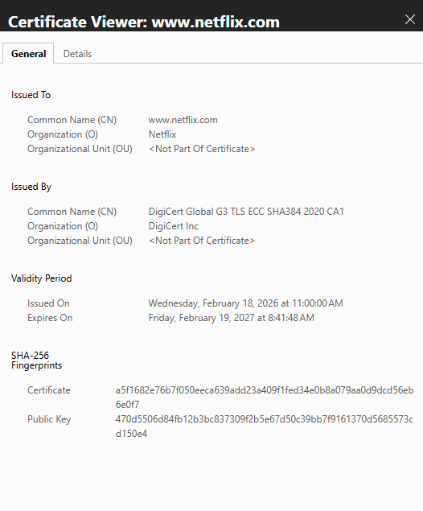
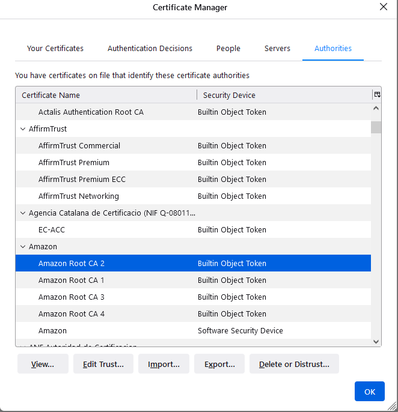

# CSIT953 第 7 周 · 证书与 PKI：把公钥和身份绑在一起

> **学习目标 (Learning objectives)** — 读完本章你应该能够：
> - 说明**公钥替换问题**：为什么签名验证通过，还不能说明这把公钥属于 Alice；说出证书怎样用"第三方签名"解决它；
> - 读懂一张 X.509 证书，说出 SAN、签发者、有效期、Basic Constraints、Key Usage 各起什么作用；分清 DV、OV、EV 各核实了什么，以及 HTTPS 小锁**没有**证明什么；描述申请者、RA、CA 怎样完成一次签发；
> - 画出"根 CA → 中间 CA → 服务器证书"的信任链，解释根 CA 的信任从哪里来、为什么要有中间 CA；列出客户端的每一项检查各挡住了哪种攻击，把常见的证书错误对应到失败的那一项；
> - 解释为什么复制证书没用：TLS 1.3 用 CertificateVerify 证明对方持有私钥；分清证书私钥、临时密钥协商和对称流量密钥的分工，走一遍 TLS 1.3 握手，说出 TLS 1.3 删掉了 TLS 1.2 的什么、为什么；
> - 描述证书的一生：ACME 怎样自动证明域名控制权，过期和撤销有什么不同，CRL、OCSP、OCSP stapling 各有什么取舍，证书透明度能做什么、不能做什么；
> - 比较公共 CA、私有 CA 和自签名证书的信任来源；分析 DNS 被投毒、企业检查代理、管理员改动信任库这几种情形下 HTTPS 还能保护什么；对 S35 那样的情形判断该不该接受，并指出起决定作用的检查；
> - 说明 mTLS、私钥保护、运维故障、交叉签名和越来越短的有效期，为什么让证书从一个密码学问题变成了一个运维问题。

> 📚 **材料说明** — 本笔记依据 Week 7 slides（S1–S39）和两段课程录音。Week 7 录音的前 31k 字符讲完了 Week 6 slides 的 S18–S39（识别协议 5–9 和 GSM），已经写进第 6 周笔记；老师说"现在进入证书和 PKI"之后才是本周内容，一路讲到 S18（TLS 1.2 与 1.3），录音在这里结束。S19–S39 在 **Week 8 录音的开头**接着讲完（前 41k 字符），到老师说"证书就讲到这里"为止，之后是第 8 周的无线安全。S30（经过代理的两段 TLS 连接）课上跳过了，S39 只简单带过，笔记按 slides 补全了这两页的讲解。S1 是封面；S8、S11 是截图页，笔记直接放了截图；S27 是一张配图，重画成了图 12。录音是自动转写，术语错得很多：key 成了 cake、case、K，certificate 成了 significant，Netflix 成了 life flex、BFlex，X.509 成了 X. 59，SAN 成了 Sari，issuer 成了 insurer，ACME 成了 SME，Let's Encrypt 成了 less encrypt，TXT 记录成了 TST record，CRL 成了 CRI，DNS 成了 DS、DRS，expired 成了 expelled，nginx 成了 engines。引用时已按 slides 校正。正文里的 S 编号就是 PDF 页码，和 slide 右下角印的页码一致（只有 S3 误印成了 4）。

第 6 周笔记的最后一句停在一个问题上：**我怎么知道这把公钥真是 Alice 的？** 这个问题在前几周反复出现，每次换一身衣服：

- 第 4 周 §3.3：Moodle 上一条匿名公告说"我是 Yudi，这是我的公钥"，你没法确认；
- 第 5 周 §2.4：第一次 SSH 连接一台服务器，客户端弹框让你核对主机密钥的指纹；
- 第 6 周 §1.4：中间人 Eve 把 DH 的公开值换成自己的，Alice 和 Bob 都察觉不到；
- 第 6 周 §2.9：协议 8、9 假设服务器手里的公钥属于 Alice，老师说这要"用 U 盘拷过去"。

当面交换、U 盘、核对指纹，在两个人之间都行得通，放到互联网上就不行了：你的浏览器每天连接几十上百个网站，事先没有见过其中任何一个。本周的**证书**（certificate）和**公钥基础设施**（Public Key Infrastructure, PKI）就是互联网给出的答案。上周老师已经提醒过它的代价：**只要用证书，就得信任某个第三方**。这一章会反复回到这句话：信任从哪里来，交给了谁，出了问题怎么办。

本章依次回答这些问题：

1. 签名已经能发现篡改了，为什么还不够？（§1）
2. 证书是什么，证明了什么，又是怎样签发的？（§2）
3. 客户端凭什么相信一张证书？它要查哪些项？（§3）
4. 在一次 HTTPS 连接里，证书到底起什么作用？（§4）
5. 证书怎样续期、撤销，签发过程又怎样被公开监督？（§5）
6. 不找公共 CA，还能怎样建立信任？（§6）
7. 攻击者改了 DNS，或者改了你的信任库，HTTPS 还剩下什么？（§7）
8. 证书怎样在云里充当机器身份，又怎样出故障？（§8）
9. PKI 作为一个系统还包括什么，正在往哪里变？（§9）
10. 把以上合起来，一次完整的信任决策是怎样做出的？（§10）

## 1. 问题：这把公钥是谁的？

### 1.1 证书为什么还是"新兴"话题 (S2)

老师开场先解释，为什么一门"新兴话题"的课要讲一项几十年前就有的技术。证书本身不新，依赖它的系统却一直在变。一个云上的应用，往往有一个公开网站、几组 API、一个负载均衡器（load balancer），后面还有一串内部服务。**每一条连接都要有办法确认对面是谁**。S2 的四条就从这里出发：

1. **网站和 API 需要可靠的服务身份**（service identity）：用户要确认自己连的是真的 nab.com.au，调用方要确认自己调的是真的支付 API；
2. **云上的工作负载会产生大量机器身份**（machine identity）：每个容器、每个微服务、每台自动扩容出来的虚拟机，都可能需要自己的证书（§8.1）；
3. **过期、配置错误和私钥被盗，既影响安全，也影响可用性**：私钥被偷，别人就能冒充这个服务；证书过期，应用本身完全正常，服务也会停（§8.3）；
4. **证书的有效期越来越短，自动化越来越必要**（§9.3）。

老师的总结是：证书管理既是一个密码学问题，也是一个**运维问题**。底层的数学大家已经熟悉，可规模、自动化、机器身份和信任策略的变化，不断带来新的挑战。这和第 4 周 §1.2 说云"改变了风险的位置、规模和速度"是同一个思路。记住第 3 条里的两种失败：**被冒充**和**停摆**。这一章的后半部分会反复回到它们。

### 1.2 签名能发现篡改，却说不出公钥是谁的 (S3)

S3 先回顾第 3 周 §1.3 的数字签名。Alice 手里有三样东西：公钥 $pk$、私钥 $sk$ 和要发的消息 $m$。她用私钥签名，得到

$$\sigma = \mathrm{Sign}(sk, m)$$

再把 $(m, \sigma)$ 发给 Bob。Bob 手里只有 Alice 的公钥 $pk$，他运行验证算法 $\mathrm{Verify}(pk, m, \sigma)$，结果是接受或拒绝。

验证**失败**能说明什么？S3 下方第一句说：无效的签名说明**消息被篡改了，或者用错了钥匙**（*An invalid signature reveals tampering or the wrong key*）。要么 $m$ 在路上被改过，要么 $\sigma$ 根本不是用 $pk$ 对应的私钥签的。

验证**通过**又能说明什么？只能说明：**这条消息由持有 $pk$ 对应私钥的那个人签过，签完之后没被改过**。至于"那个人"是谁，签名一个字也没说。S3 的最后一句就是本周的起点：**Bob 还需要知道，这把公钥确实属于 Alice**（*Bob still needs to know that this public key belongs to Alice*）。

打个比方。银行开户时，你要留一份**预留印鉴**，以后支票上的章要和它比对。比对通过，银行只知道"盖章的人用的是和预留印鉴一样的章"。如果开户那天，有人把预留印鉴换成了他自己的章，那以后他盖的每一张支票都会比对通过。签名验证就是比对印鉴：比对本身无懈可击，问题在于**拿来比对的样本是不是真的**。

### 1.3 公钥替换问题 (S4)

S4 把这个漏洞写成了一次攻击，叫**公钥替换问题**（public key substitution problem）：

1. Alice 发布一把公钥，供 Bob 使用；
2. 攻击者把它换成了另一把公钥；
3. Bob 可能把秘密加密给了攻击者，也可能接受攻击者伪造的签名；
4. 一把公钥需要和一个身份之间有**经过认证的关联**（*an authenticated association with an identity*）。

图 1 把第 3 条的两种后果画了出来。

```d2 图 1 · 公钥替换（S4）：攻击者把 Alice 的公钥 pk 换成自己的 pk′。pk′ 看上去完全正常，Bob 用它加密，秘密归了攻击者；Bob 用它验签，伪造的签名照样通过
shape: sequence_diagram
A: "Alice"
E: "攻击者" {class: warn}
B: "Bob"
A -> E: "① 发布公钥 pk（本想交给 Bob）"
E -> B: "② 换成自己的 pk′"
B.n: "pk′ 看上去完全正常\n算法、长度都对，就是不属于 Alice"
c1: "后果一：秘密加密给了攻击者" {
  B -> E: "Enc(pk′, 秘密)，攻击者用 sk′ 解开"
}
c2: "后果二：接受了伪造的签名" {
  E -> B: "m′, Sign(sk′, m′)，自称来自 Alice"
}
B.v: "用 pk′ 验证：通过" {class: warn}
```

老师特别强调了一点：**替换上去的那把公钥看起来完全正常**。它可以用很强的算法、正确的长度、规范的格式，这些检查没有一项能告诉你它属于谁。Bob 用它加密，攻击者就能用自己的私钥 $sk'$ 解密；Bob 用它验证签名，攻击者签的任何东西都能通过。

那再发一条消息，说明"这把公钥是我的"行不行？老师说不行：**另一条没有签名的消息解决不了问题**，攻击者照样能改掉它。让 Alice 给自己的公钥签个名呢？Bob 要用哪把公钥来验证这个签名？还是 Alice 的公钥，而这正是要证明的东西，绕了一圈回到原地。

所以老师说，**我们需要 Bob 能独立验证的证据**（*evidence that Bob can verify independently*）。这种证据只能来自第三方：如果 Bob 事先已经可靠地拿到了 Carol 的公钥，而 Carol 签了一句"这把公钥属于 Alice"，Bob 就能用 Carol 的公钥验证这句话。这句由第三方签名的声明，就是**证书**。老师的说法是，证书提供一份签了名的声明，把一个身份和一把公钥连在一起，而且是按照 Bob 愿意接受的、可信的策略签发的。它把"认识每一个人的公钥"这个做不到的要求，变成了"认识少数几个签发者的公钥"。

第 6 周 §1.4 的中间人攻击，正是公钥替换的一个实例：Eve 把 DH 的公开值 $Y_A$ 换成了 $Y_E$。§3.5 会看到，TLS 怎样用证书加一个签名补上这个缺口。

<details>
<summary>自测 1：Bob 收到一把自称属于 Alice 的公钥。他检查后发现：它是一把标准的 P-256 椭圆曲线公钥，格式完全正确，而且一条自称来自 Alice 的签名消息用它验证通过了。Bob 能断定这是 Alice 的公钥吗？</summary>

不能。这些检查只说明这把公钥"形式正确"，而且和那条签名消息"互相吻合"。攻击者用自己的密钥对签一条消息，同样能通过全部检查。S4 的要点就在这里：替换上去的公钥看起来完全正常，缺的是把公钥和 Alice 这个身份绑在一起的证据。

</details>

<details>
<summary>自测 2：Alice 想让 Bob 相信自己的公钥。方案一：把公钥再发一次，附上她用对应私钥做的签名。方案二：请 Bob 早就认识、手里也有其公钥的 Carol，签一句"这把公钥属于 Alice"。哪个方案有用？为什么？</summary>

方案二有用。方案一是循环论证：验证这个签名要用的，正是待证明的那把公钥，攻击者对自己的公钥也能做同样的事。方案二把信任转给了 Carol：Bob 事先可靠地拿到了 Carol 的公钥，所以能独立验证她的声明。这就是证书和 CA 的思路，代价是 Bob 必须相信 Carol 不会乱签。

</details>

## 2. 证书：一份签了名的"身份–公钥"声明

### 2.1 证书是什么 (S5)

S5 给出定义：**证书把一个身份和一把公钥绑定在一起**（*A certificate binds an identity to a public key*）。老师的说法更具体：证书是一份**关于一把公钥、签了名的声明**。对网站证书来说，"身份"通常是一个或几个域名。除了身份和公钥，这份声明还写明：

- **签发者**（issuer）：谁做的这份声明；
- **有效期**（validity period）：从什么时候到什么时候有效；
- **用途限制**（usage constraints）：这把公钥可以用来做什么。

签发者用**自己的私钥**对这些内容签名（S5 第 3 条）。图 2 画出了这个结构。

```d2 图 2 · 证书 = 签发者签了名的声明（S5）。签名覆盖身份、公钥、有效期等全部内容，改动任何一项都会验证失败；客户端用 CA 的公钥验证，CA 的私钥从不出现在证书里
direction: down
sk: "CA 私钥（只有 CA 有）" {class: warn}
cert: "证书（公开，谁都能下载）" {
  tbs: "被签名的内容\n身份 · 公钥 · 签发者 · 有效期 · 用途"
  sig: "签发者的签名" {class: key}
  tbs -> sig: "哈希后签名"
}
pk: "CA 公钥\n来自上一级证书或信任库"
ok: "客户端：验证通过\n内容一字未改" {class: good}
sk -> cert.sig: "签名"
cert.sig -> ok
pk -> ok: "验证"
```

注意图 2 里的箭头。签名覆盖了证书里所有"被签名的内容"，所以老师说：**有人改了名字、公钥或者其他任何一个被签名的字段，签发者的签名就验证不通过了**。攻击者也没法重新签一个，因为他没有 CA 的私钥。

S5 第 4 条区分了两样常被混为一谈的东西：**证书是公开的，对应的私钥必须保密**。证书里只有公开信息，可以随便分发、随便下载；和证书配对的私钥是另一样东西，必须保护好。后面会反复用到这个区分：证书被人拿到不算事故，它本来就是公开的；私钥泄露才是（§5.3）。

最后，老师补了一句很重要的话：**收到一份签了名的声明，不等于自动接受它**。客户端还要自己判断两件事：信不信任这个签发者；这张证书对**这一次连接**是否有效。前一件是 §3.1–§3.3 信任链的问题，后一件是 §3.4 那张检查清单的问题。

一个贴切的类比是**护照**。签发国是签发者，护照上的姓名是身份，照片把护照和持有人绑在一起（相当于公钥），有效期印在内页，防伪特征保证没人能改（相当于签名）。边检人员要确认签发国是被承认的、护照是真的、没有过期，还要看照片和你本人对不对得上。后面几节会一一对上这些动作。

<details>
<summary>自测：攻击者截获了服务器发来的证书，把 SAN 里的 www.netflix.com 改成 www.evil.com，其余原样转发。客户端会发现吗？</summary>

会。SAN 属于被签名的内容，改了它，签发者的签名就验证不通过。攻击者想重新签名，需要签发者的私钥，他没有。证书敢公开分发，正是因为任何改动都会被签名暴露。

</details>

### 2.2 证书证明了什么，没证明什么：DV、OV、EV (S6)

S6 问的是：一个网站有有效的 HTTPS 证书，我们到底知道了什么？

最常见的是 **DV 证书**（domain-validated，域名验证）。它只说明一件事：**CA 核实过，申请者控制着证书里列出的域名**。老师说，这是有用的信息，但它是一个很有限的声明：它**不**说明这个网站卖的是真货，不说明它会负责任地处理你的个人信息，也不说明它没有恶意内容。这些事没有人能证明，也没有人能保证。

**OV 证书**（organisation-validated，组织验证）和 **EV 证书**（extended-validation，扩展验证）多做了一些组织层面的核实，比如这家公司是否真实存在、在哪里注册。老师说，它们同样**不能**保证网站的每一个行为。

| 类型 | CA 核实了什么 | 证书主体里有什么（拓展） | 没有核实什么 |
|---|---|---|---|
| DV | 申请者控制这些域名 | 只有域名 | 背后是谁、网站做什么 |
| OV | 域名控制权 + 组织真实存在 | 域名 + 组织名称等 | 网站内容是否诚实 |
| EV | 更严格的组织审查 | 域名 + 组织名称、注册信息等 | 网站内容是否诚实 |

S6 的后两条把边界说得很直白：

- **HTTPS 不保证内容诚实、下载安全，也不保证对方是正当生意**；
- **钓鱼网站也能为它自己的域名拿到有效证书**。

课上有同学追问：既然钓鱼网站也能拿到有效证书，那证书还有什么用？老师举了自己的例子。假如他想做一个冒充 UOW 的恶意网站，可以先注册一个和 UOW 很像的域名，一年只要 10 到 15 美元，再为这个域名申请证书。全世界都信任的 CA 不会过问他拿这个域名做什么，是钓鱼也好，散布关于 UOW 的假新闻也好，CA 只检查一件事：**你是不是真的控制这个域名**。能证明，就给你证书。用户的浏览器也会信任这个网站，地址栏照样显示小锁。问题出在域名本身：它**看起来**像 UOW 的，其实不是，上面可以放任何恶意内容。

另一位同学问：买域名的时候，是不是就自动有了 DV 证书？老师说不是。买域名只是拥有了这个名字，证书要另外申请；现在有免费申请的办法，有些域名服务商也会捆绑证书。老师在 §5.2 会介绍他自己用的工具。

所以要记住：**证书认证的是名字，不是意图**。小锁的意思是：你正在和一个持有某把私钥的人加密通信，而某个 CA 确认过，这把私钥属于地址栏里这个域名的控制者。仅此而已。钓鱼攻击于是转而在名字上做文章：把 `uow.edu.au` 放在一个长域名的前半段（比如 `uow.edu.au.login-check.com`），或者把字母 l 换成数字 1。这样的证书完全合法，攻击靠的是用户看不出名字的差别。

> 📎 **拓展(超出 slides)：浏览器也不想让你误读小锁** — 研究发现，很多用户把小锁理解成"这个网站可信"。Chrome 从 117 版（2023 年）起，把地址栏里的小锁换成了一个中性的"调节"图标。更早在 2019 年，Chrome 77 和 Firefox 70 把 EV 证书在地址栏里显示的公司名移进了二级菜单，因为几乎没人注意到 EV 和 DV 的区别。今天大多数钓鱼网站都用 HTTPS。

<details>
<summary>自测：你收到一封邮件，链接是 https://uow.edu.au.login-check.com/sso。浏览器显示连接安全，证书是 Let's Encrypt 签发的 DV 证书。这能说明什么？不能说明什么？</summary>

能说明：你和这个网站之间的连接是加密的；对方持有一把私钥，Let's Encrypt 核实过它属于 `uow.edu.au.login-check.com` 这个名字的控制者，也就是 `login-check.com` 的主人（`uow.edu.au` 只是子域名前缀）。不能说明：它和 UOW 有任何关系，也不能说明它不会偷你的口令。这正是 S6 最后一条说的情形：钓鱼网站为它自己的域名拿到了有效证书。

</details>

### 2.3 证书怎样签发：申请者、RA 和 CA (S7)

S7 描述了一次简化的签发过程，有三个角色：

1. **申请者**（applicant）生成一对密钥，提交一份签了名的证书请求；
2. **注册机构**（registration authority, RA）核实申请的身份，或者核实申请者对域名的控制权；
3. **证书机构**（certificate authority, CA）按自己的策略，给核实通过的申请签发证书。

老师逐步解释了这个过程。申请者先在**自己的机器上**生成密钥对，再准备一份**证书签名请求**（certificate signing request, CSR）。CSR 里有公钥和申请的身份信息（比如域名），并且用对应的私钥签了名。这个签名的作用是**证明持有私钥**（proof of possession）：能用私钥签名的人，手里一定有私钥。

身份还要另外核实，这就是 RA 的工作。RA 可以是一个独立的机构，也可以和 CA 是同一个服务里的两个环节。对公共网站来说，查什么取决于证书类型（DV、OV 还是 EV）和 CA 的策略。核实通过后，CA 用自己的私钥签发证书。图 3 画出了整个过程。

```d2 图 3 · 签发流程（S7）：私钥在申请者本地生成，从头到尾不离开；CSR 只送出公钥和申请的身份，并用私钥签名，证明持有私钥
shape: sequence_diagram
A: "申请者（网站管理员）"
RA: "RA 注册机构"
CA: "CA 证书机构"
A.g: "在本地生成密钥对\n私钥从不离开" {class: key}
A -> RA: "① CSR：公钥 + 申请的身份，用私钥签名"
RA.v: "② 核实身份或域名控制权"
RA -> CA: "③ 核实通过"
CA.s: "④ 按策略签发"
CA -> A: "⑤ 证书（公开，不含私钥）"
```

图 3 里最值得注意的是左上角那个绿色的注释：**私钥从头到尾没有离开申请者**。老师说，CA 通常不需要网站的私钥。CSR 只把公钥送出去，CA 签的也只是"这把公钥属于这个身份"。

> 📎 **拓展(超出 slides)：为什么 CSR 一定要用私钥签名** — 假如不要求证明持有私钥，Mallory 可以把 Alice 的公钥连同自己的名字一起交上去，拿到一张"这把公钥属于 Mallory"的证书。之后 Alice 签名的每一份文件，都能用这张证书验证通过，看起来像是 Mallory 签的。要求 CSR 用对应的私钥签名，就堵住了这条路：Mallory 没有 Alice 的私钥，签不出这份 CSR。

S7 最后一条划了一道边界：**证明持有私钥，不等于证明密钥生成得完美无缺**。老师说，CSR 只能证明申请者**现在**手里有私钥。它证明不了这把私钥是用足够好的随机数生成的，也证明不了它从没被复制过，这些都很难证明。

> 📎 **拓展(超出 slides)：一个真实的反例** — 2006 到 2008 年间，Debian 系 Linux 的 OpenSSL 软件包被误改了一行代码，生成密钥时几乎只剩进程号这一个随机来源，同一种密钥一共只有约三万两千种可能。用这样的密钥做的 CSR，签名完全有效，CA 也看不出任何问题，攻击者却能把所有可能的密钥穷举出来。这和第 3 周 §1.5 的 ECDSA nonce 重复是同一类教训：算法没错，错在随机性。

> 📎 **拓展(超出 slides)：自己生成一份 CSR** — 用 OpenSSL 两条命令就能走一遍申请者的那一步（下面的输出是在本机实际运行的结果）：
>
> ```bash
> # 生成 P-256 椭圆曲线密钥对，同时做一份 www.example.com 的 CSR
> openssl req -new -newkey ec -pkeyopt ec_paramgen_curve:P-256 -noenc \
>     -keyout www.key -out www.csr -subj "/CN=www.example.com"
> # 用 CSR 里的公钥验证 CSR 自己的签名，也就是检查"证明持有私钥"
> openssl req -in www.csr -noout -verify
> Certificate request self-signature verify OK
> ```
>
> `www.key` 是私钥，留在本机；`www.csr` 才是交给 CA 的东西。

<details>
<summary>自测：CA 收到一份 CSR，用 CSR 里的公钥验证了它的签名，结果通过。CA 由此知道了什么？还需要 RA 做什么？</summary>

CA 知道提交 CSR 的人手里有这把公钥对应的私钥（证明持有）。它还不知道这个人有没有资格使用 CSR 里写的身份：任何人都能生成一对密钥，在 CSR 里写上 `www.nab.com.au`。所以 RA 还要核实身份或者域名控制权，DV 证书核实的就是域名控制权（§5.2 会看到具体怎么做）。另外，证明持有也说明不了这把私钥生成得好不好、有没有被复制过（S7 第 4 条）。

</details>

### 2.4 读一张真实的证书 (S8)

S8 是老师在浏览器里打开的 `www.netflix.com` 的证书（图 4）。老师的读法是：**先看被认证的身份，再找签发者和有效期**。



按这个顺序读：

- **Issued To（签发给谁）**：Common Name 是 `www.netflix.com`，Organization 是 Netflix。主体里出现了组织名，说明它不是 DV 证书（DV 证书的主体里只有域名），而是经过了组织核实的 OV 或 EV 证书。Organizational Unit 一栏显示 `<Not Part Of Certificate>`，意思是证书里没有这个字段。
- **Issued By（谁签发的）**：DigiCert Global G3 TLS ECC SHA384 2020 CA1，组织是 DigiCert Inc。这个名字本身透露了不少信息：它是 DigiCert 专门签 TLS 证书的一个**中间 CA**（§3.1），用椭圆曲线（ECC）密钥签名，签名时用 SHA-384 做哈希。
- **Validity Period（有效期）**：2026 年 2 月 18 日签发，2027 年 2 月 19 日到期，一共 366 天。老师在课上念出了这个到期日。§9.3 会看到，它能有这么长的有效期，只因为签发得早：2026 年 3 月 15 日以后签发的公共 TLS 证书，最长只能有 200 天。
- **SHA-256 Fingerprints（指纹）**：整张证书的哈希，和公钥的哈希。指纹不是证书里的字段，是浏览器现算出来的，方便人工比对（§6.3）。Netflix 如果续期时沿用同一把密钥，公钥指纹不变，证书指纹会变。

课上有同学问：中间人能不能直接把 Netflix 的证书拿来，说这是他的？比如我连 Netflix，中间人把 Netflix 的证书交给我，我就以为在和 Netflix 说话。老师说，只有拿到 Netflix 的**私钥**才行。证书可以下载，里面的公钥也可以下载，但只有这些是没用的。为什么没用，§3.5 会讲清楚。

<details>
<summary>自测：按图 4，这张证书在 2026 年 12 月 1 日有效吗？2027 年 3 月 1 日呢？过了到期日，用户访问 Netflix 会看到什么？</summary>

2026 年 12 月 1 日在有效期内。2027 年 3 月 1 日已经过了 2 月 19 日的到期时间，如果 Netflix 还在用这张证书，浏览器会报"证书已过期"（S15 第一行），拒绝连接或给出警告。实际上 Netflix 会在到期前换上新证书（§5.1），用户看到的会是新证书。

</details>

### 2.5 X.509 里要紧的字段 (S9)

S8 的查看器只显示了几个字段。证书的完整结构由 **X.509** 标准规定，HTTPS 和很多其他系统都用它。老师说，我们**不需要背下所有字段**，看例子就行。S9 挑出了做验证时要紧的几个：

| 字段 | 写的是什么 | 客户端拿它做什么 |
|---|---|---|
| **SAN**（Subject Alternative Name，主体备用名称） | 证书覆盖的域名，或其他身份（比如 IP 地址），可以有多个 | 和"我要访问的主机名"比对（§3.4） |
| **Issuer + Serial Number**（签发者和序列号） | 谁签的；签发者给它的编号 | 找上一级证书；撤销时用序列号点名（§5.4） |
| **Validity**（有效期） | not-before、not-after 两个时间 | 当前时间必须落在两者之间 |
| **Public Key**（公钥） | 被认证的公钥和算法 | 验证握手里的签名（§3.5） |
| **Signature**（签名） | 签发者对以上全部内容的签名 | 用签发者的公钥验证 |
| **Basic Constraints**（基本约束） | 这是不是一张 CA 证书 | 只有 CA 证书才能给别的证书签名 |
| **Key Usage / EKU**（密钥用途 / 扩展密钥用途） | 这把密钥允许做什么：签名、签证书、TLS 服务器认证、客户端认证…… | 用途不符就拒绝 |

老师特别点了三个字段。**SAN 最重要**，因为客户端要拿它和自己想访问的名字比对。**Basic Constraints** 区分 CA 证书和普通的终端实体证书（end-entity certificate）。**Key Usage** 说明允许的用途。他的提醒是：**一个签名在数学上可能完全正确，这张证书却不适合应用要它做的事**。

下面是一张证书的完整内容。它是在本机用 OpenSSL 搭的一个三级小 PKI 签出来的（根 CA → 中间 CA → `www.example.com`），不是哪个真实网站的证书，但字段和真实证书一样：

```text
$ openssl x509 -in www.pem -noout -text
Certificate:
    Data:
        Version: 3 (0x2)
        Serial Number:
            62:19:4f:9b:54:04:42:2e:58:f9:24:51:67:64:0b:65:fe:50:b9:86
        Signature Algorithm: ecdsa-with-SHA256
        Issuer: O=Example Trust, CN=Example TLS Issuing CA 1
        Validity
            Not Before: Nov  1 04:12:18 2026 GMT
            Not After : Jan 30 04:12:18 2027 GMT
        Subject: CN=www.example.com
        Subject Public Key Info:
            Public Key Algorithm: id-ecPublicKey
                Public-Key: (256 bit field, 128 bit security level)
                pub:
                    04:8b:4b:7d:24:05:42:22:38:69:ea:7a:f7:9c:a3:d0:
                    ……（省略）
                NIST CURVE: P-256
        X509v3 extensions:
            X509v3 Subject Alternative Name:
                DNS:www.example.com, DNS:example.com
            X509v3 Basic Constraints: critical
                CA:FALSE
            X509v3 Key Usage: critical
                Digital Signature
            X509v3 Extended Key Usage:
                TLS Web Server Authentication
    Signature Algorithm: ecdsa-with-SHA256
    Signature Value:
        30:44:02:20:1f:9d:5b:e1:1f:7d:87:a4:1e:e7:3f:e4:e6:70:95:95:a0:4e:71:02:
        ……（省略）
```

逐项对照 S9：

- `Data` 下面的全部内容，就是图 2 里"被签名的内容"；最后的 `Signature Value` 是中间 CA 对它的签名。
- `Issuer` 和 `Subject` 不同：签发者是中间 CA，主体是网站。
- `Validity` 正好 90 天，和 Let's Encrypt 默认的有效期一样（§5.1）。
- SAN 里有两个名字，所以同一张证书能同时用于 `www.example.com` 和 example.com。
- `CA:FALSE` 说明这是一张终端实体证书，不能拿来给别的证书签名。`critical` 的意思是：客户端如果不认识这个扩展，就必须拒绝整张证书，不能当没看见。
- Key Usage 只允许数字签名，EKU 只允许 TLS 服务器认证。拿它去签代码、签邮件，客户端都应该拒绝。

> 📎 **拓展(超出 slides)：CN 已经不算数了** — 图 4 的查看器把 Common Name（CN）放在最显眼的位置，老一些的资料也说浏览器比对的是 CN。现在的主流浏览器只看 SAN，Chrome 从 58 版（2017 年）起就不再用 CN 匹配主机名。SAN 里还可以写通配符 `*.example.com`，它只匹配**一层**子域名：`www.example.com` 可以，`example.com` 和 `a.b.example.com` 都不行（在上面那个小 PKI 里用 `openssl verify -verify_hostname` 实际验证过）。

> 📎 **拓展(超出 slides)：Basic Constraints 不查会怎样** — 2002 年，Moxie Marlinspike 发现 Internet Explorer 不检查中间证书的 Basic Constraints。于是任何人只要买一张自己域名的普通证书，就能用它的私钥给 `www.bank.com` 签一张证书，IE 照单全收：链上每个签名在数学上都对，可第二级根本不是 CA。这正是 S9 说的"签名正确，证书却不适合这项工作"。

<details>
<summary>自测：一张证书的 Basic Constraints 是 CA:FALSE，EKU 是 TLS Web Server Authentication。有人用它的私钥给 www.bank.com 签了一张证书，签名在数学上完全正确。正确实现的客户端会接受这条链吗？</summary>

不会。验证链时，客户端要求链上每一张"签发者证书"都是 CA 证书。这张证书写明了 CA:FALSE，所以它签出的任何证书都不被接受。2002 年 IE 的漏洞就是漏掉了这一项检查。签名正确只说明"这把私钥签过这些内容"，不说明签名者有资格签。

</details>

## 3. 信任链：客户端凭什么相信一张证书

§2 留下了一个问题：证书上的签名是签发者签的，客户端凭什么相信签发者？答案是一条一直延伸到"信任锚"的链。

### 3.1 根 CA、中间 CA 和服务器证书 (S10)

S10 用一张表描述了一条典型的证书链（certificate chain）：

| 证书 | 角色 | 客户端为什么接受它 |
|---|---|---|
| 根 CA（Root CA） | 信任锚（trust anchor） | 通过可信的流程配置进来 |
| 中间 CA（Intermediate CA） | 给其他证书签名 | 是从一条可信的链上合法委托下来的 |
| 服务器证书（Server certificate） | 标识一个服务 | 链有效，名字、时间、用途都对 |

老师从下往上讲。最底下是**服务器证书**，也就是网站自己的证书；签它的是一个**中间 CA**；中间 CA 的证书又由**根 CA** 签发。图 5 用 S8 那张 Netflix 证书画出了这三层，这正是老师在课上点开证书查看器、一层层追上去的那条链。

```d2 图 5 · 一条典型的证书链（S10），用的是 S8 那张 Netflix 证书的真实链。服务器在握手时发来下面两张，根证书由客户端从自己的信任库里取
direction: down
store: "客户端信任库（预装在系统和浏览器里）" {
  root: "根 CA：DigiCert Global Root G3\n自签名 · 信任锚" {class: key}
}
sent: "服务器在握手时发来" {
  inter: "中间 CA\nDigiCert Global G3 TLS ECC SHA384 2020 CA1"
  leaf: "服务器证书\nwww.netflix.com" {class: good}
}
store.root -> sent.inter: "用根私钥签名"
sent.inter -> sent.leaf: "用中间 CA 私钥签名"
```

客户端拿到服务器证书后，顺着"签发者"一层层往上找：Netflix 的证书是谁签的？DigiCert Global G3 TLS ECC SHA384 2020 CA1。它的证书又是谁签的？DigiCert Global Root G3。**这个根已经在客户端的信任库里**，于是链到头了。老师的原话是：我们的系统已经信任这个根，所以信任这个中间 CA，所以信任 Netflix。有同学顺着问：如果中间 CA 是假的，假装自己由那个根签发呢？老师说，用电脑里那份根证书的公钥一验，就知道它是假的，伪造不了。

图 5 里两个方框的标题，回答了"每张证书从哪里来"：

- **服务器在握手时发来自己的证书，以及需要的中间证书**；
- **根证书不由服务器提供，客户端从自己已有的信任库里取**。老师强调，服务器发一张根证书过来，并不会让客户端信任它（§3.3 会解释为什么）。

形式化地说，设服务器证书为 $C_0$、中间证书为 $C_1$、根证书为 $C_2$。客户端要确认：

1. 用 $C_1$ 里的公钥验证 $C_0$ 的签名，通过；用 $C_2$ 里的公钥验证 $C_1$ 的签名，通过；
2. 每一张证书的签发者名字，都等于上一级证书的主体名字；
3. $C_1$、$C_2$ 都是 CA 证书（Basic Constraints），$C_0$ 的用途是 TLS 服务器认证；
4. 每一张都在有效期内；
5. $C_2$ 在信任库里。

建链的方向是从下往上（"谁签了我？"），信任的方向是从上往下（根 → 中间 → 网站）。签名链**传递**信任，并不**产生**信任：链顶不在信任库里，链再长、签名再正确也没用。

**为什么要有中间 CA**？课上有同学问：既然有根，直接让根给网站签证书不就行了？老师反问：世界上有多少网站？数不过来。有多少根 CA？不多。他的 Windows 11 系统里有 44 个，算上浏览器和其他应用自带的，大概一百多个。如果所有网站都直接挂在根下面，会出两个问题：

1. **根要天天工作**。每天都要签发、撤销、再签发证书，根的私钥就得一直在线，暴露的机会大大增加。
2. **出事的影响太大**。老师说，如果哪天一个根 CA 的私钥被攻破，等于它下面数以亿计的网站一起被攻破：攻击者可以给任何网站签证书。

所以通常不用根直接给服务器签证书，而是让根签出一批中间 CA，由中间 CA 去做日常的签发工作。老师举例，GoDaddy 的一个根下面可能有几百个中间 CA，其中一个被攻破，影响要小得多：撤销这一个中间 CA 就行，根和其他中间 CA 照常工作。S10 的说法是，中间 CA 让一个组织**把日常签发和高度敏感的根分开**。

同学接着问：中间 CA 被攻破的事真的发生过吗？老师说发生过。他还补了一句：**不管是根还是中间 CA，背后都是人在操作，人会犯错**。

> 📎 **拓展(超出 slides)：真实发生过的 CA 入侵** — 最有名的是 2011 年的荷兰 CA **DigiNotar**。攻击者入侵了它的签发系统，签出了数百张假证书，其中包括 `*.google.com`。这些证书在伊朗被用来大规模监听 Gmail 用户；Chrome 内置的"公钥固定"发现了 Google 证书的异常，事情才曝光。各大浏览器随即把 DigiNotar 从信任库里删除，这家公司当年就破产了。正因为根私钥如此要紧，行业规则（CA/Browser Forum 的 Baseline Requirements）禁止根私钥直接给网站签证书；根私钥通常离线保存在硬件安全模块（HSM）里，只在有人见证的"密钥仪式"上拿出来给中间 CA 签名。

S10 的讲解里还有一句提醒：现实中的证书体系可以有**多条路径**和**交叉签名**，三层树只是一个好用的起点模型，不是每个 PKI 都必须长成的样子。§9.1 再回到这一点。

<details>
<summary>自测：服务器在握手时把根证书也一起发了过来。客户端能不能凭这一点信任这个根？</summary>

不能。根的信任只能来自客户端本地的信任库（S10、S12）。服务器发来的根证书只是一份公开文件，任何人都能做一张同名的自签名证书。就算它恰好和信任库里的某个根一模一样，客户端信任的也是信任库里那一份，而不是因为服务器发了它。所以服务器其实没必要发根证书，该发的是自己的证书加中间证书。

</details>

### 3.2 信任库：你的设备默认信任谁 (S11)

图 6 是 S11 的截图：Firefox 的证书管理器里"证书颁发机构"（Authorities）一栏。



这张列表就是 Firefox 的**信任库**（trust store）：客户端预先认定、可以作为信任起点的那些证书。几处细节值得看：

- 列表按机构分组：AffirmTrust、Amazon……Amazon 名下有 Amazon Root CA 1 到 4 四个根。
- 右边一栏的 Builtin Object Token 表示这个证书是 **Firefox 自带的**，随软件一起分发。少数条目显示 Software Security Device（比如截图里单独一行的 Amazon），表示它存在本机的证书数据库里，比如浏览器缓存的中间证书，或者用户自己导入的证书。
- 底部有 Import（导入）和 Delete or Distrust（删除或不再信任）两个按钮。它们就是 S12 和 §7 要讨论的权力：**谁能改这张列表，谁就决定了你信任谁**。

老师还在 Windows 上打开了证书管理器，在"受信任的根证书颁发机构"下面能看到系统级的根，他的 Windows 11 里有 44 个；macOS 在"钥匙串访问"里也能找到。这些证书被**你的设备**信任。老师演示时说，如果把 Netflix 链上的那个根删掉，再访问 Netflix，就会收到警告，因为你的电脑不再信任这条链的起点。

S11 的讲解里还有一句：**这张列表和一个只供下载证书的目录不是一回事**。信任库不是一个存放文档的仓库，而是一份"我相信谁"的名单。§9.2 会把这两者放在一起对照。

> 📎 **拓展(超出 slides)：不止一个信任库** — 操作系统有自己的信任库（Windows、macOS、Android、iOS 各一份）；Firefox 用 Mozilla 维护的那一份；Chrome 从 2022 年起也改用自己的 Chrome Root Store；Java、Python 的 certifi 包等程序还各带一份。所以同一张证书，可能在 Chrome 里正常、在 Firefox 里报错，在你的 Python 脚本里又是另一个结果。S36 说"不同的客户端可能从不同的根出发"，原因就在这里（§9.1）。

<details>
<summary>自测：你在 Firefox 里把 DigiCert Global Root G3 设为不信任，然后访问 www.netflix.com。Firefox 会怎样？同一台电脑上的 Chrome 呢？</summary>

假设 Netflix 送来的还是图 5 那条链。Firefox 从服务器证书一路找到 DigiCert Global Root G3，这个根已经不被信任，链没有可信的起点，于是报"未知签发者"一类的错误（S15 的 unknown root）。Chrome 用的是它自己的根证书库，里面仍然信任这个根，所以照常访问。信任库是每个客户端各自的配置。

</details>

### 3.3 根 CA 为什么可信：信任来自签名之外 (S12)

链总要有个头。老师问：如果每张证书都要由上面一张来担保，这个过程停在哪里？答案是：**停在客户端已经接受的一个信任锚上**，它是通过某个可信的流程进来的，比如随操作系统和浏览器一起安装。

S12 的四条把这件事说透了：

1. **根证书通常是自签名的**（self-signed）：签发者就是它自己，签名用它自己的私钥，验证用它自己证书里的公钥；
2. **自签名本身不产生信任**。老师说，任何人都能做一张自签名证书，所以自签名不可能是我们信任根的理由；
3. **信任锚由软件分发和管理策略确立**：操作系统和浏览器厂商的**根证书计划**（root program），组织的策略，或者其他严格管理的配置流程；
4. **往信任库里添加一个根，会扩大客户端接受的身份范围**。

自签名能证明什么？只能证明两件事：证书的内容签完之后没被改过，做证书的人手里有对应的私钥。它不说明做证书的人是谁。所以根的信任必须来自签名**之外**：厂商审核过这个 CA，把它放进了随软件分发的列表里，而你信任这个厂商发布的软件。信任最终落在"你装的操作系统和浏览器"上，这就是上周那句"要信任某个第三方"的具体含义。

老师说，正因如此，**安装一个根证书是一项有分量的安全决定**。视允许的范围和应用的策略而定，它可能让这个 CA 签发的、关于**许多**身份的证书，从此都被你的客户端接受。

> 📎 **拓展(超出 slides)：根证书计划是怎样运作的** — 想进入 Mozilla、Apple、Microsoft、Google 的根证书库，CA 要通过独立审计，遵守 CA/Browser Forum 制定的 Baseline Requirements，并且持续接受监督。进去了也可能被踢出来：2011 年的 DigiNotar（§3.1）是因为被入侵；2024 年 Chrome 和 Mozilla 宣布不再信任 Entrust 新签发的 TLS 证书，原因是它屡次违规、又迟迟不改。根证书计划就是 S12 说的"管理策略"，它决定了几十亿台设备的信任起点。

**课堂演示：自签名的路由器证书**。老师打开了自己路由器的管理页面。地址是一个内网 IP，用的也是 HTTPS，浏览器却弹出了警告。警告页解释得很清楚：网站一般用 CA 签发的证书证明自己的身份，而这张证书是**自签名的**，不是公认的 CA 签发的，所以默认不受信任。老师说，这张证书是他自己做的，没有找 CA 申请。

有同学问：这是不是意味着中间人可以截获连接？老师说是的：客户端没法验证，中间人攻击就有可能；如果不在乎，可以点"继续"。他的理由是：这是内网，他只是不想让学校的 IT 部门（IMTS）看到他的口令；真要防中间人也容易，**把路由器的证书拷下来，加进浏览器**，警告就消失了。紧接着他提醒：**安装证书是有风险的，尤其是来路不明的证书**。从自己的另一台电脑、自己的服务器拷过来的没问题，因为那是你自己生成的。

**同学的追问：恶意软件往信任库里装根，图什么**？有同学接着问：坏人自己做 CA、再装进受害者的设备，听起来很费事。钓鱼网站明明可以用免费证书，自己当 CA 有什么好处？老师当时说"后面再讲，通常不是为了钓鱼，而是为了别的事"。答案在 §7.2 揭晓，这里先说结论。免费的 DV 证书只能覆盖**攻击者自己控制的域名**，地址栏里显示的是一个长得像、但不一样的名字；而一个装进你信任库的根，可以给**任何名字**签证书，包括 nab.com.au 本身。地址栏里是真名字，小锁也在，一切检查都通过。S12 第 4 条说"添加一个根会扩大客户端接受的身份范围"，最坏的情况下，这个范围就是**全部身份**。

<details>
<summary>自测：某款"安全软件"安装时往系统信任库里加了一个根证书，说是"为了扫描加密流量里的病毒"。从 S12 的角度看，这件事的分量有多重？</summary>

很重。从此，持有这个根私钥的人可以给任何网站签证书，你的设备都会接受，不会有任何警告（S12 第 4 条）。你的 HTTPS 安全从此还取决于这家厂商怎样保护这把私钥：如果每台电脑装的是同一个根，私钥又能从软件里提取出来，任何人都能冒充任何网站来攻击你（§7.5 的 Superfish 就是这样）。这不是一次普通的软件安装，而是一项安全决定。

</details>

### 3.4 客户端要检查什么 (S13)

有了信任库，客户端就可以验证一张证书了。S13 列出了它要回答的四个问题：

1. 能不能**构建并验证一条通往可接受信任锚的路径**？
2. 想访问的**主机名和证书的 SAN 对得上**吗？
3. **时间、签名、CA 约束、允许的用途**都可以接受吗？
4. **撤销状态和其他应用策略**允许这次连接吗？

老师举了两个例子说明这些检查缺一不可。一张为 example.com 签发的证书，可能完全有效、也完全可信，但它**不应该**认证一个通往你银行的连接；一张名字完全正确的有效证书，也可能因为过期或者链不完整而失败。

下表把每一项检查和它挡住的攻击对应起来。读的时候注意：**每一项防的是不同的攻击，没有一项是多余的**。

| 检查 | 问的问题 | 不查会怎样 |
|---|---|---|
| 路径 + 签名 | 能否从这张证书一路验证到信任库里的某个根？ | 攻击者自己签一张 nab.com.au 的证书就能冒充 |
| 主机名（SAN） | 证书里的名字包括我要访问的这个吗？ | 任何人拿自己域名的有效证书，就能冒充任何网站（S35 第一问） |
| 有效期 | 现在是否在 not-before 和 not-after 之间？ | 私钥多年前就已泄露的旧证书还能用 |
| CA 约束（Basic Constraints） | 链上的签发者真的是 CA 吗？ | 普通网站证书也能给别的域名签证书（§2.5 的 IE 漏洞） |
| 用途（Key Usage / EKU） | 这张证书允许用于 TLS 服务器认证吗？ | 为别的用途签发的证书被挪来冒充服务器 |
| 撤销状态和应用策略 | 证书被撤销了吗？满足浏览器的其他要求（比如 §5.5 的 CT）吗？ | 私钥已知泄露的证书继续被接受 |

回到护照的类比：签发国被承认（路径），护照是真的（签名），没过期（有效期），名字和机票上的一致（主机名），它是护照而不是借书证（用途），没有挂失（撤销）。边检少查一项，就会漏掉一种假冒者。

<details>
<summary>自测：下面三种情况，分别是哪一项检查失败？① 证书的 SAN 是 *.example.com，你访问的是 example.com；② 证书本身没问题，可你电脑的时钟被调到了 2030 年；③ 证书的 EKU 只有 Code Signing（代码签名）。</summary>

① 主机名：通配符只匹配一层子域名，`*.example.com` 匹配 `www.example.com`，不匹配 `example.com` 本身。② 有效期：检查用的是**客户端**的当前时间，时钟错了，有效的证书也会被判为过期（或者尚未生效）。这是现实中证书报错的常见原因之一。③ 用途：这张证书没有被授权用于 TLS 服务器认证。

</details>

### 3.5 为什么复制证书没用：证明持有私钥 (S14)

S14 回答了 §2.4 里同学的那个问题。老师先在浏览器里演示：Google 的证书点几下就能下载，**任何人都能下载、复制任何网站的证书**。那攻击者为什么不把银行的证书拷到自己的假网站上，冒充银行？

缺的是**私钥**。S14 的后三条说明了 TLS 1.3 怎样利用这一点：

- 在用证书认证的 TLS 1.3 握手里，**服务器要对握手数据签名**；
- 这条签名放在 **CertificateVerify** 消息里，它证明服务器**持有和证书匹配的私钥**；
- **新鲜的握手上下文**让旧的证明没法被简单地重放。

客户端用证书里的公钥验证 CertificateVerify 的签名。老师总结：**证书告诉我们哪把公钥和这个身份相关联，握手证明对方能用匹配的私钥**。两样缺一不可。只复制证书，签不出这条消息，握手就会失败；老师的原话是，除非拿到私钥，否则复制证书毫无用处。

**签的是什么**？签名的对象是**到目前为止的整段握手记录**，其中包括客户端这一次新选的随机数和临时公钥。老师说，这条签名**绑定在这一次握手上**，它不是一张能反复使用的"登录令牌"。

这就是第 6 周 §2.5 的挑战–应答：由验证方提供新鲜的挑战，被验证方用私钥作答。客户端的随机数和临时公钥就是挑战，CertificateVerify 就是应答，昨天录下的应答对今天的挑战无效。说得更准确些，它就是第 6 周 §2.9 的**协议 9**（用签名做识别）。第 6 周留下的问题是"Bob 怎样确认这把公钥属于 Alice"，证书补上的正是这一块：

| 第 6 周协议 9 | TLS 1.3 |
|---|---|
| Bob 发一个随机挑战 $r$ | 客户端在 ClientHello 里发随机数和临时公钥 |
| Alice 用私钥签 $r$ | 服务器用证书私钥签整段握手记录（CertificateVerify） |
| Bob 用 Alice 的公钥验证 | 客户端用证书里的公钥验证 |
| **前提：Bob 手里的公钥真属于 Alice** | **证书 + 信任链提供这个前提** |

还有更深一层。签名覆盖的握手记录里，也包括**服务器的临时 DH 公钥**。第 6 周 §1.4 的 Eve 能得逞，是因为她换掉 DH 公开值之后没人发现；在 TLS 1.3 里，她换掉服务器的临时公钥，就得为新的握手记录重签一个 CertificateVerify，而她没有服务器的私钥。第 6 周那条拓展说"认证能补上 DH 的缺口"，具体就是这样补的。

> 📎 **拓展(超出 slides)：CertificateVerify 的具体内容** — 按 TLS 1.3 的规范（RFC 8446），服务器签名的是这样一串字节：64 个空格，一句上下文字符串 "TLS 1.3, server CertificateVerify"，一个零字节，最后是到 Certificate 消息为止所有握手消息的哈希。上下文字符串防止这个签名被挪到别的协议、别的场合去用；mTLS 里客户端签的是另一句 "TLS 1.3, client CertificateVerify"（§8.1）。

回到护照的类比：拿着别人护照的复印件过不了边检，因为照片对不上你的脸。

<details>
<summary>自测：攻击者录下了昨天 Alice 的浏览器和 bank.com 之间的完整握手，包括服务器发来的 Certificate 和 CertificateVerify。今天他架了一个假服务器，把这两条消息原样发给 Bob 的浏览器。Bob 的浏览器会接受吗？</summary>

不会。Bob 的 ClientHello 里有新的随机数和新的临时公钥，握手记录和昨天的不一样；昨天的 CertificateVerify 签的是昨天的记录，拿证书公钥去验今天的记录，必然失败。攻击者也没法现签一个，因为他没有 bank.com 的私钥。这就是 S14 第 4 条说的：新鲜的握手上下文让旧的证明没法重放。

</details>

### 3.6 读懂证书错误 (S15)

每一项检查失败，浏览器都会给出一种对应的错误。S15 把五种常见的错误和"客户端没能确认的东西"对应起来，老师说，排查问题的时候这个区分很有用。下表在 S15 的两列之外，补了常见原因和对用户的含义：

| 错误 | 客户端没能确认的东西（S15） | 常见原因 | 对用户意味着什么 |
|---|---|---|---|
| 证书过期 | 当前时间下的有效性 | 管理员忘了续期；或者客户端的时钟错了 | 多半是运维失误，也可能是有人拿出了旧证书 |
| 主机名不符 | 目标服务的身份 | 证书没覆盖这个名字；或者你被引到了别人的服务器 | 可能正是攻击（§7.2） |
| 缺少中间证书 | 一条完整、可接受的认证路径 | 服务器只配了自己的证书，没配中间证书 | 配置错误，不是攻击（§8.3） |
| 未知的根 | 一个被认可的信任起点 | 自签名证书、私有 CA，或者攻击者自己做的 CA | 需要一个独立的信任决定（§6） |
| 证书已撤销 | 在状态策略下仍然可以接受 | 私钥泄露、误签 | 很危险，千万别输入口令（§5.3） |

同一个"不安全"的警告页，背后可能是完全不同的原因：内部测试服务器的证书过期了，和网银页面突然出现"未知签发者"，危险程度差得很远。S31 要求"按原因调查警告"（§7.5），前提就是能读懂这张表。

> 📎 **拓展(超出 slides)：亲手看一遍这些错误** — badssl.com 为每种错误准备了一个测试子域名：`expired.badssl.com`（过期）、`wrong.host.badssl.com`（主机名不符）、`incomplete-chain.badssl.com`（缺中间证书）、`untrusted-root.badssl.com`（未知的根）、`self-signed.badssl.com`（自签名）、`revoked.badssl.com`（已撤销）。老师第 8 周在 Firefox 里打开的，就是这类示例网站。用不同的浏览器打开它们，对比一下错误代码，比如 Chrome 的 `NET::ERR_CERT_DATE_INVALID`、`NET::ERR_CERT_COMMON_NAME_INVALID`、`NET::ERR_CERT_AUTHORITY_INVALID`。用 OpenSSL 也能复现：在 §2.5 那个三级小 PKI 上故意不提供中间证书，`openssl verify` 报的是 `error 20 ... unable to get local issuer certificate`；把主机名换成 `www.your-bank.com`，报的是 `error 62 ... hostname mismatch`。

<details>
<summary>自测：同一个网站，你的浏览器访问正常，公司的 Python 脚本访问它却报错 "unable to get local issuer certificate"。最可能是哪一类问题？该在哪一边修？</summary>

最可能是缺少中间证书：服务器只发了自己的证书。浏览器之所以正常，是因为它以前见过、缓存过这个中间证书，或者会按证书里给的地址自己去下载；Python 不会这么做，于是建不出完整的路径（OpenSSL 的 error 20 说的就是这件事）。该在服务器那边修：部署完整的证书链（fullchain），而不是在脚本里关掉验证（§6.3）。也有可能是 Python 用的信任库里没有这条链的根；用 `openssl s_client -showcerts` 看看服务器实际发了哪几张证书，就能区分这两种情况。

</details>

## 4. 证书在 TLS 里的位置

§3 回答了"客户端凭什么相信一张证书"。这一节把证书放回它最常见的使用场景：一次 HTTPS 连接。你会看到，第 4 周的混合加密、第 6 周的 DH 和本周的证书，在 TLS 里各有分工。

### 4.1 三种密钥，三种用途 (S16)

老师提醒，一次 TLS 连接里有好几种密钥，把它们混为一谈就会糊涂。S16 把它们分成三类，下表在 S16 的两列之外补了寿命和泄露的后果：

| 组成部分 | 作用（S16） | 寿命 | 泄露了会怎样 |
|---|---|---|---|
| 证书和长期签名私钥 | 认证服务的身份 | 和证书一样，几周到一年 | 攻击者能冒充这个服务，直到证书过期或撤销生效；过去的流量仍然安全 |
| 临时密钥协商（ephemeral key agreement） | 建立新鲜的共享秘密 | 一次握手，用完即删 | 只影响这一次连接 |
| 对称流量密钥（symmetric traffic keys） | 高效地保护应用数据 | 一次连接 | 只影响这一次连接 |

老师的讲法是：证书带着一把公钥，用来**认证**服务；在典型的 TLS 1.3 证书握手里，**临时密钥协商**（也就是第 6 周的 (EC)DH）建立共享的秘密材料；协议再从这些材料和握手上下文里**派生出对称密钥**，用来加密应用数据。他特别强调：**证书的长期私钥，并不是加密每个网页的那把钥匙**。

课上一位同学的总结很准确：先拿到一个签了名的东西，再做临时密钥协商，最后用对称密钥加密，第 1、2、3 步全都用上。老师说对。

这三步你其实都学过：

- 第 4 周 §3.4 的**混合加密**：公钥密码学负责建立一把对称密钥，大量数据交给对称加密；
- 第 6 周 §1.3 的 **ECDH**：两个人在公开信道上算出同一个共享秘密；
- 第 5 周 §2.3 的 SSH：主机私钥签名证明身份，Curve25519 协商密钥，AES 加密数据。TLS 的结构和它几乎一模一样，只是"这把主机公钥属于谁"由证书来回答，不再让用户核对指纹。

为什么要把认证和密钥协商分开？老师说，这样能支持**前向保密**（forward secrecy）：**日后有人偷到证书私钥，单凭它解不开以前录下的会话**。原因在上表里：证书私钥只用来**签名**，从不参与加密；每次会话的共享秘密来自临时私钥，用完就删了，录下的流量里没有任何东西能把它还原出来。

<details>
<summary>自测：某网站的证书私钥在 2026 年 10 月被偷了。攻击者手里还有从 5 月起录下的大量 TLS 1.3 流量。他能解开这些流量吗？他现在能做什么？</summary>

解不开。每次会话的流量密钥来自那一次的临时 (EC)DH，临时私钥早已删除；证书私钥只签过 CertificateVerify，没有参与加密，这就是前向保密。但他现在能冒充这个网站：用偷来的私钥签 CertificateVerify，再配合中间人的位置欺骗用户，直到证书过期，或者撤销信息传到用户那里。所以网站要尽快撤销证书、换新私钥（§5.3）。

</details>

### 4.2 TLS 1.3 握手逐步看 (S17)

S17 把一次使用服务器证书的 TLS 1.3 完整握手分成五步：

| 步骤 | 消息和作用（S17） |
|---|---|
| 1. 客户端 → 服务器 | ClientHello：提出可选的参数，附上一个密钥份额（key share） |
| 2. 服务器 → 客户端 | ServerHello：选定参数，提供自己的密钥份额 |
| 3. 服务器认证 | EncryptedExtensions、Certificate、CertificateVerify、Finished |
| 4. 客户端确认 | 客户端验证服务器，发送 Finished |
| 5. 应用流量 | 双方用派生出的对称流量密钥加密 |

图 7 把这五步画成了时序图。

```d2 图 7 · TLS 1.3 的完整握手（S17）。ServerHello 之后双方就有了握手密钥，证书在加密通道里发送；绿色的第 ④ 步是客户端做 §3.4 的全部检查，并用证书里的公钥验证 CertificateVerify
shape: sequence_diagram
C: "客户端（浏览器）"
S: "服务器"
C -> S: "① ClientHello：可选参数 + 临时公钥"
S -> C: "② ServerHello：选定参数 + 临时公钥"
C.k: "双方各自算出 (EC)DHE 共享秘密\n派生出握手密钥" {class: aside}
hs: "以下用握手密钥加密" {
  S -> C: "③ EncryptedExtensions"
  S -> C: "Certificate：证书链"
  S -> C: "CertificateVerify：用证书私钥签握手记录"
  S -> C: "Finished：整段握手的 MAC"
}
C.v: "④ 验证证书链、主机名、有效期\n用证书里的公钥验 CertificateVerify" {class: key}
C -> S: "Finished"
app: "⑤ 应用数据：用流量密钥加密" {
  C -> S: "HTTP 请求"
  S -> C: "HTTP 响应"
}
```

逐条看：

1. **ClientHello**：客户端列出自己支持的参数（TLS 版本、加密套件、椭圆曲线、签名算法），并且**直接附上一个临时公钥**，也就是 S17 说的 key share。它还带着一个新选的随机数。
2. **ServerHello**：服务器从中选定一组参数，送回**自己的临时公钥**。到这里，双方都有了对方的临时公钥，各自算出同一个 (EC)DH 共享秘密，再从中派生出**握手密钥**。老师说，这时两边就能推出握手密钥了。
3. 从这里开始，服务器发的每条消息都**用握手密钥加密**：
   - **EncryptedExtensions**：其余协商好的参数；
   - **Certificate**：服务器证书和中间证书（§3.1）；
   - **CertificateVerify**：用证书私钥对整段握手记录的签名（§3.5）；
   - **Finished**：用握手密钥对整段握手记录算的 MAC，老师说它用来**检查这次握手**。
4. **客户端确认**：客户端验证证书（§3.4 的全部检查）和两个密码学证明（CertificateVerify 的签名、Finished 的 MAC），通过之后才接受服务器，然后发出自己的 Finished。
5. **应用流量**：双方从握手的秘密里派生出**流量密钥**，HTTP 请求和响应都用它加密。

Finished 有什么用？它是一个 MAC，覆盖了从 ClientHello 起的每一条握手消息。中间人只要改动过其中任何一条，比如偷偷删掉客户端提出的强算法、逼双方用弱算法（降级攻击），两边算出的握手记录就不一样，Finished 的验证就会失败。CertificateVerify 回答"对面是谁"，Finished 回答"我们看到的是不是同一段对话"。

S17 的讲解还提到两点：服务器可以**要求客户端也出示证书**，做双向认证（§8.1 的 mTLS）；**恢复会话**（session resumption）走的是另一条更短的路径，不在这张图里。

> 📎 **拓展(超出 slides)：TLS 1.3 快在哪里，又多藏了什么** — 客户端在第一条消息里就"猜"好了要用的曲线，把临时公钥一起发出去，所以 TLS 1.3 只要一个来回（1-RTT）就能开始传数据，TLS 1.2 要两个。另外，TLS 1.2 的证书是**明文**发送的，路上的人能看到你拿到的是哪个网站的证书；TLS 1.3 从 ServerHello 之后就开始加密，证书也藏起来了。不过 ClientHello 里的 **SNI**（Server Name Indication）仍然以明文写着你要访问的域名，因为一个 IP 上往往托管着许多网站，服务器要靠它决定发哪张证书。

<details>
<summary>自测：如果客户端只检查了 Certificate 消息（证书链、主机名、有效期都对），却忘了验证 CertificateVerify，会出什么问题？</summary>

攻击者可以把真网站的证书原样发过来（证书是公开的，§3.5），然后用他自己的临时公钥完成密钥协商。客户端看到的证书一切正常，实际上却在和攻击者建立加密通道，这就是第 6 周 §1.4 的中间人攻击。CertificateVerify 证明的正是"对面持有证书私钥，而且这次握手（包括双方的临时公钥）就是它做的"。少了它，证书什么也证明不了。

</details>

### 4.3 TLS 1.2 与 TLS 1.3 (S18)

S18 提醒我们别把两个版本混在一起。老师说，TLS 1.2 的知识在和老系统打交道时有用，但不要把它和 TLS 1.3 的流程混为一谈。四条要点：

1. **TLS 1.2 的握手不同，还保留着一些老旧的密钥交换方式**；
2. **TLS 1.3 删掉了静态 RSA 密钥传输和静态 DH 套件**；
3. **RSA 签名仍然可以用来认证 TLS 1.3 连接**；
4. **ServerKeyExchange 和旧的 ChangeCipherSpec 的作用，都不属于 TLS 1.3**。

**静态 RSA 密钥传输**是什么？第 4 周 §3.4 老师描述过它："用 RSA 公钥加密 AES 密钥"。在 TLS 1.2 里，客户端随机生成一个**预主密钥**（pre-master secret），用服务器证书里的 RSA 公钥加密后发过去；服务器用证书私钥解密，双方再由它派生出会话密钥。服务器能解开，就证明了它持有私钥，所以这种方式不需要另外的签名。

问题就出在"证书私钥参与了加密"。攻击者今天把加密流量录下来，哪怕十年后才偷到私钥，也能解开当年的预主密钥，进而解开全部流量。**静态 DH** 套件也一样：服务器的 DH 私钥是固定的，写在证书里，长期不变。两者都**没有前向保密**。TLS 1.3 只保留临时的 (EC)DHE，每次握手都换一对新的临时密钥，前向保密成了强制要求。

**删掉的是 RSA 加密，不是 RSA**。这是最容易混的一点。S18 第 3 条说得很明白：RSA **签名**仍然可以认证 TLS 1.3 连接。服务器证书完全可以是一张 RSA 证书，它的私钥用来签 CertificateVerify（RSA-PSS 签名），只是不再用来解密任何东西。老师的原话是：这不代表 RSA 彻底消失了。

第 4 条说的是两条 TLS 1.2 的消息。**ServerKeyExchange** 是 TLS 1.2 里服务器发送 (EC)DHE 参数的消息，参数附有服务器的签名；TLS 1.3 把临时公钥挪进了 ServerHello，签名改由 CertificateVerify 对整段握手负责。**ChangeCipherSpec** 在 TLS 1.2 里表示"从下一条消息开始加密"；TLS 1.3 什么时候开始加密由握手流程本身决定，这条消息不再有任何协议作用。

> 📎 **拓展(超出 slides)：为什么 TLS 1.3 的抓包里还能看到 ChangeCipherSpec** — 早期部署时发现，网络上不少老旧的中间设备（防火墙、负载均衡器）看不懂 TLS 1.3 的握手，会把连接掐断。于是 RFC 8446 规定了一种"中间设备兼容模式"：双方各发一条假的 ChangeCipherSpec，让握手看起来更像 TLS 1.2，接收方直接忽略它。这正是 S18 措辞的用意：消息也许还在，但"旧的 ChangeCipherSpec 的作用"已经不在了。

| | TLS 1.2 | TLS 1.3 |
|---|---|---|
| 密钥交换 | RSA 密钥传输、静态 DH、临时 (EC)DHE 都可以 | 只有临时 (EC)DHE（会话恢复另有预共享密钥模式） |
| 前向保密 | 用 RSA 密钥传输或静态 DH 时没有 | 一定有 |
| 服务器怎样证明持有私钥 | RSA 传输：能解开预主密钥；ECDHE：在 ServerKeyExchange 里签名 | CertificateVerify 签整段握手记录 |
| RSA 证书还能用吗 | 能，既用来加密也用来签名 | 能，只用来签名 |
| 证书是否加密传输（拓展） | 否 | 是 |
| 握手往返（拓展） | 2 个来回 | 1 个来回 |

<details>
<summary>自测：一个网站 2019 年用的是 TLS 1.2 + RSA 密钥传输。2026 年，它当年的私钥在一块报废硬盘里被找到了。有人一直保存着 2019 年录下的流量，现在能解开吗？如果当年用的已经是 TLS 1.3 呢？</summary>

能。用 RSA 密钥传输时，预主密钥是用证书公钥加密后发出的，录下的流量里就有这段密文；用找到的私钥解开它，就能派生出当年的会话密钥，读出全部内容。如果当年用的是 TLS 1.3，会话密钥来自临时 (EC)DHE，临时私钥早已删除，找到的证书私钥只签过名，解不开任何东西。

</details>

## 5. 证书的一生：签发、续期、撤销、透明

§2 到 §4 讲的是一张证书在某一时刻怎样被验证。可证书不是静止的：它会过期，需要续期；也可能出事，需要撤销。S19–S23 讲证书的一生，以及客户端怎样及时得知它的变化。

### 5.1 证书的生命周期 (S19)

第 8 周开课时，老师接着上周的内容说：**证书是一个生命周期的一部分**。S19 把这个周期分成四段：

1. **生成**一把受保护的私钥，**申请**证书；
2. **核实**身份，**签发**证书，**部署**证书链；
3. **监控**使用情况和到期时间，在截止日期之前**续期**并重新部署；
4. 失去信任时**撤销**并替换，最后**退役**旧的材料。

图 8 把它画成了一个循环：正常情况走左边的"续期"回路，出了事走右边的"撤销"回路。

```d2 图 8 · 证书的生命周期（S19）：正常情况走"续期"回路，失去信任时走"撤销"回路；两条路最后都要下线旧证书和旧私钥
direction: down
gen: "生成并保护私钥"
req: "提交 CSR"
val: "CA 核实身份并签发"
dep: "部署证书和中间链"
mon: "监控使用和到期" {class: key}
renew: "到期前续期" {class: good}
rev: "失去信任：撤销" {class: warn}
ret: "下线旧证书和旧私钥" {shape: text}
gen -> req -> val -> dep -> mon
mon -> renew: "快到期"
renew -> req: "重新申请"
mon -> rev: "私钥泄露 · 误签 · 授权失效"
rev -> gen: "换新私钥"
rev -> ret
renew -> ret
```

老师说，现在网站证书一般 **3 个月**有效，以前可以是一年甚至两年。这里要分清两个数字：3 个月（90 天）是 Let's Encrypt 这类免费 ACME CA 自己的做法；S38 说的 200 天，是 2026 年 3 月 15 日起整个行业的上限（§9.3）。老师课上说，他记不清这是 2025 年还是 2026 年的规定；其实 90 天是 Let's Encrypt 从 2015 年创立起就一直采用的做法。

这个循环和第 4 周 §4.4 的"密钥的一生"、第 5 周 §4.3 的 SSH 凭据生命周期是同一个模式，经验也相同：**事故多半发生在环节交接的地方**。签发成功了却没部署（§8.3），撤销了却没换私钥（§5.3），旧私钥在某个备份里多活了几年。图 8 底部那个容易被忽略的"下线"环节，处理的就是最后一种情况。

### 5.2 ACME：自动申请和续期 (S20)

有效期一短，每年就要换好几次证书，手工操作迟早出错。S20 介绍了自动化的标准做法：

1. **ACME 把证书申请和核实的流程自动化**；
2. **域名挑战**（domain challenge）**按 CA 的规则证明域名控制权**；
3. **自动化还必须负责部署证书、重载服务**；
4. **保护好完成挑战用的凭据，监控整条续期路径**。

ACME（Automatic Certificate Management Environment）是一个**协议**，Let's Encrypt 等服务都用它。S20 附的链接 acme.sh 是实现这个协议的一个**工具**，本身就是一个 shell 脚本。课上有同学没分清这两者，老师的回答是：acme.sh 就是一个现成的、安全的脚本，帮你签发和续期证书。不用它也能手工申请证书，只是步骤繁琐；ACME 让这件事变得简单。他还补充说，acme.sh 是开源的，代码可以一行一行地查，不用担心。

**CA 怎样确认你控制了这个域名**？老师用学校的域名举了个例子。假设你拥有 uow.edu.au，网站跑在你的服务器上。你的服务器向 CA 说："请给我一张 `www.uow.edu.au` 的证书。"CA 回答："可以，但我要先确认你是谁。你说你是 `www.uow.edu.au`，那我就去和这个域名通信。"CA 给你一段随机的内容（老师说，比如 "ABCD"），让你放到网站上；CA 再按域名去访问你的网站，把这段内容取回来。你真的控制这个域名、这台服务器，才能把它放上去；取到了，CA 就承认你拥有这个域名，签发证书。图 9 画出了这个过程。

```d2 图 9 · ACME 的 HTTP 挑战（S20）：CA 按 DNS 解析去取 token，取到了就说明你控制着这个域名此刻指向的服务器；拿到证书后还要部署并重载服务
shape: sequence_diagram
A: "你的服务器（ACME 客户端）"
CA: "CA，比如 Let's Encrypt"
A -> CA: "① 我要 www.example.com 的证书"
CA -> A: "② 挑战：把这个 token 放到你的网站上"
A.p: "放好文件\n/.well-known/acme-challenge/token"
CA -> A: "③ 按 DNS 解析，去这个网址取 token"
A -> CA: "取到了：证明你控制这个域名"
A -> CA: "④ 提交 CSR"
CA -> A: "⑤ 签发证书"
A.d: "⑥ 部署证书，重载 Web 服务" {class: key}
```

老师说的第二种办法是 **DNS 记录**。如果你控制这个域名的 DNS，就可以按 CA 的要求添加一条 TXT 记录。只有你有权限修改这个域名的 DNS，能加上这条记录，就证明了控制权。

两种挑战证明的东西略有不同：

- **HTTP 挑战**证明你控制着"这个域名**此刻指向**的那台服务器"；
- **DNS 挑战**证明你控制着"这个域名的 **DNS 记录**本身"。

这正是 DV 证书的含义（§2.2）：CA 核实的就是这一点，别的都不核实。

> 📎 **拓展(超出 slides)：两种挑战的具体做法** — HTTP-01 挑战要求把文件放在 `http://<域名>/.well-known/acme-challenge/<token>`，CA 通过 80 端口访问它；文件内容是 token 加上你 ACME 账户公钥的指纹，所以别人就算看到了 token，也冒充不了你的账户。DNS-01 挑战要求在 `_acme-challenge.<域名>` 下添加一条 TXT 记录。通配符证书（`*.example.com`）只能用 DNS-01 申请，因为"控制所有子域名"没法靠某一台服务器上的某个文件来证明。

S20 的后两条说的是：**拿到证书不等于结束**。

- **部署和重载**。新证书写到了磁盘上，正在运行的 Web 服务器（比如 nginx）手里还是旧证书，要重载（reload）一次才会换上新的。第 8 周课上有同学问：ACME 续期之后，开发者还得手动重启网站吗？老师说，可以在脚本里多加一步，让 acme.sh 续期后自动重启 Web 服务。§8.3 会看到，漏掉这一步是真实世界里证书故障最常见的原因之一。
- **保护挑战凭据**。用 DNS 挑战做自动化，服务器上就得存着一份能修改 DNS 的 API 凭据。它一旦被偷，攻击者不仅能给你的域名申请证书，还能把整个域名指向别处。第 4 周 §2.7 说过，API 凭据就是远程权力；这份凭据的权限应该小到"只能改 `_acme-challenge` 那一条记录"。
- **监控整条续期路径**。定时任务悄悄失败了，几周后证书就会过期，没人提醒你。要监控的不只是"续期有没有成功"，还有"线上实际用的是哪张证书"（§8.3）。

> 📎 **拓展(超出 slides)：用 acme.sh 走一遍** — 下面是一个最小的例子（参数以 acme.sh 的文档为准）。注意 `--install-cert` 那一步：它把证书装到 Web 服务器读取的位置，并登记了续期之后要执行的重载命令。`fullchain` 是"自己的证书 + 中间证书"，正好避免 §3.6 的缺中间证书错误。acme.sh 从 3.0 版起默认使用 ZeroSSL 签发，想用 Let's Encrypt 要加 `--server letsencrypt`。
>
> ```bash
> acme.sh --issue -d www.example.com -w /var/www/html --server letsencrypt
> acme.sh --install-cert -d www.example.com \
>     --key-file       /etc/nginx/ssl/www.key \
>     --fullchain-file /etc/nginx/ssl/www.fullchain.pem \
>     --reloadcmd      "systemctl reload nginx"
> ```
>
> 安装 acme.sh 时，它会自动添加一个每天运行的定时任务：快到期的证书自动续期，续期后执行登记好的重载命令。

<details>
<summary>自测：你在新服务器上运行 acme.sh，用 HTTP 挑战给 www.example.com 申请证书，可 DNS 里 www.example.com 还指向旧服务器。会发生什么？有什么办法？</summary>

挑战会失败。CA 按 DNS 解析去访问 `www.example.com`，到的是旧服务器，那里没有 token 文件。HTTP 挑战证明的是"你控制这个域名此刻指向的服务器"，新服务器还不满足这个条件。办法：先把 DNS 切到新服务器再申请；或者改用 DNS 挑战，它只看你能不能修改 DNS 记录，和域名指向哪台服务器无关。

</details>

### 5.3 过期、撤销与私钥泄露 (S21)

证书有两种结束方式。S21 区分了它们：

- **过期**（expiry）：证书预定的有效期到了，正常结束；
- **撤销**（revocation）：在正常过期之前，提前收回证书。

老师说，过期是"计划好的结束"，比如 3 个月到了；撤销是"提前收回的决定"。触发撤销的原因（S21 第 3 条）有：**私钥泄露**；**误签**，即 CA 不该签发这张证书；**授权丧失**，比如域名卖给了别人，原主人不再有权使用这个身份。

老师在这里纠正了一个常见的误解：**公钥被人看到不算泄露**。公钥本来就是要公开的，谁都可以看。真正严重的是**失去了对私钥的控制**，或者身份绑定本身出了问题。

撤销也有它做不到的事。老师说，**撤销证书并不会抹掉攻击者手里那份私钥的副本**，我们没办法删掉它。所以私钥泄露之后（S21 第 4 条），要做的是一整套事情：

1. **换新私钥**，用新私钥申请新证书；
2. 撤销**所有受影响的证书**：同一把私钥可能被好几张证书、好几台服务器共用；
3. 更新所有用到它的服务；
4. **调查泄露是怎样发生的**，不然新私钥也会走同样的路。

客户端则需要一个可靠的途径，得知"这张证书的状态变了"，这是 §5.4 的话题。

老师在第 8 周课上打开了自己一台 Web 服务器上 acme.sh 的工作目录，里面有四样东西：证书、配置文件、CSR 和私钥。他说，这把私钥是他自己生成的，**如果它泄露了，这些东西就都没用了，必须撤销。所以别弄丢你的私钥**。

| | 过期 | 撤销 |
|---|---|---|
| 什么时候发生 | 证书里写好的 not-after 时刻 | 任何时候，提前 |
| 谁决定 | 签发时就定了 | CA，应持有者的请求或自己发现问题 |
| 客户端怎么知道 | 看证书自己的字段，离线也能判断 | 必须从外部获得状态信息（§5.4） |
| 对攻击者手里的私钥 | 不删除私钥，但证书作废后，公共信任体系不再接受它 | 同左 |

第三行是整节最要紧的区别：**过期是证书自带的信息，每个客户端都能可靠地执行；撤销要靠外部信息及时传到每个客户端，这一点很难保证**。§5.4 会看到为什么难，§9.3 会看到行业的对策：既然撤销不可靠，就把有效期缩短，让"过期"替撤销做一部分工作。

> 📎 **拓展(超出 slides)：撤销收不回已经发生的事** — 第 4 周 §6.6 说过，撤销一个人的访问权限，收不回他已经下载的明文。证书也一样：撤销能阻止今后有人接受这张证书，却改变不了攻击者在撤销生效之前已经做过的事，比如已经冒充过的网站、已经骗到的口令。所以发现泄露之后，除了撤销，还要排查那段时间里发生了什么。

<details>
<summary>自测：管理员发现服务器私钥泄露了。他请 CA 撤销了旧证书，然后用同一把私钥重新申请了一张新证书，部署上线。哪里做错了？</summary>

新证书绑定的还是那把已经泄露的私钥，攻击者用手里的副本配上这张新证书，照样能冒充服务器。撤销抹不掉攻击者的副本（S21），所以必须先生成一把新私钥，再为新私钥申请证书。还要查清泄露的途径，并检查有没有别的证书、别的服务器也在用这把私钥。

</details>

### 5.4 客户端怎样得知证书被撤销：CRL、OCSP 与 stapling (S22)

撤销的难点在于通知。CA 宣布"这张证书作废了"，全世界几十亿个客户端怎么知道？S22 列了四种机制：

| 机制 | 基本思路（S22） | 实际要考虑的问题（S22） |
|---|---|---|
| CRL（Certificate Revocation List，证书撤销列表） | CA 发布一份签了名的撤销清单 | 新鲜度、覆盖范围和分发方式 |
| OCSP（Online Certificate Status Protocol，在线证书状态协议） | 由应答器（responder）报告某张证书的状态 | 隐私、可用性和新鲜度 |
| OCSP stapling（OCSP 装订） | 服务器把一份签了名的状态应答发给客户端 | 客户端要检查应答的有效性和新鲜度 |
| 客户端策略 | 浏览器或应用使用自己的机制 | 不同实现的行为各不相同 |

**CRL**。老师说，CRL 是一份签了名的清单，列出某个范围内被撤销的证书（按序列号列出）。客户端需要一份**合适的、足够新的**清单。清单带签名，所以放在哪里下载都行，被改过就会验不过。它的问题列在 S22 第三列：**新鲜度**，昨天发布的清单不知道今天撤销的证书；**范围**，这张证书该查哪一份清单；**分发**，清单可能很大，给谁下载、多久下载一次。

**OCSP**。不下载整份清单，只问一张证书："序列号为某某的证书现在还好吗？"应答器回答"有效""已撤销"或"未知"，并对回答签名。老师特别指出，在**直接 OCSP 查询**里，客户端要自己去联系应答器，这会带来**可用性**和**隐私**问题：应答器挂了怎么办？应答器（也就是 CA）由此知道了你在什么时候、从哪个 IP 访问了哪个网站。

**OCSP stapling**。让**服务器**定期去取自己证书的 OCSP 应答，在握手时"装订"在证书后面一起发给客户端。老师说，这样客户端就**不需要那一次直接查询**了。应答是 CA 签的，服务器改不了；但客户端仍然要检查它**有效**（签名对）而且**新鲜**（没过期，应答里写着有效时间）。图 10 对比了两种方式。

```d2 图 10 · 直接 OCSP 查询 vs OCSP stapling（S22）：直接查询时，浏览器自己去问 CA，CA 由此知道你在访问哪个网站；stapling 由网站定期取回签名应答，握手时一起发来
shape: sequence_diagram
C: "浏览器"
S: "网站"
R: "CA 的 OCSP 应答器"
g1: "直接 OCSP 查询" {
  C -> S: "① TLS 握手，拿到证书"
  C -> R: "② 这张证书还有效吗？"
  R -> C: "③ 签名的状态应答"
}
R.p: "应答器由此知道\n你在访问哪个网站" {class: warn}
g2: "OCSP stapling" {
  S -> R: "① 定期取回自己证书的应答"
  R -> S: "签名的状态应答"
  S -> C: "② 握手时一起发来"
}
C.s: "检查应答的签名和新鲜度\n不用自己去问 CA" {class: good}
```

**客户端策略**。最后一行最容易被忽略。老师说，浏览器和应用处理撤销的方式**并不统一**，有的还用厂商自己推送的机制。所以，**不要以为每个浏览器每次访问都会下载完整的 CRL，或者实时查一次 OCSP**。

**和课上问答的出入**。第 8 周课上，有同学问"我的浏览器是不是每次访问网站都执行 OCSP"，老师回答"是"；另一位同学问 CRL 多久更新一次，老师说"我想是实时的，我现在撤销，你下一分钟访问就会看到警告"。这两个回答都比实际情况乐观，和 S22 自己的提醒（上一段）也对不上，以 slides 的说法为准。实际情况见下面的拓展。

老师在课上强调的另一点完全正确：如果浏览器提示**证书已被撤销**，这是很严重的信号。它说明网站发现自己的私钥出了问题，你此刻连接的可能根本不是真网站，**千万不要输入用户名和口令**。

> 📎 **拓展(超出 slides)：现实中的撤销检查** — 直接 OCSP 查询有个根本缺陷：查不到怎么办？"查不到就拒绝"（hard-fail）的话，OCSP 服务器一出故障，大量网站就跟着打不开，所以浏览器几乎都选择"查不到就放行"（soft-fail）。可是，能做中间人的攻击者，同样能拦下那次 OCSP 查询，soft-fail 于是放行了一张已撤销的证书。正因为直接 OCSP 又慢、又泄露隐私、又挡不住主动攻击者，Chrome 很早就不做实时 OCSP 查询，改用自己推送的精选撤销列表（CRLSet）；Firefox 从 137 版（2025 年）起改用 CRLite，把所有公开证书的撤销信息压缩后定期推送到浏览器，在本地查。Let's Encrypt 主要出于隐私考虑，在 2025 年 5 月不再往证书里写 OCSP 地址，8 月关掉了 OCSP 服务，只提供 CRL。至于新鲜度：CRL 和 OCSP 应答本身都有有效期，浏览器推送的列表也是定期更新，从 CA 撤销到所有客户端都知道，通常要几小时到几天。S11 原始截图左侧的 Firefox 设置页上，就有一个"查询 OCSP 响应服务器以确认证书当前有效性"的选项（图 6 只保留了证书管理器窗口）。

<details>
<summary>自测：为什么说"直接 OCSP + 查不到就放行"挡不住一个能做中间人的攻击者？OCSP stapling 改善了哪两个问题？</summary>

攻击者既然能截获你和网站之间的流量，也就能截获你发往 OCSP 应答器的查询。他把查询丢掉，浏览器查不到状态，按"查不到就放行"的策略接受了这张已撤销的证书。stapling 改善的是隐私和可用性：客户端不用自己联系 CA，CA 也就不知道你访问了哪个网站；应答器短暂故障也不影响用户，因为服务器手里有一份还没过期的应答。但如果客户端不强制要求 stapling，攻击者只要不发 staple，问题又回到了原点。

</details>

### 5.5 证书透明度 (S23)

撤销对付的是"已知有问题的证书"。如果一张证书根本不该存在呢？比如 CA 被入侵或者核实出了错，给 `www.nab.com.au` 签了一张 NAB 并不知情的证书，谁来发现它？S23 的**证书透明度**（Certificate Transparency, CT）回答的就是这个问题：

1. **公开的日志让证书签发变得可见、可审计**；
2. **域名所有者可以监控日志，发现意料之外的证书**；
3. **日志有助于发现问题，但它不会撤销证书**；
4. **公共网络的 CT 策略，和对本地企业根的信任是两回事**。

老师解释说，CT 让公共证书的签发更容易被看见：不再只靠 CA 内部的记录，公开的日志提供了"这些证书已经签发"的证据。域名所有者可以盯着这些日志，一旦看到一张自己没申请过、关于自己域名的证书，就能去调查。这样，**误签和滥用**就有机会被发现。图 11 画出了各方的关系。

```d2 图 11 · 证书透明度（S23）：CA 把证书提交到公开日志，拿到回执 SCT 嵌进证书；浏览器检查有没有 SCT，域名所有者盯着日志找"不是我申请的"证书
direction: right
ca: "CA"
log: "公开 CT 日志\n只能追加" {class: key}
cert: "证书\n内嵌 SCT 回执"
br: "浏览器\n检查有没有 SCT"
mon: "域名所有者\n监控日志" {class: good}
ca -> log: "① 提交"
log -> ca: "② 回执 SCT"
ca -> cert: "③ 签发"
cert -> br
log -> mon: "④ 持续查看"
```

S23 的第 3、4 条划出了 CT 的边界：

- **CT 只负责"看得见"，不负责"作废"**。老师说，日志不判断一张证书是否有效，也不会自动撤销它；发现问题之后，还要走 §5.3 和 §5.4 的撤销流程。CT 和验证、撤销、名字策略是**配合**工作的。
- **CT 有适用范围**。公共网络上浏览器对 CT 的要求，不一定适用于链到**本地安装的企业根**的证书。§7 的企业检查代理签发的证书不进公共日志，CT 也就不会提醒你流量正在被公司检查。

课上有同学问：这些公开日志存在哪里？凭什么相信它们？老师说，它们就像公开的档案，存在专门的服务器上。至于"凭什么相信"，答案不是"相信日志服务器"，而在于日志的数据结构，见下面的拓展。

> 📎 **拓展(超出 slides)：CT 日志为什么值得相信** — CT 日志是一棵**只能追加的 Merkle 树**，和第 2 周 §1.5 里"每个区块都承诺前一个区块"是同一类结构。任何人都可以要求日志出示两种证明：**包含证明**（这张证书确实在日志里）和**一致性证明**（今天的日志是昨天的日志往后追加的结果，没有删改过去的记录）。日志如果偷偷删掉一条，或者给不同的人看不同的版本，就会被审计者发现。CA 把证书提交给日志后，会拿到一张签了名的回执 **SCT**（Signed Certificate Timestamp），并把它嵌进证书里。Chrome 要求 2018 年 4 月 30 日之后签发的公共证书必须带 SCT，没有就不认，所以 CA 想"偷偷签一张不留记录"是行不通的。CT 是 2011 年 DigiNotar 等事件之后，由 Google 的工程师提出的。普通人可以在 crt.sh 这类网站上按域名查询日志。它也有副作用：你为内部子域名（比如 vpn.example.com）申请的公共证书，同样会出现在公开日志里。

<details>
<summary>自测：某银行在 CT 日志里发现一张三天前签发的证书，名字是 login.bank.com，但银行从没申请过它。CT 已经帮银行做了什么？没做什么？银行接下来该做什么？</summary>

CT 提供了发现和证据：这张证书存在，哪个 CA 签的，什么时候签的。CT 没有撤销它，也没有阻止它被使用（S23 第 3 条）。银行接下来要联系签发它的 CA，以"误签"为由要求撤销；调查 CA 为什么会签给别人（DNS 被劫持？域名注册商账户被盗？挑战凭据泄露？）；再排查这三天里有没有人用它冒充银行。

</details>

## 6. 信任从哪里来：公共 CA、私有 CA 与自签名

前面几节默认证书来自公共 CA，信任来自操作系统和浏览器自带的根。这不是唯一的方式。S24–S26 讨论另外两种：组织自己当 CA，或者干脆自己给自己签名。

### 6.1 自签名证书 (S24)

S24：

1. **自签名证书的签名，用它自己的公钥就能验证通过**；
2. **自签名证书可以使用标准的 X.509 格式**；
3. **它的签名本身，不能证明任何对外的身份声明**；
4. **客户端需要一个独立建立的信任决定**。

老师在第 8 周课上说：自签名证书是用证书里那把公钥对应的私钥签的。它完全可以是一张格式标准的 X.509 证书，用的密码学也可以很强。**问题出在信任的依据上**：任何人都能做一张这样的证书，往 SAN 里填一个熟悉的名字。所以这种签名证明不了制作者控制着那个名字，至少证明不到客户端应该接受的程度。

自签名证书和 §3.3 的根证书在**格式上**没有区别，根证书也是自签名的。两者的区别只在于：根证书经过了根证书计划这个"独立的信任决定"，进了你的信任库；一张陌生的自签名证书没有。打个比方，自签名证书像一封自己给自己写的推荐信，格式再规范，也替代不了别人的担保；除非读信的人本来就认识你。

一个常见的误解是"自签名证书加密弱"。老师在讲 S25 时专门说过：**证书是哪种类型，本身并不说明加密强度**。自签名证书完全可以用 P-256 或 RSA-3072，加密强度和公共 CA 签的证书一样；它缺的是身份担保，不是加密。

### 6.2 三种部署模式 (S25)

S25 比较了三种部署模式，老师说它们的区别**主要在于客户端怎样建立信任**：

| 模式 | 信任怎样建立（S25） | 典型场景（S25） |
|---|---|---|
| 公共 CA | 根已被公共根证书计划接受 | 公开的网站和 API |
| 私有 CA | 组织自己部署它的信任锚 | 内部服务、受管设备 |
| 自签名服务器证书 | 客户端事先独立地信任这张证书 | 小范围受控环境、开发环境 |

- **公共 CA**：普通用户不需要任何特别设置，就能验证网站。
- **私有 CA**：组织给自己的服务签发证书，自己负责分发和管理根。老师用学校举例：学校可能有自己的 CA，给一些内部网站签证书。用自己的电脑访问这些网站，会看到警告；用 IMTS 发给老师的那种办公电脑访问，就没有警告，因为 IT 部门已经把学校的根装了进去，这台电脑默认信任这个私有 CA 签发的证书。
- **自签名**：只被很少几个客户端接受，比如"你和我"：我先把证书发给你，告诉你这是我网站的证书，你可以信任它。

老师说，从模式的名字判断不出加密强度，真正要问的是四个问题：**信任是怎样分发的？身份是怎样核实的？私钥由谁控制？证书怎样更换？**

| | 公共 CA | 私有 CA | 自签名 |
|---|---|---|---|
| 信任怎样分发 | 随操作系统和浏览器分发 | 组织把根装到它管理的设备上 | 每个客户端单独导入这一张证书 |
| 身份怎样核实 | CA 按行业规则核实（DV/OV/EV） | 组织自己的流程 | 没有第三方核实，靠分发渠道本身可信 |
| 私钥由谁控制 | 网站自己（CA 只控制签发私钥） | 组织的 CA 团队和各个服务 | 服务器自己 |
| 证书怎样更换 | ACME 自动续期 | 组织自己的签发系统，可以自动化 | 每次都要重新分发给所有客户端 |
| 外人访问时 | 正常 | 警告（没装根） | 警告 |

> 📎 **拓展(超出 slides)：为什么内部服务离不开私有 CA** — 公共 CA 只给公开可验证的名字签证书。像 `db.corp.internal` 这样的内部名字、`10.0.0.5` 这样的私有 IP 地址，公共 CA 按规定都不能签（2015 年起全面禁止），因为它没法核实"谁拥有"这样的名字。再加上内部服务往往成百上千、证书寿命很短，组织自己的 CA 才管得过来。

<details>
<summary>自测：下面三种场景，各该用哪种模式？① 一家银行的网上银行；② 公司内部 300 个微服务之间互相调用；③ 你在家里给自己的 NAS 打开 HTTPS 管理页面。</summary>

① 公共 CA：客户的设备五花八门，不可能要求每个人先装一个根。② 私有 CA：设备和服务都由公司管理，可以统一分发根；内部名字公共 CA 也签不了；证书多、寿命短，需要自己的自动化签发系统（§8.1）。③ 自签名，或者自己建一个小私有 CA：只有你自己的几台设备要访问它，通过可信的渠道把证书导入这几台设备就行（§6.3）。

</details>

### 6.3 安全地使用自签名证书 (S26)

第 8 周老师问全班：**自签名证书能支持安全的连接吗**？有同学答："如果我事先就有这把公钥，就能。"老师说："对，完全正确。如果我信任这把公钥，所有通信当然都是加密的。"条件是：客户端有可靠的办法知道这就是预期的那张证书，而且协议的其余部分是安全的。他又拿路由器举例：我信任那张证书，所以登录路由器时输入口令没有问题，IMTS 不知道口令是什么，因为用户名和口令都加密了。

S26 把"安全地使用"拆成四条。

**1. 通过可信的渠道分发预期的证书或信任锚**。这一步代替了 CA。老师的做法是：在你第一次连接之前，用 WhatsApp 把路由器的证书发给你，告诉你"这是我路由器的证书，可以信任"。之后看到警告页时，你就把浏览器收到的证书和我发来的那份对比，一致就可以继续。更省事的办法是把这张证书导入系统，以后就不会再有警告。对比时用的就是图 4 里那种 **SHA-256 指纹**。你在第 5 周 §2.4 见过一模一样的思路：第一次 SSH 连接时核对主机密钥的指纹。

为什么 WhatsApp 可以算可信渠道？因为它是**另一条**信道（带外，out-of-band），而且你已经通过手机号确认了对面是老师。攻击者就算能在你和路由器之间做中间人，也很难同时篡改这条 WhatsApp 消息。

**2. 保持主机名、有效期和用途检查开启**。信任一张自签名证书，只是替换了"信任锚"这一项，其余检查照常进行。最危险的做法，是为了去掉警告而**关掉整个验证**。

> 📎 **拓展(超出 slides)：别用"关掉验证"来对付自签名** — 代码里的 `requests.get(url, verify=False)`、命令行的 `curl -k`、Node.js 的 `NODE_TLS_REJECT_UNAUTHORIZED=0`，关掉的不是"信任锚检查"，而是**全部**检查：从此任何人发来的任何证书都会被接受，中间人攻击畅通无阻。正确的做法是告诉客户端该信任哪张证书，比如 `requests.get(url, verify="router.pem")`、`curl --cacert router.pem https://192.168.1.1/`，其余检查照常进行。

**3. 部署之前，先想好怎样替换、移除和恢复**。自签名证书没有 CA 帮你撤销，也没有 ACME 帮你续期。设备换了，旧证书还留在每个客户端的信任列表里；路由器的私钥泄露了，你得逐个找到导入过它的设备，手工删掉。这些事要在部署之前就想清楚。

**4. 陌生的自签名证书通常会引发信任警告**。这是正确的行为，不是故障。§7.5 会看到，老师坦白自己也常常直接忽略警告，S31 要求的恰恰相反。

> 📎 **拓展(超出 slides)：把自签名证书"装成根"的隐患** — 用 `openssl req -x509` 按默认设置生成的自签名证书，Basic Constraints 是 `CA:TRUE`，也就是说它同时是一张 CA 证书。把它导入系统的"受信任的根证书"之后，它的私钥不仅能证明"我是这台路由器"，还能给**任何**域名签证书，你的设备都会接受。在本机试一下就知道：用一张默认生成的"路由器"自签名证书的私钥，给 `www.nab.com.au` 签一张证书，`openssl verify -CAfile router.pem -verify_hostname www.nab.com.au` 的结果是 `OK`；生成时加上 `-addext "basicConstraints=critical,CA:FALSE"`，同样的验证就会报 `invalid CA certificate`。有些家用设备出厂时，同一型号的每一台都用同一把私钥，而且能从固件里提取出来。所以优先用浏览器"只为这个网站、这张证书"添加的例外（Firefox 的"接受风险并继续"记在图 6 证书管理器的 Servers 一栏里），或者确保导入的证书是 `CA:FALSE`。这正是 S12 第 4 条在家庭网络里的样子。

<details>
<summary>自测：你的同事为了去掉内部测试服务器的证书警告，在代码里写了 requests.get(url, verify=False)。这违反了 S26 的哪一条？更好的做法是什么？</summary>

违反了第 2 条"保持主机名、有效期和用途检查开启"。verify=False 关掉的是全部检查，任何人的任何证书都会被接受，中间人可以随意冒充测试服务器，偷看甚至篡改数据。更好的做法是通过可信的渠道，把测试服务器的证书（或者签发它的内部 CA）交给程序，写成 verify="internal-ca.pem"，其余检查照常进行。

</details>

## 7. 攻击者改了 DNS，或者改了你的信任库

这一部分把前面的检查放进一个真实的攻击场景：攻击者控制了 DNS，能把你的流量引到他的服务器上。HTTP 会怎样？HTTPS 又能守住什么？什么时候连 HTTPS 也守不住？

### 7.1 DNS 投毒对 HTTP (S27)

先回顾 DNS。老师在课上问了一遍：你访问一个网站时，记得的是域名，不是 IP 地址；**DNS**（Domain Name System）负责把域名翻译成 IP 地址。DNS 诚实的时候，它给你的是这个域名真正的 IP。

如果攻击者能改 DNS 的回答呢？S27 是一张示意图：攻击者往 DNS 服务器里插入一条伪造的记录，用户想访问真网站，请求却被解析到了假网站。图 12 按它重画了老师在课上讲的过程。

```d2 图 12 · DNS 投毒对 HTTP（按 S27 的配图重画）：DNS 只决定连接去往哪个地址；HTTP 没有证书可查，用户在假网站上交出了口令
shape: sequence_diagram
U: "用户"
D: "DNS 服务器"
X: "攻击者" {class: warn}
F: "假网站" {class: warn}
X -> D: "① 插入假记录"
U -> D: "② nab.com.au 的 IP 是？"
D -> U: "③ 假网站的 IP"
U -> F: "④ 请求 http://nab.com.au"
F -> U: "⑤ 一模一样的登录页"
U.n: "HTTP 没有证书可查\n地址栏照样显示 nab.com.au" {class: warn}
U -> F: "⑥ 用户名和口令"
```

老师说，**DNS 改变了连接去往的地方**。在普通的 HTTP 下，浏览器没有任何 TLS 证书验证可以用来认证目标网站，攻击者就能从假的目的地返回内容。地址栏里的名字没变，页面一模一样，用户毫无察觉地交出了口令。

老师强调，这个场景是一个很好的起点，因为它把**路由**和**身份**分开了：DNS 的回答告诉客户端该去联系哪个地址，但**地址本身证明不了是谁控制着那台服务器**。HTTP 把"连到了这个地址"当成"连到了这个网站"；证书要做的，就是把这两件事重新分开。

**攻击者怎样改 DNS**？老师给了一个就在身边的例子：**家里的 Wi-Fi 路由器本身就是一个 DNS 服务器**（它替你转发查询，并缓存结果）。在它的管理页面里，可以手工添加一条记录，把 nab.com.au 指向任意一个 IP，老师当场展示了自己办公室路由器的这个设置页。如果你去他家烧烤，连上他的 Wi-Fi，再输入 nab.com.au，路由器就会把你送到他指定的地址。

有同学问：麦当劳的 Wi-Fi 密码我知道，我能改它的 DNS 吗？老师说不能：**Wi-Fi 密码和路由器的管理密码是两回事**，你登录不了管理页面。但谁控制着这个热点，谁就能改。所以人们常说，连着不受保护的 Wi-Fi 时，最好不要访问银行网站。

> 📎 **拓展(超出 slides)：改 DNS 的几条路** — 除了直接改路由器，攻击者还可以：架一个假热点，通过 DHCP 把自己的服务器分配给你当 DNS；用恶意软件改你电脑上的 hosts 文件；或者向公共 DNS 解析服务器"投毒"，往它的缓存里塞进伪造的回答（2008 年 Dan Kaminsky 公布的缓存投毒方法，让这种攻击变得非常实用）。严格说，S27 标题里的 **DNS poisoning** 指的是最后一种，但对用户来说结果都一样：域名被解析到了错误的地址。

### 7.2 DNS 投毒对 HTTPS (S28)

现在换成 HTTPS。S28：

1. **被投毒的回答可能把客户端送到攻击者的地址**；
2. **客户端仍然会为原来的主机名验证证书**；
3. **名字不对、或者不受信任的证书应该被拒绝**；
4. **要绕过这一点，需要额外的失败，或者信任假设被改变**。

第 2 条是关键：DNS 能改连接的**去向**，改不了浏览器想访问的**名字**。浏览器要的是 nab.com.au，它就按 nab.com.au 去做 §3.4 的全部检查。攻击者的服务器必须拿出一张名字是 nab.com.au、链到可信根的证书，并且用对应的私钥签出 CertificateVerify。下表列出攻击者能拿出的几种证书，以及它们会在哪一步被拦下：

| 攻击者拿出的证书 | 失败在哪一项 | 结局 |
|---|---|---|
| 他自己域名的有效证书（比如 evil-site.com） | 主机名不符 | 拒绝 |
| 他自签名的 nab.com.au 证书 | 找不到可信的根 | 警告 |
| 从网上下载的 nab.com.au 真证书 | 签不出 CertificateVerify（§3.5） | 握手失败 |
| 真证书 + **偷来的私钥** | 全部通过 | 只能靠撤销补救（额外的失败） |
| CA **误签**给他的 nab.com.au 证书 | 全部通过 | CT 可以事后发现（额外的失败） |
| 用他自己的根签的 nab.com.au 证书，**这个根已装进受害者的设备** | 全部通过 | 没有任何警告（信任假设被改变） |

前三行对应 S28 第 3 条：正常情况下，DNS 投毒对 HTTPS 只能换来一个警告页。后三行对应第 4 条：攻击要成功，必须**另外**有东西出错（私钥泄露、CA 误签），或者受害者的**信任配置**已经被攻击者改过。

**课堂讨论：校园里的攻击者**。老师把这个问题抛给全班，场景设计得很具体。假设攻击者是学校 IT 部门（IMTS）里的人：他控制着校园网的 DNS 服务器，而老师用的这台电脑也是 IMTS 发的，系统是他们装的，他们有管理员权限，什么都能做。现在老师**手动**在浏览器里输入 `https://nab.com.au`（不经过搜索引擎），想登录网银。你是攻击者，能做什么？

同学们先想到改 DNS，把 nab.com.au 指向攻击者的服务器。老师说：可以，但这是 HTTPS，NAB 从来不用 HTTP，攻击者的服务器必须拿出有效的证书。讨论下去，答案浮出了水面：攻击者同时控制着**两样东西**。第一是 DNS 服务器，所以老师一输入 nab.com.au，就被送到攻击者的服务器；第二是老师的电脑，所以攻击者可以用自己做的 CA 给 nab.com.au 签一张证书，再把这个 CA 的根装进老师的电脑。结果是：**地址栏里是真名字，小锁也在，没有任何警告**。这就是上表的最后一行，也回答了 §3.3 那位同学的问题：装根的价值，在于能为**别人的**域名签出受害者会接受的证书。

有同学补充：如果攻击者碰不到用户的电脑，用户被引到假网站时会看到证书警告，大概就能意识到出了问题。老师同意，并给出了这一节最实用的建议：**区别就在于攻击者能不能控制你的设备**。学校发的电脑，学校能控制；你自己的 MacBook，他们控制不了，就算他们改了 DNS 记录，你自己的浏览器也会给出警告，说证书是自签名的。所以，**最好用你自己的设备**。

> 📎 **拓展(超出 slides)：如果用户没输入 `https://`** — 老师的场景特意假设他手动输入了 `https://`。如果用户只输入 nab.com.au，老式浏览器会先尝试 `http://`，攻击者的服务器就可以直接用 HTTP 回应，证书检查根本没机会登场，又回到了 §7.1，这叫 SSL stripping。网站的对策是 **HSTS**（HTTP Strict Transport Security）：网站告诉浏览器"以后只用 HTTPS 访问我"，浏览器会记住；各大浏览器还内置了一份 HSTS 预加载名单。用户这边，可以打开浏览器的"仅 HTTPS 模式"，S11 原始截图左侧的 Firefox 设置页上就有这个选项。

<details>
<summary>自测：你在朋友家连上了他的 Wi-Fi。朋友懂技术，在路由器里把 nab.com.au 指向了自己的服务器。你手动输入 https://nab.com.au。① 用你自己的笔记本，会看到什么？② 用朋友借给你、由他装好系统的笔记本呢？</summary>

① 你会被引到朋友的服务器，但他拿不出一张名字是 nab.com.au、又链到你信任库的证书（除非另外有私钥泄露或误签），浏览器会给出警告，这时千万别继续。② 如果朋友在那台电脑上装了自己的根，他就能给 nab.com.au 签一张那台电脑接受的证书，没有任何警告，你输入的口令会被他看到。DNS 只决定连接去哪里，信任库决定接受谁；第二种情况下，两样都在他手里。

</details>

### 7.3 管理员控制信任的时候 (S29)

§7.2 的最后一种情况，在企业里其实是一种**正规做法**。S29：

1. **受管设备可能接受其管理员安装的根**；
2. **检查代理**（interception proxy）**可以为被请求的主机名签发证书**；
3. **这张证书仍然必须通过客户端适用的各项检查**；
4. **安全边界包括设备本身和它的信任配置**。

很多公司为了防止数据泄露、查杀病毒，要检查员工的加密流量。做法是在公司管理的电脑上装一个公司 CA 的根，再在网络出口放一个检查代理。员工访问任何网站，代理都**当场**为这个网站的名字签一张证书，由公司 CA 签发。员工的浏览器信任公司的根，于是一切检查都能通过。

这和 §7.2 的攻击用的是**同一种机制**。区别不在技术上，而在于是否得到授权、是否有明确的策略。

第 3 条提醒，代理签的证书也得过关：名字要对，时间要对，用途要对，所以代理会自动生成符合要求的证书。第 4 条是这一节的结论：**你在别人管理的设备上，就在别人划定的安全边界里**。TLS 的所有保证，都是相对于这台设备的信任库而言的；谁能改信任库，谁就能决定你信任谁。

### 7.4 经过代理的两段 TLS 连接 (S30)

S30 课上跳过了，但它把检查代理的工作原理画得最清楚。一条"浏览器到网站"的连接，在代理那里被拆成了**两段独立的 TLS 连接**：

| 连接 | 客户端看到的证书（S30） | 明文在哪里可见（S30） |
|---|---|---|
| 浏览器 → 检查代理 | 被请求的主机名，由本地信任的 CA 签发 | 浏览器和代理 |
| 检查代理 → 真网站 | 网站自己的正常服务器证书 | 代理和网站 |

```d2 图 13 · 经过检查代理的两段 TLS 连接（S30）：两段都加密，但代理在中间解密、检查、再加密；浏览器只能检查第一段的证书
direction: down
b: "浏览器（公司管理的电脑）\n信任库里装了公司 CA 的根"
p: "检查代理\n解密、检查、再加密" {class: warn}
w: "真网站 bank.com"
b -> p: "TLS ①：bank.com 的证书，由公司 CA 签发"
p -> w: "TLS ②：网站自己的正常证书"
```

图 13 里，两段连接都是加密的，可**代理在中间解密、检查、再加密**，明文在它的内存里过了一遍。从浏览器的角度看，代理就是一个**经过授权的中间人**。

这带来两个后果。第一，代理成了一个敏感部件：它能看到所有员工的明文，手里还握着一把能给任何网站签证书的私钥（§7.5）。第二，**浏览器只能检查第一段**。第二段的证书由代理检查，如果代理验证真网站的证书时马虎了，浏览器照样显示一张完美的公司证书，用户无从得知真网站的证书有没有问题。

> 📎 **拓展(超出 slides)：怎样知道自己的流量正在被检查** — 点开地址栏的证书信息，看**签发者**。在自己的手机上访问 `www.netflix.com`，签发者是 DigiCert（图 4）；在公司电脑上，如果签发者变成了公司自己的 CA，就说明中间有检查代理。2017 年一项大规模研究（Durumeric 等人）发现，很多检查代理产品在第二段上验证证书不严，或者使用过时的算法，实际上降低了连接的安全性。

<details>
<summary>自测：在公司电脑上访问 www.netflix.com，证书查看器显示签发者是"Contoso Inspection CA"；在自己的手机上，签发者是 DigiCert。这说明了什么？这条连接加密了吗？谁能看到明文？</summary>

说明公司电脑的流量经过了检查代理（S30），浏览器看到的是代理当场签发的证书。两段连接都是加密的，可明文在三处可见：浏览器、代理和 Netflix。这在公司的策略之内，但也意味着你在公司电脑上做的事，代理都能看到。私人事务最好用自己的设备（§7.2）。

</details>

### 7.5 保护信任边界 (S31)

S31 总结了这一部分的教训。老师说，要**保护决定"信任谁"的那个系统**：

1. **控制谁能添加根、谁能修改证书验证设置**。管理员应该管控并审计对根证书库和验证设置的每一次改动。往信任库里加一个根，和往系统里加一个管理员账户一样，是特权操作。
2. **审查企业检查的范围，保护代理的私钥**。老师说，检查服务能看到明文，又握有很强的签发密钥，本身就成了敏感部件，它的**范围、访问控制、日志和密钥保护**都需要仔细审查。比如很多组织会让网银、医疗网站绕过检查；代理的 CA 私钥应该放在 HSM 里（§8.2）。
3. **保持验证开启，按原因调查警告**。用户和应用应该保持正常的证书检查，遇到失败要调查，而不是把每个警告都当成麻烦。老师在这里坦白：**包括我自己，通常也会直接忽略警告**。S31 要求的恰恰相反：按 §3.6 那张表，先弄清是哪一项检查失败，再决定怎么办。
4. **终端被完全攻破，就超出了网络 TLS 能保护的范围**。老师说，如果攻击者完全控制了终端，他可以在加密之前、解密之后读取信息，或者直接改掉应用程序的代码。TLS 保护的是**传输中**的数据，这和第 4 周 §6.3 说端到端加密"保护内容，不保护端点"是同一个道理。

> 📎 **拓展(超出 slides)：一次把信任边界交出去的真实事故** — 2015 年，联想在一批消费级笔记本上预装了一款叫 Superfish 的广告软件。为了往加密网页里插广告，它在每台电脑的系统信任库里装了一个根证书，在本机运行一个检查代理，也就是 S30 的结构。致命的是，**所有电脑用的是同一把根私钥**，而且就藏在软件里，很快被人提取了出来（保护它的口令是 komodia）。于是任何人都能给任何网站签证书，去攻击这批笔记本的用户，浏览器不会有任何警告。S31 的第 1、2 条，谁能添加根、怎样保护代理私钥，在这里全部失守。

<details>
<summary>自测：你的电脑上装了一个恶意浏览器扩展，它能读取页面内容。你登录网银时，证书完全正常，没有任何警告。TLS 保护了你吗？</summary>

TLS 保护了网络上的那一段：路上的人看不到、也改不了你的数据。但扩展运行在浏览器内部，它读到的是 TLS 解密**之后**的页面，你的口令也是在加密**之前**被它拿走的。这正是 S31 第 4 条：终端被攻破，就超出了网络 TLS 能保护的范围。

</details>

## 8. 机器身份与证书运维

前面的证书大多在认证"网站"。在云里，更多的证书认证的是**机器**：服务、容器、设备。S32–S34 讨论这类证书，以及它们怎样在没有任何密码学被攻破的情况下出故障。

### 8.1 mTLS：让客户端也出示证书 (S32)

普通浏览网页时，只有**服务器**出示证书；用户进入加密通道之后，再用口令之类的应用凭据登录。**双向 TLS**（mutual TLS, mTLS）让客户端也用证书证明自己。S32：

1. **在 mTLS 里，服务器也会请求并验证客户端的证书**；
2. **双方各自证明持有自己的私钥**；
3. **服务可以用证书身份来认证工作负载**（workload）；
4. **应用策略仍然要决定，这个身份能执行哪些操作**。

老师说，服务器请求客户端证书，按自己的策略验证它，并核实客户端确实持有对应的私钥。机制和 §3.5 一样，只是方向反过来：客户端也发一条 Certificate 和一条 CertificateVerify。当云服务或设备需要**很强的机器身份**时，这很有用。

| | 普通 HTTPS | mTLS |
|---|---|---|
| 服务器怎样证明身份 | 证书 + CertificateVerify | 同左 |
| 客户端怎样证明身份 | 加密通道建好后，用口令、令牌等应用凭据 | 也出示证书 + CertificateVerify |
| 典型场景 | 人用浏览器访问网站 | 服务之间的调用、物联网设备、内部 API |
| 认证之后 | 应用按账号授权 | 应用按证书里的身份授权 |

S32 第 4 条是这一节最重要的边界：**知道了客户端证书里的身份，并没有回答所有的授权问题**。老师说，应用还得决定这个身份可以调用哪些 API、访问哪些资源。这就是第 4 周 §5.1 的区分：mTLS 解决**认证**（你是谁），**授权**（你能做什么）还要靠 RBAC、ABAC 这类策略（第 4 周 §5.3–§5.4）。

老师还提醒了生命周期：服务不断地上线、下线，系统就得不断地签发、审查、移除工作负载证书。他说，mTLS 正好把前几周的几条线串了起来：IAM、密钥管理，以及**非人类凭据**（机器凭据）的生命周期。

> 📎 **拓展(超出 slides)：自动化的 mTLS** — 在 Kubernetes 这类环境里，服务网格（比如 Istio）会给每个工作负载自动签发寿命通常不超过一天的证书，身份写成 SPIFFE ID 这样的统一格式（例如 `spiffe://example.org/ns/prod/sa/payments`），到期前自动轮换。证书寿命短，服务下线后也就不必专门撤销：最多一天，它的证书就自然作废了。这和第 5 周 §4.3 的短期 SSH 证书是同一个思路。

<details>
<summary>自测：订单服务和支付服务之间启用了 mTLS。攻击者攻破了订单服务的容器，拿到了它的证书私钥。mTLS 还能保护支付服务吗？</summary>

mTLS 会把攻击者认证成"订单服务"，因为他持有订单服务的私钥，认证这一层已经失守。剩下的保护来自授权：支付服务按最小权限，只允许"订单服务"做它该做的事（比如发起扣款，而不是导出所有用户的卡号），这限制了攻击者能造成的损害（S32 第 4 条）。另外，证书寿命越短，偷到的私钥能用的时间越短；发现入侵后要立刻撤销这张证书，重新部署订单服务。

</details>

### 8.2 保护证书私钥 (S33)

S33：

1. **证书是公开的，私钥却需要访问控制**；
2. **在支持的场合，硬件支持的密钥或托管的密钥服务可以减少密钥被导出**；
3. **签名能力只授予预定的那个服务**；
4. **维护一份清单，准备恢复计划和泄露应对方案**。

老师说，证书的内容是公开的，所以很容易共享，对应的私钥却需要强得多的保护。视平台和 TLS 的集成方式而定，**HSM（硬件安全模块）或托管的密钥服务**可以让服务签名，却不必把私钥导出成一个普通文件。这就是第 4 周 §4.2 的云 KMS：私钥不离开服务，应用只能调用"签名"这个操作。

但老师紧接着指出：**使用密钥的权限仍然要紧**。攻击者如果能通过一个已获授权的服务调用签名，他可能根本不需要下载私钥，因为他已经有了签名的权限。私钥放进 HSM，防住的是"私钥被拷走"，防不住"私钥被借用"。所以 S33 第 3 条说，签名能力只授予预定的那个工作负载；还要监控敏感操作，并且维护一份清单，记录每把私钥、每张证书用在哪里。

清单为什么重要？回想 §5.3：私钥泄露后，要"撤销所有受影响的证书、更新所有用到它的服务"。没有清单，你连有哪些证书、装在哪几台机器上都说不清，应急响应就无从下手。老师说，恢复和替换的计划也要事先准备好。

| 私钥存在哪里 | 攻击者攻破 Web 服务器后能做什么 | 你怎样收回控制权 |
|---|---|---|
| 磁盘上的一个文件 | 把私钥拷走，以后在任何地方冒充你 | 撤销证书、换私钥，并且指望撤销信息及时传到客户端 |
| 不可导出的 HSM / KMS | 借服务器的权限调用签名，在此期间冒充你 | 收回服务器的签名权限，攻击者马上失去能力；每次签名都有日志可查 |

<details>
<summary>自测：把 TLS 私钥放进云 KMS、设为不可导出之后，攻击者攻破了 Web 服务器。他还能做什么？不能做什么？</summary>

能做：借用 Web 服务器的权限，请 KMS 替他签 CertificateVerify，在掌握这台服务器期间冒充你的网站。不能做：把私钥带走，在失去服务器之后继续冒充你。你的应对也简单得多：收回这台服务器调用 KMS 的权限，攻击者立刻失去签名能力；KMS 的日志还记录了他签过什么。为保险起见，之后仍可以换一把新密钥，这属于 S33 第 4 条的泄露应对。

</details>

### 8.3 证书故障是运维故障 (S34)

老师说，下面这些都是**没有任何人破解密码学**、证书系统照样出故障的寻常方式。S34：

1. **签发成功了，部署却让旧证书继续在线**；
2. **一个被遗忘的端点过期了，或者送出的证书链不完整**；
3. **某次改动之后，证书和私钥对不上了**；
4. **要监控线上的端点、续期任务、负责人和到期提醒**。

老师对第 1 条讲得最细：续期任务拿到了新证书，可还有一台负载均衡器在用旧的；或者 nginx 早就把旧证书读进了内存，新证书放在磁盘上，nginx 并不知道，用户访问网站，拿到的还是旧证书。他说："这种事发生过，我相信现在也还在发生。"有同学问，这是不是网站方的问题。老师说是：这是开发和运维这一侧犯的错。我们拿到了新证书，却没有重启 Web 服务器，程序还缓存着旧证书，必须重启（或者重载）它才行。

其余几条也很常见：一个没人负责的端点，到期提醒发给了一个早已离职的人；安装时只装了服务器证书，漏了中间证书链（§3.6）；部署时把新证书和错误的私钥配在了一起。老师说，**每一个问题都能让一个原本健康的应用停摆**。

所以 S34 第 4 条的要点，是监控**真实客户端收到了什么**，而不只是"CA 有没有签发"。老师说，要从客户端那一侧检查：我就是客户端，我去访问自己的网站，看有没有错误或警告。

| 故障 | 用户看到 | 怎样提前发现 |
|---|---|---|
| 新证书签好了，没部署到某台负载均衡器 / 没重载 nginx | 部分用户看到"证书已过期" | 从外部逐个探测每个端点，看实际返回的证书和到期时间 |
| 被遗忘的端点过期 | 某个子域名或 API 突然不可用 | 证书清单 + 明确的负责人 + 到期提醒 |
| 只部署了服务器证书，缺中间证书 | 浏览器可能正常，手机 App 和脚本失败 | 用多种客户端测试；部署 fullchain |
| 证书和私钥不匹配 | 服务起不来，或者握手失败 | 部署前比对证书里的公钥和私钥算出的公钥 |

> 📎 **拓展(超出 slides)：从客户端那一侧检查** — 下面几条 OpenSSL 命令就是"我是客户端"的视角（最后两条在本机实际验证过：配对时两个哈希完全相同）：
>
> ```bash
> # 看服务器实际发来了哪几张证书，缺中间证书一眼就能看出
> openssl s_client -connect www.example.com:443 -servername www.example.com -showcerts </dev/null
> # 只看线上那张证书的有效期
> openssl s_client -connect www.example.com:443 -servername www.example.com </dev/null 2>/dev/null \
>     | openssl x509 -noout -dates
> # 部署前检查证书和私钥是否配对：两个哈希必须一样
> openssl x509 -in www.pem -noout -pubkey | openssl sha256
> openssl pkey -in www.key -pubout | openssl sha256
> ```
>
> 真实世界里，这类故障的代价可以很大。2018 年 12 月，爱立信的一款核心网软件里有一张证书过期，英国 O2 和日本软银的数千万用户断网将近一天；2020 年 2 月，Microsoft Teams 因为一张认证证书过期，中断了几个小时。

<details>
<summary>自测：监控显示 acme.sh 昨晚续期成功，新证书已经在磁盘上。可今天还是有一部分用户报告"证书已过期"。最可能是哪里出了问题？怎样确认？</summary>

最可能是新证书没有真正上线：Web 服务器没有重载，内存里还是旧证书；或者有好几台服务器 / 负载均衡器，只更新了其中一部分，所以只有一部分用户遇到。确认的办法是从外部用 `openssl s_client` 逐个连接每个端点，看实际送出的证书的到期时间。修复：重载服务，并给 acme.sh 登记 `--reloadcmd`；监控要看线上端点实际送出的证书，不能只看续期任务的日志（S34 第 4 条）。

</details>

## 9. PKI 是一个系统

### 9.1 交叉签名与备用路径 (S36)

§3.1 说过，"根 → 中间 → 服务器"的三层树只是一个起点模型。S36 说明了现实为什么更复杂：

1. **不同的客户端可能从不同的受信任根出发**；
2. **一个 CA 的密钥可以通过另一个 CA 获得证书**；
3. **交叉签名可以提供另一条可接受的认证路径**；
4. **每条路径仍然受约束和客户端策略的限制**。

关键在第 2 条。证书绑定的是"一个名字 + 一把公钥"，同一把公钥完全可以被**不止一个**签发者认证。如图 14：某个中间 CA 的密钥，既有根 A 签的证书，也有根 B 签的证书。

```d2 图 14 · 交叉签名（S36）：同一个中间 CA 的密钥有两张证书，分别由根 A 和根 B 签发；只信任 A 的老设备和只信任 B 的新设备，都能建出一条完整的路径
direction: down
ra: "根 A（老）\n老设备信任它"
rb: "根 B（新）\n新设备信任它"
i: "中间 CA\n同一把密钥" {class: key}
l: "服务器证书" {class: good}
ra -> i: "交叉证书：A 为这把密钥签名"
rb -> i: "B 为同一把密钥签名"
i -> l: "签名"
```

客户端从服务器证书往上建链，到了这个中间 CA，有两张证书可选：一张通往根 A，一张通往根 B。只信任根 A 的老设备走通往 A 的那条路，只信任根 B 的新设备走通往 B 的那条路，两者都能建出完整的路径。老师说，交叉签名能帮客户端建出一条通往它**已经接受的根**的路径，这对**兼容和过渡**很有用。

为什么需要过渡？一个新的根要进入所有设备的信任库，往往要好几年，还有很多老设备永远不会再更新。新 CA 请一个老牌 CA 给自己交叉签名，就能从第一天起被所有设备接受。

S36 第 4 条和老师的补充划出了边界：交叉签名**并不让两个 CA 变得可以互换**。被选中的那条路径上，每一张证书都必须满足相关的约束和策略：有效期、Basic Constraints、用途，一样都不能少。其中一条路径过期了，依赖它的客户端就会出错。

> 📎 **拓展(超出 slides)：Let's Encrypt 的交叉签名** — Let's Encrypt 2015 年刚起步时，它自己的根 ISRG Root X1 还不在任何信任库里。于是它请老牌 CA IdenTrust 用根 DST Root CA X3 给自己的中间 CA 交叉签名，从第一天起就被几乎所有设备信任。几年后 ISRG Root X1 进入了各大信任库，而 DST Root CA X3 在 2021 年 9 月 30 日过期。那一天，一批多年没更新信任库的老设备，以及一些建链逻辑有缺陷的旧软件，访问 Let's Encrypt 签发的网站时开始报错。

<details>
<summary>自测：一台老设备的信任库多年没有更新，只信任根 A。网站中间 CA 的两张证书里，根 A 签的那张明年过期。过期之后，这台老设备访问网站会怎样？为什么新设备不受影响？</summary>

老设备会出错：它只认根 A，而通往根 A 的那条路径上有一张证书过期了，它建不出有效的路径（S36 第 4 条：每条路径都要满足约束）。新设备信任根 B，走根 B 那条路径，完全不受影响。2021 年 DST Root CA X3 过期时就是这样。

</details>

### 9.2 PKI 由什么组成 (S37)

现在可以说清楚 PKI 是什么了。老师说，PKI 远不止"证书文件加一台服务器"。S37：

1. **PKI 包括密钥、证书、证书机构、仓库**（repository）**和状态服务**；
2. **策略规定了签发规则、允许的用途和可接受的信任锚**；
3. **人和软件负责部署、续期、审计和事件处理**；
4. **公开的证书仓库，和受保护的信任库是两回事**。

图 15 把这些组成部分画在了一起：

```d2 图 15 · PKI 的组成部分（S37）：证书仓库、CT 日志和状态服务都是公开的；信任库不必保密，但它决定客户端从哪里开始信任，必须防篡改
direction: down
pol: "策略\n谁能拿证书 · 能用来做什么"
ca: "CA / RA\n核实身份 · 签发" {class: key}
repo: "证书仓库（公开）"
stat: "状态服务\nCRL · OCSP"
ct: "CT 日志（公开）"
store: "信任库（受保护）" {class: warn}
cl: "客户端\n验证证书" {class: good}
ops: "人和软件\n部署 · 续期 · 审计 · 事件响应"
pol -> ca: "约束"
ca -> repo: "发布证书"
ca -> stat: "发布撤销信息"
ca -> ct: "记录签发"
repo -> cl: "取证书"
stat -> cl: "查状态"
store -> cl: "从哪里开始信任"
ops -> ca: "运营"
ops -> store: "管理"
```

图 15 里的每个方框都对应着前面的某一节：CA / RA 是 §2.3，状态服务是 §5.4，CT 日志是 §5.5，信任库是 §3.2–§3.3，策略贯穿 §2.2 和 §9.3，"人和软件"是 §5 和 §8 讲的全部运维工作。

第 4 条值得单独看。老师说，**仓库**可以分发公开的证书，内容不必保密；**信任库**的角色完全不同：改动它，就改变了客户端接受哪些身份。

| | 证书仓库 | 信任库 |
|---|---|---|
| 里面是什么 | 公开的证书、CRL | 客户端认定的信任起点 |
| 需要保密吗 | 不需要，本来就是公开的 | 不需要保密，但必须防篡改 |
| 谁能改 | CA 发布 | 只能由系统或管理员按可信的流程改 |
| 被改了会怎样 | 最多是拿不到证书，影响可用性 | 改变了客户端接受谁的身份，影响安全 |

两者都不需要**保密**，但信任库需要**完整性**保护。真正需要保密的是另一样东西。讲到这一页时，老师说，**这是最重要的东西：私钥**。S37 的讲解列出了需要保护的三样：私钥、签发权限和信任设置。

老师的总结是：PKI 其实是一个复杂的系统，CA、证书、密钥、服务器……许多东西组合在一起。

### 9.3 越来越短的有效期，以及算法迁移 (S38)

S38 讲的是 PKI 正在发生的变化：

1. **2026 年 3 月 15 日起签发的公共 TLS 证书，最长有效期是 200 天**；
2. **已经公布的时间表，会在之后几年里把上限继续缩短**；
3. **自动化和证书清单，让频繁更换成为可能**；
4. **算法迁移需要签发者、客户端和服务一起改变**。

老师说，证书策略一直在变。从今年 3 月 15 日起，公开受信任的 TLS 证书最长 200 天，公布的时间表还会在以后几年继续缩短它。这些上限**不会自动适用于每一个私有 PKI**，CA 也可以签发更短的证书。方向很清楚：频繁更换需要可靠的自动化、完善的清单，以及能看到每一个已部署的端点。图 16 画出了这个时间表。

```plot 图 16 · 公共 TLS 证书的最长有效期（S38）。左：上限随签发日期一级级下降，S8 的 Netflix 证书赶在 3 月 15 日前签发，还有 366 天；右：换算成每年至少要换几次证书
import datetime as dt
fig, (a, b) = plt.subplots(1, 2, figsize=(8, 3.6), gridspec_kw={"width_ratios": [1.6, 1]})
d = lambda y, m, day: dt.date(y, m, day)
xs = [d(2025, 1, 1), d(2026, 3, 15), d(2027, 3, 15), d(2029, 3, 15), d(2030, 6, 1)]
ys = [398, 200, 100, 47, 47]
a.step(xs, ys, where="post", color="C0", lw=2)
a.axhline(90, color="C3", ls=":", lw=1)
a.text(d(2025, 2, 1), 70, "Let's Encrypt 默认 90 天", color="C3", fontsize=9)
a.scatter([d(2026, 2, 18)], [366], color="C1", zorder=3)
a.annotate("S8 的 Netflix 证书\n2026-02-18 签发，366 天", xy=(d(2026, 2, 18), 366), xytext=(d(2026, 9, 1), 320),
           arrowprops=dict(arrowstyle="->"), fontsize=9)
for x0, y0, lab in [(d(2025, 3, 1), 398, "398"), (d(2026, 5, 1), 200, "200"), (d(2027, 6, 1), 100, "100"), (d(2029, 6, 1), 47, "47")]:
    a.text(x0, y0 + 10, lab, color="C0", fontsize=9)
a.set_ylim(0, 440)
a.set_xlabel("签发日期 issue date")
a.set_ylabel("最长有效期（天）")
labels = ["398 天", "200 天", "100 天", "47 天"]
n = [365 / 398, 365 / 200, 365 / 100, 365 / 47]
b.bar(labels, n, color=["C3", "C0", "C0", "C2"])
for i, v in enumerate(n):
    b.text(i, v + 0.2, f"{v:.1f}", ha="center", fontsize=9)
b.set_ylabel("每年至少换几次")
b.set_ylim(0, 9.5)
```

图 16 左边是公共 TLS 证书的最长有效期随签发日期的变化。注意 S8 的 Netflix 证书（蓝点）：它在 2026 年 2 月 18 日签发，赶在 3 月 15 日之前，所以还能有 366 天；晚一个月签发，就只能有 200 天。右边换算成"每年至少要换几次证书"：到 47 天的阶段，每年至少换 8 次，而且几乎每次都得重新证明域名控制权。这种频率下，手工操作一定会出错，这就是 S38 第 3 条强调自动化和清单的原因。

> 📎 **拓展(超出 slides)：完整的时间表** — 这个时间表来自 CA/Browser Forum 2025 年 4 月通过的 SC-081 号决议。公共 TLS 证书的最长有效期：2026 年 3 月 15 日之前是 398 天；从 2026 年 3 月 15 日起 200 天；从 2027 年 3 月 15 日起 100 天；从 2029 年 3 月 15 日起 47 天。CA 复用之前的域名验证结果的期限，也同步从 398 天缩到 200 天、100 天，2029 年起只剩 10 天。

**为什么要越缩越短**？第 8 周课上同学们问了好几轮，老师的回答可以归结为一句话：**有些设备不会更新，也拿不到撤销列表**，它们会一直信任一张私钥已经泄露的证书。证书有效期 3 年，私钥在第 1 个月泄露，这些设备就要冒将近 3 年的风险；有效期一个月，最多一个月。他举例说：一张证书只有一个月有效，就算第 29 天私钥泄露了，问题也不大，因为第二天就换上了新的。这和 §5.3、§5.4 的结论连起来就是：**撤销不可靠，就让过期来做撤销的工作**。过期是证书自带的信息，每个客户端都能可靠地执行。

有同学问：那我能不能把证书设成只有一天，越短越安全？老师说可以，但会更麻烦。他自己用免费的 Let's Encrypt，对方给 90 天就是 90 天，**用免费服务的人没法自己挑有效期**；付费的 CA 也许可以商量。他的结论是：越短越安全，也越烦人，要找一个平衡点，也许一个月是可行的。

课上还有几处值得澄清：

- **200 天是 TLS 协议规定的吗**？有同学这样问，老师回答"我想是强制的"。准确地说，它确实是强制的，但来源不是 TLS 协议（协议本身不管证书有效期），而是 CA/Browser Forum 的行业规则；浏览器的根证书计划要求所有公共 CA 遵守，不遵守就会被移出信任库（§3.3）。
- **老师查到的"6 个月"证书合规吗**？老师课上打开一个网站，发现它的证书 4 月签发、10 月 22 日到期，大约 6 个月，有点疑惑为什么还能这么长。其实 6 个月不到 200 天，完全合规；只要不超过 200 天，签多长由 CA 和申请者决定。
- **续期会不会换私钥**？老师说，在他的服务器上，续期时**一切都会换**：证书、CSR，连私钥也换了，acme.sh 自动完成。是否每次都换新私钥，取决于所用工具的设置。

S38 第 4 条说的是另一种变化：**换算法**。老师说，从长期看，迁移会带来大量协调问题：换一种证书算法，会影响 CA 系统、客户端是否支持、软件、密钥存储和性能。签发者开始用新算法签名之前，所有客户端都得先认识这种签名，否则新证书一上线，老客户端就验不过。

> 📎 **拓展(超出 slides)：正在发生的算法迁移** — 上一次大迁移是从 SHA-1 换到 SHA-256：从业界宣布到浏览器真正拒绝 SHA-1 证书（2017 年），花了好几年。下一次是**后量子密码**：足够强大的量子计算机能伪造今天的 RSA 和 ECDSA 签名，NIST 已在 2024 年发布了后量子签名标准 ML-DSA（FIPS 204）。后量子签名和公钥都比现在大得多，证书链会变长，握手会变慢，HSM、CA 软件、浏览器都要一起升级，这正是 S38 第 4 条说的"签发者、客户端和服务一起改变"。

<details>
<summary>自测：假设某网站的证书 4 月 10 日签发、10 月 22 日到期（老师课上查到的那张是 4 月签发、10 月 22 日到期）。按 S38，它合规吗？如果它是 2027 年 4 月 10 日签发的，最晚能有效到哪一天？</summary>

4 月 10 日到 10 月 22 日是 195 天，没有超过 2026 年 3 月 15 日起的 200 天上限，合规。2027 年 3 月 15 日起上限变成 100 天，2027 年 4 月 10 日签发的证书，最晚 7 月 19 日左右就得到期。

</details>

<details>
<summary>自测：按图 16，到 2029 年每年至少要换 8 次证书。为什么说这时候还靠手工续期，几乎注定会出事？</summary>

47 天的有效期意味着每隔一个多月就要换一次，而域名验证结果只能复用 10 天，几乎每次续期都要重新完成挑战（§5.2）。任何一次漏做、做错，或者做完没部署、没重载（§8.3），服务就会停摆。只有 ACME 这样的自动化，加上证书清单和对线上端点的监控，才跟得上这个频率（S38 第 3 条）。

</details>

## 10. 一次完整的信任决策 (S35, S39)

### 10.1 三个证书决策 (S35)

S35 给了三个情形，要求**指出决定结果的那一项检查或信任假设**：

1. 一张**有效的 shop-example.com 证书**，出现在访问 your-bank.com 的连接里；
2. 一张**陌生的自签名证书**，用了很强的密码学，主机名也正确；
3. 一个**受管浏览器**，收到一张名字正确、由**公司已安装的 CA** 签发的证书。

老师第 8 周的讲解整理如下：

| 情形 | 起决定作用的检查 / 信任假设 | 结果 |
|---|---|---|
| shop-example.com 的有效证书出现在 your-bank.com 的连接里 | **主机名匹配**（SAN，§3.4） | 拒绝。证书本身没问题，是用错了地方 |
| 陌生的自签名证书，强密码学、主机名正确 | **信任锚**：客户端没有独立的理由信任它（§6.1） | 一般会警告或拒绝；除非事先通过可信的渠道拿到了这张证书（§6.3） |
| 受管浏览器收到公司 CA 签发的正确名字证书 | **信任配置**：公司的根已由管理员装进信任库（§7.3） | 其他检查都通过、对方证明了持有私钥，浏览器就会接受 |

老师对第二种情形的说法是"看情况，一般不行"；对第三种，"因为公司已经把 CA 装进来了，你的电脑默认信任它"。他的结论是：**三种情形的区别在于身份是否匹配、信任是怎样配置的，而不在于有没有加密**。三张证书的密码学都很强，加密强度根本不是问题所在。

<details>
<summary>自测：再加两种情形，分别由哪一项决定结果？① 一张 your-bank.com 的证书，链到公共根，主机名正确、在有效期内，但它的序列号出现在 CA 最新的 CRL 里；② 一张 your-bank.com 的证书，各项检查都通过，可服务器发来的 CertificateVerify 用证书公钥验证失败。</summary>

① 撤销状态（S13 第 4 条、S22）：证书已被撤销，按状态策略不再可接受，应当拒绝；这往往意味着私钥泄露，千万别继续。② 持有私钥的证明（S14）：对面拿着真证书，却证明不了自己持有私钥，多半是有人复制了公开的证书来冒充，握手失败。

</details>

### 10.2 完整的信任决策 (S39)

S39 是全章的总结。老师说，核心问题是：**我们怎么知道自己在用哪一把公钥**？S39 的回答分四条：

1. **证书在签发者的策略之下，把一个身份绑定到一把公钥上**（§2）；
2. **客户端验证证书链、身份、时间、用途和适用的状态规则**（§3、§5.4）；
3. **对方必须证明持有匹配的私钥**（§3.5、§4.2）；
4. **信任库、终端和证书运维，共同决定了最终的安全结果**（§6–§9）。

讲这一页时，老师又打开了 Google 的证书：它由 WR2 签发，WR2 又由 GTS Root R1 签发，而我们用的电脑信任 GTS Root R1，这就是一条链。他还说，在云系统里，这些决定发生在网站、API、负载均衡器（比如 nginx）、内部服务和受管终端上。自签名证书和企业检查说明了起点的信任配置有多要紧，过期和续期说明了运维同样要紧。

把全章压缩成一次 HTTPS 连接背后的六个问题：

1. **谁担保**？签发者用私钥签了"这个名字对应这把公钥"（S5）。
2. **担保者可信吗**？链一直延伸到信任库里的一个根，而这个根是通过可信的流程进来的（S10、S12）。
3. **名字对吗**？证书的 SAN 包含我要访问的主机名（S13、S35）。
4. **现在还算数吗**？在有效期内，用途正确，没有被撤销（S13、S21、S22）。
5. **对面真的持有私钥吗**？CertificateVerify 用证书公钥验证通过，而且签的是这一次的握手（S14、S17）。
6. **环境可靠吗**？信任库没被别人改过，终端没被攻破，运维没出岔子（S29–S31、S34）。

前五个问题，浏览器每次都替你自动回答；第六个问题，要靠管理员、运维人员，以及你自己选择用哪台设备。

## 本章小结 (Key takeaways)

本章从一个问题出发，一路走到了运维：

| 问题 | 本章的回答 | 留下的边界 |
|---|---|---|
| 这把公钥是谁的？ | CA 签名的证书把身份和公钥绑在一起 | 必须信任 CA；DV 只证明域名控制权 |
| 凭什么信任 CA？ | 信任链一直延伸到信任库里的根 | 谁能改信任库，谁就决定你信任谁 |
| 对面真的是它吗？ | CertificateVerify 证明持有私钥 | 私钥泄露，冒充就能成功 |
| 证书出了事怎么办？ | 撤销（CRL / OCSP / stapling），CT 帮助发现 | 撤销信息传播不可靠，于是缩短有效期 |
| 怎样不出事故？ | ACME 自动化、清单、从客户端一侧监控 | 运维失误照样能让服务停摆 |

本章要带走的八件事：

- **签名验证通过，只说明消息出自持有对应私钥的人，不说明那个人是谁**。攻击者把公钥换成自己的（公钥替换问题，S4），他的签名同样能通过，Bob 加密的秘密也会落到他手里。公钥必须和身份之间有经过认证的关联，这要靠 Bob 能独立验证的第三方证据。
- **证书是签发者签了名的声明：这个身份（SAN 里的域名）对应这把公钥**，附带签发者、有效期和用途。证书公开，私钥保密。DV 证书只证明申请者控制着这个域名，钓鱼网站也能为自己的域名拿到有效证书：HTTPS 认证的是名字，不是意图。申请者在本地生成密钥，用 CSR 证明持有私钥，RA 核实身份或域名控制权，CA 签发。
- **信任沿着"根 CA → 中间 CA → 服务器证书"的链传递，但不在链上产生**。根是自签名的，它的信任来自签名之外：根证书计划、软件分发和管理策略。中间 CA 让根私钥可以离线保存，也限制了出事时的影响范围。往信任库里添加一个根，就扩大了客户端接受的身份范围，最坏是全部身份。
- **客户端的每一项检查都挡住一种攻击**：路径和签名、主机名、有效期、CA 约束、用途、撤销状态。常见的证书错误各自对应其中一项失败，要按原因调查警告，不要一律点"继续"。
- **复制证书没用，因为 TLS 1.3 要求服务器用证书私钥签 CertificateVerify**，签的是包含客户端新鲜随机数和双方临时公钥的整段握手记录。这就是第 6 周的协议 9，证书补上了"这把公钥属于谁"的前提，也补上了第 6 周 DH 中间人的缺口。证书私钥只签名，临时 (EC)DHE 产生共享秘密，对称流量密钥加密数据；TLS 1.3 删掉了静态 RSA 密钥传输和静态 DH，前向保密成了强制要求，RSA 签名照样可用。
- **过期是证书自带、能可靠执行的结束；撤销是提前收回，要靠外部信息及时送达**。CRL 有新鲜度和体积问题；直接 OCSP 泄露隐私、可用性差，还挡不住能拦截查询的中间人；stapling 改善了隐私和可用性；各个浏览器有各自的机制。CT 让签发过程公开可审计，能发现误签，但不撤销证书，也不覆盖企业的私有根。ACME 用 HTTP 或 DNS 挑战自动证明域名控制权，自动化必须包括部署和重载。
- **信任从哪里来，决定了证书能证明什么**。公共 CA、私有 CA、自签名的区别，在于信任怎样分发、身份怎样核实、私钥由谁控制、证书怎样更换，而不在于加密强度。自签名证书只要通过可信的渠道分发、其余检查保持开启，同样能支持安全的连接。DNS 投毒对 HTTP 有效，对 HTTPS 只能换来一个警告页，除非另外有私钥泄露或误签，或者受害者的信任库已被改动；企业检查代理用的是同一种机制，所以安全边界包括设备和它的信任配置。
- **证书越来越是一个运维问题**。mTLS 把证书用作机器身份，但认证之后仍要授权；私钥放进 HSM / KMS，防得住拷走，防不住借用；故障多半出在部署、重载、缺中间证书和被遗忘的端点上，要从客户端一侧监控；有效期正从 398 天缩到 200、100、47 天，因为撤销靠不住，只能让过期承担更多工作；交叉签名帮新根过渡，算法迁移要签发者、客户端和服务一起改变。

下周（第 8 周）进入无线安全。你会再次见到本章的一个教训：企业 Wi-Fi（802.1X/EAP）的客户端**必须验证认证服务器的证书**，否则一个假热点就能骗走你的口令。
