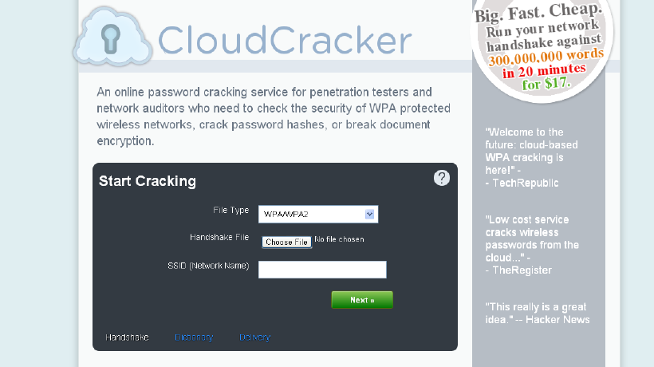

# CSIT953 第 8 周 · 无线与 IoT 安全：墙挡不住电波之后

> **学习目标 (Learning objectives)** — 读完本章你应该能够：
> - 说清一台设备怎样加入 Wi-Fi：发现（beacon / probe）、开放系统认证、关联、PSK / SAE / EAP、四次握手；解释为什么 SSID 和开放系统认证都证明不了身份，四次握手又证明了什么；
> - 按机密性、完整性与身份、可用性、运维四个维度梳理无线攻击面；说明链路加密（WPA2 / WPA3）和端到端加密（TLS / DTLS）各保护哪一段；区分干扰（jamming）和普通拥塞，说出客户端一侧和 AP 一侧受干扰的不同后果与对策；
> - 描述 evil twin 攻击，包括"强制断线 + 同名热点 + 钓鱼页面"这一整套手法；解释隐藏 SSID 和 PMF 为什么挡不住它，证书验证和受管配置文件为什么挡得住；
> - 用异或（XOR）演示 WEP 的密钥流重用和比特翻转，说出它的三个设计错误和共享密钥认证的漏洞，并把它们对应到密钥分离、认证加密、防重放这三条现代教训；
> - 比较 WPA2-Personal、WPA3-Personal（SAE）和企业 802.1X / EAP：解释离线猜测为什么可行、SSID 为什么影响预计算、什么样的口令才扛得住；说出 PMF、过渡模式和 WPS 各带来什么风险，以及该怎样配置；
> - 解释 IoT 安全为什么和普通 IT 不同，按层列出攻击面，分析默认口令和不安全更新这两种典型漏洞；
> - 为一个 IoT 部署设计身份、访问控制、可信入网和全生命周期管理；说明链路级保护和端到端保护怎样配合，选无线协议时该问哪些安全问题，Ascon（NIST SP 800-232）解决了什么、没解决什么；用这些分析 S45 的智能楼宇传感器案例。

> 📚 **材料说明** — 本笔记依据 Week 8 slides（S1–S46）和两段课程录音。Week 8 录音的前 41k 字符讲完了 Week 7 slides 的 S19–S39（证书的生命周期到完整的信任决策），已经写进第 7 周笔记；老师说"证书就讲到这里"之后才进入无线安全，讲到 S11（无线怎样改变威胁模型）时下课。第 9、10 周是客座讲师讲开源软件安全，没有本周内容。剩下的 S12–S44 在 **Week 11 录音的开头**接着讲完（前 38k 字符），到老师说"这就是第 8 周的内容"为止，之后是第 11 周的虚拟机与容器。S45（智能楼宇传感器案例）和 S46（实用清单）课上只提了一句，笔记按 slides 补全，并给出一份参考分析。S1、S2、S17、S27、S33 是封面和分节页；S8、S11、S13–S16、S22、S25 的配图都重画或改画成了正文里的图（图 1、图 4–8、图 10）；S31 是截图，笔记直接放了截图（图 12）。录音是自动转写，术语错得很多：WEP 成了 WAP、WPI，WPA2 / WPA3 成了 W2、W 3、PS3、"that period"，SSID 成了 SSD、society，IoT 成了 IT、LT、IUT，TLS / DTLS 成了 TRS / DTRS，AES-CCMP 成了 ASCMP，RC4 成了 RA 4，CRC-32 成了 CRA 32，eavesdropping 成了 eva swapping，evil twin 成了 "you were twins"，jamming 成了 Jimmy，radio 成了 video，beacon 成了 vacant，probe 成了 proper，key 成了 K、case、cane，firmware 成了 formula，VLAN 成了 Bela、Vila，Kali Linux 成了 King Linux，Ascon 成了 ascom，side-channel 成了 "Sad China"。引用时已按 slides 校正。正文里的 S 编号就是 PDF 页码，和 slide 右下角印的页码一致。

> 🎯 **考试提示** — 第 13 周的 slides 列出了考试范围（Exam Scope / Key Topics）。本周内容在 Network Security 下面占一条：**Wireless Network Security — Secure configuration and protection against impersonated access points**，也就是"安全配置"和"防范冒充的接入点"。对应本章的 §2、§3.5 和 §5，复习时优先保证这几节。IoT 安全（§6–§11）没有单独列出，但它反复用到的 WEP 教训（§4）和考试范围里的另外两条直接相关："哈希与 MAC 的安全性质和不同用途"（CRC 为什么不是 MAC，§4.3），"识别不安全信道上的认证协议的弱点"（WEP 共享密钥认证，§4.4，分析方法和第 6 周的识别协议一样）。考试是 3 小时闭卷，单选 15 分、填空和简答 21 分、问答 14 分；slides 特别提醒，**要求解释的题，只写关键词可能拿不到满分**。

第 7 周笔记的最后一句预告了本周的一个场景：连企业 Wi-Fi 时，客户端**必须验证认证服务器的证书**，否则一个假热点就能骗走你的口令。这句话背后是本周的核心变化。前几周讨论的攻击者，大多待在"网络的某个地方"：你和服务器之间的路由器上，DNS 服务器上，或者云平台里。用网线上网时，攻击者想碰到你的数据包，先得接触到那根线、那台交换机。无线网络拿掉了这层物理屏障：电波穿过墙壁，传到停车场、隔壁办公室和楼下的咖啡馆，**信号范围内的任何人都能收听，也都能发送**。墙原来替我们做的事，现在要由身份、密钥和配置来做。

这一章分两半。前一半讲 Wi-Fi：设备怎样发现并加入一个无线网络，无线电带来了哪些新威胁，WEP 这个失败的老协议留下了哪些教训，今天的 WPA2、WPA3 和企业认证该怎样配置。后一半讲**物联网**（Internet of Things, IoT）：智能门锁、摄像头、传感器、联网洗衣机。它们大多也靠无线电联网，却比笔记本难保护得多：CPU 小、内存小，一装就是十年，很少有人记得给它打补丁。WEP 是两半之间的桥，它的三个设计错误今天仍在 IoT 固件里一再出现。

本章依次回答这些问题：

1. 无线局域网由什么组成？有哪些架构？（§1）
2. 一台设备怎样加入 Wi-Fi？哪一步建立了信任，哪一步没有？（§2）
3. 换成无线电之后，攻击者多了哪些手段？假热点为什么难防？（§3）
4. WEP 用的都是正经的密码学零件，为什么整体失败？（§4）
5. WPA2、WPA3 和企业认证各防住了什么，还剩下什么风险？（§5）
6. IoT 安全为什么和普通 IT 不一样？攻击面在哪里？（§6）
7. 默认口令和固件更新为什么是 IoT 最典型的两个漏洞？（§7）
8. IoT 设备的无线链路该怎样保护？协议该怎样选？（§8）
9. 怎样给成千上万台设备发身份、管权限、接入网络？（§9）
10. 设备从部署到退役，安全怎样跟上？资源受限的设备用什么密码算法？（§10）
11. 把以上合起来，怎样分析一个真实的部署？（§11）

## 1. 无线网络是怎样连起来的

### 1.1 无线局域网：用无线电代替网线 (S3)

S3 的定义很朴素：**无线网络**（wireless network）用无线电链路（radio links）而不是物理线缆连接设备。覆盖一个局部区域（一个家、一层办公楼、一个校园）的无线网络叫**无线局域网**（wireless LAN, WLAN）。设备通常通过一个**接入点**（access point, AP）接入网络，经它到达本地资源和互联网。AP 一般把无线客户端**桥接**（bridge）到有线局域网上；通往其他网络（包括互联网）的路，由一台单独的或者集成在一起的**路由器**（router）提供。

家里那台"无线路由器"其实是好几样设备装在一个盒子里：AP（发出 Wi-Fi 信号）、交换机（背后那几个网口）、路由器（连到运营商），往往还有一个简单的防火墙。在企业和校园里，这几样通常是分开的设备：AP 挂在天花板上，路由器和防火墙在机房里。分清这几个角色，后面讨论"攻击者冒充的是谁""加密保护到哪里为止"时就不会混淆。老师的概括是：这种架构让联网很方便，**但它也带来了一个必须保护的无线电接口**。

S3 右边的配图是一个协议栈：应用层、传输层、网络层（Internet）、数据链路层、物理层。图里没有明说、但本章会反复用到的一点是：**Wi-Fi 只替换了最下面两层**。物理层从电信号换成了无线电波，数据链路层换成了 802.11 的帧格式，上面的 IP、TCP 和应用完全不变。这有两个后果：

- **Wi-Fi 的安全措施只保护无线这一跳**。WPA2、WPA3 在数据链路层加密，保护的是你的设备和 AP 之间那一段空气；数据出了 AP，进入有线网和互联网，就不归它管了（§3.3）。
- **上层的安全协议照常工作**。HTTPS、SSH、VPN 不关心下面是网线还是无线电，所以在一个不可信的 Wi-Fi 上，它们仍然能保护你（§3.3）。

### 1.2 为什么用无线：三个好处 (S4)

S4 列出了无线局域网的三个好处：

1. **安装灵活**（installation flexibility）：能把网络延伸到布线困难或者布线开销大的地方，比如不能打孔的老建筑、仓库、临时展厅；
2. **可扩展**（scalability）：需求变了，可以随时调整覆盖范围和配置，加一个 AP、挪一个 AP 就行，不用重新拉线；
3. **部署快**（installation speed）：能很快为流动的工作组（mobile workgroups）搭起网络，也能在灾难恢复（disaster recovery）时临时顶上。

老师接着指出了这三个好处的另一面：正因为无线网络装起来又快又方便，**它们常常是匆匆忙忙部署上去的**，所以安全配置格外要紧。一台从盒子里拿出来、插上电就用的 AP，默认口令、默认设置都还在，这正是 §5 和 §7 要讨论的问题。

### 1.3 Wi-Fi 的代际和 802.11 标准 (S5, S6)

**IEEE 802.11** 是无线局域网的一族标准，由 IEEE 802.11 工作组制定（S6）。它定义了客户端和 AP 之间的无线接口，也定义了客户端之间直接通信的接口。这一族标准不断增补，每次增补用一两个字母命名；为了让消费者看得懂，行业组织后来给主要的几代起了"Wi-Fi + 数字"的名字。S5 的表：

| Wi-Fi 代际 | IEEE 规范 |
|---|---|
| Wi-Fi 4 | 802.11n |
| Wi-Fi 5 | 802.11ac |
| Wi-Fi 6 | 802.11ax |
| Wi-Fi 6E | 802.11ax，工作在 6 GHz 频段 |
| Wi-Fi 7 | 802.11be |

课上有同学问家里的 Wi-Fi 是哪一代。老师说，他前不久读到新闻，大多数家庭用户还在用 Wi-Fi 6，尽管 Wi-Fi 7 已经出来两年了；Wi-Fi 7 更快，现在去 JB Hi-Fi 买路由器，很多已经是 Wi-Fi 7，但 Wi-Fi 6 对大多数人来说已经绰绰有余。他自己家里有两台 Wi-Fi 6 路由器，原因很简单：有些房间收不到信号。

这张表旁边，S5 写了本节最要紧的一句：**无线电的代际本身不保证部署是安全的**（*Radio generation alone does not guarantee a secure deployment*）。Wi-Fi 7 解决的是速度、延迟和容量问题。一台最新的 Wi-Fi 7 路由器，照样可以配一个弱口令、开着 WPS、用着默认的管理员密码。安全来自配置，不来自型号。

> 📎 **拓展(超出 slides)：6 GHz 频段是个例外** — Wi-Fi 6E 和 Wi-Fi 7 新开放的 6 GHz 频段，从一开始就规定了更高的门槛：在这个频段上只能用 WPA3（或者开放网络的加密版本 Enhanced Open），必须启用 PMF（§3.5），不允许 WPA2 和 WEP。所以"新一代"在 6 GHz 上确实强制了一部分安全设置；可同一台路由器的 2.4 GHz 和 5 GHz 频段照样可以配成 WPA2，口令照样可以很弱。

S5 的右栏把视野放宽到 Wi-Fi 之外。IoT 设备还会用别的无线技术：**Bluetooth LE**（低功耗蓝牙）、**Zigbee / Thread**、**LoRaWAN** 和**蜂窝物联网**（cellular IoT）。同学问：这些是 Wi-Fi 的升级版，还是替代品？老师的回答是**替代品**，选哪个取决于用途。S5 给出的**选型标准**是：

- **覆盖范围**（range）：一个房间、一栋楼，还是几公里外的农田？
- **功耗预算**（power budget）：插着电源，还是一颗纽扣电池要撑几年？
- **延迟**（latency）：门锁要求即时响应，土壤湿度传感器一小时报一次也无所谓；
- **拓扑**（topology）：星形（所有设备连一个中心），还是网状（设备之间互相转发）？
- **更新能力**（update capability）：这个设备将来能不能收到安全更新？

最后一条是安全标准，和前四条并列。§8.2 会回到这个选型问题，逐个看每种协议该问的安全问题。

### 1.4 两种架构：ad hoc 和 infrastructure (S7, S8)

S7 区分了两种基本架构：

- **Ad hoc**：设备之间直接通信，自己组成一个本地网络，不需要 AP。老师的例子是两部手机不经过路由器，直接互传文件、传一部大电影。
- **Infrastructure**（基础设施模式）：无线客户端通过 AP 连接，AP 把它们桥接到本地网络。家庭、办公室和校园普遍用这种架构。老师说，我们现在都连着 UOW 的 Wi-Fi，其实就在同一个局域网里。

S8 用一张示意图展示了 infrastructure 网络的全貌，图 1 是它的重画。

```d2 图 1 · 按 S8 的配图重画的 infrastructure 网络：无线客户端经 AP 进入有线局域网，再经路由器、防火墙和调制解调器到达互联网。老师说，这条路径上的每一道边界，都可能需要身份、授权或监控
direction: down
net: 互联网 {shape: cloud}
mdm: "ADSL / Cable 调制解调器"
fw: 防火墙
rt: 路由器
sw: 交换机
wired: 有线客户端 {
  pc1: 台式机
  nb1: 笔记本
}
ap: "接入点 AP" {class: key}
air: "无线客户端：经无线电接入" {
  pc2: "台式机（USB 无线网卡）"
  nb2: "笔记本（无线网卡）"
}
net -- mdm
mdm -- fw
fw -- rt
rt -- sw
sw -- wired
sw -- ap
ap -- air
```

老师沿着这条路径走了一遍：客户端先用无线电链路到达 AP，AP 再把它接到本地或互联网上的其他服务。然后他说了一句贯穿全章的话：**路径上的每一道边界，都是可能需要身份认证、授权或监控的地方**。无线客户端和 AP 之间的那段空气是一道边界（谁可以接入？§2），AP 和有线局域网之间是一道边界（接进来之后能访问什么？§5.2 的网段隔离），防火墙和互联网之间又是一道。§11 分析智能楼宇案例时，第一个任务就是画出这些边界。

> 📎 **拓展(超出 slides)：两种架构的安全差别** — 在 infrastructure 模式里，所有无线流量都要经过 AP，AP 自然成了统一执行认证、记录日志、隔离网段的地方。Ad hoc 网络没有这样一个中心，每台设备都要自己决定信任谁，管理员也很难集中监控。这也是企业网络几乎都用 infrastructure 模式的原因之一。

<details>
<summary>自测：一台全新的 Wi-Fi 7 路由器，用默认管理员密码，Wi-Fi 口令是 12345678。它比一台精心配置的 Wi-Fi 5 路由器更安全吗？</summary>

不会。S5 说无线电的代际本身不保证部署安全。Wi-Fi 7 提升的是速度和容量；这台路由器的安全取决于配置，而弱口令（§5.2 会看到它几秒钟就能被离线猜中）和默认管理员密码（§7.1）都是最典型的配置错误。唯一的例外是 6 GHz 频段强制 WPA3 和 PMF，但口令再弱，也只是把攻击从离线猜测变成在线猜测。

</details>

## 2. 加入一个 Wi-Fi 网络：发现、认证、握手

§1 描述了网络的样子，这一节看一台设备怎样连进去。分清每一步做了什么、**没做**什么，是本章理解 evil twin（§3.5）和离线猜测（§5.2）的前提。

### 2.1 发现：先看到名字，再谈信任 (S9)

设备连网之前，得先知道附近有哪些网络。S9 列出了两种**发现**（discovery）方式：

- **被动发现**（passive discovery）：AP 不停地广播**信标帧**（beacon frame），里面写着网络名字、支持的速率和安全模式等信息。你打开手机的 Wi-Fi 列表，看到的就是附近 AP 发出的信标。
- **主动发现**（active discovery）：客户端主动发出**探测请求**（probe request），问"附近有哪些网络"或者"X 网络在不在"；AP 回复**探测响应**（probe response），客户端比较这些响应，再决定连哪一个。

列表里显示的网络名字叫 **SSID**（service set identifier）。老师在课上问大家：打开 Wi-Fi 看到的 "UOW" 是什么？就是 SSID。家里的路由器可以随意改这个名字。有的路由器给 2.4 GHz 和 5 GHz 两个频段分别起名，比如 "UOW-2.4G" 和 "UOW-5G"；有的两个频段用同一个名字。

S9 下半部分是本节的重点：

- **安全要点：发现发生在建立信任之前，光凭 SSID 证明不了网络的身份**（*Discovery occurs before trust is established. An SSID alone cannot prove network identity*）；
- **风险：攻击者可以冒用一个熟悉的网络名，或者操纵发现过程的流量**（*An attacker can imitate a familiar network name or manipulate discovery traffic*）。

为什么 SSID 证明不了身份？因为它只是一串字符，任何 AP 都可以广播任何名字，信标和探测响应里也没有签名之类的密码学证明。老师说得很直白：SSID 只是一个名字。他还讲了自己的一段经历：很多年前想蹭邻居的 Wi-Fi，又不知道口令，就把自己的 Wi-Fi 改成和邻居一模一样的名字。邻居的设备不小心连上了他的热点，看到一个仿得很像 TP-Link 管理页面的网页："您的路由器出了点问题，请重新输入密码"。邻居输入了，他就拿到了口令。（老师补了一句："那时候我很穷。"）§3.5 会看到这个手法的完整版本。

> 📎 **拓展(超出 slides)：BSSID、自动连接和 Karma 攻击** — 每台 AP 的每个射频都有自己的 MAC 地址，叫 **BSSID**。一个 SSID（比如校园里的 UOW）背后可以有几百台 AP，BSSID 各不相同；设备在楼里走动时，会自动从一台 AP 切到另一台，这叫**漫游**（roaming）。为了支持漫游，设备被设计成"只要名字对、安全模式对，哪台 AP 都可以连"，这正是同名假热点能钻的空子；BSSID 本身也能伪造。老一些的设备还会主动广播探测请求，挨个询问自己记住的每一个网络名，等于把"我会自动连哪些网络"告诉了周围所有人；攻击者的 AP 可以对每个询问都回答"我就是"，这叫 **Karma 攻击**，也是 S9 说的"操纵发现流量"的一种。现在的手机已经很少这样做，还会在扫描时使用随机 MAC 地址，以减少被追踪。

> 📎 **拓展(超出 slides)：802.11 的三类帧** — 802.11 把帧分成三类：**管理帧**（management frames：信标、探测、认证、关联、**解除认证** deauthentication 等）、**控制帧**（control frames：协调谁什么时候发送）和**数据帧**（data frames：真正的用户数据）。WPA2 加密的只是数据帧；管理帧在最初的标准里既不加密也不认证，谁都能伪造一个，§3.4 和 §3.5 的强制断线攻击就利用了这一点。后来的 **PMF**（Protected Management Frames，§3.5）给其中一部分管理帧加上了保护。

<details>
<summary>自测：你在机场看到两个都叫 Airport_Free_WiFi 的网络，一个信号强，一个信号弱。凭名字和信号强弱，能判断哪个是机场的吗？</summary>

不能。S9 说光凭 SSID 证明不了网络身份：两个名字一样，可能一个真一个假，也可能两个都是假的；信号强弱只说明发射器离你多近，攻击者完全可以坐在你旁边。对这种开放网络，你根本没有办法验证 AP 的身份，所以要把它当作不可信网络（S13），靠 HTTPS 或 VPN 这类端到端的保护（§3.3）。

</details>

### 2.2 三种安全模式，三种加入流程 (S10)

发现之后，设备要正式加入网络。S10 用一张表列出了三种安全模式在发现之后的**初始连接顺序**：

| 安全模式 | 发现之后的初始连接顺序（S10） |
|---|---|
| **WPA2-Personal** | 开放系统认证 → 关联 → 用 PSK 做四次握手 |
| **WPA3-Personal** | SAE 认证 → 关联 → 四次握手 |
| **Enterprise（802.1X）** | 开放系统认证 → 关联 → EAP 认证 → 四次握手 |

表下面有两句话：**四次握手派生并安装会话密钥，WPA3 要求启用 PMF**；**仅凭开放系统认证，证明不了用户或设备的身份**（*Open-system authentication alone provides no proof of user or device identity*）。

逐个看表里的步骤：

**开放系统认证**（open-system authentication）的名字有误导性。它是 802.11 最早留下来的一个步骤：客户端说"我要认证"，AP 回答"好"，中间不涉及任何秘密。老师说它**本身什么也证明不了，只是协议开头的一个步骤**。它之所以叫"认证"，是因为当年还有另一种"共享密钥认证"，那是 WEP 的一部分，而且是个失败的设计（§4.4）。

**关联**（association）：客户端请求加入这个 AP 的网络，双方商定要用的能力，比如加密套件和速率。关联之后，客户端在 AP 那里有了一个"席位"，但还不能收发正常的数据。

接下来才是真正起作用的认证，三种模式在这里分开：

- **WPA2-Personal**：没有单独的认证步骤。所有人共用一个**预共享密钥**（pre-shared key, PSK），实际上就是那串 Wi-Fi 口令；四次握手同时完成"证明双方都知道 PSK"和"派生会话密钥"两件事。
- **WPA3-Personal**：用 **SAE**（Simultaneous Authentication of Equals，对等实体同时认证）代替了开放系统认证。它仍然基于口令，但设计成了一次密钥交换，偷听者没法拿录下来的数据离线猜口令（§5.4）。
- **Enterprise（802.1X）**：关联之后，客户端和学校或公司的**认证服务器**之间跑一轮 **EAP**（Extensible Authentication Protocol，可扩展认证协议），用每个人自己的用户名和口令，或者每台设备自己的证书。老师说，**用户或设备的身份通常就是在 EAP 这一步确立的**。UOW 的 Wi-Fi 就是企业模式，所以连接时要输入自己的学号和口令（§5.1）。

最后三种模式殊途同归，都以**四次握手**（four-way handshake）结束，由它派生出这次连接用的会话密钥。

老师讲这一页时，打开了自己路由器的管理页面。他设了两个 SSID：5 GHz 那个用纯 WPA3-SAE，2.4 GHz 那个用 WPA2 / WPA3 混合模式。同学马上问：WPA2 不如 WPA3 安全，为什么还要允许它？老师说，因为有些老笔记本和老设备不支持 WPA3，家里的很多"智能"设备也是，比如能连 Wi-Fi 的洗衣机，只支持 WPA2，不开 WPA2 它们就连不上。他一开始设的是纯 WPA3，结果几台旧的 Amazon 设备连不上，查下来才发现它们不支持 WPA3，只好改成混合模式。至于厂商为什么不升级，他猜是为了压低生产成本。同学还补充了一点：2.4 GHz 的覆盖范围比 5 GHz 大，所以 IoT 设备常常只用 2.4 GHz。这个"兼容老设备"的取舍，§5.4 讲过渡模式时会看到它的代价。

### 2.3 四次握手做了什么 (S10)

S10 对四次握手只说了一句"派生并安装会话密钥"。老师补充了两点：第一，**四次握手不是通常意义上的"用户登录"**；第二，**它的主要目的是证明双方知道相关的秘密，并派生出新鲜的会话密钥来保护流量**。在 WPA2-Personal 里，"相关的秘密"就是由 Wi-Fi 口令算出的那把主密钥。图 2 是 WPA2-Personal 网络从发现到通信的完整过程。

```d2 图 2 · 加入一个 WPA2-Personal 网络（S9、S10）：前两个阶段谁都能做，不涉及任何秘密；四次握手才第一次用到由口令算出的 PMK，并为这次连接派生出新的会话密钥
shape: sequence_diagram
C: "客户端"
A: "接入点 AP"
d: "发现（S9）" {
  A -> C: "Beacon：SSID、安全模式等"
  C -> A: "Probe Request（主动发现时）"
  A -> C: "Probe Response"
}
o: "开放系统认证 + 关联：不涉及任何秘密" {
  C -> A: "Authentication（open system）"
  A -> C: "Authentication：OK"
  C -> A: "Association Request"
  A -> C: "Association Response"
}
h: "四次握手：双方都已由口令算出 PMK" {
  A -> C: "① ANonce"
  C -> A: "② SNonce + MIC"
  A -> C: "③ 加密的 GTK + MIC"
  C -> A: "④ 确认 + MIC"
}
C.k: "双方安装会话密钥" {class: key}
C -> A: "此后的数据帧：AES-CCMP 加密"
```

> 📎 **拓展(超出 slides)：四次握手里的几把钥匙** — 下面的细节 slides 没有，但它能解释后面好几页 slides 的结论，值得弄懂。
>
> - **PMK**（pairwise master key，成对主密钥）：WPA2-Personal 里，PMK 由 Wi-Fi 口令和 SSID 算出：$\mathrm{PMK} = \mathrm{PBKDF2}(\text{口令}, \text{SSID}, 4096, 256)$，也就是把 HMAC-SHA1 连续做 4096 轮，输出 256 位。PBKDF2 你在第 3 周 §3.8 见过，助记词变种子用的就是它；那里的盐是 "mnemonic" 加口令，这里的盐是 SSID。**口令不变，PMK 就不变**，所有知道口令的人算出的 PMK 都一样。WPA3-Personal 的 PMK 由 SAE 交换产生，每次连接都不同；企业模式的 PMK 由 EAP 产生，每个用户、每次会话都不同。
> - **ANonce** 和 **SNonce**：AP 和客户端各自选的一个随机数（nonce，第 6 周 §2.5 拓展），在握手的第 ①、② 条消息里明文发出。
> - **PTK**（pairwise transient key，成对临时密钥）：$\mathrm{PTK} = \mathrm{PRF}(\mathrm{PMK}, \mathrm{ANonce}, \mathrm{SNonce}, \text{双方 MAC 地址})$。两个 nonce 每次都是新的，所以**同一个 PMK，每次连接得到的 PTK 都不一样**，这就是老师说的"新鲜的会话密钥"。PTK 再拆成三把钥匙：**KCK** 用来计算每条握手消息的 **MIC**（message integrity code，消息完整性码，作用和第 4 周 §3.5 的 MAC 一样），**KEK** 用来加密第 ③ 条消息里的 GTK，**TK** 用来加密之后所有的数据帧。
> - **GTK**（group temporal key，组临时密钥）：同一台 AP 下所有客户端共用的一把钥匙，用来加密广播和组播帧。
>
> 握手怎样"证明知道秘密"？第 ② 条消息的 MIC 只有算得出 PTK 的人才能算对，而算出 PTK 需要 PMK，所以客户端证明了自己知道口令，口令本身却从没在空中出现过。第 ③ 条消息的 MIC 反过来证明 AP 也知道口令。这是第 6 周 §2.5 挑战–应答的思路：ANonce 相当于 AP 出的挑战，MIC 是应答；而且是**双向**的，比第 6 周 §3.3 里只有手机证明自己的 GSM 强。

图 3 把这些钥匙的关系画了出来。

```d2 图 3 · WPA2-Personal 的密钥层次（📎 超出 slides 的细节）：口令和 SSID 算出 PMK；PMK 加上两个 nonce 和双方的 MAC 地址，算出这次连接专用的 PTK；PTK 再拆成三把各管一事的钥匙
direction: down
pw: "Wi-Fi 口令 + SSID"
pmk: "PMK（256 位）\n同一口令 → 同一 PMK" {class: key}
n: "ANonce、SNonce\n双方 MAC 地址"
ptk: "PTK：这次连接专用" {class: good}
kck: "KCK：算 MIC"
kek: "KEK：加密 GTK"
tk: "TK：加密数据帧"
pw -> pmk: "PBKDF2，4096 轮"
pmk -> ptk
n -> ptk
ptk -> kck
ptk -> kek
ptk -> tk
```

图 3 里有两个细节，后面会各用一次。第一，**SSID 是 PBKDF2 的盐**：不同网络的同一个口令算出不同的 PMK，可两个同名网络的同一个口令，算出的 PMK 完全一样，§5.2 会看到这为什么让 "linksys" 这类常见网络名特别危险。第二，**PMK 是所有知道口令的人共享的**，而 nonce 又是明文发送的：一个知道口令的人，只要录下了你的握手，就能算出你的 PTK，解密你的流量。共享口令的问题不止"谁都能连进来"，§4.5 和 §5.1 会回到这一点。

老师接着提醒，在企业模式里，身份确立之后还要考虑**事后的问题**：设备丢了怎么办？员工离职了怎么办？证书被撤销了怎么办？共享口令的网络对这些问题都只有一个答案：改口令，让所有人重新输入。企业模式可以只停掉那一个账户或那一张证书。这个"能不能有针对性地撤销"的问题，到 IoT 部分会变得更重要（§9）。

<details>
<summary>自测：在一个 WPA2-Personal 的家庭网络里，四次握手成功之后，路由器能确定连进来的是哪个家庭成员、哪一台设备吗？</summary>

不能。四次握手只证明了"对方知道 Wi-Fi 口令"（准确地说，知道由口令算出的 PMK），而家里每个人、每个来过的客人都知道同一个口令，在路由器看来他们一模一样。MAC 地址能说明是哪块网卡，可 MAC 地址可以随意伪造。老师强调四次握手不是用户登录；要确认是谁，得靠企业模式的 EAP。

</details>

<details>
<summary>自测：同一部手机、同一个 WPA2 口令，今天连一次、明天连一次，两次的 PMK 一样吗？PTK 呢？</summary>

PMK 一样：它只由口令和 SSID 决定。PTK 不一样：每次握手的 ANonce 和 SNonce 都是新选的随机数，所以每次连接都会派生出新的会话密钥。这就是老师说的"派生新鲜的会话密钥"。

</details>

## 3. 无线改变了威胁模型

§2 走完了一台设备正常连网的过程。这一节换到攻击者的视角：网线换成无线电之后，他多了哪些手段？

### 3.1 攻击者不必进门 (S11)

S11 的四句话是整个无线安全的出发点：

1. **无线电会穿过墙壁和公共空间**（*Radio crosses walls and shared spaces*）；
2. **在信号范围内的攻击者，不用进入场所就能接收或发送**（*Attackers within radio range can receive or transmit without entering the premises*）；
3. **加密保护载荷，但一些元数据和发现流量仍然可见**（*Encryption protects payloads. Some metadata and discovery traffic remain visible*）；
4. **要用强认证、密钥管理、PMF 和监控**（*Use strong authentication, key management, PMF and monitoring*）。

有线网络的安全，有一部分其实由门禁承担：想接上公司的交换机，先得进得了大楼。无线电不认门禁，图 4 画的就是这个变化。

```svg 图 4 · 无线电不认门禁（S11）：墙和门禁拦得住人，拦不住信号。停车场里的攻击者在信号范围（橙色虚线）之内，不进大楼也能收、也能发
<svg viewBox="0 0 640 300">
  <ellipse cx="290" cy="155" rx="275" ry="128" class="warn dashed" fill="none" stroke-width="2"/>
  <text x="470" y="44" text-anchor="middle" class="warn">信号覆盖范围</text>
  <rect x="140" y="80" width="230" height="160" class="ink" fill="none" stroke-width="3"/>
  <text x="255" y="105" text-anchor="middle">办公楼：墙 + 门禁</text>
  <circle cx="200" cy="170" r="9" class="solid-accent"/>
  <text x="200" y="200" text-anchor="middle" class="accent">AP</text>
  <rect x="290" y="150" width="46" height="30" rx="4" class="good fill-good" stroke-width="2"/>
  <text x="313" y="205" text-anchor="middle" class="good">员工</text>
  <circle cx="470" cy="160" r="11" class="solid-warn"/>
  <text x="470" y="135" text-anchor="middle" class="warn">攻击者（停车场）</text>
  <text x="470" y="192" text-anchor="middle" class="warn">收：偷听</text>
  <text x="470" y="212" text-anchor="middle" class="warn">发：注入、假热点、干扰</text>
  <circle cx="612" cy="258" r="7" class="solid-muted"/>
  <text x="598" y="288" text-anchor="end" class="muted">范围之外才收不到</text>
</svg>
```

第 2 条里的"接收"和"发送"是两类不同的能力。**接收**就是偷听，它完全是被动的：攻击者只是把空中的帧录下来，不发出任何信号，受害者无从察觉，事后也查不到痕迹。§5.2 会看到，录下一次 WPA2 握手就足以离线猜口令。**发送**是主动攻击：伪造帧、架假热点、制造干扰。§3.4 和 §3.5 讲的都是这一类。

第 3 条提醒我们，加密不是隐形斗篷。老师说，加密保护的是内容，可有些元数据和发现流量仍然看得见；更何况有的流量根本没加密，比如开放网络里的一切，攻击者直接就能拿到。

> 📎 **拓展(超出 slides)：加了密，空中还能看见什么** — 即使用 WPA2 或 WPA3，每一帧的头部仍是明文：发送方和接收方的 MAC 地址、帧的长度、发送的时间都看得见；信标和探测请求里的网络名也是明文。只凭这些，就能做**流量分析**（traffic analysis）：某个 MAC 地址每天几点出现（人在不在家），流量的大小和节奏像视频还是像网页，一台摄像头什么时候开始大量上传（有人经过）。信号强度还能大致推出设备的位置。这些都不需要解密任何内容。

第 4 条是对策的总纲，本章会逐一展开：强认证（§2、§5）、密钥管理（§4.6）、PMF（§3.5），以及监控（§3.4 的干扰诊断、§3.5 的恶意 AP 检测）。

### 3.2 无线攻击面：四个维度 (S12)

S12 把无线攻击面分成四个维度。老师建议，评估时把每一类对应到一个安全性质上：偷听威胁的是机密性；欺骗和注入威胁的是完整性和真实性；干扰威胁的是可用性；而运维上的漏洞会削弱所有性质。下表左两列是 S12，右两列是老师的对应关系和本章的位置。

| 维度（S12） | 包括的威胁（S12） | 受威胁的安全性质 | 本章 |
|---|---|---|---|
| **机密性** Confidentiality | 窃听（eavesdropping）、弱加密（weak encryption）、流量分析（traffic analysis） | 机密性 | §3.3、§4 |
| **完整性与身份** Integrity and identity | evil twin、欺骗（spoofing）、降级尝试（downgrade attempts）、帧注入（frame injection） | 完整性、真实性 | §3.5、§4.3、§5.4 |
| **可用性** Availability | 干扰（jamming）、解除认证滥用（deauthentication abuse）、资源耗尽（resource exhaustion） | 可用性 | §3.4、§3.5 |
| **运维** Operations | 不安全的默认设置（insecure defaults）、共享凭据（shared credentials）、没打补丁的 AP（unpatched APs）、无人管理的 IoT 客户端（unmanaged IoT clients） | 所有性质 | §5、§7 |

表里的几个术语 slides 没有展开，这里各用一句话说明：

- **欺骗**（spoofing）：冒充别人的身份发送数据，比如伪造 AP 的 MAC 地址；
- **降级**（downgrade）：诱使双方改用一个更弱的模式，比如让支持 WPA3 的设备退回 WPA2（§5.4）；
- **帧注入**（frame injection）：往网络里塞进伪造的帧；WEP 的完整性漏洞让注入的帧能骗过接收方（§4.3）；
- **解除认证滥用**（deauthentication abuse）：伪造"解除认证"管理帧，把客户端踢下线（§3.5）；
- **资源耗尽**（resource exhaustion）：比如用海量的关联请求填满 AP 的客户端列表，让正常用户连不上。

运维那一行最容易被忽视。老师说，共享凭据、没打补丁的 AP 这类问题，**能让本来不错的协议安全形同虚设**：WPA3 的设计再好，管理员把口令设成 12345678，或者 AP 的固件有个三年没修的漏洞，协议也帮不上忙。

老师还提醒，实际评估时还要考虑 CIA 之外的三样东西：**隐私**（privacy）、**安全**（safety，指人身和物理安全）和**可追责性**（accountability）。比如一把联网门锁、一个医疗传感器，它们出了问题，后果远不止"网络访问被滥用"：门锁被打开是人身安全问题，医疗数据泄露是隐私问题。这个视角在 IoT 部分（§6）会变成主角。

<details>
<summary>自测：把下面四件事归到 S12 的四个维度里。① 停车场里有人录下办公室的 WPA2 流量，因为口令是 office2024，事后解密了邮件；② 有人每隔几秒发一批伪造的解除认证帧；③ 一台打印机还在用出厂的管理员密码；④ 咖啡馆里出现了一个和店里同名的热点。</summary>

① 机密性：窃听加上弱口令（S12 的 weak encryption 一类问题，弱的不是算法，是口令）。② 可用性：解除认证滥用，目的是让客户端掉线。③ 运维：不安全的默认设置，它会削弱所有性质。④ 完整性与身份：evil twin。注意 ① 其实也有运维的成分：口令弱是配置问题，所以老师说运维会削弱所有性质。

</details>

### 3.3 窃听与加密：链路加密只管一跳 (S13)

对付窃听，S13 给了三条：

1. **用 WPA2（配 AES-CCMP）或 WPA3 保护无线链路**；
2. **用 TLS 或 DTLS 保护应用流量**；
3. **把开放 Wi-Fi 当作不可信网络，有些元数据仍然可见**。

前两条分工不同，这是本节的重点。老师的说法是：WPA2 和 WPA3 保护的是**链路**，也就是你的设备和路由器之间那一段；应用还需要 TLS 或 DTLS 提供**端到端**的保护。他举的例子是 WhatsApp：它的连接从你的手机一直加密到 WhatsApp 的服务器，所以就算你连的是咖啡馆里一个完全不加密的 Wi-Fi，消息照样有保护。回忆 §1.1：Wi-Fi 只替换了最下面两层，所以它的加密只管无线这一跳；TLS 在上层，不管下面换成什么。

```svg 图 5 · 两层加密各管一段（S13）：WPA2 / WPA3（蓝色）只保护设备到 AP 这一跳；TLS / DTLS（绿色）从应用一直保护到服务器。开放 Wi-Fi 少了蓝色那一层，绿色那一层还在
<svg viewBox="0 0 640 250">
  <rect x="20" y="40" width="100" height="50" rx="8" class="ink fill-muted" stroke-width="2"/>
  <text x="70" y="70" text-anchor="middle">手机</text>
  <rect x="190" y="40" width="90" height="50" rx="8" class="ink fill-muted" stroke-width="2"/>
  <text x="235" y="70" text-anchor="middle">AP</text>
  <rect x="340" y="40" width="130" height="50" rx="8" class="ink fill-muted" stroke-width="2"/>
  <text x="405" y="70" text-anchor="middle">有线网 / 互联网</text>
  <rect x="520" y="40" width="100" height="50" rx="8" class="ink fill-muted" stroke-width="2"/>
  <text x="570" y="70" text-anchor="middle">应用服务器</text>
  <line x1="120" y1="65" x2="190" y2="65" class="muted dashed" stroke-width="2"/>
  <text x="155" y="32" text-anchor="middle" class="muted">无线电</text>
  <line x1="280" y1="65" x2="340" y2="65" class="ink" stroke-width="2"/>
  <line x1="470" y1="65" x2="520" y2="65" class="ink" stroke-width="2"/>
  <rect x="50" y="115" width="210" height="32" class="good fill-good" stroke-width="2"/>
  <text x="155" y="136" text-anchor="middle" class="good">WPA2 / WPA3：只到 AP</text>
  <rect x="50" y="162" width="540" height="32" class="accent fill-soft" stroke-width="2"/>
  <text x="320" y="183" text-anchor="middle" class="accent">TLS / DTLS：从应用一直到服务器</text>
  <text x="320" y="230" text-anchor="middle" class="muted">两层都加密时仍然可见：MAC 地址、帧的大小和时间、服务器的 IP 地址</text>
</svg>
```

图 5 里蓝色那一段保护的是"空气"：防的是停车场里的偷听者。可数据出了 AP 之后，还要经过公司的有线网、ISP、互联网上的若干路由器，这些地方蓝色那一层都管不着；而且 AP 自己、能登录 AP 的人，看到的都是解密后的内容。绿色那一层不在乎路径上是谁，它只信任两端。

这里要分清一个用词。本章说的"端到端"指**从设备一直到应用服务器**，相对的是"只保护无线这一跳"。第 4 周 §6.2 的**端到端加密**（E2EE）要求更高：连服务器也看不到明文，只有通信的两个用户能解开。TLS 满足本章的"端到端"，不满足第 4 周的 E2EE，因为服务器端会解密。

第 3 条说开放 Wi-Fi 不可信。原因有两层：没有链路加密，偷听者能看到所有没被 TLS 保护的流量；更要紧的是，开放网络**根本无法验证 AP 的身份**（§2.1），你连的可能就是攻击者的热点，他成了你和互联网之间的中间人。老师说，这就是为什么每次连开放 Wi-Fi，手机（Android 和 iOS 都一样）都会弹出一个警告。

> 📎 **拓展(超出 slides)：CCMP、TKIP 和 DTLS** — **CCMP**（Counter Mode with CBC-MAC Protocol）把 AES 用在 CCM 模式下：CTR 模式负责加密，CBC-MAC 负责完整性，合起来是一种**认证加密**（第 4 周 §3.2）；每一帧还带一个 48 位、只增不减的包序号（packet number），既当 nonce，也用来拒绝重放。§4 会看到，这几样恰好补上了 WEP 的三个漏洞。WPA2 早期还允许 **TKIP**，那是 WPA（第一代）为了让老硬件能跑而设计的过渡方案，底层仍是 RC4，早已弃用，路由器里如果看到 "WPA2 (TKIP)"，要改成 AES / CCMP。**DTLS**（Datagram TLS）是跑在 UDP 上的 TLS，提供和 TLS 一样的保护，IoT 里常用的 CoAP 协议就靠它（§8.1）。

> 📎 **拓展(超出 slides)：开放网络的加密版本** — Wi-Fi 联盟推出过 **Enhanced Open**（技术名 OWE，Opportunistic Wireless Encryption）：不需要口令，但每个客户端和 AP 用一次 Diffie–Hellman 交换（第 6 周 §1）协商出自己的密钥，咖啡馆里的其他顾客就没法偷听你的链路了。它的边界在于没有认证：攻击者照样可以架一个同名的 OWE 热点，和你完成一次"加密的"交换。这正是第 6 周 §1.4 的结论：没有认证的 DH 挡得住偷听者，挡不住中间人。

<details>
<summary>自测：你在咖啡馆的开放 Wi-Fi 上用 HTTPS 登录网银。旁边的攻击者能看到什么、看不到什么？如果咖啡馆改用 WPA2，口令贴在墙上，情况有什么变化？</summary>

开放网络：攻击者看不到 HTTPS 里的内容（账号、口令、页面），但能看到你的 MAC 地址、你连的是哪个服务器的 IP、流量的大小和时间，通常还能从 DNS 查询或 TLS 握手里的服务器名看出你在访问哪家银行。改成口令公开的 WPA2：对店里的其他顾客几乎没有改善，因为知道口令的人录下你的握手，就能算出你的会话密钥（§2.3），解开 Wi-Fi 这一层；他面对的还是 HTTPS。evil twin 的风险也一样：知道口令的人可以架一个能完成握手的同名热点（§3.5）。真正保护你的始终是 TLS 这一层。

</details>

### 3.4 干扰与阻塞：攻击可用性 (S14, S15)

前两节的攻击者想**看到**数据，干扰的攻击者想的是**让你用不了**。S14 只有一句话：**干扰攻击的是可用性，要先查信道占用、重传和信号质量，排除拥塞和故障**（*Jamming attacks availability. Rule out congestion and faults by checking channel use, retries and signal quality*）。

**干扰**（jamming）就是在信道上发射噪声或无意义的信号，让接收方解不出正常的帧。老师说得很直接：干扰者不关心你的数据，他的目的就是让你连不上 AP、上不了网。这种攻击发生在物理层，加密和认证都帮不上忙：它们保护的是数据的内容和来源，管不了信道本身被噪声占满。

S14 的后半句提醒，网络变慢、掉线，**大多数时候不是攻击**。老师说，在认定是干扰攻击之前，要先排除普通的拥塞和设备故障，看三样东西：

| 要查的 | 说明 | 对判断的帮助 |
|---|---|---|
| **信道占用**（channel use） | 信道有多大比例的时间是忙的 | 忙，却解不出几个正常的帧，可疑；忙在一大堆正常设备上，多半是拥塞 |
| **重传**（retries） | 有多少帧要发好几次才成功 | 重传率突然飙升，说明空中的干扰或冲突增加了 |
| **信号质量**（signal quality） | 信号强度和底噪的比值 | 底噪（noise floor）异常抬高而附近没有正常设备，指向干扰源 |

> 📎 **拓展(超出 slides)：常见的"非攻击"** — 公寓楼里几十户的路由器挤在同一个 2.4 GHz 信道上；午饭时间的微波炉（它也工作在 2.4 GHz 附近）；蓝牙设备；一台快坏的 AP 或者松动的天线。这些都会表现为变慢和掉线，但都不是攻击。真正的干扰器（jammer）在很多国家是受管制的违禁设备。

S15 用两张配图区分了干扰的两种目标，图 6 是它们的重画：

```svg 图 6 · 干扰的两种目标（按 S15 的配图重画）。左：干扰源靠近一个用户，只有他受影响；右：干扰源靠近 AP，所有客户端一起断线。橙色是受影响的设备，蓝色是正常的
<svg viewBox="0 0 640 270">
  <text x="155" y="22" text-anchor="middle">干扰源靠近用户</text>
  <circle cx="75" cy="120" r="62" class="warn fill-warn dashed" stroke-width="2"/>
  <circle cx="95" cy="140" r="8" class="solid-warn"/>
  <text x="95" y="168" text-anchor="middle" class="warn">干扰源</text>
  <rect x="45" y="92" width="34" height="22" rx="3" class="warn fill-warn" stroke-width="2"/>
  <circle cx="235" cy="120" r="9" class="solid-accent"/>
  <text x="235" y="148" text-anchor="middle" class="accent">AP</text>
  <rect x="185" y="190" width="34" height="22" rx="3" class="good fill-good" stroke-width="2"/>
  <rect x="255" y="190" width="34" height="22" rx="3" class="good fill-good" stroke-width="2"/>
  <text x="155" y="250" text-anchor="middle">只断一个：重传、漫游失败、耗电</text>
  <line x1="320" y1="15" x2="320" y2="255" class="muted dashed" stroke-width="1"/>
  <text x="485" y="22" text-anchor="middle">干扰源靠近 AP</text>
  <circle cx="485" cy="120" r="62" class="warn fill-warn dashed" stroke-width="2"/>
  <circle cx="485" cy="120" r="9" class="solid-accent"/>
  <text x="485" y="104" text-anchor="middle" class="accent">AP</text>
  <circle cx="505" cy="145" r="8" class="solid-warn"/>
  <text x="505" y="172" text-anchor="middle" class="warn">干扰源</text>
  <rect x="360" y="60" width="34" height="22" rx="3" class="warn fill-warn" stroke-width="2"/>
  <rect x="580" y="60" width="34" height="22" rx="3" class="warn fill-warn" stroke-width="2"/>
  <rect x="360" y="190" width="34" height="22" rx="3" class="warn fill-warn" stroke-width="2"/>
  <rect x="580" y="190" width="34" height="22" rx="3" class="warn fill-warn" stroke-width="2"/>
  <text x="485" y="250" text-anchor="middle">全部断线：很多客户端同时失去服务</text>
</svg>
```

- **客户端一侧**（client-side impact）：受干扰的设备会不停地重传（retries），想换一台 AP 又换不过去（roaming failures），电池也耗得飞快（battery drain）。最后一点对靠电池供电的 IoT 设备特别要命：干扰可以把一个本该用五年的传感器在几天里耗光。
- **AP 一侧**（AP-side impact）：**很多客户端同时失去服务**。老师说，如果你能影响这台 AP，你影响的就不是一个用户，而是它下面的所有用户。

S15 给出的应对是四件事：**冗余**（redundancy）、**监控**（monitoring）、**信道规划**（channel planning）和**有线备份**（wired fallback）。冗余就是老师说的"你堵住这一台，我还有另一台"：多台 AP、多个频段；监控让你及早发现异常的底噪和重传；信道规划让自己的 AP 互相错开，也避开邻居；关键业务（收银台、监控摄像头、医疗设备）要留一条有线的后路。老师的总结是：**这些措施都没法让无线干扰变得不可能，但合起来能提高韧性**（resilience）。物理定律不受协议约束，可用性只能靠多准备几条路。

> 📎 **拓展(超出 slides)：协议层面的"干扰"** — 制造噪声需要专门的设备，功率大，也容易被定位。§3.2 表里的**解除认证滥用**开销小得多：攻击者只要用一块普通网卡，伪造几帧"解除认证"管理帧，就能把指定的客户端踢下线，安静而且有针对性。它和物理干扰的区别在于：物理干扰没有协议上的解药，解除认证滥用有，那就是 PMF（§3.5）。

<details>
<summary>自测：办公室的 Wi-Fi 每天中午 12 点到 1 点特别慢，经常掉线。在说"有人在干扰我们"之前，你该先查什么？查出什么结果才支持干扰的判断？</summary>

先按 S14 查信道占用、重传率和信号质量，同时排查普通原因：中午茶水间的微波炉（2.4 GHz）、午休时大量手机刷视频造成的拥塞、邻居的 AP 是否和你们挤在同一信道。如果信道很忙，但忙的是一大堆正常的帧，那是拥塞，用信道规划和加 AP 解决；如果底噪异常抬高、重传率飙升，空中却解不出多少正常的帧，而且换信道也跟着受影响，才支持"有干扰源"的判断。无论哪种，S15 的冗余和有线备份都能减轻影响。

</details>

### 3.5 恶意接入点与 evil twin (S16)

这一节是考试范围里"防范冒充的接入点"那一条的核心。S16 的配图里有四个角色：真正的接入点（Network Access Point）、攻击者（Attacker）、攻击者的恶意接入点（Rogue Access Point），以及连到了恶意接入点上的用户（User）。

**恶意接入点**（rogue AP）泛指未经授权的接入点；**evil twin**（邪恶双胞胎）是其中专门**冒充一个可信网络名字、引诱客户端连接**的那一种（S16：*An evil twin imitates a trusted network name to attract clients*）。它能得逞，靠的是 §2.1 的两个事实：SSID 证明不了身份，设备又被设计成"名字对就连"。

**老师的完整演示**。§2.1 那个蹭邻居 Wi-Fi 的故事，老师在第 11 周讲完了它的全貌，同学听完总结得很准：先把你从原来的网络上踢下来，再引诱你连到假热点上。图 7 把步骤画了出来。

```d2 图 7 · 老师讲的"断线 + 同名热点 + 钓鱼页"攻击。第 ① 步伪造的是管理帧，PMF 能挡；第 ③–⑥ 步利用的是"SSID 不是身份"，PMF 挡不住
shape: sequence_diagram
U: "受害者的设备"
R: "受害者自己的路由器"
X: "攻击者的 Kali 电脑" {class: warn}
X -> U: "① 冒充路由器，持续发伪造的 deauth 帧"
U -> R: "② 想重连，马上又被踢下线"
U.n: "自己的 Wi-Fi 一直连不上" {class: warn}
X -> U: "③ 广播一个同名的开放热点"
U -> X: "④ 用户点了这个同名网络"
X -> U: "⑤ 仿冒的路由器页面：请输入原来的 Wi-Fi 密码"
U -> X: "⑥ 交出真正的 Wi-Fi 口令"
X.n: "受害者重启路由器后一切恢复\n攻击者已经拿到口令" {class: aside}
```

老师特别解释了第 ① 步为什么必要：你自己的 Wi-Fi 正常工作时，你的设备会自动连回它，根本不理会那个同名的陌生热点。所以攻击者先要让你**连不上**自己的网络：他持续发送伪造的解除认证帧，几分钟里你一直掉线、重连、再掉线。这时候你看到一个名字一模一样的网络，很可能就点了进去；页面告诉你"路由器出了问题，请输入原来的密码，再设一个新密码"。攻击者拿到口令后停手，受害者重启一下路由器，一切恢复正常，多半不会想到发生过什么。

老师和同学口头上把第 ① 步叫作 jamming。严格地说，它是 S12 里的**解除认证滥用**：攻击者没有用噪声堵住信道，而是伪造了管理帧。这个区别决定了哪种防御有效。

**PMF 能防什么**。**PMF**（Protected Management Frames，受保护的管理帧）给解除认证、解除关联等管理帧加上了基于会话密钥的完整性保护：客户端只接受用四次握手产生的密钥签过的解除认证帧，攻击者没有密钥，伪造的帧就会被丢弃。WPA3 强制要求 PMF（S10），WPA2 里它是可选项。S16 的最后一句精确地划定了它的范围：**PMF 减少了已建立连接上的伪造断线，但它不验证 SSID**（*PMF reduces forged disconnects on established links. It does not verify an SSID*）。

两个限定都要读懂。"已建立的连接"：PMF 的密钥来自四次握手，所以它只能保护**连上之后**的管理帧；连接之前的信标、探测响应，它一概管不着。"不验证 SSID"：一台新出现的、自称 UOW 的 AP 是不是 UOW 的，PMF 回答不了。放到图 7 里看：PMF 能挡住第 ① 步，但如果攻击者改用真正的物理干扰把你挤下线，或者你本来就在一个陌生的地方、身边只有那个同名热点，第 ③–⑥ 步照样成立。

**隐藏 SSID 也不是办法**。老师问大家有没有用过**隐藏 SSID**（hidden SSID）：AP 不在信标里写出名字，别人的列表里看不到它，要连就得手动输入名字和口令。听上去更安全，但老师说**强有力的防御不是隐藏 SSID**，理由有两条：隐藏的名字可以从客户端的行为里学到（客户端连接时，名字会出现在它的探测请求和关联请求里）；而且隐藏 SSID **不认证 AP**，它解决不了"这台 AP 是不是真的"这个问题。

**企业网络里的 evil twin**。课上有同学问：如果有人做一个也叫 UOW 的热点，我们的设备会自动连上去吗？老师的回答是：UOW 用的是企业认证，攻击者要模仿的不只是名字，还有企业级的认证过程。在 Kali Linux 上就能做到：同样的名字，同样的认证方式，唯一的区别是攻击者只能出示一张**他自己的证书**，冒充不了学校的。可我们平常并不检查证书，弹出"是否信任"时直接点了信任，因为想赶紧上网。接下来输入的学号和口令，就到了攻击者手里。同学说："这就像钓鱼。"老师说：对。

> 📎 **拓展(超出 slides)：企业 Wi-Fi 的证书为什么要用户来确认** — 常见的企业认证方式（PEAP、EAP-TTLS）分两层：外层先和认证服务器建立一条 TLS 隧道，服务器在这里出示证书；内层再在隧道里发送用户名和口令。客户端检查服务器证书，就是在回答"隧道的另一头是不是学校的服务器"。可它和浏览器有一个关键区别：浏览器知道你要访问哪个域名，可以自动做第 7 周 §3.4 的主机名检查；Wi-Fi 客户端只知道一个 SSID，并不知道"UOW 的认证服务器应该叫什么名字、由哪个 CA 签发"。没有这份信息，它只能把证书摆给用户，问一句"信任吗"。点"信任"，就是第 7 周 §6.3 说的情形：在没有任何独立渠道核实的情况下，接受了一张陌生证书。

这就引出了 S16 列出的对策：

1. **验证企业认证的证书**。老师说，在 UOW 第一次连 Wi-Fi 时（或者在设置里"忘记此网络"之后重连），设备会显示一张证书，请你确认是否信任。这一步**不能闭着眼点**：能验证证书，才能验证这个 SSID 是不是真的属于 UOW。老师给用户的规则是：**不要接受意料之外的证书警告**。
2. **使用受管的连接配置**（managed connection profiles）。由 IT 部门下发一份配置，事先写明"认证服务器应该叫什么、由哪个 CA 签发"（📎 比如学校的 Wi-Fi 安装程序，或者公司设备管理系统推送的配置文件）。有了这份配置，设备就能像浏览器一样自动检查，遇到不符的证书直接拒绝，根本不需要问用户。这把"用户会不会乱点"这个风险整个拿掉了。
3. **不要自动连接陌生网络**，尤其是陌生的开放网络。
4. **监控恶意 AP**。📎 企业的无线入侵检测系统（WIDS）会持续扫描：有没有不属于自己的 BSSID 在广播公司的 SSID？有没有人私自把一台 AP 插进了公司的有线网？
5. **启用 PMF**，减少伪造的断线（不过它不验证 SSID）。

下表把几种常被提到的措施放在一起，按"它到底防住了什么"排列。读的时候注意，只有一行真正回答了"这台 AP 是不是真的"。

| 措施 | 防住了什么 | 防不住什么 |
|---|---|---|
| 隐藏 SSID | 几乎没有：名字仍能从客户端行为里学到 | 冒充：它不认证 AP |
| PMF | 已建立连接上的伪造断线（图 7 第 ① 步） | 物理干扰；连接前的冒充；不验证 SSID |
| 不自动连陌生网络 | 减少设备被同名开放热点"自动捡走"的机会 | 用户手动点进去（图 7 第 ④ 步） |
| 恶意 AP 监控 | 让管理员发现冒充者，事后处置 | 攻击发生的那几分钟 |
| **证书验证 + 受管配置** | **冒充的 AP 拿不出学校 CA 签发、名字正确的证书，连接被拒绝** | 用户在没有受管配置时自己点"信任" |

> 📎 **拓展(超出 slides)：Personal 模式里，AP 的身份就是"知道口令"** — 在 WPA2 / WPA3-Personal 网络里，四次握手的第 ③ 条消息证明 AP 也知道口令（§2.3），所以不知道口令的攻击者，没法冒充一个加密的家庭网络，只能退而求其次，像图 7 那样开一个同名的**开放**热点，再骗你输入口令。反过来，**任何知道口令的人都能完美冒充 AP**：在一个把口令贴在墙上的咖啡馆里，旁边的顾客可以架一个同名、同口令的热点，你的设备会毫不犹豫地连上去。共享口令既是"谁都能进"，也是"谁都能装成主人"，这是 §4.5 共享凭据问题的另一面。这里可以对照第 6 周 §3.3 的 GSM：GSM 只让手机证明自己，所以伪基站能冒充网络；Wi-Fi 的 Personal 模式是双向的，可"双向"的基础是一个人人都知道的口令；只有企业模式里的服务器证书，才是 AP 一方独有的身份证明。

<details>
<summary>自测：朋友说"我把家里 Wi-Fi 的 SSID 隐藏了，也开了 PMF，所以不怕 evil twin 了"。这两项措施各防住了什么、没防住什么？</summary>

隐藏 SSID 几乎什么也没防住：名字会出现在他的设备发出的探测请求和关联请求里，旁边的人照样学得到；它也不认证 AP。PMF 能挡住伪造的解除认证帧，让攻击者没法用这种方式把他踢下线；但 S16 说 PMF 不验证 SSID，攻击者还可以用物理干扰让他掉线，再开一个同名的开放热点、配一个钓鱼页面。对家庭网络，更有用的是：设一个强口令（攻击者不知道口令，就冒充不了加密的网络），并且记住"路由器不会通过网页让你重新输入 Wi-Fi 密码"。

</details>

<details>
<summary>自测：公司用 PEAP 企业 Wi-Fi。员工连接时弹出"是否信任此证书？签发者 Fake-Corp-CA"，员工点了信任，然后输入了域账号和口令。会发生什么？公司该怎样让员工根本不用做这个决定？</summary>

员工连上的很可能是攻击者的 evil twin：外层 TLS 隧道的另一头是攻击者自己的认证服务器，隧道里的账号和口令（或者可以离线破解的口令应答）到了他手里，而且这是能登录公司各个系统的域账号，后果比泄露一个 Wi-Fi 口令严重得多。对策是 S16 的受管连接配置：由 IT 部门下发配置，写明认证服务器的名字和签发它的 CA，设备自动拒绝不符的证书，不再弹框问人。

</details>

## 4. WEP：零件都对，整体失败

S17 是一张分节页："无线安全：历史的教训"。老师开门见山：WEP 是一种非常老的无线保护方式，今天已经没人用了，可我们还是要看一看。原因在于 WEP 是一个很好的提醒：**一个协议可以由一个个耳熟能详的密码学零件组成，整体却仍然不安全**。RC4、一把密钥、一个 IV、一个校验和，单独列出来，每一样都像模像样；拼在一起，结构整体失败了。老师由此得出一条方法论：做安全分析，必须检查**密钥、nonce、加密和完整性检查在反复使用和主动攻击下怎样相互作用**，每一个密码学组件都要准备好面对一个主动的攻击者。

这一节按"WEP 怎样加密 → 它的三个设计错误 → 一个失败的认证协议 → 三条现代教训"的顺序展开。S18 最后一句说明了为什么值得花这么多篇幅：**这些失败为今天的协议和 IoT 固件提供了教训**（*These failures offer lessons for current protocols and IoT firmware*）。

### 4.1 WEP 是怎样加密的 (S18, S22)

S18 用两句话概括了 WEP 的结构：**WEP 把 RC4 和一个 24 位的初始化向量（IV）、一把共享的长期密钥组合在一起；它用 CRC-32 做完整性检查**。要看懂这两句话为什么致命，先补一点前置知识。

> 📎 **拓展(超出 slides)：流密码和异或** — **流密码**（stream cipher）的思路很简单：用密钥生成一长串看上去随机的字节，叫**密钥流**（keystream），再把它和明文逐字节做**异或**（XOR，记作 $\oplus$）得到密文；解密时用同一串密钥流再异或一次。异或有三条性质，本节反复要用：$a \oplus a = 0$，$a \oplus 0 = a$，而且交换、结合都成立。所以 $(P \oplus KS) \oplus KS = P$，加密和解密是同一个操作。如果密钥流真正随机、而且**只用一次**，这就是理论上无法破译的一次性密码本（one-time pad）；整个流密码的安全，都押在"同一段密钥流绝不用第二次"上。**RC4** 是 Ron Rivest 在 1987 年设计的流密码，输入一把密钥，输出一串伪随机字节，因为又快又简单，曾被 WEP、早期的 TLS 和 SSH 广泛使用（第 5 周 §2.5 说过 SSH 已经淘汰了它）。

WEP 的问题在于：所有人共用一把长期密钥 $K$，如果每个包都直接用 $K$ 生成密钥流，所有包的密钥流就完全一样了。于是 WEP 给每一帧配一个 **IV**（initialization vector，初始化向量）：一个 24 位的数，和 $K$ 拼在一起作为 RC4 的输入，让每一帧的密钥流各不相同。接收方也要知道 IV 才能解密，所以 IV **明文**附在每一帧的前面。

完整性方面，WEP 先对载荷算一个 **CRC-32** 校验值，叫 **ICV**（integrity check value），附在载荷后面一起加密。整个过程写成公式是：

$$C = \big(P \,\|\, \mathrm{CRC32}(P)\big) \oplus \mathrm{RC4}(IV \,\|\, K), \qquad \text{发出的帧} = IV \,\|\, C$$

其中 $\|$ 表示拼接。S22 的配图画的就是这个过程，图 8 把它展开了。

```d2 图 8 · WEP 的加密过程（按 S22 的配图展开）：24 位 IV 和所有人共用的密钥 K 拼起来送进 RC4，生成密钥流；载荷连同它的 CRC-32 校验值（ICV）和密钥流异或，得到密文；IV 明文附在密文前面。两个橙色的输入，正是后面两个设计错误的来源
direction: down
iv: "IV：24 位，每帧一个\n明文发送" {class: warn}
k: "共享密钥 K\n全网一把" {class: warn}
rc4: "RC4(IV ‖ K)"
ks: "密钥流 KS"
p: "载荷 Payload"
icv: "ICV = CRC-32(载荷)"
x: "(载荷 ‖ ICV) ⊕ KS"
c: "发出的帧：IV ‖ 密文" {class: key}
iv -> rc4
k -> rc4
rc4 -> ks
ks -> x
p -> icv
p -> x
icv -> x
x -> c
```

> 📎 **拓展(超出 slides)："64 位 WEP"和"128 位 WEP"** — 当年路由器上的这两个选项，其实是 40 位或 104 位的共享密钥，加上 24 位的 IV。IV 是公开的，所以真正保密的只有 40 位或 104 位；用户通常输入 5 个或 13 个 ASCII 字符作为密钥。

### 4.2 设计错误三：nonce 重用 (S21, S22)

S19–S21 列出了 WEP 的三个设计错误。按图 8 的数据流，先看离密钥流最近的第三个。

S21：**流密码绝不能在同一把密钥下重用同一段密钥流；WEP 的 IV 空间太小，在繁忙的网络上，重用不可避免**（*A stream cipher must not reuse the same keystream under one key. WEP's small IV space made reuse inevitable on active networks*）。S22 说明了后果：**用同一把密钥重用一个 IV，就会重复密钥流；密钥流重用会暴露明文之间的关系**。

为什么"关系"会暴露？设两帧用了同一个 IV，于是用了同一段密钥流 $KS$：

$$C_1 = P_1 \oplus KS, \quad C_2 = P_2 \oplus KS \;\Longrightarrow\; C_1 \oplus C_2 = P_1 \oplus P_2 \oplus KS \oplus KS = P_1 \oplus P_2$$

老师的解释是：两段用同一密钥流加密的文本异或之后，**密钥流就被消掉了**，剩下的是两个明文之间的关系。攻击者也许没法立刻读出每一条消息，但他能利用可以预测的格式、头部和其他字段，一点点把明文推出来。

> **🔑 例：两帧撞了 IV** — 下面的数值是在本机用 Python 实现的 RC4 实际算出来的。共享密钥是 5 个字符 `UOW26`（40 位 WEP），两帧都用 IV `00 00 2a`。第一帧的明文是攻击者能猜到的 `PAY BOB $10`（比如这条消息就是他设法让对方发出的），第二帧是一条秘密 `PIN = 4821;`。
>
> ```text
> P1 = "PAY BOB $10"  50 41 59 20 42 4f 42 20 24 31 30
> P2 = "PIN = 4821;"  50 49 4e 20 3d 20 34 38 32 31 3b
> 密钥流 KS           23 3f ad 1c da 43 7b d6 25 f2 04   ← 攻击者不知道
> C1 = P1 ⊕ KS        73 7e f4 3c 98 0c 39 f6 01 c3 34   ← 空中截获
> C2 = P2 ⊕ KS        73 76 e3 3c e7 63 4f ee 17 c3 3f   ← 空中截获
> C1 ⊕ C2             00 08 17 00 7f 6f 76 18 16 00 0b
> P1 ⊕ P2             00 08 17 00 7f 6f 76 18 16 00 0b   ← 和上一行完全相同
> ```
>
> 攻击者手里只有两段密文，异或之后得到的正是 $P_1 \oplus P_2$。先看那三个 `00`：它们说明两条明文在第 1、4、10 个字节上**相同**（都是 `P`、空格和 `1`），这就是 S22 说的"明文之间的关系"，攻击者一个字也没解密，就已经知道了这么多。再进一步，他知道 $P_1$，于是 $P_2 = (C_1 \oplus C_2) \oplus P_1$，算出来正是 `PIN = 4821;`。顺带，$KS = C_1 \oplus P_1$ 也到手了：今后这个 IV 下的任何一帧，前 11 个字节他都能解开，还能用这段密钥流**加密自己伪造的帧**（§4.4 会用到这一点）。

> 📎 **拓展(超出 slides)：已知明文并不难得** — 例子里攻击者"恰好"知道 $P_1$，现实中这几乎是白送的：802.11 上每一个 IP 包都以同样的 8 字节 LLC/SNAP 头（`AA AA 03 00 00 00 08 00`）开头，所以每一帧前 8 个字节的密钥流都是已知的；ARP 包长度固定、内容大半可猜。攻击者还可以从外网给受害者发一封邮件、一个数据包，自己制造已知明文。

IV 到底多久重复一次？24 位只有 $2^{24} = 16{,}777{,}216$ 种取值，听上去不少，可重复来得比直觉快得多，原因有两个。

**第一，生日问题**。如果每帧随机选 IV，"至少两帧撞上同一个 IV"的概率随帧数增长得很快：一屋子 23 个人里就有一半的概率有两人同一天生日，道理一样。图 9 是用公式 $1 - e^{-n(n-1)/(2 \cdot 2^{24})}$ 算出的曲线：**大约 4823 帧之后，撞上的概率就到了一半；大约 12431 帧之后，几乎必然（99%）**。一个繁忙的网络每秒就要发几千帧。

```plot 图 9 · 24 位 IV 的生日问题：随机选 IV 时，约 4823 帧后就有一半的概率出现重复，约 12431 帧后几乎必然（99%）。繁忙的网络每秒就发几千帧
N = 2 ** 24
n = np.arange(0, 20001, 50)
p = 1 - np.exp(-n * (n - 1) / (2 * N))
plt.plot(n, p, color="C2", lw=2.2)
for x, y in ((4823, 0.5), (12431, 0.99)):
    plt.plot([x, x], [0, y], color="C3", ls="--", lw=1)
    plt.plot([0, x], [y, y], color="C3", ls=":", lw=1)
plt.annotate("4823 帧：50%", xy=(4823, 0.5), xytext=(6300, 0.32), arrowprops=dict(arrowstyle="->"))
plt.annotate("12431 帧：99%", xy=(12431, 0.99), xytext=(13800, 0.72), arrowprops=dict(arrowstyle="->"))
plt.ylim(0, 1.05)
plt.xlim(0, 20000)
plt.xlabel("同一把密钥下发出的帧数")
plt.ylabel("至少两帧 IV 相同的概率")
```

**第二，就算按顺序用也会用完**。改用计数器（0、1、2……）可以推迟重复，但 $2^{24}$ 帧之后必然从头再来。📎 2001 年分析 WEP 的经典论文估算过：一台满负荷的 AP 以 11 Mbps 连续发 1500 字节的包，大约 5 小时就把所有 IV 用完一遍。更糟的是，当时很多网卡每次重新初始化（重启、重新插卡）都把 IV 计数器**归零**，于是小编号的 IV 在每次开机后都被重用一遍，所有共用同一把密钥的网卡还都从同一个 0 开始。

这正是 S21 现代教训里那个容易被忽略的半句。完整的教训是：**nonce 必须足够大，在同一把密钥下唯一，而且在重启或断电之后也要被安全地处理；这一点对资源受限的 IoT 设备尤其重要**（*Nonces must be large enough, unique under a key, and handled safely after reboot or power loss. This matters in constrained IoT devices*）。老师强调，"唯一"这个要求**必须扛得过重启和断电**。一个靠电池供电的传感器，如果把消息计数器放在内存里，每换一次电池就从 0 数起，而密钥没换，它就在重演 WEP 的错误。

回忆第 3 周 §1.5：ECDSA 签名的 nonce 一旦重复，私钥就能被算出来。算法完全不同，教训完全相同：**number used once 必须真的只用一次**。

> 📎 **拓展(超出 slides)：WEP 的密钥本身几分钟就能算出来** — 除了 IV 重用，RC4 在"IV 拼在密钥前面"这种用法下还有一个弱点：某些特定的 IV 会泄露密钥字节的信息（Fluhrer、Mantin、Shamir，2001 年，简称 FMS 攻击）。后来的 PTW 攻击（2007 年）只需要四五万到八万多个包，就能在一分钟左右恢复 104 位的密钥。攻击者还会反复重放一个截获的 ARP 请求（WEP 没有防重放，§4.7），逼 AP 快速产生大量新的帧。所以对 WEP 来说，被攻破的不只是一个个包，而是那把全网共用的密钥本身。这就是 S26 那句"不要部署 WEP"的分量。

<details>
<summary>自测：一个 IoT 设备用一把固定的 AES 密钥做流式加密，nonce 是一个 32 位计数器，存在内存里。设备每次断电重启后计数器从 0 开始。问题出在哪里？有哪两种修法？</summary>

每次重启，计数器都从 0 开始，而密钥没换，所以同一个 nonce 会在同一把密钥下重复出现，这就是 S21 说的 nonce 重用，后果和 WEP 的 IV 重复一样：密文异或后得到明文的异或。修法一：把计数器持久化，比如每用掉一批就先把"下一批的起点"写进闪存，宁可跳号也不回头；修法二：每次启动都和服务器协商一把新的会话密钥（这就是 §4.6 的密钥分离），旧计数器归零也无妨，因为密钥已经不同了。

</details>

### 4.3 设计错误二：弱完整性 (S20, S22)

S20：**仅靠加密，证明不了消息是真的、没被改过；WEP 的 CRC-32 校验和允许有控制地改动比特**（*Encryption alone does not prove that a message is genuine or unchanged. WEP's CRC-32 checksum allowed controlled bit changes*）。老师把这个错误概括为**把差错检测当成了消息认证**（confusing error detection with message authentication）。

**CRC**（cyclic redundancy check，循环冗余校验）是为了对付**随机**差错设计的：无线电噪声翻转了几个比特，CRC 几乎一定能发现。但它有两个特点，让它对**故意**篡改毫无抵抗力。第一，它**没有密钥**，任何人都能算。第二，它是**线性**的：对等长的数据，$\mathrm{CRC}(x \oplus y) = \mathrm{CRC}(x) \oplus \mathrm{CRC}(y) \oplus \mathrm{CRC}(0)$。改动明文会怎样改变 CRC，事先就能算出来，不需要知道明文本身。

把这个性质和流密码的异或放在一起，就得到了攻击。攻击者想把明文 $P$ 改成 $P \oplus \Delta$（$\Delta$ 标出他想翻转的比特），他不需要密钥，只要在密文上异或一个"补丁"：

$$C' = C \oplus \big(\Delta \,\|\, \mathrm{CRC}(\Delta) \oplus \mathrm{CRC}(0)\big)$$

接收方解密时，密钥流照常消掉，得到 $(P \oplus \Delta) \,\|\, \big(\mathrm{CRC}(P) \oplus \mathrm{CRC}(\Delta) \oplus \mathrm{CRC}(0)\big)$，而由线性性质，后半段正好等于 $\mathrm{CRC}(P \oplus \Delta)$。**校验通过**。

> **🔑 例：把 10 改成 90，校验照样通过** — 接着用 §4.2 的密钥和 IV（同样在本机实际算过）。合法的一帧加密的是 `PAY BOB $10`，ICV 是 `f1 34 9d 35`，密文 15 字节：
>
> ```text
> 原密文 C       73 7e f4 3c 98 0c 39 f6 01 c3 34 | e4 ce b0 e4
> Δ（明文部分）  00 00 00 00 00 00 00 00 00 08 00
> CRC 补丁                                        | 08 8a d9 c8
> 篡改后 C'      73 7e f4 3c 98 0c 39 f6 01 cb 34 | ec 44 69 2c
> ```
>
> 攻击者猜到第 10 个字节是字符 `1`（`0x31`），想改成 `9`（`0x39`），两者只差 `0x08`，于是 $\Delta$ 只在这一个字节上是 `08`；CRC 补丁 `08 8a d9 c8` 由 $\mathrm{CRC}(\Delta) \oplus \mathrm{CRC}(0)$ 算出，全程没碰密钥。接收方解密 $C'$，得到 `PAY BOB $90`，ICV 恰好等于 `CRC-32("PAY BOB $90")` = `f9 be 44 fd`，**校验通过，没有任何报错**。

这就是第 4 周 §3.2 那个"10 块改成 100 块"的例子，只是更进一步：第 4 周的 AES-CTR 根本没有校验；WEP 有校验，可校验值本身也能被同样不知不觉地改对。所以老师说，**机密性和完整性必须一起设计**。

> 📎 **拓展(超出 slides)：比特翻转能做到什么** — 改金额只是演示。2001 年的论文给出了一个更狠的用法：IP 包头里目的地址的位置是固定的，攻击者把一个发往内网主机的包的目的地址，翻转成自己在互联网上的服务器地址，再把篡改后的帧重新发给 AP。AP 校验通过、解密，然后**老老实实地把明文转发**到攻击者的服务器。WEP 自己替攻击者完成了解密。

S20 给出的现代教训是：**使用认证加密，让机密性和完整性一起被检查**（*Use authenticated encryption so confidentiality and integrity are checked together*）。**认证加密**（authenticated encryption, AE）用一把密钥同时做两件事：加密，并算出一个**认证标签**（authentication tag）。标签依赖密钥，没有密钥就算不出正确的标签；密文改一个比特，标签就对不上，解密直接失败，不会输出明文。WPA2 和 WPA3 用的 CCMP（§3.3）、TLS 1.3 的 AES-GCM 和 ChaCha20-Poly1305，以及 IoT 用的 Ascon-AEAD128（§10.2），都是认证加密。

考试范围里有一条"哈希和 MAC 的安全性质和不同用途"，下表把几种校验放在一起，正好对照：

| 校验方式 | 防随机差错 | 防故意篡改 | 需要密钥 | 说明 |
|---|:---:|:---:|:---:|---|
| **CRC-32**（WEP 的 ICV） | ✓ | ✗ | 否 | 线性、谁都能算，篡改者可以同步改对 |
| **哈希**（SHA-256） | ✓ | 只有哈希值本身可信时才行 | 否 | 改了数据的人可以重算一个新哈希；第 4 周 §3.5 |
| **MAC**（HMAC-SHA256） | ✓ | ✓ | 是 | 没有密钥算不出正确的标签 |
| **认证加密的标签**（CCMP、GCM） | ✓ | ✓ | 是 | 一次操作同时提供机密性和完整性 |

<details>
<summary>自测：攻击者截获了一个 WEP 帧，知道它是发往内网主机 192.168.1.10 的 IP 包，想让 AP 把它发到自己的服务器 203.0.113.5。他需要知道 WEP 密钥吗？需要知道整个明文吗？</summary>

都不需要。他只需知道要改的那几个字节原来是什么（目的 IP 地址在 IP 头里的固定位置，旧值也知道），据此算出 $\Delta$ 和 CRC 补丁，异或到密文上即可。AP 解密时 ICV 校验通过，于是把明文转发到 203.0.113.5，攻击者直接收到了解密后的内容。这说明 CRC-32 的问题不只是"能改数据"，而是能让整个网络替攻击者解密；只有带密钥的标签（MAC 或认证加密）才能挡住。

</details>

### 4.4 共享密钥认证：把密钥流送给了偷听者 (S25)

§2.2 提到，WEP 时代除了开放系统认证，还有一种**共享密钥认证**（shared-key authentication）。S25 的配图是它的四条消息：

1. 设备（Station）发出认证请求（authentication request）；
2. AP 回一段**挑战文本**（challenge text），明文；
3. 设备用 WEP 加密这段挑战文本，作为**挑战应答**（challenge response）发回；
4. AP 解密，比对一致，回复**认证成功**（confirm success）。

这看上去就是第 6 周 §2.5 的协议 4：验证方出一个新鲜的随机挑战，被验证方用共享秘密作答。协议 4 是安全的，这个为什么不是？S25 的回答是：**这次交换暴露了一段明文挑战和它的加密应答，偷听者能由此推出那个 IV 对应的密钥流，从而破坏认证**（*The exchange exposes a plaintext challenge and its encrypted response. An observer can derive the keystream for that IV and undermine authentication*）。

具体地说，应答就是 $\big(r \,\|\, \mathrm{CRC}(r)\big) \oplus KS$，而挑战 $r$ 是明文发送的。偷听者把两者一异或：

$$KS = \text{应答} \oplus \big(r \,\|\, \mathrm{CRC}(r)\big)$$

就拿到了这个 IV 下一百多字节的密钥流（光挑战文本就有 128 字节）。轮到他自己认证时，AP 发来一个全新的挑战 $r'$，他**自己选同一个 IV**（IV 由发送方决定，AP 管不着），用偷来的密钥流"加密" $r' \,\|\, \mathrm{CRC}(r')$ 交回去，AP 解密、比对，一切正常。图 10 是这个过程。

```d2 图 10 · WEP 共享密钥认证（按 S25 的配图重画）和对它的攻击：偷听者把明文挑战和加密应答异或，得到这个 IV 的密钥流；轮到他时，他选同一个 IV，用这段密钥流"加密"新挑战，AP 照单全收
shape: sequence_diagram
S: "合法设备"
A: "AP"
E: "偷听者" {class: warn}
ok: "一次正常的认证，被偷听者录下" {
  S -> A: "① 认证请求"
  A -> S: "② 挑战 r（明文，128 字节）"
  S -> A: "③ IV，(r ‖ ICV) ⊕ KS"
  A -> S: "④ 认证成功"
}
E.k: "KS = 应答 ⊕ (r ‖ ICV)" {class: warn}
atk: "冒充" {
  E -> A: "认证请求"
  A -> E: "新挑战 r′"
  E -> A: "同一个 IV，(r′ ‖ ICV′) ⊕ KS"
  A -> E: "认证成功"
}
```

本章计算这个例子时也实际验证过：从一次挑战和应答里还原出的密钥流，和真实的完全一致；用它伪造的新应答，被正确解密并通过了 ICV 校验。

和第 6 周的协议 4 对照，就能看清问题出在哪里。协议 4 的应答是 $H(r, pw)$：知道了旧的 $r$ 和 $H(r, pw)$，对新的 $r'$ 毫无帮助，哈希的单向性保证了这一点。WEP 的应答是 $r$ 和密钥流的异或：知道了旧的一对，就得到了一段**可以重复使用的密钥材料**。再加上 IV 由应答方自己选，验证方没法强制"新鲜"。老师的总结是：**挑战–应答的设计，绝不能泄露可重复使用的密码学材料**。S25 的现代教训是：**使用标准化的认证方式，配合新鲜的挑战和防重放机制**。

> 📎 **拓展(超出 slides)：多此一举的"认证"** — 共享密钥认证不但没让 WEP 更安全，反而让它更糟：任何人只要旁听一次合法的认证，就白得了一百多字节的密钥流，可以用它往网络里注入任意内容的帧。所以当年的建议是，干脆用什么也不证明的开放系统认证。这也解释了 §2.2 里为什么 WPA2 保留了"开放系统认证"这个空步骤：真正的认证已经交给了四次握手。

<details>
<summary>自测（第 6 周的题型）：S25 的共享密钥认证安全吗？攻击者偷听了一次之后，能不能冒充合法设备？请说明理由。</summary>

不安全，能冒充。理由：挑战 r 明文传输，应答是 (r ‖ CRC(r)) 和密钥流的异或，偷听者把两者异或就得到这个 IV 的密钥流；冒充时他选同一个 IV，用这段密钥流加密 AP 新发的挑战，AP 解密比对通过。挑战虽然新鲜，但应答泄露了可重复使用的材料，IV 又由应答方决定，所以新鲜的挑战没能阻止冒充。对照第 6 周协议 4：那里的应答是 H(r, pw)，旧的一对对新挑战毫无用处。

</details>

### 4.5 设计错误一：共享凭据 (S19)

回到 S19 列的第一个错误：**一把密钥服务所有用户和设备；密钥一旦泄露，整个无线局域网都暴露了，而且很难轮换**（*One key served many users and devices. A leaked key exposed the whole WLAN and was difficult to rotate*）。

老师用 UOW 举例：我的设备和你的设备都连学校的路由器，本来应该用不同的密钥；可用 WEP 时，所有人用的是同一把。这把密钥只要泄露一次，整个 UOW 的无线网络就全部暴露；想换掉它也很难。把后果拆开来看，一把共享的长期密钥至少带来四个问题：

1. **泄露的波及范围是全网**：一台丢失的笔记本、一个离职的员工、一张贴在墙上的便签，都等于把所有人的流量交了出去。这和第 4 周 §3.2 "1000 个文件共用一把密钥"是同一个道理。
2. **轮换很难**：换密钥意味着所有设备同时改配置，现实中几乎没人做，于是一把密钥一用好几年，加密的数据越积越多，IV 重复也越来越多（§4.2）。
3. **没有可追责性**：大家用同一把密钥，出了事说不清是谁干的。
4. **内部人能互相偷看**：WEP 直接用这把密钥加密每一帧，每个合法用户都能解密其他所有用户的流量。

S19 的现代教训是：**尽可能给每个用户、每台设备不同的身份；对受管理的设备群，使用企业认证或每设备凭据**（*Give users and devices distinct identities where possible. Use enterprise authentication or per-device credentials for managed fleets*）。

注意这四个问题在 WPA2-Personal 里还剩下多少。WPA2-Personal 用四次握手为每次连接派生新的 PTK，第 4 条好了一部分；可 §2.3 说过，知道口令的人录下你的握手，照样能算出你的 PTK。第 1–3 条原封不动，因为口令仍然是全家、全店共用的。WPA3-SAE 补上了第 4 条（§5.4）；只有企业认证这类"每人一份凭据"的方案，才同时解决了四条。§5.1 讲到老师对企业模式"可追责、能有针对性地移除"的评价时，你会看到同一张清单。

> 📎 **拓展(超出 slides)：每设备口令** — 不少企业级 AP 支持在同一个 SSID 下给每台设备分配**不同的口令**（各厂商叫法不同，如 iPSK、DPSK、PPSK）。对那些只支持 WPA2-Personal、装不了证书的 IoT 设备（比如老师的洗衣机），这是一个折中：协议还是 Personal 模式，但一台设备的口令泄露了，只影响它自己，撤销时也只删这一条。

### 4.6 现代教训：密钥分离 (S23)

从三个设计错误里，slides 提炼出两条更一般的教训，S23 是第一条，**密钥分离**（key separation）：

1. **把长期密钥和会话密钥分开**（*Separate long-term keys from session keys*）；
2. **限制每把密钥保护的数据量；人员、设备或所有权发生变化时，轮换凭据**；
3. **为整个 IoT 设备群规划凭据的发放、存储、轮换和撤销**。

老师的解释是：长期凭据不应该直接用于每一次会话。WEP 正好反过来：长期密钥 $K$ 直接参与每一帧的加密。WPA2 做对了这件事：图 3 里，长期的 PMK 从不直接加密数据，它只用来派生每次连接的 PTK，真正加密数据的是 PTK 里的 TK。会话密钥泄露，只影响一次会话；长期密钥用得少、暴露得少；每把会话密钥只保护有限的数据，nonce 用不完，攻击者能收集的材料也少。这和第 4 周 §4.3 密钥层级限制波及范围、§4.5 定期轮换是一个思路。

第 3 条把视线转向 IoT。老师说，密钥分离在 IoT 里格外重要，因为**一个设备群可能有成千上万台设备**。如果它们共用一个出厂秘密，或者共用一个云端凭据，**一台设备被攻破就会变成整个设备群的问题**：攻击者买一台设备回家拆开，读出固件里的密钥，就能冒充、解密全部设备。更好的设计是把四类凭据分开，**每一类都有明确的所有者、存储位置、轮换规则和撤销途径**。下表按老师说的四类凭据，补上了每一类常见的做法（📎 表中的具体做法超出 slides）：

| 凭据类型（老师） | 用来证明 / 保护什么 | 典型的存放位置 | 轮换 | 撤销 |
|---|---|---|---|---|
| **制造身份**（manufacturing identity） | "这是我们工厂造的正品设备" | 设备里的安全芯片，由厂商 CA 签发证书 | 一般随设备一生不变 | 设备被盗、被拆时列入黑名单 |
| **入网凭据**（onboarding credentials） | 第一次加入某个网络、某个账户时的引导 | 设备 + 入网服务（比如包装盒上的二维码） | 一次性 | 入网完成后作废 |
| **运营会话密钥**（operational session keys） | 日常通信的加密和认证 | 设备内存 | 每次会话或定期 | 会话结束即作废 |
| **管理凭据**（administrative credentials） | 管理员配置设备、调用管理接口 | 管理员和管理系统 | 定期，人员变动时立即 | 离职、转岗时立即撤销 |

§9.3 的可信入网，会把前两类凭据怎样衔接讲完整。

### 4.7 现代教训：认证加密，还要加上新鲜性 (S24)

S24 是第二条教训，**认证加密**，但它附带了两条容易被忽略的限定：

1. **应用接受明文之前，先验证认证标签**（*Verify authentication tags before an application accepts plaintext*）；
2. **跟踪计数器或序列号来拒绝重放；认证加密本身不保证新鲜性**（*Track counters or sequence numbers to reject replays. Authenticated encryption alone does not ensure freshness*）；
3. **使用标准化的构造，在可行的地方把密钥放进硬件保护**。

第 1 条说的是顺序：先验标签，后交明文。📎 有的实现为了快，边解密边把明文交给应用，最后才发现标签不对，可这时被篡改的数据已经被处理了。标签没验过的明文，一个字节都不该交出去。

第 2 条是本节的重点。认证加密证明的是"这条消息出自持有密钥的人，而且没被改过"，它**没有证明"这条消息是刚刚发出的"**。老师的例子是一条"开门"命令：它可能被完美地认证过，可如果攻击者把它录下来，过几个小时再原样发一遍，门锁验证标签，**完全正确**（它本来就是主人发的），于是门开了。这就是**重放攻击**（replay attack）。第 6 周 §2.2–§2.4 的协议 1–3 败在同一个地方：消息里没有任何"新鲜"的东西，录下来就永远有效。

老师列出了提供新鲜性的几种办法：序列号、计数器、时间戳，或者挑战值；他同时提醒，这些机制**必须为丢失的消息、乱序到达、设备重启和有限的存储空间而设计**。下表把这几种办法和它们的设计难点放在一起：

| 新鲜性机制 | 怎样工作 | 设计时要处理的问题 |
|---|---|---|
| **序列号 / 计数器** | 每条消息带一个递增的编号，接收方只接受比上一条大的 | 丢包会让编号跳跃（要允许）；乱序到达（要留一个窗口）；重启后不能归零（要持久化，§4.2） |
| **时间戳** | 消息带发送时间，接收方只接受最近几秒内的 | 双方时钟要同步，很多 IoT 设备没有可靠的时钟 |
| **挑战值** | 接收方先发一个随机数，命令里必须包含它 | 多一个来回；适合开门这类关键命令（第 6 周 §2.5） |

"有限的存储"指的是：接收方不可能记住见过的每一条消息来查重。计数器的好处是只需记住一个数。

> 📎 **拓展(超出 slides)：WPA2 怎样防重放，又怎样被逼着重用 nonce** — CCMP 的每一帧都带一个 48 位的包序号（§3.3），接收方记住收到过的最大序号，小于等于它的帧一律丢弃。所以 WPA2 不怕 WEP 那样的 ARP 重放。可 2017 年公开的 **KRACK** 攻击（Key Reinstallation Attacks）表明，S21 和 S24 的教训在现代协议里同样要紧：攻击者重放四次握手的第 ③ 条消息，诱使客户端把一把**已经在用的**密钥重新安装一遍，包序号随之归零，于是 nonce 在同一把密钥下重复，WEP 式的密钥流重用又回来了。各厂商在 2017 年就修补了这个漏洞，修补的核心就是"同一把密钥不许装两次"，确保 nonce 无论如何不会重复。

第 3 条的"标准化构造"，指的是 AES-GCM、AES-CCM、ChaCha20-Poly1305、Ascon-AEAD128 这类经过多年公开分析的认证加密算法，而不是自己拼一个"加密 + 校验和"。WEP 就是自己拼的。"硬件保护"指安全芯片、TPM 这类让密钥无法被读出的硬件，§9.1 会再遇到它。

<details>
<summary>自测：一把智能门锁用 AES-GCM 加密每一条命令，标签每次都验证，但命令里只有"开门"两个字和一个随机 nonce，没有计数器或时间戳。它安全吗？</summary>

不安全，挡不住重放。随机 nonce 让每次的密文不同，但门锁不知道一条消息是不是"已经用过的"：攻击者录下一条合法的开门命令，过后原样重放，门锁解密、验标签，全部正确，门就开了。这正是 S24 说的"认证加密本身不保证新鲜性"。要加一个计数器（门锁只接受比上次大的编号，编号要扛得过重启），或者让门锁先发一个挑战值，命令里必须带上它。

</details>

### 4.8 WEP 为什么还值得学 (S26)

S26 是这一部分的总结：**WEP 展示了密码学组件被糟糕地组合在一起时会怎样失败**（*WEP shows how cryptographic components can fail when combined poorly*）。它给出了四个**安全审查时要问的问题**，最后一行加粗：**不要部署 WEP**（*Do not deploy WEP*）。

老师在课上登录了自己的路由器给大家看：管理页面里已经**找不到 WEP 了**。他说，现在的路由器都不再提供这个选项；他的路由器上还能看到 WPA（第一代），但也不要用。WEP 作为教学案例很有用，但绝不能部署。

S26 的四个问题，每一个都对应着 WEP 的一个失败，也对应着本节的一条教训。下表把它们串起来，§9 和 §11 分析 IoT 时还会用到这张表：

| 审查问题（S26） | WEP 的答案 | 现代做法 |
|---|---|---|
| 每台设备都有不同的身份吗？ | 没有，全网一把密钥（§4.5） | 企业认证、每设备凭据（§5.1、§9.1） |
| 消息能被篡改或重放吗？ | 都能：CRC-32 能被同步改对（§4.3），没有任何防重放 | 认证加密，加计数器或序列号（§4.7） |
| 重启之后 nonce 会重复吗？ | 会：IV 只有 24 位，很多网卡重启后从 0 开始（§4.2） | 足够长的 nonce；持久化计数器，或每次启动换会话密钥 |
| 密钥能轮换和撤销吗？ | 很难：要所有设备同时改（§4.5） | 密钥分离、会话密钥、可单独撤销的个人凭据（§4.6） |

<details>
<summary>自测：用 S26 的四个问题审查这款智能插座：所有出厂设备烧录同一把 AES-128 密钥；命令用 AES-GCM 加密，nonce 是存在内存里的 32 位计数器，接收方不检查编号；产品没有固件更新渠道。</summary>

① 不同身份：没有，全部设备同一把密钥，拆开一台就能冒充、解密所有设备（共享凭据，S19、S23）。② 篡改和重放：篡改挡得住（GCM 有标签），重放挡不住，因为接收方不检查编号（S24）。③ 重启后 nonce：计数器在内存里，断电后从 0 开始，同一把密钥下 nonce 重复；GCM 的 nonce 一旦重复，不仅泄露明文的异或，还会让攻击者有机会伪造标签，比 WEP 的情况更糟（S21）。④ 轮换和撤销：密钥烧死在芯片里，又没有更新渠道，根本换不了（S37 会把"没有更新渠道"列为第一种失败）。四问全部不合格。

</details>

## 5. 现代 Wi-Fi 安全：WPA2、WPA3 与企业认证

S27 是分节页："现代 Wi-Fi 安全"。WEP 的三个错误在后继者身上各有对应的修补：每次连接派生会话密钥（§2.3），用 CCMP 做认证加密、用包序号防重放（§3.3、§4.7）。可只要还用一个人人知道的口令，§4.5 的共享凭据问题就没有消失，它换了一种面目出现：**离线猜口令**。这一节是考试范围里"安全配置"那一条的主体。

### 5.1 三种模式一览 (S28)

S28 把三种模式各用一两句话概括：

- **WPA2-Personal**：使用共享密钥；**一旦认证材料被截获，弱口令就可以被离线猜测**（*Weak passphrases permit offline guessing after authentication material is captured*）。
- **WPA3-Personal**：**SAE 能抵抗被动的离线口令猜测**；WPA3 要求启用 PMF。
- **企业网络**：**802.1X / EAP 支持区分不同的用户或设备身份**；**客户端必须验证认证服务器的证书**。

老师讲这一页时，又登录了自己的路由器给大家看：可选的有 WPA2、WPA3，还有 WPA2 / WPA3 混合模式；列表里甚至还有第一代的 WPA，"但不要用它"。他用的是混合模式，这样只支持 WPA2 的设备也能连上。

对企业模式，老师补充了一个关键的现实：客户端必须正确验证认证服务器的证书，"可我们现在知道，一般人根本不在乎，直接点信任"。所以**再强的协议，也取决于终端的配置是否正确**（§3.5）。

老师接着比较了家庭和机构的不同需要。对一个小的家庭网络，**一个又长又随机的 WPA2 口令可能就是合理的控制措施**。到了机构里，共享密钥会带来一个**人员和设备的管理问题**：我们没法轻易分辨是谁用了这把密钥。他举例说，我去你家，你会把 Wi-Fi 口令告诉我，大家用的是同一个口令；可在 UOW，我们不能共用一个口令，每个人都要输入自己的用户名和口令，所以 IT 部门清楚地知道是哪个用户、哪台设备。**企业认证提高了可追责性，也让移除更有针对性**：某个人离开了，只停掉他的账户，不必让全校改口令。最后他说，WPA3 改进了协议，但它**修不好一个已经被攻破的终端，也管不住一个粗心的管理员**。

下表把三种模式放在一起，最后两行是选型时最该问的问题：

| | WPA2-Personal | WPA3-Personal | 企业模式（802.1X / EAP） |
|---|---|---|---|
| 凭据 | 全网共享的口令（PSK） | 全网共享的口令 | 每个用户或设备自己的账号、证书 |
| 偷听者录下握手之后 | 可以离线猜口令（§5.2） | 不能离线猜，只能逐个在线试（§5.4） | 不涉及共享口令 |
| PMF | 可选 | 必须 | WPA3-Enterprise 必须，WPA2-Enterprise 可选 |
| 能分清是谁连的吗 | 不能 | 不能 | 能：可追责，可单独移除 |
| 最关键的配置要求 | 又长又随机的口令 | 口令不能太弱；慎用过渡模式（§5.4） | 客户端必须验证服务器证书（§3.5） |
| 适合 | 家庭、小办公室 | 家庭、小办公室 | 企业、学校 |

课上有同学问：家里也能用企业模式吗？给每台设备设自己的用户名和口令？老师说可以，前提是路由器支持；但配置很复杂，还要准备证书（用 OpenSSL 自己生成一张就行），更麻烦的是管理：每个人、每台设备都要单独配置账号。他还透露，自己那台路由器其实很便宜，大约 30 澳元；原来的系统"很烂"，他把它格式化，装上了开源的 **OpenWrt**，一个迷你版的 Linux，`opkg update` 就像 Ubuntu 的 `apt update`。装之前要先解除厂商对路由器的限制，可能还要刷写引导程序（bootloader）。为什么一台路由器能被刷上另一个系统？§7.2 讲固件更新时会回答这个问题。

<details>
<summary>自测：一家 20 人的小公司用 WPA2-Personal。一名员工离职了，管理员该做什么？如果公司用的是企业模式呢？</summary>

WPA2-Personal：离职员工仍然知道口令，还能在停车场里连上网络，也能解密录下的同事的流量（§2.3）。管理员只能改口令，然后让其余 19 个人、所有打印机和 IoT 设备全部重新输入，现实中常常拖着不做，这就是 S19 说的"很难轮换"。企业模式：只需停用这一个账户（或撤销他的证书），其他人不受任何影响；日志里也能查到他以前用过哪些设备。这就是老师说的"可追责、移除更有针对性"。

</details>

### 5.2 WPA2-PSK 的离线猜测 (S29)

S29 把 S28 第一条展开：**截获一次 WPA2-PSK 握手，攻击者就能离线测试候选口令**（*A captured WPA2-PSK handshake lets an attacker test candidate passphrases offline*）。**SSID 参与了由口令派生密钥的过程，常见的 SSID 有利于预计算**（*The SSID contributes to passphrase-based key derivation. Common SSIDs can help precomputation*）。

**握手里到底有什么**？老师的说法是"握手数据里有你口令的哈希值"。这是一个方便的简化，准确的说法要回到图 3：攻击者从空中录到的是 SSID、双方的 MAC 地址、两个 nonce，以及第 ② 条消息的 MIC。MIC 由 PTK 算出，PTK 由 PMK 算出，PMK 由口令和 SSID 算出。所以这个 MIC 虽然不是口令本身的哈希，作用却一样：**它是一个能用来核对猜测的值**。攻击者对每个候选口令把整条链重算一遍，算出的 MIC 和录到的一致，就猜中了。图 11 是这个循环。

```d2 图 11 · 离线猜测 WPA2-PSK（S29）：攻击者录下一次握手后，对每个候选口令重算一遍图 3 的整条链，看算出的 MIC′ 和录到的 MIC 是否一致。整个循环在他自己的 GPU 上跑，AP 毫不知情，也没法限制次数
direction: down
cap: "录到的握手：SSID、双方 MAC\nANonce、SNonce、MIC" {class: warn}
g: "从字典里取下一个候选口令 g"
pmk: "PMK′ = PBKDF2(g, SSID, 4096 轮)"
ptk: "PTK′ = PRF(PMK′, 两个 nonce, MAC)"
mic: "用 PTK′ 里的 KCK 算出 MIC′"
d: "MIC′ 和录到的 MIC 一样吗" {shape: diamond}
hit: "猜中：g 就是口令" {class: key}
g -> pmk
pmk -> ptk
ptk -> mic
mic -> d
cap -> pmk: "SSID"
cap -> ptk: "nonce、MAC"
cap -> d: "MIC"
d -> hit: "一样"
d -> g: "不一样，下一个"
```

这正是第 6 周 §2.3 协议 2 的**离线字典攻击**：攻击者手里有一个"能核对猜测的值"，于是挑可能的口令一个个正着算，根本不需要逆转什么。录到的 MIC 就相当于协议 2 里的 $H(pw)$。

老师强调了"离线"（offline）这个关键词。**攻击者一旦录下了握手数据，AP 就不再能限制他猜多少次了**：他不需要再连你的路由器，只要用自己的计算资源（通常是 GPU）一遍遍地试可能的口令。对比一下在线猜测：每猜一次都要和 AP 真的交互一次，慢，会留下日志，AP 还可以限速或锁定。离线猜测既快，又无声无息。

所以弱口令在这里不堪一击。老师说，如果你的口令是 12345678，或者是你的生日，对攻击者来说易如反掌，用前几周讲过的字典攻击就行。他由此得出：**口令的长度和随机性，比"必须包含一个大写字母"这类要求重要得多**。§5.5 会把这句话算成具体的数字。

**SSID 为什么重要**？图 3 里，SSID 是 PBKDF2 的**盐**（第 6 周 §2.4、第 3 周 §3.8）。盐的作用是让同一个口令在不同的地方算出不同的结果，攻击者没法预先算好一张对所有网络都通用的"口令 → PMK"表。可 SSID 是个很差的盐：它不随机，很多人从不改路由器的默认名字。对 "linksys"、"NETGEAR"、"TP-Link" 这类常见名字，攻击者可以**预先**为成千上万个常用口令算好 PMK，录到握手后直接查表，连 PBKDF2 都省了。这就是 S29 说的"常见的 SSID 有利于预计算"，相当于成千上万个网络共用了同一个盐。

> 📎 **拓展(超出 slides)：PBKDF2 的 4096 轮能拖慢多少** — 每猜一次口令都要做 4096 轮 HMAC-SHA1，比算一次普通哈希慢几千倍，这正是第 3 周 §3.8 说的"拉伸"。即便如此，一块高端 GPU 每秒仍能对 WPA2 试大约一百万个口令（数量级估计，随硬件不断上升）。拉伸能让攻击慢下来，但救不了一个本来就在字典里的口令。

> 📎 **拓展(超出 slides)：不等客户端也能拿到材料** — 2018 年公开的 **PMKID 攻击**发现，很多支持快速漫游的 AP 会在四次握手的第 ① 条消息里附带一个 PMKID，它由 PMK 和双方的 MAC 地址算出。攻击者自己去和 AP 发起一次关联，就能拿到这个值，用它核对口令猜测，和图 11 的道理一样。这意味着 WPA2-Personal 的离线猜测，连"等一个客户端连进来"都不需要。WPA3-SAE 不受影响。

S29 给出的防御有三条：

1. **用一个长的、随机的、这个网络专用的口令**（*a long, random passphrase unique to the network*）："随机"让它不在任何字典里，"长"让穷举不可行，"专用"让别处泄露的口令不会连累这里；
2. **优先选择 WPA3-SAE 或企业认证**（§5.4、§5.1）；
3. **把访客网络和 IoT 设备的网络分开**（*Separate guest and IoT networks*）。

第 3 条初看和"猜口令"无关，老师解释了它的用意：**就算 Wi-Fi 口令被猜出来了，也不应该凭它就能访问每一个敏感系统**。家里最简单的办法是在路由器上划 **VLAN**（virtual LAN，虚拟局域网）：同一套硬件上划出几个互相隔离的网段。老师说，他去别人那里，对方把口令告诉他，他连上的却是一个隔离的网段，碰不到核心部分，比如主人家里的 NAS（网络存储）。口令保护的是"能不能进门"，网段隔离决定"进门之后能走到哪里"，这和 §1.4 老师说的"每一道边界"、§9.2 IoT 的网段隔离是同一个思路。

<details>
<summary>自测：朋友说："我把路由器的 SSID 从默认的 TP-Link_5G 改成了一个独一无二的名字，所以口令简单点也没关系。"他说得对吗？</summary>

只对了一小半。独特的 SSID 让攻击者没法用现成的预计算表（S29 说常见 SSID 有利于预计算），他必须针对这个 SSID 从头算 PBKDF2。但图 11 的离线字典攻击本来就是逐个口令现算的：口令如果是 12345678 或者生日，在字典里排得很靠前，几秒钟就会被试到。改 SSID 去掉的只是预计算这条捷径，挡不住有针对性的离线猜测；能挡住的只有长而随机的口令，或者换用 WPA3-SAE。

</details>

### 5.3 抓握手：强迫客户端重连，PMF 来挡 (S30)

离线猜测的前提是录到一次握手，而握手只在客户端连接时发生。攻击者不想守着等，就会主动制造机会。S30 第一段：**针对 WPA2 的攻击可以利用客户端的重连来截获握手；要求启用 PMF，可以减少伪造的解除认证帧**（*WPA2 attacks can exploit client reconnects to capture the handshake. Requiring PMF reduces forged deauthentication frames*）。

手法就是图 7 的第 ① 步，目的不同而已：攻击者伪造几帧解除认证帧，客户端掉线，几秒钟后自动重连，一次完整的四次握手就被录了下来。在图 7 里，断线是为了把你推向假热点；在这里，断线是为了收集离线猜测的材料。

PMF 对这一步有效：开了 PMF，伪造的解除认证帧会被客户端丢弃。注意 S30 的措辞是"**要求**启用 PMF"（requiring）：WPA2 路由器上 PMF 通常有"关闭 / 可选 / 必需"三档，"可选"时不支持 PMF 的老设备照样能连，对它们来说伪造的断线依然有效。另外，PMF 只能让攻击者**等得久一点**：手机每天会自然地断开、重连很多次（比如你回到家时），一个耐心的被动偷听者迟早能录到握手。所以 PMF 是第二道防线，真正决定离线猜测成败的仍是口令的强度和协议的选择。

S30 最后一行是一句提醒：**只在获得授权的实验室里测试**（*Test only in an authorized lab*）。录别人的握手、破解别人的口令，未经授权就是违法行为；老师讲的蹭邻居 Wi-Fi 的故事，是反面教材，不是作业。

### 5.4 WPA3-SAE 改变了什么，过渡模式留下了什么 (S28, S30)

S30 第二段：**WPA3-SAE 改变了口令攻击的模型；但弱口令、过渡模式和终端被攻破，仍然要紧**（*WPA3-SAE changes the password attack model. Weak passwords, transition modes and endpoint compromise still matter*）。S28 把"改变"具体说成：**SAE 能抵抗被动的离线口令猜测**。

> 📎 **拓展(超出 slides)：SAE 为什么能挡住离线猜测** — SAE 是一种**口令认证的密钥交换**（password-authenticated key exchange, PAKE），基于一个叫 Dragonfly 的协议。粗略地说：双方先把口令确定性地映射成椭圆曲线上的一个点（叫 password element），然后各自选一个**只在本地、从不发送的随机数**，用它和这个点做一次类似第 6 周 §1.3 ECDH 的交换（commit 消息），最后互发一个确认值（confirm 消息），证明自己算出了同一把密钥。偷听者看到的 commit 值都被随机数"遮住"了：要核对一个候选口令，他需要知道那两个随机数，而它们从不离开双方的设备。所以录下的交换对离线猜测**毫无用处**。想试一个口令，唯一的办法是真的和 AP 跑一次 SAE，一次只能试一个，AP 还可以限速。而且 PMK 由这次交换的随机数决定，每次都不同，于是有了**前向保密**：即使口令日后泄露，以前录下的流量也解不开；知道口令的其他用户，也没法像 §2.3 那样解密你的流量。

把 WPA2-PSK 和 WPA3-SAE 放在攻击者的位置上比一比：

| 攻击者的处境 | WPA2-PSK | WPA3-SAE |
|---|---|---|
| 录下一次握手，能离线猜口令吗？ | 能（§5.2） | 不能 |
| 怎样试一个候选口令？ | 在自己的 GPU 上算一遍，每秒约百万次 | 和 AP 真跑一次 SAE，在线、一次一个、可被限速 |
| 日后得知口令，能解密以前录下的流量吗？ | 能：PMK 只由口令决定，nonce 是明文 | 不能：前向保密 |
| 知道口令的其他用户，能解密你的流量吗？ | 能：录下你的握手即可 | 不能 |
| 弱口令还危险吗？ | 极其危险 | 仍然危险：在线猜测照样能试中 12345678 |

最后一行就是 S30 说的"弱口令仍然要紧"：SAE 把攻击从离线搬到了在线，代价高了几个数量级，但一个排在字典最前面的口令，在线试几十次也就中了。

**过渡模式**（transition mode）就是老师路由器上的"WPA2 / WPA3 混合模式"：同一个 SSID、同一个口令，WPA3 设备用 SAE 连，老设备用 WPA2 连。它解决了兼容问题，代价是 **WPA2 的弱点在整个网络上都还在**：只要还有一台设备用 WPA2 连接，它的握手就能被录下来做离线猜测，而猜出来的是全网共用的那个口令。

> 📎 **拓展(超出 slides)：过渡模式的降级攻击** — 2019 年公开的 Dragonblood 研究展示过一种**降级**（S12 的 downgrade）：攻击者架一个只提供 WPA2、名字相同的假 AP。一台本来支持 WPA3 的客户端，因为这个网络处在过渡模式，可能会接受用 WPA2 连接它。假 AP 不知道口令，没法完成握手，但它不需要完成：客户端在第 ② 条消息里发出的 SNonce 和 MIC（ANonce 是假 AP 自己选的），已经足够做图 11 的离线猜测。较新的设备会记住"这个网络支持 WPA3"，不再接受降级（Wi-Fi 联盟称之为 transition disable）。实用的做法是：WPA3 设备和只支持 WPA2 的老设备分用两个 SSID、两个不同的口令，后者放进单独的网段（S29 第 3 条）。

**终端被攻破**：如果笔记本上的恶意软件直接读出了保存的 Wi-Fi 口令，或者攻击者偷走了一台已经入网的设备，任何协议都无能为力。这就是老师说的"WPA3 修不好被攻破的终端"。

对企业网络，S30 再次强调：**认证服务器证书的正确验证必不可少**（§3.5）。

<details>
<summary>自测：老师的 2.4 GHz 网络为了照顾老设备用了 WPA2 / WPA3 混合模式，口令和 5 GHz 的纯 WPA3 网络一样。攻击者的最佳策略是什么？老师可以怎样改进？</summary>

攻击者会盯住只支持 WPA2 的那些设备（或者用降级手法引诱 WPA3 设备走 WPA2），录下一次 WPA2 握手，回家离线猜口令；一旦猜中，因为两个网络口令相同，5 GHz 的纯 WPA3 网络也一起失守，SAE 的保护被一个共享的口令绕过了。改进：两个网络用不同的口令；只支持 WPA2 的 IoT 设备单独放一个 SSID 和 VLAN，口令又长又随机；路由器上把 PMF 设为"必需"（老设备支持时），减少强制重连。

</details>

### 5.5 口令要多强 (S31)

S31 放了一张来自原始讲义的旧截图，图 12 是它的原样。slides 特别注明：**这是一个历史例子，截图里宣传的价格和能力不代表现在的估计**。



老师讲了这类服务的生意经：截获了握手数据，把文件上传到这样的网站，它就帮你找口令。自己在家做离线攻击，得有一块强大的 GPU，大约要 1000 块，程序还可能要跑两天；交给这个网站，花 10 来块，也许两小时内就出结果。他不确定这个网站现在还在不在，但这类网站还提供破解加密的 zip、7z、RAR 压缩包和带口令的 Excel、PDF 文件的服务。

注意截图里的数字：3 亿个单词。这是一次**字典攻击**，它不穷举所有组合，只试"人可能会用的"口令。所以它对抗的不是口令的理论强度，而是口令**像不像人选的**。S31 的教学要点正是这一点：**长的、随机生成的口令，会增加离线猜测所需的工作量**（*Long, randomly generated passphrases increase the work needed for offline guessing*）。图 13 把"工作量"换算成了时间。

```plot 图 13 · 按每秒 100 万次猜测（大约一块高端 GPU 对 WPA2 的速度）估算，试遍各类口令要多久。横轴是对数刻度，每一格差 10 000 倍。人选的、短的口令（橙色）在左边，随机生成的长口令（蓝色）在右边
cases = [
    ("8 位生日（近 100 年）", 36525),
    ("8 位纯数字", 1e8),
    ("S31 截图里的 3 亿词字典", 3e8),
    ("8 位小写字母", 26.0 ** 8),
    ("8 位随机：大小写 + 数字", 62.0 ** 8),
    ("12 位随机：大小写 + 数字", 62.0 ** 12),
    ("6 个随机单词", 7776.0 ** 6),
    ("20 位随机：大小写 + 数字", 62.0 ** 20),
]
rate, year = 1e6, 365.25 * 86400
sup = str.maketrans("0123456789", "⁰¹²³⁴⁵⁶⁷⁸⁹")
def human(s):
    if s < 180:
        return f"{s:.3g} 秒"
    if s < 3600:
        return f"{s / 60:.0f} 分钟"
    if s < 86400:
        return f"{s / 3600:.1f} 小时"
    if s < year:
        return f"{s / 86400:.1f} 天"
    v = s / year
    if v < 1e4:
        return f"{v:.1f} 年"
    return "约 10" + str(int(np.floor(np.log10(v)))).translate(sup) + " 年"
plt.gcf().set_size_inches(8, 4.2)
y = np.arange(len(cases))
secs = np.array([n / rate for _, n in cases])
colors = ["C2"] * 5 + ["C1"] * 3
plt.barh(y, secs - 1e-2, left=1e-2, color=colors, height=0.6)
for yi, s in zip(y, secs):
    plt.text(s * 4, yi, human(s), va="center")
for x, label in ((3600, "1 小时"), (year, "1 年"), (1.38e10 * year, "宇宙年龄")):
    plt.axvline(x, color="C3", ls=":", lw=1)
    plt.text(x, len(cases) - 0.35, label, ha="center", color="C3")
plt.xscale("log")
plt.xlim(1e-2, 1e34)
plt.ylim(-0.6, len(cases) + 0.1)
plt.yticks(y, [c[0] for c in cases])
plt.xlabel("试遍所有可能所需的时间（秒，对数刻度）")
```

读图 13 时注意三点。

第一，**看数量级，不看具体数字**。条形长度是"试遍所有可能"的时间，平均猜中只要一半；攻击者租 100 块 GPU，所有条形的右端都左移两个数量级（快 100 倍，在图上约是半格）。"8 位随机大小写 + 数字"的 6.9 年，换成 100 块 GPU 就只剩 25 天左右。

第二，**WPA2 口令最短 8 位，可 8 位纯数字只要 100 秒**，生日更是瞬间就被试完。老师举的 12345678 和生日，在图上处在最左端。

第三，**长度比字符种类管用**。从 8 位随机到 12 位随机，多 4 个字符，时间从 7 年变成约 1 亿年；而"必须有一个大写字母"这类规则，最多只是把每一位的选择从 36 种变成 62 种。更要紧的是，规则管不住"像人选的"：`Summer2024!` 有大写、有数字、有符号、有 11 位，却在每一个破解规则库里，实际强度和图上的字典那一条差不多。"6 个随机单词"那一条说明，长口令也可以好记，前提是单词真的是**随机**抽的，而不是自己挑的一句话。

<details>
<summary>自测：某公司规定 Wi-Fi 口令"至少 8 位，必须包含大写字母、数字和符号"，管理员设了 Uow@2026。按 S29、S31 的思路评价这条规则和这个口令。</summary>

规则抓错了重点。它要求字符种类，不要求长度和随机性；Uow@2026 满足所有规则，却是"单位名 + 符号 + 年份"这种最常见的人造格式，破解工具的规则库会优先尝试，实际强度接近图 13 里的字典那一条。S29 要的是"长、随机、网络专用"：比如由密码管理器生成的 20 位随机字符，或者 6 个随机抽取的单词。更好的是按 S29 第 2 条换用 WPA3-SAE 或企业认证，让离线猜测根本无从下手。

</details>

### 5.6 WPS：方便换来的攻击面 (S32)

S32 讲的是 **WPS**（Wi-Fi Protected Setup）：**WPS 的 PIN 方式制造了一个猜口令的攻击面；不需要时就关掉 WPS**（*WPS PIN methods created a password-guessing surface. Disable WPS when it is not needed*）。老师说，WPS 很好地说明了**便利和攻击面之间的取舍**。

WPS 为什么存在？WPA2 的口令至少 8 位，往往又长又乱，在打印机那种只有几个按键的小屏幕上输入一遍是种折磨。WPS 提供了两种省事的连接方式：输入路由器的一个 8 位 PIN，或者先按一下路由器上的按钮、再在设备上确认。同学问：这是口令之外再加的一道保护吗？老师说不是，**它是口令的替代品**：只要 Wi-Fi 开着 WPS，用 WPS 就可以跳过 WPA2 口令直接连上，而且路由器不会检查你是打印机还是笔记本电脑。

问题出在 PIN 的验证方式上。老师说，路由器**先验证前四位**，前四位对了，**再验证后面那部分**。攻击者于是可以分两步在线猜：

| 猜测方式 | 最多要试的次数 |
|---|---|
| 8 位数字整体验证 | $10^8$ = 1 亿 |
| 📎 第 8 位是前 7 位的校验位 | $10^7$ = 1000 万 |
| 前 4 位、后 3 位分开验证（WPS 的实际做法） | $10^4 + 10^3$ = **11 000** |

分开验证把乘法变成了加法：先在 1 万种可能里试出前四位，再在 1000 种可能里试出剩下的三位。哪怕每次尝试要等一两秒，几个小时也就试完了。老师评价说，这个设计实在荒唐；他还对比了手机的 4 位 PIN：手机不会一位一位地告诉你对没对。

> 📎 **拓展(超出 slides)：改口令也没用** — WPS PIN 往往印在路由器底部的标签上，很多型号还改不了。攻击者用 PIN 连上之后，路由器会把真正的 WPA2 口令发给他。你发现之后改了一个 20 位的随机口令？只要 WPS 还开着，他用同一个 PIN 再来一次，拿到的就是新口令。这就是 S32 第一句"不需要就关掉"的分量。

S32 后两句讲剩下的情形。**按钮方式**（push-button）还可以用，但要**让窗口期尽量短，并核实加入的是哪台设备**：按下按钮后的一两分钟里，附近任何设备都可以抢先连进来，所以事后要去路由器的设备列表里看一眼。最后一句把话题引向 IoT：**受管理的 IoT 设备群需要每台设备唯一的、支持轮换和撤销的凭据**。WPS 不管用哪种方式，发给每台设备的都是同一个网络口令，又回到了 §4.5 的共享凭据。下一部分讲 IoT 时，我们会看到每设备凭据怎样发放（§9）。

<details>
<summary>自测：路由器的 WPS PIN 是 3851 2469（第 8 位是校验位）。攻击者最多要试多少次？为什么不是 1 亿次？</summary>

最多 11 000 次。PIN 的第 8 位由前 7 位算出，不用猜，所以本来是 $10^7$；而路由器先单独验证前 4 位（3851），攻击者最多试 $10^4$ 次就能确定它，再单独验证剩下的 3 位（246），最多 $10^3$ 次。两段分开验证，次数从相乘变成相加：$10^4 + 10^3 = 11\,000$。

</details>

## 6. IoT 安全为什么不一样

S33 是后一半的分节页，标题下有一行副标题：**设备、无线链路、云服务和物理后果**（*Devices, wireless links, cloud services and physical consequences*）。这四个词就是本部分的提纲。老师的过渡很自然："我们从 Wi-Fi 走到 IoT。"前面讲的 Wi-Fi 安全，到这里只是一个 IoT 系统的四分之一。

### 6.1 IoT 是一个系统，不是一个设备 (S33, S34)

老师说，**一个 IoT 设备或 IoT 系统，并不只是一个设备加一条无线链路**。它包括固件、应用、网关、云服务，而且常常连着物理过程，所以安全问题可能变成人身安全或隐私问题。一台智能门锁出了问题，后果是门开了；一个联网的胰岛素泵出了问题，后果是剂量错了。这和 §3.2 末尾老师说的"隐私、安全、可追责"呼应，在 IoT 里它们从附注变成了主角。

S34 用两栏列出了 IoT 的特殊之处。左栏是**产品由哪些部分组成**：

1. **设备固件**（device firmware）；
2. **手机 App 或网页门户**（mobile app or web portal）；
3. **网关和无线链路**（gateway and wireless link）；
4. **云 API 和数据存储**（cloud API and data store）；
5. **第三方集成**（third-party integrations），比如语音助手、智能家居平台。

图 14 把这五个部分和它们背后的物理世界画在一起。

```d2 图 14 · 一个 IoT 产品的五个组成部分（S34）。攻击者可以从任何一个部分下手，包括把设备本身拿走拆开；问题可能一路传到物理世界（S33）
direction: down
app: "手机 App / 网页门户"
third: "第三方集成\n语音助手等"
cloud: "云端" {
  api: "云 API"
  db: "数据存储"
  api -- db
}
site: "现场" {
  gw: "网关 + 无线链路"
  dev: "设备固件" {class: key}
  gw -- dev
}
phy: "物理后果\n门锁、暖气、医疗设备" {class: warn}
app -- cloud.api
third -- cloud.api
cloud.api -- site.gw: "互联网"
site.dev -> phy
```

右栏是**运营上的约束**，每一条都让安全比普通 IT 难一截。下表在 S34 的五条之外，补了"为什么这让安全更难"：

| 约束（S34） | 为什么让安全更难 | 本章的回应 |
|---|---|---|
| **CPU 和内存都很小**（small CPU and memory budgets） | 跑不动完整的安全软件；省掉加密、省掉日志成了诱惑 | §10.2 轻量级密码 |
| **部署寿命长**（long deployment life） | 一个楼宇传感器可能服役十几年，比厂商的支持期还长；算法和协议在它服役期间过时 | §7.2 支持期限、§10.1 生命周期 |
| **连接时断时续**（intermittent connectivity） | 收不到更新和撤销信息；计数器、时间同步难做（§4.7） | §8、§9.3 |
| **难以打补丁**（difficult patching） | 没有更新渠道，或者要人到现场；用户根本不知道要更新 | §7.2 |
| **攻击者能接触到实物**（physical access by attackers） | 拆开读闪存、接调试口、测功耗；设备里的任何秘密都要假设可能被读出 | §4.6、§9.1 硬件保护 |

对比一下笔记本电脑：IT 部门统一管理，系统自动更新，三四年换一台，平时在你的包里。IoT 设备几乎在每一条上都相反。所以老师的结论是：**安全必须为整个产品来设计**，包括手机 App、网关、云 API、数据存储和第三方集成，而不只是设备本身。

### 6.2 IoT 攻击面：按层看 (S35)

S35 按层整理了 IoT 的攻击面。slides 只列了名词，下表逐项补上它们指的是什么（解释部分 📎 超出 slides）：

| 层（S35） | 攻击面 | 指的是什么 |
|---|---|---|
| **设备** Device | 调试端口（debug ports） | 电路板上留给工厂测试的 UART、JTAG 等接口；接上一个十几块钱的转接头，常常就能拿到管理员权限或读出整个闪存 |
| | 硬编码的秘密（hardcoded secrets） | 写死在固件里的口令、API 密钥、私钥；同一型号每台都一样（§4.6 的"出厂秘密"） |
| | 不安全的启动（unsafe boot） | 开机时不验证固件的签名，闪存里是什么就运行什么，恶意固件可以长期驻留（§7.2） |
| | 过时的库（outdated libraries） | 固件里打包了带已知漏洞（CVE）的旧版 OpenSSL、Linux 内核等 |
| **网络** Network | 薄弱的入网（weak onboarding） | 配网时开一个无口令的热点，或者用一个固定的 PIN（§9.3） |
| | 暴露的服务（exposed services） | telnet、Web 管理页直接暴露在互联网上（§7.1） |
| | 重放、欺骗（replay, spoofing） | 重放录下的命令（§4.7）；冒充别的设备的身份 |
| | 网段隔离差（poor segmentation） | IoT 设备和笔记本、NAS 混在同一个扁平网络里（§9.2） |
| **云和 App** Cloud and app | 授权失效（broken authorization） | API 不检查调用者是否有权操作他请求的那台设备（§11.1） |
| | 不安全的 API（insecure APIs） | 不认证、不限速、出错时泄露内部信息 |
| | 令牌泄露（token leakage） | API 密钥写在 App 的代码里；长期有效的令牌出现在日志里 |
| | 数据保留过多（excessive data retention） | 多年的录像、位置记录，留得越多，泄露时损失越大 |
| **运维** Operations | 资产清单不明（unknown inventory） | 不知道自己有哪些设备，自然也保护不了 |
| | 缺少日志（missing logs） | 出了事拿不出证据（§11.1） |
| | 被遗弃的产品（abandoned products） | 厂商不再支持甚至倒闭了，设备却还在线 |
| | 不安全的退役（insecure decommissioning） | 设备转卖、丢弃时，Wi-Fi 口令和令牌还在里面，访问权限也没撤销 |

老师讲网络这一层时，回到了 §2.2 的那个兼容问题：有些 IoT 设备只支持 WPA 和 WPA2，你把路由器设成纯 WPA3，它们就连不上，所以家里有 IoT 设备的话，一般只能设成混合模式。§5.4 已经说过混合模式的代价，更好的做法是给这些设备一个单独的 SSID 和网段。

<details>
<summary>自测：你在二手网站买了一个智能摄像头，到手后发现设置里还存着前主人家的 Wi-Fi 名字和口令，用它的 App 还能看到前主人的历史录像。这对应 S35 的哪几项？</summary>

主要是运维层的"不安全的退役"：前主人没有清除设备里的秘密（Wi-Fi 口令），云端也没有撤销设备和账户之间的关联。还牵涉云和 App 层：历史录像仍然对新的持有者可见，说明授权没有随所有权变化而更新（授权失效），录像保留了这么久也属于数据保留过多。从设备层看，Wi-Fi 口令以能被读出的形式存放，也是一个问题。对应的控制在 S43：退役时擦除秘密和数据、撤销凭据（§10.1）。

</details>

## 7. 两个典型漏洞：默认凭据和不安全的更新

S35 的攻击面很多，S36 和 S37 挑出了两种最常见、后果也最严重的**漏洞模式**（vulnerability patterns）。

### 7.1 默认凭据 (S36)

S36 左栏是一条攻击路径，右栏是对应的防御：

| 攻击路径（S36） | 防御（S36） |
|---|---|
| ① 扫描暴露在外的服务（scan for exposed services） | 每台设备一个唯一的凭据（unique credential per device） |
| ② 试出厂口令或泄露的口令（try factory or leaked passwords） | 使用前强制完成安全设置（force secure setup before use） |
| ③ 装上恶意软件（install malware） | 对登录尝试限速并监控（rate-limit and monitor login attempts） |
| ④ 用这些设备去扫描别人、发动拒绝服务攻击（use devices for scanning or denial of service） | 去掉不必要的、面向互联网的服务（remove unnecessary internet-facing services） |

老师说，默认凭据造成了一条**直截了当的攻击路径**。注意第 ④ 步：被感染的设备不是终点，它会被用来**扫描更多设备**，于是这条路径变成了一个自我放大的循环，图 15 画的就是它。

```d2 图 15 · 默认凭据的攻击路径（S36）是一个自我放大的循环：每台被感染的设备都会去扫描、感染更多设备，最后整个僵尸网络一起发动拒绝服务攻击
direction: down
scan: "① 扫描暴露的服务\ntelnet、Web 管理页"
login: "② 试出厂口令或泄露的口令"
mal: "③ 装上恶意软件" {class: warn}
use: "④ 扫描别人、发动 DoS" {class: warn}
scan -> login
login -> mal
mal -> use
use -> scan: "新设备加入扫描"
```

> 📎 **拓展(超出 slides)：Mirai 僵尸网络** — 2016 年的 Mirai 是这条路径最著名的实例。它在互联网上扫描开着 telnet 的摄像头、录像机和路由器，用一张大约 60 组出厂用户名和口令的清单（admin/admin 一类）逐个尝试，登录成功就装上自己，再让新设备继续扫描。几十万台设备被它控制，发动了当时规模空前的 DDoS 攻击；当年 10 月，DNS 服务商 Dyn 遭到攻击，美国不少地区一度打不开 Twitter、Netflix、GitHub 等大网站。Mirai 的源代码后来被公开，变种至今仍在活动。这些设备的主人大多毫不知情：摄像头照常工作，只是网络慢了一点。

右栏的四条防御，各自打断循环的一环：

- **每台设备一个唯一的凭据**：不再有"全系列通用"的口令可试，第 ② 步失效。这是 §4.5 共享凭据教训的极端情形：默认口令不只是全网共用，而是同一型号的每一台、全世界共用，还印在说明书里。
- **使用前强制完成安全设置**：设备第一次开机时，必须先改掉初始口令（或者完成 §9.3 的入网流程）才能正常使用，用户想偷懒也偷不了。
- **对登录尝试限速并监控**：在线猜测被拖慢，异常的登录潮会被发现，这和 §5.4 SAE 把猜测"搬到在线、可限速"是一个思路。
- **去掉不必要的、面向互联网的服务**：telnet 根本不该开，管理页面不该对公网开放；扫描不到，第 ① 步就失效了。老师的说法是：不需要暴露在互联网上的服务，就要去掉。

> 📎 **拓展(超出 slides)：法律已经把这几条写成了强制要求** — 英国从 2024 年 4 月起禁止销售带"通用默认口令"的消费类智能设备。澳大利亚的《网络安全（智能设备安全标准）规则 2025》（Cyber Security (Security Standards for Smart Devices) Rules 2025）经过 12 个月的过渡期，于 **2026 年 3 月 4 日**生效，要求在澳大利亚销售的消费类智能设备做到三件事：不得使用通用的默认口令；提供报告漏洞的渠道；公开说明设备至少能获得多长时间的安全更新。第一条对应 S36，后两条对应 S37 最后一行的"公布支持和披露政策"。

<details>
<summary>自测：某品牌摄像头每台的初始口令都不一样（印在机身标签上），但它默认开着 telnet，也不限制登录失败的次数。对照 S36 的四条防御，它做到了几条？还剩什么风险？</summary>

只做到了第一条（每台唯一的凭据）。没有强制首次设置，用户可能一直用着标签上的口令，而标签谁都看得到，包括能接触到设备的维修工、访客；不限制登录次数，攻击者可以对暴露的 telnet 做在线猜测；telnet 本身就是不必要的、面向互联网的服务，而且是明文协议，口令在网上传输时能被偷听。要补上另外三条：首次使用强制改口令、限速并监控、关掉 telnet。

</details>

### 7.2 不安全的更新 (S37)

默认口令让攻击者**进来**，不安全的更新让攻击者**留下来**，或者让漏洞**永远修不好**。S37 左栏列出了"会出什么错"，右栏是"安全的更新设计"。老师把两栏串成了两句话：不安全的更新流程可能以好几种方式失败，可能根本没有更新渠道，可能接受未签名的固件，下载可能没有保护，攻击者还可能把设备回滚到有漏洞的旧版本；安全的设计会给发布版本签名，安装前先验证，防止不安全的回滚，断电后能安全恢复，并且清楚地说明支持会持续多久。下表把左右两栏按"哪个设计对付哪个失败"重新配了对：

| 会出什么错（S37 左栏） | 后果 | 对应的安全设计（S37 右栏） |
|---|---|---|
| **没有更新渠道**（no update path） | 发现漏洞也永远修不了 | 设计之初就留好更新渠道，并公布支持期限 |
| **接受未签名的固件**（unsigned firmware accepted） | 谁都能刷进自己的固件，包括恶意的 | **给发布版本数字签名**（digitally sign releases），**安装前验证**（verify before installation） |
| **下载过程没有保护**（update downloaded without protection） | 路径上的中间人替换安装包 | 安装前验证签名（签名在，传输被篡改也会被发现） |
| **回滚到有漏洞的版本**（rollback to a vulnerable version） | 攻击者刷回一个签名合法、但有已知漏洞的旧版 | **防回滚保护**（anti-rollback protection）：设备记住允许的最低版本 |
| **支持期悄无声息地结束**（support ends without notice） | 用户不知道设备已经不再收到补丁 | **公布支持期限和漏洞披露政策**（publish a support and disclosure policy） |
| 更新到一半断电（S37 右栏隐含） | 设备变砖 | **断电后能安全恢复**（recover safely after power loss） |

签名在这里的作用，和第 3 周 §1.3 的数字签名完全一样：厂商用私钥签，设备用出厂时内置的厂商公钥验。只有持有厂商私钥的人，才能做出设备肯接受的固件。

老师讲"接受未签名的固件"这一行时，又回到了他的路由器：**为什么有些路由器能刷 OpenWrt？因为它们不检查固件的签名**。这一句很值得回味：让老师装上开源系统的那个特性，同样能让攻击者装上恶意固件。对设备主人来说是"可以自由改装"，对攻击者来说是"可以长期潜伏"。

同学顺势问：那 OpenWrt 本身会不会是个风险？老师的看法是，开源不是风险；他认为开源的软件和系统**总体上更安全**，因为很多人能看到内部设计，有问题会有人在 GitHub 上提 issue，也会有其他开发者提交补丁，主线版本再把补丁合并进来。同学追问：可攻击者也能看到代码啊？老师用 RSA 回答：RSA 的算法完全公开，攻击者知道怎样加密、怎样解密，一行行代码都看得到，可只要拿不到密钥，他就解不开你的消息，因为那是一个困难问题。他又反过来设想：如果我免费给你一个自己设计的加密方案，却不给源代码，它也许是安全的，可你没法知道我有没有留后门，你没法检查；我想证明它安全，就得把细节给你看，而我又不想公开细节，于是谁也证明不了。他估计，今天在用的密码学代码九成以上是开源的，TLS、HTTPS 的源代码都能找到。

> 📎 **拓展(超出 slides)：Kerckhoffs 原则** — 老师这段论证有一个名字，叫 **Kerckhoffs 原则**（19 世纪提出）：**一个密码系统，应当在除密钥以外的一切都公开的情况下仍然安全**。安全只押在密钥上，因为密钥可以换，算法换不了。S38 的"不要把私有的无线协议当作加密"（§8.1）是同一条原则的反面。也要标出边界：开源让审查**成为可能**，并不保证审查**真的发生**。OpenSSL 的 Heartbleed 漏洞在公开的代码里存在了两年才被发现。开源加上活跃的社区和及时的补丁，才是老师说的"更安全"。

图 16 把 S37 右栏的五条设计串成了一次真实的更新流程。

```d2 图 16 · 一次安全的固件更新（S37 右栏）：先验签名，再查版本防回滚，写进备用分区，重启自检通过才算数。任何一步失败都留在旧版本，中途断电也不会变砖
direction: down
v: "厂商：用私钥给新版本签名"
dl: "设备下载新固件\n传输方式不是关键，签名才是"
sig: "用内置的厂商公钥\n验证签名通过吗" {shape: diamond}
ver: "版本号不低于\n记住的最低版本吗" {shape: diamond}
b: "写入备用分区 B\n正在用的分区 A 不动"
boot: "从 B 启动，自检通过吗" {shape: diamond}
ok: "确认 B，抬高最低版本" {class: good}
rej: "拒绝，继续用 A" {class: warn}
v -> dl
dl -> sig
sig -> ver: "通过"
sig -> rej: "不通过"
ver -> b: "是"
ver -> rej: "否：疑似回滚"
b -> boot
boot -> ok: "通过"
boot -> rej: "失败或断电"
```

图 16 里有两个设计值得单独说。**防回滚**（anti-rollback）：旧版本的签名也是合法的，所以光验签名挡不住"刷回有漏洞的旧版"，设备必须另外记住一个只增不减的最低版本号（📎 通常存在芯片里一次性写入的熔丝或受保护的计数器中）。**A/B 双分区**：新固件写进备用分区，旧分区原封不动，新版本启动失败或者更新中途断电，设备就退回旧版本，这就是"断电后能安全恢复"的常见做法。

<details>
<summary>自测：攻击者控制了一栋楼的网络出口。传感器去下载新固件 v2.1（修了一个严重漏洞）时，他把文件换成了厂商去年发布的 v1.4，签名完全合法。图 16 里的哪一步能挡住他？如果传感器只做了签名验证呢？</summary>

挡住他的是版本检查（防回滚）：v1.4 低于设备记住的最低版本，即使签名合法也被拒绝。如果传感器只验签名，v1.4 会被当作合法固件装上，设备回到有漏洞的状态，攻击者随后利用那个已知漏洞。这正是 S37 把"回滚到有漏洞的版本"单列一行、把"防回滚保护"列为独立设计的原因：签名回答"是不是厂商发的"，回答不了"是不是该装的那一版"。

</details>

## 8. IoT 的无线链路：怎样保护，怎样选择

§6 说无线链路只是 IoT 系统的一部分，这一节回到这一部分，看 Wi-Fi 之外的那几种无线技术。

### 8.1 链路级保护加端到端保护 (S38)

S38 分两栏。老师的总纲是：**安全必须存在于不止一层**。左栏是**链路级保护**（link-level protection），每种无线技术都有自己的密钥机制：

- **Wi-Fi**：WPA2 配 AES-CCMP，或者 WPA3（§3.3、§5）；
- **BLE**：安全配对和绑定的密钥（secure pairing and bonded keys）；
- **Zigbee / Thread**：保护网络密钥和设备密钥（protect network and device keys）；
- **LoRaWAN**：把网络密钥和应用密钥分开（separate network and application keys）。

右栏是**端到端保护**（end-to-end protection），在无线链路之上：

- **在可行的地方使用 TLS 或 DTLS**；
- **认证云端或网关**（authenticate the cloud or gateway）；
- **保护命令不被重放**；
- **不要把私有的无线协议当作加密**（*Do not rely on a private radio protocol as encryption*）。

这就是图 5 的结构搬到了 IoT 上：链路加密保护设备到网关（或 AP）那一跳，TLS / DTLS 保护设备到云端的整条路径。老师说，在无线链路之上，要用 TLS 或 DTLS 保护和网关、云服务之间的通信；命令还需要防重放。

左栏的四种技术，slides 各用一句话带过。下面把每一句的意思补完整（📎 超出 slides 的细节）：

- **BLE 的"安全配对"**：**配对**（pairing）是两台 BLE 设备第一次见面时建立密钥的过程。蓝牙 4.2 起的 **LE Secure Connections** 用 ECDH（第 6 周 §1.3）协商密钥，能挡住被动偷听；更早的 LE Legacy Pairing 不行，录下一次配对过程就能算出密钥。配对还分方式："Just Works"（直接配上，无需任何确认）挡不住中间人，数字比对（numeric comparison）和输入配对码（passkey）能挡住。**绑定**（bonding）指配对后双方把长期密钥存下来，下次直接重连，不用再配对，所以密钥存在哪里、能不能被读出，就成了 S39 要问的"密钥存储"。
- **Zigbee / Thread 的"网络密钥和设备密钥"**：Zigbee 网络里所有设备共用一把**网络密钥**加密流量，这本身就是一个共享凭据。新设备入网时，要用一把**链路密钥**把网络密钥安全地交给它。早期的 Zigbee 智能家居规范，规定了一把所有厂商通用的默认链路密钥（字符串 `ZigBeeAlliance09`），谁在设备入网时录下了空中的数据，谁就能解出网络密钥，又是 WEP 的错误。Zigbee 3.0 改用每台设备不同的**安装码**（install code）来派生链路密钥。Thread 是基于 IPv6 的网状网络，入网时用每台设备自己的入网凭据。
- **LoRaWAN 的"分开网络密钥和应用密钥"**：这一条最能体现 §4.6 的密钥分离，图 17 单独画了它。

```svg 图 17 · LoRaWAN 的两把会话密钥（S38）：NwkSKey 让网络服务器核实每一帧的真伪和计数器（蓝色），AppSKey 把载荷一直加密到应用服务器（绿色）。运营网络的一方能转发、能核验，却读不到你的数据
<svg viewBox="0 0 640 240">
  <rect x="15" y="40" width="110" height="50" rx="8" class="ink fill-muted" stroke-width="2"/>
  <text x="70" y="70" text-anchor="middle">终端设备</text>
  <rect x="175" y="40" width="100" height="50" rx="8" class="ink fill-muted" stroke-width="2"/>
  <text x="225" y="70" text-anchor="middle">网关</text>
  <rect x="325" y="40" width="130" height="50" rx="8" class="ink fill-muted" stroke-width="2"/>
  <text x="390" y="70" text-anchor="middle">网络服务器</text>
  <rect x="505" y="40" width="120" height="50" rx="8" class="ink fill-muted" stroke-width="2"/>
  <text x="565" y="70" text-anchor="middle">应用服务器</text>
  <line x1="125" y1="65" x2="175" y2="65" class="muted dashed" stroke-width="2"/>
  <line x1="275" y1="65" x2="325" y2="65" class="ink" stroke-width="2"/>
  <line x1="455" y1="65" x2="505" y2="65" class="ink" stroke-width="2"/>
  <text x="150" y="32" text-anchor="middle" class="muted">无线电（几公里）</text>
  <rect x="45" y="115" width="380" height="32" class="good fill-good" stroke-width="2"/>
  <text x="235" y="136" text-anchor="middle" class="good">NwkSKey：每帧的完整性 + 帧计数器</text>
  <rect x="45" y="160" width="545" height="32" class="accent fill-soft" stroke-width="2"/>
  <text x="317" y="181" text-anchor="middle" class="accent">AppSKey：载荷加密，只有应用服务器能解开</text>
  <text x="225" y="222" text-anchor="middle" class="muted">网关只负责转发：读不了，改了也会被发现</text>
</svg>
```

LoRaWAN 的网络（网关和网络服务器）常常由电信运营商这样的第三方经营，而数据属于使用它的企业。两把钥匙让两方各管一摊：网络服务器用 **NwkSKey** 核实每一帧确实来自这台设备、没被改过、帧计数器没有倒退（这就是 §4.7 的防重放），然后把载荷转交出去；载荷用 **AppSKey** 加密，一直到企业自己的应用服务器才解开，运营商看不到内容。这又是图 5 的"链路级 + 端到端"，只是两层都在 LoRaWAN 协议内部。

右栏的四条里，"认证云端或网关"值得多说一句：TLS 只有在设备**验证了服务器证书**时才有意义（第 7 周 §3.4）。IoT 固件里常见的一个错误，是为了省事或者因为没有可靠的时钟（证书有效期检查需要时间），干脆关掉了证书验证，于是任何人都能冒充云端，向设备下发命令。这和 §3.5 企业 Wi-Fi 里"点了信任"是同一类错误。

最后一条，"不要把私有的无线协议当作加密"，正是 §7.2 里老师那段开源论证的应用。老师说，一个私有的、不常见的无线协议，**不应该仅仅因为它不常见就被当作加密**；要用那些常见的、开放的、能被检查和审计的保护方法。📎 今天用一个几百块的软件无线电（SDR）就能录下、分析大多数私有无线协议，"别人不知道我们的格式"撑不了多久。这是 Kerckhoffs 原则的反面：把安全押在算法保密上，算法一旦被逆向，就全盘皆输，而且没法像换密钥那样补救。

<details>
<summary>自测：一款智能门锁用 BLE 和手机通信。厂商宣传："我们用自研的私有无线协议，外人不知道数据格式，所以非常安全。"按 S38 和老师的观点评价这个说法，并说出你会追问的问题。</summary>

这个说法正是 S38 最后一条要否定的：协议不常见不等于加密，私有格式迟早会被逆向（录下空中的数据就能分析），安全应当只依赖密钥（Kerckhoffs 原则），而且应当用能被公开审计的标准方案。要追问：配对用的是 LE Secure Connections 吗，用哪种配对方式（Just Works 挡不住中间人）？绑定的密钥存在哪里，能被读出吗？开门命令有没有计数器或挑战值防重放（§4.7）？手机 App 到云端用 TLS 吗，验证证书吗？

</details>

### 8.2 选哪种无线协议 (S39)

S39 把 S5 的"选型标准"落到四种具体协议上，每种都给出它对 IoT 的长处，以及选它时必须回答的安全问题：

| 协议（S39） | 对 IoT 的长处（S39） | 要问的安全问题（S39） | 这个问题在问什么 |
|---|---|---|---|
| **Wi-Fi** | 现成的 IP 支持，吞吐量高 | WPA 用哪种模式？网段怎样隔离？ | WPA2 还是 WPA3、企业模式（§5）；IoT 放不放单独的网段（§5.2、§9.2） |
| **Bluetooth LE** | 低功耗，方便和手机交互 | 用哪种配对方式？密钥怎样存储？ | 配对能否挡住偷听和中间人；绑定的密钥能不能被读出（§8.1） |
| **Zigbee / Thread** | 网状组网（mesh） | 网络密钥怎样管？每台设备有没有自己的身份？ | 共享的网络密钥怎样分发、能否轮换；一台设备被攻破，会不会泄露整个网络的密钥（§4.5） |
| **LoRaWAN** | 距离远，消息小 | 入网密钥、计数器、防重放怎样做？ | 每台设备的根密钥是否唯一；帧计数器重启后会不会归零（§4.2）；网络服务器是否拒绝旧计数器（§4.7） |

老师的解释是：**选型应当跟着应用的需求走**。Wi-Fi 提供现成的 IP 支持和高吞吐量；BLE 低功耗，适合和手机交互；Zigbee 和 Thread 支持网状组网；LoRaWAN 适合远距离的小消息。然后，对每一种选择，都要问三个问题：**身份和密钥怎样管理，设备怎样更新，异常行为怎样监控**。S39 最下面那句话是本节的结论：**每一种协议都仍然需要安全的身份、更新和监控**（*Every protocol still needs secure identity, updates and monitoring*）。老师的说法是：没有哪个协议能免除这些责任。

注意表里最后一列反复指回 §4：Zigbee 的网络密钥是共享凭据，LoRaWAN 的计数器是 nonce 和防重放，BLE 的配对是密钥协商。协议换了，WEP 留下的那几个问题一个也没少。

<details>
<summary>自测：要在一片 2 平方公里的农场里部署 200 个土壤湿度传感器，靠电池工作 5 年，每小时报一次数。按 S5 的标准选一种协议，再按 S39 列出你要问的安全问题。</summary>

距离远、消息小、功耗低，选 LoRaWAN（Wi-Fi 覆盖不了 2 平方公里，也太耗电；BLE 距离太短）。按 S39 要问：入网密钥是否每台唯一（一台被拆不影响其他 199 台）；帧计数器在换电池、重启后会不会归零，网络服务器是否拒绝旧计数器（防重放）。再按 S39 最后一句追问：设备怎样获得固件更新（LoRaWAN 带宽很小，空中更新很慢，这关系到 S5 的"更新能力"）；怎样监控异常（一个传感器突然不报数，是没电了，还是被干扰、被拆了？）。

</details>

## 9. 身份、访问控制与可信入网

S39 的结论是：每种协议都仍然需要安全的身份、更新和监控。更新在 §7.2 讲过了，这一节讲身份：谁可以接入（§9.1）、接入后能做什么（§9.2）、一台新设备怎样拿到它的身份（§9.3）。

### 9.1 认出每一个参与者 (S40)

S40 的标题是**IoT 认证：识别每一个参与者**（*identify every actor*）。老师说，参与者包括人、服务和设备。S40 分两栏：

| 人和服务的身份（S40 左栏） | 设备的身份（S40 右栏） |
|---|---|
| 管理员尽可能使用**防钓鱼的多因素认证**（phishing-resistant MFA） | **每台设备一把唯一的密钥或一张唯一的证书**（unique key or certificate per device） |
| 应用拿到的是**短期令牌**（short-lived tokens） | 在可行的地方，**把身份锚定在安全硬件里**（identity anchored in secure hardware） |
| 云服务**对每一次 API 调用做授权**（authorize each API call） | **入网时双向认证**（mutual authentication during onboarding） |
| 用**角色**限制谁能修改配置（roles limit configuration changes） | **凭据可以轮换、可以撤销**（credentials can be rotated and revoked） |

左栏的四条，前几周大多见过：

- **防钓鱼的 MFA**：📎 短信验证码和"在手机上点确认"都能被钓鱼页面转发，像图 7 那样的假页面可以把你输入的一切实时转给真网站。FIDO2 安全密钥和通行密钥（passkey）把认证绑定在真实网站的域名上，假网站拿到的应答在真网站那里无效。IoT 平台的管理员账户一旦失守，失守的是成千上万台设备，所以 S40 把这一条放在第一位。
- **短期令牌**：令牌泄露了（S35 的 token leakage），也只能用很短的时间。第 5 周 §4.3 的短期 SSH 证书、第 7 周 §9.3 越来越短的证书有效期，都是同一个思路。
- **对每一次 API 调用做授权**：认证回答"你是谁"，授权回答"你能不能做这件事"（第 4 周 §5.1）。一个通过了认证的用户，请求读取设备 12345 的数据，API 还必须检查这台设备是不是属于他。§11.1 的案例会把这一条变成关键。
- **用角色限制配置修改**：这就是第 4 周 §5.3 的 RBAC：安装工可以把设备入网，运维人员可以看状态，只有少数管理员能改配置。

右栏是本节的新内容。**每台设备唯一的密钥或证书**，是 §4.5、§4.6 共享凭据教训的直接结论。**把身份锚定在安全硬件里**，回应的是 S34 的"攻击者能接触到实物"：📎 安全芯片（secure element）或 TPM 在芯片内部生成私钥，私钥永远不出芯片，芯片只对外提供"用它签名"的功能。攻击者把设备拆开、读出整个闪存，也拿不到私钥，复制不出第二台"同样身份"的设备。**入网时双向认证**是 §9.3 的第 ② 步。**可以轮换、可以撤销**：设备被盗、转卖、报废时，能单独作废它的凭据，这和第 7 周 §5.3 撤销证书是一回事。

> 📎 **拓展(超出 slides)：设备证书 + mTLS** — 把右栏的几条合起来，就是第 7 周 §8.1 的 **mTLS**：每台设备有一张由厂商或平台 CA 签发的证书，私钥在安全芯片里；设备连云端时，双方都出示证书，云端由此确认"这是设备 12345 本人"，而不只是"某个知道共享密钥的人"。主流的云 IoT 平台普遍采用这种方式认证设备。

### 9.2 访问控制：设备上和网络上 (S41)

身份确认之后，还要限制每个参与者能做什么。老师说，访问控制既在设备本地，也在整个网络上。S41 分两栏：

| 设备上（S41） | 网络上（S41） |
|---|---|
| **关闭不用的接口**（disable unused interfaces） | **把 IoT 设备放进专用的网段**（dedicated segments） |
| **把正常运行和维护分开**（separate normal operation from maintenance） | **只允许必需的目的地址和端口**（only required destinations and ports） |
| **敏感命令需要授权**（require authorization for sensitive commands） | **默认阻止设备之间的通信**（block device-to-device traffic by default） |
| **保护本地的调试和恢复模式**（protect local debug and recovery modes） | **监控偏离预期行为的情况**（monitor deviations from expected behavior） |

设备这一栏对付的是 S35 设备层的攻击面：不用的蓝牙、USB、调试串口一律关掉（攻击面越小越好）；固件升级、恢复出厂这类维护操作，要和日常运行分开，需要单独的授权；开门、改配置、关报警这类敏感命令，必须先验证发令者有这个权限；调试和恢复模式（比如按住某个键开机进入的工厂模式）不能成为绕过一切认证的后门。

网络这一栏是 §5.2 网段隔离在 IoT 上的完整版本，图 18 把它画了出来。

```d2 图 18 · IoT 的网络访问控制（S41）：IoT 设备放进专用网段，只许经网关去厂商云端的指定地址和端口；设备之间、IoT 网段到办公网段，默认一律不通（虚线）
direction: down
iot: "IoT 网段" {
  direction: right
  cam: "摄像头"
  sen: "传感器"
  cam -> sen: "默认拒绝" {style.stroke-dash: 4}
}
gw: "网关 / 防火墙\n默认拒绝，按白名单放行" {class: key}
cloud: "厂商云端\n只开 443 端口" {class: good}
office: "办公网段\n笔记本、NAS"
iot.cam -> gw
iot.sen -> gw
gw -> cloud: "允许"
gw -> office: "拒绝" {style.stroke-dash: 4}
```

课上有同学问：**为什么默认要阻止设备之间的通信**？老师的回答是出于安全：如果设备之间默认能互相通信，一台新被攻破的设备就能直接攻击其他设备。所以默认只允许设备和中心的网关（或 hub）通信；如果设备 A 确实需要和设备 B 通信，就明确地为它们开一条路，否则一律不通。这就是第 5 周 §6.7 拓展里说的**横向移动**（lateral movement）：攻击者拿下一个点之后，最想做的就是往旁边扩散。

"监控偏离预期行为"在 IoT 里其实比在笔记本上容易做：一台温控器的正常行为非常单一，每隔几分钟连一次厂商云端的 443 端口，别的什么也不做。它要是突然开始扫描互联网上的 telnet 端口（图 15 的第 ① 步），那几乎一定是出事了。笔记本的行为千变万化，就很难这样判断。

<details>
<summary>自测：一个家庭网络里，智能电视、扫地机器人、门锁和家人的笔记本、NAS 都连在同一个 Wi-Fi 上。扫地机器人的固件有漏洞被攻破了。按 S41 分析攻击者接下来能做什么，以及该怎样改造网络。</summary>

在扁平的网络里，攻击者可以从扫地机器人出发，扫描并攻击同一网段里的所有设备：试 NAS 的弱口令、攻击门锁的本地接口、偷听或篡改没加密的局域网流量，这就是横向移动。改造：按 S41 把 IoT 设备放进单独的网段（家用路由器上通常是"IoT 网络"或访客网络，或者 VLAN），默认阻止设备之间的通信，只放行各设备需要的云端地址和端口；笔记本和 NAS 留在主网段，IoT 网段不能主动连进来。这样，一台设备被攻破，损失就限制在它自己。

</details>

### 9.3 可信入网 (S42)

一台新设备从包装盒里拿出来，怎样变成"这个网络里一个有身份、有权限的成员"？S42 把**可信入网**（trusted onboarding）分成五步：

1. **设备出示一个制造身份或引导身份**（manufacturing or bootstrap identity）；
2. **设备和网络在加密通道里相互认证**；
3. **网络核对设备的类型、归属和可以接受的安全状态**（device type, ownership and acceptable security posture）；
4. **系统发放唯一的运营凭据和一套受限的策略**（unique operational credentials and a restricted policy）；
5. **运维阶段轮换凭据、更新安全状态，并在退役时撤销访问**。

老师的概括是：**可信入网是一连串的决定，而不只是交换一个口令**。图 19 是这五步。

```d2 图 19 · 可信入网的五步（S42）：入网是一连串决定，不只是交换一个口令。出厂身份只证明"这是正品"，第 ④ 步发的运营凭据才是这台设备在这个网络里的身份
shape: sequence_diagram
D: "新设备"
N: "入网服务 / 网络"
D -> N: "① 出示出厂身份：工厂签发的证书"
s2: "② 在加密通道里双向认证" {
  N -> D: "证明自己是主人的网络"
  D -> N: "用出厂私钥签名，证明是正品"
}
N.c: "③ 核对型号、归属、安全状态\n固件版本够新吗？" {class: key}
N -> D: "④ 发放唯一的运营凭据 + 受限策略"
s5: "⑤ 之后的整个生命周期" {
  N -> D: "轮换凭据、更新安全状态"
  N -> D: "退役时撤销访问"
}
```

逐步看每一步回答了什么问题：

- **第 ① 步回答"你是不是正品"**。出厂身份就是 §4.6 表里的制造身份，通常是工厂签发、私钥在安全芯片里的证书。它只证明"这是某厂某型号的真设备"，**不证明它属于你**。
- **第 ② 步回答"我们是不是在跟对的人说话"**。双向：网络要确认设备是正品，设备也要确认自己加入的是主人的网络，而不是某个冒充的入网服务（这是 evil twin 在入网阶段的翻版）。而且要在加密通道里进行，入网过程中传递的凭据不能被偷听，WPS 的 PIN 和 Zigbee 的默认链路密钥就败在这里。
- **第 ③ 步回答"该不该让它进来"**。型号对不对；归属对不对，比如这台设备的序列号有没有登记在这个客户名下；安全状态够不够，比如固件是不是带着已知漏洞的旧版本。这一步是可以说"不"的。
- **第 ④ 步回答"进来之后它是谁、能做什么"**。发给它一份**唯一的**运营凭据（§4.6 的运营身份，和出厂身份分开），同时绑定一套**受限的**策略：放进哪个网段、能去哪些地址（§9.2）。
- **第 ⑤ 步回答"以后怎么办"**。老师说，运维阶段必须能轮换这些凭据，也必须能在设备退役时撤销访问：设备坏了、换了新设备，旧的访问权限就要收回。

拿 §5.6 的 WPS 对照一下：按一下按钮，设备就拿到了全网共用的 Wi-Fi 口令。没有出厂身份，不核对任何东西，发的不是唯一凭据，也没有任何受限的策略，以后也没法单独撤销。五步一步都没做到。

> 📎 **拓展(超出 slides)：Matter 怎样做入网** — 智能家居标准 Matter 的入网流程，几乎就是 S42 的五步。你用手机扫设备上的二维码，二维码里有一个配对码（setup passcode）；手机和设备用它跑一次 **PAKE**（和 §5.4 的 SAE 同一类协议），建立加密通道（第 ② 步）。手机检查设备出示的**设备证明证书**（Device Attestation Certificate），这张证书沿着"厂商证书 → 根"一路验证到 Matter 认可的根，证明它是经过认证的正品（第 ① 步和第 ③ 步）。然后，你家的"控制器"用自己的 CA 给设备签发一张**节点运营证书**（Node Operational Certificate），再配上访问控制列表（第 ④ 步）；以后设备和家里其他成员的通信都用这张运营证书。把设备从家里移除，就撤销它的运营身份（第 ⑤ 步）。出厂证书和运营证书一前一后、分工明确，正是 §4.6 的密钥分离。

<details>
<summary>自测：一家公司用"所有新设备先连一个开放的配网热点，再在网页上输入正式 Wi-Fi 的口令"的方式部署 300 个传感器。对照 S42 的五步，它缺了什么？可能被怎样攻击？</summary>

几乎五步都缺：没有出厂身份（任何设备都能连配网热点）；配网通道既不加密，也不双向认证，正式 Wi-Fi 的口令以明文传输，旁边的人能偷听，攻击者还可以架一个同名的假配网热点，骗设备把数据发给自己；不核对型号、归属和固件版本；发下去的是 300 台共用的同一个口令，不是唯一凭据，也没有受限策略；以后也没法单独撤销某一台。攻击方式包括偷听配网过程拿到口令、冒充配网热点，以及拆开任何一台设备读出共享口令。

</details>

## 10. 全生命周期与轻量级密码

### 10.1 全生命周期安全 (S43)

§9.3 的第 ⑤ 步已经指向了"以后"。S43 把一台设备的一生分成两段，各列五件事。老师说，**生命周期安全在部署之前就开始了**。下表按部署前、使用中、退役三个阶段重排了 S43 的十条，并补上每一条为什么要做：

| 阶段 | 要做的事（S43） | 为什么 |
|---|---|---|
| **部署前** | 记录所有者、型号和固件版本（record owner, model and firmware） | 不知道有什么，就谈不上保护（S35 的"资产清单不明"） |
| | 改掉不安全的默认设置（change insecure defaults） | §7.1 默认凭据 |
| | 装上当前的更新（apply current updates） | 别让设备带着已知漏洞上岗 |
| | 规定允许的通信（define permitted communications） | 为 §9.2 的白名单提供依据 |
| | 写好恢复和替换的流程（document recovery and replacement） | 设备坏了、被攻破了，按流程处理，不临时抱佛脚 |
| **使用中** | 监控安全状态和流量（monitor security state and traffic） | §9.2 的偏离检测 |
| | 在按风险定的期限内打补丁（patch within a risk-based deadline） | 不是"立刻全部打"，也不是"有空再说" |
| | 轮换或撤销凭据（rotate or revoke credentials） | §4.6、§9.1 |
| | 导出需要的证据（export needed evidence） | 日志存到设备之外，设备被攻破或被抹掉时证据还在（§11.1） |
| **退役** | 擦除秘密和数据（erase secrets and data at retirement） | S35 的"不安全的退役"（§6.2 自测里的二手摄像头） |
| | （§9.3 第 ⑤ 步）撤销访问 | 老师说，退役时必须撤销访问 |

老师在第一条里还提到要记录**支持日期**，也就是厂商承诺提供安全更新到哪一天。S46 清单的第 1 条把它和所有者、固件版本并列。一台设备过了支持日期，就成了 S35 说的"被遗弃的产品"，要提前计划替换。

"**按风险定的期限**"（risk-based deadline）值得解释一下：几千台设备不可能每出一个补丁就全部立即更新，更新本身也有让设备停机、出错的风险。所以期限按风险来定：暴露在互联网上、正在被利用的严重漏洞，几天之内；只能在内网利用的低危漏洞，可以排进几个月后的维护窗口。

这张表和第 7 周 §5.1 证书的生命周期结构相同：发放、使用、续期、撤销、销毁。凭据、证书、设备，管理它们的一生，问的是同样几个问题。

### 10.2 轻量级密码：Ascon (S44)

最后一个话题回到密码学本身。S44 先说**为什么需要**：**有些受限设备的代码空间、内存或能量有限；当常规的算法不合适时，轻量级算法提供了另一种选择**。老师的说法是，受限的设备有时没法舒服地运行常规的实现，这时轻量级密码可以帮上忙。

S44 接着介绍了 **NIST SP 800-232**：**2025 年 8 月发布，规定了基于 Ascon 的认证加密、哈希和可扩展输出函数**（*authenticated encryption, hashing and extendable-output functions*）。老师说，这个标准是"去年 8 月"发布的。

> 📎 **拓展(超出 slides)：Ascon 和 SP 800-232** — NIST 在 2018 年发起轻量级密码的标准化竞赛，2023 年 2 月选中了 **Ascon**，2025 年 8 月 13 日正式发布 SP 800-232，里面有四个算法：**Ascon-AEAD128**（带关联数据的认证加密，128 位密钥、128 位 nonce、128 位标签）、**Ascon-Hash256**（输出 256 位的哈希函数）、**Ascon-XOF128** 和 **Ascon-CXOF128**（可扩展输出函数）。**可扩展输出函数**（extendable-output function, XOF）是"输出长度可以任意指定的哈希"，需要 32 字节就输出 32 字节，需要 100 字节就输出 100 字节，常用来派生密钥；CXOF 还允许加一个"定制字符串"，让不同用途的输出互不相干。**带关联数据**（AEAD）的意思是：消息里有一部分（比如包头，路由要用）不加密，但同样受标签保护，改了也会被发现，CCMP 保护 802.11 帧头就是这样做的。这四个算法共用同一个 320 位的置换函数，一小段代码就能同时提供加密、哈希和密钥派生，对代码空间紧张的设备特别合适。

S44 最后一句是本节的重点，也给整章画上了句号：**实现仍然需要安全的 nonce 处理、受保护的密钥，以及对侧信道泄露的防御**（*Implementations still need safe nonce handling, protected keys and defenses against side-channel leakage*）。老师补充了一项：还需要安全的更新。逐条看，每一条都指回本章前面的内容：

- **安全的 nonce 处理**：Ascon-AEAD128 和所有 AEAD 一样，nonce 在同一把密钥下重复就会出问题。§4.2 讲的 IV 重用、重启归零，换成 Ascon 照样会发生。
- **受保护的密钥**：算法再好，密钥写死在固件里、能从闪存里读出来，也没用（§4.6、§9.1）。
- **侧信道防御**：📎 **侧信道**（side-channel）指不去破解算法本身，而是测量设备运行时的功耗、耗时、电磁辐射，从中推出密钥。S34 说攻击者能接触到 IoT 设备的实物，这类攻击就现实了。防御要靠专门的实现技巧，比如让运行时间不依赖密钥、用"掩码"把密钥拆成随机的几份分别计算；Ascon 的官方代码库里就提供了带掩码的实现。
- **安全的更新**（老师补充）：§7.2。

这正是 §4 开头老师那句话的另一面。WEP 失败，不是因为 RC4 这个零件挑错了，而是因为零件的组合和使用方式错了；反过来，换上 Ascon 这样一个更合适的零件，也不会自动让系统变安全。**算法只是零件，安全取决于整个结构**。

<details>
<summary>自测：一个团队说："我们把传感器的加密从 AES 换成了 NIST 新标准 Ascon-AEAD128，所以通信现在安全了。"用 S44 的最后一句和 §4 的教训评价这个说法，并列出你要追问的问题。</summary>

换算法只换了零件，S44 明确说实现仍然要处理好 nonce、密钥和侧信道。要追问：nonce 怎样生成，同一把密钥下会不会重复，重启后计数器会不会归零（§4.2）？密钥是每台设备唯一的吗，存在安全硬件里还是写死在固件里（§4.6、§9.1）？实现有没有防侧信道，设备会不会被人拿到手里测功耗（S34）？命令有没有计数器防重放，认证加密本身不保证新鲜性（§4.7）？固件更新有没有签名和防回滚（§7.2）？这些问题不解决，换成 Ascon 和继续用 AES 没有本质区别。

</details>

## 11. 把它们合起来：智能楼宇传感器

### 11.1 课堂案例 (S45)

S45 是一个供课堂讨论的案例。场景有五个事实：

1. 传感器连入一个**共享的 Wi-Fi 网络**；
2. **所有设备用同一个口令**；
3. 固件更新**从一个 HTTP 地址下载**；
4. 云 API **在请求里接受一个设备 ID**；
5. **没有日志记录配置的变更**。

学生的任务也有五个：**找出信任边界；给可能的攻击路径排序；在设备、网络、云三层提出控制措施；说明凭据怎样发放和撤销；选出能证实一次安全事件的证据**（*Identify the trust boundaries; Rank the likely attack paths; Propose controls at device, network and cloud layers; Explain how credentials are issued and revoked; Choose evidence that would confirm an incident*）。S45 最下面还有一句很重要的提醒：**光凭一个设备 ID 或者一个 HTTP 地址，并不能证明存在漏洞；要检查 API 的授权和固件签名的验证**（*A device ID or HTTP URL alone does not prove a vulnerability. Check API authorization and firmware signature verification*）。

老师在第 11 周讲完 S44 后，只提了一句"Wi-Fi 口令，还有我们说过的 HTTP 地址，大家可以看一看"，就转入了下一个主题。下面是按本章内容整理的一份参考分析，五个任务逐一作答。

**任务一：信任边界**。图 20 把这个系统画了出来，橙色是案例里已知的薄弱点。

```d2 图 20 · 智能楼宇传感器的系统和信任边界（S45 任务一）。每个框的边界上都要回答"谁可以过来、凭什么"；橙色是案例里已知的薄弱点
direction: down
bldg: "楼宇现场" {
  direction: right
  s: "传感器\n几百台同一型号"
  wifi: "共享 Wi-Fi\n全部设备同一个口令" {class: warn}
  s -- wifi
}
cloud: "厂商云端" {
  fwsrv: "固件服务器\nHTTP 下载" {class: warn}
  api: "云 API\n请求里带设备 ID" {class: warn}
  log: "配置变更\n没有日志" {class: warn}
}
ops: "管理员 / 手机 App"
bldg.wifi -- cloud.fwsrv: "互联网"
bldg.wifi -- cloud.api: "互联网"
ops -- cloud.api
```

按 §1.4 老师说的"每一道边界"，这个系统至少有五条：

1. **空中**：传感器和 Wi-Fi 之间。谁可以接入这个网络？（现状：任何一台传感器的口令都能让人接入。）
2. **楼宇网络和互联网之间**：传感器能访问哪些地方，外面谁能访问传感器？
3. **设备和固件服务器之间**：谁能提供在传感器上运行的代码？
4. **调用者和云 API 之间**：谁能读取、修改哪一台设备的数据和配置？
5. **管理员和云端管理功能之间**：谁改了什么配置？（现状：没有记录。）

别忘了 S34 的"攻击者能接触到实物"：传感器装在楼道、天花板上，谁都可能拆下一台带回家。

**任务二：给攻击路径排序**。排序看两个因素：多容易发生，波及面多大。

| 排序 | 攻击路径 | 前提（要先核实） | 波及面 |
|---|---|---|---|
| 1 | 遍历设备 ID，读取、修改**所有楼宇**的传感器 | API 没有检查调用者是否有权访问这个设备 ID | 全部客户，不需要靠近任何楼宇 |
| 2 | 冒充固件服务器（或在路径上替换文件），给传感器刷入恶意固件 | 设备安装前**不验证签名** | 所有下载更新的传感器，从此长期潜伏，还能进一步攻击楼宇网络 |
| 3 | 拆下一台传感器，读出共享的 Wi-Fi 口令，接入楼宇网络 | 口令以能被读出的形式存放（几乎必然） | 整个楼宇网络；没法单独撤销，只能全部改口令 |
| — | 没有日志 | 不是攻击路径本身 | 让上面每一种都难以发现、难以证实 |

第 1 名排在最前，因为它不需要任何物理接近，一个脚本就能把所有楼宇的传感器遍历一遍。不过，它和第 2 名都带着一个"前提"，这正是 S45 那句提醒的意思，下面单独讲。

**任务三：三层控制**。

- **设备层**：每台设备一张唯一的证书，私钥在安全芯片里（§9.1）；安全启动加上固件签名验证和防回滚（§7.2）；关掉调试接口（§9.2）；消息计数器扛得过重启（§4.2）。
- **网络层**：传感器放进专用的 IoT 网段，用每设备凭据接入（802.1X 配设备证书，或者至少每设备一个口令，§4.5），不再全网一个口令；只放行固件服务器和 API 的地址与端口，默认阻止设备之间的通信，并监控偏离（§9.2）。
- **云端层**：设备用证书和 mTLS 认证（§9.1），用户和应用用短期令牌；**对每一次 API 调用检查调用者和这个设备 ID 的归属关系**；限制请求频率；所有配置变更写入设备之外的日志（S43 的"导出证据"），修改配置的权限按角色分配（S40）。固件服务器也可以改用 HTTPS，作为额外的一层；但关键是签名。

**任务四：凭据怎样发放和撤销**。按 §9.3 的五步：出厂时写入制造身份 → 楼宇业主登记购买的序列号（归属）→ 入网时双向认证、核对固件版本 → 发放唯一的运营证书，绑定 IoT 网段的策略 → 定期轮换，楼宇易主时轮换（S23 的"所有权变化时轮换"）→ 传感器被拆除、被盗、报废时，单独撤销这一台的证书和网络访问，从资产清单中注销，擦除设备里的秘密（S43）。对照现状：共享口令根本没法"单独撤销"。

**任务五：能证实事件的证据**。

- **API 访问日志**：哪个调用者访问了哪些设备 ID。一个令牌在几分钟里访问了上千个不属于它的设备 ID，就是遍历的证据；
- **配置变更日志**：现在没有，必须补上，否则"谁在什么时候改了阈值"永远说不清；
- **各设备上报的固件版本和哈希**：和厂商发布的版本比对，对不上，说明有设备被刷了别的固件；
- **设备上签名验证失败的记录**：说明有人试过推送伪造的固件；
- **网络流量记录**：传感器连了白名单之外的地址，或者传感器之间出现了通信；
- **Wi-Fi 接入记录**：陌生设备用共享口令连进了网络（在共享口令下，你看得到"有陌生设备"，却查不出是谁，这又是 §5.1 可追责性的问题）。

这些证据要**导出到设备之外**保存（S43）：一台被攻破的设备，它自己的日志是不可信的。

**那句提醒：设备 ID 和 HTTP 本身不等于漏洞**。S45 最后一句教的是一种分析习惯：把"看起来可疑的设计特征"和"能被利用的弱点"分开。

- **请求里带设备 ID** 是再正常不过的设计，API 总得知道你问的是哪一台。它就像一个用户名，公开了也无妨。问题只在于 API **有没有授权检查**：调用者认证过之后，服务器有没有核实"这台设备属于你"。有，设备 ID 被人知道了也没用；没有，攻击者把 ID 加一减一就能遍历所有设备。所以要检查的是**API 的授权**。
- **从 HTTP 地址下载固件** 也不必然是漏洞。HTTP 不保证完整性，路径上的人能替换文件；但如果设备在安装前用厂商公钥**验证签名**（图 16），替换后的文件过不了验证，被拒绝安装。固件本身通常也不是秘密。签名在，HTTP 的风险就小得多；签名不在，换成 HTTPS 也只是把攻击者挡在传输路径之外，挡不住一台被攻破的固件服务器。所以要检查的是**固件签名的验证**。

这也是第 13 周 slides 对考试的提醒：要求解释的题，只写关键词可能拿不到满分。写"HTTP 不安全"只是一个关键词；写清楚"HTTP 不保证完整性，所以要看设备有没有在安装前验证签名；验证了，风险就被控制住了"，才是一个完整的解释。

最后，用 §4.8 那张表里的 S26 四问，给这个案例做一次快速体检：

| S26 的审查问题 | 智能楼宇传感器的现状 |
|---|---|
| 每台设备都有不同的身份吗？ | Wi-Fi 层没有：全部共用一个口令；云端只有一个设备 ID，要看 API 是否认证、授权 |
| 消息能被篡改或重放吗？ | 固件：取决于签名验证；API 命令：案例没说，要查 |
| 重启之后 nonce 会重复吗？ | 案例没说，要查（§4.2） |
| 密钥能轮换和撤销吗？ | 共享口令：只能全部一起换，没法单独撤销 |

<details>
<summary>自测：同学看完 S45 说："这个系统有两个严重漏洞，一个是 API 用设备 ID，另一个是固件走 HTTP。"按 S45 的提醒，你会怎样修正他的说法？</summary>

两者都只是"需要检查的地方"，不是已经证实的漏洞。设备 ID 只是标识，漏洞在于 API 是否对每次调用做授权：如果服务器核实了调用者对这个设备 ID 的归属，带 ID 完全正常；如果没有，攻击者就能遍历所有设备。HTTP 只是传输方式，漏洞在于设备安装前是否验证固件签名：验证了，替换的固件会被拒绝；没验证，才是严重漏洞。修正后的说法：要检查 API 的授权和固件签名验证，两项检查不通过，才分别构成"越权访问"和"可被刷入恶意固件"的漏洞。

</details>

### 11.2 实用清单 (S46)

S46 用五条清单收尾，每一条都对应本章的一部分：

| S46 清单 | 对应本章 |
|---|---|
| 1. **建立资产清单**：每台设备、它的所有者、固件版本和支持日期（inventory each device, owner, firmware version and support date） | §6.2 资产清单、§10.1 部署前 |
| 2. **给每台设备唯一的身份**，去掉默认凭据和共享凭据（give every device a unique identity, remove default and shared credentials） | §4.5、§7.1、§9.1 |
| 3. **使用可信的入网、加密的链路和防重放的消息**（secure onboarding, encrypted links and replay-resistant messages） | §9.3、§3.3 和 §8.1、§4.7 |
| 4. **用网段隔离和最小权限策略限制通信**（segmentation and least-privilege policy） | §5.2、§9.2 |
| 5. **验证签名的更新，监控安全状态，规划退役**（verify signed updates, monitor security state and plan decommissioning） | §7.2、§9.2、§10.1 |

S46 最后一句是整章的结论：**安全的无线链路，必须有设备、云端和生命周期的控制措施来支撑**（*A secure radio link must be supported by device, cloud and lifecycle controls*）。本章前一半花了很大篇幅讲怎样保护无线链路：WPA3、SAE、PMF、证书验证。后一半说明，这一切只是一层。门锁的 Wi-Fi 再安全，云 API 不做授权，任何人都能远程开门；Wi-Fi 口令再长，固件不验签名，一次更新就能让设备易主。

## 本章小结 (Key takeaways)

本章从"墙挡不住电波"出发，一路走到了一台设备的一生：

| 问题 | 本章的回答 | 留下的边界 |
|---|---|---|
| 谁能接触到无线信号？ | 范围内的任何人，能收也能发（S11） | 加密不隐藏元数据；物理干扰没有密码学解药 |
| 怎样证明你有权接入？ | PSK 或 SAE 证明知道口令，EAP 证明个人身份 | Personal 模式分不清是谁；口令弱就会被猜中 |
| 怎样证明 AP 是真的？ | 企业模式下验证服务器证书，最好用受管配置 | SSID、隐藏 SSID、PMF 都做不到；用户可能乱点"信任" |
| WEP 为什么失败？ | 共享密钥、IV 重用、CRC 校验、能被重复使用的认证应答 | 教训：密钥分离、认证加密、新鲜性 |
| IoT 多出了什么？ | 整个产品、漫长的寿命、物理后果 | 默认口令、更新、身份、网段、退役都得管 |

本章要带走的八件事：

- **无线电拿掉了门禁**：信号范围内的任何人都能接收，也能发送；偷听是被动的，不留痕迹。加密保护载荷，但帧头里的 MAC 地址、长度、时间和网络名照样可见。WPA2 / WPA3 只保护设备到 AP 这一跳，TLS / DTLS 保护设备到服务器的整条路径；开放 Wi-Fi 要当作不可信网络。
- **加入 Wi-Fi 时，发现和开放系统认证都不涉及任何秘密**，SSID 只是一个名字。真正的认证在 PSK（四次握手）、SAE 或 EAP。四次握手证明双方知道由口令算出的 PMK，并为每次连接派生新的 PTK；它不是用户登录，在 Personal 模式下，所有知道口令的人在 AP 看来都一样。
- **Evil twin 利用的是"SSID 不是身份"和"名字对就连"**。完整的套路是：伪造解除认证帧把人踢下线，开一个同名热点，再放一个钓鱼页面。隐藏 SSID 没用；PMF 只能减少已建立连接上的伪造断线，不验证 SSID；真正能认证 AP 的，是企业模式下对认证服务器证书的验证，最好由受管配置自动完成。用户不要接受意料之外的证书警告。
- **WEP 零件都对，整体失败**。共享的长期密钥一漏全漏、难以轮换、无法追责；24 位 IV 必然重复，同一密钥流加密的两帧异或后得到明文的异或；CRC-32 线性又没有密钥，比特翻转之后校验照样通过；共享密钥认证把可重复使用的密钥流送给了偷听者。三条教训：把长期密钥和会话密钥分开；用认证加密；认证加密之外还要新鲜性（计数器、序列号、挑战值，而且要扛得过重启）。
- **WPA2-Personal 的握手一旦被录下，口令就能被离线猜测**：AP 无法限制次数，SSID 是一个不随机的盐，常见的 SSID 让预计算可行；伪造的解除认证帧可以逼出一次握手，"要求 PMF"只能让攻击者多等一会儿。防御是又长又随机、网络专用的口令（长度比字符种类重要），WPA3-SAE 或企业认证，以及把访客和 IoT 设备隔离到单独的网段。
- **WPA3-SAE 是一种口令认证的密钥交换**：录下的交换对离线猜测没有用，每猜一次都要在线进行，还有前向保密；但弱口令、过渡模式（降级）和被攻破的终端仍然要紧。企业认证带来不同的身份、可追责和有针对性的撤销，前提是客户端验证服务器证书。WPS 的 PIN 分两半验证，1000 万种可能塌缩成 11 000 次在线尝试，不需要就关掉。
- **IoT 是一个系统**：固件、App、网关和链路、云 API、第三方集成，背后还有物理后果；它受制于小算力、长寿命、断续的连接、难打的补丁和能被拿到手的实物。攻击面横跨设备、网络、云和运维四层。默认凭据（Mirai）和不安全的更新是两种典型漏洞，对策分别是每台设备唯一的凭据、强制首次设置、关掉不需要的服务，以及签名、安装前验证、防回滚、断电可恢复、公布支持期限。
- **安全的无线链路必须有设备、云端和生命周期的控制来支撑**。链路级保护加端到端保护，不把私有协议当加密（Kerckhoffs 原则）；认出每一个参与者，人用防钓鱼的 MFA，设备用安全硬件里唯一的证书；网段默认拒绝；入网是一连串决定（出厂身份、双向认证、核对、唯一的运营凭据和受限策略、轮换与撤销）；从资产清单到退役管好设备的一生；Ascon 这样的轻量级算法只是更合适的零件。审查任何一个设计时，S26 的四个问题和 S45 的提醒（设备 ID、HTTP 本身不等于漏洞，要查授权和签名验证）都是最好用的工具。

第 9、10 周是客座讲师的开源软件安全。到那里，你会再遇到本章的两条线索：§7.2 里"开源是否更安全"的讨论，和 S35 设备层的"过时的库"。一个 IoT 固件里打包的第三方组件，就是一条软件供应链。
